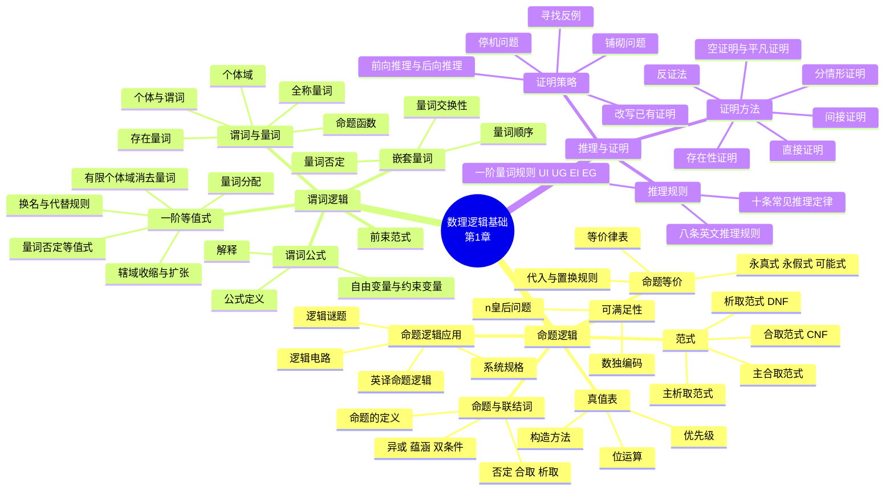

# 数理逻辑基础（The Foundations: Logic and Proofs）

> **本章主线**：先建立"**命题**"这一最小真值单位与六个**联结词**，用**真值表**与**等价律**刻画命题之间的推理关系；再把视线从"整句"下沉到"**对象—性质—关系**"，用**谓词**与**量词**获得表达"所有""存在"的能力；最后把这两套语言变成**证明**的工具——推理规则保证每步合法，证明方法与策略决定整条路线。
>
> 一句话版本：**命题逻辑管"句子怎么连"，谓词逻辑管"话说到了谁"，推理规则与证明方法管"从已知走到必然"。**

---

## 1.1 命题逻辑（Propositional Logic）

### 1.1.1 命题与命题公式

**命题（proposition / statement）**：一个**陈述句**，满足两个条件——具有确定的含义（不模糊、不歧义），且具有**唯一真值**，或为真 $T$、或为假 $F$，绝不既真又假、既不真也不假、也不"介于两者之间"。

需要区分"是否为命题"与"是否知道其真值"：命题的真值必须客观存在，但你不一定知道它。"火星表面温度是 800ºF"是命题，"明天太阳会出来"也是命题——它们的真值待定或未知，但真假是确定的。

**不是命题的典型情况**：

- **无意义语句**："La la la la la."；
- **疑问句（interrogative）**："Who's there?"——没有真值；
- **祈使句（imperative）**："Take two aspirins."、"$x := x+1$"——没有真值；
- **含有自由变元的式子**："$3-x=5$"——$x$ 未定，真值不确定；
- **项（term）**："$1+2$"——它是一个数值，不是一个断言。

**真值记号**：true $\equiv T$（或 $1$），false $\equiv F$（或 $0$），因此命题逻辑又称**二值逻辑（binary logic）**。

**命题变量（propositional variables）**：用字母 $p, q, r, s, \ldots$ 表示命题，正如用字母表示数值变量。

命题分为两级：

- **原子命题（atomic proposition）**：不能分解为更简单陈述句的命题；
- **复合命题（compound proposition）**：由原子命题经运算构造而成，如 $p \wedge q$，对应一个复合英语句子。

**命题公式的语言（严格定义）**：

1. **原子**：$p_1, p_2, p_3, \ldots$ 都是公式；
2. 若 $\alpha$ 是公式，则 $\neg \alpha$ 是公式；
3. 若 $\alpha$、$\beta$ 是公式，则 $(\alpha \wedge \beta)$、$(\alpha \vee \beta)$、$(\alpha \to \beta)$、$(\alpha \leftrightarrow \beta)$ 也是公式；
4. 有限次使用上述规则得到的符号串都是公式。

> **约定**：可省略最外层括号——$p_1 \vee \neg p_2$ 即 $(p_1 \vee \neg p_2)$；结合律允许省略更多括号——$p_1 \wedge p_2 \wedge p_3$ 即 $(p_1 \wedge p_2) \wedge p_3$。

**运算符（operators）**：把 $n$ 个运算对象（operand）表达式组合成更大的表达式。**一元运算符**取 1 个运算对象（如 $-3$ 中的负号），**二元运算符**取 2 个（如 $3 \times 4$ 中的乘号）。逻辑运算符作用于命题而非数值。

### 1.1.2 六个基本联结词

| 形式名称 | 英文昵称 | 元数 | 符号 |
| :--- | :--- | :--- | :--- |
| 否定运算符 | NOT | 一元 | $\neg$ |
| 合取运算符 | AND | 二元 | $\wedge$ |
| 析取运算符 | OR | 二元 | $\vee$ |
| 异或运算符 | XOR | 二元 | $\oplus$ |
| 蕴涵运算符 | IMPLIES | 二元 | $\to$ |
| 双条件运算符 | IFF | 二元 | $\leftrightarrow$ |

**否定 $\neg$（NOT）**：一元否定运算符把命题变换为其否定。若 $p =$ "I have brown hair."，则 $\neg p =$ "I do not have brown hair."。

| $p$ | $\neg p$ |
| :---: | :---: |
| T | F |
| F | T |

**真值表（truth table）**：对命题公式中各个分量指派真值的**各种可能组合**，确定该公式在这些组合下的真值，汇列成表即为真值表。

**合取 $\wedge$（AND）**：两个命题的"逻辑与"。若 $p=$ "I will have salad for lunch."、$q=$ "I will have steak for dinner."，则 $p \wedge q$ 表示"两件事都会发生"。

| $p$ | $q$ | $p \wedge q$ |
| :---: | :---: | :---: |
| F | F | F |
| F | T | F |
| T | F | F |
| T | T | T |

**析取 $\vee$（OR）**：两个命题的"逻辑或"。若 $p=$ "My car has a bad engine."、$q=$ "My car has a bad door."，则 $p \vee q$ 表示二者至少之一成立。$p \vee q$ 意为 $p$ 真、或 $q$ 真、或二者皆真，故称**相容或（inclusive or）**，含义类似英语中的 "and/or"。

| $p$ | $q$ | $p \vee q$ |
| :---: | :---: | :---: |
| F | F | F |
| F | T | T |
| T | F | T |
| T | T | T |

**异或 $\oplus$（XOR）**：$p \oplus q$ 意为 $p$ 真或 $q$ 真，**但不同时真**；称 exclusive or，因为它排除了二者同时为真的可能。若 $p =$ "I will earn an A in this course."、$q =$ "I will drop this course."，则 $p \oplus q$ 表示"二者必居其一，且不会同时发生"。

| $p$ | $q$ | $p \oplus q$ |
| :---: | :---: | :---: |
| F | F | F |
| F | T | T |
| T | F | T |
| T | T | F |

**自然语言的歧义**：英语 "or" 在"both"情形上有歧义，需靠语境消歧。本课程约定 "or" 指**相容或**。

**蕴涵 $\to$（IMPLIES）**：$p \to q$ 陈述 $p$ 蕴涵 $q$，即"若 $p$ 为真，则 $q$ 为真；若 $p$ 不为真，则 $q$ 可真可假"。$p$ 称为**前件（antecedent）**，$q$ 称为**后件（consequent）**。

| $p$ | $q$ | $p \to q$ |
| :---: | :---: | :---: |
| F | F | T |
| F | T | T |
| T | F | F |
| T | T | T |

三条极易误解的性质：

1. $p \to q$ **仅在 $p$ 真而 $q$ 不真时为假**——这是唯一为假的情形，也是记忆全表的钥匙；
2. $p \to q$ **不表示 $p$ 导致 $q$**——它只断言真值关系，不断言因果；
3. $p \to q$ **不要求 $p$ 或 $q$ 为真**——例如 "(1=0) $\to$ pigs can fly" 是**真命题**，因为前件为假。

**$p \to q$ 的种种英语说法**：if $p$, then $q$；if $p$, $q$；when $p$, $q$；whenever $p$, $q$；$q$ if $p$；$q$ when $p$；$q$ whenever $p$；$p$ implies $q$；$q$ follows from $p$；$q$ is implied by $p$；**$p$ only if $q$**；**$p$ is sufficient for $q$**；**$q$ is necessary for $p$**；$q$ unless $\neg p$。

其中最容易译错的是 **only if** 与 **unless**：

- "$p$ only if $q$" 意为"只有 $q$ 成立才可能 $p$"，即 $p \to q$（**不是** $q \to p$）；
- "$q$ unless $\neg p$" 意为"除非 $\neg p$，否则 $q$"，即 $p \to q$；
- "$p$ is sufficient for $q$" 即 $p$ 是 $q$ 的**充分条件**，$p \to q$；
- "$q$ is necessary for $p$" 即 $q$ 是 $p$ 的**必要条件**，$p \to q$。

**双条件 $\leftrightarrow$（IFF）**：$p \leftrightarrow q$ 陈述 $p$ 为真当且仅当 $q$ 为真。

| $p$ | $q$ | $p \leftrightarrow q$ |
| :---: | :---: | :---: |
| F | F | T |
| F | T | F |
| T | F | F |
| T | T | T |

$p \leftrightarrow q$ 表示 $p$ 与 $q$ **具有相同真值**。注意此真值表恰为 $\oplus$ 的**反面**，因此

$$p \leftrightarrow q \equiv \neg(p \oplus q)$$

同样地，$p \leftrightarrow q$ 并不表示 $p$ 与 $q$ 为真，也不表示二者互为因果。

**布尔运算汇总表**（1 个一元运算符 + 5 个二元运算符）：

| $p$ | $q$ | $\neg p$ | $p \wedge q$ | $p \vee q$ | $p \oplus q$ | $p \to q$ | $p \leftrightarrow q$ |
| :---: | :---: | :---: | :---: | :---: | :---: | :---: | :---: |
| F | F | T | F | F | F | T | T |
| F | T | T | F | T | T | T | F |
| T | F | F | F | T | T | F | F |
| T | T | F | T | T | F | T | T |

**另一种联结词——NAND（Sheffer 竖）**：除上述六个之外还存在别的二元联结词。例如 NAND 的真值表是"合取取反"：

| $p$ | $q$ | $p$ NAND $q$ |
| :---: | :---: | :---: |
| T | T | F |
| T | F | T |
| F | T | T |
| F | F | T |

**为什么二元联结词共有 16 个**：二元联结词的真值表有 4 行（$(p,q)$ 取 $TT, TF, FT, FF$），每行结果可独立取 $T$ 或 $F$，故共有

$$2 \cdot 2 \cdot 2 \cdot 2 = 2^4 = 16$$

个不同的二元联结词。

**通用联结词组**：$\{\neg, \wedge\}$ 是**通用**的——仅用否定与合取就能表达任何布尔真值表；$\{\neg, \vee\}$ 同理也是通用的；但 $\{\neg, \oplus\}$ **不是**通用的。

### 1.1.3 构造真值表与优先级

**构造复合命题真值表的步骤**：

1. **行**：为原子命题的所有可能取值组合各设一行，$n$ 个原子命题需 $2^n$ 行；
2. **列**：为复合命题设一列（通常放在最右），并为构建过程中出现的**每个子表达式**各设一列，包括原子命题本身。

**例**：构造 $(p \vee q) \to \neg r$ 的真值表（$2^3 = 8$ 行）。

| $p$ | $q$ | $r$ | $\neg r$ | $p \vee q$ | $(p \vee q) \to \neg r$ |
| :---: | :---: | :---: | :---: | :---: | :---: |
| T | T | T | F | T | F |
| T | T | F | T | T | T |
| T | F | T | F | T | F |
| T | F | F | T | T | T |
| F | T | T | F | T | F |
| F | T | F | T | T | T |
| F | F | T | F | F | T |
| F | F | F | T | F | F |

**优先级（precedence）**：括号用于分组子表达式，省略括号时按下述约定：**$\neg$ 优先于 $\wedge$ 与 $\vee$，$\wedge$、$\vee$ 优先于 $\to$、$\leftrightarrow$**。

例如 $\neg s \wedge f$ 意为 $(\neg s) \wedge f$，**不是** $\neg(s \wedge f)$；而 $f \wedge g \vee s$ 是**有歧义**的写法，应写成 $f \wedge (g \vee s)$ 或 $(f \wedge g) \vee s$。

**替代记号对照**：

| 名称 | not | and | or | xor | implies | iff |
| :--- | :---: | :---: | :---: | :---: | :---: | :---: |
| 命题逻辑 | $\neg$ | $\wedge$ | $\vee$ | $\oplus$ | $\to$ | $\leftrightarrow$ |
| 布尔代数 | $\bar{p}$ | $pq$ | $p+q$ | $\oplus$ | — | — |
| C/C++/Java（按字） | `!` | `&&` | `\|\|` | `!=` | — | `==` |
| C/C++/Java（按位） | `~` | `&` | `\|` | `^` | — | — |

**逻辑与位运算**：计算机的位运算直接对应逻辑联结词——bitwise OR、bitwise AND、bitwise XOR。布尔运算可推广到作用于**位串（bit strings）**，按位独立运算：

$$
\begin{aligned}
&\texttt{01 1011 0110}\\
&\texttt{11 0001 1101}\\
\hline
&\texttt{11 1011 1111} \quad \text{Bit-wise OR}\\
&\texttt{01 0001 0100} \quad \text{Bit-wise AND}\\
&\texttt{10 1010 1011} \quad \text{Bit-wise XOR}
\end{aligned}
$$

### 1.1.4 逆命题、否命题与逆否命题

由 $p \to q$ 可构造三个新条件句：

- $q \to p$ 称为 $p \to q$ 的**逆命题（converse）**；
- $\neg q \to \neg p$ 称为 $p \to q$ 的**逆否命题（contrapositive）**；
- $\neg p \to \neg q$ 称为 $p \to q$ 的**否命题（inverse）**。

关键结论：**只有逆否命题与原命题逻辑等价**（真值表完全相同）。用真值表验证：

| $p$ | $q$ | $\neg q$ | $\neg p$ | $p \to q$ | $\neg q \to \neg p$ |
| :---: | :---: | :---: | :---: | :---: | :---: |
| F | F | T | T | T | T |
| F | T | F | T | T | T |
| T | F | T | F | F | F |
| T | T | F | F | T | T |

$p \to q$ 与 $\neg q \to \neg p$ 两列完全一致，故

$$(p \to q) \equiv (\neg q \to \neg p)$$

**易错点**：逆命题与否命题**都不**与原命题等价，但它们彼此等价——因为"$q \to p$ 的逆否命题"正是 $\neg p \to \neg q$。这是后续"间接证明（证明逆否命题）"合法性的唯一依据。

### 1.1.5 命题逻辑的应用

**英译命题逻辑（translating English to propositional logic）**的步骤：

1. 识别句中的**原子命题**，并用命题变量逐一表示；
2. 确定合适的**逻辑联结词**，把句子结构翻译成公式。

**例**：翻译"You can access the Internet from campus only if you are a computer science major or you are not a freshman."

设 $a$ 表示 "You can access the Internet from campus."，$c$ 表示 "You are a computer science major."，$f$ 表示 "You are a freshman."。句中 "only if" 引出的是**必要条件**，故译作

$$a \to (c \vee \neg f)$$

**例**：翻译"You cannot ride the roller coaster if you are under 4 feet tall unless you are older than 16 years old."

设 $p$ 表示 "you are under 4 feet tall."，$q$ 表示 "you are older than 16 years old."，$r$ 表示 "You can ride the roller coaster."。"unless" 可展开为"若 $\neg(\cdot)$ 则"的形式，故译作

$$(p \wedge \neg q) \to \neg r$$

**系统规格（system specifications）**：系统与软件工程师用英语接收需求，再用基于逻辑的精确**规格语言**表达。

**相容性定义**：一组命题是**相容的（consistent）**，当且仅当可以给命题变量指派一组真值，使得其中**每个命题都为真**。

**例**：判断下列规格是否相容——"The diagnostic message is stored in the buffer or it is retransmitted."、"The diagnostic message is not stored in the buffer."、"If the diagnostic message is stored in the buffer, then it is retransmitted."

设 $p$ 表示 "The diagnostic message is stored in the buffer."，$q$ 表示 "The diagnostic message is retransmitted."，则三条规格写作

$$p \vee q, \qquad \neg p, \qquad p \to q$$

取 $p$ 为假、$q$ 为真时三条同时为真，故规格**相容**。若再加入第四条 "The diagnostic message is not retransmitted."（即 $\neg q$），则不存在任何指派使四条同时为真，规格**不相容**。

**逻辑谜题（logic puzzles）**：核心方法是为每类人物或事实设立命题变量，再用"某类人必说真话/必说假话"把每句话写成条件式，最后枚举真值指派逐一检验。

**骑士与骗子**：某岛居民分两类——**骑士（knights）**总说真话，**骗子（knaves）**总说谎话。你遇到 A 和 B：A 说 "B is a knight."，B 说 "The two of us are of opposite types."。问 A、B 各是什么？

设 $p$ 表示"A 是骑士"，$q$ 表示"B 是骑士"。A 的陈述内容为 $q$，B 的陈述内容为 $(p \wedge \neg q) \vee (\neg p \wedge q)$。

- 若 A 是骑士，则 $p$ 真且 A 说真话，故 $q$ 真；但此时 B 说的是 $(p \wedge \neg q) \vee (\neg p \wedge q)$，在 $p, q$ 同真时该式为**假**，与"B 是骑士必说真话"矛盾。故 A 不是骑士。
- 于是 A 是骗子，即 $\neg p$ 真，A 说假话，故 $q$ 为假，即 B 也不是骑士。

结论：**A 与 B 都是骗子。**

**泥额头问题**：父亲对一儿一女说 "At least one of you has a muddy forehead."，随后两次询问 "Do you know whether you have a muddy forehead?"。每个孩子能看见对方额头却看不见自己的，两人都诚实且同时作答。第一次两人都答 "No"（各自都认为"若我没泥，对方看到我有泥就该推断出自己有泥"需等对方先说）；听到对方答 "No" 后，第二次两人都能推断出自己额头有泥，故都答 "Yes"。（补充说明：这是"公共知识通过公开回答逐步建立"的经典例子。）

**谁养鱼（爱因斯坦谜题）**：五间房屋排成一列，颜色、国籍、饮料、宠物、香烟各不相同，给定十五条线索（英国人住红房子、瑞典人养狗、丹麦人喝茶、绿房子在白房子左边、绿房主喝咖啡、抽 Pall Mall 者养鸟、黄房主抽 Dunhill、中间房主喝牛奶、挪威人住第一间、抽 Blend 者住在养猫者隔壁、养马者隔壁是抽 Dunhill 者、抽 Blue Master 者喝啤酒、德国人抽 Prince、挪威人住蓝房子隔壁、只喝水者住在抽 Blend 者隔壁），问谁养鱼。按线索逐条排除可得唯一排列：挪威—黄—猫—水—Dunhill；丹麦—蓝—马—茶—Blend；英国—红—鸟—牛奶—Pall Mall；德国—绿—鱼—咖啡—Prince；瑞典—白—狗—啤酒—Blue Master。**答案：德国人养鱼。**

**逻辑电路（logic circuits）**：电子电路中每个输入/输出信号可视为 0 或 1，0 表示 False、1 表示 True。复杂的数字电路由三种称为**门（gates）**的基本电路构造：

- **反相器（inverter，NOT 门）**：取一个输入位，产生该位的否定；
- **OR 门**：取两个输入位，产生等价于两位析取的值；
- **AND 门**：取两个输入位，产生等价于两位合取的值。

构造思路是：为输出表达式的每一部分各构建一个子电路，再组合起来，从而在给定输入信号下产生所需输出。

> **一句话总结 1.1**：**命题是能判真假的陈述句，六个联结词把原子命题组装成复合命题，真值表给出全部语义——其中"蕴涵只在 $T \to F$ 时为假"是全部推理规则的根基。**

---

## 1.2 命题逻辑的应用（Applications of Propositional Logic）

（补充说明：本节的示例已在 1.1.5 中与基本概念一并展开，此处集中给出翻译与建模的方法要点。）

**翻译的四条对照规则**：

| 英语表达 | 逻辑形式 | 说明 |
| :--- | :--- | :--- |
| if $p$, then $q$ | $p \to q$ | 最直接的形式 |
| $p$ only if $q$ | $p \to q$ | $q$ 是 $p$ 的**必要条件** |
| $p$ unless $q$ | $\neg q \to p$ | 等价于 $p \vee q$ |
| $p$ is sufficient for $q$ | $p \to q$ | $p$ 充分 |
| $q$ is necessary for $p$ | $p \to q$ | $q$ 必要 |

**中文句子的翻译练习**：

- "她既聪明又用功。" —— $p \wedge q$；
- "除非你努力，否则你将失败。" —— 设 $p$：你努力，$q$：你失败，则 $\neg p \to q$（等价于 $p \vee q$）；
- "甲和乙中有一人且只有一人是大学生。" —— $p \oplus q$；
- "我和他既是弟兄又是同学。" —— $p \wedge q$。

**布尔检索（Boolean searching）**：用 AND、OR、NOT 组合关键词，在大型文档集合或 Web 上检索。这是命题逻辑最直接的工程应用之一。

**建模三问**（遇到任何"把自然语言变成公式"的题都先问自己）：

1. **哪些是不可再分的原子命题？**——先列变量表，写清每个字母的确切含义；
2. **句子骨架对应哪个联结词？**——"且"→ $\wedge$，"或"→ $\vee$（除非明说"二者不可兼得"才用 $\oplus$），"若…则"→ $\to$；
3. **有没有"必要/充分/除非/只有"这类陷阱词？**——它们几乎都译成 $\to$，且方向常与语感相反。

> **一句话总结 1.2**：**翻译题的成败在于先把原子命题钉死、再识别 only if / unless 这类方向陷阱；系统规格的相容性就是"是否存在一组赋值让所有命题同时为真"。**

---

## 1.3 命题等价（Propositional Equivalences）

### 1.3.1 永真式、永假式与可能式

**永真式（tautology，重言式）**：无论原子命题取何真值**总为真**的复合命题，真值表每一行都是 T。例：$p \vee \neg p$。

**永假式（contradiction，矛盾式）**：无论原子命题取何真值**总为假**的复合命题，真值表每一行都是 F。例：$p \wedge \neg p$。

**可能式（contingency）**：既非永真也非永假，真值表中有些行给 T、有些行给 F。例：$p$。

| $p$ | $\neg p$ | $p \vee \neg p$ | $p \wedge \neg p$ |
| :---: | :---: | :---: | :---: |
| T | F | T | F |
| F | T | T | F |

**判定哪些是永真式**（先问"对 $p,q,r$ 的何种赋值会使它**为假**"，找不到即为永真）：

| 公式 | 结论 |
| :--- | :--- |
| $p \to (q \to p)$ | 永真式 |
| $p \to (\neg p \to p)$ | 永真式 |
| $(q \to p) \to (p \to q)$ | 可能式 |
| $(q \to p) \vee (p \to q)$ | 永真式 |
| $(p \to (q \to r)) \to (q \to (p \to r))$ | 永真式 |

### 1.3.2 逻辑等价与等价律

**逻辑等价（logical equivalence）**：$p \Leftrightarrow q$ 当且仅当 $p$ 与 $q$ 在真值表的**每一行取值都相同**，即二者表达同一真值函数。等价记作 $p \Leftrightarrow q$ 或 $p \equiv q$。等价地：

$$p \equiv q \quad \Longleftrightarrow \quad p \leftrightarrow q \text{ 是永真式}$$

**$\leftrightarrow$ 与 $\Leftrightarrow$ 的区别**（极易混淆，务必分清）：

- $A \leftrightarrow B$ 是一个**命题公式**，它只表示"$A$ 与 $B$ 此刻恰好同真值"，本身可真可假。例如 $A=(2+2=4)$、$B=$ "我在 BUPT 教书"，则 $A \leftrightarrow B$ 是一个有真值的命题；
- $A \Leftrightarrow B$ 是一个**元语言断言**，它声称"$A \leftrightarrow B$ 是永真式"，即不存在任何赋值使其为假。它只在精心构造的 $A, B$ 之间成立，例如 $p \vee q \Leftrightarrow \neg(\neg p \wedge \neg q)$。

**常元记号**：用 $T$ 表示**任一**永真式，用 $F$ 表示**任一**永假式。

**完整等价律表（logical equivalences）**：

| 名称 | 定律 |
| :--- | :--- |
| 同一律 Identity | $P \wedge T \equiv P$；$P \vee F \equiv P$ |
| 零律 Domination | $P \vee T \equiv T$；$P \wedge F \equiv F$ |
| 等幂律 Idempotency | $P \vee P \equiv P$；$P \wedge P \equiv P$ |
| 双重否定律 Double negation | $\neg(\neg P) \equiv P$ |
| 交换律 Commutativity | $P \vee Q \equiv Q \vee P$；$P \wedge Q \equiv Q \wedge P$ |
| 结合律 Associativity | $(P \vee Q) \vee R \equiv P \vee (Q \vee R)$；$(P \wedge Q) \wedge R \equiv P \wedge (Q \wedge R)$ |
| 分配律 Distributivity | $P \wedge (Q \vee R) \equiv (P \wedge Q) \vee (P \wedge R)$；$P \vee (Q \wedge R) \equiv (P \vee Q) \wedge (P \vee R)$ |
| 德·摩根律 De Morgan's laws | $\neg(P \wedge Q) \equiv \neg P \vee \neg Q$；$\neg(P \vee Q) \equiv \neg P \wedge \neg Q$ |
| 蕴涵等价式 Implication | $P \to Q \equiv \neg P \vee Q$ |
| 排中律 Tautology | $P \vee \neg P \equiv T$ |
| 矛盾律 Contradiction | $P \wedge \neg P \equiv F$ |
| 否定律 Negation Laws | $P \vee \neg P \equiv T$；$P \wedge \neg P \equiv F$ |
| 吸收律 Absorption | $P \vee (P \wedge Q) \equiv P$；$P \wedge (P \vee Q) \equiv P$ |
| 等值式 Equivalence | $(P \to Q) \wedge (Q \to P) \equiv (P \leftrightarrow Q)$ |
| 归谬论 Absurdity | $(P \to Q) \wedge (P \to \neg Q) \equiv \neg P$ |
| 蕴涵逆反式 Contrapositive | $(P \to Q) \equiv (\neg Q \to \neg P)$ |
| 输出律 Exportation | $(P \wedge Q) \to R \equiv P \to (Q \to R)$ |
| 双条件展开 Biconditional | $P \leftrightarrow Q \equiv (P \to Q) \wedge (Q \to P)$；$P \leftrightarrow Q \equiv \neg(P \oplus Q)$ |
| 异或展开 Exclusive or | $P \oplus Q \equiv (P \vee Q) \wedge \neg(P \wedge Q)$；$P \oplus Q \equiv (P \wedge \neg Q) \vee (Q \wedge \neg P)$ |

**记忆主线**：这张表不是 19 条孤立的公式，而是**三条主干**——

1. **消去非常规联结词**：$\to$、$\leftrightarrow$、$\oplus$ 都能用 $\neg, \wedge, \vee$ 表示（蕴涵等价式、双条件展开、异或展开）；
2. **搬运否定**：德·摩根律与双重否定律负责把 $\neg$ 推到变元前面（这是求范式的关键步骤）；
3. **结构与常量**：同一律、零律、等幂律、分配律、吸收律负责化简与展开。

### 1.3.3 判断等价的三种方法与两条规则

**判断逻辑等价的方法**：

1. **真值表法**：逐行比对两个公式的真值列；
2. **等值演算法**：用基本等价定理、代入规则、置换规则作符号推导；
3. **求主范式法**（1.3.5 展开）：两公式主析取范式相同则等价。

**代入规则（substitution rule）**：在一个**永真公式**中，把任一命题变元 $R$ **出现的每一处**都用另一个命题公式代入，所得公式**仍是永真式**。

例：求证 $(p \to q) \vee \neg(p \to q)$ 为永真式。由 $R \vee \neg R \equiv T$，把其中所有 $R$ 都用 $(p \to q)$ 代入即得——因为原式的永真性不依赖于 $R$ 的具体取值。

**置换规则（replacement rule）**：给定公式 $A$，设其子公式 $A_i \equiv B_i$，把 $A$ 中的 $A_i$ 替换为 $B_i$ 得到 $B$，则 $A \equiv B$。

例：求证 $(P \to (Q \to R)) \equiv (P \to (\neg Q \vee R))$。只需把子公式 $(Q \to R)$ 用其等价式 $(\neg Q \vee R)$ 置换即可。

**两条规则的区别**（考点）：代入规则作用于**永真公式中的变元**，要求"处处代入"；置换规则作用于**任意公式中的子公式**，可"局部替换"。

**真值表证明示例**：验证 $\neg p \vee q \equiv p \to q$。

| $p$ | $q$ | $\neg p$ | $\neg p \vee q$ | $p \to q$ |
| :---: | :---: | :---: | :---: | :---: |
| T | T | F | T | T |
| T | F | F | F | F |
| F | T | T | T | T |
| F | F | T | T | T |

**用等价律定义联结词**（反向使用等价律）：

$$p \oplus q \equiv (p \vee q) \wedge \neg(p \wedge q), \qquad p \to q \equiv \neg p \vee q, \qquad p \leftrightarrow q \equiv (p \to q) \wedge (q \to p)$$

**等值演算长例**：验证 $(p \wedge \neg q) \to (p \oplus r) \equiv \neg p \vee q \vee \neg r$。

$$
\begin{aligned}
& (p \wedge \neg q) \to (p \oplus r) \\
\equiv\ & \neg(p \wedge \neg q) \vee (p \oplus r) && \text{（展开 } \to \text{）} \\
\equiv\ & \neg(p \wedge \neg q) \vee \bigl((p \vee r) \wedge \neg(p \wedge r)\bigr) && \text{（展开 } \oplus \text{）} \\
\equiv\ & (\neg p \vee q) \vee \bigl((p \vee r) \wedge \neg(p \wedge r)\bigr) && \text{（德·摩根）} \\
\equiv\ & q \vee \Bigl(\neg p \vee \bigl((p \vee r) \wedge \neg(p \wedge r)\bigr)\Bigr) && \text{（交换、结合）} \\
\equiv\ & q \vee \Bigl(\bigl(\neg p \vee (p \vee r)\bigr) \wedge \bigl(\neg p \vee \neg(p \wedge r)\bigr)\Bigr) && \text{（}\vee\text{ 对 }\wedge\text{ 分配）} \\
\equiv\ & q \vee \Bigl(\bigl((\neg p \vee p) \vee r\bigr) \wedge \bigl(\neg p \vee \neg(p \wedge r)\bigr)\Bigr) && \text{（结合）} \\
\equiv\ & q \vee \Bigl((T \vee r) \wedge \bigl(\neg p \vee \neg(p \wedge r)\bigr)\Bigr) && \text{（排中律）} \\
\equiv\ & q \vee \bigl(T \wedge (\neg p \vee \neg(p \wedge r))\bigr) && \text{（零律）} \\
\equiv\ & q \vee (\neg p \vee \neg(p \wedge r)) && \text{（同一律）} \\
\equiv\ & q \vee (\neg p \vee (\neg p \vee \neg r)) && \text{（德·摩根）} \\
\equiv\ & q \vee ((\neg p \vee \neg p) \vee \neg r) && \text{（结合）} \\
\equiv\ & q \vee (\neg p \vee \neg r) && \text{（等幂）} \\
\equiv\ & \neg p \vee q \vee \neg r && \text{（交换、结合）}
\end{aligned}
$$

**练习**：求证 $Q \vee \neg((\neg P \vee Q) \wedge P)$ 是永真式。

$$
\begin{aligned}
\neg((\neg P \vee Q) \wedge P)
&\equiv \neg(\neg P \vee Q) \vee \neg P && \text{（德·摩根）} \\
&\equiv (P \wedge \neg Q) \vee \neg P && \text{（德·摩根、双重否定）} \\
&\equiv \neg Q \vee (P \vee \neg P) && \text{（分配、交换）} \\
&\equiv \neg Q \vee T \equiv T
\end{aligned}
$$

故原式 $\equiv Q \vee T \equiv T$。

### 1.3.4 范式（DNF 与 CNF）

**简单析取式（基本和）**：仅由**有限个命题变元或其否定**构成的析取式。例：$P \vee Q \vee R$、$P \vee \neg Q \vee P$。

**简单合取式（基本积）**：仅由**有限个命题变元或其否定**构成的合取式。例：$P \wedge R$、$Q \wedge R \wedge \neg Q$。

单个变项 $P$、$\neg Q$ 既是简单析取式也是简单合取式。而 $\neg P \vee (Q \wedge R)$、$(P \wedge Q) \vee \neg R$ **不是**简单析取式——它们的子项里混入了合取/析取嵌套。

**析取范式（DNF）**：有限个**简单合取式的析取**。**合取范式（CNF）**：有限个**简单析取式的合取**。

**判别例**：

- $P \vee (P \wedge Q) \vee (\neg P \wedge \neg Q \wedge \neg R)$ 是析取范式；
- $P \vee Q \vee R$ **既是**析取范式**也是**合取范式；
- $(P \vee Q) \wedge \neg Q \wedge (Q \vee \neg R \vee S)$ 是合取范式。

**存在性定理**：**任意一个命题公式均存在一个与之等值的析取范式和合取范式。**

**构造性证明**（三步走）：

1. 用等价式**消去** $\to$ 与 $\leftrightarrow$：$P \to Q \equiv \neg P \vee Q$，$P \leftrightarrow Q \equiv (P \to Q) \wedge (Q \to P)$；
2. 用**德·摩根律**把 $\neg$ 移到命题变元之前，用**双重否定律**消去连续的 $\neg$；
3. 用**分配律**化为基本积的析取或基本和的合取。

**例**：求 $(P \vee Q) \to R$ 的析取范式与合取范式。

$$
(P \vee Q) \to R \equiv \neg(P \vee Q) \vee R \equiv (\neg P \wedge \neg Q) \vee R \qquad \text{—— 析取范式}
$$

继续化为合取范式：

$$
\begin{aligned}
(\neg P \wedge \neg Q) \vee R
&\equiv (\neg P \vee R) \wedge (\neg Q \vee R) && \text{（分配律）}
\end{aligned}
$$

故 $(\neg P \vee R) \wedge (\neg Q \vee R)$ 是合取范式。

**重要结论：析取（合取）范式不唯一！** 同一个公式可以有不同的 DNF——

$$
(\neg P \vee R) \wedge (\neg Q \vee R) \equiv (\neg P \wedge \neg Q) \vee (R \wedge \neg Q) \vee (\neg P \wedge R) \vee R \equiv (\neg P \wedge \neg Q) \vee R
$$

两式都是 $(P \vee Q) \to R$ 的析取范式，写法却不同。要获得**唯一**表示，必须用主范式。

### 1.3.5 主析取范式与主合取范式

**极小项（minterm）**：含 $n$ 个变项的**合取式**中，每个变项 $P_i$ 或其否定 $\neg P_i$ **恰好出现一个**，且按下标顺序排列，这样的简单合取式称为极小项。

- $P \wedge \neg Q \wedge R$ 是极小项；
- $P \wedge \neg Q$ **不是**（缺 $R$）；
- $P \wedge \neg Q \wedge \neg P$ **不是**（$P$ 与 $\neg P$ 同时出现）。

**极大项（maxterm）**：含 $n$ 个变项的**析取式**中，每个变项或其否定**恰好出现一个**，且按下标顺序排列。

**主析取范式**：若干个**不同极小项的析取式**。**主合取范式**：若干个**不同极大项的合取式**。

**唯一性定理**：**任何一个命题公式均存在一个与之等值的主析取范式，而且是唯一的。**

**极小项与赋值一一对应**：每个极小项**只有一个赋值使其为真**，其余 $2^n - 1$ 个赋值使其为假。因此极小项与赋值构成一一对应，可以用二进制编号命名。

**极小项记法表**（$P, Q, R$ 三变项）：

| 极小项 | 赋值 | 十进制 | 记法 |
| :--- | :---: | :---: | :---: |
| $\neg P \wedge \neg Q \wedge \neg R$ | 000 | 0 | $m_{000}$ 或 $m_0$ |
| $\neg P \wedge \neg Q \wedge R$ | 001 | 1 | $m_{001}$ 或 $m_1$ |
| $\neg P \wedge Q \wedge \neg R$ | 010 | 2 | $m_{010}$ 或 $m_2$ |
| $\neg P \wedge Q \wedge R$ | 011 | 3 | $m_{011}$ 或 $m_3$ |
| $P \wedge \neg Q \wedge \neg R$ | 100 | 4 | $m_{100}$ 或 $m_4$ |
| $P \wedge \neg Q \wedge R$ | 101 | 5 | $m_{101}$ 或 $m_5$ |
| $P \wedge Q \wedge \neg R$ | 110 | 6 | $m_{110}$ 或 $m_6$ |
| $P \wedge Q \wedge R$ | 111 | 7 | $m_{111}$ 或 $m_7$ |

**极大项记法表**：

| 极大项 | 赋值 | 十进制 | 记法 |
| :--- | :---: | :---: | :---: |
| $P \vee Q \vee R$ | 000 | 0 | $M_{000}$ 或 $M_0$ |
| $P \vee Q \vee \neg R$ | 001 | 1 | $M_{001}$ 或 $M_1$ |
| $P \vee \neg Q \vee R$ | 010 | 2 | $M_{010}$ 或 $M_2$ |
| $P \vee \neg Q \vee \neg R$ | 011 | 3 | $M_{011}$ 或 $M_3$ |
| $\neg P \vee Q \vee R$ | 100 | 4 | $M_{100}$ 或 $M_4$ |
| $\neg P \vee Q \vee \neg R$ | 101 | 5 | $M_{101}$ 或 $M_5$ |
| $\neg P \vee \neg Q \vee R$ | 110 | 6 | $M_{110}$ 或 $M_6$ |
| $\neg P \vee \neg Q \vee \neg R$ | 111 | 7 | $M_{111}$ 或 $M_7$ |

**关键对照**（最易记错之处）：**极小项含变元本身 $\iff$ 对应赋值为 1**；**极大项含变元的否定 $\iff$ 对应赋值为 1**。两者恰好相反，且 $M_k = \neg m_k$。

**方法一：真值表法求主析取范式**——公式的主析取范式与其真值表**一一对应**：取使公式为真的那些赋值，每个赋值写成一个极小项，全部析取起来。

**例**：求 $\neg(P \wedge Q)$ 的主析取范式。

| $P$ | $Q$ | $P \wedge Q$ | $\neg(P \wedge Q)$ |
| :---: | :---: | :---: | :---: |
| 0 | 0 | 0 | **1** |
| 0 | 1 | 0 | **1** |
| 1 | 0 | 0 | **1** |
| 1 | 1 | 1 | 0 |

使公式为真的赋值是 $00$、$01$、$10$，对应极小项 $m_0, m_1, m_2$，故

$$\neg(P \wedge Q) \equiv (\neg P \wedge \neg Q) \vee (\neg P \wedge Q) \vee (P \wedge \neg Q) \equiv m_0 \vee m_1 \vee m_2$$

**方法二：等值演算法求主析取范式**：

1. 先把公式化为**析取范式**，"消去"含矛盾式的简单合取式（因 $(P \wedge \neg P \wedge Q) \vee G \equiv G$），并把 $P \wedge P$ 用 $P$ 代替；
2. 若某个简单合取式不是极小项（缺变项），就添加 $(P_i \vee \neg P_i)$ 再用分配律展开。例：含 $P,Q,R$ 的项 $P \wedge \neg R$ 缺 $Q$，则

$$P \wedge \neg R \equiv P \wedge \neg R \wedge (Q \vee \neg Q) \equiv (P \wedge Q \wedge \neg R) \vee (P \wedge \neg Q \wedge \neg R)$$

3. 用**等幂律**删去重复的极小项（$m_i \vee m_i \equiv m_i$），再按编号顺序排列。

**例**：求 $((P \vee Q) \to R) \to P$ 的主析取范式。

$$
\begin{aligned}
((P \vee Q) \to R) \to P
&\equiv \neg(\neg(P \vee Q) \vee R) \vee P && \text{（展开外层 } \to \text{）} \\
&\equiv ((P \vee Q) \wedge \neg R) \vee P && \text{（德·摩根、双重否定）} \\
&\equiv (P \wedge \neg R) \vee (Q \wedge \neg R) \vee P && \text{（分配律）} \\
&\equiv P \vee (Q \wedge \neg R) && \text{（吸收律，得析取范式）} \\
&\equiv \bigl(P \wedge (Q \vee \neg Q) \wedge (R \vee \neg R)\bigr) \vee \bigl((Q \wedge \neg R) \wedge (P \vee \neg P)\bigr) \\
&\equiv (P \wedge Q \wedge R) \vee (P \wedge Q \wedge \neg R) \vee (P \wedge \neg Q \wedge R) \vee (P \wedge \neg Q \wedge \neg R) \\
&\qquad \vee (P \wedge Q \wedge \neg R) \vee (\neg P \wedge Q \wedge \neg R) \\
&\equiv m_7 \vee m_6 \vee m_5 \vee m_4 \vee m_2 \quad \text{（去重后）} \\
&\equiv \sum m(2,4,5,6,7)
\end{aligned}
$$

**方法一：真值表法求主合取范式**——取使公式为**假**的那些赋值，每个赋值写成一个极大项，全部合取起来。

上例 $\neg(P \wedge Q)$ 中使公式为假的赋值只有 $11$，对应极大项 $M_3 = \neg P \vee \neg Q$，故

$$\neg(P \wedge Q) \equiv \neg P \vee \neg Q \equiv M_3$$

**方法二：等值演算法求主合取范式**：

1. 先把公式化为**合取范式**，"消去"含永真式的简单析取式（因 $(P \vee \neg P \vee Q) \wedge G \equiv G$），并把 $P \vee P$ 用 $P$ 代替；
2. 若某个简单析取式不是极大项（缺变项），就添加 $(P_i \wedge \neg P_i)$ 再用分配律展开。例：项 $P \vee \neg R$ 缺 $Q$，则

$$P \vee \neg R \equiv P \vee \neg R \vee (Q \wedge \neg Q) \equiv (P \vee Q \vee \neg R) \wedge (P \vee \neg Q \vee \neg R)$$

3. 用等幂律删去重复的极大项（$M_i \wedge M_i \equiv M_i$，注意此处是**合取**形式），再按编号顺序排列。

**主析取范式与主合取范式的互补关系**：若公式的主析取范式编号集合为 $S$，则其主合取范式的编号集合恰为**补集** $\{0, 1, \ldots, 2^n - 1\} \setminus S$。这是检验结果最便捷的自查手段。

**练习**：求 $(P \vee Q) \to \neg R$ 的主析取范式。

| $P$ | $Q$ | $R$ | $(P \vee Q) \to \neg R$ |
| :---: | :---: | :---: | :---: |
| 0 | 0 | 0 | **1** |
| 0 | 0 | 1 | **1** |
| 0 | 1 | 0 | **1** |
| 0 | 1 | 1 | 0 |
| 1 | 0 | 0 | **1** |
| 1 | 0 | 1 | 0 |
| 1 | 1 | 0 | **1** |
| 1 | 1 | 1 | 0 |

共有 5 种情况为真，对应 $m_0, m_1, m_2, m_4, m_6$，故

$$(P \vee Q) \to \neg R \equiv (\neg P \wedge \neg Q \wedge \neg R) \vee (\neg P \wedge \neg Q \wedge R) \vee (\neg P \wedge Q \wedge \neg R) \vee (P \wedge \neg Q \wedge \neg R) \vee (P \wedge Q \wedge \neg R)$$

### 1.3.6 可满足性及其应用

**可满足性（satisfiability）**：一个复合命题是**可满足的**，若存在一组赋值使它为真；否则称为**不可满足的**。

关键联系：**复合命题不可满足 $\iff$ 其否定是永真式。**

**例**：判定下列命题的可满足性——

- "可满足"，给 $p, q, r$ 均赋 T 即可；
- "可满足"，给 $p$ 赋 T、$q$ 赋 F 即可；
- "不可满足"，检查变项的所有可能赋值，没有一种能使该命题为真。

**例（$n$ 皇后问题）**：在 $n \times n$ 棋盘上放置 $n$ 个皇后，使任意两个皇后都不处于同一行、同一列或同一对角线上。

**记号**：命题变元 $P(i,j)$ 表示"第 $i$ 行第 $j$ 列放了皇后"。$4 \times 4$ 棋盘有 16 个变元 $P(1,1), \ldots, P(4,4)$。

**四类断言**：

- 每行**至少**一个皇后：

$$\bigwedge_{i=1}^{n} \bigvee_{j=1}^{n} P(i,j)$$

- 每行**至多**一个皇后：

$$\bigwedge_{i=1}^{n} \bigwedge_{j=1}^{n} \bigwedge_{k=j+1}^{n} \bigl(\neg P(i,j) \vee \neg P(i,k)\bigr)$$

- 每列**至多**一个皇后：

$$\bigwedge_{j=1}^{n} \bigwedge_{i=1}^{n} \bigwedge_{k=i+1}^{n} \bigl(\neg P(i,j) \vee \neg P(k,j)\bigr)$$

- 任一**斜线**上不能有两个皇后：

$$\bigwedge_{i=1}^{n} \bigwedge_{j=1}^{n} \bigwedge_{\substack{k=1 \\ k \neq i}}^{n} \bigl(\neg P(i,j) \vee \neg P(i+k, j+k) \vee \neg P(i+k, j-k)\bigr)$$

**已知结果**：满足条件的放置方法数已算到 $n \le 27$；$n = 8$ 时有 **92** 种，$n = 16$ 时增长到 **14,772,512** 种。

**例（数独 Sudoku）**：由 $9 \times 9$ 网格表示，分成九个 $3 \times 3$ 的**块（block）**，部分格子已预填 $1, \ldots, 9$。求解即给每个空格赋数字，使**每一行、每一列和每一块**都恰好包含九个数字中的每一个。

**编码为可满足性问题**：令 $p(i,j,n)$ 表示"第 $i$ 行第 $j$ 列的格子中数字为 $n$"，共 $9 \times 9 \times 9 = 729$ 个命题变元。四类断言为：

- 对每个已给出的数字断言相应的 $p(i,j,n)$；
- 每行含每个数字：

$$\bigwedge_{i=1}^{9} \bigwedge_{n=1}^{9} \bigvee_{j=1}^{9} p(i,j,n)$$

- 每列含每个数字：

$$\bigwedge_{j=1}^{9} \bigwedge_{n=1}^{9} \bigvee_{i=1}^{9} p(i,j,n)$$

- 每个 $3 \times 3$ 块含每个数字：

$$\bigwedge_{r=0}^{2} \bigwedge_{s=0}^{2} \bigwedge_{n=1}^{9} \bigvee_{i=1}^{3} \bigvee_{j=1}^{3} p(3r+i, 3s+j, n)$$

- 没有格子含多于一个数字（对所有 $n \neq n'$ 取合取）：

$$\bigwedge_{i=1}^{9} \bigwedge_{j=1}^{9} \bigwedge_{n=1}^{9} \bigwedge_{\substack{n'=1 \\ n' \neq n}}^{9} \bigl(\neg p(i,j,n) \vee \neg p(i,j,n')\bigr)$$

**求解**：解数独即求对 729 个变仪 $p(i,j,n)$ 的一组赋值，使上述所有断言的**合取**为真；被赋 T 的变项就给出了谜题的一个解。

**为什么不能靠枚举**：真值表法**总能**判定可满足性，但在大型问题上即使现代计算机也过于复杂（$729$ 个变元意味着 $2^{729}$ 种赋值）。因此学界研究了大量高效的**可满足性求解方法**，因为许多实际问题都可转化为可满足性问题。

> **一句话总结 1.3**：**等价律表是命题世界的"代数运算律"，范式是命题的"标准型"——主范式给出唯一表示，可满足性则把逻辑变成可以交给计算机搜索的约束问题。**

---

## 1.4 谓词与量词（Predicates and Quantifiers）

### 1.4.1 为什么需要谓词逻辑

命题逻辑以**原子命题**为基本单位，无法表达结构性的推理。考虑经典三段论：

- 所有男人都是凡人；
- 苏格拉底是男人；
- 因此苏格拉底是凡人。

在命题逻辑中，这三个句子分别是三个互不相关的原子命题 $p, q, r$，$p \wedge q \to r$ **不是**永真式，因此该推理无法被命题逻辑验证。问题出在：命题逻辑看不到"苏格拉底"与"所有男人"之间的**内部结构**。

解决方案是下沉一层，谈论**对象**、对象的**性质**以及对象之间的**关系**——这就是谓词逻辑。

### 1.4.2 谓词、命题函数与个体域

**主语与谓语**：原子命题至少由主语和谓语两部分组成。主语是独立存在的**个体（individual）**或值，谓语描述该个体的性质或个体间的关系，称为**谓词（predicate）**。

**定义（$n$ 元谓词）**：一个谓词 $P$ 连同相关的 $n$（$n \ge 0$）个**个体变量**组成的表达式称为 $n$ 元谓词，记作 $P(x_1, x_2, \ldots, x_n)$，其中 $n$ 是该表达式中**不同个体变量的数目**。$n$ 元谓词也称为**简单命题函数**。

- $n > 1$ 时，$P$ 通常给出 $x_i\ (i = 1, \ldots, n)$ 之间的**关系**。例：$P(x,y,z)$ 表示"$x$ 位于 $y$ 与 $z$ 之间"，这是一个三元谓词；
- $n = 0$ 时，0 元谓词就是一个命题。

**命题函数（proposition function）**：简单命题函数与由它们经联结词构成的**复合命题函数**统称为命题函数。

关键一点：$P(x)$ 本身**不是命题**，因为它含有**自由变量**。只有把具体的个体代入后，$P(a)$ 才成为可判定真假的命题。

**个体域（universe of discourse / domain）**：个体变量 $x$ 可选择的取值范围。每一个个体变量都有自己的个体域。若无特别指定，缺省为**全个体域（total universe of discourse）**，即任意个体均可作为常量代入。

代入后：指定个体域后，把域中每个个体 $a$ 代入 $P(x)$ 中所有 $x$ 就得到命题 $P(a)$。不同个体代入后真值可能不同，也可能相同。

**解释（interpretation）**：给定个体域及谓词的具体含义，即对谓词公式作解释后，它才成为有真值的命题。

### 1.4.3 谓词公式与变量的约束

**定义（谓词公式）**：

1. $n$ 元谓词是一个谓词公式；
2. 若 $A$ 是谓词公式，则 $(\neg A)$ 也是谓词公式；
3. 若 $A, B$ 是谓词公式，则 $(A \vee B)$、$(A \wedge B)$、$(A \to B)$、$(A \leftrightarrow B)$ 也是谓词公式；
4. 若 $A$ 是谓词公式且含有**未被量化**的个体变量 $x$，则 $\forall x A(x)$、$\exists x A(x)$ 也是谓词公式；
5. 有限次使用 (1)~(4) 所得到的也是谓词公式。

**变量的约束（binding variables）**：

- **自由变量（free variable）**：不在任何量词辖域内的变量；
- **约束变量（bound variable）**：在量词辖域内被该量词约束的变量。

**例**：$(\forall x\,P(x)) \wedge Q(x)$ ——第二个 $x$ 处在 $\forall x$ 的**辖域（scope）之外**，因此是自由的；该式**不是完整命题**。

**例**：$(\forall x\,P(x)) \wedge (\exists x\,Q(x))$ ——是完整命题，且没有多余的量词。

### 1.4.4 全称量词与存在量词

**定义（全称量化 universal quantification）**：命题函数 $P(x)$ 的全称量化是这样一个命题：若对个体域中**每一个**个体 $a$，$P(a)$ 均为 T，则该命题为 T。记作

$$\forall x\,P(x)$$

其中 $\forall$ 是**全称量词（universal quantifier）**，读作"对任意的""所有的""对每一个"。

**定义（存在量化 existential quantification）**：命题函数 $P(x)$ 的存在量化是这样一个命题：若个体域中**存在一个**个体 $a$ 使 $P(a)$ 为 T，则该命题为 T，否则为 F。记作

$$\exists x\,P(x)$$

其中 $\exists$ 是**存在量词（existential quantifier）**，读作"有一个""某些""某个"。

**唯一性量词（uniqueness quantifier）**：$\exists! x\,P(x)$ 表示 $P(x)$ 对个体域中**恰好一个** $x$ 为真。

- $P(x)$ 为"$x + 1 = 0$"、$U$ 为整数集时，$\exists! x\,P(x)$ 为真；若 $P(x)$ 为"$x > 0$"，则 $\exists! x\,P(x)$ 为假；
- 唯一性量词并非必需，因为它可以表达为：

$$\exists x\,\bigl(P(x) \wedge \forall y\,(P(y) \to y = x)\bigr)$$

### 1.4.5 语句形式化：全称配蕴涵、存在配合取

用量词与谓词把自然语言翻译为公式时，有三个关键点：

1. **准确地提取谓词**：表示**性质**的谓语用一元谓词，表示**关系**的谓语用二元或更多元数的谓词；
2. **准确地使用量词并确定辖域**：辖域中多于一个谓词时必须注意联结词与括号的使用——**全称量词配蕴涵，存在量词配合取**；
3. **准确地处理多个重叠量词**：其排列次序应与原语句意义一致。

其中第 2 点是最核心的经验法则：

$$\forall x\,(S(x) \to P(x)) \qquad \text{（正确：所有 } S \text{ 都是 } P\text{）}$$
$$\exists x\,(S(x) \wedge P(x)) \qquad \text{（正确：有些 } S \text{ 是 } P\text{）}$$

**典型错误对照**：

- "Every student in this class has studied calculus." 正确译作 $\forall x\,(S(x) \to P(x))$（$S$：在本班，$P$：学过微积分）；若写成 $\forall x\,(S(x) \vee P(x))$，则意为"每个人要么在本班要么学过微积分"，与原文不符；
- "Some student in this class has visited Mexico." 正确译作 $\exists x\,(S(x) \wedge M(x))$；若写成 $\exists x\,(S(x) \to M(x))$，则由于前件为假时蕴涵为真，只要存在任何一个不在本班的人，该式就为真——与原文不符。

**综合例题**：

**例**：翻译 "There is a woman who has taken a flight on every airline in the world."

设 $P(w,f)$："$w$ 乘坐过航班 $f$"，$Q(f,a)$："$f$ 是航空公司 $a$ 的航班"，则

$$\exists w\,\forall a\,\exists f\,\bigl(P(w,f) \wedge Q(f,a)\bigr)$$

**例**：翻译 "Every mail message larger than one megabyte will be compressed."

设 $S(m,y)$："邮件 $m$ 大于 $y$ 兆字节"，$C(m)$："邮件 $m$ 将被压缩"，则

$$\forall m\,\bigl(S(m,1) \to C(m)\bigr)$$

**例**：翻译 "If a user is active, at least one network link will be available."

设 $A(u)$："用户 $u$ 是活跃的"，$S(n,x)$："网络链路 $n$ 处于状态 $x$"，则

$$\exists u\,A(u) \to \exists n\,S(n, \text{available})$$

**中文例句翻译**：

- "每个人都爱她自己的孩子"：设 $P(x)$：$x$ 是人，$C(x)$：$x$ 是孩子，$I(x,y)$：$x$ 属于 $y$，$L(x,y)$：$x$ 爱 $y$，则

$$\forall x\,\forall y\,\bigl(P(y) \wedge C(x) \wedge I(x,y) \to L(y,x)\bigr)$$

- "每一个人的外祖父都是他母亲的父亲"：设 $O(x,y)$：$x$ 是 $y$ 的外祖父，$F(x,y)$：$x$ 是 $y$ 的父亲，$M(x,y)$：$x$ 是 $y$ 的母亲，则

$$\forall x\,\forall y\,\bigl(O(x,y) \to \exists z\,(F(x,z) \wedge M(z,y))\bigr)$$

- "不管黑猫白猫，抓住老鼠就是好猫"：设 $C(x)$：$x$ 是猫，$B(x)$：$x$ 是黑的，$W(x)$：$x$ 是白的，$G(x)$：$x$ 是好的，$M(x)$：$x$ 是老鼠，$K(x,y)$：$x$ 抓住 $y$，则

$$\forall x\,\forall y\,\bigl(C(x) \wedge M(y) \wedge (B(x) \vee W(x)) \wedge K(x,y) \to G(x)\bigr)$$

- "对平面上任意两点，有且仅有一条直线通过这两点"：设 $P(x)$：$x$ 是点，$L(x)$：$x$ 是直线，$R(x,y,z)$：$z$ 通过 $x$ 和 $y$，$E(x,y)$：$x$ 等于 $y$，则

$$\forall x\,\forall y\,\Bigl(P(x) \wedge P(y) \to \exists z\,\bigl(L(z) \wedge R(x,y,z) \wedge \forall u\,(L(u) \wedge R(x,y,u) \to E(z,u))\bigr)\Bigr)$$

> **一句话总结 1.4**：**谓词把"整句"拆成"对象 + 性质/关系"，量词把个体域上的"全部/存在"压缩成一个符号；翻译的黄金法则是"全称配蕴涵、存在配合取"。**

---

## 1.5 嵌套量词与一阶等值式

### 1.5.1 嵌套量词

**例**：设 $x, y$ 的个体域是人，$L(x,y)$ 表示"$x$ 喜欢 $y$"。

- $\exists y\,L(x,y)$ 表示"存在某个 $x$ 喜欢的人"——它仍含 1 个自由变量 $x$，是一个谓词；
- $\forall x\,\exists y\,L(x,y)$ 表示"每个人都有他喜欢的人"——是真命题，且无自由变量。

**四种嵌套量词的语义**（以 $Q(x,y)$ 为例，$x, y$ 均为实数）：

| 公式 | 语义 |
| :--- | :--- |
| $\forall x\,\forall y\,Q(x,y)$ | 对任意 $x$、任意 $y$，$Q(x,y)$ 成立 |
| $\exists x\,\exists y\,Q(x,y)$ | 存在 $x$、存在 $y$ 使 $Q(x,y)$ 成立 |
| $\forall x\,\exists y\,Q(x,y)$ | 对每个 $x$ 都存在 $y$ 使 $Q(x,y)$ 成立 |
| $\exists y\,\forall x\,Q(x,y)$ | 存在一个 $y$，对所有 $x$ 都有 $Q(x,y)$ 成立 |

其中 $\exists y\,\forall x$ 的成立条件**更强**：若它成立，则 $\forall x\,\exists y$ 必然成立；反之不然。

**量词否定的直观**：

- $\neg\forall$ = $\exists\neg$："不是所有都成立" = "存在一个不成立"；
- $\neg\exists$ = $\forall\neg$："不存在成立的" = "对所有都不成立"。

这两条直观与德摩根律完全一致——量词否定本质上就是德摩根律在无穷多个命题上的推广。

**量词的交换性（危险情形）**：

| 公式对 | 是否等价 |
| :--- | :--- |
| $\forall x\,\forall y\,P(x,y) \iff \forall y\,\forall x\,P(x,y)$ | **是**（同种量词可交换） |
| $\exists x\,\exists y\,P(x,y) \iff \exists y\,\exists x\,P(x,y)$ | **是** |
| $\forall x\,\exists y\,P(x,y) \iff \exists y\,\forall x\,P(x,y)$ | **否！意义完全不同** |

**经典例证**：设 $Q(x,y)$ 表示"$x + y = 0$"，个体域为实数。

- $\exists y\,\forall x\,Q(x,y)$ 意为"存在实数 $y$，对每个实数 $x$ 都有 $x + y = 0$"——**假**（无论 $y$ 取何值，只有一个 $x$ 能使 $x + y = 0$）；
- $\forall x\,\exists y\,Q(x,y)$ 意为"对每个实数 $x$ 都存在实数 $y$ 使 $Q(x,y)$ 成立"——**真**（取 $y = -x$ 即可）。

**另一个例证**：设 $Q(x,y,z)$ 表示"$x + y = z$"，个体域为实数。

- $\forall x\,\forall y\,\exists z\,Q(x,y,z)$——"对任意实数 $x, y$ 都存在实数 $z$ 使 $x + y = z$"，**真**；
- $\exists z\,\forall x\,\forall y\,Q(x,y,z)$——"存在实数 $z$ 使对一切实数 $x, y$ 都有 $x + y = z$"，**假**。

**"恰好两个对象具有性质 $P$"** 的正确与错误写法：

- **正确**：

$$\exists x\,\exists y\,\Bigl(P(x) \wedge P(y) \wedge x \neq y \wedge \forall z\,\bigl(P(z) \to (z = x \vee z = y)\bigr)\Bigr)$$

- **错误**：

$$\exists x\,\exists y\,\bigl(P(x) \wedge P(y) \wedge x \neq y\bigr) \wedge \forall z\,\bigl(P(z) \to (z = x \vee z = y)\bigr)$$

**错因**：错误写法把全称部分放在了 $\exists$ 的**辖域之外**，成了两个独立命题的合取；此时 $x$ 与 $y$ 在后一个合取项中**未被约束**（不受 $\exists$ 管辖），因此该式**根本不是命题**。这是"量词辖域"最典型的踩坑点。

**关于无限长公式**：命题逻辑严格来说只能构造**有限长**公式（$P(a) \wedge P(b)$、$P(a) \wedge P(b) \wedge P(c)$……），无法表达"所有自然数都有性质 $P$"。谓词逻辑中只需写成 $\forall x\,P(x)$，这正是量词的价值所在。

### 1.5.2 一阶逻辑等值式的来源

一阶逻辑等值式有三大来源：

1. **命题逻辑等值式的代换实例**——把命题逻辑的永真等值式中的命题变元换成谓词公式；
2. **与量词有关的等值式**：有限个体域量词消去、量词否定、量词辖域收缩与扩张、量词分配；
3. **与变项命名有关的规则**：换名规则、代替规则。

### 1.5.3 有限个体域上消去量词

设个体域为 $S = \{a_1, a_2, \ldots, a_n\}$，则

$$\forall x\,P(x) \iff P(a_1) \wedge P(a_2) \wedge \cdots \wedge P(a_n)$$
$$\exists x\,P(x) \iff P(a_1) \vee P(a_2) \vee \cdots \vee P(a_n)$$

个体域有限时，量词可以**完全展开**为命题逻辑公式，从而把所有量词等值式都归约到命题逻辑的等值式上加以证明。

**例**：$x \in \{1,2,3,4\}$ 时，$\forall x\,P(x) = P(1) \wedge P(2) \wedge P(3) \wedge P(4)$。

**例**：$P(x)$ 为"$x^2 > 10$"，个体域为不超过 4 的正整数，则

$$\exists x\,P(x) = P(1) \vee P(2) \vee P(3) \vee P(4) = \mathrm{T}$$

### 1.5.4 量词否定等值式

$$\neg\forall x\,P(x) \iff \exists x\,\neg P(x)$$
$$\neg\exists x\,P(x) \iff \forall x\,\neg P(x)$$

**推广形式**：

| 原公式 | 否定 |
| :--- | :--- |
| $\forall x\,P(x)$ | $\exists x\,\neg P(x)$ |
| $\exists x\,P(x)$ | $\forall x\,\neg P(x)$ |
| $\neg\forall x\,\neg P(x)$ | $\exists x\,P(x)$ |
| $\neg\exists x\,\neg P(x)$ | $\forall x\,P(x)$ |

这些等值式可由命题逻辑的**德摩根律**配合量词展开来证明。

**应用例**：求 "There is a woman who has taken a flight on every airline in the world." 的否定，即 $\neg\exists w\,\forall a\,\exists f\,(P(w,f) \wedge Q(f,a))$ 的逐步展开：

$$
\begin{aligned}
&\neg\exists w\,\forall a\,\exists f\,\bigl(P(w,f) \wedge Q(f,a)\bigr) \\
\iff\ & \forall w\,\neg\forall a\,\exists f\,\bigl(P(w,f) \wedge Q(f,a)\bigr) && \text{（}\neg\exists \to \forall\neg\text{）} \\
\iff\ & \forall w\,\exists a\,\neg\exists f\,\bigl(P(w,f) \wedge Q(f,a)\bigr) && \text{（}\neg\forall \to \exists\neg\text{）} \\
\iff\ & \forall w\,\exists a\,\forall f\,\neg\bigl(P(w,f) \wedge Q(f,a)\bigr) && \text{（}\neg\exists \to \forall\neg\text{）} \\
\iff\ & \forall w\,\exists a\,\forall f\,\bigl(\neg P(w,f) \vee \neg Q(f,a)\bigr) && \text{（德·摩根）}
\end{aligned}
$$

即"对每个女性 $w$，都存在一家航空公司 $a$，使她没有乘坐过 $a$ 的任何航班"。

### 1.5.5 量词辖域收缩与扩张

设 $B$ 中**不含** $x$，则：

**关于全称量词**：

| 编号 | 等值式 |
| :---: | :--- |
| (1) | $\forall x\,(A(x) \vee B) \iff \forall x\,A(x) \vee B$ |
| (2) | $\forall x\,(A(x) \wedge B) \iff \forall x\,A(x) \wedge B$ |
| (3) | $\forall x\,(A(x) \to B) \iff \exists x\,A(x) \to B$ |
| (4) | $\forall x\,(B \to A(x)) \iff B \to \forall x\,A(x)$ |

**关于存在量词**：

| 编号 | 等值式 |
| :---: | :--- |
| (1) | $\exists x\,(A(x) \vee B) \iff \exists x\,A(x) \vee B$ |
| (2) | $\exists x\,(A(x) \wedge B) \iff \exists x\,A(x) \wedge B$ |
| (3) | $\exists x\,(A(x) \to B) \iff \forall x\,A(x) \to B$ |
| (4) | $\exists x\,(B \to A(x)) \iff B \to \exists x\,A(x)$ |

**记忆要点**：把与 $x$ 无关的 $B$ 移进或移出辖域时，**量词符号本身不变**；但当 $B$ 出现在**蕴涵的前件**位置时，量词必须**取反**（(3) 的两条）。配套形式还有 $B \vee \forall x\,A(x) \iff \forall x\,(B \vee A(x))$ 等。

### 1.5.6 量词分配等值式

| 编号 | 等值式 | 是否恒等 |
| :---: | :--- | :---: |
| (1) | $\forall x\,(A(x) \wedge B(x)) \iff \forall x\,A(x) \wedge \forall x\,B(x)$ | **成立** |
| (2) | $\exists x\,(A(x) \vee B(x)) \iff \exists x\,A(x) \vee \exists x\,B(x)$ | **成立** |
| (3) | $\forall x\,(A(x) \vee B(x)) \iff \forall x\,A(x) \vee \forall x\,B(x)$ | **不成立** |
| (4) | $\exists x\,(A(x) \wedge B(x)) \iff \exists x\,A(x) \wedge \exists x\,B(x)$ | **不成立** |

**记忆口诀**：**全称对合取可分配、存在对析取可分配；反过来不成立。**

**反例**（针对 (4)）：取 $A(x)$："$x$ 是偶数"，$B(x)$："$x$ 是奇数"，个体域为整数。则

- 左边 $\exists x\,(A(x) \wedge B(x))$ 意为"存在既是偶数又是奇数的整数"——真值为 **0**（假）；
- 右边 $\exists x\,A(x) \wedge \exists x\,B(x)$ 意为"存在偶数且存在奇数"——真值为 **1**（真）。

两者真值不同，故不等值。另一个常见反例：$P(x)$："$x$ 的生日是 4 月 30 日"，$Q(x)$："$x$ 的生日是 12 月 20 日"。

### 1.5.7 换名规则与代替规则

**换名（rename）规则**：对**约束变量**可以改名，只要新名字不与辖域内其他变量同名、且改名后不改变约束关系。例：

$$H(x,y) \vee \forall z\,F(z) \vee \forall u\,\bigl(G(u) \to H(x,u)\bigr)$$

把约束变量改成不与自由变量 $x, y$ 冲突的名字。

**代替（substitute）规则**：对**自由变量**可以用个体（项）代入，代入必须对该自由变量的**所有出现**同时进行。例：

$$H(s,t) \vee \exists x\,F(x) \vee \forall y\,\bigl(G(y) \to H(s,y)\bigr)$$

把自由变量 $x$ 代以 $s$、$y$ 代以 $t$；注意约束变量 $\exists x$ 中的 $x$ 与 $\forall y$ 中的 $y$ **不被替换**。

**两条规则的区别**：换名针对**约束变量**（renaming bound variables），代替针对**自由变量**（substituting free variables）。两者共同的作用是**避免变量名冲突**，这是求前束范式前的必要准备。

### 1.5.8 前束范式

**前束范式（prenex normal form）**：如果一个公式的**所有量词都集中在全式开头**，且它们的辖域都延伸到整个公式的末尾，则称为前束范式。一般形如

$$Q_1 x_1\,Q_2 x_2 \cdots Q_n x_n\,M(x_1, \ldots, x_n)$$

其中 $Q_i \in \{\forall, \exists\}$，$M$ 是**不含量词**的公式，称为**母式（矩阵）**。

**例**：

$$\forall x\,\forall y\,\exists z\,\bigl(Q(x,y) \to R(z)\bigr)$$
$$\forall y\,\forall x\,\bigl(\neg P(x,y) \to Q(y)\bigr)$$

**求前束范式的方法**：将 $\neg$ 后移（用量词否定等值式）、辖域扩张或收缩、使用换名和代替规则，作等值演算。

**存在性定理**：

- 任何一个谓词公式均有与其等价的**前束范式**；
- 任何一个谓词公式均可转为与其等价的**前束析取范式**；
- 任何一个谓词公式均可转为与其等价的**前束合取范式**。

**练习**：把 $\exists x\,S(x) \to \exists x\,T(x)$ 化为前束范式。要点是先用**换名规则**把两个 $\exists x$ 中之一改名（如改为 $\exists y\,T(y)$）以避免变量名冲突，再把量词前移。

> **一句话总结 1.5**：**嵌套量词的顺序承载着本质语义（$\forall\exists$ 与 $\exists\forall$ 天差地别）；量词等值式与换名、代替规则共同构成一套"量词演算"，其最终目标是把任何公式整理成量词全部前置的前束范式。**

---

## 1.6 推理规则（Rules of Inference）

### 1.6.1 论证、前提与结论

**论证（argument）**：一串命题，其中最后一个称为**结论（conclusion）**，前面的称为**前提（premises）**。

**有效的论证形式**：若前提全为真则结论必为真。一个论证形式有效，当且仅当对应的**蕴涵式是永真式**：

$$\bigl((p_1) \wedge (p_2) \wedge \cdots \wedge (p_n)\bigr) \to q$$

**推理规则（inference rule）**：一种模式，它确立"若已知若干具有特定形式的前提语句都为真，则可有效推出某个相关结论为真"。一般写作：

$$
\begin{aligned}
&\text{antecedent 1}\\
&\text{antecedent 2}\\
&\quad \cdots\\
\hline
&\text{consequent}
\end{aligned}
$$

其中 $\therefore$ 读作 "therefore"（因此）。

**核心对应关系**：**每条有效推理规则都对应一个重言蕴涵式**：

$$\bigl((\text{ante. } 1) \wedge (\text{ante. } 2) \wedge \cdots\bigr) \to \text{consequent}$$

### 1.6.2 八条基本推理规则

| 名称 | 形式 | 说明 |
| :--- | :--- | :--- |
| **附加律** Addition | $\dfrac{p}{\therefore p \vee q}$ | 由 $p$ 真可推出 $p \vee q$ 真 |
| **化简律** Simplification | $\dfrac{p \wedge q}{\therefore p}$ | 由合取真可推出任一合取项真 |
| **合取律** Conjunction | $\dfrac{p,\ q}{\therefore p \wedge q}$ | 两项都真则合取真 |
| **假言推理** Modus Ponens | $\dfrac{p,\ p \to q}{\therefore q}$ | 又称"肯定前件式"（law of detachment） |
| **拒取式** Modus Tollens | $\dfrac{\neg q,\ p \to q}{\therefore \neg p}$ | 又称"否定后件式" |
| **假言三段论** Hypothetical Syllogism | $\dfrac{p \to q,\ q \to r}{\therefore p \to r}$ | 蕴涵的传递性 |
| **析取三段论** Disjunctive Syllogism | $\dfrac{p \vee q,\ \neg p}{\therefore q}$ | 排除法 |
| **消解原理** Resolution | $\dfrac{p \vee q,\ \neg p \vee r}{\therefore q \vee r}$ | 自动定理证明的基础 |

modus ponens 拉丁文原意为 "the mode of affirming"（肯定的模式），modus tollens 意为 "the mode of denying"（否定的模式）——名字本身就说明了它们的工作方式。

### 1.6.3 十条常见推理定律

| 名称 | 形式 |
| :--- | :--- |
| 附加律 | $A \Rightarrow (A \vee B)$ |
| 化简律 | $(A \wedge B) \Rightarrow A$ |
| 假言推理 | $(A \to B) \wedge A \Rightarrow B$ |
| 拒取式 | $(A \to B) \wedge \neg B \Rightarrow \neg A$ |
| 析取三段论 | $(A \vee B) \wedge \neg B \Rightarrow A$ |
| 假言三段论 | $(A \to B) \wedge (B \to C) \Rightarrow (A \to C)$ |
| 等价三段论 | $(A \leftrightarrow B) \wedge (B \leftrightarrow C) \Rightarrow (A \leftrightarrow C)$ |
| 构造性两难 | $(A \to B) \wedge (C \to D) \wedge (A \vee C) \Rightarrow (B \vee D)$ |
| 构造性两难（特殊形式） | $(A \to B) \wedge (\neg A \to B) \wedge (A \vee \neg A) \Rightarrow B$ |
| 破坏性两难 | $(A \to B) \wedge (C \to D) \wedge (\neg B \vee \neg D) \Rightarrow (\neg A \vee \neg C)$ |

**构造性两难**的直观：两条路 $A$、$C$ 无论走哪条都会分别到达 $B$、$D$，而 $A \vee C$ 说明至少走了一条，故 $B \vee D$ 必然成立。**破坏性两难**则从后件的否定反推前件的否定。

### 1.6.4 推理定律的三种来源

一阶逻辑（乃至命题逻辑）的推理定律主要有三个来源：

1. **命题逻辑推理定律的代换实例**——把命题逻辑的重言蕴涵式中的命题变元换成谓词公式；
2. **基本等值式生成的推理定律**——由 $A \leftrightarrow B$ 可得 $A \Rightarrow B$ 与 $B \Rightarrow A$；
3. **其他一阶逻辑推理定律**：

$$\forall x\,A(x) \vee \forall x\,B(x) \Rightarrow \forall x\,\bigl(A(x) \vee B(x)\bigr)$$
$$\exists x\,\bigl(A(x) \wedge B(x)\bigr) \Rightarrow \exists x\,A(x) \wedge \exists x\,B(x)$$
$$\forall x\,\bigl(A(x) \to B(x)\bigr) \Rightarrow \forall x\,A(x) \to \forall x\,B(x)$$
$$\exists x\,\bigl(A(x) \to B(x)\bigr) \Rightarrow \exists x\,A(x) \to \exists x\,B(x)$$

**注意方向**：这些蕴涵都**不可逆**——例如 $\forall x\,(A(x) \vee B(x))$ 推不出 $\forall x\,A(x) \vee \forall x\,B(x)$，这正是 1.5.6 中量词分配反例的另一面。

**一阶逻辑推理定律的来源**还包括 $\forall x\,F(x) \Rightarrow \exists x\,F(x)$（全称蕴涵存在，要求个体域非空）。

### 1.6.5 基本推理规则与两条导出规则

**推理规则（构造证明时可直接使用的规则）**：

- **前提引入规则**：在证明的任何步骤上都可以引入前提；
- **结论引入规则**：在证明的任何步骤上所得到的结论都可以作为后继证明的前提；
- **置换规则**：在证明的任何步骤上，命题公式中的**子公式**都可以用与之等值的公式置换，得到公式序列中的又一个公式；
- **分离规则（假言推理）**：已知 $(A \to B)$ 与 $A$，则有 $B$。

**两条常用的导出规则**：

**CP 规则（条件证明法）**：为证明形如 $A \to B$ 的结论，可以把 $A$ 作为**附加前提**引入，然后推出 $B$。其依据正是输出律 $(P \wedge Q) \to R \equiv P \to (Q \to R)$。

**反证规则（归谬法）**：为证明 $A$，可以引入 $\neg A$ 作为附加前提；若由此推出矛盾 $S \wedge \neg S$，则 $A$ 成立。

### 1.6.6 形式证明与推理的形式结构

**形式证明（formal proof）**：一个证明是由命题构成的序列，其中每一步要么是**前提**，要么是由前面若干步应用**推理规则**得到的**结论**。序列的最后一项即为所要证明的结论。

**推理的形式结构**：推理"从 $A_1, A_2, \ldots, A_k$ 推出 $B$"记作

$$(A_1 \wedge A_2 \wedge \cdots \wedge A_k) \to B$$

该推理**有效**当且仅当此蕴涵式是**永真式**。

**证明的标准写法**（两列式）：

| 步骤 | 理由 |
| :--- | :--- |
| 1. $A_1$ | 前提引入 |
| 2. $\neg A_1 \vee A_2$ | 前提引入 |
| 3. $A_1 \to A_2$ | (2) 置换（蕴涵等价式） |
| 4. $A_2$ | (1)(3) 假言推理 |

### 1.6.7 构造证明的例题

**例**：前提为 $p \to q$、$q \to r$、$\neg r$，结论为 $\neg p$。证明：

| 步骤 | 理由 |
| :--- | :--- |
| 1. $p \to q$ | 前提引入 |
| 2. $q \to r$ | 前提引入 |
| 3. $p \to r$ | (1)(2) 假言三段论 |
| 4. $\neg r$ | 前提引入 |
| 5. $\neg p$ | (3)(4) 拒取式 |

**例**：证明 $q \to (p \to r)$ 与 $(p \wedge q) \to r$ 等价（输出律）。

$$
\begin{aligned}
q \to (p \to r)
&\equiv \neg q \vee (\neg p \vee r) && \text{（蕴涵等价式，两次）} \\
&\equiv (\neg q \vee \neg p) \vee r && \text{（结合律）} \\
&\equiv \neg(p \wedge q) \vee r && \text{（德·摩根）} \\
&\equiv (p \wedge q) \to r && \text{（蕴涵等价式）}
\end{aligned}
$$

**例（探案问题）**：已知 $A \vee B$、$A \to C$、$D \to \neg E$、$\neg D \to \neg C$、$E$，求证 $B$。证明：

| 步骤 | 理由 |
| :--- | :--- |
| 1. $E$ | 前提引入 |
| 2. $D \to \neg E$ | 前提引入 |
| 3. $\neg D$ | (1)(2) 拒取式 |
| 4. $\neg D \to \neg C$ | 前提引入 |
| 5. $\neg C$ | (3)(4) 假言推理 |
| 6. $A \to C$ | 前提引入 |
| 7. $\neg A$ | (5)(6) 拒取式 |
| 8. $A \vee B$ | 前提引入 |
| 9. $B$ | (7)(8) 析取三段论 |

**例（逻辑学家部落）**：某部落成员分两类——一类总说真话，一类总说假话。已知某成员说"我是说真话者，或者 2 + 2 = 5"，判断其类型。

设 $P$："他说真话"，$Q$："2 + 2 = 5"。他所说的话内容为 $P \vee Q$。由于 $Q$ 恒假，$P \vee Q \equiv P$。若他是说真话者，则 $P$ 真且他说的 $P \vee Q$ 也真——一致；若他是说假话者，则 $P$ 假且他说的内容应为假，但 $P \vee Q \equiv P$ 也为假——也一致。此时需借助更强的约束（如"说假话者说的话必假"结合句子自指结构）作真值表分析才能定论——这类题的通法是把"某类人说的话"编码为 $P \leftrightarrow (\text{陈述内容})$，再枚举赋值。

### 1.6.8 一阶逻辑的推理规则：UI、UG、EI、EG

| 规则 | 名称 | 形式 | 注意条件 |
| :--- | :--- | :--- | :--- |
| **UI** | 全称量词消去（universal instantiation） | $\dfrac{\forall x\,A(x)}{\therefore A(y)}$ 或 $\dfrac{\forall x\,A(x)}{\therefore A(c)}$ | $y$ 是自由变项；$c$ 是个体常项；被消去量词的**辖域是整个公式** |
| **UG** | 全称量词引入（universal generalization） | $\dfrac{A(y)}{\therefore \forall x\,A(x)}$ | $y$ 是自由变项；量词加在**整个公式前面** |
| **EI** | 存在量词消去（existential instantiation） | $\dfrac{\exists x\,A(x)}{\therefore A(c)}$ | $c$ 是**特定的**满足 $A$ 的个体常项（必须是**新**常项）；辖域是整个公式 |
| **EG** | 存在量词引入（existential generalization） | $\dfrac{A(c)}{\therefore \exists x\,A(x)}$ | $c$ 是个体常项；量词加在整个公式前面 |

**例**：$\forall x\,(F(x) \to G(x))$ 与 $F(a)$ 为前提下，证明 $G(a)$。

| 步骤 | 理由 |
| :--- | :--- |
| 1. $F(a)$ | 前提引入 |
| 2. $\forall x\,(F(x) \to G(x))$ | 前提引入 |
| 3. $F(a) \to G(a)$ | (2) UI |
| 4. $G(a)$ | (1)(3) 假言推理 |

**例**：$\forall x\,(F(x) \to G(x))$ 与 $\exists x\,F(x)$ 为前提下，证明 $\exists x\,G(x)$。

| 步骤 | 理由 |
| :--- | :--- |
| 1. $\exists x\,F(x)$ | 前提引入 |
| 2. $F(c)$ | (1) EI |
| 3. $\forall x\,(F(x) \to G(x))$ | 前提引入 |
| 4. $F(c) \to G(c)$ | (3) UI |
| 5. $G(c)$ | (2)(4) 假言推理 |
| 6. $\exists x\,G(x)$ | (5) EG |

**关键顺序："先 EI，后 UI"**。若把顺序颠倒：

| 步骤 | 理由 |
| :--- | :--- |
| 1. $\forall x\,(F(x) \to G(x))$ | 前提引入 |
| 2. $F(c) \to G(c)$ | (1) UI |
| 3. $\exists x\,F(x)$ | 前提引入 |
| 4. $F(c)$ | (3) EI |

**这个证明是错的**。原因：第 (3)(4) 步应当在 (1)(2) 步**之前**——因为 (4) 中的 $c$ 是**特定的**（由 EI 引入的新常项），而 (2) 中的 $c$ 必须是**任意的**（由 UI 引入的自由变项）。同一个符号 $c$ 不能同时承担两种角色，否则把"存在某个满足 $F$ 的特定个体"与"对任意个体"混为一谈。

**例**：前提为 $\neg\exists x\,(F(x) \wedge H(x))$、$\forall x\,(G(x) \to H(x))$，结论为 $\forall x\,(G(x) \to \neg F(x))$。

| 步骤 | 理由 |
| :--- | :--- |
| 1. $\neg\exists x\,(F(x) \wedge H(x))$ | 前提引入 |
| 2. $\forall x\,(\neg F(x) \vee \neg H(x))$ | (1) 置换（量词否定、德·摩根） |
| 3. $\forall x\,(H(x) \to \neg F(x))$ | (2) 置换（蕴涵等价式） |
| 4. $H(y) \to \neg F(y)$ | (3) UI |
| 5. $\forall x\,(G(x) \to H(x))$ | 前提引入 |
| 6. $G(y) \to H(y)$ | (5) UI |
| 7. $G(y) \to \neg F(y)$ | (4)(6) 假言三段论 |
| 8. $\forall x\,(G(x) \to \neg F(x))$ | (7) UG |

**例（航海家问题）**：航海家都教育自己的孩子成为航海家，有一个人教育他的孩子去做飞行员。证明：这个人一定不是航海家。

设 $S(x)$："$x$ 是航海家"，$E(x)$："$x$ 教育他的孩子成为航海家"。前提为 $\forall x\,(S(x) \to E(x))$ 与 $\exists x\,\neg E(x)$，结论为 $\exists x\,(\neg E(x) \wedge \neg S(x))$。

**例（病人与骗子）**：有些病人相信所有的医生，但病人都不相信一个骗子。证明：医生都不是骗子。

设 $F(x)$："$x$ 是病人"，$G(x)$："$x$ 是医生"，$H(x)$："$x$ 是骗子"，$L(x,y)$："$x$ 相信 $y$"。前提为

$$\exists x\,\bigl(F(x) \wedge \forall y\,(G(y) \to L(x,y))\bigr), \qquad \forall x\,\forall y\,\bigl(F(x) \wedge H(y) \to \neg L(x,y)\bigr)$$

结论为 $\forall x\,(G(x) \to \neg H(x))$。

### 1.6.9 一阶逻辑推理的补充说明

**例（函数序列收敛）**：设 $f_1(x), f_2(x), \ldots$ 是函数序列，$f(x)$ 是一个函数。"对任给 $\varepsilon > 0$、$x_0 \in (a,b)$，都存在 $N$，使得当 $n > N$ 时有 $|f(x_0) - f_n(x_0)| < \varepsilon$，则称函数序列 $\{f_n(x)\}$ 在 $(a,b)$ 区间内收敛于 $f(x)$。"

设 $G(x,y)$："$x$ 大于 $y$"，$B(x)$："$x$ 属于 $(a,b)$ 区间"，$s(x,n)$："$f(x)$ 与 $f_n(x)$ 之差的绝对值"，则

$$\forall x\,\forall\varepsilon\,\bigl(G(\varepsilon,0) \wedge B(x) \to \exists N\,\forall n\,(G(n,N) \to G(\varepsilon, s(x,n)))\bigr)$$

**例（函数序列一致收敛）**："对任给 $\varepsilon > 0$，都存在 $N$，使得当 $n > N$ 时，对所有 $x \in (a,b)$ 都有 $|f(x) - f_n(x)| < \varepsilon$，则称函数序列 $\{f_n(x)\}$ 在 $(a,b)$ 区间内**一致收敛**于 $f(x)$。"

形式化时**量词顺序与收敛的定义不同**——$N$ 不再依赖于 $x$：

$$\forall\varepsilon\,\exists N\,\forall x\,\forall n\,\bigl(G(\varepsilon,0) \wedge B(x) \wedge G(n,N) \to G(\varepsilon, s(x,n))\bigr)$$

对照两式即可看出：**收敛**是 $\forall x\,\forall\varepsilon\,\exists N$，**一致收敛**是 $\forall\varepsilon\,\exists N\,\forall x$——差别仅在 $N$ 是否依赖于 $x$，而这正是数学分析中两个概念的本质区别。

**例（极限的量化定义）**：

$$\lim_{x \to a} f(x) = L \iff \forall\varepsilon > 0\ \exists\delta > 0\ \forall x\,\bigl(0 < |x - a| < \delta \to |f(x) - L| < \varepsilon\bigr)$$

（补充说明：此例与传统"$\varepsilon$-$\delta$"语言完全一致，量词顺序 $\forall\varepsilon\exists\delta\forall x$ 不可交换。）

**例（哥德巴赫猜想）**：设 $E(x)$："$x$ 是偶数"，$P(x)$："$x$ 是素数"，则猜想可写作

$$\forall x\,\Bigl(\bigl[x > 2 \wedge E(x)\bigr] \to \exists p\,\exists q\,\bigl(P(p) \wedge P(q) \wedge p + q = x\bigr)\Bigr)$$

即"每个大于 2 的偶数都是两个素数之和"。这是一个**尚未被证明**的猜想。

**逻辑程序设计（Prolog）**：Prolog（from **Pro**gramming in **Log**ic）是一种基于谓词逻辑规则进行推理的程序设计语言，由人工智能领域的计算机科学家于 1970 年代开发。Prolog 程序由两类语句组成：**Prolog facts（事实）** 与 **Prolog rules（规则）**。事实通过指定满足谓词的元素来定义谓词。

> **一句话总结 1.6**：**推理规则把"永真蕴涵式"变成可操作的证明步骤；命题层面靠八条基本规则，一阶层面靠 UI/UG/EI/EG 四规则——而"先 EI 后 UI"是量词证明中唯一不能违反的顺序纪律。**

---

## 1.7 证明方法（Methods of Proving Theorems）

### 1.7.1 证明术语

| 术语 | 含义 |
| :--- | :--- |
| **定理（theorem）** | 已被证明为真的陈述 |
| **公理、假定、假设、前提（axioms, postulates, hypotheses, premises）** | 关于推理对象结构的假定（通常未被证明） |
| **推理规则（rules of inference）** | 从假设到结论的逻辑有效推导模式 |
| **引理（lemma）** | 用作证明主要定理的踏脚石的次要定理 |
| **推论（corollary）** | 由主要定理容易地推出的次要定理 |
| **猜想（conjecture）** | 真值尚未被证明的陈述（可能被广泛相信为真） |
| **理论（theory）** | 可由给定公理集证明的所有定理的集合 |

理解层次可以概括为：**公理 → 定理 → 思想/学说**。公理是起点，定理是公理经证明得到的结论，大量定理构成理论体系。

### 1.7.2 八种定理证明方法

| 编号 | 方法 | 适用形式 |
| :---: | :--- | :--- |
| 1 | 直接证明 direct proof | $p \to q$ |
| 2 | 间接证明 indirect proof | $p \to q \equiv \neg q \to \neg p$ |
| 3 | 空证明 vacuous proof | $p \to q$，其中 $p$ 为 F |
| 4 | 平凡证明 trivial proof | $p \to q$，其中 $q$ 为 T |
| 5 | 反证明 proof of contradiction | $P$；$\neg P \Rightarrow S \wedge \neg S$ |
| 6 | 分例证明 proof by cases | $p_1 \vee p_2 \vee \cdots \vee p_n \to q$，即 $(p_1 \to q) \wedge (p_2 \to q) \wedge \cdots \wedge (p_n \to q)$ |
| 7 | 存在证明 existence proof | $\exists x\,P(x)$ |
| 8 | 归纳证明 induction proof | $\forall x\,P(x)$ |

其中 1–4 用于**蕴涵式**，5–6 是通用的间接策略，7–8 用于**带量词的命题**。

**蕴涵式的五种证法对照**：

- **直接证明**：假定 $p$ 为真，推出 $q$；
- **间接证明**：假定 $\neg q$，推出 $\neg p$（证明逆否命题）；
- **空证明**：直接证明 $\neg p$（即证明前件为假）；
- **平凡证明**：直接证明 $q$（即证明后件为真）；
- **分例证明**：证明 $p \to (a \vee b)$，且 $a \to q$、$b \to q$。

### 1.7.3 证明方法例题

**例（直接证明）**：证明"若 $n$ 是奇数，则 $n^2$ 是奇数"。

设 $n$ 是奇数，则 $n = 2k + 1$（$k$ 为整数）。于是

$$n^2 = (2k+1)^2 = 4k^2 + 4k + 1 = 2(2k^2 + 2k) + 1$$

由于 $2k^2 + 2k$ 是整数，故 $n^2$ 是奇数。

**例（间接证明）**：证明"若 $3n + 2$ 是奇数，则 $n$ 是奇数"。

用逆否命题：假定 $n$ **不是**奇数，即 $n$ 是偶数，设 $n = 2k$。则

$$3n + 2 = 6k + 2 = 2(3k + 1)$$

是偶数，即 $3n + 2$ **不是**奇数。故逆否命题成立，原命题成立。

**例（反证法）**：证明 $\sqrt{2}$ 是无理数。

假定 $\sqrt{2}$ 是**有理数**，则可写成既约分数 $\sqrt{2} = a/b$（$a, b$ 互素）。两边平方得 $2b^2 = a^2$，故 $a^2$ 是偶数，从而 $a$ 是偶数，设 $a = 2c$。代入得 $2b^2 = 4c^2$，即 $b^2 = 2c^2$，故 $b$ 也是偶数。于是 $a, b$ 都是偶数，与"$a/b$ 既约"矛盾。故 $\sqrt{2}$ 不是有理数，即它是无理数。

**反证法的一般模式**：要证 $P$，则假定 $\neg P$，推出矛盾 $S \wedge \neg S$，故 $P$ 成立。

**例（构造性存在证明）**：证明"存在可以写成两种不同立方和的正整数"。

$$1729 = 10^3 + 9^3 = 12^3 + 1^3$$

这个证明**构造**出了具体的 $a$ 使 $P(a)$ 为真，故称**构造性证明（constructive proof）**。（补充说明：1729 因拉马努金与哈代的出租车故事而闻名，被称为"的士数"。）

**例（构造性存在证明）**：证明"存在任意长的连续合数序列"。

对任意正整数 $n$，考虑

$$(n+1)! + 2,\ (n+1)! + 3,\ \ldots,\ (n+1)! + (n+1)$$

共 $n$ 个连续整数。对每个 $k = 2, \ldots, n+1$，$(n+1)! + k$ 能被 $k$ 整除且大于 $k$，故均为合数。由于 $n$ 可任意大，连续合数序列可以任意长。

**例（非构造性存在证明）**：证明"存在无穷多个素数"。

假定素数只有有限个：$p_1, p_2, \ldots, p_n$。令

$$Q = p_1 p_2 \cdots p_n + 1$$

则 $Q$ 不被任何 $p_i$ 整除（余数恒为 1）。因此 $Q$ 要么本身是素数，要么有一个不等于任何 $p_i$ 的素因子——两种情况下都存在一个不在列表中的素数，与"只有这 $n$ 个素数"矛盾。故素数有无穷多个。

这个证明**没有给出**具体的素数，只证明了其存在性，因此是**非构造性证明（nonconstructive proof）**。

### 1.7.4 证明的局限与常见谬误

**证明的局限（limits on proofs）**：

- **哥德巴赫猜想**：每个大于 2 的偶数都是两个素数之和——至今未被证明；
- **哥德尔不完备性定理（Gödel）**：在任何足够强的一致形式系统中，都存在**既不能被证明也不能被否证**的命题。这意味着**并非每个真命题都有一条证明**。

**常见谬误（common fallacies）**：

- **肯定后件（affirming the consequent）**：由 $p \to q$ 与 $q$ 推出 $p$——**错误**。$q$ 真可能另有原因；
- **否定前件（denying the antecedent）**：由 $p \to q$ 与 $\neg p$ 推出 $\neg q$——**错误**。$p$ 为假时 $q$ 可真可假。

**循环论证**：在证明过程中把待证结论（或与之等价的命题）当作前提使用，这样的证明无效。典型形式是"因为 $A$ 所以 $B$，因为 $B$ 所以 $A$"。

> **一句话总结 1.7**：**证明方法是围绕"蕴涵式如何拆解"组织的工具箱——直接证前件、间接证逆否、空证明证前件假、平凡证明证后件真、反证法寻找矛盾、分例法穷尽情形。**

---

## 1.8 证明方法与策略（Proof Methods and Strategy）

### 1.8.1 证明方法总览

本节展开的方法包括：

1. 引论（Introduction）；
2. 穷举证明与分情形证明（Exhaustive Proof and Proof by Cases）；
3. 存在性证明（Existence Proofs）；
4. 唯一性证明（Uniqueness Proofs）；
5. 证明策略（Proof Strategies）；
6. 寻找反例（Looking for Counterexamples）；
7. 证明策略实战（Proof Strategy in Action）；
8. 铺砌（Tilings）；
9. 开放问题的作用（The Role of Open Problems）；
10. 其他证明方法（Additional Proof Methods）。

### 1.8.2 前向推理与后向推理

**前向推理（forward reasoning）**：从前提出发，逐步应用推理规则推出结论。常用的"武器"是假言推理（modus ponens）。

**后向推理（backward reasoning）**：从**待证结论**出发，反向寻找"什么能推出它"，一步步回溯到已知条件。要点是**反向找链、正向用假言推理**。

**后向推理与前向推理的区别**：后向推理从目标倒推，处理复杂结论时更自然；前向推理从条件正推，处理复杂前提时更自然。**间接证明**（证明逆否命题）与后向推理不同——前者改变了命题的形式，后者只是在原命题内部寻找证明路径。

**例（后向推理）**：证明对任意正实数 $a, b$ 有 $\dfrac{a+b}{2} > \sqrt{ab}$。

从结论出发反向推导：

$$
\frac{a+b}{2} > \sqrt{ab} \iff a + b > 2\sqrt{ab} \iff a - 2\sqrt{ab} + b > 0 \iff (\sqrt{a} - \sqrt{b})^2 > 0
$$

而 $(\sqrt{a} - \sqrt{b})^2 \ge 0$，且当 $a \ne b$ 时严格为正，故原不等式成立。

**把后向推理改写为前向推理**（正式证明中通常要求正向书写）：

$$
\begin{aligned}
& (\sqrt{a} - \sqrt{b})^2 > 0 && \text{（已知 } a \ne b \text{）} \\
\Rightarrow\ & a - 2\sqrt{ab} + b > 0 \\
\Rightarrow\ & a + b > 2\sqrt{ab} \\
\Rightarrow\ & \frac{a+b}{2} > \sqrt{ab}
\end{aligned}
$$

**例（Stone Game）**：有一堆 15 块石头，两人轮流取，每次可取 1、2 或 3 块，取到最后一块者胜。判断先手是否有必胜策略。

**反向分析**（找"必败局面"）：若轮到某人取时石堆剩 0 块，则他无石可取——不对，应分析"取完后给对方留下什么局面"。设剩余 $n$ 块时轮到某人取：

- $n = 0$：对方刚取完最后一块，**当前行动者已输**（对方赢）；
- $n = 1, 2, 3$：当前行动者可一次取完，**必胜**；
- $n = 4$：无论取 1、2 还是 3，都会给对方留下 3、2 或 1 块，对方必胜——故 $n = 4$ 是**必败局面**；
- $n = 5, 6, 7$：可取 1、2、3 块留给对方 4 块，**必胜**；
- $n = 8$：无论怎么取都会给对方留下 5、6、7 块（对方必胜），**必败**。

规律：**$n \equiv 0 \pmod 4$ 为必败局面，其余为必胜局面**。

| 剩余块数 | 0 | 1 | 2 | 3 | 4 | 5 | 6 | 7 | 8 | 9 | 10 | 11 | 12 | 13 | 14 | 15 |
| :--- | :-: | :-: | :-: | :-: | :-: | :-: | :-: | :-: | :-: | :-: | :-: | :-: | :-: | :-: | :-: | :-: |
| 胜负 | 输 | 赢 | 赢 | 赢 | **输** | 赢 | 赢 | 赢 | **输** | 赢 | 赢 | 赢 | **输** | 赢 | 赢 | 赢 |

初始 15 块，$15 \equiv 3 \pmod 4$，故**先手有必胜策略**：先取 3 块，留下 12 块；此后无论对手取 $k$ 块（$k = 1,2,3$），先手都取 $4 - k$ 块，始终保持给对手留下 4 的倍数。

**把反向分析改写为正向证明**：先手第一次取 3 块，剩 12 块。之后每当对手取 $k$ 块，先手取 $4-k$ 块。由于 $k \in \{1,2,3\}$，$4 - k \in \{1,2,3\}$ 合法。每一轮合计取 4 块，故石堆从 12 开始按 $12 \to 8 \to 4 \to 0$ 递减，最终先手取到最后一块。

### 1.8.3 穷举证明与分情形证明

**穷举证明（exhaustive proof）**：当可能的情形数目有限且不多时，逐一验证每种情形。

**分情形证明（proof by cases）**：把前提拆成若干**互斥且穷尽**的情形，对每种情形分别证明。

**例（异或与最大值）**：证明对任意实数 $x, y$ 有 $\max(x,y) = \frac{x+y+|x-y|}{2}$。

分情形讨论：

- **情形 1**：$x \ge y$。此时 $|x-y| = x-y$，故 $\frac{x+y+(x-y)}{2} = x = \max(x,y)$ ✓；
- **情形 2**：$x < y$。此时 $|x-y| = y-x$，故 $\frac{x+y+(y-x)}{2} = y = \max(x,y)$ ✓。

两情形穷尽所有可能，故等式恒成立。

**例（WLOG：不失一般性）**：证明"若 $x$ 与 $y$ 的乘积为偶数，则 $x$ 与 $y$ 中至少有一个是偶数"。

用**逆否命题**：假定 $x$ 与 $y$ **都**是奇数，则 $x = 2m+1$、$y = 2n+1$，故

$$xy = (2m+1)(2n+1) = 4mn + 2m + 2n + 1 = 2(2mn + m + n) + 1$$

是奇数，与"乘积为偶数"矛盾。故原命题成立。

在分情形处理时，若某情形与另一情形**完全对称**，可声明"不失一般性（without loss of generality，WLOG）"，只证明其中一种。此例中由于 $x$ 与 $y$ 在结论中地位对称，可只讨论 $x$ 为奇数的情形并说明 $y$ 为奇数的情形同理。

**例**：证明"若 $xy$ 与 $x + y$ 都是偶数，则 $x$ 与 $y$ 都是偶数"。用逆否命题，只需证"若 $x$ 与 $y$ 中至少有一个是奇数，则 $xy$ 或 $x+y$ 是奇数"。分两种情形（"$x,y$ 皆奇"与"恰一奇"）即可，另一种对称情形由 WLOG 覆盖。

**例**：证明 $24 \mid (n^2 - 1)$ 对一切与 6 互素的整数 $n$ 成立。

由于 $n$ 与 6 互素，$n$ 是奇数且不被 3 整除，故 $n$ 除以 6 的余数只能是 $1$ 或 $5$（即 $n \equiv 1, 5 \pmod 6$）。分两种情形：

- $n \equiv 1 \pmod 6$：$n^2 - 1 = (n-1)(n+1)$，其中 $n - 1$ 被 6 整除，故 $n^2-1$ 被 6 整除；
- $n \equiv 5 \pmod 6$：$n + 1$ 被 6 整除，同样 $n^2 - 1$ 被 6 整除。

再注意 $n$ 是奇数时 $n - 1$ 与 $n + 1$ 是两个连续偶数，其中必有一个被 4 整除，故 $n^2 - 1$ 被 8 整除。结合"被 3 整除"与"被 8 整除"（3 与 8 互素），得 $24 \mid (n^2 - 1)$。

**例**：证明方程 $x^2 + 3y^2 = 8$ 没有整数解。

由 $3y^2 \le 8$ 得 $y^2 \le 2$，故 $y \in \{-1, 0, 1\}$。穷举：

- $y = 0$：$x^2 = 8$，无整数解；
- $y = \pm 1$：$x^2 = 5$，无整数解。

故方程无整数解。

**例**：证明任何整数的平方的末位数字不可能是 2、3、7、8。

整数 $n$ 除以 10 的余数只有 $0, 1, \ldots, 9$ 共 10 种情形，逐一计算 $n^2$ 的末位数字：

| $n \bmod 10$ | 0 | 1 | 2 | 3 | 4 | 5 | 6 | 7 | 8 | 9 |
| :--- | :-: | :-: | :-: | :-: | :-: | :-: | :-: | :-: | :-: | :-: |
| $n^2 \bmod 10$ | 0 | 1 | 4 | 9 | 6 | 5 | 6 | 9 | 4 | 1 |

结果只可能是 $0, 1, 4, 5, 6, 9$，故 2、3、7、8 不可能出现。

### 1.8.4 存在性证明与唯一性证明

**存在性证明（existence proof）**：证明形如 $\exists x\,P(x)$ 的命题。

- **构造性证明（constructive）**：直接找到或构造出满足 $P(a)$ 的元素 $a$；
- **非构造性证明（nonconstructive）**：不构造具体的元素，而用矛盾或其他方式证明其必然存在。

判据很简单：**证明中是否给出了具体的 $a$**。1.7.3 中 $1729 = 10^3 + 9^3 = 12^3 + 1^3$ 是构造性的；素数无穷多个的证明是非构造性的。

**唯一性证明（uniqueness proof）**：证明"存在且仅存在一个元素满足性质 $P$"，即 $\exists! x\,P(x)$，需要两部分：

1. **存在性**：证明存在 $x$ 使 $P(x)$ 为真；
2. **唯一性**：证明若 $P(x)$ 与 $P(y)$ 都真，则 $x = y$。

### 1.8.5 改写已有证明

**例**：证明"存在无穷多个形如 $4k + 3$ 的素数"。

模仿"素数无穷多"的证明，假定形如 $4k+3$ 的素数只有有限个 $q_1, q_2, \ldots, q_n$。**第一次尝试**取

$$Q = 4 \prod_{i=1}^{n} q_i + 3$$

但 $Q$ 形如 $4k + 3$ 吗？设 $\prod q_i$ 为整数，$4 \prod q_i + 3 = 4(\prod q_i) + 3$，确实形如 $4k+3$。然而它的素因子中可能出现形如 $4k+1$ 的素数，而 $4k+1$ 型素数的乘积仍是 $4k+1$ 型，无法保证 $Q$ 有一个 $4k+3$ 型素因子。**这个构造失败了**。

**改用**

$$Q = 4 \prod_{i=1}^{n} q_i - 1 = 4\left(\prod_{i=1}^{n} q_i - 1\right) + 3$$

此时 $Q \equiv 3 \pmod 4$，且不被任何 $q_i$ 整除。$Q$ 的素因子分解中必有**奇数个**形如 $4k+3$ 的素数（因为 $4k+1$ 型素数之积仍为 $4k+1$ 型），故存在一个不在原列表中的 $4k+3$ 型素数，矛盾。因此形如 $4k+3$ 的素数有无穷多个。

**改写已有证明的方法论**：先找结构相似的已知证明，套用其框架；若中途卡住，检查"构造的对象是否真的落在目标集合内"，必要时调整构造。

**例（梅森数与 $a^n - 1$ 的分解）**：若 $a^n - 1$（$a > 1$，$n > 1$）是素数，则 $a = 2$ 且 $n$ 是素数。

因为 $a^n - 1 = (a-1)(a^{n-1} + a^{n-2} + \cdots + 1)$，若 $a > 2$ 则 $a - 1 > 1$ 是真因子，$a^n - 1$ 不是素数，故 $a = 2$。若 $n$ 是合数，$n = rs$（$r, s > 1$），则 $2^n - 1 = (2^r)^s - 1$ 可仿上分解，也不是素数。故 $n$ 必为素数。形如 $2^p - 1$（$p$ 为素数）的数称为**梅森数**。

### 1.8.6 寻找反例

**反例（counterexample）**：证明一个全称命题 $\forall x\,P(x)$ 为假，只需找出一个 $x$ 使 $P(x)$ 为假。

**例**：猜测"$n^2 - n + 41$ 对一切正整数 $n$ 都是素数"。

验算 $n = 1, 2, \ldots, 40$ 时该式确实都给出素数，一度令人以为猜想成立。但取 $n = 41$：

$$41^2 - 41 + 41 = 41^2 = 1681 = 41 \times 41$$

是合数。故该猜想**为假**，$n = 41$ 就是反例。

**教训**：**有限次的验证永远不能证明全称命题**——$n \le 40$ 的 40 次成功丝毫不构成证明。

**著名的反例与开放问题**：

- **欧拉猜想被推翻**：欧拉曾猜想至少需要 $n$ 个 $n$ 次幂之和才能等于一个 $n$ 次幂。1966 年发现
$$27^5 + 84^5 + 110^5 + 133^5 = 144^5$$
只用 4 个五次幂就得到另一个五次幂，该猜想被推翻。
- **费马大定理（Fermat's Last Theorem）**：$x^n + y^n = z^n$ 在 $n > 2$ 时无正整数解。费马在书页边注中声称有证明但未写下；历经三百多年，1990 年代由 **Wiles（怀尔斯）** 完成证明。
- **$3x + 1$ 问题（冰雹问题、Collatz 猜想）**：对任意正整数 $n$，若 $n$ 为偶数则除以 2，若为奇数则乘 3 加 1，如此反复是否总能回到 1？已验证到 $5.6 \times 10^{13}$ 仍未发现反例，但也未被证明。
- **$n^2 + 1$ 素数问题**：是否存在无穷多个形如 $n^2 + 1$ 的素数？未解决。
- **孪生素数猜想**：是否存在无穷多对相差 2 的素数 $(p, p+2)$？未解决。

这些问题共同说明：**全称命题的证明与"大量验证"之间有本质鸿沟**。

### 1.8.7 停机问题

**停机问题（the halting problem）**：是否存在一个程序，能判定任意给定程序在任意给定输入上是否最终停机？

假定存在这样的判定程序 `Halt(P, I)`，它对输入程序 `P` 和输入 `I` 输出"停机"或"不停机"。

构造一个"捣乱"程序 `Trouble(t)`：

- 若 `Halt(t, t)` 输出"停机"，则让 `Trouble(t)` **进入死循环**；
- 若 `Halt(t, t)` 输出"不停机"，则让 `Trouble(t)` **立即停机**。

现在把 `Trouble` 作用于自身，即考察 `Trouble(Trouble)`：

- 若它**停机**，按定义说明 `Halt(Trouble, Trouble)` 输出"不停机"，于是 `Trouble(Trouble)` 应**不停机**——矛盾；
- 若它**不停机**，按定义说明 `Halt(Trouble, Trouble)` 输出"停机"，于是 `Trouble(Trouble)` 应**停机**——同样矛盾。

两个方向都导出矛盾，故**这样的判定程序 `Halt` 不存在**，停机问题是**不可判定**的。

**对角化特征**：`Trouble` 的关键在于"**把程序作用于自身，并反转结果**"——这与康托尔对角线法如出一辙（见 1.8.9）。对人工智能的评注：既然连"程序是否停机"都无法机械判定，那么"程序能否解决一切问题"就更有理由被否定——这类不可判定性是计算能力的**根本边界**，而非工程上的暂时困难。

### 1.8.8 铺砌问题

**铺砌（tiling）**：用若干形状的砖块无重叠、无缝隙地覆盖一个区域。

**例 1**：用 $1 \times 2$ 的多米诺骨牌铺砌 $8 \times 8$ 标准棋盘，是否可能？**可能**——只要沿着一行行横放或一列列竖放，$64$ 个格子恰需 32 块骨牌，显然可以铺满。

**例 2**：若把标准棋盘**对角的两格挖去**（共剩 62 格），还能用 31 块 $1 \times 2$ 骨牌铺满吗？**不能**。理由用**染色论证**：把棋盘按国际象棋方式黑白相间染色，$8 \times 8$ 棋盘上黑白各 32 格，而**对角的两格同色**，挖去后剩下 30 黑 32 白（或反之）。而每块 $1 \times 2$ 骨牌无论怎么放，必定覆盖**一黑一白**。31 块骨牌覆盖 31 黑 31 白，与"30 黑 32 白"矛盾，故不可能铺满。

**例 3（非标准棋盘）**：从一个 $2^n \times 2^n$ 的棋盘中挖去任意一个方格，剩下部分总能用 L 形三格砖（tromino）铺满。这个命题可用**数学归纳法**证明：$n = 1$ 时 $2 \times 2$ 棋盘挖去一格恰剩 3 格，正好一块 L 形砖；归纳步把 $2^n \times 2^n$ 棋盘分成 4 个 $2^{n-1} \times 2^{n-1}$ 子棋盘，其中一个已被挖去一格，另三个各在中心附近放一块 L 形砖"制造"出挖去一格的效果，然后对四个子棋盘分别归纳。

### 1.8.9 开放问题与其他证明方法

**开放问题的作用（the role of open problems）**：开放问题驱动数学发展——解决它们的努力往往催生新工具。最著名的例子是费马大定理，其证明过程催生了代数数论的大量成果。

**其他证明方法（additional proof methods）**：

- **数学归纳法（induction）**：证明 $\forall n\,P(n)$，用于与自然数有关的命题；
- **结构归纳法（structural induction）**：证明关于递归定义的对象（如公式、树、串）的命题；
- **康托尔对角线法（Cantor's diagonal argument）**：证明实数不可数——构造一个与列表中每个数都不同的新数。**停机问题**（1.8.7）与**幂集基数严格大于原集**（见后续集合论章节）都使用同一手法；
- **组合证明（combinatorial proof）**：用计数或双射论证组合恒等式。

**对角化方法的统一性**：康托尔对角线法、停机问题、罗素悖论、哥德尔不完备性定理，本质上都采用"**列举 + 反转对角线元素**"的自我指涉构造，导出一个不在列举中的对象，从而证明某种"完备列举"不可能存在。掌握这一模式，就能看穿一大类不可判定性与不可数性证明。

> **一句话总结 1.8**：**证明策略的核心是"选择正确的入口"——复杂结论用后向推理、有限情形用分情形穷举、全称命题先想反例、存在命题先看能否构造；而停机问题告诉我们，可证明与可计算的边界客观存在。**

---

## 1.9 知识定位与框架衔接

### 前置知识（本章依赖什么）

本章是**离散数学的起点**，不依赖任何前置课程内容。它只依赖两项极基础的装备：

1. **初等数学与集合论的直观**：整数、奇偶、整除、素数的基本概念，以及"集合""元素"的朴素理解——用于所有例题的素材；
2. **自然语言的语法直觉**：区分陈述句、疑问句、祈使句的能力——命题的定义正是建立在"陈述句"这一语法概念之上。

这也意味着本章的学习门槛低但**抽象度跃升**：需要从"计算数值"转向"操作符号"。

### 后置知识（本章通向什么）

本章是整个离散数学的**方法论底座**，后续几乎所有章节都要回来取用：

1. **集合与基本结构（第 2 章）**：集合运算的恒等式（并交差补、德摩根律）就是命题等价律的"换皮"；集合等式的互含法证明直接依赖命题逻辑与证明方法；**成员表**与真值表同构；
2. **关系（后续章）**：关系的性质（自反、对称、传递）与闭包算法基于命题逻辑与量化表述；等价关系与偏序的证明大量使用本章的推理规则；
3. **图论与网络**：连通性、路径存在性的形式化表达依赖量词；图论中大量定理（如欧拉回路判定）的证明使用本章的证明方法与反例技巧；
4. **组合计数**：计数恒等式的组合证明（1.8.9）直接使用双射与分情形论证；鸽巢原理的证明是反证法的典型应用；
5. **布尔代数与逻辑电路**：本章的联结词与等价律就是布尔代数的运算规则，逻辑门是联结词的物理实现；
6. **代数结构（半群、群、格）**：公理化方法（公理 → 定理 → 理论，见 1.7.1）在此被系统化；格的运算律与命题等价律高度平行；
7. **算法与可计算性（若后续涉及）**：停机问题（1.8.7）是计算理论的开端；可满足性问题（1.3.6）是 SAT 求解器与形式化验证的基础；
8. **数据库与检索**：布尔检索（1.2）是 SQL 的 `WHERE` 子句与搜索引擎查询语法的理论原型。

### 本节在整个课程中的位置（打地基比喻）

- 本章是离散数学的**"逻辑地基"**。如果把整个离散数学比作建造一栋大楼，第 2 章的集合是**砖块**，后续的关系、图、代数结构是**楼层结构**，那么本章提供的命题逻辑与谓词逻辑就是**施工规范**——它规定了"什么样的推理是合法的"，从而让后面每一层的论证都能被检验。
- 更准确地说，本章提供的是**三种能力**：
    - **表达能力**——把自然语言精确翻译成公式（1.1–1.5）；
    - **演算能力**——用等价律与范式对公式作机械化简与标准化（1.3）；
    - **论证能力**——用推理规则与证明方法把"已知"推向"必然"（1.6–1.8）。
- 学习节奏建议：**先吃透 1.1 的六个联结词与真值表（尤其蕴涵只在 $T \to F$ 时为假）→ 1.3 的等价律表要能默写主干三条线 → 求主范式必须练到能闭卷完成 → 1.4–1.5 的量词翻译与"全称配蕴涵、存在配合取"要形成条件反射 → 1.6 的八条推理规则与 UI/UG/EI/EG 是证明题的语法 → 1.7–1.8 的证明方法重在"看结论选入口"**。
- 最容易被轻视也最容易失分的是：**只记住符号而不会翻译**。本章真正的难点不在演算（那是机械的），而在"从一句中文/英文里准确地提取出原子命题、量词与联结词"。

### 核心灵魂问题（学完本章应能回答）

1. **为什么"$p \to q$"在前件为假时规定为真？这不是反直觉吗？**——这不是任意的约定，而是**唯一能保持推理规则一致**的选择。若规定 $F \to q$ 为假，则"假命题蕴涵任何命题"将不成立，而数学中大量定理的前提在某些取值下恰好不成立却仍要被使用（例如"对任意实数 $x$，若 $x > 0$ 则 $x^2 > 0$"，在 $x \le 0$ 时前提为假但定理必须为真）。更准确地说，$p \to q$ 的语义只承诺"**当前件为真时后件必为真**"，它从不承诺前件为真——这正是"$p \to q$ 不要求 $p$ 或 $q$ 为真"的含义。

2. **为什么嵌套量词的顺序这么重要？$\forall x\exists y$ 与 $\exists y\forall x$ 到底差在哪？**——差别在于**后者所选的 $y$ 必须"一劳永逸"地对所有 $x$ 同时有效**，而前者允许**每个 $x$ 挑自己的 $y$**。以 $Q(x,y): x + y = 0$ 为例，$\forall x\exists y$ 真（$y = -x$ 随 $x$ 变），$\exists y\forall x$ 假（不存在一个固定 $y$ 能与所有 $x$ 抵消）。这个区别是"收敛"与"一致收敛"（1.6.9）的分水岭，也是数学分析中大量定义的核心。

3. **为什么"全称配蕴涵、存在配合取"？**——因为二者的意图不同。$\forall x\,(S(x) \to P(x))$ 说的是"**凡是** $S$ 都是 $P$"，它对**不在 $S$ 中**的对象不作要求，故用蕴涵把非 $S$ 的情形"放过"（前件为假则整个蕴涵为真）；而 $\exists x\,(S(x) \wedge P(x))$ 说的是"**确实存在**一个既是 $S$ 又是 $P$ 的对象"，用合取同时要求两项成立。若把全称写成 $\vee$，就等于宣称"所有对象要么是 $S$ 要么是 $P$"；若把存在写成 $\to$，则只要有一个非 $S$ 的对象存在，命题就意外为真。

4. **主析取范式的"唯一性"到底意味着什么？为什么它比普通 DNF 重要？**——普通 DNF **不唯一**（1.3.4 中 $(\neg P \wedge \neg Q) \vee R$ 与 $(\neg P \vee R) \wedge (\neg Q \vee R)$ 都是 $(P \vee Q) \to R$ 的范式），因此不能用来判断两个公式是否等价。而主析取范式与真值表**一一对应**，是公式的**标准型**——两公式主范式相同 ⟺ 两公式等价。这就是"唯一性"的实际价值：它把"判断等价"这个语义问题，变成了"比较编号集合"这个机械操作。

5. **为什么有限次验证永远不能证明一个全称命题？**——因为全称命题断言的是**无穷多个**情形的成立，而验证只覆盖了有限多个。$n^2 - n + 41$ 在 $n = 1, \ldots, 40$ 时都是素数，第 41 个就失败了（1.8.6）。**寻找反例**因此成为证明全称命题时应当首先尝试的动作——它成本低，且一旦找到就直接终结问题。

6. **停机问题为什么不可判定？它和康托尔对角线法有什么关系？**——`Trouble` 程序"把程序作用于自身并反转结果"，从而构造出一个与其自身行为相矛盾的实例；康托尔对角线法"构造一个与列表中每个数都不同的新数"，从而证明完备列举不可能。两者共享同一结构：**用对角位置上的自指否定，制造出一个逃出列举范围的对象**。这也是哥德尔不完备性定理的证明骨架。

> **一句话总结本章**：**命题逻辑用六个联结词与真值表给"推理"建立了代数；谓词逻辑用谓词与量词给"所有/存在"建立了符号；等价律与范式让公式可以机械化简与标准化；推理规则与证明方法把这一切变成可检验的论证——这套"表达—演算—论证"的三层结构，是后续所有离散数学章节共同的语言与纪律。**

---

## 课件 PDF

<iframe src="https://cognishelf.naimore3.workers.dev/课程笔记/大一下/离散数学（上）/01/01.pdf" width="100%" height="800px" style="border: none;"></iframe>

[打开 PDF](https://cognishelf.naimore3.workers.dev/课程笔记/大一下/离散数学（上）/01/01.pdf)
