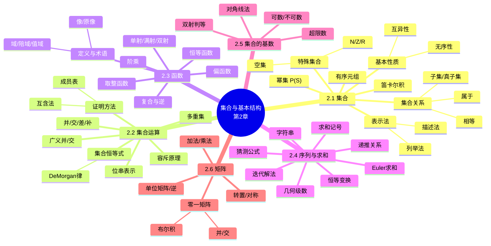

# 集合与基本结构（Sets and Basic Structures）

> **本章主线**：集合是什么（表示与关系）→ 集合能做什么（运算与恒等式）→ 集合之间的对应（函数）→ 有序结构（序列、字符串、求和）→ 无穷的度量（基数）→ 离散结构的载体（矩阵）。
> 一句话版本：**集合是离散数学的"原子语言"**——本章把"一堆对象"形式化为集合，再依次构造出函数、序列、基数、矩阵这四类基本结构。

---

## 2.1 集合（Sets）

### 2.1.1 集合的概念与朴素集合论

**集合（set）** 是一种基本的离散结构，表示**零个或多个互不相同的对象的无序汇集**。集合论研究集合之间的运算、关系与命题；集合在计算机软件系统中无处不在，全部数学都可以用某种形式的集合论（配合谓词逻辑）来定义。

**朴素集合论（naïve set theory）** 的基本前提是：任何我们能（以任意方式）描述的对象（元素）类都构成一个集合。但由此推出的理论是**逻辑不一致的**——存在命题 $p$，使得 $p$ 与 $\neg p$ 都能从公理推出，于是任意命题都"可证"，理论失去意义。更精密的集合论（公理化集合论）修复了这一问题（补充说明/拓展：典型的病态例子是罗素悖论 $S = \{x \mid x \notin x\}$，本课程不深究其公理化修补）。

### 2.1.2 集合的表示与基本性质

1. **列举法**：用花括号列出全部元素，如 $\{a, b, c\}$。集合变量约定用 $S, T, U, \ldots$。
2. **描述法（set-builder notation）**：对论域上任意命题 $P(x)$，$\{x \mid P(x)\}$ 表示使 $P(x)$ 为真的全体 $x$。

**例**：英语元音集 $V = \{a, e, i, o, u\}$；小于 10 的正奇数集 $O = \{1, 3, 5, 7, 9\}$；小于 100 的正整数可记为 $\{1, 2, 3, \ldots, 99\}$。

集合的两条**基本性质**（决定了它与"有序结构"的根本区别）：

1. **无序性**：元素排列顺序无关，$\{a, b, c\} = \{c, b, a\} = \ldots$
2. **互异性**：重复列举无影响。若 $a = b$，则 $\{a, b, c\} = \{a, c\} = \{a, a, b, a, b, c, c, c, c\}$，该集合至多含 2 个元素。

**集合相等**：两个集合相等当且仅当它们含**完全相同的元素**；与定义方式、表示方式无关。例：$\{1,2,3,4\} = \{x \mid x \text{ 是整数}, 0 < x < 5\} = \{x \mid x \text{ 是正整数}, 0 < x^2 < 25\}$。

### 2.1.3 特殊集合与集合间关系

**无限集**：概念上集合可以是无限的。常用特殊无限集：

- $N = \{0, 1, 2, \ldots\}$（自然数）；
- $Z = \{\ldots, -2, -1, 0, 1, 2, \ldots\}$（整数）；
- $R$（实数）。黑板粗体 $\mathbb{N}, \mathbb{Z}, \mathbb{R}$ 也常用来表示这些数集。无限集有不同的"大小"（见 2.5 节）。

文氏图（Venn diagram）用封闭区域直观表示集合及其关系。

**属于（member of）**：$x \in S$（"$x$ 属于 $S$"）是命题"x 是集合 $S$ 的元素"，如 $3 \in N$、$a \in \{x \mid x \text{ 是字母}\}$。$x \notin S \equiv \neg(x \in S)$。用属于关系可定义集合相等：$S = T \Leftrightarrow \forall x\,(x \in S \Leftrightarrow x \in T)$。

**空集（empty set）** $\varnothing$：**唯一**不含任何元素的集合，$\varnothing = \{\} = \{x \mid \text{False}\}$，且恒有 $\neg\exists x\,(x \in \varnothing)$。

**子集（subset）**：$S \subseteq T$ 表示 $S$ 的每个元素也是 $T$ 的元素，即 $S \subseteq T \Leftrightarrow \forall x\,(x \in S \rightarrow x \in T)$。恒有 $\varnothing \subseteq S$、$S \subseteq S$。

**真子集（proper subset）**：$S \subset T$ 表示 $S \subseteq T$ 且 $T \nsubseteq S$（即 $S \ne T$）。例：$\{1,2\} \subset \{1,2,3\}$。

**集合的元素也可以是集合**。例：$S = \{x \mid x \subseteq \{1,2,3\}\}$，则

$$S = \bigl\{\varnothing,\ \{1\},\ \{2\},\ \{3\},\ \{1,2\},\ \{1,3\},\ \{2,3\},\ \{1,2,3\}\bigr\}$$

注意 $1 \ne \{1\} \ne \{\{1\}\}$——**数、单元素集、单元素集的套娃集是三个不同对象**。

### 2.1.4 基数与幂集

**基数（cardinality）** $|S|$：衡量 $S$ 含多少个不同元素。例：$|\varnothing| = 0$，$|\{1,2,3\}| = 3$，$|\{\{1,2,3\},\{4,5\}\}| = 2$。若 $|S| \in N$ 则称 $S$ **有限**，否则**无限**。

**幂集（power set）** $P(S)$：$S$ 的**全部子集**构成的集合，$P(S) := \{x \mid x \subseteq S\}$。例：$P(\{a,b\}) = \{\varnothing, \{a\}, \{b\}, \{a,b\}\}$。有时记作 $2^S$。对有限 $S$ 有

$$|P(S)| = 2^{|S|}$$

但对一切 $S$ 都有 $|P(S)| > |S|$（包括无限集，如 $|P(N)| > |N|$）——**无限集也有不同的大小层次**（对角线论证见 2.5 节）。

### 2.1.5 有序元组与笛卡尔积

**有序 $n$ 元组（ordered $n$-tuple）** $(a_1, a_2, \ldots, a_n)$：与集合不同，**顺序有意义、重复有意义**。例：$(1,2) \ne (2,1) \ne (2,1,1)$。特例依次为空序列、单元素组、序偶（pair）、三元组、四元组等。

**笛卡尔积（Cartesian product）**：对集合 $A, B$，

$$A \times B := \{(a, b) \mid a \in A \land b \in B\}$$

例：$\{a,b\} \times \{1,2\} = \{(a,1),(a,2),(b,1),(b,2)\}$。有限情形 $|A \times B| = |A|\,|B|$。笛卡尔积**不可交换**：一般 $A \times B \ne B \times A$。可推广到 $A_1 \times A_2 \times \cdots \times A_n$。

**二元关系预告**：从 $A$ 到 $B$ 的二元关系就是 $A \times B$ 的一个**子集**；$n$ 元关系是 $A_1 \times \cdots \times A_n$ 的子集（各 $A_i$ 称为域，$n$ 称为度）。这一观点把"关系"完全归约为"集合"，是本课程"用集合解释一切"的典型示范。

## 2.2 集合运算（Set Operations）

### 2.2.1 并、交、互斥与容斥

**并（union）**：

$$A \cup B := \{x \mid x \in A \lor x \in B\}$$

$A \cup B$ 是同时包含 $A$ 与 $B$ 的**最小**超集：$(A \cup B \supseteq A) \land (A \cup B \supseteq B)$。例：$\{a,b,c\} \cup \{2,3\} = \{a,b,c,2,3\}$；$\{2,3,5\} \cup \{3,5,7\} = \{2,3,5,7\}$。

**交（intersection）**：

$$A \cap B := \{x \mid x \in A \land x \in B\}$$

$A \cap B$ 是同时含于 $A$ 与 $B$ 的**最大**子集。例：$\{a,b,c\} \cap \{2,3\} = \varnothing$；$\{2,4,6\} \cap \{3,4,5\} = \{4\}$。

**互斥（disjoint）**：$A \cap B = \varnothing$ 时称 $A, B$ 互斥。例：偶数集与奇数集互斥。

**容斥原理（inclusion-exclusion principle）**：

$$|A \cup B| = |A| + |B| - |A \cap B|$$

直觉：直接相加会把公共部分**数两遍**，故减去一次交集。**应用**：统计"至少满足其一"的元素个数时，先分别计数再修正重叠。

### 2.2.2 差与补

**差（difference）** $A - B$（也叫 $B$ 关于 $A$ 的补）：

$$A - B := \{x \mid x \in A \land x \notin B\}$$

例：$\{1,2,3,4,5,6\} - \{2,3,5,7,9,11\} = \{1,4,6\}$；$Z - N = \{\ldots, -3, -2, -1\}$（负整数集）。

**补（complement）**：当论域（universe of discourse）明确取为集合 $U$ 且 $A \subseteq U$ 时，$A$ 的补 $\overline{A} := U - A = \{x \mid x \notin A\}$。例：$U = N$ 时 $\overline{\{3,5\}} = \{0,1,2,4,6,7,\ldots\}$。

### 2.2.3 集合恒等式与德摩根律

常用**集合恒等式**（与命题逻辑的对应律一一平行）：

| 类型 | 恒等式 |
|---|---|
| 单位/零律 | $A \cup \varnothing = A$，$A \cap U = A$；$A \cup U = U$，$A \cap \varnothing = \varnothing$ |
| 幂等 | $A \cup A = A$，$A \cap A = A$ |
| 补的补 | $\overline{\overline{A}} = A$ |
| 交换 | $A \cup B = B \cup A$，$A \cap B = B \cap A$ |
| 结合 | $(A \cup B) \cup C = A \cup (B \cup C)$，交同理 |

**德摩根律（DeMorgan's laws）**（与命题逻辑德摩根律完全平行，可由后者证明）：

$$\overline{A \cup B} = \overline{A} \cap \overline{B}, \qquad \overline{A \cap B} = \overline{A} \cup \overline{B}$$

> 记忆口诀：**"长杠变短杠，开口换方向"**——并变交、交变并，补作用到每个集合上。

### 2.2.4 集合等式的证明方法

证明形如 $E_1 = E_2$ 的集合等式有三种技术：

1. **互含法（mutual subsets）**：分别证 $E_1 \subseteq E_2$ 与 $E_2 \subseteq E_1$。
2. **集合描述法 + 逻辑等价演算**：把集合表达式翻译成含 $\in$ 的命题，做等价变形。
3. **成员表（membership table）**：完全类似命题逻辑的真值表。

**例（互含法）**：证明 $A \cap (B \cup C) = (A \cap B) \cup (A \cap C)$。

1. **证 $\subseteq$**：设 $x \in A \cap (B \cup C)$，则 $x \in A$ 且 $x \in B$ 或 $x \in C$。
    - 情形 1：$x \in B$。于是 $x \in A \cap B$，故 $x \in (A \cap B) \cup (A \cap C)$。
    - 情形 2：$x \in C$。同理 $x \in A \cap C$，故 $x \in (A \cap B) \cup (A \cap C)$。
2. **证 $\supseteq$**：设 $x \in (A \cap B) \cup (A \cap C)$，则 $x \in A \cap B$ 或 $x \in A \cap C$。两种情形均给出 $x \in A$ 且（$x \in B$ 或 $x \in C$），故 $x \in A \cap (B \cup C)$。（证明完毕）

**例（成员表）**：证明 $(A \cup B) - B = A - B$。

| $A$ | $B$ | $A \cup B$ | $(A \cup B) - B$ | $A - B$ |
|---|---|---|---|---|
| 0 | 0 | 0 | 0 | 0 |
| 0 | 1 | 1 | 0 | 0 |
| 1 | 0 | 1 | 1 | 1 |
| 1 | 1 | 1 | 0 | 0 |

两列完全相同，等式成立。

> 该例演示的核心技巧：**成员表把集合等式"降维"成逐位比较的布尔等式——凡涉及有限个集合的并、交、差、补的等式，都可以机械验证，是最可靠的兜底方法**。练习：$(A \cup B) - C = (A - C) \cup (B - C)$ 可用同样的 8 行成员表验证。

### 2.2.5 广义并、广义交、位串与多重集

由于并、交满足交换律与结合律，可从二元运算推广到**集合族** $\{A_1, \ldots, A_n\}$ 甚至无限集合族 $X = \{A \mid P(A)\}$：

$$\bigcup_{i=1}^{n} A_i := ((\cdots((A_1 \cup A_2) \cup \cdots) \cup A_n), \qquad \bigcup_{A \in X} A := \{x \mid \exists A \in X,\ x \in A\}$$

广义交对偶定义（记号 $\bigcap$）。**结合与分组方式、元素顺序均无关**。

**用位串表示集合**：对可枚举论域 $U = \{x_1, x_2, \ldots, x_n\}$，把 $S \subseteq U$ 编码为位串 $b_1 b_2 \cdots b_n$，其中 $b_i = 1 \Leftrightarrow x_i \in S$。此时并、交、补分别**直接对应按位或、按位与、按位非**——集合运算的硬件化。

**例（位串运算，题意还原）**：$\{1,2,3,4,5\}$ 与 $\{1,3,5,7,9\}$ 的位串分别为 `111110000` 与 `101010101`。

1. 并：`111110000 ∨ 101010101 = 1111101010` 对应 $\{1,2,3,4,5,7,9\}$。
2. 交：`111110000 ∧ 101010101 = 1010100000` 对应 $\{1,3,5\}$。

**多重集（multiset）**：元素可**重复出现**的无序汇集，记作 $\{m_1 \cdot a_1, m_2 \cdot a_2, \ldots, m_r \cdot a_r\}$，$m_i$ 称为**重数（multiplicity）**，基数定义为重数之和。设 $P, Q$ 为多重集：

- 并 $P \cup Q$：各元素重数取 **max**；
- 交 $P \cap Q$：各元素重数取 **min**；
- 差 $P - Q$：重数相减后与 0 取大；
- 和 $P + Q$：各元素重数**相加**。

> 一句话对比：**普通集合"只问在不在"（重数截断为 0/1），多重集"还问有几个"**——前者的 max/min 在多重集上推广成了重数的算术。

## 2.3 函数（Functions）

### 2.3.1 定义与术语

**函数（function / map / mapping）** $f: A \to B$：把 $A$ 中**每个**元素**恰好指定** $B$ 中一个元素 $f(x)$ 的对应法则。作为关系看，$f$ 是 $A \times B$ 的子集，且满足：对每个 $a \in A$，恰有一个有序对 $(a, b) \in f$。

**基本术语**（设 $f(a) = b$，$a \in A$，$b \in B$）：

1. $A$ 是 $f$ 的**域（domain）**；
2. $B$ 是 $f$ 的**陪域（codomain）**；
3. $b$ 是 $a$ 在 $f$ 下的**像（image）**；
4. $a$ 是 $b$ 的一个**原像（pre-image）**（$b$ 可以有多个原像）；
5. **值域（range）** $R = \{b \mid \exists a,\ f(a) = b\} \subseteq B$。

签名（signature）记作 $A \to B$。**值域一般不等于陪域**——陪域是"声明的目标集合"，值域是"实际取到的部分"。例：声明 $f$ 把本班学生映射到成绩集 $\{A,B,C,D,E\}$（陪域）；若实际成绩全为 A、B，则值域为 $\{A,B\}$，陪域仍是 $\{A,B,C,D,E\}$。

**集合的像**：$f: A \to B$，$S \subseteq A$，则 $f(S) := \{f(s) \mid s \in S\} = \{b \mid \exists s \in S,\ f(s) = b\}$。值域即 $f(A)$。

**算子（operator）**：$n$ 元算子是从 $S$ 的有序 $n$ 元组集合到 $S$ 自身的函数。例：$\lnot$ 是 $\{T,F\}$ 上的一元算子，$\land, \lor$ 是二元算子，$\cup, \cap$ 是集合族上的二元算子。若 $\cdot$ 是 $B$ 上的二元算子，则可逐点扩张到函数：$(f \cdot g)(a) := f(a) \cdot g(a)$，如 $(f+g)(x) = f(x)+g(x)$。

### 2.3.2 复合、单射、满射、双射

**复合（composition）**：$g: A \to B$，$f: B \to C$，则 $(f \circ g): A \to C$ 定义为 $(f \circ g)(a) := f(g(a))$。注意 $g(a) \in B$ 保证 $f(g(a))$ 有定义。**复合一般不可交换**（$f \circ g \ne g \circ f$，且多数情形两侧甚至无定义）——与笛卡尔积同属"有方向"的运算。

**单射（injective / one-to-one）**：$f: A \to B$ 是单射，若

$$\neg\exists x, y\ (x \ne y \land f(x) = f(y))$$

即定义域中不同元素映到不同位置（记忆法：像疫苗注射，每针打进不同病人）。数值函数的**充分条件**：严格单调递增（$x > y \rightarrow f(x) > f(y)$）或严格单调递减。$x^3$ 单射；但逆命题不真，如 $1/x$ 单射却不单调。

**满射（surjective / onto）**：$f: A \to B$ 是满射，若 $\forall b \in B,\ \exists a \in A:\ f(a) = b$，即**值域 $=$ 陪域**——$A$ 完全覆盖住整个 $B$。例：$f: R \to R$，$x^3$ 满射，$x^2$ 不满射（负数无原像）。

**双射（bijective / one-to-one correspondence）**：既是单射又是满射，也称可逆（invertible）。对双射 $f: A \to B$ 存在**逆函数** $f^{-1}: B \to A$，满足 $f^{-1} \circ f = I_A$（$I_A$ 为恒等函数）。

**恒等函数（identity function）** $I: A \to A$（也记 $I_A, 1, 1_A$）：$I(a) = a$。恒等函数总是双射。例：加 0、乘 1、与 $T$ 合取、与 $\varnothing$ 求并等都是各自论域上的恒等算子。**可逆计算的物理意义（补充说明/拓展）**：若计算机的状态转移函数是双射，则该计算理论上可无能耗可逆地执行——这是低功耗可逆计算研究的出发点。

### 2.3.3 取整函数、阶乘与偏函数

**取整函数**（离散数学中最常用的两个实数函数）：

1. **下取整（floor）** $\lfloor \cdot \rfloor: R \to Z$：$\lfloor x \rfloor := \max(\{i \in Z \mid i \le x\})$，即不超过 $x$ 的最大整数。
2. **上取整（ceiling）** $\lceil \cdot \rceil: R \to Z$：$\lceil x \rceil := \min(\{i \in Z \mid i \ge x\})$，即不小于 $x$ 的最小整数。

例：$\lfloor 1.6 \rfloor = 1$，$\lceil 1.6 \rceil = 2$，$\lfloor -1.4 \rfloor = -2$，$\lceil -1.4 \rceil = -1$，$\lfloor -3 \rfloor = \lceil -3 \rceil = -3$。注意：

- $x \notin Z$ 时 $\lfloor -x \rfloor \ne -\lfloor x \rfloor$，$\lceil -x \rceil \ne -\lceil x \rceil$；
- $x \in Z$ 时 $\lfloor x \rfloor = \lceil x \rceil = x$。

阶梯图像上，端点用**空心圆**表示"不取"、实心点表示"取到"——这是描述分段函数边界归属的通用画法。

**阶乘函数** $f: N \to Z^+$，$f(n) = n! = 1 \cdot 2 \cdot \cdots \cdot n$，规定 $0! = 1$。例：$6! = 720$；$20! = 2\,432\,902\,008\,176\,640\,000$，增长极快（补充说明/拓展：Stirling 公式给出近似 $n! \approx \sqrt{2\pi n}\,(n/e)^n$）。

**偏函数（partial function）**：只对 $A$ 的某个子集（**定义域子集 / domain of definition**）指定像的函数；对定义域子集之外的元素称 $f$ **无定义（undefined）**。当定义域子集等于全 $A$ 时称为**全函数（total function）**。例：$f(n) = \sqrt{n}$ 是 $Z \to R$ 的偏函数，定义域子集为非负整数。

## 2.4 序列与求和（Sequences, Strings, and Summations）

### 2.4.1 序列与递推关系

**序列（sequence / series）**：类似有序元组，但**每个元素带索引**，且可以无限。序列 $\{a_n\}$ 对应某个生成函数 $f: S \to A$（$S \subseteq N$ 常取 $N$ 或 $Z^+$），$a_n := f(n)$ 称为**第 $n$ 项**，$n$ 是**索引**。常用省略号列举法：$\{a_n\} = 0, 1, 4, 9, 16, 25, \ldots$ 即 $a_n = n^2$。与集合不同，序列中**允许重复**：$b_n = (-1)^n$ 给出无限的 $1, -1, 1, -1, \ldots$，而不是二元集 $\{1,-1\}$。

**递推关系（recurrence relation）**：用**前面的项**表达 $a_n$ 的方程，对一切 $n \ge n_0$（$n_0$ 为非负整数）成立：

$$a_n = f(a_0, a_1, \ldots, a_{n-1})$$

满足递推关系的序列称为该递推的**解**；**初始条件（initial conditions）**指定递推生效之前各项的值。

**例（一阶递推）**：$a_n = a_{n-1} + 3$（$n = 1, 2, 3, \ldots$），$a_0 = 2$。求 $a_1, a_2, a_3$。

1. 依据递推：$a_1 = a_0 + 3 = 2 + 3 = 5$。
2. $a_2 = a_1 + 3 = 5 + 3 = 8$。
3. $a_3 = a_2 + 3 = 8 + 3 = 11$。

**例（二阶递推）**：$a_n = a_{n-1} - a_{n-2}$（$n \ge 2$），$a_0 = 3$，$a_1 = 5$。则 $a_2 = 5 - 3 = 2$，$a_3 = 2 - 5 = -3$。

**斐波那契（Fibonacci）序列**：初始条件 $f_0 = 0$，$f_1 = 1$；递推 $f_n = f_{n-1} + f_{n-2}$。逐项得 $f_2 = 1$，$f_3 = 2$，$f_4 = 3$，$f_5 = 5$，$f_6 = 8$。

**解递推 = 求封闭公式（closed formula）**：给出第 $n$ 项关于 $n$ 的显式表达。本节演示**迭代法**（猜测 + 数学归纳法证明，归纳法见后续章节）：

**例（正向迭代）**：$a_n = a_{n-1} + 3$（$n \ge 2$），$a_1 = 2$。逐项展开：

1. $a_2 = 2 + 3$。
2. $a_3 = (2 + 3) + 3 = 2 + 3 \times 2$。
3. $a_4 = (2 + 3 \times 2) + 3 = 2 + 3 \times 3$。
4. 归纳模式：$a_n = 2 + 3(n-1)$。

**例（反向迭代）**：同一递推，从 $a_n$ 逐级回代：

1. $a_n = a_{n-1} + 3$。
2. $a_n = (a_{n-2} + 3) + 3 = a_{n-2} + 3 \times 2$。
3. $a_n = a_{n-3} + 3 \times 3$。
4. $a_n = a_1 + 3(n-1) = 2 + 3(n-1)$。

> 两条路径殊途同归：**正向"从底往上垒"，反向"从顶往下拆"**——核心都是把递推里的常数增量累加成 $3(n-1)$。

**应用（复利）**：本金 $P_0 = 10000$，年利率 $11\%$ 按年复利。账户金额满足 $P_n = 1.11\,P_{n-1}$，$P_0 = 10000$。正向代换：$P_1 = 1.11 P_0$，$P_2 = 1.11^2 P_0$，……，$P_n = 1.11^n \times 10000$。$P_{30} = 1.11^{30} \times 10000 \approx \$228\,992.97$。

### 2.4.2 猜测特殊序列与字符串

给定前若干项猜测通项的方法论——依次自问：

1. 有无**重复出现的同值项**？
2. 能否由前项**加/乘一个量**得到后项？
3. 能否由前若干项**组合**得到后项？
4. 项之间有无**周期循环**？
5. 是否匹配某个**著名序列**（素数、斐波那契……）？

**例**：$1, \frac12, \frac14, \frac18, \frac1{16}$——分母是 2 的幂，猜测 $a_n = 1/2^n$（$a = 1, r = \tfrac12$ 的等比数列）。
**例**：$1, 3, 5, 7, 9$——每项加 2，猜测 $a_n = 2n+1$（等差数列，$a = 1, d = 2$）。
**例**：$1, -1, 1, -1, 1$——正负交替，猜测 $a_n = (-1)^n$（$r = -1$ 的等比）。
**例**：$1, 7, 25, 79, 241, 727, 2185, 6559, 19681, 59047$——后项与前项之比逼近 3，对照 $3^n$ 发现每项恰为对应幂次减 2，猜测 $a_n = 3^n - 2$。

> 仅凭有限前项**无法在数学上唯一确定**通项——总存在无穷多个可计算函数取到同样的前缀；"找最简单规律"只是启发式约定（补充说明/拓展：整数序列可在 OEIS 在线大百科中检索）。

**字符串（string）**：取自**有限字母表 $\Sigma$** 的（有限）符号序列。形式化：$s = s_1 s_2 \cdots s_n$，$s_i \in \Sigma$，常从 0 或 1 起编号。要点：

1. **长度** $|s|$：符号个数（下标值个数）。
2. **连接（concatenation）** $st$：$s$ 的符号序列后直接接 $t$ 的符号序列；$s^n$ 为 $n$ 个 $s$ 连接。
3. **空串** $\varepsilon$（教材用 $\lambda$）：长度为 0 的串。
4. $\Sigma^n := \{s \mid s \text{ 是 } \Sigma \text{ 上长 } n \text{ 的串}\}$；$\Sigma^* := \{s \mid s \text{ 是 } \Sigma \text{ 上有限串}\}$。

### 2.4.3 求和记号与恒等变换

**求和（summation）**：给定序列 $\{a_i\}$、下界 $j$、上界 $k \ge j$，

$$\sum_{i=j}^{k} a_i := a_j + a_{j+1} + \cdots + a_k$$

$i$ 称为**求和指标（index of summation）**。无穷级数写 $\sum_{i=j}^{\infty} a_i$；对集合 $X = \{x_1, x_2, \ldots\}$ 求和写 $\sum_{x \in X} f(x)$；用谓词限定求和范围写 $\sum_{x: P(x)} f(x)$。

**常用变形恒等式**：

| 名称 | 恒等式 |
|---|---|
| 分配 | $\sum_{i=j}^{k} c\,f(i) = c \sum_{i=j}^{k} f(i)$ |
| 和之和 | $\sum_{i=j}^{k} (f(i) + g(i)) = \sum_{i=j}^{k} f(i) + \sum_{i=j}^{k} g(i)$ |
| 换元 | $\sum_{i=j}^{k} f(i) = \sum_{i=j+p}^{k+p} f(i-p)$ |
| 拆项 | $\sum_{i=j}^{k} f(i) = \sum_{i=j}^{m} f(i) + \sum_{i=m+1}^{k} f(i)$ |

**常用闭式**：

| 名称 | 公式 |
|---|---|
| 等差（Euler） | $\displaystyle\sum_{i=1}^{n} i = \frac{n(n+1)}{2}$ |
| 平方和 | $\displaystyle\sum_{i=1}^{n} i^2 = \frac{n(n+1)(2n+1)}{6}$ |
| 立方和 | $\displaystyle\sum_{i=1}^{n} i^3 = \frac{n^2(n+1)^2}{4}$ |
| 几何级数 | $\displaystyle\sum_{i=0}^{n} r^i = \frac{1-r^{n+1}}{1-r}\ (r \ne 1)$；$r = 1$ 时为 $n+1$ |

**Euler 配对技巧**（12 岁的 Euler 发现）：

1. 目标 $S = \sum_{i=1}^{n} i = 1 + 2 + \cdots + (n-1) + n$。
2. 反写 $S = n + (n-1) + \cdots + 2 + 1$。
3. 两式**逐项相加**：每对之和均为 $n+1$，共 $n$ 对。
4. 故 $2S = n(n+1)$，即 $S = n(n+1)/2$——只需心算一次乘法再除以 2。

**几何级数推导**（错位相减）：设 $S = \sum_{i=0}^{n} r^i = 1 + r + r^2 + \cdots + r^n$。

1. 两边乘 $r$：$rS = r + r^2 + \cdots + r^n + r^{n+1}$。
2. 用原式减新式（错位对齐）：$(1 - r)S = 1 - r^{n+1}$。
3. $r \ne 1$ 时除以 $1-r$ 得 $S = \dfrac{1-r^{n+1}}{1-r}$；$r = 1$ 时直接得 $S = n+1$。

**嵌套求和**与量词类似，注意自由/绑定变量：$\sum_{i=1}^{4}\sum_{j=1}^{3} i = \sum_{i=1}^{4} 3i = 3(1+2+3+4) = 60$。

**例（拆项 + 平方和公式）**：求 $\displaystyle\sum_{k=50}^{100} k^2$。

1. 拆项：$\sum_{k=50}^{100} k^2 = \sum_{k=1}^{100} k^2 - \sum_{k=1}^{49} k^2$。
2. 代入平方和公式：$\frac{100 \cdot 101 \cdot 201}{6} - \frac{49 \cdot 50 \cdot 99}{6}$。
3. 计算：$338\,350 - 40\,425 = 297\,925$。

> 该例演示的核心技巧：**"从非 1 开始的求和"一律用拆项化归到标准公式**——先补成从 1 起，再减去多算的前缀。

## 2.5 集合的基数（Cardinality of Sets）

### 2.5.1 基数相等与可数性

**基数相等的严格定义**（适用于无限集）：对（可能无限的）集合 $A, B$，

$$|A| = |B| \iff \text{存在从 } A \text{ 到 } B \text{ 的双射}$$

有限情形下"存在双射"等价于"元素个数相同"——该定义是有限情形的自然推广。

**可数（countable）**：$S$ 有限，或 $|S| = |N|$。直觉：可以把 $S$ 的元素**逐一列举**，使每个元素终将被数到。例：$N, Z$。**不可数（uncountable）**：连无限列举也数不完。例：$R, R^2, P(N)$。

### 2.5.2 可数与不可数的证明

**定理**：$Z$ 可数。**证明**：构造双射 $f: Z \to N$，

$$f(i) = \begin{cases} 2i, & i \ge 0 \\ -2i - 1, & i < 0 \end{cases}$$

（把非负整数映到偶数、负整数映到奇数），易验证 $f$ 双射。

**定理**：自然数序偶对 $(n, m)$ 的全体可数。**证明**：按和 $s = n + m$ 从小到大排列，同和内按 $n$ 排序——每个序偶恰出现一次，该枚举本身构成双射 $N^2 \to N$（对角线枚举）。

**定理**：正有理数可数。**构造**：把 $p/q$ 排在网格第 $q$ 行，按 $p+q$ 递增列举（跳过重复的同一分数），得序列 $1, \tfrac12, 2, 3, \tfrac13, \tfrac14, \tfrac23, \ldots$——每个正有理数终将出现。

**定理（康托尔对角线法，1891）**：开区间 $[0, 1) = \{r \in R \mid 0 \le r < 1\}$ 不可数。

1. **反证假设**：存在序列 $\{r_i\} = r_1, r_2, \ldots$ 穷尽 $[0, 1)$ 的一切元素。
2. 把每个 $r_i$ 写成十进制小数（对角线思想对任意进制都成立）：

$$\begin{aligned} r_1 &= 0.d_{1,1}\, d_{1,2}\, d_{1,3}\, \cdots \\ r_2 &= 0.d_{2,1}\, d_{2,2}\, d_{2,3}\, \cdots \\ r_3 &= 0.d_{3,1}\, d_{3,2}\, d_{3,3}\, \cdots \\ &\ \vdots \end{aligned}$$

3. **构造新数**：取对角线数字 $d_{i,i}$，每位加 1（mod 10，9 变 0），得到新小数 $r^* = 0.d^*_1 d^*_2 d^*_3 \cdots$，其中 $d^*_i = (d_{i,i} + 1) \bmod 10$。
4. **矛盾**：$r^*$ 与 $r_1$ 至少在第 1 位不同，与 $r_2$ 至少在第 2 位不同，……，故 $r^*$ 不在列表中——与"列表穷尽一切"矛盾。列表不存在，$[0,1)$ 不可数。

**超限基数（transfinite cardinal number）**：无限集的基数不是自然数，而是特殊的超限基数。$|N| = \aleph_0$ 是**最小的**超限基数。**连续统假设**断言 $|R| = \aleph_1$（第二小超限基数）（补充说明/拓展：该假设独立于 ZFC 公理系统，既不能证明也不能证伪）。

> 代数数与超越数（补充说明/拓展）：代数数集（某整系数多项式的根）可数且包含全体有理数；$\pi, e$ 是超越数。实数可按"有理/无理"或"代数/超越"两种方式二分。

## 2.6 矩阵（Matrices）

### 2.6.1 定义与基本运算

**矩阵（matrix）**：元素（通常为数）排成的矩形阵列。$m \times n$ 矩阵恰有 $m$ 行、$n$ 列；$n \times n$ 矩阵称为**方阵（square matrix）**，$n$ 称为它的阶。元素记 $a_{i,j}$，先写行下标后写列下标。矩阵有大量应用：解线性方程组、计算机图形与图像处理、计算科学建模、量子力学与量子计算等。

**矩阵相等**：$A = B$ 当且仅当行数相同、列数相同，且**所有对应元素相等**。

**矩阵加法**：$A + B = [a_{i,j} + b_{i,j}]$（要求形状相同）。

**矩阵乘法**：$A$ 为 $m \times k$，$B$ 为 $k \times n$，则 $AB$ 为 $m \times n$ 矩阵 $C = [c_{i,j}]$，其中

$$c_{i,j} = \sum_{\ell=1}^{k} a_{i,\ell}\, b_{\ell,j}$$

即 $C$ 的第 $(i,j)$ 元 = $A$ 的第 $i$ **行**与 $B$ 的第 $j$ **列**的点积。**矩阵乘法一般不可交换**（$AB \ne BA$，且形状甚至可能不允许交换）。三重循环算法的时间复杂度为 $\Theta(mnk)$。

**单位矩阵（identity matrix）** $I_n$：对角线为 1、其余为 0 的 $n \times n$ 方阵，元素用 **Kronecker delta** 记：$[I_n]_{i,j} = \delta_{i,j}$（$i = j$ 时 1，否则 0）。

**矩阵的逆**：部分方阵 $A$ 存在唯一的乘法逆 $A^{-1}$，满足 $A^{-1} A = I_n$；此时 $A^{-1} A = A A^{-1}$（补充说明/拓展：求逆算法本课程不展开）。

**矩阵的幂**：$A$ 为 $n \times n$ 方阵、$p \ge 0$ 时，$A^p := A \cdot A \cdots A$（$p$ 个），并规定 $A^0 := I_n$。

**转置（transpose）** $A^t$（或 $A^T$）：把 $A$ 沿主对角线"翻转"，$[A^t]_{i,j} = a_{j,i}$，$m \times n$ 转为 $n \times m$。

**对称矩阵（symmetric matrix）**：方阵 $A$ 满足 $A = A^t$，即 $\forall i, j:\ a_{i,j} = a_{j,i}$。

### 2.6.2 零一矩阵与布尔运算

**零一矩阵（zero-one matrix）**：所有元素为 0 或 1 的矩阵（0/1 可代表假/true），是表示**关系与有向图**的天然载体（详见后续"关系"章节）。对 $m \times n$ 零一矩阵 $A, B$：

1. **并（join）**：$A \lor B := [a_{i,j} \lor b_{i,j}]$（对应元素取逻辑或）；
2. **交（meet）**：$A \land B := [a_{i,j} \land b_{i,j}] = [a_{i,j} \cdot b_{i,j}]$（对应元素取逻辑与/乘积）。

**布尔积（boolean product）** $A \odot B$：$A$ 为 $m \times k$、$B$ 为 $k \times n$ 零一矩阵时，$[A \odot B]_{i,j} = \bigvee_{\ell=1}^{k} (a_{i,\ell} \land b_{\ell,j})$——形式同普通矩阵乘法，但把 $+$ 换成 $\lor$、把 $\times$ 换成 $\land$。直觉："存在中间点 $\ell$ 使得 $a_{i,\ell}$ 与 $b_{\ell,j}$ 同时为 1"。

**布尔幂（boolean power）**：$A^{[k]} := A \odot A \odot \cdots \odot A$（$k$ 个），$A^{[0]} := I_n$。

> 一句话总结 2.6：**矩阵是"二维离散结构的通用容器"**——加法/乘法承载数值计算，零一矩阵 + 布尔积承载"可达性/关系复合"（这正是关系的传递闭包、图可达性算法的矩阵语言）。

---

### 前置知识（本节依赖什么）

1. **命题逻辑（第 1 章）**：$\land, \lor, \neg, \rightarrow, \leftrightarrow$ 与真值表——集合运算与恒等式、成员表、单射/满射的一阶逻辑刻画，都是把命题逻辑"换皮"到集合与函数上；德摩根律等恒等式从逻辑直接平移。
2. **基本证明方法（第 1 章）**：直接证明、反证法、分情形证明——集合等式的互含法、对角线法的反证、递推的迭代猜测都是这些方法的具体应用。

### 后置知识（本节通向什么）

1. **关系（后续"关系"章节 / 离散数学（下）第 9 章）**：关系 = 笛卡尔积的子集（2.1.5 已预告）；函数是"单值"的特殊关系；零一矩阵与布尔积是关系的表示与复合工具。
2. **序列与递推（离散数学（下）递推关系章节）**：本节的斐波那契、迭代法是递推求解的引子；母函数、特征方程等系统方法在后续展开。
3. **计数/组合（后续章节）**：阶乘、求和闭式、鸽巢原理将与排列组合结合，成为计数的核心工具。
4. **代数结构（离散数学（下）半群与群）**：集合 + 满足封闭性的运算 = 代数结构；群、环、域都是"在集合上装运算"的产物——本章的集合与运算正是它们的原材料。

### 本节在整个课程中的位置（打地基比喻）

- 本章是离散数学的**"集合地基"**：先学会用集合精确地说"一堆对象"，再用函数、序列、基数、矩阵四种基本结构把离散对象组织起来。
- **集合**是词汇，**运算**是语法，**函数/关系**是句子，**代数结构**是文章——本章完成"词汇 + 基础语法"。
- 学习节奏建议：**先吃透 2.1–2.2 的表示与运算（含恒等式证明）→ 再吃透 2.3 函数的"单射/满射/双射"三分法 → 2.4 求和闭式与递推迭代要练熟 → 2.5 对角线法看懂思想即可 → 2.6 矩阵运算重在"零一矩阵 + 布尔积"为关系做准备**。

### 核心灵魂问题（学完本章应能回答）

1. **为什么幂集 $P(S)$ 的基数严格大于 $S$，即使 $S$ 是无限集？** ——对角线论证（2.5）给出的不只是 $[0,1)$ 不可数，更是"$f: S \to P(S)$ 永远不可能满射"的普适模板；想通这一点，就理解了"无穷有大小"。
2. **函数、关系、笛卡尔积子集三者是什么关系？** ——三者层层包含：$A \times B$ 的子集是关系；"对每个 $a$ 恰有一个 $b$"的特殊关系是函数；函数再加"单射/满射"条件得到双射与可逆。
3. **为什么矩阵乘法不可交换，而集合的并/交可交换？** ——乘法涉及"行 × 列"的求和顺序与中间维度 $k$，交换后形状和值都变了；并/交是逐元素的逻辑运算，天然对称——**"运算是否可交换"取决于它是否携带"方向/顺序"信息**。

> **一句话总结本章**：**集合 = 无序互异的元素汇集**；运算（并交差补 + 恒等式）给出集合世界的演算规则；函数是"恰好一个像"的特殊关系；序列/求和与矩阵是组织离散数据的两大容器；基数用双射这把尺子量出了无穷的层次——这四块拼图合起来，构成后续所有离散数学章节的公共地基。

---

## 课件 PDF

<iframe src="https://cognishelf.naimore3.workers.dev/课程笔记/大一下/离散数学（上）/02/02.pdf" width="100%" height="800px" style="border: none;"></iframe>

[打开 PDF](https://cognishelf.naimore3.workers.dev/课程笔记/大一下/离散数学（上）/02/02.pdf)
