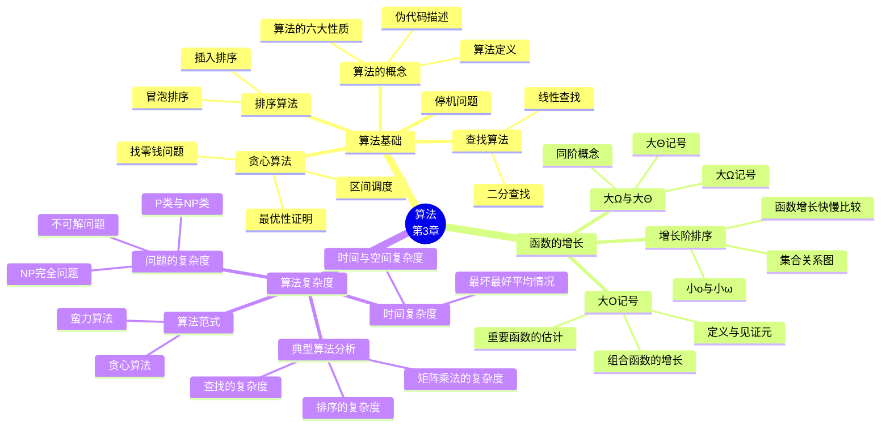

# 算法（Algorithms）

> **本章主线**：从"什么是一个算法"讲起，先给出算法的精确定义与六条基本性质，再用查找、排序、贪心三类实例学会**描述算法与分析算法**；接着引入 **大 $O$、大 $\Omega$、大 $\Theta$ 记号**这套"描述增长快慢的语言"，把"哪个算法更快"变成可以严格证明的命题；最后用这套语言为具体算法**估算复杂度**，并上升到"问题本身有多难"——引出 $P$ 与 $NP$、$NP$ 完全以及**不可解问题**。
>
> 一句话版本：**算法 = 有限步的精确指令；大 $O$ 记号 = 衡量它"随着输入变大要花多少代价"的尺子；而有些问题连尺子都不需要——它们根本没有算法。**

---

## 3.1 算法（Algorithms）

### 3.1.1 问题与算法

在计算机科学中，许多领域都存在一类**关键的一般性问题（general problem）**：给定符合规范的输入，要求输出具有特定性质的答案。

- **第一步是精确地陈述问题**：用适当的结构明确规定**输入（input）**与期望的**输出（output）**。
- **第二步是给出求解过程**：指定一个过程的各个步骤，使得它接受合法输入并产生期望输出，这个过程就称为**算法（algorithm）**。

> **定义（算法）**：一个算法是**执行计算或求解问题的一组有限的精确指令**（a finite set of precise instructions for performing a computation or for solving a problem）。

算法一词（algorithm）源于 9 世纪波斯数学家 **阿尔·花拉子米（Abu Ja'far Mohammed Ibin Musa Al-Khowarizmi，约 780–850）**的名字，其拉丁化形式 *Algoritmi* 后来演变为 algorithm；他关于印度数字与算术的著作把十进制记数法传入欧洲。

**案例：变位词编程任务（Anagram Programming Task）**

给定一部含 **70,000 个单词**的词典，编写一个变位词工具：输入一个单词，返回该词在词典中出现的**所有变位词（anagram）**——即由颠倒字母顺序而构成的字。

| 输入 | 输出 |
|---|---|
| `CAT` | `ACT`, `CAT`, `TAC` |
| `SUBESSENTIAL` | `SUITABLENESS` |

这个任务看起来简单，实际却要求算法设计上的巧思：若对词典中每个词都与输入词逐字母比较，每次查询需 $O(70000 \times L)$ 量级的工作（$L$ 为词长）；而**把每个词按字母排序后作为"签名"建立索引**，则一次查询只需对输入词排一次序再查表。**同一个问题，算法设计的好坏带来数量级的差别**——这正是本章要教的核心本领。

**例：描述一个求有限整数序列中最大值的算法**

求解步骤：

1. 令临时最大值等于序列中的第一个整数。
2. 将序列中的下一个整数与临时最大值比较：
    - 若它比临时最大值大，则把临时最大值置为该整数。
3. 若序列中还有更多整数，重复上一步；否则停止。
4. 算法终止时，临时最大值即为序列中的最大整数。

### 3.1.2 算法的描述方式与六大性质

**算法的描述方式**：算法可以用不同方式给出，其步骤可以用**自然语言**描述，也可以用**伪代码（pseudocode）**描述。

- **伪代码**是"自然语言描述的步骤"与"用某种编程语言编码"之间的**中间步骤**。
- 伪代码的结构取自 C++、Java 等流行语言。
- 程序员可以根据伪代码描述，用特定语言构造出程序。
- 伪代码有助于分析求解问题所需的时间，且这种分析**独立于实际实现所用的编程语言**。

**算法的六大性质**

| 性质 | 含义 |
|---|---|
| **输入（Input）** | 算法有取自某个指定集合的输入值 |
| **输出（Output）** | 由输入值，算法产生取自某个指定集合的输出值，输出值即为解 |
| **正确性（Correctness）** | 算法对每一组输入值都应产生正确的输出值 |
| **有限性（Finiteness）** | 算法对任何输入都应在**有限步**之后产生输出 |
| **有效性（Effectiveness）** | 算法的每一步都必须能够正确地、在有限时间内完成 |
| **一般性（Generality）** | 算法应适用于所求形式的所有问题，而不只是某一组特定输入 |

> **注意**：这六条中，**有限性**与**一般性**最容易被忽视。一个过程即使每一步都是确定的，若不能保证在有限步内终止（例如陷入死循环），它就只是一个"过程"而非算法——这正是 3.1.5 停机问题的伏笔。

**例：求有限序列中最大元素的算法（伪代码）**

```
procedure max(a1, a2, …, an: integers)
    max := a1
    for i := 2 to n
        if max < ai then max := ai
    return max {max is the largest element}
```

这个算法满足前述六条性质：输入为 $n$ 个整数，输出为最大者，对任意输入都在有限步内终止，每一步都是可执行的比较与赋值，且适用于任意有限整数序列。

### 3.1.3 查找问题与两种查找算法

**查找问题（searching problem）的定义**：一般查找问题是在由**互异元素**构成的表 $a_1, a_2, \dots, a_n$ 中定位元素 $x$，或者判定它不在表中。

- 查找问题的解是表中等于 $x$ 的那一项的**位置**：即若 $x = a_i$，则 $i$ 就是解；若 $x$ 不在表中，则解为 $0$。
- **实例**：图书馆在允许读者借阅新书之前，需要检查该读者是否出现在"有逾期未还书籍"的名单上。

本节研究两种查找算法：**线性查找**与**二分查找**。

#### 线性查找（Linear Search）

线性查找算法通过**从表头开始逐个检查元素**来定位表中的项：先将 $x$ 与 $a_1$ 比较，若相等则返回位置 1；否则试 $a_2$，若 $x = a_2$ 则返回位置 2；如此继续；若扫描完整个表仍未找到匹配，则返回 0。

```
procedure linear search(x: integer, a1, a2, …, an: distinct integers)
    i := 1
    while (i ≤ n and x ≠ ai)
        i := i + 1
    if i ≤ n then location := i
    else location := 0
    return location
    {location is the subscript of the term that equals x,
     or is 0 if x is not found}
```

#### 二分查找（Binary Search）

二分查找假定输入是**按递增顺序排列**的表。

- 算法先将要查找的元素与**中间元素**比较。
- 若中间元素**小于**待查元素，则在表的**上半部分**继续查找。
- 若中间元素**不小于**待查元素，则在表的**下半部分**（含中间位置）继续查找。
- 重复此过程，直到表的大小为 1。
- 若待查元素与表中元素相等，则返回该位置；否则返回 0 表示未找到。

3.3 节将证明二分查找远比线性查找高效。

```
procedure binary search(x: integer, a1, a2, …, an: increasing integers)
    i := 1   {i is the left endpoint of interval}
    j := n   {j is the right endpoint of interval}
    while i < j
        m := ⌊(i + j)/2⌋
        if x > am then i := m + 1
        else j := m
    if x = ai then location := i
    else location := 0
    return location
    {location is the subscript i of the term ai equal to x,
     or 0 if x is not found}
```

> **易错点**：二分查找中 `m := ⌊(i + j)/2⌋` 取下整，且当 $x > a_m$ 时令 $i := m+1$（跳过 $m$），否则令 $j := m$（**保留** $m$）。若两边都跳过或都保留，都会破坏循环不变式而漏解。此外二分查找**必须**在有序表上进行，这是它成立的前提。

**例：在下列 16 个元素的表中二分查找 19 的步骤**

列表：`1  2  3  5  6  7  8  10  12  13  15  16  18  19  20  22`

| 步骤 | 当前区间 | 中点位置与值 | 比较与决策 |
|---|---|---|---|
| 1 | 位置 1–16 | 第 8 位，值为 10 | $19 > 10$，故继续在位置 9–16 中查找 |
| 2 | 位置 9–16 | 第 12 位，值为 16 | $19 > 16$，故继续在第 13 位及以上查找 |
| 3 | 位置 13–16 | 第 14 位，值为 19 | $19 \not> 19$，故继续在位置 13–14 中查找 |
| 4 | 位置 13–14 | 第 13 位，值为 18 | $19 > 18$，故继续在第 14 位查找 |
| 5 | 位置 14 | 表仅剩一个元素，循环结束 | $19 = 19$，返回位置 **14** |

### 3.1.4 排序问题与两种排序算法

**排序（sorting）**就是把表中的元素按递增顺序（数值序、字母序等）排列。

排序之所以重要：

- 相当大比例的计算机资源被用于对各种表进行排序，尤其是在涉及需要按特定顺序（按客户、按零件号等）呈现的大型数据库信息的应用中。
- 人们为排序发明了数量惊人的、本质不同的算法，它们的相对优劣已被广泛研究。
- 排序算法有助于说明计算机科学的基本概念。
- 本书研究多种排序算法：**二分、插入、冒泡、选择、归并、快速、锦标赛排序**。

本节先讲冒泡排序与插入排序，3.3 节将分析它们所需的时间。

#### 冒泡排序（Bubble Sort）

冒泡排序对表进行**多趟（multiple passes）扫描**，每发现一对**次序颠倒**的元素就交换它们。

```
procedure bubblesort(a1, …, an: real numbers with n ≥ 2)
    for i := 1 to n − 1
        for j := 1 to n − i
            if aj > aj+1 then interchange aj and aj+1
    {a1, …, an is now in increasing order}
```

**排序过程的关键性质**：

- 第 1 趟结束时，**最大元素**已被放到正确位置。
- 第 2 趟结束时，**第 2 大元素**已被放到正确位置。
- 此后每一趟都会再有一个元素被放到正确位置。

**例：用冒泡排序排列 $3\ 2\ 4\ 1\ 5$ 的各趟过程**

| 趟次 | 过程 | 该趟结束后的表 |
|---|---|---|
| 初始 | — | 3 2 4 1 5 |
| 第 1 趟 | 3 与 2 交换得 2 3 4 1 5；4 与 1 交换得 2 3 1 4 5；4 与 5 不换 | 2 3 1 4 **5** |
| 第 2 趟 | 3 与 1 交换得 2 1 3 4 5；3 与 4 不换 | 2 1 3 **4** 5 |
| 第 3 趟 | 2 与 1 交换得 1 2 3 4 5；2 与 3 不换 | 1 2 **3** 4 5 |
| 第 4 趟 | 1 与 2 不换 | **1** 2 3 4 5 |

（加粗表示该趟后已固定到最终位置的元素）

#### 插入排序（Insertion Sort）

插入排序**从第 2 个元素开始**：它把第 2 个元素与第 1 个比较，若前者不小于后者则放在其后，否则插到其前。

```
procedure insertion sort(a1, …, an: real numbers with n ≥ 2)
    for j := 2 to n
        i := 1
        while aj > ai
            i := i + 1
        m := aj
        for k := 0 to j − i − 1
            aj−k := aj−k−1
        ai := m
    {Now a1, …, an is in increasing order}
```

**排序过程的关键性质**：

- 接着把第 3 个元素放到前 3 个元素中的正确位置。
- 此后每一趟，都把第 $n+1$ 个元素放到前 $n+1$ 个元素中的正确位置。
- 寻找正确位置使用的是**线性查找**的思想（顺序比较，直到找到不小于当前元素的位置）。

**例：用插入排序排列输入 $3\ 2\ 4\ 1\ 5$ 的各步过程**

| 步骤 | 说明 | 结果 |
|---|---|---|
| i. | 前两个位置互换 | `2  3  4  1  5` |
| ii. | 第 3 个元素保持原位 | `2  3  4  1  5` |
| iii. | 第 4 个元素被放到最前面（1 依次与 4、3、2 比较后插入开头） | `1  2  3  4  5` |
| iv. | 第 5 个元素保持原位 | `1  2  3  4  5` |

### 3.1.5 贪心算法（Greedy Algorithms）

**最优化问题（optimization problem）**是在所有可能的输入上最小化或最大化某个参数的问题。本节将研究的最优化问题包括：

- 求两个城市之间**总里程最短**的路线。
- 确定如何用**尽可能少的比特**编码消息。
- 用**尽可能少的光纤**连接网络节点。

这类问题常常可以用**贪心算法（greedy algorithm）**求解，即在**每一步都做出"最好"的选择**。

> **核心警告**：每一步都做"最好选择"**并不一定**产生整体最优解；但在许多情况下确实如此。因此在指明"每一步的最好选择"是什么之后，我们要么**证明**这种方法总能产生最优解，要么**找出反例**说明它不能。贪心方法是一种**算法范式（algorithmic paradigm）**——即设计算法的一般性思路。

#### 例：找零钱问题（Making Change）

**问题**：设计一个用以下美国硬币帮 $n$ 分钱找零的贪心算法——25 分（quarter）、10 分（dime）、5 分（nickel）、1 分（penny），要求使用的**硬币总数最少**。

**思路**：每一步都选择**面值最大且不超过剩余金额**的硬币。

以 $n = 67$ 分为例：

1. 先选 1 个 quarter，剩余 $67 - 25 = 42$ 分；再选 1 个 quarter，剩余 $42 - 25 = 17$ 分。
2. 然后选 1 个 dime，剩余 $17 - 10 = 7$ 分。
3. 选 1 个 nickel，剩余 $7 - 5 = 2$ 分。
4. 选 1 个 penny，剩余 1 分；再选 1 个 penny，剩余 0 分。

共 6 枚硬币：$25 + 25 + 10 + 5 + 1 + 1 = 67$。

**贪心找零算法（伪代码）**：该算法对任意硬币面值 $c_1, c_2, \dots, c_r$ 都适用。对美国货币，$c_1 = 25$，$c_2 = 10$，$c_3 = 5$，$c_4 = 1$。

```
procedure change(c1, c2, …, cr: values of coins, where c1 > c2 > … > cr;
                 n: a positive integer)
    for i := 1 to r
        di := 0   [di counts the coins of denomination ci]
        while n ≥ ci
            di := di + 1   [add a coin of denomination ci]
            n := n − ci
    [di counts the coins ci]
```

#### 美国硬币下贪心算法的最优性证明

> **引理 1**：若 $n$ 是正整数，则用 quarter、dime、nickel、penny 以**最少硬币数**为 $n$ 分找零时，硬币组合中**至多有 2 个 dime、1 个 nickel、4 个 penny，且不能同时有 2 个 dime 和 1 个 nickel**；dime、nickel、penny 的总金额**不超过 24 分**。

**证明（反证法）**：若有多于引理允许的硬币，都可以替换成更少的硬币：

- 若有 3 个 dime，可换成 1 个 quarter 和 1 个 nickel（$30 = 25 + 5$）。
- 若有 2 个 nickel，可换成 1 个 dime（$10 = 10$）。
- 若有 5 个 penny，可换成 1 个 nickel（$5 = 5$）。
- 若有 2 个 dime 和 1 个 nickel，可换成 1 个 quarter（$25 = 25$）。

这些都更省硬币，矛盾。而允许的组合中面值最大的是 **2 个 dime 和 4 个 penny**，共 $2\times10 + 4\times1 = 24$ 分。

> **定理**：美国硬币下，贪心找零算法所产生的找零使用的硬币数最少。

**证明（反证法）**：

1. 假设存在正整数 $n$，使得用 quarter、dime、nickel、penny 为 $n$ 分找零时，存在一种比算法所用硬币总数**更少**的方案。
2. 设该最优方案中 quarter 数为 $q'$，贪心算法的方案中 quarter 数为 $q$。由于除 quarter 外的硬币总额不超过 24 分（引理 1），故必有 $q' \ge q$；但若 $q' > q$ 则两方案金额不可能相等，故 $q' = q$。
3. 同理，由引理 1，两种方案中 dime、nickel、penny 的数目也必须相同。

于是两方案完全相同，与"更少"矛盾。

#### 最优性依赖于可用面值

贪心算法的最优性**依赖于可用的面值组合**：

- 对美国硬币，若再加入半美元硬币（50 分）和美元硬币（100 分），最优性仍然成立。
- 但若只允许 quarter（25 分）、dime（10 分）和 penny（1 分），算法就**不再**产生最少硬币数。

**例**：31 分钱。最优方案需要 **4 枚硬币**，即 3 个 dime 和 1 个 penny（$30 + 1$）。而贪心算法会先选 1 个 quarter，剩 6 分；再选不了 dime，只能选 6 个 penny，共 **7 枚**——远非最优。

> **要点**：这说明"贪心"是一种**启发式策略**而非普适最优方法；其正确性必须针对具体的面值系统单独证明或证伪。

#### 例：区间调度（Greedy Scheduling）

**问题**：有一组带有开始与结束时间的报告待安排，构造一个贪心算法，在报告厅中安排**尽可能多**的报告。假设：

- 报告一旦开始就持续到结束。
- 任何两个报告不能同时进行。
- 一个报告可以在另一个报告结束的**同一时刻**开始。
- 一旦选定了若干报告，就不能再加入与已选报告时间冲突的报告（因为它与至少一个已选报告重叠）。

**关键设问**：每一步应当如何做"最好选择"？即该挑哪个报告？候选思路：

- 挑选与已选报告兼容者中**开始最早**的？
- 挑选已兼容者中**时长最短**的？
- 挑选与已选报告兼容者中**结束最早**的？

**答案**：

- **挑最短报告不成立**——可以构造反例。
- **挑结束最早的成立**——该算法在课件中给出，并将在第 5 章用**归纳法**证明其正确性。

**反例说明（为何"最短"不行）**：设报告 2 为 9:00–10:00（时长 1 小时），报告 1 为 8:00–9:45（时长 1 小时 45 分），报告 3 为 9:45–11:00（时长 1 小时 15 分）。若先挑时长最短的报告 2（1 小时），则它与报告 1（8:00–9:45）和报告 3（9:45–11:00）都重叠，只能安排 1 场；而选择报告 1 与报告 3（因报告 3 在 9:45 开始，恰在报告 1 结束时开始，二者兼容），可安排 2 场。故"最短优先"失败。

**区间调度算法（伪代码）**

```
procedure schedule(s1 ≤ s2 ≤ … ≤ sn: start times,
                   e1 ≤ e2 ≤ … ≤ en: end times)
    sort talks by finish time and reorder so that e1 ≤ e2 ≤ … ≤ en
    S := ∅
    for j := 1 to n
        if talk j is compatible with S then
            S := S ∪ {talk j}
    return S   [S is the set of talks scheduled]
```

### 3.1.6 停机问题（Halting Problem）

**问题**：能否设计一个过程，它以**一个计算机程序及其输入**为输入，判定该程序在该输入下是否最终会停机？

**解答：用反证法证明不存在这样的过程。**

**证明**：

1. 假设存在这样的过程，记为 $H(P, I)$。过程 $H(P,I)$ 以程序 $P$ 和 $P$ 的输入 $I$ 为输入。
    - 若 $P$ 在以 $I$ 运行时会停止，则 $H$ 输出 "halt"；
    - 否则 $H$ 输出 "loops forever"。
2. 由于程序本身就是一串字符，故可以调用 $H(P, P)$。构造过程 $K(P)$，其工作方式如下：
    - 若 $H(P,P)$ 输出 "loops forever"，则 $K(P)$ **停机**；
    - 若 $H(P,P)$ 输出 "halt"，则 $K(P)$ **进入无限循环**，每次迭代打印 "ha"。
3. 现在以 $K$ 自身为输入调用 $K$，即考察 $K(K)$：
    - 若 $H(K,K)$ 的输出是 "loops forever"，则按 $K$ 的定义 $K(K)$ 会停机——**矛盾**；
    - 若 $H(K,K)$ 的输出是 "halt"，则按 $K$ 的定义 $K(K)$ 会无限循环——**矛盾**。
4. 因此，不存在能判定任意程序是否停机的一般过程。**停机问题是不可解的（unsolvable）。**

**中文补充：停机问题的意义与不可计算性**

- **一个实际问题**：给定一个算法和相应的输入，判定这个算法是否能够完成？（还是进入死循环不能完成？）
- 由于算法都可以用**图灵机**描述，问题转变为：给定一个图灵机和相应的输入，判定它是否停机？
- 对于**特定的算法**，我们大概是可以判定的；但是否存在对**一般的算法**进行判定的方法？
- **程序正确性证明**就包括：给一段程序，判断这段程序是否会进入死循环。
- **注意**：这个方法本身也必须是一个算法，否则没有意义。

**形式化表述**：是否存在算法能够判定某个图灵机 $M$ 在输入 $I$ 下是否停机？即

$$\text{Halt}(M, I) = \text{True} \iff M \text{ 在 } I \text{ 处停机},\qquad \text{Halt}(M, I) = \text{False} \iff M \text{ 在 } I \text{ 处不停机}$$

**答案是否定的，不存在这样的算法；停机问题是不可计算问题。**

**中文补充的证明框架（Trouble 构造）**：

- 假设存在这样的算法，对应的图灵机是 $\text{Halt}(a, k)$，其中 $a$ 是要判定的图灵机编码，$k$ 是输入的编码。
- 构造图灵机 $\text{Trouble}(a)$：

```
function Trouble(a)
    if Halt(a, a) = False then
        return True
    else
        loop forever
```

- Trouble 图灵机自然也可以编码，记为 $t$，考察把 $t$ 作为 Trouble 的输入会怎样：$\text{Trouble}(t) = ?$
- **矛盾？矛盾！**
    - 若 $\text{Trouble}(t)$ 停机返回了，即 $\text{Halt}(t,t) = \text{False}$，但这样恰恰说明 $\text{Trouble}(t)$ 不停机，**矛盾**。
    - 若 $\text{Trouble}(t)$ 不停机，即 $\text{Halt}(t,t)$ 返回了 True，但这样却说明 $\text{Trouble}(t)$ 能停机，**矛盾**。
- 消除矛盾的唯一途径就是**否定假设**：不存在能一般性地判定图灵机停机的算法。

**关于人的智能能否解决停机问题**：

- 人的智能就能解决停机问题么？至少目前还是否。
- 对于太长的算法，或者输入太复杂的算法，不能判定。
- 对于一些短而简单的算法，也不能判定——例如某些数论难题（如"寻找大于给定 $N$ 的孪生素数"）。

> **要点**：停机问题的不可解性是"**问题的性质**"而非"我们还不够聪明"；它划定了算法能力的**根本边界**，是 3.3 节区分"可解 / 不可解"问题的理论依据。

---

## 3.2 函数的增长（The Growth of Functions）

### 3.2.1 为什么要研究函数的增长

无论计算机科学还是数学，很多时候我们关心**函数增长得有多快**。

在计算机科学中：

- 我们想理解**随着输入规模增长**，一个算法求解问题能有多快。
- 我们可以比较求解同一问题的两个不同算法的效率。
- 我们也能判定随着输入增长，使用某个特定算法是否**实际可行**。

这些问题的深入讨论留待 3.3 节。数学中研究函数增长的两个领域是：

- **数论**（第 4 章）。
- **组合学**（第 6 章和第 8 章）。

### 3.2.2 大 $O$ 记号（Big-O Notation）

> **记号的历史（补充说明/拓展）**：这套记号并非为计算机而生。德国数学家 **巴赫曼（Paul Gustav Heinrich Bachmann，1837–1920）**在 1894 年研究解析数论时首次引入 $O$ 记号；**兰道（Edmund Landau，1877–1938）**随后推广使用，故这套记号在数论中又称"**兰道记号**"；直到 1976 年，**高德纳（Donald E. Knuth，1938— ）**才把它系统引入计算机科学，用于度量算法复杂度，并补上了 $\Omega$ 与 $\Theta$。今天它已成为算法分析的通用语言。

> **定义（大 $O$）**：设 $f$ 和 $g$ 是从整数集或实数集到实数集的函数。若存在常数 $C$ 和 $k$，使得
> $$|f(x)| \le C\,|g(x)| \qquad \text{只要 } x > k$$
> 则称 **$f(x)$ 是 $O(g(x))$**。

- 读作 "$f(x)$ is big-O of $g(x)$"，或 "$g$ **渐近地支配（asymptotically dominates）**$f$"。
- 常数 $C$ 和 $k$ 称为该关系的**见证元（witnesses）**。**只需找到一对见证元**即可。

> **关于符号的说明**：
>
> - 若找到一对见证元，则存在**无穷多对**：总可以把 $k$ 或 $C$ 取得更大而仍保持不等式成立。即任何满足 $C < C'$ 且 $k < k'$ 的一对 $C', k'$ 也是见证元。
> - 你可能会看到 " $f(x) = O(g(x))$ " 的写法，但这是对等号的**滥用**，其含义是"当 $x$ 充分大时 $f$ 与 $g$ 的值之间存在不等式关系"。
> - 写成 $f(x) \in O(g(x))$ 是恰当的，因为 $O(g(x))$ 表示**所有**是 $O(g(x))$ 的函数构成的集合。
> - 由于我们处理的总是取正值的函数，通常**省略绝对值符号**。

**例：证明 $x^2 + 2x + 1$ 是 $O(x^2)$**

**解**：当 $x > 1$ 时，有 $x < x^2$ 且 $1 < x^2$，因此

$$x^2 + 2x + 1 \le x^2 + 2x^2 + x^2 = 4x^2$$

故可取 $C = 4$、$k = 1$ 作为见证元，证明 $x^2 + 2x + 1$ 是 $O(x^2)$。

**另一种取法**：当 $x > 2$ 时，有 $2x \le x^2$ 且 $1 < x^2$，因此

$$x^2 + 2x + 1 \le x^2 + x^2 + x^2 = 3x^2$$

故可取 $C = 3$、$k = 2$ 作为见证元。**这说明见证元不唯一。**

**例：证明 $7x^2$ 是 $O(x^3)$**

**解**：当 $x > 7$ 时，$7x^2 < x^3$。取 $C = 1$、$k = 7$ 作为见证元即可。

（思考：$C = 7$、$k = 1$ 行不行？此时需要 $7x^2 \le 7x^3$ 对 $x > 1$ 成立，即 $1 \le x$ 对 $x>1$ 成立——**是可行的**，故也可以。）

**例：证明 $n^2$ 不是 $O(n)$**

**证明**：假设存在常数 $C$ 和 $k$，使得当 $n > k$ 时 $n^2 \le Cn$。两边同除以 $n$（$n>0$）得 $n \le C$ 必须对所有 $n > k$ 成立。但由于 $n$ 可以任意大，这不可能，**矛盾**。故 $n^2$ 不是 $O(n)$。

**若干重要事实**

- 若两个函数满足 $f(x) = O(g(x))$ 且 $g(x) = O(f(x))$，则称这两个函数**同阶（of the same order）**。
- 若 $f(x) = O(g(x))$，且 $h(x)$ 对所有正实数都大于 $g(x)$，则 $f(x) = O(h(x))$。
- 若对 $x > k$ 有 $|f(x)| \le C|g(x)|$，且对所有 $x$ 有 $|g(x)| \le C'|h(x)|$，则当 $x > k$ 时 $|f(x)| \le CC'|h(x)|$，故 $f(x) = O(h(x))$。（**传递性**）
- 许多应用中的目标是：在 $O(g(x))$ 中把 $g(x)$ 选得**尽可能小**（当然是在相差常数倍的范围内）。

#### 多项式的 Big-O 估计

> **定理**：设 $f(x) = a_n x^n + a_{n-1}x^{n-1} + \dots + a_1 x + a_0$，其中 $a_n \ne 0$，则 **$f(x)$ 是 $O(x^n)$**。

**证明**：假设 $x > 1$，

$$
\begin{aligned}
|f(x)| &= |a_n x^n + a_{n-1}x^{n-1} + \dots + a_1 x + a_0| \\
&\le |a_n|x^n + |a_{n-1}|x^{n-1} + \dots + |a_1|x + |a_0| \qquad (\text{三角不等式}) \\
&= x^n\left(|a_n| + \frac{|a_{n-1}|}{x} + \dots + \frac{|a_1|}{x^{n-1}} + \frac{|a_0|}{x^n}\right) \\
&\le x^n\left(|a_n| + |a_{n-1}| + \dots + |a_1| + |a_0|\right) \qquad (\text{因 } x > 1)
\end{aligned}
$$

取 $C = |a_n| + |a_{n-1}| + \dots + |a_1| + |a_0|$、$k = 1$，即得 $f(x)$ 是 $O(x^n)$。

> **要点**：多项式的**首项 $a_n x^n$ 支配它的增长**。

#### 若干重要函数的 Big-O 估计

**例：用大 $O$ 记号估计前 $n$ 个正整数之和**

$$\sum_{i=1}^{n} i = 1 + 2 + \dots + n = \frac{n(n+1)}{2} = \frac{n^2 + n}{2} \le n^2 \quad (n \ge 1)$$

故 $\sum_{i=1}^{n} i$ 是 $O(n^2)$，取 $C = 1$、$k = 1$。

**例：用大 $O$ 记号估计阶乘函数**

$$n! = 1 \cdot 2 \cdot 3 \cdots n \le n \cdot n \cdot n \cdots n = n^n$$

故 $n!$ 是 $O(n^n)$，取 $C = 1$、$k = 1$。

**例：用大 $O$ 记号估计 $\log n!$**

已知 $n! \le n^n$，两边取对数得

$$\log(n!) \le \log(n^n) = n\log n$$

故 $\log(n!)$ 是 $O(n \log n)$，取 $C = 1$、$k = 1$。

#### 涉及对数、幂、指数的常用 Big-O 估计

| 条件 | 结论 |
|---|---|
| $d > c > 1$ | $n^c$ 是 $O(n^d)$，但 $n^d$ **不是** $O(n^c)$ |
| $b > 1$，$c, d$ 为正 | $(\log_b n)^c$ 是 $O(n^d)$，但 $n^d$ **不是** $O((\log_b n)^c)$ |
| $b > 1$，$d$ 为正 | $n^d$ 是 $O(b^n)$，但 $b^n$ **不是** $O(n^d)$ |
| $c > b > 1$ | $b^n$ 是 $O(c^n)$，但 $c^n$ **不是** $O(b^n)$ |

> **记忆线索**：这四组结论串起来就是一条增长链——**对数 < 幂 < 指数（底数越大越快）**。箭头方向是"阶更大"，反向都不成立。

#### 函数的组合

- 若 $f_1(x)$ 是 $O(g_1(x))$ 且 $f_2(x)$ 是 $O(g_2(x))$，则 $(f_1 + f_2)(x)$ 是 $O(\max(|g_1(x)|, |g_2(x)|))$。
- 若 $f_1(x)$ 和 $f_2(x)$ 都**是** $O(g(x))$，则 $(f_1 + f_2)(x)$ 是 $O(g(x))$。
- 若 $f_1(x)$ 是 $O(g_1(x))$ 且 $f_2(x)$ 是 $O(g_2(x))$，则 $(f_1 f_2)(x)$ 是 $O(g_1(x) g_2(x))$。

**和的证明**：由定义，存在常数 $C_1, C_2, k_1, k_2$ 使得

$$|f_1(x)| \le C_1|g_1(x)| \quad (x > k_1), \qquad |f_2(x)| \le C_2|g_2(x)| \quad (x > k_2)$$

于是当 $x > \max(k_1, k_2)$ 时，令 $g(x) = \max(|g_1(x)|, |g_2(x)|)$：

$$
|(f_1 + f_2)(x)| = |f_1(x) + f_2(x)| \le |f_1(x)| + |f_2(x)| \qquad (\text{三角不等式}) \\
\le C_1|g_1(x)| + C_2|g_2(x)| \le C_1|g(x)| + C_2|g(x)| = (C_1 + C_2)|g(x)| = C|g(x)|
$$

其中 $C = C_1 + C_2$。故 $(f_1+f_2)(x)$ 是 $O(\max(|g_1(x)|,|g_2(x)|))$，见证元为 $C = C_1+C_2$、$k = \max(k_1,k_2)$。

**练习：按增长阶排序**

> 将下列函数排序，使每一个都是列表中下一个函数的大 $O$：
> $f_1(n) = (1.5)^n$，$f_2(n) = 8n^3 + 17n^2 + 111$，$f_3(n) = (\log n)^2$，$f_4(n) = 2^n$，$f_5(n) = \log(\log n)$，$f_6(n) = n^2(\log n)^3$，$f_7(n) = 2^n(n^2+1)$，$f_8(n) = n^3 + n(\log n)^2$，$f_9(n) = 10000$，$f_{10}(n) = n!$

**解法思路**：依次找出剩余函数中**增长最慢**的那个：

| 次序 | 函数 | 理由 |
|---|---|---|
| 1 | $f_9(n) = 10000$ | 常数，不随 $n$ 增长 |
| 2 | $f_5(n) = \log(\log n)$ | 比其余一切都慢 |
| 3 | $f_3(n) = (\log n)^2$ | 次慢 |
| 4 | $f_6(n) = n^2(\log n)^3$ | $(\log n)^3$ 因子小于 $n$ 的任何正幂 |
| 5 | $f_2(n) = 8n^3 + 17n^2 + 111$ | 与下一项同阶 |
| 6 | $f_8(n) = n^3 + n(\log n)^2$ | 与上一项同阶 |
| 7 | $f_1(n) = (1.5)^n$ | 指数函数 |
| 8 | $f_4(n) = 2^n$ | 因 $2 > 1.5$，比上一项增长快 |
| 9 | $f_7(n) = 2^n(n^2+1)$ | 因 $n^2+1$ 因子而比上一项快 |
| 10 | $f_{10}(n) = n!$ | 对任何常数 $c$，$n!$ 都比 $c^n$ 增长快 |

（$f_2$ 与 $f_8$ 同阶，二者可互换位置；关键在于 $\log$ 的幂次最终都被 $n$ 的任意正幂压制。）

### 3.2.3 大 $\Omega$ 记号（Big-Omega Notation）

> **定义（大 $\Omega$）**：设 $f$ 和 $g$ 是从整数集或实数集到实数集的函数。若存在常数 $C$ 和 $k$，使得
> $$|f(x)| \ge C\,|g(x)| \qquad \text{只要 } x > k$$
> 则称 **$f(x)$ 是 $\Omega(g(x))$**，读作 "$f(x)$ is big-Omega of $g(x)$"。

- **大 $O$ 给出增长的上界，大 $\Omega$ 给出增长的下界**。大 $\Omega$ 告诉我们：一个函数**至少**和另一个函数增长得一样快。
- **重要对偶关系**：$f(x)$ 是 $\Omega(g(x))$ **当且仅当** $g(x)$ 是 $O(f(x))$。这直接由定义推出。

**例：证明 $f(x) = x^2 + 2x + 1$ 是 $\Omega(x^2)$**

**解**：对一切正实数 $x$，$x^2 + 2x + 1 \ge x^2$。故取 $C = 1$、$k = 1$。

（再问：它是否也是 $O(x^2)$？**是**——3.2.2 已证。因此它同时是 $O(x^2)$ 与 $\Omega(x^2)$，即与 $x^2$ **同阶**——这正是下面大 $\Theta$ 的内容。）

### 3.2.4 大 $\Theta$ 记号（Big-Theta Notation）

> **定义（大 $\Theta$）**：设 $f$ 和 $g$ 是从整数集或实数集到实数集的函数。若 $f(x)$ 是 $\Omega(g(x))$ **且** $f(x)$ 是 $O(g(x))$，则称 **$f(x)$ 是 $\Theta(g(x))$**。

称为 "$f$ is big-Theta of $g(x)$"，也说 "$f(x)$ **的阶是** $g(x)$"，或 "$f(x)$ 与 $g(x)$ **同阶**"。

**三种等价说法**（课件并列给出，含义完全相同）：

- "$f(x)$ is big-Theta of $g(x)$"；
- "$f(x)$ is of order $g(x)$"（$f(x)$ 的阶是 $g(x)$）；
- "$f(x)$ and $g(x)$ are of the same order"（$f(x)$ 与 $g(x)$ 同阶）。

**等价的显式刻画**：$f(x)$ 是 $\Theta(g(x))$ **当且仅当**存在常数 $C_1, C_2, k$，使得

$$C_1|g(x)| \le |f(x)| \le C_2|g(x)| \qquad \text{当 } x > k$$

> **要点**：大 $\Theta$ 给出了函数增长的**紧确界**——上下界同阶。这也是它成为描述算法复杂度首选记号的原因。

**例：证明前 $n$ 个正整数之和是 $\Theta(n^2)$**

**解**：设 $f(n) = 1 + 2 + \dots + n$。

- 已证 $f(n)$ 是 $O(n^2)$。
- 为证 $f(n)$ 是 $\Omega(n^2)$，需找正常数 $C$ 使 $f(n) > Cn^2$ 对充分大的 $n$ 成立。**只对大于 $n/2$ 的项求和**：

$$
1 + 2 + \dots + n \ge \lceil n/2 \rceil + (\lceil n/2 \rceil + 1) + \dots + n
\ge \underbrace{\lceil n/2 \rceil + \lceil n/2 \rceil + \dots + \lceil n/2 \rceil}_{}
= (n - \lceil n/2 \rceil + 1)\lceil n/2 \rceil \ge \frac{n}{2}\cdot\frac{n}{2} = \frac{n^2}{4}
$$

取 $C = \frac{1}{4}$，则对一切正整数 $n$ 有 $f(n) > Cn^2$。故 $f(n)$ 是 $\Omega(n^2)$，从而 $f(n)$ 是 $\Theta(n^2)$。

> **技巧**：证明下界时，**只保留一部分项而丢弃其余项**（此处丢掉前半部分），是处理求和式 $\Omega$ 估计的常用手法。

**例：证明 $f(x) = 3x^2 + 8x\log x$ 是 $\Theta(x^2)$**

**解**：

- 当 $x > 1$ 时，$0 \le 8x\log x \le 8x^2$，故 $3x^2 + 8x\log x \le 11x^2$，即它是 $O(x^2)$。
- 另一方面 $x^2$ 显然是 $O(3x^2 + 8x\log x)$，即 $3x^2 + 8x\log x$ 是 $\Omega(x^2)$。

两者合起来，$3x^2 + 8x\log x$ 是 $\Theta(x^2)$。

**若干性质**

- 若 $f(x)$ 是 $\Theta(g(x))$，则必有 $g(x)$ 是 $\Theta(f(x))$（**对称性**）。
- $f(x)$ 是 $\Theta(g(x))$ **当且仅当** $f(x)$ 是 $O(g(x))$ 且 $f(x)$ 是 $\Omega(g(x))$。
- **警惕**：有些作者粗心地把大 $O$ 记号当作与大 $\Theta$ 记号同义使用——**这是错误的**。$O$ 只给上界，$\Theta$ 给紧确界。

> **补充说明/拓展**：在算法分析中，"某算法的时间复杂度是 $O(n^2)$"只说明**最坏情况下不超过**平方量级（可能实际快得多）；而"是 $\Theta(n^2)$"才说明**确实**是平方量级。严格的分析应当用 $\Theta$，工程讨论中混用 $O$ 很常见，但阅读文献时需留意这个差别。

#### 多项式的 Big-Theta 估计

> **定理**：设 $f(x) = a_n x^n + a_{n-1}x^{n-1} + \dots + a_1 x + a_0$，其中 $a_n \ne 0$，则 $f(x)$ 的阶是 $x^n$，即 **$f(x)$ 是 $\Theta(x^n)$**。

**例**：

- 多项式 $f(x) = 3x^5 + 2x^4 + 100x^2 + 5$ 的阶是 $x^5$（即 $\Theta(x^5)$）。
- 多项式 $g(x) = x^{199} + 3x^{100} + 7$ 的阶是 $x^{199}$（即 $\Theta(x^{199})$）。

#### 判定函数阶的规则

1. $\Theta(1)$ 类函数是**常数**，增长为零。
2. $\Theta(\lg n)$ 低于 $\Theta(n^k)$，只要 $k > 0$。
3. $\Theta(n^a)$ 低于 $\Theta(n^b)$，当且仅当 $0 < a < b$。
4. $\Theta(a^n)$ 低于 $\Theta(b^n)$，当且仅当 $0 < a < b$。
5. 对 $n$ 的任意幂 $n^k$ 与任意 $a > 1$，$\Theta(n^k)$ 都低于 $\Theta(a^n)$。
6. 对任意 $a > 1$，$\Theta(a^n)$ 低于 $\Theta(n!)$。
7. $\Theta(n!)$ 低于 $\Theta(n^n)$。

> **串联记忆**：**常数 < 对数 < 幂 < 指数 < 阶乘 < 双指数**。这条链是本章所有复杂度比较的总纲。

### 3.2.5 其他增长阶关系：小 $o$ 与小 $\omega$

- $\Omega(g) = \{f \mid g \text{ 是 } O(f)\}$：即"至少是 $g$ 阶"的所有函数。
- $o(g) = \{f \mid \forall c>0\ \exists k\ \forall x>k:\ |f(x)| < |c\,g(x)|\}$：即"**严格低于** $g$ 阶"的所有函数。
- $\omega(g) = \{f \mid \forall c>0\ \exists k\ \forall x>k:\ |c\,g(x)| < |f(x)|\}$：即"**严格高于** $g$ 阶"的所有函数。
- $\Theta(g) = O(g) \cap \Omega(g)$：上下界同阶，即"恰好是 $g$ 阶"的所有函数。
- $o(g) \subseteq O(g) - \Theta(g)$，$\omega(g) \subseteq \Omega(g) - \Theta(g)$。

**记号对照**

| 记号 | 含义 | 类比 |
|---|---|---|
| $O(g)$ | 增长**不快于** $g$（上界） | $\le$ |
| $\Omega(g)$ | 增长**不慢于** $g$（下界） | $\ge$ |
| $\Theta(g)$ | 与 $g$ **同阶**（紧确界） | $=$ |
| $o(g)$ | 增长**严格慢于** $g$ | $<$ |
| $\omega(g)$ | 增长**严格快于** $g$ | $>$ |

> **补充说明/拓展**：小 $o$ 与大 $O$ 的差别在于**对任意常数 $c$ 都成立**：$f = O(g)$ 只要求**存在**一个 $C$ 使 $f \le Cg$；而 $f = o(g)$ 要求**对每一个** $c>0$ 都有 $f < cg$（当 $x$ 足够大时）。因此 $o(g) \subseteq O(g)$，且排除了"同阶"的情形。例如 $x$ 是 $o(x^2)$，但不是 $o(x)$。

---

## 3.3 算法复杂度（Complexity of Algorithms）

### 3.3.1 时间复杂度与空间复杂度

给定一个算法，对于特定规模的输入，这个算法的效率如何？要回答这个问题，我们问：

- 这个算法求解问题**用多少时间**？
- 这个算法求解问题**用多少计算机内存**？

- 分析算法求解特定规模输入所需的**时间**，就是在研究算法的**时间复杂度（time complexity）**。
- 分析算法求解特定规模输入所需的**计算机内存**，就是在研究算法的**空间复杂度（space complexity）**。

**本课程的约定**：

- 本课程**focus 在时间复杂度**；空间复杂度留待后续课程。
- 时间复杂度用算法所使用的**操作次数**来度量，并用大 $O$ 与大 $\Theta$ 记号来估计。
- 这种分析可用于判断用该算法求解特定规模问题是否**实际可行**，也可用于比较求解同一问题的不同算法的效率。
- 我们**忽略实现细节**（包括所用的数据结构、硬件与软件平台），因为考虑它们极其复杂。

**时间复杂度分析的要点**：

- 确定**操作次数**，例如比较次数和算术运算（加、乘等）次数。可以用基本操作所需时间来估计计算机实际求解问题所需的时间。
- 忽略次要细节，例如算法的"**日常管理**"（housekeeping，如循环变量自增）方面。
- 我们**聚焦于最坏情况时间复杂度**，它给出算法求解特定规模问题所用操作次数的**上界**。
- **平均情况时间复杂度**通常要难确定得多，它是算法在所有特定规模输入上所用操作数的平均值。

### 3.3.2 典型算法的时间复杂度分析

#### 求最大值算法

```
procedure max(a1, a2, …, an: integers)
    max := a1
    for i := 2 to n
        if max < ai then max := ai
    return max {max is the largest element}
```

**解（数比较次数）**：

- 比较 `max < ai` 执行 $n-1$ 次。
- 每次 $i$ 自增时，要做一次 $i \le n$ 的测试。
- 最后一次比较判定 $i > n$。

因此恰好进行 $2(n-1) + 1 = 2n - 1$ 次比较。故该算法的时间复杂度是 **$\Theta(n)$**。

#### 线性查找的最坏情况复杂度

```
procedure linear search(x: integer, a1, a2, …, an: distinct integers)
    i := 1
    while (i ≤ n and x ≠ ai)
        i := i + 1
    if i ≤ n then location := i
    else location := 0
    return location
```

**解（数比较次数）**：

- 每一步做两次比较：$i \le n$ 与 $x \ne a_i$。
- 为结束循环，还需做一次 $i \le n$ 的比较。
- 循环之后，再做一次 $i \le n$ 比较。

若 $x = a_i$，则用 $2i + 1$ 次比较。若 $x$ 不在表中，则用 $2n + 1$ 次比较，另外还需一次比较来退出循环。故**最坏情况下**共 $2n + 2$ 次比较，复杂度为 **$\Theta(n)$**。

#### 线性查找的平均情况复杂度

**解**：假设元素在表中，且各可能位置等可能。由上页论证，若 $x = a_i$，比较次数为 $2i + 1$。于是平均比较次数为

$$\frac{1}{n}\sum_{i=1}^{n}(2i+1) = \frac{1}{n}\left(2\cdot\frac{n(n+1)}{2} + n\right) = \frac{n(n+1)+n}{n} = n + 2$$

故线性查找的**平均情况复杂度是 $\Theta(n)$**。

> **要点**：线性查找最坏与平均都是 $\Theta(n)$（仅差一个低阶常数），因为"目标恰好在最后"这种情况把平均值拉到了同一量级。

#### 二分查找的最坏情况复杂度

```
procedure binary search(x: integer, a1, a2, …, an: increasing integers)
    i := 1   {i is the left endpoint of interval}
    j := n   {j is the right endpoint of interval}
    while i < j
        m := ⌊(i + j)/2⌋
        if x > am then i := m + 1
        else j := m
    if x = ai then location := i
    else location := 0
    return location
```

**解**：为简便设 $n = 2^k$ 个元素，注意 $k = \log n$。

- 每一阶段做**两次比较**：$i < j$ 与 $x > a_m$。
- 第 1 次迭代时表的大小为 $2^k$，之后依次为 $2^{k-1}$、$2^{k-2}$……直到表的大小为 $2^1 = 2$。
- 最后一步的比较告诉我们表的大小是 $2^0 = 1$，并将元素与仅剩的那一个元素比较。
- 因此至多做 $2k + 2 = 2\log n + 2$ 次比较。
- 故时间复杂度是 **$\Theta(\log n)$**，**优于线性查找**。

> **要点**：这正是"有序"这一额外信息带来的回报——从 $\Theta(n)$ 降到 $\Theta(\log n)$。$n = 2^{20} \approx 10^6$ 时，线性查找最坏约 $10^6$ 次比较，二分查找至多约 $42$ 次。

#### 冒泡排序的最坏情况复杂度

**解**：对表进行 $n-1$ 趟扫描，第 $i$ 趟做 $n-i$ 次比较。于是总比较次数为

$$\sum_{i=1}^{n-1}(n-i) = (n-1) + (n-2) + \dots + 1 = \frac{n(n-1)}{2}$$

其最坏情况复杂度是 **$\Theta(n^2)$**。

#### 插入排序的最坏情况复杂度

**解**：第 $j$ 趟（$j = 2, \dots, n$）需要把第 $j$ 个元素与前 $j-1$ 个元素依次比较，最坏情况比较 $j-1$ 次。于是总比较次数为

$$\sum_{j=2}^{n}(j-1) = 1 + 2 + \dots + (n-1) = \frac{n(n-1)}{2}$$

故其复杂度是 **$\Theta(n^2)$**。

> **（补充说明/拓展）**：按本课件给出的伪代码字面（`i := 1` 后 `while aj > ai` 递增 $i$），当第 $j$ 个元素需插到最前面时，比较会进行到 $i = j$，故也可写成 $\sum_{j=2}^{n} j = \frac{n(n+1)}{2} - 1$。两种写法**只差一个低阶项**，同为 $\Theta(n^2)$，不影响结论。

#### 排序与查找算法的复杂度汇总

| 算法 | 最好情况比较次数 | 最坏情况比较次数 | 平均情况 | 时间复杂度（最坏） |
|---|---|---|---|---|
| 求最大值 | $2n-1$ | $2n-1$ | $\Theta(n)$ | $\Theta(n)$ |
| 线性查找 | $3$（$2\cdot1+1$，首个元素即命中） | $2n+2$ | $\Theta(n)$（教材值 $n+2$） | $\Theta(n)$ |
| 二分查找 | $2\log n + 2$ | $2\log n + 2$ | — | $\Theta(\log n)$ |
| 冒泡排序 | $n-1$ | $\frac{n(n-1)}{2}$ | $\Theta(n^2)$ | $\Theta(n^2)$ |
| 插入排序 | $n-1$ | $\frac{n(n-1)}{2}$ | $\Theta(n^2)$ | $\Theta(n^2)$ |
| 矩阵乘法 | $n^3$ 次乘法 | $n^3$ 次乘法 | — | $O(n^3)$ |
| 布尔积 | — | $2n^3$ 次位运算 | — | $O(n^3)$ |

> **要点**：排序算法的最好情况（输入已有序）都是 $\Theta(n)$ 量级——只需扫一遍确认，无需任何交换；而最坏情况（输入逆序）达到 $\Theta(n^2)$。**这正是"有序"这一信息在算法中的价值：它能把 $\Theta(n^2)$ 降到 $\Theta(n)$，二分查找能把查找从 $\Theta(n)$ 降到 $\Theta(\log n)$。**

#### 矩阵乘法算法

矩阵乘法的定义可以直接化为算法：$C = AB$，其中 $C$ 是 $m \times n$ 矩阵，是 $m \times k$ 矩阵 $A$ 与 $k \times n$ 矩阵 $B$ 的乘积。

```
procedure matrix multiplication(A, B: matrices)
    for i := 1 to m
        for j := 1 to n
            cij := 0
            for q := 1 to k
                cij := cij + aiq bqj
    return C {C = [cij] is the product of A and B}
```

**复杂度**：用该算法乘两个 $n \times n$ 矩阵，乘积有 $n^2$ 个元素；求每个元素需 $n$ 次乘法与 $n-1$ 次加法。因此共用了 $n^3$ 次乘法和 $n^2(n-1)$ 次加法。故矩阵乘法的复杂度是 **$O(n^3)$**。

#### 布尔积算法

零一矩阵的**布尔积**定义同样可以转成算法：

```
procedure Boolean product(A, B: zero-one matrices)
    for i := 1 to m
        for j := 1 to n
            cij := 0
            for q := 1 to k
                cij := cij ∨ (aiq ∧ bqj)
    return C {C = [cij] is the Boolean product of A and B}
```

**复杂度**：设 $A, B$ 都是 $n \times n$ 零一矩阵。$A \odot B$ 有 $n^2$ 个元素，求每个元素需 $n$ 次 OR 与 $n$ 次 AND，即每个元素需 $2n$ 次位运算。总共需 $2n^3$ 次运算，故复杂度是 **$O(n^3)$**。

#### 矩阵链乘法（Matrix-Chain Multiplication）

**问题**：$A_1 A_2 \cdots A_n$ 应当按什么顺序计算，才能使用最少的整数乘法？其中 $A_i$ 是 $m_i \times m_{i+1}$ 的整数矩阵。（矩阵乘法满足结合律。）

**例**：$A_1 A_2 A_3$ 应以何种顺序相乘乘法次数最少？其中 $A_1$ 是 $30 \times 20$，$A_2$ 是 $20 \times 40$，$A_3$ 是 $40 \times 10$。

**解**：$A_1 A_2 A_3$ 有两种计算方式。

1. **$A_1(A_2 A_3)$**：先算 $A_2 A_3$，需 $20 \cdot 40 \cdot 10 = 8000$ 次乘法，得到 $20 \times 10$ 矩阵；再用 $A_1$ 乘它，需 $30 \cdot 20 \cdot 10 = 6000$ 次乘法。总计 $8000 + 6000 = 14000$。
2. **$(A_1 A_2)A_3$**：先算 $A_1 A_2$，需 $30 \cdot 20 \cdot 40 = 24000$ 次乘法，得到 $30 \times 40$ 矩阵；再乘 $A_3$，需 $30 \cdot 40 \cdot 10 = 12000$ 次乘法。总计 $24000 + 12000 = 36000$。

故**第一种方式更优**（14000 < 36000）。

> **要点**：同一个矩阵连乘积，仅仅因为**结合顺序**不同，乘法次数就相差 2 倍以上。寻找最优乘法顺序的高效算法基于**动态规划**这一算法范式（见第 8 章）。

### 3.3.3 算法范式（Algorithmic Paradigms）

**算法范式（algorithmic paradigm）**是基于某种特定概念、用于构造算法以求解各类问题的**一般性方法**。

- **贪心算法**已在 3.1 节介绍。
- 本节讨论**蛮力算法（brute-force algorithm）**。
- 后续章节还会看到：**分治法**（第 8 章）、**动态规划**（第 8 章）、**回溯法**（第 11 章）、**概率算法**（第 7 章）。还有许多其他范式会在后续课程中出现。

#### 蛮力算法（Brute-Force Algorithms）

**蛮力算法**以最直截了当的方式求解问题，**不利用任何能使算法更高效的思路**。

我们此前见过的蛮力算法有：**顺序查找（线性查找）、冒泡排序、插入排序**。

#### 例：用蛮力算法求最近点对

**问题**：为平面上 $n$ 个点构造一个求**最近点对**的蛮力算法，并给出算术运算次数的**最坏情况估计**。

**解**：两点 $(x_i, y_i)$ 与 $(x_j, y_j)$ 之间的距离为

$$d = \sqrt{(x_j - x_i)^2 + (y_j - y_i)^2}$$

蛮力算法就是计算**所有点对**之间的距离，并选出距离最小的那一对。

> **优化提示**：**不必开平方**，因为两点距离的平方最小时，距离也最小。

```
procedure closest pair((x1, y1), (x2, y2), …, (xn, yn): xi, yi real numbers)
    min := ∞
    for i := 1 to n
        for j := 1 to i
            if (xj − xi)^2 + (yj − yi)^2 < min
                then min := (xj − xi)^2 + (yj − yi)^2
                     closest pair := (xi, yi), (xj, yj)
    return closest pair
```

算法遍历 $\frac{n(n-1)}{2}$ 个点对，计算 $(x_j - x_i)^2 + (y_j - y_i)^2$ 并与当前最小值比较，故使用 **$\Theta(n^2)$** 次算术与比较运算。

> **展望**：后续章节将用**分治**思想把这一问题的复杂度降到 $O(n \log n)$。这正是"算法范式"威力的体现——同一问题，蛮力 $\Theta(n^2)$ 与分治 $O(n\log n)$ 差距随 $n$ 增大而急剧扩大。

> **（补充说明/拓展）**：课件此处提到分治算法的最坏情况复杂度时写作 $O(\log n)$，这与经典结果不符——分治求解最近点对的正确界是 **$O(n\log n)$**（因为仍需对点按坐标排序，且合并步骤是线性的）。这里按标准结论表述。

#### 用具体时间感受复杂度的差距

为直观体会不同复杂度阶的实际差距，假设**每次操作耗时 1 纳秒（$10^{-9}$ 秒）**，问题规模为 **$n$ 位（$n$ bits）**，操作次数是 $n$ 的函数：

| $n$ | $\log_2 n$ | $n$ | $n\log_2 n$ | $n^2$ | $2^n$ | $n!$ |
|---|---|---|---|---|---|---|
| 10 | $3\times10^{-9}$ s | $10^{-8}$ s | $3\times10^{-8}$ s | $10^{-7}$ s | $10^{-6}$ s | 0.0036 s |
| 20 | $4\times10^{-9}$ s | $2\times10^{-8}$ s | $9\times10^{-8}$ s | $4\times10^{-7}$ s | 0.001 s | 77 年 |
| 30 | $5\times10^{-9}$ s | $3\times10^{-8}$ s | $1.5\times10^{-7}$ s | $9\times10^{-7}$ s | 1 s | $8\times10^{15}$ 年 |
| 40 | $5\times10^{-9}$ s | $4\times10^{-8}$ s | $2\times10^{-7}$ s | $1.6\times10^{-6}$ s | 18 分钟 | * |
| 50 | $6\times10^{-9}$ s | $5\times10^{-8}$ s | $3\times10^{-7}$ s | $2.5\times10^{-6}$ s | 13 天 | * |
| 100 | $7\times10^{-9}$ s | $10^{-7}$ s | $7\times10^{-7}$ s | $10^{-5}$ s | $4\times10^{13}$ 年 | * |
| 1000 | $10^{-8}$ s | $10^{-6}$ s | $10^{-5}$ s | 0.001 s | * | * |
| $10^6$ | $2\times10^{-8}$ s | 0.001 s | 0.02 s | 16.7 分钟 | * | * |

> 表中 **\* 表示耗时超过 $10^{100}$ 年**。
>
> **读表要点**：$n$ 从 10 增到 $10^6$（放大十万倍）时，$\log_2 n$ 级的算法耗时几乎不变（仍是纳秒级），$n$ 级也只到毫秒；而 $2^n$ 级在 $n = 30$ 时就已需 1 秒，$n = 100$ 时超过宇宙年龄。**这正是"多项式可解 vs 指数不可解"的直观含义**：算法复杂度的阶决定了问题的规模上限，而这条界线不可逾越地取决于增长阶，而非计算机速度。哪怕计算机快一亿倍，$2^n$ 算法能处理的 $n$ 也只增加约 27。

### 3.3.4 问题的复杂度：可解、不可解与 $P$、$NP$

#### 可解与不可解

- **可解（tractable / feasible）**：若一个问题或算法的时间复杂度**不超过多项式**，则称它是可解的（可行的）。**$P$ 是所有可解问题构成的集合**。
- **不可解（intractable / infeasible）**：时间复杂度**高于多项式**的问题或算法称为不可解的（不可行的）。

> **注意**：$n^{1{,}000{,}000}$ 在技术上属于可解，但实际上非常困难；$n^{\log\log\log n}$ 在技术上属于不可解，但实际上很容易。这类情形很罕见。

**不可解问题（Unsolvable Problems）**

- 图灵在 20 世纪 30 年代发现，存在**没有任何算法能求解**的问题。
- 等价地说，存在**不可判定的（undecidable）**是非问句，以及**不可计算的（uncomputable）**函数。
- **经典例子**：停机问题——给定任意的算法及其输入，该算法最终会停机，还是会永远"无限循环"下去？

#### 问题复杂度的分类

| 类别 | 含义 |
|---|---|
| **可解问题（Tractable Problem）** | 存在多项式时间算法求解该问题。这类问题属于 **$P$ 类** |
| **不可解问题（Intractable Problem）** | 不存在多项式时间算法求解该问题 |
| **不可求解问题（Unsolvable Problem）** | **不存在**任何算法求解该问题，例如停机问题 |
| **$NP$ 类（Class NP）** | 解可以在多项式时间内**验证**，但尚未找到多项式时间算法**求解** |
| **$NP$ 完全类（NP Complete Class）** | 若为该类中**任一**成员找到多项式时间算法，则该算法可用于求解该类中的**所有**问题 |

> **补充说明/拓展**：$P$ 与 $NP$ 的核心不对称在于"**求解**"与"**验证**"的难度差异。以布尔可满足性问题（SAT）为例：给定一个赋值，检查它是否满足公式只需多项式时间（甚至线性时间）；但在所有 $2^n$ 个赋值中找出一个满足者，目前没有多项式时间算法。正是这种"验证容易、求解困难"的落差定义了 $NP$。

#### $P$ 与 $NP$ 问题（P Versus NP Problem）

**$P$ 与 $NP$ 问题**问的是：$P = NP$ 吗？即是否存在这样的问题——它的解可以在多项式时间内被**验证**，却不能在多项式时间内被**求解**？

- **注意**：仅仅"没有人找到多项式时间算法"与"证明该问题不能由多项式时间算法求解"是**两回事**。
- 若能找到 $NP$ 完全类中**任一**问题的多项式时间算法，则该算法可用于获得 $NP$ 完全类中**每一个**问题的多项式时间算法。
- **可满足性**（1.3 节）就是一个 $NP$ 完全问题。
- 由于没有人能为 $NP$ 完全类中的任何问题找到多项式时间算法，人们普遍**相信 $P \ne NP$**。
- $P$ 与 $NP$ 问题仍然是数学（含理论计算机科学）中最著名的未解决问题之一。**克莱数学研究所（Clay Mathematics Institute）为此悬赏 100 万美元**。

**关键要点回顾**

1. 算法复杂度、时间复杂度、最坏情况时间复杂度的**定义**。
2. 复杂度的各种**特定增长阶的名称**。
3. 如何分析简单算法时间复杂度的**最坏情况、最好情况或平均情况**增长阶。

**作业**

- §3.1：2, 56
- §3.2：34, 73, 74
- §3.3：40

**课堂练习**

> 证明 $n \log n$ 是 $O(\log n!)$。

**解答思路**：由本节已证的 $n! \le n^n$ 得到的是上界，方向不对；这里需要的是 $n!$ 的**下界**。只取 $n!$ 中较大的那一半因子：

$$n! = 1 \cdot 2 \cdots n \ge \underbrace{\lceil n/2\rceil \cdot (\lceil n/2\rceil + 1) \cdots n}_{\text{共约 } n/2 \text{ 个因子}} \ge \left(\frac{n}{2}\right)^{n/2}$$

两边取对数得

$$\log(n!) \ge \frac{n}{2}\log\frac{n}{2} = \frac{n}{2}\left(\log n - 1\right) \ge \frac{n}{4}\log n \qquad (\text{当 } n \ge 4)$$

故 $\log(n!)$ 是 $\Omega(n\log n)$，即 $n\log n$ 是 $O(\log n!)$。

---

## 3.4 知识定位与框架衔接

### 前置知识（本章依赖什么）

- **命题逻辑与基本证明方法**（第 1 章）：本章所有"最优性证明""复杂度下界证明"都要用到**反证法**（贪心找零、停机问题）、**分情形**与**归纳法**（区间调度的正确性将在第 5 章用归纳证明）；证明 $f(x)$ 是 $O(g(x))$ 时反复使用的**三角不等式** $|a+b| \le |a|+|b|$ 也是证明练习。
- **集合、函数与矩阵**（第 2 章）：算法被定义为"从输入集合到输出集合的**函数**"；矩阵乘法的复杂度分析直接建立在 2.6 节的矩阵运算定义之上；零一矩阵的布尔积来自 2.6.2 节。
- **求和记号与闭式**（2.4 节）：复杂度分析中 $\sum_{i=1}^{n-1}(n-i) = \frac{n(n-1)}{2}$ 这类求和闭式是必备工具——不会求和就无法完成任何复杂度推导。

### 后置知识（本章通向什么）

- **第 4 章数论**：大 $O$ 记号用于估计数论算法的复杂度（如欧几里得算法、模幂运算），这直接决定了 RSA 等密码体制的安全参数。
- **第 5 章归纳与递推**：区间调度贪心算法的正确性证明、分治算法复杂度递推式（如 $T(n) = 2T(n/2) + O(n)$）的求解都依赖此章。
- **第 6、8 章组合学与高级计数**：$n!$、$n^n$、二项式系数等函数的增长阶是计数问题的核心；第 8 章给出分治、动态规划等范式及其复杂度分析，并完成最近点对的 $O(n\log n)$ 算法。
- **第 11 章（回溯与更多范式）**：算法范式思想的延续。
- **后续课程**：数据结构与算法、计算理论（图灵机与可计算性）、复杂度理论（$P/NP$ 的深入）、密码学。

### 本节在整个课程中的位置（打地基比喻）

- 本章是离散数学的**"度量衡与工程学"**。如果说第 1 章教你如何"正确地推理"，第 2 章教你如何"精确地描述对象"，那么本章教你两件更实用的事：**如何把解决问题的步骤写成可执行的算法**（3.1），以及**如何用统一的尺子衡量优劣**（3.2–3.3）。
- 打一个比方：**算法是菜谱，复杂度是这道菜"随着客人数量增加需要多少厨师"的增长规律**。只看菜谱（3.1）不够——同一道菜可能有多种做法（线性查找 vs 二分查找、冒泡 vs 插入），而大 $O$ 记号（3.2）给出了比较它们的公平标准；3.3 则把尺子架到具体算法与具体问题上，量出**哪些问题能做到**、**哪些问题做不到**。
- 学习节奏建议：**先把 3.1 的六条算法性质与四种算法的伪代码吃透（伪代码要能默写）→ 3.2 的大 $O$ 定义必须达到"能用 $C$ 和 $k$ 严格证明一个函数是 $O$ 或 $\Theta$"的程度，并熟记那条增长链 → 3.3 的复杂度推导重在掌握"数操作次数"的方法，而不是背结论**。
- 最容易被轻视也最容易失分的是：**$\Theta$ 与 $O$ 的混用**（把上界当成紧确界），以及**复杂度推导中漏掉循环退出时的额外比较**（如线性查找的 $2n+2$ 而非 $2n$）。本章的算法分析讲究精确计数，一个"多算一次"就可能改变结论的形式。

### 核心灵魂问题（学完本章应能回答）

1. **大 $O$ 定义中为什么要"$x > k$"这个条件？去掉它会怎样？** ——因为大 $O$ 描述的是**渐近行为**，即输入足够大之后的趋势。小规模输入时哪个算法更快可能完全相反（例如插入排序在 $n$ 很小时快过归并排序），而工程上真正关心的是规模增长后的表现。去掉 "$x>k$" 就变成了对所有 $x$ 都得成立的强命题，很多正确的大 $O$ 结论（如 $7x^2$ 是 $O(x^3)$）将不再成立。
2. **为什么"贪心算法每一步选最好"不保证全局最优？** ——因为它做决策时只依据**当前局部信息**，不做回溯，因而可能放弃"暂时看起来差、但从全局看更优"的选择。找零问题中面值为 $\{25, 10, 1\}$ 时的 31 分就是反例：贪心先拿走 quarter，最终要 7 枚硬币，而最优只需 4 枚。这恰好说明**正确性必须证明**，不能靠直觉。
3. **二分查找比线性查找快，代价是什么？** ——代价是**必须预先排序**。二分查找本身是 $\Theta(\log n)$，但若输入未排序，排序一次就要 $\Theta(n\log n)$。因此若只查一次，排序加二分（$\Theta(n\log n) + \Theta(\log n)$）远不如直接线性查找（$\Theta(n)$）；只有当**查找次数足够多**（如 $m$ 次查找，$m\log n$ 相比 $mn$ 的节省超过一次 $n\log n$ 的排序成本）时才有优势。**没有免费的午餐——用有序性换来了速度。**
4. **$P$ 与 $NP$ 问题为什么这么重要？如果 $P = NP$ 会怎样？** ——因为 $NP$ 完全类中聚集了大量实际核心问题（可满足性 SAT、旅行商判定问题、图着色、背包等）。若 $P = NP$，则这些问题全部存在多项式时间算法，意味着**现代密码学（依赖某些问题"求解困难"）将从根本上瓦解**，同时物流、调度、蛋白质折叠等领域的组合优化难题都会被一举解决。反之若 $P \ne NP$，则我们获得一个关于"计算本质极限"的深刻定理。正因如此，它是克莱研究所悬赏百万美元的七大难题之一。
5. **停机问题"不可解"到底是什么意思？它和"我们还没找到算法"有何不同？** ——"不可解"是一个**已被证明的数学定理**：任意算法都做不到，无论多么聪明、多少时间。这与 $P$ vs $NP$ 中"尚未找到多项式算法"（可能只是暂时不知道）有本质区别。停机问题的证明用**对角线式的自指构造**（让程序 $K$ 以自身为输入），与第 2 章 Cantor 对角线法证明实数不可数是同一种思想——**"自指"是揭示计算极限的统一武器**。

> **一句话总结本章**：**算法是把问题解法写成有限步精确指令的过程，它有输入、输出、正确性、有限性、有效性、一般性六条底线；大 $O$／大 $\Omega$／大 $\Theta$ 记号提供了衡量函数增长的三把尺子（上界／下界／紧确界），沿"常数 < 对数 < 幂 < 指数 < 阶乘 < 双指数"这条链可以排出任何两个函数的快慢；用这套语言度量算法，得到查找 $\Theta(\log n)$ 优于 $\Theta(n)$、排序 $\Theta(n^2)$、矩阵乘法 $O(n^3)$ 等结论；而贪心算法、蛮力算法这类范式告诉我们要怎样构造算法，证明与反例则是检验它们的唯一手段；最后，从算法上升到问题，我们得到可解的 $P$、可验证的 $NP$、相互等价的 $NP$ 完全类，以及被图灵的对角线论证判定为不存在任何算法的不可解问题——这就是计算能力的边界。**

---

## 课件 PDF

<iframe src="https://cognishelf.naimore3.workers.dev/课程笔记/大一下/离散数学（上）/03/03.pdf" width="100%" height="800px" style="border: none;"></iframe>

[打开 PDF](https://cognishelf.naimore3.workers.dev/课程笔记/大一下/离散数学（上）/03/03.pdf)
