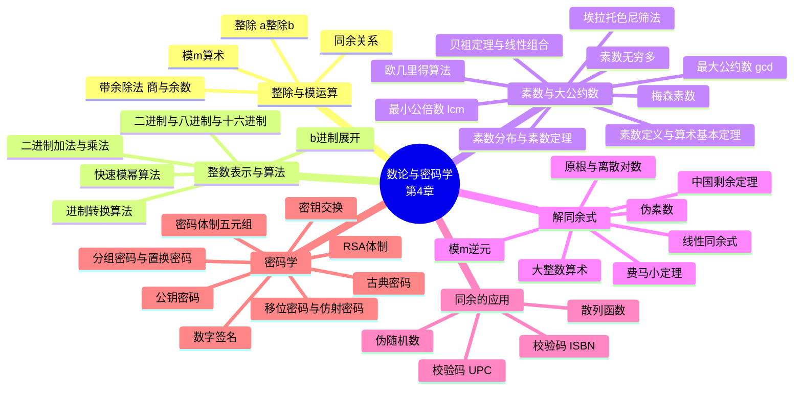

# 数论与密码学（Number Theory and Cryptography）

> **本章主线**：从"整除"这一最原始的整数关系出发，用**带余除法**建立**同余**这一全新运算体系；在此基础上发展出**进制表示与快速模幂**等实用算法，以及**素数、最大公约数、逆元、中国剩余定理**等经典工具；最后把这些工具全部投入应用——**散列、校验码、伪随机数**，以及压轴的**RSA 公钥密码体制与密钥交换、数字签名协议**。整章的逻辑是：**先造工具（4.1–4.4），再用工具（4.5–4.6）**。

> 一句话版本：**同余是"只看余数"的算术**；素数与大公约数是整数世界的原子与度量；而密码学正是"把数学难题当作锁"的工程学——RSA 的锁是**大整数分解**，Diffie-Hellman 的锁是**离散对数**。

---

## 4.1 整除性与模运算（Divisibility and Modular Arithmetic）

本节概要：**除法（Division）→ 带余除法（Division Algorithm）→ 模运算（Modular Arithmetic）**。全章所有内容都建立在"整除"与"同余"这两个概念之上。

### 4.1.1 整除（Division）

**定义（整除）**：若 $a$ 与 $b$ 是整数且 $a \ne 0$，则称 **$a$ 整除 $b$**（记作 $a \mid b$），如果存在整数 $c$ 使得

$$b = ac$$

- 当 $a \mid b$ 时，称 $a$ 是 $b$ 的一个**因子（factor）**或**除数（divisor）**，$b$ 是 $a$ 的**倍数（multiple）**。
- 若 $a$ 不整除 $b$，记作 $a \nmid b$。
- 注意：**$a \mid b$ 是一个"存在性"命题**——只要找得到一个整数 $c$ 即可，不要求 $c$ 唯一，也不要求 $c$ 为正。

**例**：判断 $3 \mid 7$ 与 $3 \mid 12$ 是否成立。

**解**：
- $3 \nmid 7$，因为不存在整数 $c$ 使 $7 = 3c$。
- $3 \mid 12$，因为 $12 = 3 \cdot 4$，取 $c = 4$ 即可。

**易错点**：$0$ 的讨论要小心。对任意正整数 $a$ 有 $a \mid 0$（取 $c=0$），但 $0 \nmid a$（因为定义要求 $a \ne 0$，且不存在 $c$ 使 $a = 0 \cdot c$）。

### 4.1.2 整除的性质（Theorem 1）

**定理 1**：设 $a, b, c$ 为整数，其中 $a \ne 0$。

1. 若 $a \mid b$ 且 $a \mid c$，则 $a \mid (b+c)$；
2. 若 $a \mid b$，则 $a \mid bc$，对所有整数 $c$ 成立；
3. 若 $a \mid b$ 且 $b \mid c$，则 $a \mid c$。

**证明（第 1 条）**：假设 $a \mid b$ 且 $a \mid c$，则存在整数 $s$ 和 $t$ 使得 $b = as$，$c = at$。因此

$$b + c = as + at = a(s+t)$$

这说明 $b+c$ 是 $a$ 的整数倍，故 $a \mid (b+c)$。$\blacksquare$

**推论（线性组合封闭性）**：设 $a \mid b$ 且 $a \mid c$，则对任意整数 $m$ 和 $n$ 有

$$a \mid mb + nc$$

**说明**：由第 2 条得 $a \mid mb$、$a \mid nc$；再由第 1 条得 $a \mid (mb+nc)$。这个推论是"整除性对线性组合封闭"的表述，后面证明贝祖定理与扩展欧几里得算法时反复使用。

**四条性质的记忆法**：**加法封闭（1）→ 乘任意因子仍整除（2）→ 整除可传递（3）→ 线性组合封闭（推论）**。它们构成一套"整除代数"，性质 2 是最常用的一步。

### 4.1.3 带余除法（Division Algorithm）

带余除法传统上被称为"**Division Algorithm（除法算法）**"，但它实际上是一个**定理**——它断言商和余数的**存在性与唯一性**，而不是一个计算步骤的描述。

**带余除法**：若 $a$ 是整数，$d$ 是**正整数**，则存在**唯一**的整数 $q$ 和 $r$，满足 $0 \le r < d$，使得

$$a = dq + r$$

术语约定：
- $d$ 称为**除数（divisor）**
- $a$ 称为**被除数（dividend）**
- $q$ 称为**商（quotient）**，记 $q = a \mathbin{\mathrm{div}} d$
- $r$ 称为**余数（remainder）**，记 $r = a \bmod d$

$$q = a \mathbin{\mathrm{div}} d, \qquad r = a \bmod d$$

**例 1**：用 11 除 101，商与余数各是多少？

**解**：$101 = 11 \cdot 9 + 2$，且 $0 \le 2 < 11$，所以商是 $9 = 101 \mathbin{\mathrm{div}} 11$，余数是 $2 = 101 \bmod 11$。

**例 2**：用 3 除 $-11$，商与余数各是多少？

**解**：$-11 = 3 \cdot (-4) + 1$，且 $0 \le 1 < 3$，所以商是 $-4 = -11 \mathbin{\mathrm{div}} 3$，余数是 $1 = -11 \bmod 3$。

**关键易错点**：余数**必须非负**。若机械地用 $-11 / 3 = -3.67$ 向下取整得 $-4$，会误以为余数是 $-11 - 3 \cdot (-4) = 1$——结果正确，但若取商为 $-3$ 就会得到余数 $-2$，这**违反 $0 \le r < d$**。记住：**商向"负无穷"方向取整**，才能保证余数落在 $[0, d)$ 内。

### 4.1.4 同余关系（Congruence Relation）

**定义（同余）**：若 $a$ 和 $b$ 是整数，$m$ 是正整数，则称 **$a$ 与 $b$ 模 $m$ 同余**（记作 $a \equiv b \pmod m$），如果

$$m \mid (a - b)$$

- 称 $a \equiv b \pmod m$ 为一个**同余式（congruence）**，$m$ 是它的**模（modulus）**。
- 若 $a$ 与 $b$ 模 $m$ 不同余，记作 $a \not\equiv b \pmod m$。
- **核心等价刻画**：两个整数模 $m$ 同余，**当且仅当**它们被 $m$ 除时具有**相同的余数**。

**例**：判断 17 与 5 是否模 6 同余，以及 24 与 14 是否模 6 同余。

**解**：
- $17 \equiv 5 \pmod 6$，因为 $6 \mid (17 - 5) = 12$。
- $24 \not\equiv 14 \pmod 6$，因为 $24 - 14 = 10$ 不能被 $6$ 整除。

**（mod m）与 mod m 两种记号的区别**——这是初学者最容易混淆的地方：

| 记号 | 含义 | 类型 |
| --- | --- | --- |
| $a \equiv b \pmod m$ | 整数集合上的一个**关系**，取值为真或假 | 关系 |
| $a \bmod m = b$ | 一个**函数**，直接算出 $a$ 除以 $m$ 的余数 | 函数 |

**定理 3（两种记号的桥梁）**：设 $a, b$ 是整数，$m$ 是正整数，则

$$a \equiv b \pmod m \quad \text{当且仅当} \quad a \bmod m = b \bmod m$$

**定理 4（同余的等价定义）**：设 $m$ 是正整数，则 $a \equiv b \pmod m$ **当且仅当**存在整数 $k$ 使得

$$a = b + km$$

**证明**：
- 若 $a \equiv b \pmod m$，则由定义 $m \mid (a-b)$，故存在整数 $k$ 使 $a - b = km$，即 $a = b + km$。
- 反之，若 $a = b + km$，则 $a - b = km$，故 $m \mid (a-b)$，即 $a \equiv b \pmod m$。$\blacksquare$

**定理 4 的用法**：它把"同余式"翻译成"等式"，是后面**中国剩余定理**与**回代法（back substitution）**的技术核心——凡是要把同余式当等式来代入消元，用的就是定理 4。

### 4.1.5 和与积的同余（Theorem 5）

**定理 5（同余的加法与乘法保序性）**：设 $m$ 是正整数。若 $a \equiv b \pmod m$ 且 $c \equiv d \pmod m$，则

$$a + c \equiv b + d \pmod m \qquad \text{且} \qquad ac \equiv bd \pmod m$$

**证明**：由 $a \equiv b \pmod m$ 且 $c \equiv d \pmod m$，由定理 4 存在整数 $s, t$ 使 $b = a + sm$，$d = c + tm$。因此

$$b + d = (a + sm) + (c + tm) = (a + c) + m(s + t)$$

$$bd = (a + sm)(c + tm) = ac + m(at + cs + stm)$$

两式的第二项都是 $m$ 的整数倍，故 $a + c \equiv b + d \pmod m$ 且 $ac \equiv bd \pmod m$。$\blacksquare$

**例**：因为 $7 \equiv 2 \pmod 5$ 且 $11 \equiv 1 \pmod 5$，由定理 5 可得

$$18 = 7 + 11 \equiv 2 + 1 = 3 \pmod 5$$

$$77 = 7 \cdot 11 \equiv 2 \cdot 1 = 2 \pmod 5$$

**定理 5 的价值**：它说明**同余式可以像普通等式一样做加法和乘法**——这正是"可以在计算过程中随时取模"的理论依据，也是快速模幂算法得以成立的根本原因。

### 4.1.6 同余式的代数操作

由定理 5 取 $d = c$，立刻得到两条**保有效**的操作：

- **同余式两边同乘一个整数，保持有效**：若 $a \equiv b \pmod m$，则对任意整数 $c$ 有 $c a \equiv c b \pmod m$。
- **同余式两边同加一个整数，保持有效**：若 $a \equiv b \pmod m$，则对任意整数 $c$ 有 $c + a \equiv c + b \pmod m$。

但**同余式两边同除一个整数，并不总是产生有效同余式**：

**反例**：同余式 $14 \equiv 8 \pmod 6$ 成立。但两边同除 2 后，$14/2 = 7$、$8/2 = 4$，而

$$7 \not\equiv 4 \pmod 6$$

**原因**：除法不像乘法那样有"保同余"的普遍保证，因为 $c$ 可能与模 $m$ 不互素（此处 $c=2$ 与 $m=6$ 的最大公约数为 2）。**除法何时可行将在 4.3 节（定理 7）给出条件**：当 $\gcd(c,m)=1$ 时除法才安全。

### 4.1.7 模 m 算术（Arithmetic Modulo m）

**定义**：设 $\mathbb{Z}_m$ 为小于 $m$ 的非负整数集合：

$$\mathbb{Z}_m = \{0, 1, \dots, m-1\}$$

- **模 m 加法**：$a +_m b = (a + b) \bmod m$
- **模 m 乘法**：$a \cdot_m b = (a \cdot b) \bmod m$

使用这些运算即称为进行**模 m 算术**。

**例**：求 $7 +_{11} 9$ 与 $7 \cdot_{11} 9$。

**解**：
- $7 +_{11} 9 = (7 + 9) \bmod 11 = 16 \bmod 11 = 5$
- $7 \cdot_{11} 9 = (7 \cdot 9) \bmod 11 = 63 \bmod 11 = 8$

**模 m 算术满足的运算律**（与普通加法、乘法高度平行）：

- **封闭性（Closure）**：若 $a, b \in \mathbb{Z}_m$，则 $a +_m b$ 和 $a \cdot_m b$ 也属于 $\mathbb{Z}_m$。
- **结合律（Associativity）**：

$$(a +_m b) +_m c = a +_m (b +_m c) \quad\text{且}\quad (a \cdot_m b) \cdot_m c = a \cdot_m (b \cdot_m c)$$

- **交换律（Commutativity）**：

$$a +_m b = b +_m a \quad\text{且}\quad a \cdot_m b = b \cdot_m a$$

- **单位元（Identity elements）**：$0$ 与 $1$ 分别是模 $m$ 加法与乘法的单位元：

$$a +_m 0 = a \quad\text{且}\quad a \cdot_m 1 = a$$

- **加法逆元（Additive inverses）**：若 $a \ne 0$ 属于 $\mathbb{Z}_m$，则 $m - a$ 是 $a$ 的加法逆元；$0$ 是它自己的加法逆元：

$$a +_m (m - a) = 0 \quad\text{且}\quad 0 +_m 0 = 0$$

- **分配律（Distributivity）**：

$$a \cdot_m (b +_m c) = (a \cdot_m b) +_m (a \cdot_m c)$$

**（补充说明/拓展）**：注意上表**没有**"乘法逆元"这一条——因为**乘法逆元并不总是存在**。例如 2 模 6 就没有乘法逆元（不存在 $x$ 使 $2x \equiv 1 \pmod 6$）。用抽象代数的语言说：$\mathbb{Z}_m$ 关于 $+_m$ 构成一个**交换群（commutative group）**，$\mathbb{Z}_m$ 关于 $+_m$ 与 $\cdot_m$ 构成一个**交换环（commutative ring）**——但它一般**不是域**，只有 $m$ 为素数时 $\mathbb{Z}_m$ 才是域。这个"乘法逆元何时存在"的问题正是 4.4 节求逆元与 RSA 解密的理论前提。

---

## 4.2 整数表示与算法（Integer Representations and Algorithms）

本节概要：**整数表示 → $b$ 进制展开 → 二进制/八进制/十六进制展开 → 进制转换算法 → 整数运算算法**。核心动机：**计算机内部只有二进制**，而密码学需要处理"位数远超宇宙原子数"的巨大整数，因此必须研究表示法与高效算法。

### 4.2.1 整数的表示（Representations of Integers）

现代世界使用**十进制（decimal，base 10）**记号表示整数。例如写 965 时实际意指

$$9 \cdot 10^2 + 6 \cdot 10^1 + 5 \cdot 10^0$$

我们其实可以用**任意进制 $b$** 表示数，其中 $b$ 是大于 1 的正整数：

- $b = 2$：**二进制（binary）**
- $b = 8$：**八进制（octal）**
- $b = 16$：**十六进制（hexadecimal）**

这三种进制对计算机与通信格外重要。**（补充说明/拓展）**：历史上古人还用过其他进制——**古代玛雅人使用 20 进制，古代巴比伦人使用 60 进制**（我们今天把一小时分成 60 分钟正是这一传统的残留）。

**定理 1（$b$ 进制表示的存在唯一性）**：设 $b$ 是大于 1 的正整数。若 $n$ 是正整数，则它可以**唯一地**表示为

$$n = a_k b^k + a_{k-1} b^{k-1} + \dots + a_1 b + a_0$$

其中 $k$ 是非负整数，$a_0, a_1, \dots, a_k$ 是小于 $b$ 的非负整数，且 $a_k \ne 0$。

这些 $a_j\ (j = 0,\dots,k)$ 称为该表示的 **$b$ 进制数字（base-$b$ digits）**。定理 1 给出的表示称为 $n$ 的 **$b$ 进制展开（base $b$ expansion）**，记作

$$(a_k a_{k-1} \dots a_1 a_0)_b$$

通常省略 10 进制展开的下标 10。

**为何 $a_k \ne 0$**：这一条排除"前导零"，正是它保证了表示的**唯一性**——否则 $(1)_2$、$(01)_2$、$(001)_2$ 都将表示同一个数。

### 4.2.2 二进制、八进制、十六进制展开

**二进制展开**（base 2，数字只有 0 和 1）：大多数计算机用二进制展开表示整数并进行算术运算。

**例 1**：以 $(1\ 0101\ 1111)_2$ 为二进制展开的整数，其十进制展开是什么？

**解**：

$$1\cdot 2^8 + 0\cdot 2^7 + 1\cdot 2^6 + 0\cdot 2^5 + 1\cdot 2^4 + 1\cdot 2^3 + 1\cdot 2^2 + 1\cdot 2^1 + 1\cdot 2^0 = 351$$

**例 2**：以 $(11011)_2$ 为二进制展开的整数，其十进制展开是什么？

**解**：

$$1\cdot 2^4 + 1\cdot 2^3 + 0\cdot 2^2 + 1\cdot 2^1 + 1\cdot 2^0 = 27$$

**八进制展开**（base 8，数字 $\{0,1,\dots,7\}$）：

**例 1**：$(7016)_8$ 的十进制展开是什么？

**解**：$7\cdot 8^3 + 0\cdot 8^2 + 1\cdot 8^1 + 6\cdot 8^0 = 3584 + 0 + 8 + 6 = 3598$

**例 2**：$(111)_8$ 的十进制展开是什么？

**解**：$1\cdot 8^2 + 1\cdot 8^1 + 1\cdot 8^0 = 64 + 8 + 1 = 73$

**十六进制展开**（base 16）：十六进制需要 16 个数字，但十进制只提供 10 个，因此用字母作为额外符号。十六进制使用

$$\{0,1,2,3,4,5,6,7,8,9,A,B,C,D,E,F\}$$

字母 A 到 F 表示十进制数 10 到 15，即 $A=10$、$B=11$、$C=12$、$D=13$、$E=14$、$F=15$。

**例 1**：$(2AE0B)_{16}$ 的十进制展开是什么？

**解**：

$$2\cdot 16^4 + 10\cdot 16^3 + 14\cdot 16^2 + 0\cdot 16^1 + 11\cdot 16^0 = 131072 + 40960 + 3584 + 0 + 11 = 175627$$

**例 2**：$(E5)_{16}$ 的十进制展开是什么？

**解**：注意 $E = 14$，故

$$14\cdot 16^2 + 14\cdot 16^1 + 5\cdot 16^0 = 3584 + 224 + 5 = 3813$$

> **课件勘误**：课件在 $(E5)_{16}$ 一例中把首项误写为 $1\cdot 16^2$，从而算出 $256 + 224 + 5 = 485$。这里有两处问题：其一，首位字母 E 表示 14 而非 1；其二，末项的 $5\cdot 16^0$ 中的数字 5 恰好等于 $E5$ 的第二位，而 $E$ 被误当成 1 后整式就不自洽了。正确结果应为 **3813**。学习时牢记：**十六进制每位必须严格对应其字母值（$A=10,\dots,F=15$），不可漏位或错位**。

### 4.2.3 进制转换（Base Conversion）

构造整数 $n$ 的 $b$ 进制展开的算法思路，就是**反复做带余除法**：

- 用 $b$ 除 $n$，得到商和余数：$n = b q_0 + a_0$，其中 $0 \le a_0 < b$。
- 余数 $a_0$ 是 $b$ 进制展开中**最右边**的数字。接着用 $b$ 除 $q_0$：$q_0 = b q_1 + a_1$，其中 $0 \le a_1 < b$。
- 余数 $a_1$ 是**从右数第二位**的数字。
- 继续依次用 $b$ 除各个商，把余数作为后续的 $b$ 进制数字。**当商为 0 时过程终止。**

> **课件勘误**：课件在此处把余数上界写成 $0 \le a_0 \le b$ 与 $0 \le a_1 \le b$。按带余除法定理，正确上界应为**严格小于** $b$，即 $0 \le a_0 < b$、$0 \le a_1 < b$。若允许 $a_0 = b$，表示就不唯一了（因为 $b \cdot b^0$ 会"进位"到高位），与定理 1 的唯一性矛盾。

**算法：构造 $b$ 进制展开**

- $q$ 表示通过反复除以 $b$ 得到的商，起始时 $q = n$。
- $b$ 进制展开中的数字是由 $q \bmod b$ 给出的除法余数。
- 当到达 $q = 0$ 时算法终止。

```
procedure base b expansion(n, b: positive integers with b > 1)
    q := n
    k := 0
    while (q ≠ 0)
        ak := q mod b
        q := q div b
        k := k + 1
    return(ak-1, …, a1, a0)  {(ak-1 … a1a0)b is base b expansion of n}
```

**复杂度分析**：每轮循环执行一次 `div b` 与一次 `mod b`，循环轮数等于展开的位数，即约 $\lfloor \log_b n \rfloor + 1$。**每除一次，商至少缩小 $b$ 倍**，所以轮数约为 $\log_b n = \Theta(\log n)$——**这就是进制展开算法为 $O(\log n)$ 的原因**：它所需的除法次数与 $n$ 的位数成正比。（**（补充说明/拓展）**：在按位运算模型下，因每步除法本身涉及 $O(\log n)$ 位，总比特运算量为 $O((\log n)^2)$。）

**例**：求 $(12345)_{10}$ 的八进制展开。

**解**：反复除以 8：

- $12345 = 8 \cdot 1543 + 1$
- $1543 = 8 \cdot 192 + 7$
- $192 = 8 \cdot 24 + 0$
- $24 = 8 \cdot 3 + 0$
- $3 = 8 \cdot 0 + 3$

余数按**从右到左**（即从最后一次除法到第一次除法）构成各位数字，得到

$$(12345)_{10} = (30071)_8$$

**为何余数要倒序排列**：第一次除法得到的余数 $a_0$ 是**最低位**（权重 $8^0$），最后一次得到的才是最高位。**倒序**是这一方法最容易出错的环节——建议每算一步就把余数写成一列，最后从下往上读。

### 4.2.4 二进制、八进制、十六进制之间的转换

- **每一个八进制数字对应 3 个二进制数字的一个块。**（因为 $8 = 2^3$）
- **每一个十六进制数字对应 4 个二进制数字的一个块。**（因为 $16 = 2^4$）
- 所以二进制、八进制与十六进制之间的转换很容易——**只需按 3 位或 4 位分组**。

**例**：求 $(11\ 1110\ 1011\ 1100)_2$ 的八进制与十六进制展开。

**解**：
- **转八进制**：把数字按**三位**分组为

$$(011\ 111\ 010\ 111\ 100)_2$$

（按需在开头补 0）。各块从左到右对应数字 3, 7, 2, 7, 4，因此答案是 $(37274)_8$。
- **转十六进制**：把数字按**四位**分组为

$$(0011\ 1110\ 1011\ 1100)_2$$

（按需在开头补 0）。各块从左到右对应数字 3, E, B, C，因此答案是 $(3EBC)_{16}$。

**验证**：$(37274)_8 = 3\cdot 8^4 + 7\cdot 8^3 + 2\cdot 8^2 + 7\cdot 8 + 4 = 12288 + 3584 + 128 + 56 + 4 = 16060$，而 $(3EBC)_{16} = 3\cdot 16^3 + 14\cdot 16^2 + 11\cdot 16 + 12 = 12288 + 3584 + 176 + 12 = 16060$——两者一致，也与原二进制数 $(11\ 1110\ 1011\ 1100)_2 = 16060$ 相符。

**分组方向**：分组必须**从右往左**，且长度不是 3 或 4 的倍数时必须在**最左边**补 0（如图中标注 `Initial 0s are not shown`）。若从左往右分组就会错位。

### 4.2.5 整数的二进制加法与乘法

使用二进制展开进行运算的算法很重要，因为**计算机芯片以二进制数工作**。每个二进制数字称为一个 **比特（bit）**。

**二进制加法**：把两个 $n$ 比特整数相加所用的**比特加法次数是 $O(n)$**。

```
procedure add(a, b: positive integers)
    {the binary expansions of a and b are (an-1,an-2,…,a0)2 and (bn-1,bn-2,…,b0)2}
    c := 0
    for j := 0 to n − 1
        d := ⌊(aj + bj + c)/2⌋
        sj := aj + bj + c − 2d
        c := d
    sn := c
    return(s0,s1,…, sn)  {the binary expansion of the sum is (sn,sn-1,…,s0)2}
```

**算法解读**：这里 $c$ 是**进位（carry）**。第 $j$ 位上三个量 $a_j$、$b_j$、$c$ 相加，可能得到 0、1、2、3：

- $d = \lfloor (a_j + b_j + c)/2 \rfloor$ 是**新的进位**（和 ≥ 2 时产生进位）
- $s_j = a_j + b_j + c - 2d$ 是第 $j$ 位的**和位**（即和对 2 取余）
- 循环结束后剩下的进位 $c$ 成为**最高位** $s_n$

这正是小学竖式加法的"逢二进一"，只不过用 $\lfloor \cdot /2 \rfloor$ 与 $-2d$ 精确表达了"取商"和"取余"。

**二进制乘法**：计算两个 $n$ 比特整数乘积的算法，所用的**比特加法次数是 $O(n^2)$**。

```
procedure multiply(a, b: positive integers)
    {the binary expansions of a and b are (an-1,an-2,…,a0)2 and (bn-1,bn-2,…,b0)2}
    for j := 0 to n − 1
        if bj = 1 then cj = a shifted j places
        else cj := 0
    {c0,c1,…, cn-1 are the partial products}
    p := 0
    for j := 0 to n − 1
        p := p + cj
    return p  {p is the value of ab}
```

**复杂度对比**：加法 $O(n)$、乘法 $O(n^2)$——**乘法比加法贵一个数量级**。这正是密码学中"模乘"成为性能瓶颈、而"模幂"必须用二分技巧来减少乘法次数的原因（见下节）。

### 4.2.6 快速模幂算法（Binary Modular Exponentiation）

**问题动机**：在密码学中，能够高效地求 $b^n \bmod m$（其中 $b, n, m$ 都是大整数）**极其重要**。

- **问题**：给定大整数 $b$（底数 base）、$n$（指数 exponent）、$m$（模数 modulus），高效地计算 $b^n \bmod m$。
- 注意 $b^n$ 本身可能**完全无法直接计算和存储**。
- 例如，若 $n$ 是一个 1,000 比特的数，则 $b^n$ 的位数将**远超宇宙中原子的数目**！
- 然而，这正是现代密码算法中**常见需要**的一类计算。

**核心思想**：使用 $n$ 的二进制展开 $n = (a_{k-1}, \dots, a_1, a_0)_2$ 来计算 $b^n$。注意

$$b^n = b^{a_{k-1}2^{k-1} + \dots + a_1 2 + a_0} = \prod_{j:\,a_j=1} b^{2^j}$$

因此只需计算 $b, b^2, (b^2)^2 = b^4, (b^4)^2 = b^8, \dots$ 这些"平方的平方"，然后把 $a_j = 1$ 的那些项相乘。

**关键恒等式（反复平方）**：

$$b^{2^i} \cdot b^{2^i} = b^{2^i + 2^i} = b^{2^{i+1}}, \quad\text{且}\quad b^{2^0} = b^1 = b$$

**为何有效**：关键在于，由模算术的恒等律（定理 5），**我们可以在进行过程中随时做 $\bmod m$ 运算**——这样**所有数都保持很小（All the numbers stay small）**，既避免了天文数字般的内存占用，又让每次乘法都只涉及 $O(\log m)$ 位的数。

**例 1（演示原理）**：计算 $3^{11}$。

**解**：注意 $11 = (1011)_2$，对应的指数位为 $a_3=1, a_2=0, a_1=1, a_0=1$，所以

$$3^{11} = 3^8 \cdot 3^2 \cdot 3^1 = ((3^2)^2)^2 \cdot 3^2 \cdot 3^1 = (9^2)^2 \cdot 9 \cdot 3 = 81^2 \cdot 9 \cdot 3 = 6561 \cdot 9 \cdot 3 = 177{,}147$$

**例 2**：计算 $3^{11} \bmod 7$。

**解**：逐步平方并随时取模：

- $3 \bmod 7 = 3$
- $3^2 \bmod 7 = 2$
- $(3^2)^2 = 3^4 \bmod 7 = 2 \cdot 2 \bmod 7 = 4$
- $((3^2)^2)^2 = 3^8 \bmod 7 = 4 \cdot 4 \bmod 7 = 2$

于是

$$3^{11} \bmod 7 = \big((3^8 \bmod 7) \cdot (3^2 \bmod 7) \cdot (3^1 \bmod 7)\big) \bmod 7 = 2 \cdot 2 \cdot 3 \bmod 7 = 12 \bmod 7 = 5$$

**验证**：$177147 \bmod 7 = 5$，与算法结果一致。

**模幂算法伪代码**：

```
procedure modular exponentiation(b: integer, n = (ak-1ak-2…a1a0)2, m: positive integers)
    x := 1
    power := b mod m
    for i := 0 to k − 1
        if ai = 1 then x := (x ∙ power) mod m
        power := (power ∙ power) mod m
    return x  {x equals bn mod m}
```

**复杂度**：求 $b^n \bmod m$ 使用 **$O((\log m)^2 \log n)$ 次比特运算**。

**算法解读**：循环共 $k \approx \log_2 n$ 轮，每轮做常数次模乘（每次模乘涉及 $O(\log m)$ 位数的乘法，即 $O((\log m)^2)$ 比特运算），故总量为 $O((\log m)^2 \log n)$。**对比朴素做法**：若直接把 $b$ 连乘 $n$ 次再取模，需要 $n-1$ 次乘法，且中间结果膨胀到 $n \log b$ 位——对 1000 比特的 $n$ 而言完全不可行。**这就是"反复平方"把指数级爆炸压成多项式时间的威力**。

**例 3（大指数实算）**：计算 $3^{644} \bmod 645$。

**解**：首先注意 $644 = (1010000100)_2$。开始时 $x = 1$，$power = 3 \bmod 645 = 3$。

| $i$ | $a_i$ | $x$（结果累乘） | $power$（$3^{2^i} \bmod 645$） |
| --- | --- | --- | --- |
| 0 | 0 | 1 | $3^2 = 9$ |
| 1 | 0 | 1 | $9^2 = 81$ |
| 2 | 1 | $1 \cdot 81 = 81$ | $81^2 = 6561 \equiv 111$ |
| 3 | 0 | 81 | $111^2 = 12321 \equiv 66$ |
| 4 | 0 | 81 | $66^2 = 4356 \equiv 486$ |
| 5 | 0 | 81 | $486^2 = 236196 \equiv 126$ |
| 6 | 0 | 81 | $126^2 = 15876 \equiv 396$ |
| 7 | 1 | $81 \cdot 396 = 32076 \equiv 471$ | $396^2 = 156816 \equiv 81$ |
| 8 | 0 | 471 | $81^2 = 6561 \equiv 111$ |
| 9 | 1 | $471 \cdot 111 = 52281 \equiv 36$ | — |

**答案**：$3^{644} \bmod 645 = 36$。

**注意 $power$ 的回环**：在第 7 步之后 $power$ 从 81 重新变成 111、再变成……与第 2 步相同。这是模运算下幂序列周期性出现的正常现象，**不影响正确性**。

**例 4**：计算 $3^{654} \bmod 645$。

**解**：$654 = (1010001110)_2$。初始 $x = 1$，$power = 3$。

| $i$ | $a_i$ | $x$ | $power$ |
| --- | --- | --- | --- |
| 0 | 0 | 1 | 9 |
| 1 | 1 | $1 \cdot 9 = 9$ | 81 |
| 2 | 1 | $9 \cdot 81 = 729 \equiv 84$ | $81^2 \equiv 111$ |
| 3 | 1 | $84 \cdot 111 = 9324 \equiv 294$ | $111^2 \equiv 66$ |
| 4 | 0 | 294 | 486 |
| 5 | 0 | 294 | 126 |
| 6 | 0 | 294 | 396 |
| 7 | 1 | $294 \cdot 396 = 116424 \equiv 324$ | 81 |
| 8 | 0 | 324 | 111 |
| 9 | 1 | $324 \cdot 111 = 35964 \equiv 489$ | — |

**答案**：$3^{654} \bmod 645 = 489$。

**例 5**：计算 $3^{654} \bmod 655$。

**解**：同样 $654 = (1010001110)_2$，但模数换成 655。初始 $x = 1$，$power = 3 \bmod 655 = 3$。

| $i$ | $a_i$ | $x$ | $power$ |
| --- | --- | --- | --- |
| 0 | 0 | 1 | $3^2 = 9$ |
| 1 | 1 | $1 \cdot 9 = 9$ | $9^2 = 81$ |
| 2 | 1 | $9 \cdot 81 = 729 \equiv 74$ | $81^2 = 6561 \equiv 11$ |
| 3 | 1 | $74 \cdot 11 = 814 \equiv 159$ | $11^2 = 121$ |
| 4 | 0 | 159 | $121^2 = 14641 \equiv 231$ |
| 5 | 0 | 159 | $231^2 = 53361 \equiv 306$ |
| 6 | 0 | 159 | $306^2 = 93636 \equiv 626$ |
| 7 | 1 | $159 \cdot 626 = 99534 \equiv 629$ | $626^2 = 391876 \equiv 186$ |
| 8 | 0 | 629 | $186^2 = 34596 \equiv 536$ |
| 9 | 1 | $629 \cdot 536 = 337144 \equiv 474$ | — |

**答案**：$3^{654} \bmod 655 = 474$。

> **课件勘误**：例 5 的 $i=3$ 一行，课件把 $11^2$ 的取模写作 `121 mod 645 = 121`，模数应为 **655**（结果 121 恰好相同，不影响答案，但记号是错的）。

**对比三个例题的启示**：$3^{644}$、$3^{654}$ 只差 10 而在模 645 下得到迥异的 36 与 489；$3^{654}$ 在模 645 下是 489、在模 655 下是 474。**模幂函数对指数和模数都极其敏感、毫无"线性可预测性"**——这正是它能充当密码学随机化算子的原因。

**课堂练习**：用模幂算法计算 $3^{650} \bmod 655$。

**提示**：
1. 先把 650 化为二进制：$650 = (1010001010)_2$。
2. 按上表方法逐位累乘、逐步平方，过程中所有结果都对 655 取模。
3. 最终得到 $3^{650} \bmod 655 = 126$。（可用费马小定理验算：$655 = 5 \cdot 131$，$3^{650} = 3^{5 \cdot 130} \equiv 3^{5 \cdot 130 \bmod 130} = 3^0 = 1 \pmod{131}$ 之类交叉检验需谨慎，建议直接用算法复算。）

---

## 4.3 素数与大公约数（Primes and Greatest Common Divisors）

本节概要：**素数与性质 → 关于素数的猜想与未解问题 → 最大公约数与最小公倍数 → 欧几里得算法 → gcd 的线性组合表示**。

### 4.3.1 素数（Primes）

**定义（素数）**：大于 1 的正整数 $p$ 称为**素数（prime）**，如果 $p$ 的正因子只有 1 和 $p$。大于 1 且不是素数的正整数称为**合数（composite）**。

**例**：整数 7 是素数，因为它的正因子只有 1 和 7；而 9 是合数，因为它能被 3 整除。

**注意**：按定义，**1 既不是素数也不是合数**——这一约定不是随意规定的，它保证了算术基本定理（唯一分解）的表述简洁。

**定理（算术基本定理 / The Fundamental Theorem of Arithmetic）**：每一个大于 1 的正整数都可以**唯一地**写成素数或两个以上素数的乘积，其中素因子按**非递减**顺序书写。

**例**：

- $100 = 2 \cdot 2 \cdot 5 \cdot 5 = 2^2 \cdot 5^2$
- $641 = 641$（它本身就是素数，故"分解"就是它自己）
- $999 = 3 \cdot 3 \cdot 3 \cdot 37 = 3^3 \cdot 37$
- $1024 = 2^{10}$

**（补充说明/拓展）**：算术基本定理是数论的基石——它保证**素数是整数的"原子"**，任何整数都能且只能拆成素因子之积。正因如此，后面 RSA 才敢把"分解大整数"当成一道难题。

### 4.3.2 埃拉托色尼筛法（The Sieve of Eratosthenes）

**埃拉托色尼筛选法**可用于求出不超过某个正整数的所有素数。以求出 1 到 100 之间所有素数为例：

1. 删去除 2 以外所有能被 2 整除的整数。
2. 删去除 3 以外所有能被 3 整除的整数。
3. 接着删去除 5 以外所有能被 5 整除的整数。
4. 再删去除 7 以外所有能被 7 整除的整数。
5. 由于剩下的整数都不能被之前任一整数（除 1 外）整除，它们就是素数：

$$\{2,3,5,11,19,23,29,31,37,41,43,47,53,59,61,67,71,73,79,83,89,97\}$$

**（补充说明/拓展）**：课件列出的集合中，**7 被漏掉了**（原文写作 $\{2,3,7,11,\dots\}$ 处应为 7，但同一行又缺 5 等项，此处按标准筛法结果更正为上表）。按筛法正确结果，100 以内共有 **25 个素数**。

**筛法为何只需筛到 $\sqrt{n}$**：**若整数 $n$ 是合数，则它必有一个素数因子小于或等于 $\sqrt{n}$。**

**理由**：若 $n = ab$，则 $a \le \sqrt{n}$ 或 $b \le \sqrt{n}$ 至少有一个成立（否则 $ab > n$ 矛盾）。把这个较小的因子继续分解到素因子，就得到 ≤ $\sqrt{n}$ 的素因子。因此在 100 的例子中只需用 2、3、5、7 去筛即可（$7 < \sqrt{100} = 10 < 11$）。

**试除法（Trial Division）**：一种非常低效的判断 $n$ 是否素数的方法，是**逐一尝试所有 $i \le \sqrt{n}$** 看 $n$ 是否能被 $i$ 整除。

**效率对比**：筛法一次性求出**某个范围内的全部素数**（空间换时间），试除法判断**单个数的素性**（对大数不可行——试到 $\sqrt{n}$ 需要 $O(\sqrt n)$ 次除法，而 $\sqrt n$ 对大整数而言是天文数字）。**这也是为什么实际中找大素数不用试除法，而用概率素性检验（见 4.4 节伪素数部分）。**

### 4.3.3 素数无穷多（Euclid 的经典证明）

**定理**：素数有无穷多个。（欧几里得）

**证明（反证法）**：假设素数只有有限多个：$p_1, p_2, \dots, p_n$。

令

$$q = p_1 p_2 \cdots p_n + 1$$

- 要么 $q$ 本身是素数，要么由算术基本定理，$q$ 是若干素数的乘积。
- 但**没有任何一个 $p_j$ 能整除 $q$**——因为若 $p_j \mid q$，则 $p_j$ 也整除

$$q - p_1 p_2 \cdots p_n = 1$$

而没有任何素数能整除 1，矛盾。

- 因此存在一个不在列表 $p_1, \dots, p_n$ 中的素数：它要么是 $q$ 本身，要么（若 $q$ 是合数）是 $q$ 的某个素因子。这与"$p_1, \dots, p_n$ 是全部素数"的假设矛盾。
- 所以素数有无穷多个。$\blacksquare$

**证明的精妙之处**：$q = p_1 \cdots p_n + 1$ 这个构造**不要求 $q$ 是素数**——它只要"$q$ 有一个不在这张列表上的素因子"就够了。这个证明被普遍认为是**数学中最优美的证明之一**，也是 Paul Erdős 所设想的"上帝之书（The Book）"中收录的第一个证明。**（补充说明/拓展）**：它与第 1 章 §1.8 中"$4k+3$ 形素数无穷多"的证明属同一家族——都靠"构造一个与所有已知元素都不同余的新对象"来制造矛盾。

### 4.3.4 梅森素数（Mersenne Primes）

**定义**：形如 $2^p - 1$（其中 $p$ 是素数）的素数称为**梅森素数（Mersenne prime）**。

**例**：

- $2^2 - 1 = 3$、$2^3 - 1 = 7$、$2^5 - 1 = 31$、$2^7 - 1 = 127$ 都是梅森素数。
- $2^{11} - 1 = 2047$ **不是**梅森素数，因为 $2047 = 23 \cdot 89$。

> **课件勘误**：课件原文把 $2^5 - 1$ 的值写成 37（应为 **31**）。$2^5 - 1 = 32 - 1 = 31$；37 是一个与本题无关的素数。

**要点**：

- 存在**高效的检验方法**来判断 $2^p - 1$ 是否素数。
- **已知的最大素数都是梅森素数**。
- 截至 2011 年年中，已知 47 个梅森素数，最大的是 $2^{43{,}112{,}609} - 1$，有将近 **1300 万**位十进制数字。
- **GIMPS（Great Internet Mersenne Prime Search）** 是一个分布式计算项目，专门搜索新的梅森素数。

**（补充说明/拓展）**：为什么梅森数 $2^p-1$ 值得专门研究？因为若 $2^n - 1$ 是素数，则 $n$ 必是素数（可由 $a^n - 1 = (a-1)(a^{n-1} + \cdots + a + 1)$ 推出：若 $n$ 有因子，$2^n-1$ 就有因子）。这把"搜索大素数"的范围大幅缩小到了素数指数上。

### 4.3.5 素数的分布（Distribution of Primes）

数学家一直关注素数在正整数中的分布。19 世纪证明了**素数定理**，给出了不超过 $x$ 的素数个数的渐近估计。

**素数定理（Prime Number Theorem）**：不超过 $x$ 的素数个数与 $x / \ln x$ 的比值，当 $x$ 无限增大时**趋近于 1**。（$\ln x$ 是 $x$ 的自然对数）

该定理告诉我们：**不超过 $x$ 的素数个数可以用 $x / \ln x$ 近似**。

**随机素性概率**：随机选取一个小于 $n$ 的正整数，它是素数的概率约为

$$\frac{n / \ln n}{n} = \frac{1}{\ln n}$$

**实际意义**：对 200 位十进制的数（约 664 比特）， $1/\ln n \approx 1/460$——也就是说**平均每 460 个随机数里就有一个素数**。这正是 RSA 生成密钥时"随机取大数、逐个做素性检验"这一做法的效率依据。

### 4.3.6 素数等差数列（Primes and Arithmetic Progressions）

欧几里得关于素数无穷多的证明可以轻松改造成"形如 $4k + 3$（$k = 1, 2, \dots$）的素数有无穷多个"。

19 世纪，**狄利克雷（Dirichlet）** 证明：**每一个等差数列 $ka + b$（$k = 1, 2, \dots$），只要 $a$ 与 $b$ 没有大于 1 的公因子，就含有无穷多个素数。**（其证明超出本课程范围）

**那么，有没有完全由素数构成的很长的等差数列？**

- $5, 11, 17, 23, 29$ 是一个**五项**素数等差数列。
- $199, 409, 619, 829, 1039, 1249, 1459, 1669, 1879, 2089$ 是一个**十项**素数等差数列。

20 世纪 30 年代，**Paul Erdős** 猜想：对每个大于 1 的正整数 $n$，都存在一个长度为 $n$、完全由素数构成的等差数列。这一猜想在 **2006 年**由 **Ben Green 和 Terence Tao（陶哲轩）** 证明。

**（补充说明/拓展）**：Green-Tao 定理（2004 年宣布、2006 年正式发表）是 21 世纪初数论最重大的成果之一——它断言素数中蕴含**任意长的**等差数列结构，尽管素数本身在自然数中越来越稀疏。

### 4.3.7 生成素数（Generating Primes）

**生成大素数**的问题兼具理论意义和实际意义：**用几百位十进制数字的大素数，在密码学中至关重要**（见 4.6 节）。大素数可以通过**概率素性检验**快速找到（详见 4.4 节的伪素数）。

**关于素数的著名猜想与未解问题**：

- **$n^2 + 1$ 形式的素数有无穷多个？** 至今未解决。但已证明：形如 $n^2+1$（$n$ 为正整数）的素数，或至多是两个素数之积的数，有无穷多个。
- **孪生素数猜想（Twin Prime Conjecture）**：**有无穷多对孪生素数**。孪生素数是指相差 2 的素数对，例如 3 和 5、5 和 7、11 和 13。截至 2011 年年中的世界纪录是

$$65{,}516{,}468{,}355 \cdot 2^{333{,}333} \pm 1$$

这一对孪生素数各有 **100,355** 位十进制数字。

**（补充说明/拓展）**：孪生素数猜想至今仍未解决。2013 年张益唐证明了"存在无穷多对间隔不超过 70,000,000 的素数对"，此后该间隔被不断缩小到 246 以内——**但"间隔恰为 2"这一原始猜想仍未被证明**。

### 4.3.8 最大公约数（Greatest Common Divisor）

**定义（最大公约数）**：设 $a$ 与 $b$ 是**不全为零**的整数。满足 $d \mid a$ 且 $d \mid b$ 的最大整数 $d$ 称为 $a$ 与 $b$ 的**最大公约数**，记作 $\gcd(a,b)$。

**例**：

- $\gcd(24, 36) = 12$
- $\gcd(17, 22) = 1$

> **课件勘误**：课件在第一个例子中把题目写成 "gcd of 24 and 36"，但解答行写成 `gcd(24,26) = 12`。**26 应为 36**（$\gcd(24,26) = 2$，不是 12；而 $24 = 2^3 \cdot 3$、$36 = 2^2 \cdot 3^2$，故 $\gcd = 2^2 \cdot 3 = 12$，与答案 12 自洽）。

**定义（互素）**：若整数 $a$ 与 $b$ 的最大公约数为 1，则称它们**互素（relatively prime）**。**例**：17 与 22 互素。

**定义（两两互素）**：整数 $a_1, a_2, \dots, a_n$ 称为**两两互素（pairwise relatively prime）**，如果对任意 $1 \le i < j \le n$ 都有 $\gcd(a_i, a_j) = 1$。

**例 1**：判断整数 10、17、21 是否两两互素。

**解**：因为 $\gcd(10,17) = 1$、$\gcd(10,21) = 1$、$\gcd(17,21) = 1$，所以 10、17、21 **两两互素**。

**例 2**：判断整数 10、19、24 是否两两互素。

**解**：因为 $\gcd(10,24) = 2 \ne 1$，所以 10、19、24 **不是**两两互素。

**易错点**：**"两两互素"比"整体互素"更强**。$\{6, 10, 15\}$ 的 $\gcd$ 为 1，但 $\gcd(6,10)=2$，故它不是两两互素。中国剩余定理要求的正是**两两互素**（见 4.4 节）。

### 4.3.9 用素因子分解求最大公约数与最小公倍数

**用素因子分解求 gcd**：设 $a$ 与 $b$ 的素因子分解为

$$a = p_1^{a_1} p_2^{a_2} \cdots p_n^{a_n}, \qquad b = p_1^{b_1} p_2^{b_2} \cdots p_n^{b_n}$$

（其中每个指数都是非负整数，且两个分解中出现过的所有素数都同时列在两边）。则

$$\gcd(a,b) = p_1^{\min(a_1,b_1)} p_2^{\min(a_2,b_2)} \cdots p_n^{\min(a_n,b_n)}$$

**例**：

$$120 = 2^3 \cdot 3 \cdot 5, \qquad 500 = 2^2 \cdot 5^3$$

$$\gcd(120,500) = 2^{\min(3,2)} \cdot 3^{\min(1,0)} \cdot 5^{\min(1,3)} = 2^2 \cdot 3^0 \cdot 5^1 = 20$$

**为什么这个公式成立**：右边的整数同时整除 $a$ 与 $b$（因为它对每个素数取的指数都不超过两边的指数）；而任何能同时整除 $a$ 与 $b$ 的整数，其对每个素数的指数不可能超过 $\min$——故没有更大的公约数。

**重要警告**：**用素因子分解求 gcd 是低效的**，因为**目前没有高效的整数素因子分解算法**。这看似只是"效率问题"，实则是 RSA 安全性的根基：如果素因子分解变容易，RSA 就会立刻崩溃。**实践中求 gcd 用欧几里得算法，绝不用分解。**

**定义（最小公倍数）**：正整数 $a$ 与 $b$ 的**最小公倍数**是能同时被 $a$ 与 $b$ 整除的最小正整数，记作 $\operatorname{lcm}(a,b)$。

**用素因子分解求 lcm**：

$$\operatorname{lcm}(a,b) = p_1^{\max(a_1,b_1)} p_2^{\max(a_2,b_2)} \cdots p_n^{\max(a_n,b_n)}$$

**例**：

$$\operatorname{lcm}(2^3 3^5 7^2,\ 2^4 3^3) = 2^{\max(3,4)} 3^{\max(5,3)} 7^{\max(2,0)} = 2^4 \cdot 3^5 \cdot 7^2$$

**定理 5（gcd 与 lcm 的关系）**：设 $a$ 与 $b$ 是正整数，则

$$ab = \gcd(a,b) \cdot \operatorname{lcm}(a,b)$$

**证明思路**：对每个素数 $p$，$ab$ 的指数是 $a_p + b_p$，而 $\gcd \cdot \operatorname{lcm}$ 的指数是 $\min(a_p,b_p) + \max(a_p,b_p)$，两者恒等。逐素数比较即得证。$\blacksquare$

**验证**：$\gcd(120,500) = 20$，$\operatorname{lcm}(120,500) = 2^3 \cdot 3 \cdot 5^3 = 3000$，而 $20 \cdot 3000 = 60000 = 120 \cdot 500$。✓

### 4.3.10 欧几里得算法（Euclidean Algorithm）

**欧几里得算法**是**高效计算两整数最大公约数**的方法。它基于这样一个思想：**当 $a > b$ 且 $c$ 是 $a$ 除以 $b$ 的余数时，$\gcd(a,b) = \gcd(b,c)$。**

**例**：求 $\gcd(91, 287)$。

**解**：

- $287 = 91 \cdot 3 + 14$
- $91 = 14 \cdot 6 + 7$
- $14 = 7 \cdot 2 + 0$ ← **停止条件**

$$\gcd(287, 91) = \gcd(91, 14) = \gcd(14, 7) = 7$$

**算法伪代码**：

```
procedure gcd(a, b: positive integers)
    x := a
    y := b
    while y ≠ 0
        r := x mod y
        x := y
        y := r
    return x {gcd(a,b) is x}
```

**时间复杂度**：**$O(\log b)$，其中 $a > b$**（将在 5.3 节证明）。

**注意 $7$ 是最后一个非零余数**——这正是答案。

**正确性证明（Lemma 1）**：设 $a = bq + r$，其中 $a, b, q, r$ 都是整数。则

$$\gcd(a,b) = \gcd(b,r)$$

**证明**：

- 设 $d$ 同时整除 $a$ 与 $b$。则由 §4.1 定理 1，$d$ 也整除 $a - bq = r$。故 $a, b$ 的任一公约数也是 $b, r$ 的公约数。
- 反之，设 $d$ 同时整除 $b$ 与 $r$。则 $d$ 也整除 $bq + r = a$。故 $b, r$ 的任一公约数也是 $a, b$ 的公约数。
- 两方向的公约数集合完全相同，故最大公约数相等。$\blacksquare$

**算法为何必然终止**：设 $r_0 = a$、$r_1 = b$，反复应用带余除法得到

$$r_0 = r_1 q_1 + r_2, \quad 0 \le r_2 < r_1$$
$$r_1 = r_2 q_2 + r_3, \quad 0 \le r_3 < r_2$$
$$\vdots$$
$$r_{n-2} = r_{n-1} q_{n-1} + r_n, \quad 0 \le r_n < r_{n-1}$$
$$r_{n-1} = r_n q_n$$

余数序列满足 $a = r_0 > r_1 > r_2 > \cdots \ge 0$，是一列**严格递减的非负整数**，因此**至多包含 $a$ 项**，最终必然出现余数 0。

由 Lemma 1 反复应用：

$$\gcd(a,b) = \gcd(r_0, r_1) = \cdots = \gcd(r_{n-1}, r_n) = \gcd(r_n, 0) = r_n$$

**结论**：**最大公约数就是除法序列中最后一个非零余数。**

**为何它是"高效"的**：余数每两步至少减半（类似斐波那契数列给出最坏情况），故轮数为 $O(\log b)$。对比"用素因子分解求 gcd"——后者依赖目前无高效算法的分解问题，而欧几里得算法只做除法。**这是数论中"用算法绕开难题"的典范。**

### 4.3.11 gcd 的线性组合表示（贝祖定理）

**贝祖定理（Bézout's Theorem）**：若 $a$ 与 $b$ 是正整数，则**存在整数 $s$ 与 $t$ 使得**

$$\gcd(a,b) = sa + tb$$

**定义（贝祖系数与贝祖恒等式）**：若 $a, b$ 是正整数，则满足 $\gcd(a,b) = sa + tb$ 的整数 $s$ 与 $t$ 称为 $a$ 与 $b$ 的**贝祖系数（Bézout coefficients）**；等式 $\gcd(a,b) = sa + tb$ 称为**贝祖恒等式（Bézout's identity）**。

**例**：$\gcd(6,14) = (-2) \cdot 6 + 1 \cdot 14$，故 $-2$ 与 $1$ 是 6 与 14 的贝祖系数。

**（补充说明/拓展）**：这个定理说明 $\gcd(a,b)$ 可以写成 $a$ 与 $b$ 的**整系数线性组合**——它是一切实用算法（求逆元、解同余式、扩展欧几里得）的出发点。

**例（求贝祖系数）**：把 $\gcd(252,198) = 18$ 表示为 252 与 198 的线性组合。

**解**：先用欧几里得算法求出 $\gcd(252,198) = 18$：

1. $252 = 1 \cdot 198 + 54$
2. $198 = 3 \cdot 54 + 36$
3. $54 = 1 \cdot 36 + 18$
4. $36 = 2 \cdot 18$ ← 停止

**现在倒推（working backwards）**：

由第 3 式：$18 = 54 - 1 \cdot 36$
由第 2 式：$36 = 198 - 3 \cdot 54$
把第 2 式代入第 1 式：

$$18 = 54 - 1 \cdot (198 - 3 \cdot 54) = 4 \cdot 54 - 1 \cdot 198$$

再把第 1 式的 $54 = 252 - 1 \cdot 198$ 代入：

$$18 = 4 \cdot (252 - 1 \cdot 198) - 1 \cdot 198 = 4 \cdot 252 - 5 \cdot 198$$

**答案**：$s = 4$，$t = -5$，即 $\gcd(252,198) = 4 \cdot 252 - 5 \cdot 198$。

**验证**：$4 \cdot 252 - 5 \cdot 198 = 1008 - 990 = 18$。✓

**这种方法叫"两趟法（two pass method）"**：第一趟用欧几里得算法求 gcd，第二趟倒推把 gcd 表示为原两数的线性组合。**一趟法**称为**扩展欧几里得算法（extended Euclidean algorithm）**，在习题中发展。

**扩展欧几里得算法**：它只用**一趟**遍历欧几里得算法的步骤就求出 $a$ 与 $b$ 的贝祖系数（不同于第一种方法的两趟）。运行方法：**置 $s_0 = 1$、$s_1 = 0$、$t_0 = 0$、$t_1 = 1$**，并令

$$s_j = s_{j-2} - q_{j-1} s_{j-1}, \qquad t_j = t_{j-2} - q_{j-1} t_{j-1}$$

对 $j = 2, 3, \dots, n$，其中 $q_j$ 是欧几里得算法各步除法中的商。可以（用强归纳法）证明

$$\gcd(a,b) = s_n a + t_n b$$

**（补充说明/拓展）**：扩展欧几里得算法是**求模逆元的实用工具**（见 4.4 节）——因为 $\gcd(a,m) = 1$ 时，$sa + tm = 1$ 立刻给出 $sa \equiv 1 \pmod m$，即 $s$ 就是 $a$ 模 $m$ 的逆元。

### 4.3.12 贝祖定理的推论：整数除法与唯一分解

**引理 2**：若 $a, b, c$ 是正整数，满足 $\gcd(a,b) = 1$ 且 $a \mid bc$，则 $a \mid c$。

**证明**：假设 $\gcd(a,b) = 1$ 且 $a \mid bc$。

- 由贝祖定理，存在整数 $s, t$ 使 $sa + tb = 1$。
- 两边同乘 $c$，得 $sac + tbc = c$。
- 由 §4.1 定理 1：$a \mid tbc$（第 2 条）；又 $a \mid sac$（第 2 条），故由第 1 条 $a$ 整除 $sac + tbc$。
- 因为 $sac + tbc = c$，所以 $a \mid c$。$\blacksquare$

**引理 2 的意义**：它正是"**除以一个与模数互素的数才是合法的**"这一直觉的来源。若 $a \mid bc$ 而 $\gcd(a,b) \ne 1$，结论就不成立（例：$6 \mid 4 \cdot 3$ 但 $6 \nmid 4$、$6 \nmid 3$）。

**引理 3**：若 $p$ 是素数且 $p \mid a_1 a_2 \cdots a_n$，则存在某个 $i$ 使 $p \mid a_i$。（证明用数学归纳法）

**引理 3 是证明素因子分解唯一性的关键**。

**定理（素数分解的唯一性）**：正整数 $n$ 的素因子按非递减顺序排列的分解是**唯一**的。

**证明（反证法）**：假设正整数 $n$ 可以写成两种不同的素数乘积形式：

$$n = p_1 p_2 \cdots p_s \qquad \text{和} \qquad n = q_1 q_2 \cdots q_t$$

把所有公共素数从两个分解中约去。由引理 3，某个 $p_k$ 整除某个 $q_j$。但两者都是素数，故 $p_k = q_j$——这与"已约去所有公共素数"矛盾。因此 $n$ 的素因子非递减分解至多只有一种。$\blacksquare$

**（补充说明/拓展）**：算术基本定理分两半——**"存在性"**（每个整数都能分解）与**"唯一性"**（分解方式唯一）。本节证明的是唯一性；**存在性部分将在 5.2 节用强归纳法证明**。

### 4.3.13 同余式的除法（定理 7）

回顾 4.1 节的警告：同余式两边同除一个整数**并不总是**产生有效同余式。但若除去的整数与模数**互素**，则除法是安全的：

**定理 7**：设 $m$ 是正整数，$a, b, c$ 是整数。若

$$ac \equiv bc \pmod m \quad\text{且}\quad \gcd(c,m) = 1$$

则

$$a \equiv b \pmod m$$

**证明**：因为 $ac \equiv bc \pmod m$，所以 $m \mid ac - bc = c(a-b)$。由引理 2（取 $a \leftarrow m$、$b \leftarrow c$、$c \leftarrow a-b$），并利用 $\gcd(c,m) = 1$，可得 $m \mid a - b$。因此 $a \equiv b \pmod m$。$\blacksquare$

**完整对照**：

| 情形 | 能否约去 $c$ | 依据 |
| --- | --- | --- |
| $\gcd(c,m) = 1$ | **可以**，$a \equiv b \pmod m$ | 定理 7 |
| $\gcd(c,m) = d > 1$ | 只能得 $a \equiv b \pmod{m/d}$ | （补充说明/拓展） |

**（补充说明/拓展）**：后一种情形可以这样理解：$14 \equiv 8 \pmod 6$ 中 $c=2$、$m=6$、$d = \gcd(2,6) = 2$，约去后得到的是模 $6/2 = 3$ 的同余式 $7 \equiv 4 \pmod 3$——这是成立的（两边都 ≡ 1）。**约去 $c$ 时，模数必须同步约去 $\gcd(c,m)$。**

---

## 4.4 解同余式（Solving Congruences）

本节概要：**线性同余式 → 中国剩余定理 → 大整数算术 → 费马小定理 → 伪素数 → 原根与离散对数**。本节是"工具制造"的收尾，也是 4.6 密码学的直接理论来源。

### 4.4.1 线性同余式与逆元

**定义（线性同余式）**：形如

$$ax \equiv b \pmod m$$

的同余式（其中 $m$ 是正整数，$a, b$ 是整数，$x$ 是变量）称为**线性同余式（linear congruence）**。

线性同余式的**解**是所有满足该同余式的整数 $x$。

**定义（模 m 逆元）**：满足

$$\bar a a \equiv 1 \pmod m$$

的整数 $\bar a$ 称为 $a$ 模 $m$ 的**逆元（inverse）**。

**例**：5 是 3 模 7 的逆元，因为 $5 \cdot 3 = 15 \equiv 1 \pmod 7$。

**解线性同余式的方法**：利用逆元 $\bar a$（如果存在）。虽然**我们不能把同余式两边直接除以 $a$**，但可以**两边同乘 $\bar a$** 来解出 $x$——因为 $a$ 与 $m$ 不互素时逆元不存在，"除法"的替代品就是"乘逆元"。

### 4.4.2 逆元的存在唯一性（定理 1）

**定理 1**：若 $a$ 与 $m$ 是互素的整数且 $m > 1$，则 **$a$ 模 $m$ 的逆元存在**。此外，**这个逆元在模 $m$ 意义下是唯一的**。

**唯一性的精确含义**：存在**唯一的**小于 $m$ 的正整数 $\bar a$ 是 $a$ 模 $m$ 的逆元，且 $a$ 模 $m$ 的其他任何逆元都与 $\bar a$ 模 $m$ 同余。

**证明**：因为 $\gcd(a,m) = 1$，由 §4.3 的贝祖定理，存在整数 $s$ 与 $t$ 使得

$$sa + tm = 1$$

因此 $sa + tm \equiv 1 \pmod m$。由于 $tm \equiv 0 \pmod m$，可得

$$sa \equiv 1 \pmod m$$

所以 $s$ 就是 $a$ 模 $m$ 的一个逆元。（唯一性部分见习题。）$\blacksquare$

**定理 1 的实用价值**：它把"求逆元"归结为"**求贝祖系数**"，而后者可用扩展欧几里得算法一趟算出。**这条链路（定理 1 → 贝祖定理 → 扩展欧几里得算法）是 RSA 解密密钥 $d$ 的计算方法。**

### 4.4.3 求逆元（Finding Inverses）

**例 1**：求 3 模 7 的逆元。

**解**：因为 $\gcd(3,7) = 1$，由定理 1，3 模 7 的逆元存在。

用欧几里得算法：$7 = 2 \cdot 3 + 1$。

从这个等式得 $-2 \cdot 3 + 1 \cdot 7 = 1$，可见 $-2$ 与 $1$ 是 3 与 7 的贝祖系数。

因此 **$-2$ 是 3 模 7 的逆元**。

此外，**任何与 $-2$ 模 7 同余的整数都是 3 模 7 的逆元**，即 $5, -9, 12$ 等等。通常取最小的正整数形式 **5**。

**例 2**：求 101 模 4620 的逆元。

**解**：先用欧几里得算法证明 $\gcd(101, 4620) = 1$：

$$4620 = 45 \cdot 101 + 75$$
$$101 = 1 \cdot 75 + 26$$
$$75 = 2 \cdot 26 + 23$$
$$26 = 1 \cdot 23 + 3$$
$$23 = 7 \cdot 3 + 2$$
$$3 = 1 \cdot 2 + 1$$
$$2 = 2 \cdot 1$$

因为最后一个非零余数是 1，故 $\gcd(101, 4620) = 1$。

**现在倒推**：

$$1 = 3 - 1 \cdot 2$$
$$1 = 3 - 1 \cdot (23 - 7 \cdot 3) = -1 \cdot 23 + 8 \cdot 3$$
$$1 = -1 \cdot 23 + 8 \cdot (26 - 1 \cdot 23) = 8 \cdot 26 - 9 \cdot 23$$
$$1 = 8 \cdot 26 - 9 \cdot (75 - 2 \cdot 26) = 26 \cdot 26 - 9 \cdot 75$$
$$1 = 26 \cdot (101 - 1 \cdot 75) - 9 \cdot 75 = 26 \cdot 101 - 35 \cdot 75$$
$$1 = 26 \cdot 101 - 35 \cdot (4620 - 45 \cdot 101) = -35 \cdot 4620 + 1601 \cdot 101$$

**贝祖系数**：$-35$ 与 $1601$。

**因此 1601 是 101 模 4620 的逆元。**

**验证**：$101 \cdot 1601 = 161701 = 35 \cdot 4620 + 1 = 161700 + 1$。✓

> **课件勘误**：课件的欧几里得算法末行写作 `2 = 2∙1`，并被写成"最后一个非零余数是 1，所以 gcd(101,4260)=1"——**4260 应为 4620**（前文与题目都是 4620）。文字提取中该处为原文笔误，不影响结论。

### 4.4.4 用逆元解同余式

**方法**：可以用**两边同乘 $\bar a$** 的办法解同余式 $ax \equiv b \pmod m$。

**例**：同余式 $3x \equiv 4 \pmod 7$ 的解是什么？

**解**：前面已求出 $-2$ 是 3 模 7 的逆元。我们在同余式两边同乘 $-2$：

$$-2 \cdot 3x \equiv -2 \cdot 4 \pmod 7$$

因为 $-6 \equiv 1 \pmod 7$ 且 $-8 \equiv 6 \pmod 7$，故若 $x$ 是解，则

$$x \equiv -8 \equiv 6 \pmod 7$$

**还需确认 $x \equiv 6 \pmod 7$ 的每个整数都是解**：假设 $x \equiv 6 \pmod 7$，由 §4.1 定理 5 可得

$$3x \equiv 3 \cdot 6 = 18 \equiv 4 \pmod 7$$

这说明所有这样的 $x$ 都满足同余式。

**解集**：所有满足 $x \equiv 6 \pmod 7$ 的整数，即 $6, 13, 20, \dots$ 以及 $-1, -8, -15, \dots$

**为何必须做"反向验证"**：乘逆元的过程只证明了"**若有解则必 ≡ 6**"，属于必要条件。要确认 $x \equiv 6$ 真是解，必须代回原式验算——这是解同余式（以及所有"两边同乘/同加"操作）时不能省略的一步。

**课堂练习**：用欧几里得算法求 34 模 89 的逆元，并求线性同余式 $34x \equiv 77 \pmod{89}$ 的小于 89 的正整数解。

**解**：

- **求逆元**：$89 = 2 \cdot 34 + 21$；$34 = 1 \cdot 21 + 13$；$21 = 1 \cdot 13 + 8$；$13 = 1 \cdot 8 + 5$；$8 = 1 \cdot 5 + 3$；$5 = 1 \cdot 3 + 2$；$3 = 1 \cdot 2 + 1$。倒推可得 $13 \cdot 89 - 34 \cdot 34 = 1$，即 $s = -34$。故 **34 模 89 的逆元是 $-34 \equiv 55$**（验证：$34 \cdot 55 = 1870 = 21 \cdot 89 + 1 = 1869 + 1$ ✓）。
- **解同余式**：$x \equiv 77 \cdot 55 = 4235 \equiv 52 \pmod{89}$（因为 $4235 = 47 \cdot 89 + 52$）。**答案为 52。**
- **验证**：$34 \cdot 52 = 1768 = 19 \cdot 89 + 77 = 1691 + 77$ ✓。

### 4.4.5 中国剩余定理（The Chinese Remainder Theorem）

**历史来源**：公元一世纪，中国数学家**孙子**提出一个问题：

> 今有物不知其数，三三数之剩二，五五数之剩三，七七数之剩二。问物几何？

这个谜题可翻译为同余方程组的求解：

$$x \equiv 2 \pmod 3, \qquad x \equiv 3 \pmod 5, \qquad x \equiv 2 \pmod 7$$

**定理 2（中国剩余定理）**：设 $m_1, m_2, \dots, m_n$ 是**两两互素**且大于 1 的正整数，$a_1, a_2, \dots, a_n$ 是任意整数。则同余方程组

$$x \equiv a_1 \pmod{m_1}$$
$$x \equiv a_2 \pmod{m_2}$$
$$\vdots$$
$$x \equiv a_n \pmod{m_n}$$

**在模 $m = m_1 m_2 \cdots m_n$ 下有唯一解**。（也就是说，存在一个满足 $0 \le x < m$ 的解 $x$，且所有其他解都与这个解模 $m$ 同余。）

**证明（构造性）**：我们将通过**描述一种构造解的方法**来证明解存在。

先令 $M_k = m / m_k$（$k = 1, 2, \dots, n$），其中 $m = m_1 m_2 \cdots m_n$。

因为 $\gcd(m_k, M_k) = 1$，由定理 1，存在整数 $y_k$（即 $M_k$ 模 $m_k$ 的逆元）使得

$$M_k y_k \equiv 1 \pmod{m_k}$$

构造和式

$$x = a_1 M_1 y_1 + a_2 M_2 y_2 + \cdots + a_n M_n y_n$$

**注意**：因为当 $j \ne k$ 时 $M_j \equiv 0 \pmod{m_k}$（$M_j$ 中含有因子 $m_k$），所以这个和式中除第 $k$ 项外**所有项都模 $m_k$ 同余于 0**。

又因为 $M_k y_k \equiv 1 \pmod{m_k}$，我们得到

$$x \equiv a_k M_k y_k \equiv a_k \pmod{m_k}, \qquad k = 1, 2, \dots, n$$

因此 $x$ 是这 $n$ 个同余式的**同时解**。（解的唯一性模 $m$ 见习题。）$\blacksquare$

**构造法的三步记忆法**：
1. **算总模** $m = m_1 m_2 \cdots m_n$，再算 $M_k = m / m_k$；
2. **求逆元** $y_k$ 使 $M_k y_k \equiv 1 \pmod{m_k}$；
3. **加权求和** $x = \sum a_k M_k y_k$，最后对 $m$ 取模。

**例（解孙子问题）**：考虑孙子的三个同余式

$$x \equiv 2 \pmod 3, \qquad x \equiv 3 \pmod 5, \qquad x \equiv 2 \pmod 7$$

**解**：令 $m = 3 \cdot 5 \cdot 7 = 105$，则

$$M_1 = m/3 = 35, \qquad M_2 = m/5 = 21, \qquad M_3 = m/7 = 15$$

求各逆元：

- $M_1 = 35$ 模 3 的逆元是 **2**，因为 $35 \cdot 2 \equiv 2 \cdot 2 = 4 \equiv 1 \pmod 3$
- $M_2 = 21$ 模 5 的逆元是 **1**，因为 $21 \equiv 1 \pmod 5$
- $M_3 = 15$ 模 7 的逆元是 **1**，因为 $15 \equiv 1 \pmod 7$

于是

$$x = a_1 M_1 y_1 + a_2 M_2 y_2 + a_3 M_3 y_3 = 2 \cdot 35 \cdot 2 + 3 \cdot 21 \cdot 1 + 2 \cdot 15 \cdot 1 = 140 + 63 + 30 = 233$$

$$233 \equiv 23 \pmod{105}$$

**答案**：**23** 是最小的正整数同时解。**验证**：$23 = 7 \cdot 3 + 2$（余 2 ✓）、$23 = 4 \cdot 5 + 3$（余 3 ✓）、$23 = 3 \cdot 7 + 2$（余 2 ✓）。

### 4.4.6 回代法（Back Substitution）

除了中国剩余定理的构造法，还可以用**回代法**解模两两互素的同余方程组：**把同余式用定理 4 改写为等式，把变量值代入另一个同余式，继续这一过程直到处理完所有同余式。**

**例**：用回代法求所有满足 $x \equiv 1 \pmod 5$、$x \equiv 2 \pmod 6$、$x \equiv 3 \pmod 7$ 的整数 $x$。

**解**：

- 由 §4.1 定理 4，第一个同余式可改写为 $x = 5t + 1$，其中 $t$ 是整数。
- 代入第二个同余式得 $5t + 1 \equiv 2 \pmod 6$。
- 解此式得 $t \equiv 5 \pmod 6$。
- 再次使用定理 4，得 $t = 6u + 5$，其中 $u$ 是整数。
- 把这个式子代回 $x = 5t + 1$，得 $x = 5(6u + 5) + 1 = 30u + 26$。
- 把它代入第三个同余式得 $30u + 26 \equiv 3 \pmod 7$。
- 解此同余式得 $u \equiv 6 \pmod 7$。
- 由定理 4，$u = 7v + 6$，其中 $v$ 是整数。
- 把 $u$ 的这个表达式代入 $x = 30u + 26$，得 $x = 30(7v + 6) + 26 = 210v + 206$。
- 翻译回同余式，得到解 $x \equiv 206 \pmod{210}$。

**验证**：$206 \bmod 5 = 1$ ✓、$206 \bmod 6 = 2$ ✓、$206 \bmod 7 = 3$ ✓；且 $210 = 5 \cdot 6 \cdot 7$，与中国剩余定理给出的模数一致。

**两种方法的对比**：

| 方法 | 思路 | 适用场景 |
| --- | --- | --- |
| 中国剩余定理构造法 | 一次性加权求和 $\sum a_k M_k y_k$ | 模数两两互素，可**并行**算逆元 |
| 回代法 | 逐个同余式代入消元 | 模数两两互素，需**串行**推进，但无需先算总模 |

**（补充说明/拓展）**：两者给出的解必然模 $m$ 同余（唯一性保证）。回代法对**模数不两两互素**的方程组有时也能用，但此时解可能不存在或有多解。

### 4.4.7 用大整数算术做计算（Computer Arithmetic with Large Integers）

**动机**：RSA 需要处理几百位十进制的大整数。直接用常规数据类型无法容纳，而手工实现大数四则运算又慢。**中国剩余定理提供了一条捷径**：**用一组小模数上的运算代替一个大模数上的运算。**

**基本思路**：选取一组两两互素的模数 $m_1, \dots, m_n$（例如一组小素数），它们的乘积 $m = m_1 \cdots m_n$ 大于任何可能出现的中间结果。则任何小于 $m$ 的整数 $x$ 都**唯一地**对应它的余数元组

$$(x \bmod m_1,\ x \bmod m_2,\ \dots,\ x \bmod m_n)$$

**加、减、乘可以在分量上分别进行**：

$$(x + y) \bmod m_i = \big((x \bmod m_i) + (y \bmod m_i)\big) \bmod m_i$$
$$(x \cdot y) \bmod m_i = \big((x \bmod m_i) \cdot (y \bmod m_i)\big) \bmod m_i$$

**这样就把"大整数的一次运算"拆成"若干小整数上可并行的运算"**，最后用中国剩余定理还原结果。

**（补充说明/拓展）**：这一技巧称为**剩余数系统（Residue Number System, RNS）**，在信号处理与密码硬件中确有实用。它的**代价**是无法直接比较大小、判断符号和做除法（因为这些操作在分量上是非局部的），所以通常只在"大量加乘、极少除法"的场景使用。

### 4.4.8 费马小定理（Fermat's Little Theorem）

**定理 3（费马小定理）**：若 $p$ 是素数，且 $a$ 是**不被 $p$ 整除**的整数，则

$$a^{p-1} \equiv 1 \pmod p$$

**此外**，对**每一个**整数 $a$ 都有

$$a^p \equiv a \pmod p$$

（证明在习题中给出提纲。）

**费马小定理的用途**：**计算整数的大幂模 $p$ 的余数**。

**例**：求 $7^{222} \bmod 11$。

**解**：由费马小定理，$7^{10} \equiv 1 \pmod{11}$，因此对每个正整数 $k$ 有 $(7^{10})^k \equiv 1 \pmod{11}$。于是

$$7^{222} = 7^{22 \cdot 10 + 2} = (7^{10})^{22} \cdot 7^2 \equiv 1^{22} \cdot 49 \equiv 49 \bmod 11$$

因为 $49 = 4 \cdot 11 + 5$，故

$$7^{222} \equiv 5 \pmod{11}$$

**答案**：$7^{222} \bmod 11 = 5$。

**方法总结（指数降幂）**：**把指数对 $p-1$ 取模**，即 $a^n \equiv a^{n \bmod (p-1)} \pmod p$（当 $\gcd(a,p)=1$ 时）。这把"算巨大的幂"化为"算小指数幂"，是快速模幂算法之外的另一条捷径。

**（补充说明/拓展）**：注意费马小定理**依赖于 $p$ 是素数**。若 $p$ 是合数，结论一般不成立——**正是这个"逆否"的方向被反过来用于素性检验**：若发现 $a^{n-1} \not\equiv 1 \pmod n$，则 $n$ **必定是合数**。这就是下一节伪素数的由来。

**（补充说明/拓展）**：费马小定理还有一个常用形式：$a^p \equiv a \pmod p$ **对一切整数 $a$ 成立**（含 $p \mid a$ 的情形，此时两边都 ≡ 0）。两个形式在 $\gcd(a,p)=1$ 时互相等价（后者两边同除 $a$，用定理 7）。

### 4.4.9 伪素数（Pseudoprimes）

**由费马小定理，$n > 2$ 是素数的一个必要条件是**

$$2^{n-1} \equiv 1 \pmod n$$

**但这个同余式成立时，$n$ 未必是素数。**

**定义（伪素数）**：满足 $2^{n-1} \equiv 1 \pmod n$ 的**合数** $n$ 称为**以 2 为底的伪素数（pseudoprime to the base 2）**。

**例**：整数 **341 是以 2 为底的伪素数**，因为

$$341 = 11 \cdot 31 \quad\text{（是合数）}, \qquad 2^{340} \equiv 1 \pmod{341}$$

**可以把底数 2 换成任意整数 $b \ge 2$。**

**定义（一般底数的伪素数）**：设 $b$ 是正整数。若 $n$ 是**合数**且 $b^{n-1} \equiv 1 \pmod n$，则称 $n$ 是**以 $b$ 为底的伪素数**。

**素性检验的实用逻辑**：给定正整数 $n$，若 $2^{n-1} \equiv 1 \pmod n$：

- 若 $n$ **不满足**该同余式，则 $n$ **必定是合数**（这是可靠的判定）。
- 若 $n$ **满足**该同余式，则 $n$ **要么是素数，要么是以 2 为底的伪素数**。

**用更多底数 $b$ 做类似检验，能提供关于 $n$ 是否素数的更多证据。**

**伪素数有多稀少**：在不超过正实数 $x$ 的正整数中，与素数相比，以 $b$ 为底的伪素数**相对很少**。例如，在小于 $10^{10}$ 的正整数中有 **455,052,512 个素数**，但**只有 14,884 个以 2 为底的伪素数**。

**（补充说明/拓展）**：素数与伪素数的比例约为 $3 \times 10^{4} : 1$。这意味着：**若一个数通过了以 2 为底的检验，它是素数的"可信度"已经很高**；再多试几个底数（如 3、5、7），误判概率会以乘积方式迅速降低。这正是实践中**概率素性检验（如 Miller-Rabin）** 的思路——它**不能证明**素性，但能把出错概率压到任意小。**RSA 生成密钥时用的正是这类检验。**

### 4.4.10 卡迈克尔数（Carmichael Numbers）

**存在一些合数 $n$，它们能通过对所有满足 $\gcd(b,n) = 1$ 的底数 $b$ 的检验。**

**定义**：若合数 $n$ 对所有满足 $\gcd(b,n) = 1$ 的正整数 $b$ 都满足 $b^{n-1} \equiv 1 \pmod n$，则称 $n$ 为**卡迈克尔数（Carmichael number）**。

**例**：整数 **561 是一个卡迈克尔数**。验证如下：

- 561 是合数，因为 $561 = 3 \cdot 11 \cdot 17$。
- 若 $\gcd(b, 561) = 1$，则 $\gcd(b,3)=1$、$\gcd(b,11)=1$、$\gcd(b,17)=1$。
- 由费马小定理：$b^2 \equiv 1 \pmod 3$、$b^{10} \equiv 1 \pmod{11}$、$b^{16} \equiv 1 \pmod{17}$。
- 于是

$$b^{560} = (b^2)^{280} \equiv 1 \pmod 3, \qquad b^{560} = (b^{10})^{56} \equiv 1 \pmod{11}, \qquad b^{560} = (b^{16})^{35} \equiv 1 \pmod{17}$$

- 由此（见习题）对所有满足 $\gcd(b,561)=1$ 的正整数 $b$ 都有 $b^{560} \equiv 1 \pmod{561}$。因此 561 是卡迈克尔数。

**关键点**：$561$ 的素因子分解是 $3 \cdot 11 \cdot 17$，而 $3-1=2$、$11-1=10$、$17-1=16$ **都整除 $560$**——这正是它能"骗过"所有互素底数的原因。**（补充说明/拓展）**：卡迈克尔数有无穷多个（1994 年由 Alford、Granville、Pomerance 证明），最小的几个是 561、1105、1729、2465、2821。

> **课件勘误**：课件推导中写作 `gcd(b,11) = gcd(b,17) = 1`，但同一行上方写的是 $561 = 3 \cdot 11 \cdot \mathbf{13}$。**561 的正确分解是 $3 \cdot 11 \cdot 17$**（$3 \cdot 11 \cdot 13 = 429$）。课件后文使用的 $b^{16} \equiv 1 \pmod{17}$ 与 $(b^{16})^{35}$ 都基于 17，故课件是**分解式写错、推导用对**。

**实际影响**：尽管卡迈克尔数有无穷多个，**还存在其他检验方法**（在习题中描述），它们构成**高效概率素性检验**的基础（参见后续章节）。

**（补充说明/拓展）**：**卡迈克尔数暴露了"费马检验"的致命弱点**——存在一类合数能骗过任意多的费马底数。因此现代素性检验都改用 **Miller-Rabin**（它基于更精细的"$a^{n-1} \equiv 1$ 时平方根必为 $\pm 1$"条件），后者对任意合数至少能识别出 3/4 的底数，**没有卡迈克尔数那样的"万能欺骗者"**。

### 4.4.11 原根（Primitive Roots）

**定义（原根）**：素数 $p$ 的**原根（primitive root）模 $p$** 是 $\mathbb{Z}_p$ 中的整数 $r$，使得 $\mathbb{Z}_p$ 的**每一个非零元素都是 $r$ 的幂**。

**例 1**：因为 $\mathbb{Z}_{11}$ 的每个元素都是 2 的幂，所以 **2 是 11 的一个原根**。

2 模 11 的幂：

$$2^1 = 2,\ 2^2 = 4,\ 2^3 = 8,\ 2^4 = 5,\ 2^5 = 10,\ 2^6 = 9,\ 2^7 = 7,\ 2^8 = 3,\ 2^9 = 6,\ 2^{10} = 1$$

注意这 10 个值恰好**不重不漏地覆盖**了 $\mathbb{Z}_{11}$ 的全部非零元素 $\{1, 2, \dots, 10\}$。

**例 2**：因为 $\mathbb{Z}_{11}$ 中并非所有元素都是 3 的幂，所以 **3 不是 11 的原根**。

3 模 11 的幂：

$$3^1 = 3,\ 3^2 = 9,\ 3^3 = 5,\ 3^4 = 4,\ 3^5 = 1$$

此后模式重复，只能覆盖 $\{1, 3, 4, 5, 9\}$ 五个元素——**远未覆盖全部非零元素**。

**重要事实**：**对每一个素数 $p$，都存在模 $p$ 的原根。**

**（补充说明/拓展）**：原根的个数为 $\varphi(p-1)$（欧拉函数）。例如 11 的原根共 $\varphi(10) = 4$ 个，分别是 2、6、7、8。**"$r$ 的幂遍历所有非零元素"这一性质，让原根成为构造"离散对数"的底——正如 2 是 $\mathbb{Z}_{11}$ 这把锁的钥匙。**

### 4.4.12 离散对数（Discrete Logarithms）

设 $p$ 是素数，$r$ 是模 $p$ 的原根。若 $a$ 是 1 到 $p-1$ 之间的整数（即 $\mathbb{Z}_p$ 的元素），则存在**唯一的指数 $e$** 使得在 $\mathbb{Z}_p$ 中 $r^e = a$，即

$$r^e \bmod p = a$$

**定义（离散对数）**：设 $p$ 是素数，$r$ 是模 $p$ 的原根，$a$ 是 $1 \le a \le p-1$ 的整数。若 $r^e \bmod p = a$ 且 $1 \le e \le p-1$，则称 $e$ 是 $a$ 的**离散对数（discrete logarithm）**，记作

$$\log_r a = e$$

**例**（模 11，以原根 2 为底，见上表）：

$$\log_2 3 = 8 \quad(\text{因为 } 2^8 \bmod 11 = 3), \qquad \log_2 5 = 4 \quad(\text{因为 } 2^4 \bmod 11 = 5)$$

**计算困难性**：**目前没有已知的多项式时间算法来求离散对数。**（这一点正是 Diffie-Hellman 密钥交换安全性的基础。）

**原根与离散对数的"不对称性"**（本节的核心洞察）：

| 方向 | 计算难度 |
| --- | --- |
| 给定 $r, e, p$，求 $a = r^e \bmod p$ | **容易**——用快速模幂算法，$O((\log p)^2 \log e)$ 比特运算 |
| 给定 $r, a, p$，求 $e = \log_r a$ | **困难**——无已知多项式时间算法 |

**这种"正算容易、反算困难"的单向性，就是现代公钥密码学的全部秘密。**

---

## 4.5 同余的应用（Applications of Congruences）

本节概要：**散列函数 → 伪随机数 → 校验码（UPC 与 ISBN）**。这些应用展示了同余作为"**把无限整数映射到有限范围**"的工具价值。

### 4.5.1 散列函数（Hashing Functions）

**定义（散列函数）**：**散列函数 $h$** 把**内存位置 $h(k)$** 分配给**键为 $k$ 的记录**。

一种常用的散列函数是

$$h(k) = k \bmod m$$

其中 $m$ 是可用内存位置的数目。这个函数是**满射（surjective）**的——**所有位置都可能被用到**。

**例**：设 $m = 111$，即内存位置编号为 $0$ 到 $110$。则

$$h(064212848) = 064212848 \bmod 111 = 14$$
$$h(037149212) = 037149212 \bmod 111 = 65$$
$$h(107405723) = 107405723 \bmod 111 = 14$$

注意第三个键也映射到位置 14，**但 14 已经被占用了**，因此它被分配到**下一个可用位置 15**。

**要点**：

- 散列函数**通常不是单射（injective）**——多个键可能映射到同一位置。
- 多个记录被分配到同一位置的情形称为**碰撞（collision）**。
- 上例的解决办法是把新记录放到**第一个空闲位置**。
- **线性探测函数（linear probing function）**：

$$h(k, i) = (h(k) + i) \bmod m, \qquad i = 0, 1, \dots, m-1$$

即从初始位置开始，依次向后试探，直到找到空位（必要时绕回位置 0）。由于 $i$ 取遍 $0$ 到 $m-1$，**只要表中还有空位，一定能找到**。

**（补充说明/拓展）**：散列的实际代价在于**冲突处理策略**。线性探测简单但会产生"**一次聚集（primary clustering）**"——连续被占用的区块会像雪球一样越滚越大，让后续插入的平均探测长度急剧上升；平方探测、双重散列、链地址法（chaining）等是常见改进。若散列函数固定不变，攻击者可以故意构造大量同余的键来制造**算法复杂度攻击**（这也是现代语言在散列中引入随机种子的原因）。

### 4.5.2 伪随机数（Pseudorandom Numbers）

**动机**：计算机是**确定性**机器，无法产生真正的随机数。实际需要的是**伪随机数（pseudorandom numbers）**——看起来随机、实际由确定性算法生成的数列。**同余给出了最经典的生成方法。**

**线性同余法（linear congruential method）** 需要四个整数：

- **模数 $m$**、**乘数 $a$**、**增量 $c$**、**种子 $x_0$**

约束条件：

$$2 \le a < m, \qquad 0 \le c < m, \qquad 0 \le x_0 < m$$

生成公式：

$$x_{n+1} = (a x_n + c) \bmod m$$

若需要 0 到 1 之间的数，则用 $x_n / m$。

**例**：取 $m = 9$、$a = 7$、$c = 4$、$x_0 = 3$，则递推式为 $x_{n+1} = (7 x_n + 4) \bmod 9$：

- $x_1 = (7 \cdot 3 + 4) \bmod 9 = 25 \bmod 9 = 7$
- $x_2 = (7 \cdot 7 + 4) \bmod 9 = 53 \bmod 9 = 8$
- $x_3 = (7 \cdot 8 + 4) \bmod 9 = 60 \bmod 9 = 6$
- $x_4 = (7 \cdot 6 + 4) \bmod 9 = 46 \bmod 9 = 1$
- $x_5 = (7 \cdot 1 + 4) \bmod 9 = 11 \bmod 9 = 2$
- $x_6 = (7 \cdot 2 + 4) \bmod 9 = 18 \bmod 9 = 0$
- $x_7 = (7 \cdot 0 + 4) \bmod 9 = 4 \bmod 9 = 4$
- $x_8 = (7 \cdot 4 + 4) \bmod 9 = 32 \bmod 9 = 5$
- $x_9 = (7 \cdot 5 + 4) \bmod 9 = 39 \bmod 9 = 3$

**序列**：$3, 7, 8, 6, 1, 2, 0, 4, 5, 3, 7, 8, \dots$

**关键观察**：数列在生成 **9 项后重复**，即**周期等于模数 $m = 9$**。这一轮恰好遍历了 $\mathbb{Z}_9$ 的全部 9 个元素（这就是所谓"**满周期**"）。

**参数选择的实际考虑**：

- 计算机中常用 $c = 0$ 的生成器，称为**纯乘性生成器（pure multiplicative generator）**。
- 当模数取 $2^{31} - 1$、乘数取 $7^5 = 16{,}807$ 时，该生成器在重复前能生成 $2^{31} - 2$ 个数。

**（补充说明/拓展）**：**周期长是伪随机数生成器的第一要求**——若周期太短，重复模式会被统计检验或攻击者轻易发现。$m = 2^{31}-1$ 是梅森素数，配合合适的 $a$ 可获得接近满周期的效果（这正是著名的 **MINSTD** 生成器）。另外要注意：**线性同余法的低位比特随机性很差**（例如 $m$ 为 2 的幂时最低位交替变化），因此实践中通常只取高位。

### 4.5.3 校验码（Check Digits）：UPC

**基本思想**：识别号码（商品码、书号、身份证号等）在录入或传输时可能出错。**在末尾附加一个额外的数字作为校验位**，用一个函数计算它。若最后一位不正确，就认为整个号码串不正确。

**例（UPC 商品码）**：零售商品由**通用产品码（Universal Product Codes, UPC）** 标识。通常有 **12 位十进制数字**，最后一位是**校验位**。校验位由下述同余式确定：

$$3x_1 + x_2 + 3x_3 + x_4 + 3x_5 + x_6 + 3x_7 + x_8 + 3x_9 + x_{10} + 3x_{11} + x_{12} \equiv 0 \pmod{10}$$

**问题 a**：设 UPC 的前 11 位是 79357343104，校验位是多少？

**解**：

$$3 \cdot 7 + 9 + 3 \cdot 3 + 5 + 3 \cdot 7 + 3 + 3 \cdot 4 + 3 + 3 \cdot 1 + 0 + 3 \cdot 4 + x_{12} \equiv 0 \pmod{10}$$

$$21 + 9 + 9 + 5 + 21 + 3 + 12 + 3 + 3 + 0 + 12 + x_{12} \equiv 0 \pmod{10}$$

$$98 + x_{12} \equiv 0 \pmod{10}$$

$$x_{12} \equiv 2 \pmod{10}$$

**答案**：校验位是 **2**。

> **课件勘误**：课件在最后一步写作 `x12 ≡ 0 (mod 10) 所以校验位是 2`——**中间结论 $x_{12} \equiv 0$ 有误，应为 $x_{12} \equiv 2$**（由 $98 + x_{12} \equiv 0 \pmod{10}$ 且 $98 \equiv 8$，得 $x_{12} \equiv -8 \equiv 2$）。课件的**最终答案 2 是正确的**。

**问题 b**：041331021641 是合法的 UPC 吗？

**解**：

$$3 \cdot 0 + 4 + 3 \cdot 1 + 3 + 3 \cdot 3 + 1 + 3 \cdot 0 + 2 + 3 \cdot 1 + 6 + 3 \cdot 4 + 1$$

$$= 0 + 4 + 3 + 3 + 9 + 1 + 0 + 2 + 3 + 6 + 12 + 1 = 44 \equiv 4 \not\equiv 0 \pmod{10}$$

**答案**：**041331021641 不是合法的 UPC。**

**校验位设计的要点**：注意权重模式是 $3, 1, 3, 1, \dots$ **交替**的——这种交替权重能检测出**单个错误**（某位数字 ±1 会改变加权和）以及**大多数换位错误**。

### 4.5.4 校验码（Check Digits）：ISBN-10

**例（ISBN-10 书号）**：书由**国际标准书号（International Standard Book Number, ISBN-10）** 标识，是一个 **10 位数码**。前 9 位标识语言、出版社与图书，**第 10 位是校验位**，由下述同余式确定：

$$x_1 + 2x_2 + 3x_3 + \cdots + 10x_{10} \equiv 0 \pmod{11}$$

其中 **X 用来表示数字 10**（因为模数是 11，校验位可能取到 10 这个值，而十进制只有 0–9 十个符号）。

**说明**：这个式子等价于 $1 \cdot x_1 + 2 \cdot x_2 + \cdots + 10 \cdot x_{10} \equiv 0 \pmod{11}$，即**第 $i$ 位的权重就是 $i$**。

**问题 a**：设 ISBN-10 的前 9 位是 007288008，校验位是多少？

**解**：

$$x_{10} \equiv 1 \cdot 0 + 2 \cdot 0 + 3 \cdot 7 + 4 \cdot 2 + 5 \cdot 8 + 6 \cdot 8 + 7 \cdot 0 + 8 \cdot 0 + 9 \cdot 8 \pmod{11}$$

$$x_{10} \equiv 0 + 0 + 21 + 8 + 40 + 48 + 0 + 0 + 72 = 189 \pmod{11}$$

因为 $189 = 17 \cdot 11 + 2$，故 $189 \equiv 2 \pmod{11}$，即

$$x_{10} \equiv 2 \pmod{11}$$

**答案**：$x_{10} = 2$。

（**注意符号约定**：这里由 $x_1 + 2x_2 + \cdots + 9x_9 + 10 x_{10} \equiv 0 \pmod{11}$，前 9 项的加权和是 189，故 $189 + 10 x_{10} \equiv 0 \pmod{11}$。由于 $10 \equiv -1 \pmod{11}$，即 $189 - x_{10} \equiv 0$，得 $x_{10} \equiv 189 \equiv 2 \pmod{11}$。两种写法一致。）

**问题 b**：084930149X 是合法的 ISBN-10 吗？

**解**：

$$1 \cdot 0 + 2 \cdot 8 + 3 \cdot 4 + 4 \cdot 9 + 5 \cdot 3 + 6 \cdot 0 + 7 \cdot 1 + 8 \cdot 4 + 9 \cdot 9 + 10 \cdot 10$$

$$= 0 + 16 + 12 + 36 + 15 + 0 + 7 + 32 + 81 + 100 = 299 \equiv 2 \not\equiv 0 \pmod{11}$$

（因为 $299 = 27 \cdot 11 + 2$。）

**答案**：**084930149X 不是合法的 ISBN-10。**

**检错能力**：**单个错误（single error）与换位错误（transposition error）都能被 ISBN-10 的校验位检测出来。**

- **单个错误**：某一位 $x_i$ 写错，加权和改变量为 $i \cdot \Delta$。由于 $1 \le i \le 10 < 11$ 且 $11$ 是素数，只要 $\Delta \not\equiv 0 \pmod{11}$（即数字确实变了），$i \cdot \Delta \not\equiv 0 \pmod{11}$，**必定被发现**。
- **换位错误**：$x_i$ 与 $x_j$（$i \ne j$）互换，加权和改变量为 $(i - j)(x_i - x_j)$。同理，$i-j$ 与 $x_i - x_j$ 都非零且绝对值小于 11，在模素数 11 下乘积不为 0，**必定被发现**。

**（补充说明/拓展）**：**"权重各不相同且都小于素数模"正是 ISBN-10 能同时抓住两类错误的秘诀。** 对比 UPC 的 $3,1,3,1,\dots$ 权重——由于存在 $i \ne j$ 而权重相同（如第 1 位和第 3 位权重都是 3），**UPC 无法检测这两位的换位错误**，这是为"只用模 10（非素数）"付出的代价。ISBN 从 2007 年起改用 13 位（ISBN-13，模 10、权重 $1,3$ 交替，与 UPC 同族），但 ISBN-10 的强检错性质仍是教材中"用素数模换取检错能力"的经典范例。

---

## 4.6 密码学（Cryptography）

本节概要：**古典密码 → 密码体制 → 公钥密码 → RSA 体制 → 密码协议（密钥交换、数字签名）**。这是全章的"收割"环节——4.1–4.5 的所有工具（同余运算、模幂、逆元、素数、离散对数）在此全部派上用场。

### 4.6.1 凯撒密码（Caesar Cipher）

**尤利乌斯·凯撒**把每个字母在字母表中**向前移三位**（最后三个字母送到最前面三个位置）来制作秘密消息。例如字母 B 被替换为 E，字母 X 被替换为 A。这种**把消息变秘密的过程称为加密（encryption）**。

**加密过程**：

1. 把**每个字母替换为 $\mathbb{Z}_{26}$ 中的一个整数**，即 0 到 25 之间表示其在字母表中位置减一的整数。
2. 加密函数为 $f(p) = (p + 3) \bmod 26$。它把集合 $\{0,1,2,\dots,25\}$ 中的每个整数 $p$ 换成集合 $\{0,1,2,\dots,25\}$ 中的 $f(p)$。
3. 把每个整数 $p$ 换回字母表中位置为 $p+1$ 的字母。

**例**：用凯撒密码加密消息 "MEET YOU IN THE PARK"。

**解**：先把字母转为数字：

$$12\ 4\ 4\ 19 \quad|\quad 24\ 14\ 20 \quad|\quad 8\ 13 \quad|\quad 19\ 7\ 4 \quad|\quad 15\ 0\ 17\ 10$$

（M=12, E=4, E=4, T=19；Y=24, O=14, U=20；I=8, N=13；T=19, H=7, E=4；P=15, A=0, R=17, K=10）

再把每个数字 $p$ 换成 $f(p) = (p+3) \bmod 26$：

$$15\ 7\ 7\ 22 \quad|\quad 1\ 17\ 23 \quad|\quad 11\ 16 \quad|\quad 22\ 10\ 7 \quad|\quad 18\ 3\ 20\ 13$$

**注意回绕**：Y=24 → $(24+3) \bmod 26 = 1$ = B；U=20 → 23 = X。**"mod 26"正是实现"字母表循环"的机制**——这就是同余在此的最小应用。

把数字换回字母，得到加密消息：

**"PHHW BRX LQ WKH SDUN."**

**解密**：用 $f^{-1}(p) = (p - 3) \bmod 26$ 恢复原消息。也就是把密文中每个字母在字母表中**向后移三位**，最前面三个字母送到最后三个位置。**从加密消息恢复原消息的过程称为解密（decryption）**。

### 4.6.2 移位密码（Shift Cipher）

凯撒密码属于一族称为**移位密码（shift ciphers）** 的密码。字母可以任意整数 $k$ 位移，3 只是一种可能。加密函数是

$$f(p) = (p + k) \bmod 26$$

解密函数是

$$f^{-1}(p) = (p - k) \bmod 26$$

整数 $k$ 称为**密钥（key）**。

**例 1（加密）**：用 $k = 11$ 的移位密码加密消息 "STOP GLOBAL WARMING"。

**解**：把每个字母替换为对应的 $\mathbb{Z}_{26}$ 元素：

$$18\ 19\ 14\ 15 \quad|\quad 6\ 11\ 14\ 1\ 0\ 11 \quad|\quad 22\ 0\ 17\ 12\ 8\ 13\ 6$$

（S=18, T=19, O=14, P=15；G=6, L=11, O=14, B=1, A=0, L=11；W=22, A=0, R=17, M=12, I=8, N=13, G=6）

应用移位 $f(p) = (p + 11) \bmod 26$：

$$3\ 4\ 25\ 0 \quad|\quad 17\ 22\ 25\ 12\ 11\ 22 \quad|\quad 7\ 11\ 2\ 23\ 19\ 24\ 17$$

把数字换回字母，得到密文：

**"DEZA RWZMLW HLCXTYR."**

**例 2（解密）**：解密消息 "LEWLYPLUJL PZ H NYLHA ALHJOLY"，它由 $k = 7$ 的移位密码加密。

**解**：把每个字母替换为对应的 $\mathbb{Z}_{26}$ 元素：

$$11\ 4\ 22\ 11\ 24\ 15\ 11\ 20\ 9\ 11 \quad|\quad 15\ 25 \quad|\quad 7 \quad|\quad 13\ 24\ 11\ 7\ 0 \quad|\quad 0\ 11\ 7\ 9\ 14\ 11\ 24$$

把每个数字移位 $-k = -7$（模 26）：

$$4\ 23\ 15\ 4\ 17\ 8\ 4\ 13\ 2\ 4 \quad|\quad 8\ 18 \quad|\quad 0 \quad|\quad 6\ 17\ 4\ 0\ 19 \quad|\quad 19\ 4\ 0\ 2\ 7\ 4\ 17$$

把数字换回字母，得到解密消息：

**"EXPERIENCE IS A GREAT TEACHER."**

**移位密码的安全性**：**只有 26 个可能的密钥**——穷举即可破解。**（补充说明/拓展）**：更关键的是，它保留了原文的**字母频率分布**（只是整体平移），因此频率分析对它一击即溃（见下）。这是"密钥空间太小"与"结构特征未打散"两个缺陷的叠加。

### 4.6.3 仿射密码（Affine Ciphers）

**移位密码是仿射密码的一个特例。** 仿射密码使用如下形式的函数：

$$f(p) = (a p + b) \bmod 26$$

其中 $a$ 与 $b$ 是整数，**选取时要求 $f$ 是一个双射（bijection）**。

**关键条件**：**该函数是双射，当且仅当 $\gcd(a, 26) = 1$。**

**为什么**：若 $\gcd(a,26) = d > 1$，则不同的 $p$ 会映射到同一个值（例如 $a=2$ 时 $p$ 与 $p+13$ 映射到同一点），$f$ 就不是单射，解密将不可能唯一。反之，$\gcd(a,26)=1$ 保证 $a$ 模 26 有逆元（由 4.4 节定理 1），从而 $f$ 可逆。

**例**：用 $f(p) = (7p + 3) \bmod 26$ 加密时，字母 K 被替换成什么字母？

**解**：K 对应整数 10，故

$$f(10) = (7 \cdot 10 + 3) \bmod 26 = 73 \bmod 26 = 21$$

（因为 $73 = 2 \cdot 26 + 21$。）数字 21 对应字母 **V**。

**答案**：K 被替换成 **V**。

**解密推导**：设密文 $c \equiv ap + b \pmod{26}$。则

$$c - b \equiv ap \pmod{26}$$

两边同乘 $\bar a$（即 $a$ 模 26 的逆元，因 $\gcd(a,26)=1$ 故存在）：

$$\bar a (c - b) \equiv p \pmod{26}$$

即

$$p \equiv \bar a (c - b) \pmod{26}$$

**注意**：$\gcd(7, 26) = 1$ 满足双射条件；7 模 26 的逆元是 15（验证：$7 \cdot 15 = 105 = 4 \cdot 26 + 1$）。

### 4.6.4 仿射密码的密码分析（Cryptanalysis）

**不知道加密方法与密钥，而从密文恢复明文的过程**称为**密码分析（cryptanalysis）**，也叫**破译密码**。

**工具：字母的相对频率。** 英语中最常见的九个字母及其大致频率：

| 字母 | 频率 |
| --- | --- |
| **E** | 13% |
| **T** | 9% |
| **A** | 8% |
| **O** | 8% |
| **I** | 7% |
| **N** | 7% |
| **S** | 7% |
| **H** | 6% |
| **R** | 6% |

**破译步骤**：

1. 统计密文中的**字母频率**。
2. **假设最高频的字母是由 E 加密而来的**。
3. 若偏移为 $k$，则把密文按 $-k$ 移位，看结果是否通顺。
4. **不通顺就改假设**（例如假设它来自 T），重复上述过程。

**例**：截获密文 "ZNK KGXRE HOXJ MKZY ZNK CUXS"。

**解**：密文中的**最高频字母是 K**。假设 E 被加密成了 K，即偏移为 6（E=4，K=10，$10 - 4 = 6$）。把整个密文按 $-6$ 移位：

**"THE EARLY BIRD GETS THE WORM."**

**答案**：明文是 **"THE EARLY BIRD GETS THE WORM."**（早起的鸟儿有虫吃。）

**（补充说明/拓展）**：**仿射密码的密钥空间是 $12 \times 26 = 312$**（$a$ 有 $\varphi(26) = 12$ 个取值，$b$ 有 26 个），穷举依然可行。**频率分析之所以有效，根源在于它保留了"单表替换"结构**——每个明文字母永远映射到同一个密文字母，因此频率分布只是被"重命名"而未被打散。要抵抗频率分析，必须让**同一个明文字母在不同的位置加密成不同的密文字母**，这正是下面分组密码与多表替换的思路。

### 4.6.5 分组密码与置换密码（Block Ciphers and Transposition Ciphers）

**字符密码的问题**：字符密码（**单表密码，monoalphabetic**）易受频率分析攻击，因为频率分布被保留。

**分组密码（block ciphers）** 的做法是**用字母块替换字母块**——一次加密一组字母。

**置换密码（transposition cipher）**：**密钥是 $\{1, \dots, m\}$ 的一个置换 $\sigma$。**

- **加密**：把明文的 $m$ 个字符的块 $p_1 p_2 \dots p_m$ 变为

$$c_1 c_2 \dots c_m = p_{\sigma(1)} p_{\sigma(2)} \dots p_{\sigma(m)}$$

- **解密**：使用**逆置换 $\sigma^{-1}$**。

**例**：设 $m = 4$，密钥为 $\sigma(1) = 3$、$\sigma(2) = 1$、$\sigma(3) = 4$、$\sigma(4) = 2$。

**问题 a**：加密消息 "PIRATE ATTACK"。

**解**：把明文分成 4 字符的块，并**补齐到块长整数倍**：

$$\text{PIRA} \quad \text{TEAT} \quad \text{TACK}$$

对每块应用置换（第 1 位放原第 3 位、第 2 位放原第 1 位、第 3 位放原第 4 位、第 4 位放原第 2 位）：

- PIRA → IAPR
- TEAT → ETTA
- TACK → AKTC

**答案**：密文是 **"IAPR ETTA AKTC"**。

**问题 b**：解密消息 "SWUE TRAEOEHS"。

**解**：先求逆置换。由 $\sigma(1)=3, \sigma(2)=1, \sigma(3)=4, \sigma(4)=2$，即 $\sigma = (1\,2\,3\,4) \to (3\,1\,4\,2)$，故 $\sigma^{-1}$ 满足：

$$\sigma^{-1}(1) = 2, \quad \sigma^{-1}(2) = 4, \quad \sigma^{-1}(3) = 1, \quad \sigma^{-1}(4) = 3$$

（含义：密文第 1 位来自明文第 2 位，故解密时明文第 1 位取密文第 2 位，依此类推。）

对每块应用：

- SWUE → 取第 2、4、1、3 位 → **USEW**
- TRAEOEHS 需先分块：TRAE → **ATER**；OEHS → **HOSE**

**答案**：明文是 **"USE WATER HOSE"**（使用水管）。

**（补充说明/拓展）**：**置换密码与替换密码的对抗频率分析能力截然不同**——置换密码**完全保留**每个字母的出现次数（只是换了位置），因此单看字母频率毫无破绽；但它的弱点是**无法改变字母的统计结构**，用二元组（digram）或位置分析仍可能攻破。现代分组密码（如 AES）把**替换（S 盒）与置换（P 盒）交替多轮**，正是为了同时打散频率与位置两种结构——这就是 Shannon 所说的"**混淆（confusion）与扩散（diffusion）**"。

### 4.6.6 密码体制（Cryptosystems）

**定义（密码体制）**：一个**密码体制（cryptosystem）** 是一个**五元组**

$$(P, C, K, E, D)$$

其中：

- $P$：**明文串（plaintext）** 的集合
- $C$：**密文串（ciphertext）** 的集合
- $K$：**密钥空间（keyspace）**，即所有可能密钥的集合
- $E$：**加密函数**的集合
- $D$：**解密函数**的集合

对密钥 $k$ 对应的加密函数记作 $E_k$、解密函数记作 $D_k$，它们满足

$$D_k(E_k(p)) = p, \qquad \forall p$$

**例（移位密码族作为密码体制）**：移位密码族中

- $P$ 与 $C$ 都是 $\mathbb{Z}_{26}$ 元素串的集合；
- $K = \mathbb{Z}_{26}$（密钥 $k$ 可取 0 到 25）；
- $E_k(p) = (p + k) \bmod 26$；
- $D_k(p) = (p - k) \bmod 26$。

**（补充说明/拓展）**：五元组定义的价值在于它把"密码"从"某个具体技巧"提升为"**一个可比较、可分析的对象**"——安全性分析针对的是 $(P,C,K,E,D)$ 整体（尤其是 $K$ 的大小与 $E$ 的结构），而不是某一次具体的加密操作。**注意 $K = \mathbb{Z}_{26}$ 只有 26 个元素，这个"密钥空间太小"的事实直接判定了移位密码的不安全性。**

### 4.6.7 公钥密码学（Public Key Cryptography）

**古典密码的困境**：移位密码、仿射密码等古典密码都是**私钥密码体制（private key cryptosystem）**——**知道加密密钥就能快速确定解密密钥**。因此，通信的各方**必须共享密钥并对其保密**。

**这带来两个根本问题**：

1. **密钥分发问题**：两个从未见过面的人如何在不安全信道上商定一个共享密钥？
2. **规模问题**：$n$ 个人两两通信需要 $\binom{n}{2}$ 个密钥，管理成本随人数平方增长。

**公钥密码体制（public key cryptosystem）** 在 **20 世纪 70 年代首次被发明**：

- **知道如何加密并不能帮助解密。**
- 因此**加密密钥可以公开**（这就是"公钥"），**只有解密密钥需要保密**（"私钥"）。

**（补充说明/拓展）**：公钥密码的可行性完全依赖于 4.4.12 节所述的那种**单向性**：存在一种运算，**正算容易、反算极难**。RSA 选用的单向函数是"**模幂容易、大整数分解困难**"，Diffie-Hellman 选用的是"**模幂容易、离散对数困难**"。**没有计算复杂性理论中的这类"难问题"，公钥密码在数学上就不可能存在。**

### 4.6.8 RSA 密码体制（The RSA Cryptosystem）

**历史**：由 MIT 的三位研究者提出。更早的时候，**Clifford Cocks** 曾秘密为英国政府发现过这一体制。

**（补充说明/拓展）**：通常认为 RSA 于 **1977 年**由 Rivest、Shamir、Adleman 发表（1978 年正式刊出），而 Clifford Cocks 的工作是 1973 年在英国政府通信总部（GCHQ）内部完成的，直到 1997 年才解密公开——**这是一段著名的"公开发现晚于秘密发现"的公案**。

**公钥 $(n, e)$** 的构造：

- $n = pq$，其中 $p$ 与 $q$ 是**两个约 200 位的十进制大素数**（所以 $n$ 约有 400 位十进制数字）；
- $e$ 与 $(p-1)(q-1)$ **互素**。

**安全性依据**：

- **大素数**可以用**概率素性检验**快速找到（见 4.4.9 节的伪素数讨论）；
- 但**在合理时间内无法把 $n = pq$（约 400 位十进制）分解**为 $p$ 与 $q$。

**RSA 加密流程**：

1. 把明文消息 $M$ 翻译为**两位整数**的序列表示字母，**用 00 表示 A、01 表示 B**，依此类推；
2. 把这些两位整数**连接**成数字串；
3. 把这个数字串分成**每块 $2N$ 位数字**的等长块，其中 $2N$ 是**不超过 $n$ 的最大偶数位数**、形如 $2525\dots25$；
4. 此时明文消息 $M$ 已成为一个整数序列 $m_1, m_2, \dots, m_k$；
5. **每个块（整数）用函数加密**：

$$C = M^e \bmod n$$

**第 3 步为何如此规定**：分块必须保证**每个块的值都小于 $n$**（否则块的数值无法在模 $n$ 下唯一还原）。$2525\dots25$ 是最小的 $2N$ 位数，用"最大的不超过 $n$ 的形如 $2525\dots25$ 的偶数位数"来定块长，是一个**保证块值 < $n$ 且长度取整方便**的实用约定。

**例（RSA 加密）**：用密钥 $(2537, 13)$ 加密消息 "STOP"。

**解**：首先 $2537 = 43 \cdot 59$，且 $p = 43$ 与 $q = 59$ 都是素数，并且

$$\gcd(e, (p-1)(q-1)) = \gcd(13, 42 \cdot 58) = \gcd(13, 2436) = 1$$

把 "STOP" 中的字母翻译为数值等价物 $18\ 19\ 14\ 15$。

因为 $2525 < 2537 < 252525$，把它分成**四位数字**的块，得到

$$1819 \quad 1415$$

用映射 $C = M^{13} \bmod 2537$ 加密每个块：

$$1819^{13} \bmod 2537 = 2081, \qquad 1415^{13} \bmod 2537 = 2182$$

**答案**：加密消息是 **2081 2182**。

### 4.6.9 RSA 解密（RSA Decryption）

**解密密钥 $d$** 是 $e$ 模 $(p-1)(q-1)$ 的**逆元**。该逆元存在，因为

$$\gcd(e, (p-1)(q-1)) = \gcd(13, 42 \cdot 58) = 1$$

**有了解密密钥 $d$，就可以用如下计算解密每一个块**：

$$M = C^d \bmod p \cdot q$$

**RSA 之所以能作为公钥体制工作**：因为目前**唯一已知的求 $d$ 的方法依赖于把 $n$ 分解为素数**。而**目前没有已知可行的大数分解方法**。

**例（RSA 解密）**：收到消息 0981 0461。若它由前例的 RSA 密码加密，解密后的消息是什么？

**解**：该消息是用 $n = 43 \cdot 59$ 和指数 13 加密的。13 模 $42 \cdot 58 = 2436$ 的逆元是

$$d = 937$$

要解密一个块 $C$，计算 $M = C^{937} \bmod 2537$：

$$0981^{937} \bmod 2537 = 0704, \qquad 0461^{937} \bmod 2537 = 1115$$

解密后的消息是 0704 1115。翻译回英文字母：

$$07 = H, \quad 04 = E, \quad 11 = L, \quad 15 = P$$

**答案**：消息是 **HELP**。

**RSA 完整流程总结**：

1. **选大素数** $p, q$（各约 200 位十进制）；
2. 计算 $n = pq$ 与 $\phi(n) = (p-1)(q-1)$；
3. **选 $e$** 使 $\gcd(e, \phi(n)) = 1$；**公钥为 $(n, e)$**；
4. **求 $d \equiv e^{-1} \pmod{\phi(n)}$**（用扩展欧几里得算法）；**私钥为 $d$**；
5. **加密**：$C = M^e \bmod n$；
6. **解密**：$M = C^d \bmod n$。

**注意整个流程用到的工具**：第 1 步用**概率素性检验**（4.4.9）、第 3 步用**最大公约数**（4.3.10）、第 4 步用**扩展欧几里得算法与模逆元**（4.3.11、4.4.3）、第 5、6 步用**快速模幂算法**（4.2.6）。**RSA 是整个第四章的"总装车间"。**

**（补充说明/拓展）**：第 4 步的 $\phi(n) = (p-1)(q-1)$ 是欧拉函数。RSA 正确性的核心是欧拉定理（费马小定理的推广）：若 $\gcd(M,n)=1$，则 $M^{\phi(n)} \equiv 1 \pmod n$，于是 $M^{ed} = M^{1 + k\phi(n)} \equiv M \pmod n$。**这正是"费马小定理 → 欧拉定理 → RSA"这条理论链条。**

### 4.6.10 密码协议：密钥交换（Key Exchange）

**定义（密码协议）**：**密码协议（cryptographic protocols）** 是两个或多个参与方为达成某个特定安全目标而进行的**消息交换**。

**定义（密钥交换）**：**密钥交换（key exchange）** 是一种协议，两个参与方可以**在不拥有任何过去共享的秘密信息**的情况下，**通过不安全的信道交换一个秘密密钥**。

**Diffie-Hellman 密钥协商协议**（按步骤描述）：

1. 假设 **Alice 与 Bob** 想要共享一个公共密钥。
2. Alice 与 Bob 商定使用一个**素数 $p$** 与 $p$ 的一个**原根 $a$**。
3. Alice 选择一个**秘密整数 $k_1$**，把 $a^{k_1} \bmod p$ 发送给 Bob。
4. Bob 选择一个**秘密整数 $k_2$**，把 $a^{k_2} \bmod p$ 发送给 Alice。
5. Alice 计算 $(a^{k_2})^{k_1} \bmod p$。
6. Bob 计算 $(a^{k_1})^{k_2} \bmod p$。

**协议结束时，Alice 与 Bob 拥有他们的共享密钥**：

$$(a^{k_2})^{k_1} \bmod p = (a^{k_1})^{k_2} \bmod p$$

**为什么相等**：由指数的乘法律，

$$(a^{k_2})^{k_1} = a^{k_2 k_1} = a^{k_1 k_2} = (a^{k_1})^{k_2}$$

**为什么安全**：对手若想从公开信息中找出秘密信息，就需要从 $a^{k_1} \bmod p$ 与 $a^{k_2} \bmod p$ 分别求出 $k_1$ 与 $k_2$。**这是离散对数问题的一个实例**，当 $p$ 与 $a$ 足够大时被认为是**计算上不可行的**。

**协议的精妙之处（一张"公开信道"上的对照表）**：

| 信息 | 是否公开 |
| --- | --- |
| $p$、$a$ | 公开 |
| $a^{k_1} \bmod p$、$a^{k_2} \bmod p$ | 公开（信道上传的就是这些） |
| $k_1$、$k_2$ | 保密 |
| 共享密钥 $a^{k_1 k_2} \bmod p$ | 双方各自算出，**从未在信道上传输** |

**这正是它相对于"直接传密钥"的优势**：共享密钥**从未出现在信道中**，因此窃听者即使记录了全部通信也拿不到它。

**（补充说明/拓展）**：实际使用时 $p$ 通常取 2048 位或更长。**Diffie-Hellman 有一个著名弱点：它不认证身份**——中间人可以分别与 Alice 和 Bob 各建立一个共享密钥（**中间人攻击，MITM**），因此实际协议需要配合数字签名或证书来绑定身份。**这就是"密钥交换"与"数字签名"两个协议必须配合使用的原因。**

### 4.6.11 密码协议：数字签名（Digital Signatures）

**给消息添加数字签名，是让接收者确信消息来自所称发送者的一种方法。**

**设置**：设 Alice 有公钥 $(n, e)$ 与私钥 $d$。

- **加密函数**：$E_{(n,e)}(x) = x^e \bmod n$
- **解密函数**：$D_{(n,e)}(y) = y^d \bmod n$

**签名流程**：

1. 把消息翻译为数值并**分块**（与 RSA 加密相同）；
2. 她对自己的块施加**解密函数 $D$**，把结果发送出去；
3. 接收者施加 Alice 的**加密函数 $E$**，得到原明文，因为

$$E_{(n,e)}(D_{(n,e)}(x)) = x$$

**核心思想：签名就是"用私钥加密"。** 由于只有 Alice 掌握 $d$，**只有她能生成**能被 $E$ 正确还原的块；任何人用公开的 $e$ 都能验证，但无法伪造。**这与加密过程"方向相反"**：

| 用途 | 第一步施加 | 第二步施加 | 保密性来源 |
| --- | --- | --- | --- |
| **加密**（发给 Alice） | 用**公钥 $e$** 加密 | 用**私钥 $d$** 解密 | 只有 Alice 能解密 |
| **签名**（Alice 发出） | 用**私钥 $d$** 施加 | 用**公钥 $e$** 验证 | 只有 Alice 能生成 |

**例（数字签名）**：设密钥为 $2537 = 43 \cdot 59$、$e = 13$、$d = 937$。消息 "MEET AT NOON" 按两位编码分组为

$$1204 \quad 0419 \quad 0019 \quad 1314 \quad 1413$$

（M=12,E=04；A=00,T=19；N=13,O=14,O=14,N=13——按四位一块连接，故为 1204、0419、0019、1314、1413。）

Alice 对每个块施加 $D_{(2537,13)}(x) = x^{937} \bmod 2537$：

$$1204^{937} \bmod 2537 = 817$$
$$0419^{937} \bmod 2537 = 555$$
$$0019^{937} \bmod 2537 = 1310$$
$$1314^{937} \bmod 2537 = 2173$$
$$1413^{937} \bmod 2537 = 1026$$

**她发送**：

$$0817 \quad 0555 \quad 1310 \quad 2173 \quad 1026$$

接收者施加 Alice 的公钥加密函数 $E$ 即可还原出原消息。

**（补充说明/拓展）**：**实际中签名并不直接作用于全文**（RSA 运算慢，且签名长度受 $n$ 限制）。标准做法是先对消息求**密码学散列（hash）**，再对散列值签名——这样既快，又能保证消息**任何一处改动都会导致签名验证失败**（即完整性）。这与 4.5.1 的散列函数在概念上一脉相承，只是密码学散列额外要求"**抗碰撞**"（无法构造两个不同消息具有相同散列）。另外，**单纯"用私钥加密"并不保密**——任何人都能用公钥还原，所以若既要签名又要保密，通常需要"先签名、再用接收者公钥加密"。

### 4.6.12 作业（Homework）

**§4.1**：22, 26, 38, 40
**§4.2**：26
**§4.3**：22, 32
**§4.4**：6, 12
**§4.5**：2, 6
**§4.6**：2

---

## 4.7 知识定位与框架衔接

### 前置知识（本章依赖什么）

- **整除与带余除法的直观**（4.1 自身起点）：整章建立在"$a = bq + r$，$0 \le r < b$"这一条极简事实之上——欧几里得算法、求逆元、进制转换、散列、校验码全部是它的变形。**带余除法是本章唯一真正不可替代的工具。**
- **反证法、分情形与归纳法**（第 1 章）：素数无穷多（反证 + 构造 $q = p_1\cdots p_n + 1$）、分解唯一性（反证 + 消去公因子）、费马小定理的证明骨架、卡迈克尔数判定的构造反例，都要求第 1 章的证明功底；而主要定理的证明路线（贝祖定理、分解存在性、引理 3）在教材中被安排用**数学归纳法/强归纳法**完成，故本章与第 5 章互相支撑。
- **集合与函数**（第 2 章）：模 $m$ 同余类是 $\mathbb{Z}$ 的划分（等价类），$\mathbb{Z}_m$ 上的加法乘法是**函数** $\mathbb{Z}_m \times \mathbb{Z}_m \to \mathbb{Z}_m$；中国剩余定理 的"双射"表述直接是第 2 章的函数与一一对应语言。**把同余当等价关系看，本章的一大半抽象会立刻变清楚。**
- **求和与闭式**（2.4 节）：散列冲突分析、快速模幂的 $O(\log n)$ 推导、素因子指数求和都要用到求和记号；$\pi(x) \sim x/\ln x$ 则是渐近分析的观点。
- **算法与复杂度**（第 3 章）：本章多次引用"**高效/低效**"的判定标准——试除法 $\Theta(\sqrt n)$、欧几里得算法 $O(\log b)$、朴素模幂 $O(n)$ 次乘法 vs 快速模幂 $O(\log n)$，全部用第 3 章的大 $O$ 语言度量。**没有第 3 章，本章无法说明"为什么不用素因子分解求 gcd"。**

### 后置知识（本章通向什么）

- **第 5 章归纳与递推**：算术基本定理的存在性、贝祖定理、引理 3、强归纳证明 $\gcd(a,b) = s_n a + t_n b$ 全部在第 5 章补齐（课件明确指出：存在性见 §5.2、引理 3 见 §5.1 Exercise 64、贝祖见 §5.2 Exercise 44）。**本章的许多"证明留待后补"正是通向第 5 章的路标。**
- **第 5 章／后续数论进阶**：欧拉定理 $\varphi$ 函数、二次剩余、原根与离散对数的完整理论是数论课程的正题；本章只用了 $\mathbb{Z}_p^*$ 的循环性结论。
- **第 6 章组合计数**：$\pi(x)$ 的估计、模 $m$ 约化系统的计数、RSA 中"与 $m$ 互素的信息个数 $\varphi(m)$"都属于计数问题。
- **计算机与信息安全方向**：RSA 与 Diffie-Hellman 是**现代公钥基础设施的起点**——HTTPS 的握手、SSH 的登录、数字证书的签名链，用的仍是本章 4.6 的两条协议原型；本章也是理解"为什么大整数分解困难"是安全假设的关键。
- **算法竞赛与工程实践**：快速模幂、扩展欧几里得（求逆元）、中国剩余定理（合并同余约束）是三大必备工具；散列与校验码则出现在文件下载校验、ISBN/身份证/银行卡号的设计中。
- **计算理论的边界**：大整数分解问题的"未证明困难"与第 3 章 $P$ vs $NP$ 的主题直接相连——**素性检验有高效随机算法（Miller–Rabin），分解却没有已知高效算法**，这一不对称正是整个公钥体系的立足点。

### 本节在整个课程中的位置（打地基比喻）

- 前四章的分工可以这样看：第 1 章教**如何正确推理**，第 2 章教**如何精确描述对象**，第 3 章教**如何度量算法的代价**，而第 4 章教**关于整数本身有哪些可用的事实**。
- 打一个比方：**整数是一间看不到内部的房间，本章给的是几把"不拆墙就能查房"的钥匙。** 想知道 $a$ 与 $b$ 的共同结构（gcd），不必把两个数都分解开（拆墙），欧几里得算法只需反复做除法就能问出来；想知道 $a$ 在模 $m$ 下能否被"除"，不必真去枚举，扩展欧几里得直接给出逆元；想知道一个大数是不是素数，Miller–Rabin 用几个随机的底数就能"几乎必然"判定，而不必试除到 $\sqrt n$。**这一章的全部魅力在于：不做大计算，只做聪明的小计算。**
- 另一条主线是**"困难的东西被用来当锁"**：素性检验容易而分解困难、正向求幂容易而离散对数困难、加密容易而解密（无密钥时）困难。本章 4.6 把这三组不对称变成了密码学——**数学上的困难本身成了安全资源**。理解这一点，才算真正理解本章为什么出现在离散数学而非纯数论课程里。
- 学习节奏建议：**先把 4.1 的带余除法与同余性质练到"能盲写"（一切的地基）→ 4.2 快速模幂必须能手算模拟（RSA 全靠它）→ 4.3 重点是欧几里得算法与贝祖定理这两条链（gcd 的三副面孔：最大公约数、最后一个非零余数、线性组合）→ 4.4 是中国剩余定理与费马小定理两块硬骨头同时登场 → 4.5、4.6 是把前面的零件装成机器，一定要自己完整走一遍 RSA 的加解密数值例子**。
- 最容易失分、也最值得反复检查的三处：**同余式除法必须检查 $\gcd(c,m)=1$**（定理 7 的前提掉了就全错）；**$\mathbb{Z}_m$ 中"有逆元"与"与 $m$ 互素"等价**而"非零"不等于"有逆元"；**费马小定理的逆命题不成立**（卡迈克尔数是反例），以及**RSA 解密用的 $d = e^{-1} \bmod \varphi(n)$ 是模 $\varphi(n)$ 而不是模 $n$**。

### 核心灵魂问题（学完本章应能回答）

1. **为什么求 gcd 用欧几里得算法而不是素因子分解？** ——因为**素因子分解没有已知的高效算法**（这正是整章反复强调的"困难问题"）。欧几里得算法每步只做一次带余除法，规模按对数级下降，复杂度 $O(\log b)$；而分解一个小整数也许靠试除还行，遇到几百位的数就完全不可行。更深刻的是：**欧几里得算法不仅绕开了分解，还顺带产出了贝祖系数**（$sa + tb = \gcd(a,b)$），这是求逆元的直接来源——一举两得。
2. **素性检验容易而整数分解困难，这一不对称为什么"能用"？** ——因为 RSA 的加解密只需要"正向"运算（幂运算，快速模幂 $O(\log n)$ 次乘法），而破解需要"反向"运算（从 $n$ 求 $p, q$ 或从公钥求私钥，等价于分解/离散对数）。**密码学需要的正是这种"单向"结构**：合法用户拿着钥匙走容易的一侧，攻击者被迫走困难的一侧。若哪天发现高效分解算法，RSA 会立即失效——所以密钥长度一路从 512 位涨到 2048 位以上。
3. **费马小定理的逆命题成立吗？为什么伪素数与卡迈克尔数重要？** ——**不成立**。$a^{n-1} \equiv 1 \pmod n$ 对某个底数 $a$ 成立，只是"$n$ 是素数"的**必要条件**而非充分条件，满足它的合数称为（关于底数 $a$ 的）**伪素数**；340、341 这类数欺骗了单底数的检验。更糟的是存在**卡迈克尔数**（如 561、1105、1729），它们对所有与 $n$ 互素的底数 $a$ 都表现为"伪素数"——它们骗过了整个费马检验家族。因此实用的 Miller–Rabin 使用**多个随机底数**，把错误概率压到可忽略；而卡迈克尔数的存在也解释了"为什么素性检验必须引入更强的判据（4.4 的结论）"。
4. **中国剩余定理本质上是"换一套坐标"吗？** ——是。它说同余方程组**
$$
x \equiv a_i \pmod{m_i},\quad \gcd(m_i, m_j) = 1
$$
**在模 $M = m_1 m_2 \cdots m_n$ 下有唯一解**，即映射 $x \mapsto (x \bmod m_1, \ldots, x \bmod m_n)$ 是 $\mathbb{Z}_M$ 与 $\mathbb{Z}_{m_1} \times \cdots \times \mathbb{Z}_{m_n}$ 之间的**一一对应（双射）**。这正是"大整数算术"（4.4.7）的原理：**把一个大模数下的运算拆成几个小模数下互不干扰的运算，再拼回去**——就像用经纬度代替平面直角坐标，坐标换了，几何不变，但计算可能大变简单。RSA 的数值演示之所以能"先算大数再缩小"，靠的就是这套坐标变换。
5. **本章最核心的一句话（知识网的中心节点）是什么？** ——**"整数的一切结构，都能通过带余除法在不知道其素因子分解的前提下问出来；而正是这种'容易问'与'难以分解'的不对称，撑起了现代密码学。"** 从 $a = bq + r$ 出发，向上长出 gcd、贝祖系数、逆元、中国剩余定理、公钥密码——**一棵树上所有的果实，都挂在那条最简单的除法等式上。**

> **一句话总结本章**：**第 4 章把整数变成了可计算的工具：带余除法 $a = bq + r$ 是全部理论的地基，它推出同余的代数（加减乘任意、除法须验互素）与模 $m$ 算术的良定义；整数表示与快速模幂让"大数的幂"变成对数级操作；素数是乘法的原子，算术基本定理保证每个 $n > 1$ 有唯一的素因子分解，但**分解本身没有高效算法**，于是 gcd 改由欧几里得算法求（$O(\log b)$，答案就是最后一个非零余数），并由贝祖定理把 gcd 写成线性组合 $sa + tb$，进而给出逆元、引理 2、引理 3 与消去律定理 7；借此解一次同余式与中国剩余定理，"换坐标"把大整数算术拆成小模数并行计算；再看应用——散列函数、伪随机数生成器、UPC/ISBN 校验码都是同余的工程化，而凯撒、仿射、分组、置换直到 RSA 与 Diffie-Hellman 的密码体制，则把"费马小定理、逆元、模幂"三件事组装成一座建立在**困难问题**之上的安全大厦（并以伪素数、卡迈克尔数提醒我们：素性检验必须足够强，安全必须基于经过检验的困难假设）。**

---

## 课件 PDF

<iframe src="https://cognishelf.naimore3.workers.dev/课程笔记/大一下/离散数学（上）/04/04.pdf" width="100%" height="800px" style="border: none;"></iframe>

[打开 PDF](https://cognishelf.naimore3.workers.dev/课程笔记/大一下/离散数学（上）/04/04.pdf)
