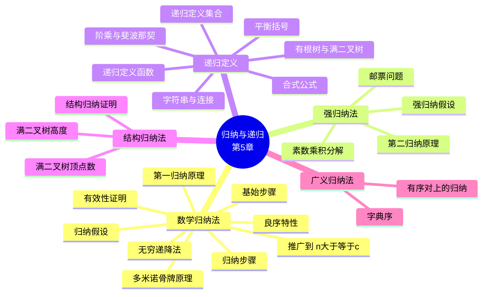

# 归纳与递归（Induction and Recursion）

> **本章主线**：从"如何证明一个对**所有自然数**都成立的命题"这一根本问题出发，先给出**数学归纳法**（第一归纳原理）这一把无限个命题压缩成两步的证明机器，再把它加强为**强归纳法**（第二归纳原理）与**良序特性**；随后把"归纳"的思想从**证明**搬到**定义**上，得到**递归定义**——用自身的小规模情形刻画函数、集合与结构；最后用**结构归纳法**证明递归定义对象的性质，并把归纳推广到**有序对**等更一般的良序结构上。整章的逻辑是：**先用归纳证明（5.1–5.2），再用递归定义（5.3），最后用结构归纳证明递归对象的性质（5.3 末）**。

> 一句话版本：**归纳是"站上第一块骨牌，再保证每一块都推得倒下一块"**——它把"验证无穷多个情形"这件不可能的事，换成了"验证起点 + 验证一步传递"这两件可能的事；而递归则是归纳在**定义**上的孪生兄弟：用小的说大的。

---

## 5.1 数学归纳法（Mathematical Induction）

本节概要：**归纳原理 → 归纳证明的骨架 → 若干典型例题 → 常见错误 → 推广形式**。归纳法是本章全部内容的发动机，也是整个离散数学中证明"对所有 $n$ 成立"这类命题的**标准武器**。

### 5.1.1 归纳法的直观：多米诺骨牌效应

**数学归纳法（mathematical induction）** 是一种**强大而严格的技术**，用于证明谓词 $P(n)$ 对**每个自然数** $n$ 都成立，无论 $n$ 有多大。它的直观模型是**多米诺骨牌效应（the domino effect）**：

- **前提 1**：第 $0$ 块骨牌倒下（Premise #1: Domino #0 falls）。
- **前提 2**：对每个 $n$，若第 $n$ 块骨牌倒下，则第 $n+1$ 块也会倒下（Premise #2: For every $n\in\mathbb{N}$, if domino #n falls, then domino #(n+1) also falls）。
- **结论**：所有骨牌都会倒下。

这个比喻的价值在于它揭示了归纳法的**两个前提缺一不可**：只保证"起点倒下"而不管传递，骨牌只能倒一块；只保证"传递"而起点不倒，所有骨牌都纹丝不动。**归纳法的全部力量就来自这两句话的组合。**

### 5.1.2 第一归纳原理（The First Principle of Mathematical Induction）

归纳法建立在下述**谓词逻辑的推理规则**之上：

$$
\frac{P(0) \qquad \forall n \ge 0\ (P(n) \to P(n+1))}{\therefore\ \forall n \ge 0\ P(n)}
$$

即：**若 $P(0)$ 为真，且对每个 $n \ge 0$ 都有 $P(n) \to P(n+1)$，则 $\forall n \ge 0\ P(n)$ 为真。** 该规则称为**第一归纳原理**。

**该推理规则的有效性证明**：给定任意 $k \ge 0$，第二个前提 $\forall n\ge 0\ (P(n) \to P(n+1))$ 显然蕴含

$$
\forall n \ge 0\ \big(n < k \to (P(n) \to P(n+1))\big),
$$

也就是蕴含了下述一串逐块相邻的蕴涵式：

$$
(P(0) \to P(1)) \ \wedge\ (P(1) \to P(2)) \ \wedge\ \cdots \ \wedge\ (P(k-1) \to P(k)).
$$

对这串相邻蕴涵式**反复使用假言三段论（hypothetical syllogism）** $k-1$ 次，即得 $P(0) \to P(k)$；再由第一个前提 $P(0)$ 与**假言推理（modus ponens）**，就得到 $P(k)$。由于 $k$ 是任意的，故 $\forall k \ge 0\ P(k)$。$\blacksquare$

**这一步为什么要证明？** 因为归纳法并非"显然成立"——它的严格性恰恰来自把"无穷多步"化归为"有限步的推理规则"。

### 5.1.3 归纳证明的骨架

要证明 $\forall n\ P(n)$，遵循以下**两步模板**：

1. **基始步骤（basis step，基始）**：证明 $P(0)$（或其他起点值）为真。
2. **归纳步骤（inductive step，归纳）**：证明 $\forall n\ (P(n) \to P(n+1))$。

归纳步骤通常这样展开：

1. 令 $n\in\mathbb{N}$，**假设 $P(n)$ 为真**——这一假设称为**归纳假设（inductive hypothesis）**。
2. 在此假设下，**证明 $P(n+1)$ 为真**。常用**直接证明**；也可视情形使用其他证法。

两步骤完成后，**归纳推理规则**即给出 $\forall n\ P(n)$。

**归纳法的推广形式**：该规则同样可用于证明 $\forall n \ge c\ P(n)$（$c$ 为给定常数，$c$ 未必为 $0$）。此时**基始步骤改为证明 $P(c)$**，其余不变。这是实际做题中最常用的形式——绝大多数题目要求证明的起点是 $n = 1$ 或 $n = 2$。

### 5.1.4 典型例题

#### 例 5.1：前 $n$ 个奇数之和为 $n^2$

**题目**：证明前 $n$ 个正奇数之和等于 $n^2$，即证明

$$
\forall n \ge 1:\quad \sum_{i=1}^{n} (2i - 1) = n^2. \qquad P(n)
$$

**基始步骤**：取 $n = 1$。前 $1$ 个正奇数之和为 $1$，而 $1 = 1^2$，故 $P(1)$ 为真。

**归纳步骤**：证明 $\forall n\ge 1:\ P(n) \to P(n+1)$。设 $n \ge 1$，假设 $P(n)$ 为真（即 $1 + 3 + \cdots + (2n-1) = n^2$），证明 $P(n+1)$：

$$
\begin{aligned}
\sum_{i=1}^{n+1}(2i-1)
&= \left(\sum_{i=1}^{n}(2i-1)\right) + \big(2(n+1)-1\big) \\
&= n^2 + (2n+1) \qquad & &\text{（由归纳假设 } P(n)\text{）} \\
&= (n+1)^2. \qquad & &\text{（恰好是 } P(n+1) \text{ 的右端）}
\end{aligned}
$$

**结论**：由归纳原理，$P(n)$ 对一切 $n \ge 1$ 成立。$\blacksquare$

**核心技巧**：归纳步骤的关键动作是**从和式中"剥出"最后一项**，把 $n+1$ 项之和写成 $n$ 项之和 $+$ 第 $n+1$ 项，然后把归纳假设**整体代入**——这一步几乎所有求和的归纳题都一样。

#### 例 5.2：$\forall n > 0,\ n < 2^n$

**题目**：证明对每个正整数 $n$，$n < 2^n$。令 $P(n) = (n < 2^n)$。

**基始步骤**：$P(1) = (1 < 2^1) = (1 < 2) = \mathbf{T}$，成立。

**归纳步骤**：对 $n > 0$，假设 $n < 2^n$，证明 $n + 1 < 2^{n+1}$：

$$
\begin{aligned}
n + 1 &< 2^n + 1 \qquad & &\text{（由归纳假设）} \\
      &< 2^n + 2^n \qquad & &\text{（因为 } 1 < 2^n\text{，当 } n \ge 1\text{）} \\
      &= 2^{n+1}.
\end{aligned}
$$

**核心技巧**：本题的难点是"**放大时要把 $1$ 放成 $2^n$ 而不是别的**"。若直接写 $2^n + 1 < 2^{n+1}$ 需要额外论证 $1 < 2^n$（靠 $n\ge1$），这一步是本题唯一的"技术点"。**放缩的方向与幅度必须服务于目标形式。**

#### 例 5.3：$n$ 元集的并集与交集的对偶

**题目**：设 $A_1, A_2, \ldots, A_n$ 是任意 $n$ 个集合，证明

$$
\overline{\bigcup_{i=1}^{n} A_i} = \bigcap_{i=1}^{n} \overline{A_i}.
$$

**解**：令 $P(n)$ 为"该等式对任意 $n$ 个集合成立"这一谓词。

**基始步骤**：$n = 1$ 时两端都是 $\overline{A_1}$，故 $P(1)$ 为真。

**归纳步骤**：设 $P(k)$ 成立，考察 $P(k+1)$ 的左端：

$$
\begin{aligned}
\overline{\bigcup_{i=1}^{k+1} A_i}
&= \overline{\left(\bigcup_{i=1}^{k} A_i\right) \cup A_{k+1}} \qquad & &\text{（结合律，拆出第 } k+1 \text{ 项）} \\
&= \overline{\left(\bigcup_{i=1}^{k} A_i\right)} \cap \overline{A_{k+1}} \qquad & &\text{（由 De Morgan 律）} \\
&= \left(\bigcap_{i=1}^{k} \overline{A_i}\right) \cap \overline{A_{k+1}} \qquad & &\text{（由归纳假设 } P(k)\text{）} \\
&= \bigcap_{i=1}^{k+1} \overline{A_i}. \qquad & &\text{（即 } P(k+1) \text{ 的右端）}
\end{aligned}
$$

故 $P(k+1)$ 为真，由归纳原理 $P(n)$ 对一切 $n \ge 1$ 成立。$\blacksquare$

**核心技巧**：这是**把二元运算律"推广到 $n$ 元"的标准套路**——先用**结合律**把 $n+1$ 个元素拆成"前 $n$ 个 $+$ 第 $n+1$ 个"，再用**二元的该定律**（此处为 De Morgan 律）处理，最后用**归纳假设**收尾。凡是要证"某个二元运算的定律对 $n$ 元都成立"，都可以照此三步走。

#### 例 5.4：有限集的子集个数为 $2^n$

**题目**：证明若 $S$ 是含 $n$ 个元素的有限集（$n$ 为非负整数），则 $S$ 有 $2^n$ 个子集。

**解**：令 $P(n)$ 为"含 $n$ 个元素的集合有 $2^n$ 个子集"。

**基始步骤**：$P(0)$ 为真。空集 $\varnothing$ 只有它自身一个子集，而 $2^0 = 1$。

**归纳步骤**：设对任意非负整数 $k$，$P(k)$ 为真（归纳假设：**每个含 $k$ 个元素的集合都有 $2^k$ 个子集**）。设 $T$ 是含 $k+1$ 个元素的集合，则

$$
T = S \cup \{a\}, \quad \text{其中 } a \in T,\ S = T - \{a\},\ |S| = k.
$$

对 $S$ 的**每个**子集 $X$，$T$ 中恰有**两个**子集与之对应，即 $X$ 与 $X \cup \{a\}$。由归纳假设，$S$ 有 $2^k$ 个子集；于是 $T$ 的子集个数为

$$
2 \cdot 2^k = 2^{k+1}.
$$

故 $P(k+1)$ 为真，由归纳原理结论成立。$\blacksquare$

**核心技巧**：本题的灵魂是**"配对"思想**——把 $T$ 的子集按"是否含 $a$"两两配对，从而把 $2^{k+1}$ 个对象归约到 $2^k$ 组。**面对"计数翻倍"的归纳题，先想能不能构造出一一对应的配对。**

#### 例 5.5：任何有限非空集都是可数的

**题目**：证明任何有限非空集都是**可数的（countable）**，即它可以被排列成一个序列（列表）。

**解**：令 $P(n)$ 为"若 $|A| = n \ge 1$，则 $A$ 可数"。

**基始步骤**：$n_0 = 1$ 时，取任意单元素集 $A = \{x\}$。此时 $x$ 自身构成一个序列，其对应集合正是 $A$，故 $P(1)$ 为真。

**归纳步骤**：假设 $P(k)$ 成立，即任何含 $k$ 个元素的集合 $A$ 都是可数的。取任意含 $k+1$ 个元素的集合 $B$，任取其中一元素 $x$。

- 由于 $B - \{x\}$ 是含 $k$ 个元素的集合，由归纳假设 $P(k)$，存在序列 $x_1, x_2, \ldots, x_k$ 以 $B - \{x\}$ 为其对应集合。
- 于是序列 $x_1, x_2, \ldots, x_k, x$ 就以 $B$ 为对应集合，故 $B$ 可数。
- 因为 $B$ 可以是任意含 $k+1$ 个元素的集合，故 $P(k)$ 成立时 $P(k+1)$ 必成立。

**结论**：由归纳原理，$P(n)$ 对一切 $n \ge 1$ 成立。$\blacksquare$

**核心技巧**：与例 5.4 同样的"**增加一个元素**"结构，但此处不是配对计数而是**构造序列**：把新元素**追加到列表末尾**。注意归纳假设必须对"任意的" $k$ 元集成立，才能用在 $B - \{x\}$ 上。

### 5.1.5 归纳证明的书写准则

归纳证明虽然机械，但书写上的疏漏极容易导致"看似正确实则无效"。以下准则应当成为习惯：

- **明确写出 $P(n)$**：在动手之前先把谓词 $P(n)$ 用一句话或一个等式**写清楚**。常见错误是 $P(n)$ 写错（比如把"$n$ 项之和"写成"$n$ 项之积"），结果整题跑偏。
- **基始步骤不可省**：即使它"显而易见"，也必须写出并说明它对应哪一步。
- **归纳假设必须明确声明**：要写出"假设 $P(k)$ 为真"，并明确 $k$ 的取值范围。
- **归纳步骤要指明用到假设的位置**：在推导中标注"**由归纳假设**"，让读者（和阅卷人）看到链条确实闭合。
- **不要把要证的东西当作已知**：归纳步骤的目标是 $P(k+1)$，推导中**不能**直接使用 $P(k+1)$。
- **基始步骤的起点要与 $P(n)$ 的定义域一致**：若命题从 $n \ge 3$ 开始，就应验证 $P(3)$，而不是 $P(0)$。

**（补充说明/拓展）**：一个实用的自检方法是"**逆推检查**"——把归纳步骤中**最后一次变形**的结果与 $P(k+1)$ 的**右端**逐字对照。如果两者形状不一致，说明推导链没有真正到达目标（这是最常见的失分点，往往发生在最后一步"忘了把 $k+1$ 代回去"）。

### 5.1.6 常见错误：两个"伪证明"

归纳法最容易出错的地方不是计算，而是**归纳步骤中隐含的不成立假设**。下面两个经典反例说明了问题的严重性。

#### 反例一：所有马都是同一颜色

**"定理"**：所有的马都是同一颜色。

**"证明"（归纳）**：对 $n$ 归纳，$P(n)$ = "任意 $n$ 匹马颜色相同"。

- 基始：$n = 1$ 时，一匹马显然与自身同色，$P(1)$ 为真。
- 归纳步骤：假设 $P(k)$ 成立，考虑 $k+1$ 匹马 $h_1, h_2, \ldots, h_{k+1}$。对前 $k$ 匹 $h_1, \ldots, h_k$ 用 $P(k)$ 得它们同色；对后 $k$ 匹 $h_2, \ldots, h_{k+1}$ 用 $P(k)$ 得它们也同色。两组有公共马 $h_2, \ldots, h_k$，故 $k+1$ 匹同色。

**错在哪里？** 归纳步骤在 $k = 1$ 时**失效**：当 $k = 1$ 时，"前 $1$ 匹"是 $\{h_1\}$，"后 $1$ 匹"是 $\{h_2\}$，两者**没有公共元素**——"两组有公共马"这一关键论断不成立。因此归纳链条从第 1 步到第 2 步就断了。

#### 反例二：平面上任意多条互不平行的直线共点

**"定理"**：设 $P(n)$ 为"平面上任意 $n$ 条两两不平行的直线交于一点"，则 $P(n)$ 对所有 $n \ge 2$ 成立。

**"证明"**：

- **基始步骤**：$n = 2$ 时，两条不平行直线必交于唯一一点，$P(2)$ 为真。
- **归纳步骤**：设 $P(k)$ 成立，考虑 $k+1$ 条两两不平行的直线。由归纳假设，**前 $k$ 条**交于公共点 $p_1$；再由归纳假设，**后 $k$ 条**也交于公共点 $p_2$。

**错在哪里？** 关键在于 $p_1$ 与 $p_2$ 未必相同。前 $k$ 条与后 $k$ 条有 $k-1$ 条公共直线：

- 当 $k \ge 3$ 时，这 $k-1 \ge 2$ 条公共直线中有两条不同直线，它们**至多交于一点**，故 $p_1$ 必须等于 $p_2$——这一步成立。
- 但当 $k = 2$ 时，前后两组各 2 条直线只有 $1$ 条公共直线，**无法强制 $p_1 = p_2$**。于是归纳链条同样在 $k = 2$ 处断裂。

**（补充说明/拓展）**：这两个反例的共同结构是：**归纳步骤在某个特定的 $k$ 值上需要额外的"重叠充分性"条件，而该条件在小 $k$ 时恰好不满足**。因此归纳证明完成后，必须回头检查**归纳步骤在最小值处是否真的成立**——这与基始步骤无关，却同样致命。判断口诀：**"传递链条的每一步是否真的接上了？"**

### 5.1.7 强归纳法（第二归纳原理）

**强归纳法（strong induction）**，又称**第二归纳原理（the second principle of induction）**，其特征推理规则为：

$$
\frac{P(0) \qquad \forall n \ge 0:\ \big(\forall\, 0 \le k \le n\ P(k)\big) \to P(n+1)}{\therefore\ \forall n \ge 0:\ P(n)}
$$

它与第一归纳原理的**唯一区别**在于：归纳步骤所用的假设更强。第一原理只需假设 $P(n)$（即 $k = n$ 这一情形），而第二原理假设**所有更小的 $k \le n$ 都使 $P(k)$ 成立**。

两种叙述方式的对照：

| | 归纳步骤的假设 | 归纳步骤的目标 |
|---|---|---|
| **第一归纳原理** | 对每个 $n$，假设 $S(n)$ 为真 | 证明 $S(n+1)$ 为真 |
| **第二归纳原理（强归纳）** | 对每个 $n$，假设对**所有** $k < n+1$ 都有 $S(k)$ 为真 | 证明 $S(n+1)$ 为真 |

> **注意**：强归纳法与弱归纳法在**证明能力上等价**——凡是能用强归纳证明的，都能改写成弱归纳（反之亦然）。强归纳的价值在于**书写更自然**，尤其当 $P(n+1)$ 的证明需要用到**多个**更小情形（如 $P(n)$ 和 $P(n-1)$）时。

**两种看待归纳的视角**（多米诺比喻的两种版本）：

- **弱归纳视角**：$d_0$ 撞倒 $d_1$，$d_1$ 撞倒 $d_2$……对应 $P(0) \Rightarrow P(1)$、$P(1) \Rightarrow P(2)$……即 $P(i) \Rightarrow P(i+1)$。**每块骨牌只被前一块撞倒。**
- **强归纳视角**：$d_1$ 倒了是因为 $d_0$ 倒了，$d_2$ 倒了是因为 $d_0$ 和 $d_1$ 都倒了……对应 $P(0) \Rightarrow P(1)$、$(P(0) \wedge P(1)) \Rightarrow P(2)$……即 $(\forall i < j\ P(i)) \Rightarrow P(j)$。**每块骨牌被它前面所有骨牌一起撞倒。**

两种视角描述的是**同一件事**（骨牌全倒），差别只在"把哪些倒下的骨牌算作推力来源"。

### 5.1.8 强归纳法典型例题

#### 例 5.6：每个大于 1 的整数都可表示为素数之积（分解的存在性）

**题目**：证明每个整数 $n > 1$ 都可以写成若干（$s$ 个）素数的乘积 $p_1 p_2 \cdots p_s$。

**解**：令 $P(n)$ = "$n$ 具有该性质"。

**基始步骤**：$n = 2$。取 $s = 1$，$p_1 = 2$，则 $2 = 2$ 是素数之积，故 $P(2)$ 为真。

**归纳步骤**：设 $n \ge 2$，假设对一切 $2 \le k \le n$ 都有 $P(k)$ 成立。考察 $n+1$：

- **情形 1：$n+1$ 是素数**。取 $s = 1$，$p_1 = n+1$，则 $P(n+1)$ 成立。
- **情形 2：$n+1$ 不是素数**。则 $n+1 = ab$，其中 $1 < a \le n$ 且 $1 < b \le n$。由归纳假设，$a = p_1 p_2 \cdots p_t$，$b = q_1 q_2 \cdots q_u$。于是
  $$
  n+1 = p_1 p_2 \cdots p_t\, q_1 q_2 \cdots q_u,
  $$
  是 $s = t + u$ 个素数之积，故 $P(n+1)$ 成立。

**结论**：由强归纳原理，每个 $n > 1$ 都可表示为素数之积。$\blacksquare$

**为什么这里必须用强归纳？** 因为把 $n+1$ 分解为 $a\cdot b$ 后，$a$ 与 $b$ 都只是**比 $n+1$ 小**，并**不保证等于 $n$**。若用弱归纳（只假设 $P(n)$），就完全无法处理 $a, b < n$ 的情形。**"需要用到多个更小情形"正是强归纳的用武之地。**

**另一种等价叙述**（同一证明的简化版）：

- 基始：$n = 2$ 是素数，$P(2)$ 为真。
- 归纳步骤：假设 $\forall i < n:\ P(i)$ 成立。**情形 1**：$n$ 是素数，则 $P(n)$ 成立，结束。**情形 2**：$n$ 不是素数，则 $n = ab$，其中 $1 < a, b < n$。由假设 $P(a)$ 与 $P(b)$ 成立，故 $n$ 是素数之积。

#### 例 5.7：邮票问题（12 分及以上的邮资都可用 4 分与 5 分邮票凑出）

**题目**：证明任何**不少于 12 分**的邮资都可以只用 **4 分**和 **5 分**的邮票凑出。令 $P(n)$ = "$n$ 分邮资可以凑出"。

**基始步骤**：需要验证**连续四个**情形（这是**强归纳**特有的：为了往前推 4 步，必须先把 4 个起点都立住）：

$$
12 = 3 \times 4, \qquad 13 = 2 \times 4 + 1 \times 5, \qquad 14 = 1 \times 4 + 2 \times 5, \qquad 15 = 3 \times 5.
$$

故对一切 $12 \le n \le 15$，$P(n)$ 成立。

**归纳步骤**：设 $n \ge 15$，假设对一切 $12 \le k \le n$ 都有 $P(k)$ 成立。注意 $12 \le n - 3 \le n$，故由归纳假设 $P(n-3)$ 成立；**再加一张 4 分邮票**即得

$$
(n - 3) + 4 = n + 1
$$

分邮资的凑法。故 $P(n+1)$ 成立。

**结论**：由强归纳原理，$P(n)$ 对一切 $n \ge 12$ 成立。$\blacksquare$

**核心技巧**：本题是**"步长型强归纳"的模板**——归纳步骤不是从 $n$ 推到 $n+1$，而是从 $n-3$ 推到 $n+1$（跨度 4）。这时**基始步骤必须验证足够多的连续起点**，否则链条会断（例如只验证 $12$，则 $16$ 需要 $13$，而 $13$ 未证）。**步长与基始个数的关系是这类题的唯一考点。**

### 5.1.9 良序特性（The Well-Ordering Property）

**良序特性**是证明归纳推理规则有效性的**另一条途径**，它说：

> **每个非空的非负整数集合都有最小（最小）元素。**

形式化地：

$$
\forall\, S \subseteq \mathbb{N},\ S \ne \varnothing:\quad \exists\, m \in S:\ \forall n \in S:\ m \le n.
$$

**它如何推出归纳法？** 由良序特性，集合 $\{n \mid \neg P(n)\}$（若非空）必有最小元素 $m$。但由 $m$ 的最小性，$P(m-1)$ 必须为真；而归纳步骤断言 $P(m-1) \to P(m)$，于是 $P(m)$ 为真——这与 $m \in \{n \mid \neg P(n)\}$ 矛盾。故该集合必为空，即 $\forall n\ P(n)$。

**良序特性、强归纳、弱归纳三者的等价性**：三者可以互相推导，是同一个原理的三种表述。实践中，**良序特性常用于"反证式"证明**（假设存在反例，取最小反例，导出矛盾），这与归纳法的"正面推进"形成互补。

### 5.1.10 无穷递降法（The Method of Infinite Descent）

**无穷递降法**是**证明 $P(n)$ 对所有 $n \in \mathbb{N}$ 都为假**的一种方法——可以说是归纳原理的**逆向对偶**。

它的思路是**先证明**

$$
\forall P(n):\ \exists\, k < n:\ P(k),
$$

即"**对每个成立的 $P$，都存在一个更小的成立的 $P$**"。但由 $\mathbb{N}$ 的良序特性，

$$
\exists P(m) \implies \exists P(n):\ \forall P(k):\ n \le k,
$$

即"**若存在成立的 $P$，就存在最小的成立的 $P$**"。这两条论断**相互矛盾**，除非根本不存在 $P(m)$——即

$$
\forall m \in \mathbb{N}:\ \neg P(m),
$$

**不存在任何 $P$**。

**无穷递降法例题：$\sqrt{2}$ 是无理数**

**题目**：证明 $\sqrt{2}$ 不是有理数。

**证明**：反设 $\sqrt{2}$ 是有理数，则存在正整数 $m, n$ 使 $\sqrt{2} = m/n$。令 $M, N$ 是使该式成立的、**分母 $n$ 最小的**那一对整数（由良序特性，这样的最小 $N$ 存在）。

由此可构造出**分母更小**的表示：取

$$
j = 2N - M, \qquad k = M - N,
$$

则可以验证

$$
\sqrt{2} = \frac{j}{k}, \qquad k < N.
$$

这与 $N$ 的最小性矛盾。故 $\sqrt{2}$ 是无理数。$\blacksquare$

**（补充说明/拓展）**：这里 $j = 2N - M$、$k = M - N$ 的构造来源于 $\sqrt2 = m/n$ 的等价变形：由 $m^2 = 2n^2$ 与 $0 < m - n < n$（因为 $1 < \sqrt2 < 2$）可得 $m - n$ 是更小的分母。**无穷递降法与"取最小反例"的反证法本质上是一回事**，只是叙述上把"矛盾"显式地表现为"可以不断变小下去"。

### 5.1.11 归纳法与其他证明方法的对比

| 维度 | 第一归纳原理 | 第二归纳原理（强归纳） | 良序特性 | 无穷递降法 |
|---|---|---|---|---|
| **归纳假设** | 仅 $P(n)$ | 所有 $k \le n$ 的 $P(k)$ | — | 假定反例存在 |
| **典型用途** | 求和恒等式、不等式、计数 | 分解存在性、步长型问题 | 证明归纳法有效性、取最小反例 | 证明"对所有 $n$ 都假" |
| **书写难度** | 最简 | 稍繁（假设更强） | 常需反证 | 需构造更小实例 |
| **证明能力** | 三者等价 | 三者等价 | 三者等价 | 与反证法等价 |

**一句口诀**：**弱归纳"只看前一块"，强归纳"看全部前情"，良序"取最小反例"，递降"越推越小直到矛盾"。**

---

## 5.2 强归纳与良序性（Strong Induction and Well-Ordering）

本节概要：**第二归纳原理（强归纳法）→ 良序特性 → 无穷递降法**。上一节已经把强归纳法作为第一归纳原理的加强版介绍完毕（5.1.7–5.1.8），本节把它正式作为**独立的推理规则**确立下来，并给出与之等价的**良序特性**——三者是同一件事的三种说法。

### 5.2.1 第二归纳原理的正式表述

**第二归纳原理（the second principle of induction）**的特征推理规则为：

$$
\frac{P(0) \qquad \forall n \ge 0:\ \big(\forall\, 0 \le k \le n\ P(k)\big) \to P(n+1)}{\therefore\ \forall n \ge 0:\ P(n)}
$$

**与第一原理的唯一差别**：归纳步骤所用的假设更强。第一原理只需假设 $P(n)$；第二原理假设**对所有更小的 $k$ 都有 $P(k)$ 成立**，即"$P$ 在所有先前情形中都为真（$P$ is true in all previous cases）"。

**强归纳法的标准叙述形式**：设 $S(n)$ 是待证命题，则把第一归纳原理中的归纳步骤

> 对每个 $n$，**假设 $S(n)$ 为真**，证明 $S(n+1)$ 为真

替换为

> 对每个 $n$，**假设对所有 $k < n+1$ 都有 $S(k)$ 为真**，证明 $S(n+1)$ 为真。

**为什么需要强归纳？** 因为很多命题的 $P(n+1)$ 证明需要**同时**用到 $P(n)$、$P(n-1)$ 甚至更早的多个情形（例如斐波那契数列的 $f_{k+1} = f_k + f_{k-1}$ 就同时需要 $P(k)$ 与 $P(k-1)$）。强归纳法把这些情形**一次性**全部假设下来，避免在证明中临时补证。

### 5.2.2 强归纳法的经典应用

#### 例 5.8：邮资问题的强归纳叙述

见 5.1.8 例 5.7。**该例是强归纳法"步长型"用法的标准范例**：为确保归纳步骤可以从 $n-3$ 推到 $n+1$，基始步骤必须验证 $12, 13, 14, 15$ 这四个连续值。**基始步骤的个数必须覆盖归纳步骤的跨度**，这是强归纳法最容易出错的地方。

#### 例 5.9：算术基本定理的存在性部分

见 5.1.8 例 5.6。**每个大于 1 的整数都是素数之积**。该定理的证明是强归纳法最经典的应用，因为它把 $n+1$ 分成 $a \cdot b$ 后，需要同时用到 $P(a)$ 与 $P(b)$，而 $a, b$ 都只是"小于 $n+1$"，无从用弱归纳处理。

**（补充说明/拓展）**：算术基本定理的完整内容包含**存在性**与**唯一性**两部分。此处证明的是**存在性**（每个 $n > 1$ 都可分解）；**唯一性**（分解在非递减次序下唯一）需要借助欧几里得引理（若 $p$ 为素数且 $p \mid ab$，则 $p \mid a$ 或 $p \mid b$），其证明依赖于数论中的裴蜀定理，已超出归纳法本身的范围。

### 5.2.3 良序特性（The Well-Ordering Property）

**良序特性**是归纳原理的另一种等价表述，它说：

> **每个非空的非负整数集合都有最小（最小）元素。**（Every non-empty set of non-negative integers has a minimum (smallest) element.）

形式化地：

$$
\forall\, S \subseteq \mathbb{N},\ S \ne \varnothing:\quad \exists\, m \in S:\ \forall n \in S:\ m \le n.
$$

**良序特性如何证明归纳法的有效性？** 设归纳法的两个前提成立。考虑集合 $\{n \mid \neg P(n)\}$：

1. 若该集合为空，则 $\forall n\ P(n)$，结论已成立。
2. 若该集合非空，由良序特性它有最小元素 $m$。
3. 由于 $m$ 是**最小**的反例，$P(m-1)$ 必为真（当 $m > 0$ 时）；而当 $m = 0$ 时，与基始步骤 $P(0)$ 矛盾。
4. 但归纳步骤断言 $P(m-1) \to P(m)$，故 $P(m)$ 为真——这与 $m \in \{n \mid \neg P(n)\}$ 矛盾。

因此该集合必为空，即 $\forall n\ P(n)$。

> **注意**：良序特性只对**非负整数集**（或更一般地，任何**良序集**）成立，对整数集 $\mathbb{Z}$、有理数集 $\mathbb{Q}$、实数集 $\mathbb{R}$ 都**不成立**（例如 $\mathbb{Z}$ 的全体负整数集没有最小元素，$\mathbb{Q} \cap (0,1)$ 没有最小元素）。**归纳法之所以能在自然数上工作，根本原因正是自然数的良序性。**

**良序特性的实战用法：最小反例法**

良序特性最常用的形式是**反证 + 取最小反例**，其模板为：

1. **反设**命题为假，即存在反例。
2. 由良序特性，取**最小的**反例 $m$。
3. 利用 $m$ 的最小性：所有比 $m$ 小的情形都成立，据此导出矛盾。

这与强归纳法在逻辑上完全等价，但**书写上常常更简洁**——尤其适合"证明某个数不存在"或"证明某个性质必然成立"的题目。

### 5.2.4 无穷递降法（The Method of Infinite Descent）

**无穷递降法**是证明 $P(n)$ 对所有 $n \in \mathbb{N}$ 都为**假**的方法，可以看作**归纳原理的逆向对偶（a converse to the principle of induction）**。

**方法结构**：

1. **先证明**：对每个成立的 $P(n)$，都存在一个更小的 $k < n$ 使 $P(k)$ 成立。即
   $$
   \forall P(n):\ \exists\, k < n:\ P(k),
   $$
   通俗地说——"**对每个 $P$ 都存在一个更小的 $P$**"。
2. **由良序特性**：若存在成立的 $P$，则存在**最小的**成立的 $P$。即
   $$
   \exists P(m) \implies \exists P(n):\ \forall P(k):\ n \le k,
   $$
   通俗地说——"**若存在 $P$，就存在最小的 $P$**"。
3. **两论断矛盾**（第 1 步说可以永远变小，第 2 步说必有最小值），故第 1 步的假设不成立，即**不存在任何 $P$**：
   $$
   \forall m \in \mathbb{N}:\ \neg P(m).
   $$

**无穷递降法例题：$\sqrt{2}$ 是无理数**

**题目**：证明 $\sqrt{2}$ 不是有理数。

**证明**：反设 $\sqrt{2}$ 是有理数，则存在正整数 $m, n \in \mathbb{Z}^+$ 使 $\sqrt{2} = m/n$。在所有这样的表示中，取**分母 $n$ 最小**的一对，记作 $M, N$（即 $\sqrt{2} = M/N$，且 $N$ 是所有可能分母中最小的）。

由 $\sqrt2 = M/N$ 与 $1 < \sqrt2 < 2$ 可得 $N < M < 2N$，故

$$
0 < M - N < N.
$$

现在令

$$
j = 2N - M, \qquad k = M - N,
$$

则可以验证 $\sqrt{2} = j/k$，且其分母 $k = M - N < N$。

这与 $N$ 的**最小性**矛盾。故 $\sqrt{2}$ 是无理数。$\blacksquare$

**关键技巧**：证明的核心是**从任一有理表示构造出一个分母更小的有理表示**。构造的动机来自 $\sqrt2 = M/N \Rightarrow M^2 = 2N^2$：由此可以推出 $M - N$ 与 $2N - M$ 都是正整数，且比值仍为 $\sqrt2$ 而分母更小。**无穷递降法与"取最小反例"的反证法本质上是一回事**，只是把矛盾显式地表现为"可以无限变小"。

### 5.2.5 三种原理的等价性总结

| 原理 | 核心断言 | 典型使用场景 | 叙述风格 |
|---|---|---|---|
| **第一归纳原理** | $P(0) \wedge \forall n(P(n) \to P(n+1)) \Rightarrow \forall n P(n)$ | 求和、不等式、计数恒等式 | 正面推进 |
| **第二归纳原理（强归纳）** | $P(0) \wedge \forall n(\forall k\le n\ P(k) \to P(n+1)) \Rightarrow \forall n P(n)$ | 分解存在性、多情形依赖 | 正面推进，假设更强 |
| **良序特性** | 非空 $\mathbb{N}$ 子集必有最小元 | 取最小反例、证明归纳法有效性 | 反证式 |

**三者可以互相推导，在证明能力上完全等价。** 选择哪一种取决于题目：**需要多个更小情形时用强归纳；需要"取最小反例"时用良序特性；证明"对所有 $n$ 都假"时用无穷递降法。**

**一句口诀**：**弱归纳"看前一块"，强归纳"看全部前情"，良序"取最小反例"，递降"越推越小直到矛盾"。**

---

## 5.3 递归定义与结构归纳法（Recursive Definitions and Structural Induction）

本节概要：**递归定义函数 → 递归定义集合与结构 → 结构归纳法 → 广义归纳法**。本节把归纳法的思想从**证明**搬到**定义**上：所谓**递归定义**，就是"用自身的小规模情形来规定大规模情形"；而**结构归纳法**则是针对这样定义出来的对象做证明的标准方法。

### 5.3.1 递归定义的函数（Recursively Defined Functions）

**定义（递归定义 / 归纳定义）**：一个函数的**递归定义（recursive definition）**或**归纳定义（inductive definition）**由两个步骤组成：

- **基始步骤（BASIS STEP）**：指定该函数在**零点**处的值。
- **递归步骤（RECURSIVE STEP）**：给出由函数在**较小整数**处的值求其在某个整数处的值的规则。

> **重要前提**：递归定义要**良定义（well-defined）**，必须满足两点——(1) 基始值已明确给出；(2) 递归规则每次只依赖**严格更小**的自变量取值。否则定义可能自相矛盾或无法确定唯一值。

#### 例 5.10：由递归式求值

**题目**：设 $f$ 由下式定义：

$$
f(0) = 3, \qquad f(n + 1) = 2f(n) + 3.
$$

求 $f(1), f(2), f(3), f(4)$。

**解**：逐步代入递归式：

$$
\begin{aligned}
f(1) &= 2f(0) + 3 = 2 \cdot 3 + 3 = 9, \\
f(2) &= 2f(1) + 3 = 2 \cdot 9 + 3 = 21, \\
f(3) &= 2f(2) + 3 = 2 \cdot 21 + 3 = 45, \\
f(4) &= 2f(3) + 3 = 2 \cdot 45 + 3 = 93.
\end{aligned}
$$

**核心技巧**：递归求值的关键是**严格按顺序自小到大逐项代入**——每一项都必须用**已经算出的前一项**，不能跳步。**（补充说明/拓展）**：该递归式的闭式为 $f(n) = 3 \cdot 2^{n+1} - 3$，可直接验证 $f(0) = 3$、$f(4) = 93$；把递归式化为闭式（"求解递推关系"）是第 8 章的主题。

#### 例 5.11：阶乘的递归定义

$$
f(0) = 1, \qquad f(n + 1) = (n + 1) \cdot f(n) \quad (n \ge 0).
$$

这就是通常记作 $f(n) = n!$ 的阶乘函数。

#### 例 5.12：求和与幂的递归定义

**求和**的递归定义：

$$
\sum_{k=0}^{0} a_k = a_0, \qquad \sum_{k=0}^{n+1} a_k = \sum_{k=0}^{n} a_k + a_{n+1}.
$$

**幂**的递归定义：

$$
a^0 = 1, \qquad a^{n+1} = a^n \cdot a.
$$

**核心技巧**：这两个定义揭示了"$\sum$ 与指数记号"这类**看起来是基本记号的东西，其实都是递归定义的缩写**。理解了这一点，求和与幂的各种恒等式就都能用归纳法证明了——因为它们的定义本身就是归纳式的。

### 5.3.2 斐波那契数列（Fibonacci Numbers）

**定义**：**斐波那契数列**由下式递归定义：

$$
f_0 = 0, \qquad f_1 = 1, \qquad f_n = f_{n-1} + f_{n-2} \quad (n \ge 2).
$$

数列的开头是 $0, 1, 1, 2, 3, 5, 8, 13, \ldots$

> **注意**：斐波那契数列的递归定义需要**两个**基始值（$f_0$ 与 $f_1$），因为递归步骤同时依赖前**两项**。这与阶乘只需一个基始值形成对照。**递归步骤依赖多少项，基始步骤就需要多少个值。**

#### 例 5.13：斐波那契数列的求值

**题目**：求 $f_2, f_3, f_4, f_5$。

**解**：

$$
\begin{aligned}
f_2 &= f_1 + f_0 = 1 + 0 = 1, \\
f_3 &= f_2 + f_1 = 1 + 1 = 2, \\
f_4 &= f_3 + f_2 = 2 + 1 = 3, \\
f_5 &= f_4 + f_3 = 3 + 2 = 5.
\end{aligned}
$$

#### 例 5.14：斐波那契数列求和恒等式

**题目**：证明对一切 $n \ge 0$，

$$
\sum_{i=0}^{n} f_i = f_{n+2} - 1.
$$

用归纳法验证：需要验证一个基始情形，然后假设公式对 $n$ 成立并证明它对 $n+1$ 也成立。

**解**：令 $P(n)$ 为该等式。

**基始步骤**：$n = 0$ 时，$\sum_{i=0}^{0} f_i = f_0 = 0$，而 $f_2 - 1 = 1 - 1 = 0$，故 $P(0)$ 成立。

**归纳步骤**：设 $P(n)$ 成立，即 $\sum_{i=0}^{n} f_i = f_{n+2} - 1$。则

$$
\begin{aligned}
\sum_{i=0}^{n+1} f_i
&= \left(\sum_{i=0}^{n} f_i\right) + f_{n+1} \\
&= (f_{n+2} - 1) + f_{n+1} \qquad & &\text{（由归纳假设）} \\
&= (f_{n+1} + f_{n+2}) - 1 \\
&= f_{n+3} - 1. \qquad & &\text{（由斐波那契递归定义）}
\end{aligned}
$$

这正是 $P(n+1)$。由归纳原理，等式对一切 $n \ge 0$ 成立。$\blacksquare$

**核心技巧**：本题的关键动作是**在最后一步把 $f_{n+1} + f_{n+2}$ 合并成 $f_{n+3}$**——也就是**逆用**斐波那契的递归定义。归纳步骤中"把两项合成下一项"与"把一项拆成两项"都是常见手法，取决于要往哪个方向对齐目标式。

#### 例 5.15：斐波那契数列的下界估计（强归纳法）

**题目**：证明当 $n \ge 3$ 时，

$$
f_n > \alpha^{\,n-2}, \qquad \text{其中 } \alpha = \frac{1 + \sqrt{5}}{2}.
$$

**解**：令 $P(n)$ 为命题 $f_n > \alpha^{n-2}$。用**强归纳法**证明 $P(n)$ 对一切 $n \ge 3$ 成立。

**基始步骤**：需要验证**两个**起点（因为递归式依赖前两项）：

- $P(3)$ 成立，因为 $\alpha \approx 1.618 < 2 = f_3$（即 $\alpha < f_3$）。
- $P(4)$ 成立，因为 $\alpha^2 = \dfrac{3 + \sqrt{5}}{2} \approx 2.618 < 3 = f_4$。

**归纳步骤**：假设 $P(j)$ 对一切满足 $3 \le j \le k$ 的整数 $j$ 成立（其中 $k \ge 4$），即 $f_j > \alpha^{j-2}$。要证明 $P(k+1)$，即 $f_{k+1} > \alpha^{k-1}$。

**关键的工具是恒等式 $\alpha^2 = \alpha + 1$**——因为 $\alpha$ 是方程 $x^2 - x - 1 = 0$ 的根。由此可得

$$
\alpha^{k-1} = \alpha^2 \cdot \alpha^{k-3} = (\alpha + 1)\cdot\alpha^{k-3} = \alpha\cdot\alpha^{k-3} + 1\cdot\alpha^{k-3} = \alpha^{k-2} + \alpha^{k-3}.
$$

由归纳假设（注意 $k \ge 4$，故 $k$ 与 $k-1$ 都在 $[3, k]$ 范围内）：

$$
f_k > \alpha^{k-2}, \qquad f_{k-1} > \alpha^{k-3}.
$$

于是

$$
f_{k+1} = f_k + f_{k-1} > \alpha^{k-2} + \alpha^{k-3} = \alpha^{k-1}.
$$

故 $P(k+1)$ 成立。由强归纳原理，$P(n)$ 对一切 $n \ge 3$ 成立。$\blacksquare$

**核心技巧**：本题有**三重**关键点——(1) **基始步骤必须验证两个值**（因为递归式依赖前两项，归纳步骤要从 $k-1$ 和 $k$ 同时取用）；(2) 归纳步骤的标题是 "$P(k+1)$"，但真正用到的是 $P(k)$ 与 $P(k-1)$，所以**假设必须覆盖到 $k-1$**（这正是强归纳的必要性）；(3) **恒等式 $\alpha^2 = \alpha + 1$ 是整题的引擎**——没有它就无法把 $\alpha^{k-2} + \alpha^{k-3}$ 合并成 $\alpha^{k-1}$。凡涉及斐波那契与黄金比的估计题，都要先想到 $\alpha^2 = \alpha + 1$。

#### 例 5.16：拉梅定理（Lamé's Theorem）

**定理（拉梅定理）**：设 $a, b$ 为正整数且 $a \ge b$，则**用欧几里得算法求 $\gcd(a,b)$ 所用的除法次数不超过 $b$ 的十进制位数的 5 倍**。

**证明**：用欧几里得算法求 $\gcd(a,b)$（$a \ge b$）时，带余除法序列为

$$
\begin{aligned}
r_0 &= r_1 q_1 + r_2 \qquad & &0 \le r_2 < r_1, \\
r_1 &= r_2 q_2 + r_3 \qquad & &0 \le r_3 < r_2, \\
    &\ \ \vdots \\
r_{n-2} &= r_{n-1} q_{n-1} + r_n \qquad & &0 \le r_n < r_{n-1}, \\
r_{n-1} &= r_n q_n.
\end{aligned}
$$

其中 $a = r_0$，$b = r_1$，共用了 $n$ 次除法。由于每个商 $q_1, q_2, \ldots, q_{n-1}$ 都至少为 $1$，且 $q_n \ge 2$（否则除法不会停止），可以逐层向下估计余数：

$$
\begin{aligned}
r_n &\ge 1 = f_2, \\
r_{n-1} &\ge 2 r_n \ge 2 f_2 = f_3, \\
r_{n-2} &\ge r_{n-1} + r_n \ge f_3 + f_2 = f_4, \\
       &\ \ \vdots \\
r_2 &\ge r_3 + r_4 \ge f_{n-1} + f_{n-2} = f_n, \\
b = r_1 &\ge r_2 + r_3 \ge f_n + f_{n-1} = f_{n+1}.
\end{aligned}
$$

因此 **$b \ge f_{n+1}$**。

由例 5.15，当 $n > 2$ 时 $f_{n+1} > \alpha^{n-1}$（其中 $\alpha = \frac{1+\sqrt5}{2}$），故

$$
b > \alpha^{\,n-1}.
$$

由于

$$
\log_{10}\alpha \approx 0.208 > \frac{1}{5},
$$

两边取以 10 为底的对数得

$$
\log_{10} b > (n-1)\log_{10}\alpha > \frac{n-1}{5},
$$

即

$$
n - 1 < 5\log_{10} b.
$$

设 $b$ 有 $k$ 位十进制数字，则 $b < 10^k$，故 $\log_{10} b < k$。于是 $n - 1 < 5k$，而 $k$ 为整数，故

$$
\boxed{\ n \le 5k\ }
$$

即除法次数不超过 $b$ 的十进制位数的 5 倍。$\blacksquare$

**推论（欧几里得算法的复杂度）**：作为拉梅定理的推论，当 $a > b$ 时，欧几里得算法求 $\gcd(a,b)$ 所用的除法次数是 $O(\log b)$。精确地，除法次数不超过

$$
5(\log_{10} b + 1),
$$

因为 $b$ 的十进制位数（等于 $\lfloor \log_{10} b \rfloor + 1$）不超过 $\log_{10} b + 1$。

> **历史地位**：**拉梅定理是计算复杂性理论史上的第一个结果**。它第一次用"输入规模的函数"（$b$ 的位数 $k$）给出了算法的步数上界，开创了"算法复杂度分析"这一研究方向。**（补充说明/拓展）**：这个结论也解释了为什么 4.3 节说"用素因子分解求 gcd 不高效"——欧几里得算法只需 $O(\log b)$ 次除法，而试除分解需要 $\Theta(\sqrt b)$ 次，差距是指数级的。

### 5.3.3 递归定义的集合与结构（Recursively Defined Sets and Structures）

**递归定义的集合**由两部分组成：

- **基始步骤**：指定初始的元素集合。
- **递归步骤**：给出由**已知在集合中**的元素构造**新元素**的规则。

#### 例 5.17：整数的一个子集

**定义**：集合 $S$ 定义为

- **基始步骤**：$3 \in S$。
- **递归步骤**：若 $x \in S$ 且 $y \in S$，则 $x + y \in S$。

最初 $3$ 在 $S$ 中，然后 $3 + 3 = 6$，然后 $3 + 6 = 9$，以此类推。**可以猜想 $S$ 就是全体 3 的正倍数**（这一猜想将在例 5.22 中严格证明）。

#### 例 5.18：自然数集

**定义**：自然数集 $\mathbb{N}$ 定义为

- **基始步骤**：$0 \in \mathbb{N}$。
- **递归步骤**：若 $n \in \mathbb{N}$，则 $n + 1 \in \mathbb{N}$。

最初 $0$ 在 $\mathbb{N}$ 中，然后 $0 + 1 = 1$，然后 $1 + 1 = 2$，以此类推。

#### 例 5.19：字符串（Strings）

**定义**：字母表 $\Sigma$ 上的**字符串集 $\Sigma^*$** 定义为

- **基始步骤**：$\lambda \in \Sigma^*$（$\lambda$ 是**空串**）。
- **递归步骤**：若 $w \in \Sigma^*$ 且 $x \in \Sigma$，则 $wx \in \Sigma^*$。

**例**：若 $\Sigma = \{0, 1\}$，则 $\Sigma^*$ 中的字符串就是全体**位串**：$\lambda, 0, 1, 00, 01, 10, 11, \ldots$

**例**：若 $\Sigma = \{a, b\}$，证明 $aab \in \Sigma^*$：

1. 因为 $\lambda \in \Sigma^*$ 且 $a \in \Sigma$，所以 $a \in \Sigma^*$。
2. 因为 $a \in \Sigma^*$ 且 $a \in \Sigma$，所以 $aa \in \Sigma^*$。
3. 因为 $aa \in \Sigma^*$ 且 $b \in \Sigma$，所以 $aab \in \Sigma^*$。

**核心技巧**：这类"证明某个串属于 $\Sigma^*$"的题，做法是**从空串出发逐步增生字符**，每一步都引用递归步骤。**（补充说明/拓展）**注意递归步骤是 $wx$（在**右边**追加一个字符），因此生成顺序必须是**从左到右**的正序；若写成 $xw$ 则在左边追加，$aab$ 的生成顺序就变成 $a \to b$ 反了。

#### 例 5.20：字符串的连接（Concatenation）

**定义**：两个字符串可以通过**连接（concatenation）**运算结合。设 $\Sigma$ 是符号集，$\Sigma^*$ 是由 $\Sigma$ 中符号构成的字符串集，则连接（记作 $\cdot$）递归定义为

- **基始步骤**：若 $w \in \Sigma^*$，则 $w \cdot \lambda = w$。
- **递归步骤**：若 $w_1 \in \Sigma^*$、$w_2 \in \Sigma^*$ 且 $x \in \Sigma$，则
  $$
  w_1 \cdot (w_2 x) = (w_1 \cdot w_2)\, x.
  $$

通常把 $w_1 \cdot w_2$ 直接写作 $w_1 w_2$。若 $w_1 = \text{abra}$，$w_2 = \text{cadabra}$，则连接结果为 $w_1 w_2 = \text{abracadabra}$。

**核心技巧**：这个递归定义的"递归方向"是**对第二个字符串的长度做归纳**——每次从 $w_2$ 右边剥掉一个字符 $x$，直到 $w_2$ 退化为空串 $\lambda$（基始情形）。**理解"对谁递归"是读懂递归定义的关键。**

#### 例 5.21：字符串的长度

**题目**：给出 $l(w)$（字符串 $w$ 的长度）的递归定义。

**解**：

$$
l(\lambda) = 0, \qquad l(wx) = l(w) + 1 \quad \text{若 } w \in \Sigma^* \text{ 且 } x \in \Sigma.
$$

**注意**：这里同样是对**右边**剥字符，每剥一个字符长度加 1，剥到空串时长度为 0。

#### 例 5.22：平衡括号（Balanced Parentheses）

**题目**：给出**平衡括号集合 $P$** 的递归定义。

**解**：

- **基始步骤**：$() \in P$。
- **递归步骤**：若 $w \in P$，则 $()w \in P$，$(w) \in P$，$w() \in P$。

**例**：证明 $()() \in P$（即 `(())` 形式与外接情形）。**为什么 `))(()` 不在 $P$ 中？** 因为从基始 $()$ 出发，无论怎样套用三条递归规则，都只能得到"左右括号配对完整"的串——`))(()` 无法由任何有限次递归生成，故不在 $P$ 中。

**核心技巧**：平衡括号的三条递归规则分别对应"**在左边添一对**"、"**在两边各套一层**"、"**在右边添一对**"。**这类定义的关键是规则要足够"生成"出所有想要的串，又不能"生成"出不该有的串**——前者靠规则的完备性，后者靠结构归纳法证明（见 5.3.5）。

#### 例 5.23：命题逻辑的合式公式（Well-Formed Formulae）

**定义**：涉及 $\mathbf{T}$、$\mathbf{F}$、命题变元，以及运算符集合 $\{\neg, \wedge, \vee, \to, \leftrightarrow\}$ 的**合式公式集**定义为

- **基始步骤**：$\mathbf{T}$、$\mathbf{F}$ 以及 $s$（$s$ 是命题变元）都是合式公式。
- **递归步骤**：若 $E$ 和 $F$ 是合式公式，则
  $$
  (\neg E), \quad (E \wedge F), \quad (E \vee F), \quad (E \to F), \quad (E \leftrightarrow F)
  $$
  都是合式公式。

**例**：$((p \vee q) \to (q \wedge \mathbf{F}))$ 是合式公式；而 $pq \wedge$ 不是合式公式（因为 $\wedge$ 需要两个**带括号的**合式公式作为运算对象，且每个复合式必须整体加括号）。

**核心技巧**：这个定义解释了第 1 章为什么"公式要写那么多括号"——**括号是递归定义的一部分，不是可选装饰**。$pq\wedge$ 之所以不是合式公式，正是因为它是"先并列后运算"，不符合递归构造的顺序。

#### 例 5.24：有根树（Rooted Trees）

**定义**：**有根树**由一组顶点与连接它们的边组成，其中含一个称为**根（root）**的特殊顶点。有根树集递归定义为

- **基始步骤**：单个顶点 $r$（作为根）是一棵有根树。
- **递归步骤**：若 $T_1, T_2, \ldots, T_n$ 是互不相交的有根树，则通过**新增一个根 $r$** 并把 $r$ 与 $T_1, \ldots, T_n$ 各自的根相连，得到一棵新的有根树。

**（补充说明/拓展）**：树将在第 11 章系统研究。此处只需理解：**"递归定义"能刻画那些天然具有自相似结构的对象**——一棵树去掉根就变成若干棵更小的树，这正是递归定义的素材。

#### 例 5.25：满二叉树（Full Binary Trees）

**定义**：**满二叉树集**递归定义为

- **基始步骤**：只含单个顶点 $r$ 的树是一棵满二叉树。
- **递归步骤**：若 $T_1$ 和 $T_2$ 是互不相交的满二叉树，则存在一棵满二叉树 $T = T_1 \cdot T_2$，其根与 $T_1$、$T_2$ 的根分别相连。

**满二叉树的高度 $h(T)$** 递归定义为

- **基始步骤**：只含根 $r$ 的满二叉树 $T$ 的高度为 $h(T) = 0$。
- **递归步骤**：若 $T_1$ 和 $T_2$ 是满二叉树，则 $T = T_1 \cdot T_2$ 的高度为
  $$
  h(T) = 1 + \max\big(h(T_1), h(T_2)\big).
  $$

**满二叉树的顶点数 $n(T)$** 递归定义为

- **基始步骤**：只含根 $r$ 的满二叉树 $T$ 的顶点数为 $n(T) = 1$。
- **递归步骤**：若 $T_1$ 和 $T_2$ 是满二叉树，则 $T = T_1 \cdot T_2$ 的顶点数为
  $$
  n(T) = 1 + n(T_1) + n(T_2).
  $$

**核心技巧**：$h(T)$ 与 $n(T)$ 的定义都体现了"**$1 + $ 组合子结构的值**"这一模式——那个 $1$ 就是新加的根。**递归定义的对象，其度量函数通常也递归定义**，且形式高度相似（先写单顶点基始值，再写 $1 + $ 子结构的组合）。

### 5.3.4 结构归纳法（Structural Induction）

**定义**：要证明**递归定义集合**中元素的性质，我们使用**结构归纳法（structural induction）**：

- **基始步骤**：证明该性质对**递归定义的基始步骤中所指定的所有元素**都成立。
- **递归步骤**：证明若该性质对**用于构造新元素的所有元素**都成立，则它对这些**新元素**也成立。

**结构归纳法的有效性**可以由数学归纳原理推出。

> **对比理解**：普通归纳法是沿**自然数的顺序**（$0, 1, 2, \ldots$）推进；结构归纳法是沿**对象的构造过程**推进——从最基础的原子出发，每套用一次构造规则就往前推进一步。**两者的逻辑骨架完全一样：都验证"起点成立" + "构造保持性质"。**

**结构归纳法例题：递归定义集合的刻画**

**题目**：证明由"$3 \in S$"且"若 $x \in S$ 且 $y \in S$，则 $x + y \in S$"所定义的集合 $S$，恰是**全体 3 的正倍数**。

**解**：令 $A$ 为全体能被 3 整除的正整数之集。要证 $A = S$，需证明**双向包含** $A \subseteq S$ 与 $S \subseteq A$。

**第一部分：$A \subseteq S$**（每个 3 的正倍数都在 $S$ 中）

令 $P(n)$ 为命题 "$3n$ 属于 $S$"。

- **基始步骤**：$3 \cdot 1 = 3 \in S$，由递归定义的第一部分（基始步骤）直接得到。
- **归纳步骤**：假设 $P(k)$ 成立，即 $3k \in S$。由递归定义的第二部分，若 $3k \in S$，又因 $3 \in S$，则
  $$
  3k + 3 = 3(k+1) \in S.
  $$
  故 $P(k+1)$ 成立。

由归纳原理，$P(n)$ 对一切 $n \ge 1$ 成立，即 $A \subseteq S$。

**第二部分：$S \subseteq A$**（$S$ 中每个元素都是 3 的正倍数）

- **基始步骤**：由递归定义的第一部分，$3 \in S$，而 $3 = 3 \cdot 1$ 是 3 的正倍数，故 $3 \in A$。
- **递归步骤**：递归定义的第二部分说，$S$ 中的元素只能以两种方式产生——或者由基始步骤给出，或者由两个已有元素相加得到。若 $x \in S$ 且 $y \in S$，并假设 $x, y$ 都是 3 的正倍数（即 $x = 3a$、$y = 3b$，$a, b$ 为正整数），则
  $$
  x + y = 3a + 3b = 3(a + b)
  $$
  也是 3 的正倍数，故 $x + y \in A$。

由结构归纳法，$S$ 中每个元素都属于 $A$，即 $S \subseteq A$。

**结论**：$A \subseteq S$ 且 $S \subseteq A$，故 $A = S$，即 $S$ 恰是全体 3 的正倍数。$\blacksquare$

**核心技巧**：本题是**结构归纳法的标准范式**——要证明"递归定义的集合 $S$ = 某个已知集合 $A$"，必须**分两个方向**：(1) $A \subseteq S$ 通常用**普通归纳**（因为 $A$ 是自然数的倍数集，天然有序）；(2) $S \subseteq A$ 必须用**结构归纳**（逐个检查 $S$ 的每条构造规则是否保持"是 3 的倍数"这一性质）。**两个方向用的方法不同，这是本题最容易漏掉的地方。**

**结构归纳法例题：满二叉树的顶点数上界**

**定理**：若 $T$ 是一棵满二叉树，则

$$
n(T) \le 2^{\,h(T)+1} - 1.
$$

**证明**：对满二叉树的结构做结构归纳。

- **基始步骤**：$T$ 是只含单顶点 $r$ 的满二叉树。此时 $n(T) = 1$、$h(T) = 0$，而 $2^{0+1} - 1 = 1$，故 $n(T) = 1 \le 1$ 成立。
- **归纳步骤**：设 $T_1$ 和 $T_2$ 是满二叉树，且结论对它们成立，即
  $$
  n(T_1) \le 2^{\,h(T_1)+1} - 1, \qquad n(T_2) \le 2^{\,h(T_2)+1} - 1.
  $$
  考察 $T = T_1 \cdot T_2$。由 $n(T)$ 的递归定义，
  $$
  \begin{aligned}
  n(T) &= 1 + n(T_1) + n(T_2) \\
       &\le 1 + \big(2^{\,h(T_1)+1} - 1\big) + \big(2^{\,h(T_2)+1} - 1\big) \qquad & &\text{（由归纳假设）} \\
       &= 2^{\,h(T_1)+1} + 2^{\,h(T_2)+1} - 1.
  \end{aligned}
  $$
  由 $h(T)$ 的递归定义，$h(T) = 1 + \max(h(T_1), h(T_2))$，故 $h(T_1) \le h(T) - 1$ 且 $h(T_2) \le h(T) - 1$。于是
  $$
  \begin{aligned}
  n(T) &\le 2^{\,h(T_1)+1} + 2^{\,h(T_2)+1} - 1 \\
       &\le 2^{\,h(T)} + 2^{\,h(T)} - 1 \qquad & &\text{（因为 } h(T_i) + 1 \le h(T)\text{）} \\
       &= 2 \cdot 2^{\,h(T)} - 1 \\
       &= 2^{\,h(T)+1} - 1.
  \end{aligned}
  $$
  故结论对 $T$ 成立。

**结论**：由结构归纳法，对任意满二叉树 $T$ 都有 $n(T) \le 2^{h(T)+1} - 1$。$\blacksquare$

**核心技巧**：结构归纳证明的骨架是"**把子结构的界代入，再用定义式把子结构的参数换成整体的参数**"。本题的技术点在于 $h(T_1) \le h(T) - 1$ 这一步——它来自 $h(T) = 1 + \max(h(T_1), h(T_2))$ 的定义，是把**局部量**放大到**整体量**的关键。

### 5.3.5 广义归纳法（Generalized Induction）

**广义归纳法**用于证明那些具有**良序性**、但**不是整数集**的集合上的结论。典型情形是**有序对集合** $\mathbb{N} \times \mathbb{N}$。

**字典序（lexicographic ordering）**：在 $\mathbb{N} \times \mathbb{N}$ 上规定 $(x_1, y_1) \le (x_2, y_2)$ 当且仅当

$$
x_1 < x_2, \qquad \text{或者} \qquad x_1 = x_2 \ \text{且}\ y_1 < y_2.
$$

这称为**字典序**。字符串通常也按字典序排列。**（补充说明/拓展）**：字典序确实是 $\mathbb{N} \times \mathbb{N}$ 上的良序——这是广义归纳法能够在有序对上使用的前提。

**广义归纳法例题**

**题目**：设 $a_{m,n}$ 对 $(m,n) \in \mathbb{N} \times \mathbb{N}$ 由下式定义：

$$
a_{0,0} = 0, \qquad
a_{m,n} = \begin{cases}
a_{m-1,n} + 1, & \text{若 } n = 0 \text{ 且 } m > 0, \\
a_{m,n-1} + n, & \text{若 } n > 0.
\end{cases}
$$

证明

$$
a_{m,n} = m + \frac{n(n+1)}{2}
$$

对一切 $(m,n) \in \mathbb{N} \times \mathbb{N}$ 成立。

**解**：使用广义归纳法。

- **基始步骤**：
  $$
  a_{0,0} = 0 = 0 + \frac{0 \cdot 1}{2}.
  $$
- **归纳步骤**：假设当 $(m', n')$ 在 $\mathbb{N} \times \mathbb{N}$ 的字典序下**小于** $(m, n)$ 时，有
  $$
  a_{m',n'} = m' + \frac{n'(n'+1)}{2}.
  $$
  分两种情形讨论。

  **情形 1：$n = 0$**。此时 $(m-1, n)$ 在字典序下小于 $(m, n)$，由归纳假设
  $$
  a_{m,n} = a_{m-1,n} + 1 = \left(m - 1 + \frac{n(n+1)}{2}\right) + 1 = m + \frac{n(n+1)}{2}.
  $$

  **情形 2：$n > 0$**。此时 $(m, n-1)$ 在字典序下小于 $(m, n)$，由归纳假设
  $$
  a_{m,n} = a_{m,n-1} + n = \left(m + \frac{n(n-1)}{2}\right) + n = m + \frac{n(n-1) + 2n}{2} = m + \frac{n(n+1)}{2}.
  $$

两种情形都得 $a_{m,n} = m + \dfrac{n(n+1)}{2}$，故结论成立。$\blacksquare$

**核心技巧**：广义归纳法的要点是**必须先确认所用序关系是良序**（字典序满足），否则归纳法不成立。证明中每一步都要显式指出"$(m', n')$ 在字典序下小于 $(m, n)$"，这样才能引用归纳假设。**本题的技术点是把 $m + \frac{n(n-1)}{2} + n$ 通分化简为 $m + \frac{n(n+1)}{2}$。**

### 5.3.6 归纳法的四种形态对照

| 形态 | 归纳的结构基础 | 基始步骤验证对象 | 归纳步骤假设 | 典型应用 |
|---|---|---|---|---|
| **第一归纳原理** | 自然数 $\mathbb{N}$ 的顺序 | $P(0)$ 或 $P(c)$ | 仅 $P(n)$ | 求和、不等式恒等式 |
| **强归纳（第二原理）** | 自然数 $\mathbb{N}$ 的顺序 | 常需多个连续起点 | 所有 $k \le n$ 的 $P(k)$ | 分解存在性、步长型问题 |
| **结构归纳法** | 递归定义的构造过程 | 基始步骤给出的全部原子元素 | 构造新元素所用子结构都成立 | 递归定义集合、满二叉树 |
| **广义归纳法** | 一般良序集（如字典序下的 $\mathbb{N}^2$） | 最小元素 | 字典序下更小的所有元素 | 有序对上的递归定义 |

**一句口诀**：**弱归纳顺着一根数轴走，强归纳回头看得更远，结构归纳顺着构造树走，广义归纳换一把尺子（别的良序）再走。**

---

## 5.4 知识定位与框架衔接

### 前置知识（本节依赖什么）

- **命题逻辑与谓词逻辑（第 1 章）**：归纳原理本身就是一条**谓词逻辑的推理规则**——$P(0)$ 与 $\forall n \ge 0\,(P(n) \to P(n+1))$ 推出 $\forall n\,P(n)$。归纳步骤 "$\forall n\, P(n) \to P(n+1)$" 正是第 1 章的**全称量词 + 蕴涵**的组合，书写归纳假设就是在做**全称实例化**。第 1 章的**推理规则**（假言推理、假言三段论）在归纳有效性的证明中被直接使用。
- **集合与函数（第 2 章）**：归纳证明常涉及集合的并、交、子集关系（如例 5.3 的德·摩根律推广），以及函数与序对（无穷递降法证 $\sqrt2$ 无理时的 $j = 2N - M$、$k = M - N$）。
- **算法（第 3 章）**：本章**递归算法**（5.4）与第 3 章的算法分析直接衔接；拉梅定理本身就是**算法复杂度**的第一个历史结果，它给出的 $O(\log b)$ 正是第 3 章大 O 记号的应用。
- **数论（第 4 章）**：强归纳的经典应用（素数分解存在性）与拉梅定理都建立在**整除与欧几里得算法**之上；若不熟悉 $\gcd$ 与带余除法，拉梅定理的证明链无法读懂。

### 后置知识（本节通向什么）

- **递归算法与程序正确性（5.4、5.5）**：递归定义的函数直接对应递归算法；而**循环不变式**与**程序正确性证明**不过是把归纳原理搬到程序状态上——归纳步骤即"若循环体执行前断言成立，则执行后断言仍成立"。
- **数据结构与树的归纳（第 11 章）**：满二叉树定理 $n(T) \le 2^{h(T)+1} - 1$ 的结构归纳证明，是后续所有**树的性质证明**（二叉搜索树高度、堆的性质、红黑树不变式）的模板。
- **形式语言与自动机**：$\Sigma^*$、字符串连接、平衡括号这三个递归定义，正是**形式语言**的雏形；结构归纳是证明"某串属于某语言"的标准工具。
- **算法设计与复杂度分析**：**主定理**（分析分治算法）的证明用递归树 + 归纳；**摊还分析**与**势能法**用归纳；图算法中 Dijkstra 正确性、Bellman-Ford 收敛性都靠归纳。
- **数理逻辑与可计算性**：哥德尔不完备定理与停机问题的证明都依赖**递归定义的形式系统**与**对角线法**；广义归纳法（超限归纳）是集合论与序数理论的基础。
- **数学各分支**：归纳法是组合数学、图论、代数中"证明对一切 $n$ 成立"的通用工具；无穷递降法在数论（如费马大定理 $n=4$ 情形）中有经典应用。

### 本节在整个课程中的位置（打地基比喻）

如果说第 1 章教会了你**"什么算是一个证明"**，第 3 章教会了你**"算法如何度量好坏"**，第 4 章给了你**"整数的可计算结构"**，那么第 5 章给出的是一件**"把有限验证推广到无限"的机器**。

归纳法的独特之处在于：它**把一个无穷的命题族压缩成两步有限的检查**。你不能真的去验证 $1 + 2 + \cdots + n = \frac{n(n+1)}{2}$ 对每一个 $n$ 都成立——那是无穷多次检查；但你可以验证 $P(1)$，再验证"$P(k) \Rightarrow P(k+1)$"，两步就完成了。**这是一次"以有限驾驭无限"的飞跃**，也是数学相比于实验科学最有力的地方。

用多米诺骨牌作比：归纳证明的**基始步骤**是"推倒第一块骨牌"，**归纳步骤**是"保证任意一块倒下都能带倒下一块"。这两件事都只涉及有限的、局部的动作，但它们合起来就保证了**整列无限长的骨牌全部倒下**。而**强归纳**则是允许某块骨牌被它前面**所有**骨牌一起撞倒——按此思路把"骨牌排成一列"推广成"骨牌排成一棵树"（递归定义的集合），就得到了**结构归纳法**。本章后半段做的事情，本质上是**把归纳法从数轴搬到任意递归构造出来的结构上**。

### 核心灵魂问题（学完本章应能回答）

1. **归纳法为什么是"合法"的？它的说服力究竟来自哪里？**——它的合法性有两种等价的解释。**推理规则解释**：归纳原理本身是一条被接受的谓词逻辑推理规则（可从"良序特性"或皮亚诺公理推出）；**良序解释**：假设存在反例，取**最小反例** $m$，则 $P(m-1)$ 成立，由归纳步骤 $P(m)$ 也成立，矛盾。两种解释都指向同一个事实——**归纳法有效性的根源是自然数的良序性**。这也回答了"为什么归纳法不能直接用在实数上"：$\mathbb{R}$ 不满足良序性。
2. **为什么强归纳与弱归纳"看起来更强"，实际能力却完全等价？**——因为弱归纳可以**加强命题**来模拟强归纳。若想证 $\forall n\,P(n)$，改证 $Q(n) = P(0) \wedge P(1) \wedge \cdots \wedge P(n)$，则 $Q(n) \Rightarrow Q(n+1)$ 的证明就可以用上所有 $P(k)\ (k \le n)$。强归纳的价值**不在于证明能力更强，而在于书写更自然**——省去了人为构造 $Q(n)$ 的麻烦。**这条"等价性"是理解归纳法家族的钥匙**：弱归纳、强归纳、良序特性、结构归纳、广义归纳，说到底都是同一件事的不同外衣。
3. **归纳步骤里的"假设 $P(n)$"是不是在循环论证？**——不是，这是初学者最大的心理障碍。归纳步骤证明的是一个**条件命题** $P(n) \to P(n+1)$——"**如果** $P(n)$ 成立，**那么** $P(n+1)$ 成立"。证明条件命题的标准做法就是**假设前件、推出后件**，这与"预先认定结论为真"是两回事。真正让证明成立的是**基始步骤 + 条件命题**这两块拼图的组合：基始提供第一个真值，条件命题提供传递机制，两者都**不需要**预设结论对一切 $n$ 成立。**（补充说明/拓展）** 换一个角度看：归纳步骤证明的是"**不存在**一个从真到假的相邻跃变"，而基始保证起点为真——一个无穷的链条只要起点为真且处处不下降，就处处为真。
4. **"所有马都是同一种颜色"的证明错在哪里？它给了我们什么教训？**——错在**归纳步骤在 $k = 1$ 时不成立**。从 $k$ 匹马推到 $k+1$ 匹马的过程中，需要两个大小为 $k$ 的子群组**至少共享一匹马**，才能把颜色传递下去；当 $k = 1$ 时，两个子群组各只有一匹马（第一匹与第二匹），**没有交集**，颜色无法传递。教训是：**归纳步骤对"某个特定的 $k$"不成立，整个证明就垮了**——基始步骤正确与否完全救不了它。这与"伪证明"应当反复检查的正是归纳步骤的**每一个 $k$**（尤其是最小的那几个），而不能只看形式是否正确。
5. **为什么"唯一分解"（算术基本定理）比"存在分解"难得多？**——存在性只需**强归纳**几步就能证出（把 $n$ 拆成两个更小的因子，递归下去）。**唯一性**则必须调用**数论结构**：核心是欧几里得引理"$p \mid ab \Rightarrow p \mid a$ 或 $p \mid b$"，而这条引理本身依赖于**裴蜀定理**（$\gcd(a,b)$ 可写成线性组合），进而依赖欧几里得算法与带余除法。可见**归纳法能处理"层层递归"的结构，但处理不了"整除的深层性质"**——后者必须靠第 4 章的数论工具。这也说明了各章之间的真实依赖关系：**归纳是一种通用方法，但它不能替代领域知识**。
6. **递归定义与归纳证明为什么总是成对出现？**——因为**它们是同一个硬币的两面**。递归定义回答"这个对象是怎么**造出来**的"（从原子出发、由构造规则生成新元素），结构归纳回答"这个对象**具有什么性质**"（基始验原子、归纳步骤验构造规则保持性质）。递归定义给出**构造的生成树**，结构归纳就沿着这棵树**自下而上**地验证性质。**递归定义 = 归纳的结构；结构归纳 = 对递归定义的证明**。理解了这一对偶，"递归算法 → 循环不变式 → 程序正确性"这条链条也就顺理成章了。

> **一句话总结本章**：**第 5 章给出了"以有限驾驭无限"的通用机器——数学归纳法：它把对无穷多个 $n$ 的验证压缩成"基始步骤 $P(c)$ + 归纳步骤 $P(n) \to P(n+1)$"两步有限检查，其合法性根源在于自然数的良序性；当归纳步骤需要同时用到多个更小的情形时，把假设加强为 $\forall k \le n\,P(k)$ 就得到强归纳（第二原理），它与第一原理、良序特性三者在证明能力上完全等价，并可互相推导；把"取最小反例"的思路推向极致得到无穷递降法（$\sqrt2$ 无理性的证明即其范例）；当证明对象不再是数轴而是递归定义的集合与结构时，归纳法自然推广为结构归纳法（沿构造规则自下而上验证）与广义归纳法（在任意良序集上归纳）；本章所有内容最终服务于一个统一的思想——递归定义回答"对象如何被构造"，归纳证明回答"构造出的对象具有什么性质"，两者互为硬币的两面。$\\blacksquare$**

---

## 课件 PDF

<iframe src="https://cognishelf.naimore3.workers.dev/课程笔记/大一下/离散数学（上）/05/05.pdf" width="100%" height="800px" style="border: none;"></iframe>

[打开 PDF](https://cognishelf.naimore3.workers.dev/课程笔记/大一下/离散数学（上）/05/05.pdf)
