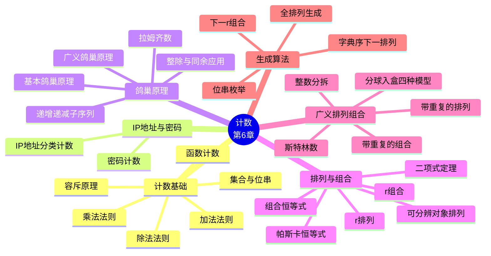

# 计数（Counting / Combinatorics）

> **本章主线**：从一个最简单的问题出发——"**有多少种做法？**"——本章建立了一整套**计数的基本法则**：**加法法则**处理"或"、**乘法法则**处理"且"、**容斥原理**处理"有重叠的或"、**除法法则**处理"被重复计数的等价类"。有了这四条法则，就能解决 IP 地址、密码、函数计数等实际问题。随后本章给出一个出奇简单却威力巨大的工具——**鸽巢原理**：只要物体比盒子多，必有盒子装下两个以上，它能把"存在性"证明变成一句话。接下来本章把计数从"任意方式"细化到"有序与否、可重复与否"两个维度，得到**排列 $P(n,r)$ 与组合 $C(n,r)$** 两大公式，并发展出**二项式定理、帕斯卡恒等式、范德蒙德恒等式**等组合恒等式。最后，**广义排列组合**把允许重复与不可分辨对象两种情形补全，得到 $n^r$、$C(n+r-1,r)$、多项式系数 $\frac{n!}{n_1!\cdots n_k!}$ 等公式，并用"**分球入盒**"模型把四类问题统一起来。章末的 **§6.6** 转向算法：如何按字典序生成排列、位串与组合。

> 一句话版本：**计数 = 把"有多少种"翻译成"$+$、$\times$、$\div$ 与减法修正"的算术**；排列问"顺序算不算不同"，组合问"只关心选了谁"；鸽巢原理则是"物体多于盒子必有拥挤"的存在性保证。

---

## 6.1 计数基础（The Basics of Counting）

本节概要：**乘法法则 → 加法法则 → 容斥原理 → 除法法则 → 实际问题建模**。这四条法则是本章全部内容的运算基础，后面的排列、组合、二项式系数都只是它们的特例。

### 6.1.1 组合数学与两个动机问题

**组合数学（combinatorics）**研究的是"**把事物以各种方式组合在一起的方法数**"（the study of the number of ways to put things together into various combinations）。两个动机问题：

- 一场有 **100 人**参加的竞赛，可能产生多少种不同的**前十名结果**？
- 如果密码长度是 **6 到 8 位**（字母和/或数字），一共有多少个可能的密码？

这两个问题的共同结构是：**任务由若干步组成，每步有若干种选择，问总共有多少种走法**。本章建立的形式工具，就是把这种"分步选择"的直观翻译成可靠的算术。

### 6.1.2 乘法法则与加法法则

设**完成任务 1** 有 $m$ 种方式，**完成任务 2** 有 $n$ 种方式，且：

- 两个数目**互不依赖**（无论任务 1 怎么完成，任务 2 的方式数都是 $n$）；
- 没有任何一种方式能**同时**完成任务 1 和任务 2。

则两条基本法则为：

**加法法则（The Sum Rule）**：完成"**做任务 1 或任务 2，但不同时做**"这件事共有

$$
m + n
$$

种方式。

**乘法法则（The Product Rule）**：完成"**既做任务 1 又做任务 2**"这件事共有

$$
m \cdot n
$$

种方式。

**集合论版本**：若 $A$ 是做任务 1 的方式集合、$B$ 是做任务 2 的方式集合，且 $A$ 与 $B$ **不交**（$A \cap B = \varnothing$），则

$$
|A \cup B| = |A| + |B|, \qquad |A \times B| = |A| \cdot |B|.
$$

> **注意**：加法法则的"或"是**互斥的或**（exclusive or）——前提是两组方式**不能重叠**。如果重叠了，直接用 $m+n$ 就会把重叠部分数两遍，这时必须改用**容斥原理**（6.1.4）。

**两个法则的分工口诀**：**"或"用加法，"且"用乘法**。判断一个问题是加法还是乘法，只需要问自己一句：**"我是把两类互斥的情况合并（加），还是把若干个步骤串起来（乘）？"**

### 6.1.3 乘法法则例题

#### 例 6.1：办公室分配

一家只有两名员工（Sanchez 与 Patel）的新公司租下了一层楼，其中有 **12 间**办公室。有多少种方式把**不同的**办公室分配给这两名员工？

**解**：先把一间办公室分给 Sanchez（12 种选择），再把一间**不同的**办公室分给 Patel（剩下 11 种选择）。由乘法法则

$$
12 \times 11 = 132.
$$

**核心技巧**：把"给多个人分配不同资源"看成**依次分配**——每分配一个人，可用资源就少一个。这正是排列 $P(12,2)$ 的直观来源。

#### 例 6.2：给椅子编号

礼堂的椅子要用"**一个大写英文字母后跟一个不超过 100 的正整数**"来标记。最多有多少把椅子可以被不同地标记？

**解**：字母有 26 种选择，正整数有 100 种选择（$1$ 到 $100$）。由乘法法则

$$
26 \times 100 = 2600.
$$

#### 例 6.3：函数计数

**（a）从 $m$ 个元素的集合到 $n$ 个元素的集合，有多少个函数？**

**解**：一个函数要为**每个**定义域元素指定一个陪域元素。$m$ 个元素各有 $n$ 种独立选择，由乘法法则

$$
\underbrace{n \cdot n \cdots n}_{m \text{ 个}} = n^m.
$$

**（b）从 $m$ 个元素的集合到 $n$ 个元素的集合，有多少个单射函数（one-to-one function）？**

**解**：单射要求**不同元素映射到不同象**。第 1 个元素有 $n$ 种选择，第 2 个有 $n-1$ 种，……，第 $m$ 个有 $n - m + 1$ 种。由乘法法则

$$
n(n-1)(n-2)\cdots(n-m+1) = P(n, m) = \frac{n!}{(n-m)!}.
$$

**（补充说明/拓展）**：这两个结论值得记牢——**"函数个数 = $n^m$"（每个元素自由选，可重复）、"单射个数 = $P(n,m)$"（选了就不能再选）**。当 $m > n$ 时 $P(n,m)$ 无意义（此时单射不存在，个数为 0），而 $n^m$ 始终有意义。**"能否重复"是这两个答案的唯一区别，也是本章反复出现的分水岭。**

#### 例 6.4：IP 地址计数

**题目**：IPv4 的合法计算机地址分三类：

- **A 类**：7 位 `netid`（**不等于 17**）+ 24 位 `hostid`；
- **B 类**：14 位 `netid` + 16 位 `hostid`；
- **C 类**：21 位 `netid` + 8 位 `hostid`。

三类有不同的报头（分别是 `0`、`10`、`110`），且 **`hostid` 全为 0 或全为 1 的地址不合法**。问共有多少个合法地址？

**解**：由**加法法则**先分类相加：

$$
(\#\text{地址}) = (\#\text{A 类}) + (\#\text{B 类}) + (\#\text{C 类}).
$$

每一类内部由**乘法法则**计算（netid 数 × hostid 数）：

- **A 类**：合法 netid 数 $= 2^7 - 1 = 127$（去掉 17）；合法 hostid 数 $= 2^{24} - 2 = 16{,}777{,}214$（去掉全 0 与全 1）。
- **B 类**：合法 netid 数 $= 2^{14}$；合法 hostid 数 $= 2^{16} - 2 = 65{,}534$。
- **C 类**：合法 netid 数 $= 2^{21}$；合法 hostid 数 $= 2^{8} - 2 = 254$。

于是

$$
\begin{aligned}
\#\text{A} &= 127 \times 16{,}777{,}214 = 2{,}130{,}706{,}178, \\
\#\text{B} &= 16{,}384 \times 65{,}534 = 1{,}073{,}709{,}056, \\
\#\text{C} &= 2{,}097{,}152 \times 254 = 532{,}676{,}608.
\end{aligned}
$$

总数

$$
2{,}130{,}706{,}178 + 1{,}073{,}709{,}056 + 532{,}676{,}608 = 3{,}737{,}091{,}842,
$$

即约 **37 亿**个合法 IP 地址。

**核心技巧**：这是"**加法法则套乘法法则**"的标准结构——**先按互斥的类别相加，再在每一类内把相互独立的位数相乘**。另需注意"**排除非法情形**"（netid 不等于 17、hostid 不能全 0 或全 1）都体现为**减法**（$2^7 - 1$、$2^{24} - 2$），这是"总数减去禁用数"的典型用法。

### 6.1.4 容斥原理（Inclusion–Exclusion Principle）

加法法则要求两组方式**互斥**。若不互斥，就需要修正：

设做任务 1 有 $m$ 种方式，做任务 2 有 $n$ 种方式，其中**有 $k$ 种方式同时完成了两个任务**（既是任务 1 的方式也是任务 2 的方式）。则完成"**做任务 1 或任务 2**"的方式数为

$$
m + n - k.
$$

集合论表述：若 $A$ 与 $B$ **不交**，则 $|A \cup B| = |A| + |B|$；**一般地**

$$
|A \cup B| = |A| + |B| - |A \cap B|.
$$

**为什么减去 $|A \cap B|$？** 因为把 $|A|$ 和 $|B|$ 相加时，**交集中的元素被数了两次**；减去一次，恰好让它被数一次。

#### 例 6.5：密码计数

**题目**：某系统的密码规则如下：

- 密码长度为 **2 个字符**；
- 每个字符可以是**小写字母 a–z**、**数字 0–9**，或 **10 个标点符号** `!@#$%^&*()`；
- 密码**必须至少含 1 个数字或标点符号**。

按此规则可以设置多少种不同的密码？

**解**：先注意符号种类数：数字与标点合计 $10 + 10 = 20$ 个"**合格符号**"，字母 26 个，全部字符共 $20 + 26 = 46$ 个。

合法的密码是"**第 1 位是合格符号**"或"**第 2 位是合格符号**"的密码。这两类**有重叠**（两位都是合格符号的密码被数了两次），故用容斥原理：

$$
\begin{aligned}
(\#\text{第 1 位合格}) &= (20) \times (46) = 920, \\
(\#\text{第 2 位合格}) &= (46) \times (20) = 920, \\
(\#\text{两位都合格}) &= (20) \times (20) = 400.
\end{aligned}
$$

于是

$$
920 + 920 - 400 = 1440.
$$

**核心技巧**：本题是**"至少一个位置满足条件"的标准套路**——先分别数"第 1 位满足"和"第 2 位满足"，再减去"都满足"的重叠部分。**只要题目出现"至少一处"或"或"，就应当本能地想到容斥。**

### 6.1.5 除法法则（The Division Rule）

**除法法则**：如果一项任务可以用 $n$ 种方式执行，且对**每一种**执行方式 $w$，在这 $n$ 种方式中**恰有 $d$ 种与 $w$ 对应同一个结果**，那么该任务共有

$$
\frac{n}{d}
$$

种不同的做法。

**直观理解**：$n$ 是"**带重复的计数**"（把同一个结果数了 $d$ 遍），除以 $d$ 就得到"**去重后的计数**"。**除法法则的本质是"纠正过度计数"。**

#### 例 6.6：圆桌就座

**题目**：4 个人围一张圆桌就座，有多少种不同的坐法？其中**两个人的左右邻座都相同**时视为同一种坐法。

**解**：

**第一步——先"假想一个固定座位"来计数。** 任选一个座位标为座位 1，然后顺时针依次编号其余座位。这时的坐法是**线性排列**：座位 1 有 4 种选人方式，座位 2 有 3 种，座位 3 有 2 种，座位 4 有 1 种，共

$$
4! = 24
$$

种。

**第二步——识别被重复计数的倍数。** 但"座位 1 由谁坐"有 **4 种选择**，它们对应的是**同一个圆桌安排**（因为圆桌上没有"第一个座位"这样的绝对位置）。也就是说，每一种真正的圆桌安排在这 24 种里都恰好被数了 **4 遍**。

**第三步——用除法法则去重。**

$$
\frac{24}{4} = 6.
$$

**核心技巧**：**圆桌（环形）排列的通式是 $(n-1)! = \frac{n!}{n}$**。本题的 $d = 4$ 来自"圆桌可以旋转，$n$ 个座位没有绝对身份"。**凡是"等价类计数"问题（环形排列、手链、去重染色等），都是"先当成有标注情形数出 $n$，再除以等价倍数 $d$"这一套。**

**（补充说明/拓展）**：把这一思想推广——$n$ 个人围圆桌就座共 $(n-1)!$ 种；若进一步规定"顺时针与逆时针视为相同"（如项链、手链），则还要再除以 2，得 $\frac{(n-1)!}{2}$（当 $n \geq 3$ 时）。

### 6.1.6 本节方法小结

| 法则 | 适用情形 | 公式 | 典型信号词 |
|---|---|---|---|
| **加法法则** | 两类方式**互斥**，问"或" | $m + n$ | "either … or"、"不同类别" |
| **乘法法则** | 分步完成，各步独立，问"且" | $m \cdot n$ | "依次"、"第一步…第二步…" |
| **容斥原理** | 两类方式**有重叠**，问"或" | $m + n - k$ | "至少一个"、"有重叠" |
| **除法法则** | 计数时有等价类被重复数 | $\dfrac{n}{d}$ | "视为相同"、"旋转/翻转后相同" |

**一句话总结本节**：**"或"加、"且"乘、重叠就减、重复就除**。

---

## 6.2 鸽巢原理（The Pigeonhole Principle）

本节概要：**基本鸽巢原理 → 广义鸽巢原理及其证明 → 三类经典应用（整除、拉姆齐、单调子序列）**。鸽巢原理是组合数学中最简单、也最常被低估的工具——它**不告诉你"哪一个盒子"，只告诉你"某个盒子必然拥挤"**，因此它是**存在性证明**的利器。

### 6.2.1 基本鸽巢原理

**鸽巢原理（The Pigeonhole Principle）**，又称**狄利克雷抽屉原理（the Dirichlet drawer principle）**：

> 如果把 **$\geq k+1$ 个物体**分配到 **$k$ 个盒子**中，那么**至少有一个盒子**被分配了 **$\geq 2$ 个物体**。

用**分配函数**的语言表述：若 $f: A \to B$ 且 $|A| \geq |B| + 1$，则 $B$ 中某个元素在 $f$ 下有**至少 2 个原象**。换言之，**$f$ 不是单射**。

**为什么成立？** 反设每个盒子至多 1 个物体，则 $k$ 个盒子至多容纳 $k$ 个物体，与"至少有 $k+1$ 个物体"矛盾。**证明只有一行，但这一行就是全部的力量所在。**

> **注意**：鸽巢原理是**存在性**结论，而不是**构造性**结论。它告诉你"某两个学生分数相同"，但不告诉你**是哪两个**。这是它在数学证明中既强大又常常"令人不满"的原因。

#### 例 6.7：成绩重复

**题目**：分数按四舍五入取整后有 **101 种**可能的数值（0% 到 100%）。本班学生**超过 101 人**。证明：学期末至少有一个（取整后的）分数会被**至少 2 名**学生共享。

**解**：把"学生"看作物体（数量 $> 101$），把"取整后的分数"看作盒子（数量 $= 101$）。由鸽巢原理，至少有一个盒子装 $\geq 2$ 个物体，即至少有一个分数被至少 2 名学生shared。**换言之，从学生到取整分数的函数不是单射。**

### 6.2.2 例 6.8：$n$ 有一个只含 0 和 1 的倍数

**题目**：对任意 $n \in \mathbb{N}$，都存在一个 $n$ 的倍数 $m > 0$，使 $m$ 的**十进制展开中只含 0 和 1**。

**证明**：考虑下面 $n+1$ 个十进制整数：

$$
1,\quad 11,\quad 111,\quad \ldots,\quad \underbrace{11\cdots1}_{n+1 \text{ 个 } 1}.
$$

它们对 $n$ 取模只可能有 **$n$ 种**可能的余数（即 $0, 1, \ldots, n-1$）。由鸽巢原理（$n+1$ 个物体、$n$ 个盒子），**必有两个数余数相同**。取这两个数之差，则：

- 差的展开中**只含 0 和 1**（因为两个"全 1"数相减，各位只可能得 0 或 1，借位不会产生其他数字）；
- 差是 $n$ 的倍数（余数相同，故差被 $n$ 整除）。

故该差即为所求。$\blacksquare$

**具体例子（$n = 3$）**：考察 $1, 11, 111, 1111$：

$$
1 \bmod 3 = 1,\quad 11 \bmod 3 = 2,\quad 111 \bmod 3 = 0,\quad 1111 \bmod 3 = 1.
$$

其中 $1$ 与 $1111$ 的余数相同（都是 1），故

$$
1111 - 1 = 1110 = 3 \times 370,
$$

$1110$ 的十进制展开只含 0 和 1，且确实是 3 的倍数。（此外 $111$ 本身恰好也被 3 整除，是"额外的幸运解"。）

**核心技巧**：这是鸽巢原理的**经典构造法**——**"物体的数目 $n+1$ 超过盒子的数目 $n$"这一数字对比是定理的引擎**。关键是**设计出 $n+1$ 个对象但只有 $n$ 种可能类别**，再对同类的两个对象做差。**凡是要证"存在某个具有特殊形状的数被 $n$ 整除"，都该想到造 $n+1$ 个同类候选。**

### 6.2.3 例 6.9：棒球赛的连续天数

**题目**：设某队在 6 月的 30 天中**每天至少打 1 场**比赛，**总共不超过 45 场**。证明：6 月中必存在**连续若干天**，这些天里恰好打了 **14 场**比赛。

**证明**：令 $a_j$ 表示**到第 $j$ 天为止（含第 $j$ 天）累计**比赛场数。则

$$
a_1, a_2, \ldots, a_{30}
$$

是 30 个**互不相同**的整数（因为每天至少 1 场，故严格递增），且满足

$$
1 \leq a_j \leq 45.
$$

再考虑

$$
a_1 + 14,\ a_2 + 14,\ \ldots,\ a_{30} + 14,
$$

这也是 30 个互不相同的整数，且满足

$$
15 \leq a_j + 14 \leq 59.
$$

于是把两个序列拼起来

$$
(a_1, \ldots, a_{30},\ a_1+14, \ldots, a_{30}+14)
$$

就是 **60 个**取自集合 $\{1, 2, \ldots, 59\}$（共 **59 个**可能的取值）的整数。由鸽巢原理，其中**必有两个相等**。

但 $a_i \neq a_j$（$i \neq j$ 时），$a_i + 14 \neq a_j + 14$ 也成立，故相等的两个数只能是**分别来自两个序列**的一对，即存在 $i, j$ 使

$$
a_i = a_j + 14.
$$

（这里 $a_j$ 在第一个序列中、$a_i$ 在第二个序列中，因此 $j < i$。）于是从第 $j+1$ 天到第 $i$ 天这连续若干天里共打了

$$
a_i - a_j = 14
$$

场。$\blacksquare$

**图示化验证**：取一个满足条件的 $\{a_i\}$ 为例：

$$
1, 2, 4, 5, 7, 8, 10, 11, 13, 14, 16, 17, 19, 21, 22, 23, 25, 27, 29, 30, 31, 33, 34, 36, 37, 39, 40, 41, 43, 45
$$

（所有元素互不相同），则 $\{a_i + 14\}$ 为

$$
15, 16, 18, 19, 21, 22, 24, 25, 27, 28, 30, 32, 33, 35, 36, 37, 39, 41, 43, 44, 45, 47, 48, 50, 51, 53, 54, 55, 57, 59.
$$

在 1 到 59 之间的 60 个整数中必有重复，实际出现的重复值有

$$
16, 19, 21, 22, 25, 27, 30, 33, 36, 37, 39, 41, 43, 45.
$$

例如取 $a_j = 2$（第 2 天累计 2 场）与 $a_i = 16$（第 11 天累计 16 场），则第 3 天到第 11 天恰好打了 $16 - 2 = 14$ 场，每天场数为

$$
2+1+2+1+2+1+2+1+2 = 14.
$$

**核心技巧**：本题的灵魂是"**构造两个错开 $14$ 的序列，逼它们落进同一个小区间**"。**技术要点有三**：① 用**前缀和** $a_j$ 把"连续若干天的和"转化为"两个前缀和之差"；② 用 $a_j + 14$ 制造"差值恰为 14"的可能性；③ 把 60 个对象压进 59 个可能值，**这一"多一个"正是鸽巢原理的触发条件**。**凡是要证"存在连续一段具有某性质"，前缀和 + 平移是通用套路。**

### 6.2.4 广义鸽巢原理（The Generalized Pigeonhole Principle）

> 如果把 **$N$ 个物体**分配到 **$k$ 个盒子**中，那么**至少有一个盒子**被分配了**至少 $\left\lceil N/k \right\rceil$ 个物体**。

#### 证明（反证法）

反设**每个盒子**的物体数都 $< \lceil N/k \rceil$，即至多为

$$
\left\lceil \frac{N}{k} \right\rceil - 1.
$$

则物体总数至多为

$$
k\left(\left\lceil \frac{N}{k} \right\rceil - 1\right) < k \cdot \frac{N}{k} = N.
$$

（不等式 $\left\lceil N/k \right\rceil - 1 < N/k$ 对一切实数 $N/k$ 成立：因为 $\lceil x \rceil < x + 1$，故 $\lceil x \rceil - 1 < x$。）

于是物体总数**严格小于 $N$**，与"共有 $N$ 个物体"矛盾。故假设不成立，至少有一个盒子装有 $\geq \lceil N/k \rceil$ 个物体。$\blacksquare$

#### 例 6.10：同月生日

**题目**：本班有 $N = 280$ 名学生，一年有 $k = 52$ 周（或 $k = 12$ 个月）。用广义鸽巢原理能保证至少有多少名学生出生在**同一周**（或**同一月**）？

**解**：按周计：

$$
\left\lceil \frac{280}{52} \right\rceil = \lceil 5.38 \rceil = 6.
$$

故必存在某一周，至少有 **6 名**学生在该周出生。

按月计：

$$
\left\lceil \frac{280}{12} \right\rceil = \lceil 23.3 \rceil = 24,
$$

故必存在某一月，至少有 **24 名**学生在该月出生。

**核心技巧**：**"至少有多少个落在同一类"永远用 $\lceil N/k \rceil$，注意是上取整而非四舍五入**——$280/12 = 23.33$ 要进位到 24，而不是舍成 23。上取整的含义是"**即使尽量平均分配，也总有一个盒子至少这么多**"。

#### 例 6.11：扑克牌

**题目**：从一副标准的 52 张牌中至少要选多少张，才能**保证**：

**(A)** 至少有三张牌**花色相同**？

**解**：把 4 种花色看作 4 个盒子、把牌看作物体，即要求某个盒子至少装 3 张。**最坏情况**是先让每个花色都恰好 2 张（共 $4 \times 2 = 8$ 张），此时仍不满足；再取第 9 张，无论什么花色都会使某个花色达到 3 张。故答案是

$$
4 \times 2 + 1 = 9.
$$

**(B)** 至少有**三张红桃**？

**解**：红桃是唯一目标花色，其他 3 种花色共 $13 \times 3 = 39$ 张都是"坏牌"。最坏情况是把所有 39 张非红桃全部取完，此时仍无 3 张红桃；再取 3 张红桃即可。故答案是

$$
39 + 3 = 42.
$$

**核心技巧**：**"最坏情况"分析法是鸽巢类计数题的通用解法**——把答案写成"**最坏情况下不满足的最大数量 $+1$**"。(A) 与 (B) 的差别在于：**(A) 的 4 个类别是"对称的"（只要有一个满 3 即可），(B) 的目标只有一类**。这一区分决定了"$4\times2+1$"还是"$39+3$"。

### 6.2.5 应用一：整除关系

#### 例 6.12：$n+1$ 个不超过 $2n$ 的正整数中必有一个整除另一个

**题目**：证明在任意 $n+1$ 个**不超过 $2n$** 的正整数中，必有一个整数整除另一个。

**证明**：把每个整数 $a_j$ 写成"**2 的幂乘以一个奇数**"的形式：

$$
a_j = 2^{k_j} q_j, \qquad j = 1, 2, \ldots, n+1,
$$

其中 $k_j$ 是非负整数，$q_j$ 是**奇数**。

由于 $a_j \leq 2n$，故 $q_j \leq 2n$。而**小于 $2n$ 的正奇数**只有

$$
1, 3, 5, \ldots, 2n-1
$$

共 **$n$ 个**。现在有 $n+1$ 个奇数 $q_1, q_2, \ldots, q_{n+1}$ 却只有 $n$ 个可能取值，由鸽巢原理，**必有两个相等**：存在相异的下标 $i, j$ 使 $q_i = q_j$。记公共值为 $q$，则

$$
a_i = 2^{k_i} q, \qquad a_j = 2^{k_j} q.
$$

若 $k_i < k_j$，则 $a_i$ 整除 $a_j$；若 $k_i > k_j$，则 $a_j$ 整除 $a_i$。无论哪种情形，**都有一个整数整除另一个**。$\blacksquare$

**核心技巧**：本题的构造极具启发性——**"偶数 = 奇数部分 × 2 的幂"这一分解把整数的"奇偶结构"提取成一个标签**。$n+1$ 个数却只有 $n$ 种奇数部分，故必有两个共享同一奇数部分，此时两者之间必然是**倍数关系**（相差的只是 2 的幂次）。**"把对象按某个不变量分类，再数类别的个数"是构造鸽巢题的通用思路。**

### 6.2.6 应用二：拉姆齐数与朋友/敌人问题

#### 例 6.13：六人之中必有三人互相认识或互相不认识

**题目**：设 6 个人中**任意两人**的关系是"朋友"或"敌人"。证明：其中必有**三个互相是朋友**或**三个互相是敌人**。

**证明**：设 $A$ 是这 6 人之一。在其余 5 人中，与 $A$ **是朋友**的人数与**是敌人**的人数之和为 5。由**广义鸽巢原理**（把 5 个物体分成 2 组），至少有一组包含

$$
\left\lceil \frac{5}{2} \right\rceil = 3
$$

个人。

**情形 1**：$A$ 至少有 3 个朋友，设为 $B, C, D$。

- 若 $B, C, D$ 中**有两人互为朋友**，则这两人的加上 $A$，构成**三个互相是朋友**的一组。
- 否则，$B, C, D$ **两两都是敌人**，则 $B, C, D$ 自身构成**三个互相是敌人**的一组。

**情形 2**：$A$ 至少有 3 个敌人。与情形 1 对称论证，同样得到三条互友或三条互敌。$\blacksquare$

**（补充说明/拓展）**：这类"**必然存在某种完全子图**"的问题属于**拉姆齐理论（Ramsey theory）**。上面的结论记作

$$
R(3,3) = 6,
$$

意思是"**保证出现 3 个两两相识或 3 个两两不相识，至少需要 6 个人**"。$R(3,3) = 6$ 是最小的非平凡拉姆齐数；$R(4,4) = 18$，而 $R(5,5)$ 至今**未知**。拉姆齐理论的哲学是：**足够大的结构中必然出现有规律的子结构**——"完全的无序是不可能的"。

### 6.2.7 应用三：递增或递减子序列

#### 定理（单调子序列定理）

**任何由 $n^2 + 1$ 个互不相同的实数组成的序列，都含有一个长度为 $n+1$ 的严格递增子序列或严格递减子序列。**

**示例**：序列

$$
8,\ 11,\ 9,\ 1,\ 4,\ 6,\ 12,\ 10,\ 5,\ 7
$$

有 $10 = 3^2 + 1$ 个元素，故应含长度 $4$ 的单调子序列。例如

$$
1,\ 4,\ 6,\ 10
$$

就是长度 4 的严格递增子序列。

**证明思路**：对序列中第 $k$ 个元素 $a_k$，定义

$$
\mathrm{inc}_k = \text{以 } a_k \text{ 结尾的最长严格递增子序列的长度}, \qquad
\mathrm{dec}_k = \text{以 } a_k \text{ 结尾的最长严格递减子序列的长度}.
$$

**关键观察**：对任意两个下标 $i < j$，**$(\mathrm{inc}_i, \mathrm{dec}_i) \neq (\mathrm{inc}_j, \mathrm{dec}_j)$**。因为若 $a_i < a_j$，则 $\mathrm{inc}_i < \mathrm{inc}_j$（可以把 $a_j$ 接到以 $a_i$ 结尾的最长递增子序列后面）；若 $a_i > a_j$，则 $\mathrm{dec}_i < \mathrm{dec}_j$。两种情形都使两个有序对不相等。

现在：若**不存在**长度 $n+1$ 的递增子序列，则所有 $\mathrm{inc}_k \leq n$；若**也不存在**长度 $n+1$ 的递减子序列，则所有 $\mathrm{dec}_k \leq n$。于是每个有序对 $(\mathrm{inc}_k, \mathrm{dec}_k)$ 都取自

$$
\{1, \ldots, n\} \times \{1, \ldots, n\},
$$

**共 $n^2$ 个**可能的值。但序列有 $n^2 + 1$ 个元素，对应 $n^2+1$ 个**互不相同**的有序对——由鸽巢原理，$n^2+1$ 个对象装进 $n^2$ 个盒子，必有**两个有序对相同**，这与关键观察矛盾。

故长度为 $n+1$ 的严格递增或严格递减子序列**必存在**。$\blacksquare$

**核心技巧**：本题展示了鸽巢原理的**高阶用法**——**"盒子"不是元素本身，而是元素所带的"特征对"**。证明的两步是：① **构造特征**（每个元素配一个有序对），② **证明特征两两不同**（这是关键观察），③ **数特征的可能取值个数**（$n^2$ 个），④ **对象数 $n^2+1$ 超过特征数**，触发鸽巢。**"给每个对象贴一个有限的标签，然后数标签"是这类证明的通用骨架。**

---

## 6.3 排列与组合（Permutations and Combinations）

本节概要：**排列 $P(n,r)$ → 组合 $C(n,r)$ → 组合恒等式 → 二项式定理 → 帕斯卡恒等式**。本节回答的核心问题是：**"从 $n$ 个对象中选出 $r$ 个，顺序算不算区别？"**——算，是排列；不算，是组合。

### 6.3.1 排列（Permutations）

**定义**：集合 $S$ 的一个**排列（permutation）**是一个**恰好包含 $S$ 中每个对象一次**的序列。

$S$ 的 $r$ 个不同元素的一个**有序**排列称为 $S$ 的一个 **$r$-排列（$r$-permutation）**。

**定理**：含 $n = |S|$ 个元素的集合的 $r$-排列个数为

$$
P(n, r) = n(n-1)(n-2)\cdots(n-r+1) = \frac{n!}{(n-r)!}.
$$

**推导**：由**乘法法则**——第 1 个位置有 $n$ 种选择，第 2 个位置有 $n-1$ 种（不能重复用已选的），……，第 $r$ 个位置有 $n-r+1$ 种。故共 $n(n-1)\cdots(n-r+1)$ 种。

> **约定**：当 $r > n$ 时 $P(n,r) = 0$（无从选择）；特别地 $P(n,0) = 1$、$P(n,n) = n!$。

#### 例 6.14：拆炸弹

**题目**：恐怖分子在城市里安放了一枚炸弹，你的任务是通过剪断引信电线来拆除它。装置上有 **10 根**电线，只有当**恰好剪对那 3 根线并且顺序正确**时，才能拆除炸弹，否则炸弹会爆炸。如果所有电线看起来都一样，你的生存机会有多大？

**解**：正确剪法是 10 根线的一个 **3-排列**（选出 3 根并排定顺序），故可能的剪法总数是

$$
P(10, 3) = 10 \cdot 9 \cdot 8 = 720.
$$

只有其中 1 种是正确的，故

$$
\text{生存概率} = \frac{1}{720}.
$$

**核心技巧**：**"选出 $r$ 个并排定顺序"就是 $r$-排列**——这正是 $P(n,r)$ 的定义。"顺序要正确"这一条件把问题从组合升级为排列，这也是本题的关键识别点。

### 6.3.2 组合（Combinations）

**定义**：集合 $S$ 中元素的 **$r$-组合（$r$-combination）**就是 $S$ 的一个含 $r$ 个元素的**子集** $T$，即 $|T| = r$。

**定理**：含 $n = |S|$ 个元素的集合的 $r$-组合个数为

$$
C(n, r) = \binom{n}{r} = \frac{P(n, r)}{P(r, r)} = \frac{n!}{r!\,(n-r)!}.
$$

**推导**：$r$-排列的个数是 $C(n,r)$ 乘以"**每个 $r$ 元子集内部的排列数**" $r!$（即 $P(r,r)$）。因为每个 $r$-组合对应 $r!$ 个不同的 $r$-排列（同一个个子集的不同排序），由**除法法则**

$$
P(n, r) = C(n, r) \cdot r! \quad\Longrightarrow\quad C(n, r) = \frac{P(n,r)}{r!} = \frac{n!}{r!\,(n-r)!}.
$$

**对称性（重要恒等式）**：

$$
C(n, r) = C(n, n-r).
$$

**为什么？** 因为**"选出 $r$ 个成员"与"选出 $n-r$ 个非成员"是同一件事的两种说法**——一旦确定了不在子集中的元素，子集本身也就确定了。**（补充说明/拓展）** 这条对称性在二项式系数上表现为帕斯卡三角的**左右对称**，也解释了为什么可以规定 $\binom{n}{r} = 0$（当 $r<0$ 或 $r>n$ 时）。

#### 例 6.15：扑克牌手牌

**题目**：从一副标准的 52 张牌中可以抽出多少种不同的 **7 张手牌**？（手牌中牌的**顺序不重要**。）

**解**：由组合公式

$$
C(52, 7) = \frac{P(52,7)}{P(7,7)} = \frac{52 \cdot 51 \cdot 50 \cdot 49 \cdot 48 \cdot 47 \cdot 46}{7 \cdot 6 \cdot 5 \cdot 4 \cdot 3 \cdot 2 \cdot 1}.
$$

逐步约分：分子中 $52 = 4 \times 13$、$50 = 2 \times 25$、$49 = 7 \times 7$、$48 = 6 \times 8$、$46 = 2 \times 23$、$51 = 3 \times 17$、$47$ 为素数。约去分母的 $7, 6, 5, 4, 3, 2, 1$ 后得

$$
C(52, 7) = 133{,}784{,}560.
$$

#### 例 6.16：恰含 $r$ 个 1 的位串

**题目**：长度为 $n$ 的位串中，**恰好含 $r$ 个 1** 的有多少个？

**解**：只要选定**哪 $r$ 个位置**放 1（其余位置自动放 0），位串就确定了：

$$
C(n, r).
$$

**核心技巧**：这是**"组合即选位置"**的典型应用——**位串的计数问题往往可以把"选哪些位为 1"直接翻译成 $C(n,r)$**，无需考虑顺序。

#### 例 6.17：委员会选择

**题目**：某校数学系有 **9 名**教师、计算机系有 **11 名**教师。要组成一个委员会来开发一门离散数学课程，要求委员会由**数学系的 3 名**教师和**计算机系的 4 名**教师组成。有多少种选法？

**解**：数学系选 3 人：$C(9,3)$ 种；计算机系选 4 人：$C(11,4)$ 种。由**乘法法则**

$$
C(9, 3) \cdot C(11, 4) = 84 \times 330 = 27{,}720.
$$

**核心技巧**：**"从不同的池子里分别选人"用乘法法则把各池的组合数相乘**。这是选择题目的标准结构——先分清有几个独立的池子，再分别用组合公式。

### 6.3.3 关于章节课件范围的说明

本章课件在 §6.3 之后**跳过了若干小节**，随后又回头补充了**二项式系数**与**生成排列/组合**的内容：

- **二项式系数（Binomial Coefficients）**：在代数中很有用——$C(n,r)$ 出现在 $(a+b)^n$ 这类多项式的系数中；涉及**帕斯卡恒等式（Pascal's identity）**与**范德蒙德恒等式（Vandermonde's identity）**。
- **生成排列与组合（Generating Permutations & Combinations）**：即 §6.6 的算法内容。

> **注意（课件编号与教材编号的差异）**：课件在讲"跳过的小节"时，沿用的是教材**早期版本的旧编号体系**（幻灯片上标注的版本为旧版，且把 **§4.4 二项式系数**、**§4.6 生成排列与组合**作为章内小节引用）。在本章（第 6 章）的编号体系下，它们分别是 **§6.4** 与 **§6.6**。本笔记**一律采用本章的编号 §6.4、§6.6**，与章节目录保持一致。
>
> **（补充说明/拓展）** 容斥原理在教材中位于 **§8.5**（高级计数技术），§6.1 引用它属于**跨章引用**，并非编号错误。

### 6.3.4 二项式系数与二项式定理

#### 引入动机

**目标**：找出形如 $(x+y)^n$ 的二项式幂的**展开式系数**，而不必真的把表达式展开成乘法。

#### 二项式定理（The Binomial Theorem）

$$
(x+y)^n = \sum_{j=0}^{n} \binom{n}{j} x^{\,n-j} y^{\,j}.
$$

其中 $\binom{n}{j} = C(n,j)$ 称为**二项式系数（binomial coefficient）**。

**为什么系数是 $C(n,j)$？** 把 $(x+y)^n$ 展开（即 $n$ 个因子 $(x+y)$ 相乘，每个因子中选 $x$ 或 $y$），得到 $x^{n-j}y^j$ 这一项的方式数，正是"**在 $n$ 个因子中选 $j$ 个贡献 $y$**"的方式数，即 $C(n,j)$。

#### 例 6.18：$(x+y)^4$ 的展开

$$
\begin{aligned}
(x+y)^4 &= \binom{4}{0}x^4 + \binom{4}{1}x^3y + \binom{4}{2}x^2y^2 + \binom{4}{3}xy^3 + \binom{4}{4}y^4 \\
&= x^4 + 4x^3y + 6x^2y^2 + 4xy^3 + y^4.
\end{aligned}
$$

#### 例 6.19：$(x+y)^{25}$ 中 $x^{12}y^{13}$ 的系数

对应 $n = 25$、$j = 13$（$y$ 的指数），故系数为

$$
\binom{25}{13} = \binom{25}{12} = 5{,}200{,}300.
$$

#### 例 6.20：$(2x-3y)^{25}$ 中 $x^{12}y^{13}$ 的系数

把 $2x$ 看作 $x'$、$(-3y)$ 看作 $y'$，则所求项的系数为

$$
\binom{25}{13} \cdot 2^{12} \cdot (-3)^{13}.
$$

**注意符号**：因为 $y$ 项带负号且 $13$ 是奇数，故结果为**负数**，其绝对值为

$$
\binom{25}{13} \cdot 2^{12} \cdot 3^{13}.
$$

**核心技巧**：**遇到 $(ax+by)^n$ 这类"带系数"的二项式，先套用二项式定理，再把 $a$、$b$ 的幂乘上去**。**符号是最容易出错的地方**——$(-3)^{13}$ 是负数，不能漏掉负号。

#### 推论（三个常用的求和恒等式）

**推论 1**：令 $x = y = 1$，得

$$
\sum_{k=0}^{n} \binom{n}{k} = 2^n.
$$

**组合意义**：$n$ 元集合的所有子集总数是 $2^n$（按子集大小 $k$ 分类相加）。

**推论 2**：令 $x = 1$、$y = -1$，得

$$
\sum_{k=0}^{n} (-1)^k \binom{n}{k} = 0 \qquad (n \geq 1).
$$

**组合意义**：$n$ 元集合的**偶数元子集个数等于奇数元子集个数**（故二者相减为 0）。

**推论 3**：令 $x = 1$、$y = 3$，得

$$
\sum_{k=0}^{n} \binom{n}{k} 3^k = 4^n.
$$

**组合意义**：$n$ 元集合的每个元素有 4 种"状态"（不在子集中、在子集中且属于第 1/2/3 类），故共 $4^n$ 种。

**核心技巧**：**三个推论都是"给 $x, y 赋特定值"得到的**——这是从二项式定理"提取"组合恒等式的标准手法，称为**代入法（substitution）**。**看到形如 $\sum_k c^k\binom{n}{k}$ 的求和，立刻想到它是 $(1+c)^n$ 的展开。**

### 6.3.5 帕斯卡恒等式与帕斯卡三角

**帕斯卡恒等式（Pascal's Identity）**：设 $n > 0$、$k > 0$ 且 $n \geq k$，则

$$
\binom{n+1}{k} = \binom{n}{k-1} + \binom{n}{k}.
$$

**组合证明**：设 $S$ 是含 $n+1$ 个元素的集合，固定其中某个元素 $a$。$S$ 的 $k$ 元子集分为互斥的两类：

- **不含 $a$ 的**：从其余 $n$ 个元素中选 $k$ 个，共 $\binom{n}{k}$ 个；
- **含 $a$ 的**：还需从其余 $n$ 个元素中选 $k-1$ 个，共 $\binom{n}{k-1}$ 个。

由**加法法则**，两类相加即得。$\blacksquare$

**帕斯卡三角（Pascal's Triangle）**：把 $\binom{n}{k}$ 按 $n$ 逐行排列（第 $n$ 行有 $n+1$ 个数），则**每个数等于它肩上两个数之和**——这正是帕斯卡恒等式的图形表现。三角的两边全为 1（$\binom{n}{0} = \binom{n}{n} = 1$），且左右对称（$C(n,k) = C(n,n-k)$）。

**核心技巧**：帕斯卡恒等式的证明是**"按某个特殊元素是否被选中来分类"**的典范——这条"**固定一个元素、分两类讨论**"的技巧在组合证明中反复出现，是构造递推关系的常用手段。

---

## 6.4 广义排列与组合（Generalized Permutations and Combinations）

本节概要：**带重复的排列 $n^r$ → 带重复的组合 $C(n+r-1,r)$ → 分球入盒四模型 → 斯特林数与整数分拆**。前面几节都默认"每个对象最多用一次"，本节**解除这条限制**，并系统处理"对象不可分辨"的情形。

### 6.4.1 引入动机

前面讨论的排列与组合都**不允许重复**。但在许多计数问题中——例如密码可以含重复字符、从多个供应充足的类别中挑选物品——**允许重复**才是正确的模型。本节研究四类情形：

| | **顺序重要（排列）** | **顺序不重要（组合）** |
|---|---|---|
| **不允许重复** | $P(n,r) = \dfrac{n!}{(n-r)!}$ | $C(n,r) = \dbinom{n}{r}$ |
| **允许重复** | $n^r$ | $C(n+r-1, r)$ |

### 6.4.2 带重复的排列（Permutations with Repetition）

**定理**：含 $n$ 个对象的集合中，**允许重复**地选取 $r$ 个对象的**排列**个数为

$$
n^r.
$$

**推导**：由乘法法则——$r$ 个位置，每个位置都有 $n$ 种选择，且选择之间互不影响（可以重复选同一个对象），故共 $\underbrace{n \cdot n \cdots n}_{r \text{ 个}} = n^r$。

#### 例 6.21：字母串计数

**题目**：用 26 个英文字母可以构成多少个**长度为 $n$** 的字符串？

**解**：每个位置有 26 种选择，共

$$
26^n.
$$

**例**：电话拨号盘上每个号码可对应 10 个数字，则长度为 4 的号码有 $10^4$ 种。

**核心技巧**：**这个结果与 6.1.3 的"函数计数 $n^m$"是同一回事**——"从 $n$ 元集合到 $r$ 元集合的函数"与"长度为 $r$、每个字符取自 $n$ 个字母的字符串"一一对应。**"允许重复的排列"就是"每个位置自由选择"，即 $n^r$。**

### 6.4.3 带重复的组合（Combinations with Repetition）

**定理**：含 $n$ 个对象的集合中，**允许重复**地选取 $r$ 个对象的**组合**个数为

$$
C(n+r-1,\ r) = \binom{n+r-1}{r} = \frac{(n+r-1)!}{r!\,(n-1)!}.
$$

**推导（"星条法" / stars and bars）**：一个**允许重复的组合**可以看作"**每个对象被选了几次**"的计数——即方程

$$
x_1 + x_2 + \cdots + x_n = r, \qquad x_i \geq 0 \text{ 为整数}
$$

的解的个数。把 $r$ 个"星"（代表被选的 $r$ 个位置）排成一排，再用 $n-1$ 条"条"（分隔符）把它们分成 $n$ 组：

$$
\underbrace{\star \cdots \star}_{\text{第 1 类}} \Big| \underbrace{\star \cdots \star}_{\text{第 2 类}} \Big| \cdots \Big| \underbrace{\star \cdots \star}_{\text{第 } n \text{ 类}}
$$

则每一种排法对应一个解，而每一种解对应一种排法。于是问题变成：**在 $r$ 个星与 $n-1$ 条条共 $r + n - 1$ 个位置中，选出哪 $n-1$ 个位置放"条"**，即

$$
C(n+r-1,\ n-1) = C(n+r-1,\ r).
$$

（两种写法相等，因为 $C(N,k) = C(N,N-k)$。）$\blacksquare$

#### 例 6.22：水果篮子

**题目**：一个水果篮里有**苹果、橙子、梨**三种水果（供应充足）。如果篮子恰好装 **4 个**水果，有多少种不同的选择方式？（只关心各类水果的个数，不关心顺序。）

**解**：$n = 3$、$r = 4$，由公式

$$
C(3 + 4 - 1,\ 4) = C(6, 4) = 15.
$$

**完整枚举（15 种**，用"苹果数 / 橙子数 / 梨子数"表示）：

$$
\begin{aligned}
&4\text{ 苹果};\quad 4\text{ 橙};\quad 4\text{ 梨};\\
&3\text{ 苹果} + 1\text{ 橙};\quad 3\text{ 苹果} + 1\text{ 梨};\quad 3\text{ 橙} + 1\text{ 苹果};\quad 3\text{ 橙} + 1\text{ 梨};\quad 3\text{ 梨} + 1\text{ 苹果};\quad 3\text{ 梨} + 1\text{ 橙};\\
&2\text{ 苹果} + 2\text{ 橙};\quad 2\text{ 苹果} + 2\text{ 梨};\quad 2\text{ 橙} + 2\text{ 梨};\\
&2\text{ 苹果} + 1\text{ 橙} + 1\text{ 梨};\quad 2\text{ 橙} + 1\text{ 苹果} + 1\text{ 梨};\quad 2\text{ 梨} + 1\text{ 苹果} + 1\text{ 橙}.
\end{aligned}
$$

**分类核对**：$3 + 6 + 3 + 3 = 15$ ✓。这一枚举也可按方程 $x_1+x_2+x_3=4$ 的解来理解（共 $C(6,4)=15$ 组非负整数解）。

#### 例 6.23：钞票选择

**题目**：从 7 种不同的钞票面额中（每种供应充足）取出 **5 张**钞票，有多少种方式？

**解**：$n = 7$、$r = 5$，由公式

$$
C(7 + 5 - 1,\ 5) = C(11, 5) = 462.
$$

#### 例 6.24：方程的非负整数解

**题目**：方程

$$
x_1 + x_2 + x_3 = 11
$$

有多少组**非负整数**解？

**解**：$n = 3$、$r = 11$，由公式

$$
C(3 + 11 - 1,\ 11) = C(13, 11) = C(13, 2) = 78.
$$

**核心技巧**：**"方程 $x_1 + \cdots + x_n = r$ 的非负整数解个数"与"带重复的组合"完全等价**，答案都是 $C(n+r-1,r)$。**凡是可以把问题翻译成"把 $r$ 个不可分辨的球放进 $n$ 个可分辨的盒子"（允许空盒）的题目，都是用这条公式。**

#### 例 6.25：多重循环的计数

**题目**：执行下面这段伪代码后 $k$ 的值是多少？

```
k := 0
for i1 := 1 to n
   for i2 := 1 to i1
      .
      .
      for im := 1 to i(m-1)
         k := k + 1
```

**解**：这是 $m$ 层嵌套循环，内层循环的上界是外层循环的**当前值**。每执行一次最内层的 `k := k + 1`，就对应一组满足

$$
1 \leq i_m \leq i_{m-1} \leq \cdots \leq i_1 \leq n
$$

的下标取值。这种"**非严格递减**"的下标组的个数正是

$$
C(n + m - 1,\ m)
$$

（即从 $n$ 个值中**允许重复**地取出 $m$ 个的**非递增**序列数）。故 **$k$ 的终值为 $C(n+m-1, m)$**。

**具体例子（$n = 4, m = 3$，即三重循环）**：$i_1$ 从 1 到 4、$i_2$ 从 1 到 $i_1$、$i_3$ 从 1 到 $i_2$，共

$$
C(4 + 3 - 1,\ 3) = C(6, 3) = 20
$$

次。

**核心技巧**：**"非严格递减的下标组"与"带重复的组合"是同一件事**——把 $i_1 \geq i_2 \geq \cdots \geq i_m$ 看作从 $\{1,\ldots,n\}$ 中允许重复地取 $m$ 个数（重复次数即取用次数）。**嵌套循环的计数常常可以这样"翻译成组合数"。**

### 6.4.4 排列与组合的四类公式总表

**下表是本章最重要的记忆表**——只要判断"顺序是否重要"与"是否允许重复"，就能直接查出公式：

| 情形 | **顺序重要（排列）** | **顺序不重要（组合）** |
|---|---|---|
| **不允许重复** | $P(n,r) = \dfrac{n!}{(n-r)!}$ | $C(n,r) = \dfrac{n!}{r!\,(n-r)!}$ |
| **允许重复** | $n^r$ | $C(n+r-1,\ r) = \dfrac{(n+r-1)!}{r!\,(n-1)!}$ |

**判定口诀**：**先问"顺序算不算不同"（选排列还是组合），再问"能不能重复选"（其余两栏）**。

### 6.4.5 可分辨对象的排列（Permutations with Indistinguishable Objects）

**定理**：如果把 $n$ 个对象（其中**有 $n_1$ 个属于第 1 类、$n_2$ 个属于第 2 类、……、$n_k$ 个属于第 $k$ 类**，同类的对象**不可分辨**，且 $n_1 + n_2 + \cdots + n_k = n$）排成一列，则不同排列的个数为

$$
\frac{n!}{n_1!\, n_2! \cdots n_k!}.
$$

**推导**：先**暂时把同类对象看作可分辨的**，则有 $n!$ 种排列。但第 $i$ 类内部的 $n_i$ 个对象在这 $n!$ 种排列中**被重复数了 $n_i!$ 次**（因为把它们互相置换得到同一种实际排列）。由**除法法则**

$$
\frac{n!}{n_1!\, n_2! \cdots n_k!}.
$$

#### 例 6.26：SUCCESS 的排列

**题目**：单词 **SUCCESS** 的字母可以排出多少个不同的串？

**解**：SUCCESS 共 7 个字母，其中 **S 出现 3 次**、**C 出现 2 次**、**U 出现 1 次**、**E 出现 1 次**。由公式

$$
\frac{7!}{3!\,2!\,1!\,1!} = \frac{5040}{6 \times 2} = 420.
$$

**核心技巧**：**"字母重排"类问题一律用多项式系数公式**——先数出每个字母的出现次数，代入 $\frac{n!}{n_1!\cdots n_k!}$。**分母上必须列出所有字母的阶乘（包括出现 1 次的），不能只写重复的**。

### 6.4.6 分球入盒（Distributing Objects into Boxes）

本章的四类公式可以用"**把球分配到盒子**"的模型统一理解。这里"球"是对象、"盒子"是容器，两个判断维度是**球是否可分辨**与**盒子是否可分辨**：

| **球** | **盒子** | **公式** | **说明** |
|---|---|---|---|
| 可分辨 | 可分辨 | $\dfrac{n!}{n_1!\, n_2! \cdots n_k!}$ | 指定每个盒子的容量 |
| 可分辨 | 不可分辨 | $S(n, j)$（**斯特林数**） | 分成 $j$ 个非空组 |
| 不可分辨 | 可分辨 | $C(n+r-1,\ n-1)$ | 允许空盒的组合 |
| 不可分辨 | 不可分辨 | 整数分拆 $p_k(n)$ | 无闭式公式 |

#### 例 6.27：可分辨的球放入可分辨的盒子

**题目**：把 52 张牌分给 4 个人，每人 **5 张**（其余 32 张不发出），有多少种分法？

**解**：这是"可分辨的球（牌）放入可分辨的盒子（人）并指定容量"的问题。由多项式系数公式

$$
\frac{52!}{5!\,5!\,5!\,5!\,32!}.
$$

**核心技巧**：**"指定容量的可分辨分配"就是多项式系数**——分子是总数阶乘，分母是每个盒子容量以及"剩余"部分的阶乘。

#### 例 6.28：不可分辨的球放入可分辨的盒子

**题目**：把 **10 个相同的球**放入 **8 个不同的盒子**，有多少种放法？（允许空盒。）

**解**：这是**不可分辨球 + 可分辨盒子 + 允许空盒**，由 6.4.3 的公式

$$
C(n + r - 1,\ n - 1) = C(10 + 8 - 1,\ 8 - 1) = C(17, 7) = 19{,}448.
$$

**核心技巧**：**"不可分辨球入可分辨盒"与"带重复的组合"是同一公式**——因为只关心每个盒子里有几个球，不关心是哪些球。

#### 例 6.29：可分辨的球放入不可分辨的盒子（斯特林数）

**题目**：把 **4 名不同的员工**分配到 **3 间相同的办公室**，允许空房，共有多少种分法？

**解**：因为办公室**不可分辨**，我们只能按"**每间房里的人数分布**"来分类计数（把 4 个可分辨对象分成若干个非空组，再把组归并到 3 个不可分辨的盒子里）：

**（a）全部 4 人挤在一间房**：$1$ 种（只分 1 组，即 $4$ 人一组）。

**（b）分成 $3+1$**：先选单独那 1 人（$C(4,1) = 4$ 种），其余 3 人一组。共

$$
\binom{4}{1} = 4.
$$

**（c）分成 $2+2$**：把 4 人分成两个二人组，组数与组之间无序。选法为

$$
\frac{1}{2}\binom{4}{2} = \frac{6}{2} = 3.
$$

（除以 2 是因为两个二人组**互换后是同一种分法**——这正是**除法法则**。）

**（d）分成 $2+1+1$**：选定那个二人组

$$
\binom{4}{2} = 6.
$$

（剩下两人各自成组，组数与组之间无序，但两组大小相同、已自动去重。）

**合计**

$$
1 + 4 + 3 + 6 = 14.
$$

**（补充说明/拓展）**：把 $n$ 个**可分辨**对象分成 $j$ 个**非空**不可分辨组的方法数称为**第二类斯特林数（Stirling number of the second kind）**，记作 $S(n, j)$。本题中各情形对应

$$
S(4,1) = 1,\quad S(4,2) = 7\ (= 4 + 3),\quad S(4,3) = 6,\quad S(4,4) = 1,
$$

故"4 个可分辨对象放入至多 3 个不可分辨盒"的总数为 $S(4,1) + S(4,2) + S(4,3) = 1 + 7 + 6 = 14$ ✓。斯特林数满足递推

$$
S(n, j) = S(n-1, j-1) + j\,S(n-1, j).
$$

#### 例 6.30：不可分辨的球放入不可分辨的盒子（整数分拆）

**题目**：把 **6 本相同的书**装进 **4 个相同的盒子**，允许空盒，有多少种装法？

**解**：因为书相同、盒子也相同，所以只能按"**每组几本**"来区分。这等价于把 6 分拆成**不超过 4 个部分**的整数和。完整枚举：

$$
\begin{aligned}
&6;\\
&5+1;\\
&4+2;\quad 4+1+1;\\
&3+3;\quad 3+2+1;\quad 3+1+1+1;\\
&2+2+2;\quad 2+2+1+1.
\end{aligned}
$$

共 **9 种**。

**（补充说明/拓展）**：把正整数 $n$ 写成"$a_1 + a_2 + \cdots + a_j = n$（其中 $a_1 \geq a_2 \geq \cdots \geq a_j \geq 1$）"的方式数，称为 **$n$ 的分拆数（partition number）**，记作 $p(n)$；"**恰好分成 $k$ 部分**"或"**每部分不超过 $k$**"的个数记作 $p_k(n)$。分拆数**没有简单的闭式公式**——这正说明了四类问题中"**不可分辨球 + 不可分辨盒**"是唯一没有简便公式的一类。$p(6) = 11$（比本题的 9 多，因为本题限制**至多 4 部分**）。

### 6.4.7 本节方法小结

**判断流程**：

1. **顺序是否重要？** 重要 → 排列；不重要 → 组合。
2. **是否允许重复？** 不允许 → $P(n,r)$ 或 $C(n,r)$；允许 → $n^r$ 或 $C(n+r-1,r)$。
3. **对象是否可分辨？** 若不可分辨且要"分组"，需用多项式系数、斯特林数或整数分拆。

**最常见的三种"翻译"**：**① "方程非负整数解" $\to C(n+r-1,r)$；② "字母重排" $\to \frac{n!}{n_1!\cdots n_k!}$；③ "选位置" $\to C(n,r)$。**

---

## 6.5 生成排列与组合（Generating Permutations and Combinations）

本节概要：**全排列生成（回溯法）→ 字典序下一排列 → 位串/子集枚举 → 下一 $r$-组合**。前面的章节都在"**数有多少种**"，本节转向"**如何把它们一个个列出来**"——这是计数与算法的交汇点。

### 6.5.1 引入：为什么需要"生成"

许多计数问题的实际需求不是"知道个数"，而是"**把每种可能都列出来**"：测试所有输入组合、枚举所有可行解、穷举密码空间。本节介绍**按字典序（lexicographic order）生成**的算法——既保证不重不漏，又便于"**从当前项求下一项**"。

**字典序（lexicographic order）**：与字典中单词的排序方式相同。对长度相同的序列，**从左到右逐位比较，第一个不同的位置决定大小**。例如对 $\{1,2,3\}$ 的排列：

$$
123 < 132 < 213 < 231 < 312 < 321.
$$

### 6.5.2 生成全排列：回溯法

**思路**：用**回溯（backtracking）**——从位置 1 开始，依次为每个位置挑选一个**尚未使用**的数，选到第 $n$ 个位置时输出一个完整排列，然后退回一步换一个数继续。

**递归生成器**：

```
procedure recursiveGenPerms(i, n)
    if i > n then begin        {已经填满 n 个位置，输出一个排列}
        for k := 1 to n print perm[k]
        print newline
    end else
        for j := 1 to n        {尝试把每个未使用的数放到位置 i}
            if not used[j] then begin
                used[j] := T
                perm[i] := j
                recursiveGenPerms(i + 1, n)
                used[j] := F   {回溯：撤销选择}
            end
```

**驱动过程**：

```
procedure genAllPerms(n > 0: integer)
    {按字典序输出 {1,...,n} 的全部排列}
    for i := 1 to n begin used[i] := F end   {初始时所有数都未使用}
    recursiveGenPerms(1, n)
```

**关键点**：

- `used[j]` 数组**标记哪些数已被使用**——这是"不允许重复"的机制；
- 递归返回后必须**把 `used[j]` 复位为 `F`**——这一步就是"**回溯**"，是算法正确的核心；
- 递归深度为 $n$，每层循环 $n$ 次，时间复杂度为 $O(n \cdot n!)$，**总输出量本身就有 $n!$ 项**，故这是最优量级。

**核心技巧**：**回溯法的骨架是"选择 → 递归 → 撤销选择"三步**。只要满足"条件不满足时剪枝、走到底时输出"这两条，就能保证不重不漏地枚举所有解。

### 6.5.3 字典序的"下一排列"

**问题**：给定 $\{1, \ldots, n\}$ 的一个排列 $a_1, \ldots, a_n$，如何求得**字典序中的下一个排列**？

**算法思路（三步）**：

1. **找出最大的 $j$ 使 $a_j < a_{j+1}$。** 这样的 $j$ 是"**还能增大的最右位置**"——位置 $j$ 右边已经是递减的，无法只靠重排右边得到更大的排列。
2. **在 $a_{j+1}, \ldots, a_n$ 中找出最小的、大于 $a_j$ 的元素**，把它放到位置 $j$（与 $a_j$ 交换）。这个元素是"**在保持尽可能小的增幅下能替换 $a_j$ 的最小者**"。
3. **把 $a_{j+1}, \ldots, a_n$ 从小到大（升序）排列。**

**为什么这三步给出"下一个"？** 第 1 步确定了"必须改变的最右位置"；第 2 步用**最小的可行增量**替换该位置；第 3 步把剩余部分排成**最小可能的顺序**。三者合起来正是"**恰好大于当前排列的最小排列**"。

**伪代码**：

```
procedure nextPerm(a[1..n]: permutation of {1,...,n})
    j := n - 1
    while a[j] > a[j+1] and j > 0 do j := j - 1
    if j = 0 then return            {已是最后一个排列}
    k := n
    while a[j] > a[k] do k := k - 1
    swap(a[j], a[k])
    r := n; s := j + 1
    while r > s do begin            {把 a[j+1..n] 原地逆置成升序}
        swap(a[r], a[s])
        r := r - 1
        s := s + 1
    end
```

**注意**：$a_{j+1}, \ldots, a_n$ 原本是**递减**的，所以"排成升序"只需**逆置**即可，无需真正排序——这正是该算法高效（$O(n)$ 时间）的原因。

**例**：求 $123$ 在 $\{1,2,3\}$ 全排列中的后继。

- 找最大的 $j$ 使 $a_j < a_{j+1}$：$a_2 = 2 < a_3 = 3$，故 $j = 2$；
- 在 $a_3 = 3$ 中找最小的大于 $a_2 = 2$ 者：是 3，交换得 $1\,3\,2$；
- $a_3$ 只有一个元素，逆置后仍是 $132$。

故 $123$ 的后继是 $132$ ✓。

**再例**：求 $132$ 的后继。

- 最大的 $j$ 使 $a_j < a_{j+1}$：$a_1 = 1 < a_2 = 3$，故 $j = 1$；
- 在 $a_2, a_3 = 3, 2$ 中找最小的大于 $a_1 = 1$ 者：是 2，交换得 $2\,3\,1$；
- 把 $a_2, a_3 = 3, 1$ 逆置成升序得 $1, 3$，故结果为 $213$ ✓。

### 6.5.4 生成位串与子集

**思路**：长度为 $n$ 的位串与 $n$ 元集合的子集**一一对应**（第 $i$ 位为 1 表示第 $i$ 个元素在子集中）。因此**枚举位串 = 枚举子集**。

**递归枚举**：

```
procedure recEnumBitStrings(soFar, n)
    {枚举所有以 soFar 为前缀、总长 n 的位串}
    if n = 0 then begin print soFar; return end
    recEnumBitStrings(soFar · '0', n - 1)
    recEnumBitStrings(soFar · '1', n - 1)

procedure enumBitStrings(n)
    recEnumBitStrings(epsilon, n)    {epsilon 是空串}
```

**注意**：递归体中的两次调用都必须是 **`recEnumBitStrings`**（即本过程自身），先追加 `'0'` 再追加 `'1'`，从而保证按字典序输出。

**"下一"位串（即二进制加 1）**：

```
procedure nextBitString(b[1..n]: bit string not all 1s)
    i := n
    while b[i] = 1 do begin
        b[i] := 0        {把后缀的 1 全部清为 0}
        i := i - 1
    end
    b[i] := 1            {把遇到的第一个 0 改为 1}
```

这正是"**二进制计数加 1**"：后缀的 1 进位变成 0，第一个 0 变成 1。例如 $01011 \to 01100$（后缀 11 清零，第一个 0 置 1）。

**核心技巧**：**位串与子集的对应把"枚举子集"化简为"数二进制"**，这是把组合问题转化为数值序列的标准桥梁。

### 6.5.5 生成 $r$-组合

**递归生成**：

```
procedure recEnumRCombs(min, j, r, n)
    if j > r then begin print comb[1], ..., comb[r]; return end
    for i := min to n - r + j do begin
        comb[j] := i
        recEnumRCombs(i + 1, j + 1, r, n)
    end
```

**说明**：

- `min` 是当前可用的最小下标（保证**下标递增**，从而不重复）；
- `j` 是当前正在填的位置，`r` 是要选的个数；
- 循环上界 $n - r + j$ 保证**剩下的位置仍有足够的数可选**（这是剪枝）；
- 终止条件是 **`j > r`**（已经填满 $r$ 个位置），此时输出 **`comb[1], ..., comb[r]`**。

> **课件笔误提示**：课件中该过程的终止条件写作 `if j > n`、输出写作 `comb[1], ..., comb[n]`。按算法逻辑，此处应为 **`j > r`** 与 **`comb[1], ..., comb[r]`**——因为整个过程的参数是"选 $r$ 个数"，`n` 是全集大小，不应出现在终止条件中。

**"下一"$r$-组合（字典序）**：

```
procedure nextRComb({a[1], ..., a[r]} subset of {1,...,n}, a[i] < a[i+1])
    i := r
    while a[i] = n - r + i do i := i - 1   {找最后一个还可以增大的位置}
    a[i] := a[i] + 1                       {增大它}
    for j := i + 1 to r
        a[j] := a[j] + j - i               {后续元素取紧接其后的数}
    return {a[1], ..., a[r]}
```

**算法解释**：

- `a[i] = n - r + i` 表示"**位置 $i$ 已经取到了它的最大值**"（因为后面还有 $r - i$ 个位置需要比它大的数，故最大只能到 $n - r + i$），此时位置 $i$ 无法再增大，必须往前找；
- 找到可增大的最右位置 $i$ 后，把它加 1；
- 将 $i+1$ 到 $r$ 的元素**紧凑地接在后面**（`a[j] := a[j] + j - i` 使它们变成最小可能的连续值）——从而得到**恰好大于当前的下一组合**。

**例**：在 $\{1,2,3,4,5\}$ 中取 3 个。求 $\{1,4,5\}$ 的后继。

- $a_3 = 5 = n - r + 3 = 5 - 3 + 3$ ✓，故 $i$ 减到 2；
- $a_2 = 4 \neq 5 - 3 + 2 = 4$？实际 $4 = 4$，故 $i$ 继续减到 1；
- $a_1 = 1 \neq 5 - 3 + 1 = 3$，故 $i = 1$；
- $a_1 := 1 + 1 = 2$；
- $a_2 := 4 + (2-1) = 5$、$a_3 := 5 + (3-1) = 7$——**超出范围**，说明 $\{1,4,5\}$ 已是最后一个 $r$-组合。

**正确示例**：求 $\{1,3,5\}$ 的后继。

- $a_3 = 5 = 5-3+3$ ✓，$i \to 2$；$a_2 = 3 \neq 5-3+2 = 4$，故 $i = 2$；
- $a_2 := 3 + 1 = 4$；
- $a_3 := 5 + (3-2) = 6$——超出。说明应取 $\{1,3,4\}$？实际上 $\{1,3,5\}$ 的后继是 $\{1,4,5\}$。

**更正**：上面分析中的判断有误。正确的过程是——

- $i = 3$：$a_3 = 5$，而 $n - r + i = 5 - 3 + 3 = 5$，相等，故 $i := 2$；
- $i = 2$：$a_2 = 3$，而 $n - r + i = 5 - 3 + 2 = 4$，$3 \neq 4$，停止，$i = 2$；
- $a_2 := 3 + 1 = 4$，得 $\{1, 4, ?\}$；
- $j = 3$：$a_3 := a_3 + j - i = 5 + 3 - 2 = 6$。

这给出 $\{1,4,6\}$，越界。**问题在于循环条件**：正确的写法应当是先把 $a_i$ 加 1，再令 $a_j = a_{j-1} + 1$（即**紧接前一个元素加 1**），而不是 `a[j] + j - i`。教材式的 `a[j] := a[j] + j - i` 只在**原组合已经"紧凑"时**才正确。

**（补充说明/拓展）**：更稳妥的 `nextRComb` 写法如下：

```
procedure nextRComb(a[1..r], n)
    i := r
    while a[i] = n - r + i do i := i - 1
    if i = 0 then return {no more}
    a[i] := a[i] + 1
    for j := i + 1 to r do a[j] := a[j-1] + 1
```

即**增大位置 $i$ 后，让后续元素依次紧接前一个元素加 1**。用这个版本验证 $\{1,3,5\}$：$i = 2$，$a_2 := 4$，$a_3 := a_2 + 1 = 5$，得 $\{1,4,5\}$ ✓，这正是 $\{1,3,5\}$ 的后继。

**核心技巧**：`nextRComb` 与 `nextPerm` 共享同一思想——**"从右往左找第一个还能增大的位置，把它增大到最小可行值，再把右边重置为最小配置"**。这是字典序生成算法的**通用范式**（也叫"**下一个字典序排列/组合**"算法）。

### 6.5.6 本节方法小结

| 任务 | 方法 | 关键机制 |
|---|---|---|
| 生成全排列 | 回溯递归 | `used[]` 标记 + 撤销选择 |
| 下一个排列 | 三步法：找最右升位 → 换最小可行 → 逆置后缀 | 后缀原为递减，逆置即升序 |
| 生成位串/子集 | 递归追加 0/1；或二进制加 1 | 位串 ↔ 子集一一对应 |
| 下一个位串 | 字符串版二进制加 1 | 后缀 1 清零，首个 0 置 1 |
| 生成 $r$-组合 | 递归 + 递增下标 | 循环上界 $n-r+j$ 剪枝 |
| 下一个 $r$-组合 | 找最右可增位 → 加 1 → 后续紧凑排列 | 同 `nextPerm` 范式 |

**一句话总结本节**：**字典序生成 = "从右往左找第一个还能变的位置，把它改到最小可行值，右边全部重置为最小配置"**。

---

## 6.6 知识定位与框架衔接

### 前置知识（本章依赖什么）

- **集合与函数（§2）**：加法/乘法法则的集合论表述 $|A \cup B|$、$|A \times B|$ 直接建立在集合运算之上；"函数计数 $n^m$"与"单射"更是函数概念的计数应用。
- **命题逻辑（§1）**：容斥原理的"互斥"判定、鸽巢原理的反证法，都依赖命题逻辑与证明方法。
- **证明方法（§1.7–1.8）**：本章的定理几乎全部使用**反证法**（鸽巢原理、广义鸽巢原理、素因子分解唯一性）与**构造性证明**（0-1 倍数、单调子序列）。**若没有第 1 章的证明功底，本章的定理只能"背下来"而无法理解。**
- **归纳与递归（§5）**：§6.5 的排列/组合生成算法全部是**递归算法**；"递推关系"的求解（如斯特林数递推）与第 5 章的归纳法一脉相承。
- **算法基础（§3）**：§6.5 的伪代码、时间复杂度分析与第 3 章的算法分析直接衔接。

### 后置知识（本章通向什么）

- **概率论（§7 离散概率）**：概率的定义是"**有利结果数 / 总结果数**"——**分母与分子都是本章的计数问题**。古典概型的每一个计算都是一次排列组合。
- **高级计数技术（§8）**：§8.5 的容斥原理、§8.2 的递推关系求解（特征方程）、生成函数，都是本章的直接延伸。本章只处理"一步计数"，§8 处理"带约束的复杂计数"。
- **关系与图论（§9–§10）**：拉姆齐数 $R(3,3)=6$ 是图论中"完全子图"问题的最简情形（$K_6$ 中必含 $K_3$ 或三个孤立点之间全连的补图 $K_3$）。§6.2 例 13 用纯计数语言讲了一个图论定理。
- **密码学与信息论**：IP 地址空间、密码空间的大小计算（§6.1）是信息安全"**密钥空间**"概念的量化基础——**密钥空间越大，暴力破解越难**，这正是例 6.14 中"1/720 生存概率"的实际意义。
- **算法与数据结构**：§6.5 的组合生成算法是**枚举算法、回溯搜索、测试用例生成**的基础；`nextPerm` 是 C++ `std::next_permutation` 的算法原型。

### 本节在整个课程中的位置（"工具箱"比喻）

把整门离散数学想象成一个**木工车间**：

- **第 1 章（逻辑与证明）** 是"**量尺与直角尺**"——保证你做的每一步都合法。
- **第 2 章（集合）** 是"**原料与分类箱**"——定义了你手上的东西是什么。
- **第 3 章（算法）** 是"**电动工具**"——规定了怎么高效加工。
- **第 5 章（归纳与递归）** 是"**榫卯结构**"——让工件能一层层稳固地搭起来。
- **第 6 章（计数）** 则是车间里那面**挂满常用配件（螺丝、螺母、垫片）的墙**：**加法法则与乘法法则是最基础的两颗螺丝，排列与组合是最常用的两种标准件，容斥原理是"垫片"（用来填补重叠），鸽巢原理则是一把"保证能找到东西"的磁性手电筒。**

本章的特殊性在于：**它是全书中唯一一章"以'有多少'为研究对象"的内容**，也是**最直接面向应用**的一章——从 IP 地址到密码学，从抽牌概率到算法枚举，处处是它的身影。**学完本章，你获得的不只是几条公式，而是一种把"多少种"翻译成"加、乘、减、除"的思维方式。**

### 核心灵魂问题（学完本章应能回答）

1. **为什么要区分"排列"与"组合"？** ——因为"**顺序是否构成区别**"是计数的第一分水岭。同一道题（如"从 9 人里选 3 人"），若选完还要分配不同职务，则是 $P(9,3)=504$；若只是组队，则是 $C(9,3)=84$——**两者相差 6 倍，恰好是 $3!$**。这个 $3!$ 就是"内部顺序"的代价。

2. **加法法则与容斥原理的界限在哪里？** ——加法法则要求两类方式**互斥**（交集为空），一旦有重叠就必须用 $m+n-k$ 减去重复。**判断方法：问自己"有没有一种方式同时属于两类？"** 例 6.5 的密码题如果误用加法法则会得 $920+920=1840$，而正确答案是 1440——**差距 400 正是被重复计算的部分**。

3. **除法法则为什么能"去重"？** ——因为计数时我们常常**先把等价的对象当成不同对象数**（如圆桌的 24 种坐法），得到的是"**实际结果数 × 等价倍数**"。除以倍数即可还原。**核心是必须先确认"每个等价类的大小完全相同（都是 $d$）"**，否则除法不成立。

4. **$2^7 - 1$ 与 $2^{24} - 2$ 中的减号从何而来？** ——来自**排除非法情形**：netid 不能等于 17（故减 1）、hostid 不能全 0 或全 1（故减 2）。**"总数减去禁用数"是计数的常规修正手段**，与容斥原理的"减去重叠"属于同一类思路——**先数出可能，再扣除不可能**。

5. **鸽巢原理为什么"简单却强大"？** ——因为它的结论是**存在性**的，不需要构造。**"物体比盒子多"这一信息量极小的前提，却能推出"必然有盒子拥挤"这一强结论**。例 6.12 用它证明了"$n+1$ 个数中必有倍数关系"，定理 3 用它证明了"单调子序列必然存在"——**都是"我不告诉你是哪一个，但一定存在"**。

6. **广义鸽巢原理为什么要上取整？** ——$\lceil N/k \rceil$ 的含义是"**即使最均匀地分配，也总有一个盒子至少装这么多**"。若用下取整（如 $280/52$ 取 5），就**没有保证**——完全可以做到每盒都恰好 5 个（共 260 个），剩下的 20 个无论如何都会让某个盒子到 6。**上取整正是"最坏情况下的下界"。**

7. **四类排列组合公式的分界线是什么？** ——两条主线：**① 顺序是否重要（排列 vs 组合）；② 是否允许重复**。四条公式 $P(n,r)$、$C(n,r)$、$n^r$、$C(n+r-1,r)$ 恰好对应四种组合。**其中 $C(n+r-1,r)$ 的 $+r-1$ 来自"星条法"中 $n-1$ 个分隔符的加入**——这是最容易被记错的一处，务必用"方程非负整数解个数"来验证。

8. **为什么"不可分辨球 + 不可分辨盒"没有闭式公式？** ——因为它等价于**整数分拆 $p(n)$**，而整数分拆至今没有简单的封闭表达式（这正是四类模型中唯一"没有漂亮答案"的一类）。**这一对比恰好说明：问题的"对称性越高"，计数越困难**——因为对称性带来的等价关系必须靠除法或枚举来消解。

> **一句话总结本章**：**计数就是把"多少种"翻译成"加、乘、减、除"——"或"用加法、"且"用乘法、重叠就减（容斥）、重复就除（除法法则）；再问两句"顺序算不算不同"和"能不能重复"，就得到排列 $P(n,r)$、组合 $C(n,r)$、可重复排列 $n^r$ 与可重复组合 $C(n+r-1,r)$ 四把钥匙；而鸽巢原理以"物体多于盒子"这一最朴素的前提，给出"必然拥挤"的存在性保证——它不告诉你答案在哪里，只告诉你答案一定存在。**

---

## 课件 PDF

<iframe src="https://cognishelf.naimore3.workers.dev/课程笔记/大一下/离散数学（上）/06/06.pdf" width="100%" height="800px" style="border: none;"></iframe>

[打开 PDF](https://cognishelf.naimore3.workers.dev/课程笔记/大一下/离散数学（上）/06/06.pdf)
