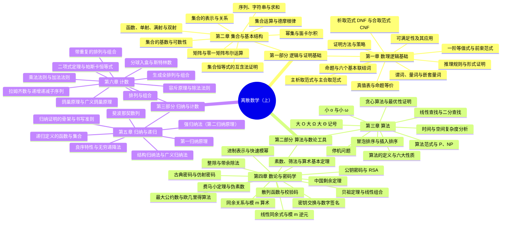

# 课程概览
## 基本信息
- 授课老师：吴斌
- 课程成绩：93 分
- 这门课难度较低，上课认真听讲，课后作业按时完成即可。期末考试难度不大。老师授课水平高，认真负责，有能力；推荐跟着老师进行学习。
## 知识结构

本课程分为**逻辑与证明基础**（第一~二章）、**算法与数论工具**（第三~四章）与**归纳与计数**（第五~六章）三大部分：第一章以命题逻辑与谓词逻辑建立"表达—演算—论证"的三层结构，规定"什么样的推理是合法的"；第二章用集合、函数、序列、基数与矩阵搭起离散对象的公共地基；第三、四章分别给出度量算法代价的尺子（大 $O$ 记号与复杂度）和关于整数本身的可计算事实（同余、gcd、逆元与密码学）；最后以数学归纳法这件"以有限驾驭无限"的机器收束，并把"有多少种"翻译成加、乘、减、除的计数工具。整体框架如下：

1. **第一章 数理逻辑基础**
    - 本章是离散数学的**"逻辑地基"与施工规范**：如果集合是砖块、关系与图是楼层结构，那么命题逻辑与谓词逻辑就是规定"什么样的推理是合法的"的那本规范，让后面每一层的论证都能被检验。
    - **命题逻辑**：六个基本联结词（否定、合取、析取、异或、蕴涵、双条件）与真值表给出"推理的代数"；等价律表、代入与置换规则让公式可以机械化简；**范式**（DNF/CNF）把公式标准化，而**主析取范式与真值表一一对应**，使"判断两公式是否等价"从语义问题变成"比较编号集合"的机械操作。
    - **谓词逻辑**：用谓词与量词给"所有/存在"建立符号系统；嵌套量词的顺序至关重要（$\forall x\exists y$ 与 $\exists y\forall x$ 差在"每个 $x$ 挑自己的 $y$"还是"一个 $y$ 一劳永逸"）；"**全称配蕴涵、存在配合取**"是把中文准确形式化的条件反射。
    - **推理与证明**：八条基本推理规则、十条常见推理定律与一阶量词规则 UI/UG/EI/EG 构成证明题的语法；八种定理证明方法（直接、间接、空、平凡、分情形、构造、存在、唯一）与前后向推理策略，是把"已知"推向"必然"的武器。停机问题与康托尔对角线法共享"自指否定"的核心结构，是计算极限的起点。
2. **第二章 集合与基本结构**
    - 集合是离散数学的**"原子语言"**：把"一堆对象"形式化为集合，再依次构造出函数、序列、基数、矩阵这四类基本结构——**集合是词汇，运算是语法，函数与关系是句子，代数结构是文章**。
    - **集合与运算**：表示法（列举/描述）与基本性质（无序性、互异性）、子集与幂集、笛卡尔积；并交差补与德摩根律等恒等式，以及**互含法**与**成员表**两种证明手段——成员表与真值表同构，德摩根律不过是命题逻辑的"换皮"。
    - **函数**：域/陪域/值域、像与原像，以及**单射/满射/双射**三分法——函数是"对每个 $a$ 恰有一个 $b$"的特殊关系，再加单射/满射即得可逆的双射，这是后续同构、可数性、编码函数共同的语言。
    - **序列、求和与基数**：求和记号与恒等变换、几何级数与 Euler 求和是全书最常用的计算工具；**基数用双射这把尺子量出无穷的层次**——对角线法证明实数不可数，并给出"$f: S \to P(S)$ 永不满射"的普适模板。矩阵与零一矩阵的布尔积则为关系的表示与复合做准备。
3. **第三章 算法**
    - 本章教会两件实用的事：**如何把解决问题的步骤写成可执行的算法**，以及**如何用统一的尺子衡量优劣**——算法是菜谱，复杂度是"这道菜随着客人增加需要多少厨师"的增长规律。
    - **算法基础**：算法的精确定义与六大性质（输入、输出、确定性、有限性、有效性、一般性）、伪代码描述；线性查找与二分查找、冒泡排序与插入排序的对比；贪心算法及其**最优性证明**（找零问题的反例说明"每步选最好"不保证全局最优）；停机问题揭示计算的边界。
    - **函数的增长**：大 $O$（上界）、大 $\Omega$（下界）、大 $\Theta$（紧确界）三把尺子，定义中"$x > k$"这一条件刻画的是**渐近行为**；小 $o$ 与小 $\omega$ 补全严格不等式；沿"常数 < 对数 < 幂 < 指数 < 阶乘 < 双指数"的增长链可排列任何两个函数的快慢。
    - **复杂度分析**：时间与空间复杂度、最坏/最好/平均情况；用"数操作次数"的方法为查找（$\Theta(n)$ vs $\Theta(\log n)$）、排序（$\Theta(n^2)$）、矩阵乘法（$O(n^3)$）估算代价；最后上升到"问题本身有多难"——可解的 $P$、可验证的 $NP$、相互等价的 $NP$ 完全类，以及被对角线论证判定为**不存在任何算法**的不可解问题。
4. **第四章 数论与密码学**
    - 本章的逻辑是**先造工具（4.1–4.4），再用工具（4.5–4.6）**：整数是一间看不到内部的房间，本章给的是几把"不拆墙就能查房"的钥匙——**不做大计算，只做聪明的小计算**。
    - **地基与算法**：带余除法 $a = bq + r$ 是**全章唯一真正不可替代的工具**，它推出同余的代数（加减乘任意、**除法须验 $\gcd(c,m)=1$**）与模 $m$ 算术的良定义；进制表示与**快速模幂**把"大数的幂"变成对数级操作（RSA 全靠它）。
    - **素数与 gcd**：素数是乘法的原子，算术基本定理保证唯一分解，但**分解本身没有已知高效算法**——这正是本章反复强调的"困难问题"。于是 gcd 改由**欧几里得算法**求（$O(\log b)$，答案就是最后一个非零余数），并由**贝祖定理**写成线性组合 $sa + tb = \gcd(a,b)$（gcd 的三副面孔：最大公约数、最后一个非零余数、线性组合），进而给出逆元与同余式除法定理。
    - **解同余式与应用**：线性同余式与模 $m$ 逆元（**"有逆元"等价于"与 $m$ 互素"，而"非零"不等于"有逆元"**）、**中国剩余定理**（本质是"换一套坐标"，把大模数运算拆成小模数并行再拼回）、费马小定理及其**逆命题不成立**的反例（伪素数 340/341、卡迈克尔数 561/1105/1729，解释了为何实用素性检验要用多随机底的 Miller–Rabin）。
    - **密码学**：散列函数、伪随机数与 UPC/ISBN 校验码是同余的工程化；凯撒、移位、仿射、分组与置换密码逐层演进到**公钥密码**，最终由 **RSA**（锁是大整数分解）、**Diffie-Hellman 密钥交换**（锁是离散对数）与**数字签名**把费马小定理、逆元、模幂三件事组装成安全大厦——**数学上的困难本身成了安全资源**。（注意 $d = e^{-1} \bmod \varphi(n)$ 是模 $\varphi(n)$ 而非模 $n$。）
5. **第五章 归纳与递归**
    - 本章给出的是一件**"把有限验证推广到无限"的机器**：它把对无穷多个 $n$ 的验证压缩成"基始步骤 + 归纳步骤"两步有限检查，这是一次"以有限驾驭无限"的飞跃。
    - **归纳法的家族**：第一归纳原理（多米诺骨牌：起点倒下 + 每一块推得倒下一块，两个前提缺一不可）、强归纳法（第二归纳原理）、良序特性三者**证明能力完全等价**——强归纳的价值不在于更强，而在于书写更自然；把"取最小反例"推向极致得到**无穷递降法**（$\sqrt2$ 无理性的经典证明）。归纳法有效性的根源是**自然数的良序性**，这也解释了它为何不能直接用于实数。
    - **递归与结构归纳**：把归纳从**证明**搬到**定义**上，得到递归定义的函数（阶乘、斐波那契）与递归定义的集合（$\Sigma^*$、平衡括号、合式公式、有根树与满二叉树）；再用**结构归纳法**证明这些递归对象的性质，并把归纳推广到字典序、有序对等更一般的良序结构。
    - **一对孪生兄弟**：递归定义回答"对象如何被构造"，结构归纳回答"构造出的对象具有什么性质"——递归定义给出构造的生成树，结构归纳就沿这棵树自下而上验证性质。理解了这一对偶，"递归算法 → 循环不变式 → 程序正确性"的链条也就顺理成章。常见谬误"所有马都是同一种颜色"的教训是：**归纳步骤对某个特定 $k$ 不成立，整个证明就垮了**。
6. **第六章 计数**
    - 本章是全书唯一"以'有多少'为研究对象"的一章，也是**最直接面向应用**的一章：从 IP 地址到密码学，从抽牌概率到算法枚举，处处是它的身影——学完本章，你获得的是把"多少种"翻译成"加、乘、减、除"的思维方式。
    - **四条基本法则**：乘法法则处理"且"、加法法则处理"或"、**容斥原理**处理"有重叠的或"（一旦有重叠就必须用 $m+n-k$ 减去重复）、**除法法则**处理"被重复计数的等价类"（核心是先确认每个等价类大小完全相同）。
    - **鸽巢原理**："物体比盒子多必有拥挤"这一信息量极小的前提，却能给出**存在性**的强结论——不需要构造，只告诉你答案一定存在；广义鸽巢原理的 $\lceil N/k \rceil$ 正是"最坏情况下的下界"。它把整除关系、**拉姆齐数**（$R(3,3)=6$，即 $K_6$ 中必含 $K_3$）与递增/递减子序列的存在性都变成一句话。
    - **排列组合与生成**：两条主线（顺序是否重要、是否允许重复）分出四把钥匙 $P(n,r)$、$C(n,r)$、$n^r$、$C(n+r-1,r)$，配合二项式定理、帕斯卡恒等式与范德蒙德恒等式；**分球入盒**模型把四类问题统一（其中"不可分辨球 + 不可分辨盒"等价于整数分拆 $p(n)$，至今没有简单闭式——对称性越高，计数越难）。章末转向算法：用回溯法与字典序生成排列、位串与组合（`nextPerm` 正是 C++ `std::next_permutation` 的原型），这也是枚举算法、回溯搜索与测试用例生成的基础。

### 知识定位与框架衔接

**前置知识**：本章不需要任何前置课程内容，只依赖两项极基础的装备——初等数学与集合论的直观（整数、奇偶、整除、素数的基本概念与"集合""元素"的朴素理解，用于全部例题素材）与自然语言的语法直觉（区分陈述句、疑问句、祈使句的能力，命题的定义正建立在"陈述句"这一语法概念上）。这也意味着本课程的学习门槛低但**抽象度跃升**：需要从"计算数值"转向"操作符号"。

**后置知识**：离散数学（下）的递推关系（本章斐波那契与迭代法是递推求解的引子，生成函数与特征方程在其后系统展开）、关系（关系 = 笛卡尔积的子集，函数是"单值"的特殊关系，零一矩阵与布尔积是其表示与复合工具）、代数结构（集合 + 满足封闭性的运算 = 代数结构，群、环、域都是在集合上装运算的产物）、图论与树（连通性与路径存在性的形式化依赖量词，判定与证明依赖本章方法），以及数据结构与算法（复杂度分析、`nextPerm` 之类的枚举原型）、计算理论与复杂性（停机问题、$P$ vs $NP$、SAT 与形式化验证）、数据库与检索（布尔检索是 SQL 的 `WHERE` 与搜索引擎查询语法的理论原型）、信息安全（RSA 与 Diffie-Hellman 是公钥基础设施的起点，HTTPS 握手、SSH 登录与数字证书签名链用的仍是本章的协议原型）与概率论（古典概型的分子分母都是本章的计数问题）。

**故事比喻**：这门课像置办一个**木工车间**——第 1 章（逻辑与证明）是**量尺与直角尺**，保证你做的每一步都合法；第 2 章（集合）是**原料与分类箱**，定义你手上的东西是什么；第 3 章（算法）是**电动工具**，规定怎么高效加工，还配了一把叫"大 $O$"的卡尺用来比较工具；第 4 章（数论与密码学）是**一间上锁的保险柜**，钥匙不是拆墙（素因子分解）而是聪明的小计算（欧几里得算法、快速模幂），而柜子里的秘密恰好是"困难本身能当锁用"；第 5 章（归纳与递归）是**榫卯结构**，让工件能一层层稳固地搭起来；第 6 章（计数）则是挂满常用配件的**一面墙**——加法与乘法法则是最基础的两颗螺丝，排列与组合是最常用的两种标准件，容斥原理是"垫片"，鸽巢原理是一把"保证能找到东西"的磁性手电筒。

**四个灵魂问题**：

1. **为什么"$p \to q$"在前件为假时规定为真，为什么有限次验证永远不能证明全称命题？** —— 前者是**唯一能保持推理规则一致**的选择：$p \to q$ 的语义只承诺"当前件为真时后件必为真"，它从不承诺前件为真（例如"若 $x>0$ 则 $x^2>0$"在 $x \le 0$ 时前提为假但定理必须为真）；后者因为全称命题断言的是**无穷多个**情形，而验证只覆盖有限多个——$n^2 - n + 41$ 在 $n = 1,\ldots,40$ 时都是素数，第 41 个就失败了，所以"寻找反例"应成为证明全称命题时首先尝试的动作。
2. **为什么大 $O$ 定义中要有"$x > k$"，为什么大 $\Theta$ 与大 $O$ 不能混用？** —— 大 $O$ 描述的是**渐近行为**，即输入足够大之后的趋势；小规模输入时快慢可能完全相反（插入排序在 $n$ 很小时快过归并排序），去掉 "$x>k$" 就会变成强命题而使许多正确结论（如 $7x^2$ 是 $O(x^3)$）不再成立。把上界当成紧确界则是本章最常见的失分点——$O$ 只给上界，$\Theta$ 才要求上下界同阶，混用会让"线性查找是 $O(n^2)$"这类真命题失去信息量。
3. **归纳法为什么合法，"假设 $P(n)$"为什么不是循环论证，强归纳又为什么与弱归纳等价？** —— 合法性源于**自然数的良序性**（假设存在反例，取最小反例 $m$，则 $P(m-1)$ 成立从而 $P(m)$ 也成立，矛盾）。归纳步骤证明的是一个**条件命题** $P(n) \to P(n+1)$，证条件命题的标准做法就是假设前件推出后件，这与"预先认定结论为真"是两回事；真正让证明成立的是**基始提供第一个真值 + 条件命题提供传递机制**。强归纳并非能力更强，而是可以**加强命题**来模拟：改证 $Q(n) = P(0) \wedge \cdots \wedge P(n)$，则归纳步骤自然能用上所有 $P(k)\ (k \le n)$——弱归纳、强归纳、良序特性、结构归纳、广义归纳说到底都是同一件事的不同外衣。
4. **为什么求 gcd 不用素因子分解，为什么中国剩余定理"换个坐标"就能算得更快，为什么密码学需要这种不对称？** —— 因为**素因子分解没有已知的高效算法**，而欧几里得算法每步只做一次带余除法、规模按对数级下降（$O(\log b)$），并顺带产出贝祖系数 $sa + tb$，这是求逆元的直接来源——一举两得。中国剩余定理给出 $x \mapsto (x \bmod m_1, \ldots, x \bmod m_n)$ 的一一对应，如同用经纬度代替平面直角坐标：**坐标换了，几何不变，但计算可能大变简单**。而 RSA 的加解密只需"正向"幂运算（快速模幂），破解却需要"反向"分解或离散对数——**密码学需要的正是这种单向结构**：合法用户走容易的一侧，攻击者被迫走困难的一侧；素性检验容易而分解困难的不对称，正是整个公钥体系的立足点。
