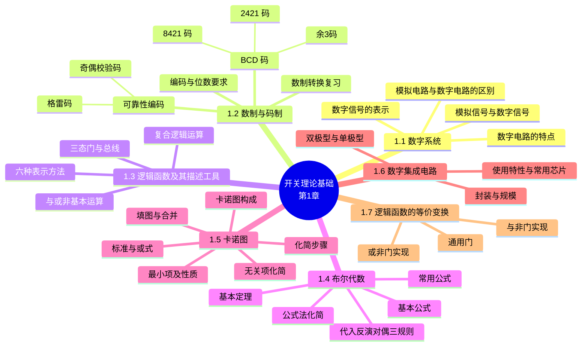

# 第一章 开关理论基础

> **本章主线**：先建立"**数字信号 / 数字系统**"的图景 → 用**数制与码制**把信息变成二进制代码 → 用**逻辑函数及其六种表示方法**刻画电路的因果关系 → 用**布尔代数**（公式法）与**卡诺图**把逻辑函数化到最简 → 最后落到**数字集成电路**的器件特性与**逻辑函数的等价变换**，为第二章组合逻辑电路的分析与设计备齐全套工具。
> 一句话版本：**先编码，再描述，后化简，最后落到芯片实现**——本章交出贯穿全书的两件数学武器（**布尔代数 + 卡诺图**）和"**最简 = 最省**"的工程价值观。
> 课程概况：本课程共 **64 学时**（课堂教学 48 + 实验 16）；考核 = 实验×20% +（作业+课堂）×10% + 期中×10% + 期末×60%。

## 1.1 数字系统

### 1.1.1 模拟信号与数字信号

- **模拟信号**：幅度随时间**连续**变化的信号。
- **数字信号**：幅度随时间**离散**变化的二值信号，只有高电平（1）与低电平（0）两种取值，伴有上升沿、下降沿。
- **数字系统**：处理数字信号的实体。
- **正/负逻辑**：正逻辑约定高电平为"1"、低电平为"0"；**负逻辑**则相反——高电平为"0"，低电平为"1"。
- 电平判别存在 $V_{H(max)}$、$V_{H(min)}$、$V_{L(max)}$、$V_{L(min)}$ 四个门限，中间为**不定区（Invalid）**。
- 数字世界与模拟世界必须互相转换：CD 播放器中，盘片上的数字位流（bit）经 **数/模转换（D/A）** 与线性放大驱动喇叭发声；反过来录音则需 **模/数转换（A/D）**。

### 1.1.2 数字电路的特点

1. 二值信号，**抗干扰能力强，保密性好**；
2. 通用性强，具有极强的信息处理和控制能力。

### 1.1.3 模拟电路与数字电路的区别

1. **工作任务不同**：
    - 模拟电路：处理大小、相位、失真等；
    - 数字电路：处理**逻辑关系（因果关系）**。
2. **晶体管的工作状态不同**：
    - 模拟电路：工作在线性放大区，是**放大管**；
    - 数字电路：工作在饱和或截止状态，是**开关管**。
3. **运算种类不同**——数字电路含有两种运算：
    - 数的**算术运算**；
    - **逻辑（控制）运算**。
4. 数字系统与模拟信号联系时，必须经过模/数（A/D）、数/模（D/A）电路。

**强制对比：模拟电路 vs 数字电路**

| 对比项 | 模拟电路 | 数字电路 |
| :--- | :--- | :--- |
| 信号 | 幅度连续变化 | 幅度离散的二值信号 |
| 晶体管角色 | 线性放大区·放大管 | 饱和/截止·开关管 |
| 核心任务 | 大小、相位、失真 | 逻辑（因果）关系 |
| 运算 | 线性放大 | 算术运算 + 逻辑运算 |
| 抗干扰 | 较弱 | **强** |

> 口诀：**模拟管放大看波形，数字管开关看因果**；要想两者对话，中间必须过 A/D、D/A。

### 1.1.4 数字信号的表示

- **电平信号**：以一个节拍内信号是高、低电平来表示"1"或"0"；
- **脉冲信号**：以一个节拍内有无脉冲来表示"1"或"0"。

---

## 1.2 数制与码制

### 1.2.1 数制（复习）

数制的两个要点：**多位数码中每一位的构成方法**（权值），以及**从低位到高位的进位规则**。

常用数制 0～15 对照（二、八、十、十六进制相互转换是复习内容）：

| 十进制 | 0 | 1 | 2 | 3 | 4 | 5 | 6 | 7 | 8 | 9 | 10 | 11 | 12 | 13 | 14 | 15 |
| :--- | :---: | :---: | :---: | :---: | :---: | :---: | :---: | :---: | :---: | :---: | :---: | :---: | :---: | :---: | :---: | :---: |
| 二进制 | 0000 | 0001 | 0010 | 0011 | 0100 | 0101 | 0110 | 0111 | 1000 | 1001 | 1010 | 1011 | 1100 | 1101 | 1110 | 1111 |
| 八进制 | 0 | 1 | 2 | 3 | 4 | 5 | 6 | 7 | 10 | 11 | 12 | 13 | 14 | 15 | 16 | 17 |
| 十六进制 | 0 | 1 | 2 | 3 | 4 | 5 | 6 | 7 | 8 | 9 | A | B | C | D | E | F |

**例题：同一个数，二进制与 BCD 完全不同**

题目：把十进制数 28 分别写成二进制数和 8421 BCD 码。

步骤：

1. 二进制（除 2 取余，逆序排列）：$28 \div 2 = 14 \cdots 0$，$14 \div 2 = 7 \cdots 0$，$7 \div 2 = 3 \cdots 1$，$3 \div 2 = 1 \cdots 1$，$1 \div 2 = 0 \cdots 1$，逆序得 $11100$。
2. 8421 BCD（按位翻译：每位十进制数字各用 4 位二进制表示）：$2 \to 0010$，$8 \to 1000$，拼接得 $0010\ 1000$。

答案：$(28)_{10} = (11100)_2 = (0010\ 1000)_{8421}$。

一句话概括：**二进制是"重新计数"，BCD 是"按位翻译"——同一个 28，两种码长相完全不同，做题先看清标注的是哪种码。**

### 1.2.2 编码与位数要求

- **编码**：用文字、符号或数码来表示某种信息的过程。
- 对 $N$ 项信息进行编码，要求二进制代码的位数 $n$ 满足：

$$2^n \ge N$$

- 数字系统中常用的编码分两大类：**BCD 码**（只有十个编码组，二～十进制编码）与**可靠性编码**（奇偶校验码、格雷码）；此外还有 7 位的 **ASCII 码**。

### 1.2.3 BCD 码

**BCD 码（Binary Coded Decimal）**：用**四位二进制代码**表示一位十进制数的计数符号的编码方法。按每位有无固定权值，分为**有权码**（8421、2421、5421）与**无权码**（余3码）。

**（1）8421 码**

- 用 $0000 ～ 1001$（自然二进制）代表 $0 ～ 9$，权值从高到低分别为 **8、4、2、1**；
- $1010 ～ 1111$ 为**冗余码**（6 个）；
- 8421 码是一种**人机联系时广泛使用的中间形式**；
- 运算时按**逢十进一**的原则，并且要进行调整：**有进位或出现冗余码（和＞9）时，+6（0110）调整**——口诀"**判 9 加 6**"。

**例题：8421 码加法调整（8 + 9 = 17）**

步骤：

1. 直接相加：$1000 + 1001 = 10001$（二进制和，**最高位产生进位**）。
2. 低 4 位为 $0001$；因为有进位，须 +6 调整：$0001 + 0110 = 0111$。
3. 拼接：进位 1 保留，低 4 位为 $0111$。

答案：结果为 $1\ 0111$（8421 BCD）$= 17$。

**例题：8421 码加法调整（7 + 6 = 13）**

步骤：

1. 直接相加：$0111 + 0110 = 1101$（没有二进制进位，但 $1101 > 1001$，是**冗余码**，等价于和＞9）。
2. 因出现冗余码，+6 调整：$1101 + 0110 = 10011$。
3. 取低 4 位 $0011$，最高位为进位 1。

答案：结果为 $1\ 0011$（8421 BCD）$= 13$。

一句话概括：**8421 码做加法，"二进制加完"只是第一步——有进位或和超 9 就 +6 校正，这就是"判 9 加 6"。**

**（2）2421 码**

- 权值由高到低分别为 **2、4、2、1**；
- **不允许出现 $0101 ～ 1010$ 的 6 种状态**；
- 是**对 9 的自补码**（0 与 9、1 与 8……两码按位互反）；
- 执行十进制数相加时，能**正确地产生进位信号**。

| 十进制 | 0 | 1 | 2 | 3 | 4 | 5 | 6 | 7 | 8 | 9 |
| :--- | :---: | :---: | :---: | :---: | :---: | :---: | :---: | :---: | :---: | :---: |
| 2421 码 | 0000 | 0001 | 0010 | 0011 | 0100 | 1011 | 1100 | 1101 | 1110 | 1111 |

**（3）余3码**

- 是一种**无权码**；
- 有六个冗余码：$0000、0001、0010、1101、1110、1111$；
- **对 9 的自补码**；
- 构成方法：将 8421 码的每个码都**加 0011**；
- 执行十进制数相加时，能**正确地产生进位信号**。

| 十进制 | 0 | 1 | 2 | 3 | 4 | 5 | 6 | 7 | 8 | 9 |
| :--- | :---: | :---: | :---: | :---: | :---: | :---: | :---: | :---: | :---: | :---: |
| 余3码 | 0011 | 0100 | 0101 | 0110 | 0111 | 1000 | 1001 | 1010 | 1011 | 1100 |

**强制对比：三种常用 BCD 码**

| 特性 | 8421 码 | 2421 码 | 余3码 |
| :--- | :--- | :--- | :--- |
| 权值 | 8、4、2、1（有权） | 2、4、2、1（有权） | **无权** |
| 冗余码 | $1010～1111$（6 个） | $0101～1010$（6 个） | $0000、0001、0010、1101、1110、1111$ |
| 对 9 自补 | 否 | **是** | **是** |
| 构成关系 | — | — | 每码 = 8421 码 + 0011 |
| 加法进位 | 需"判 9 加 6"调整 | 能正确产生进位 | 能正确产生进位 |

> 口诀：**8421 加 6 调整，2421 与余 3 对 9 自补；余 3 就是 8421 加 3，无权进位不用调**。

### 1.2.4 可靠性编码

**可靠性编码**：为减少错误的产生，或者能检测出错误的发生，所设定的码制。

**（1）格雷码（循环码）**

- 多种编码方案中，**相邻的两个代码只有 1 位取值不同**，减少传输错误（机械/电气切换时最多只错 1 位）；
- 二进制 ↔ 格雷码转换（$B_3B_2B_1B_0$ ↔ $G_3G_2G_1G_0$）：

$$
\begin{cases}
G_3 = B_3 \\
G_2 = B_3 \oplus B_2 \\
G_1 = B_2 \oplus B_1 \\
G_0 = B_1 \oplus B_0
\end{cases}
\qquad
\begin{cases}
B_3 = G_3 \\
B_2 = G_3 \oplus G_2 \\
B_1 = G_2 \oplus G_1 \\
B_0 = G_1 \oplus G_0
\end{cases}
$$

**例题：求 13 的格雷码**

步骤：

1. 13 的二进制：$B = 1101$。
2. $G_3 = B_3 = 1$；$G_2 = B_3 \oplus B_2 = 1 \oplus 1 = 0$；$G_1 = B_2 \oplus B_1 = 1 \oplus 0 = 1$；$G_0 = B_1 \oplus B_0 = 0 \oplus 1 = 1$。

答案：$G = 1011$（B：1101 → G：1011）。

一句话概括：**格雷码每一位都是相邻二进制位的异或——"错一次只错一格"就是它的全部价值。**

**（2）奇偶校验码**

用来检验在传送过程中是否产生错误的代码：码中 1 的个数强制为奇数（或偶数）。

1. **组成（两部分）**：**信息位**（位数不限）+ **检验位**（仅 1 位）。
2. **编码方式（两种）**：
    - **偶校验**：校验码中"1"的个数为偶数；
    - **奇校验**：校验码中"1"的个数为奇数。
3. **特点**：
    1. 编码简单、容易实现；
    2. 只有**检错**能力，没有**纠错**能力；
    3. 只能发现**单错**，不能发现**双错**。

**例题：给信息位补奇/偶校验位**

题目：信息位 "a" $= 1100001$（7 位），求其奇校验码；信息位 $1001101$，分别求奇、偶校验码。

步骤：

1. "a" 中 1 的个数为 3（奇数）：奇校验要求总数为奇数 → 校验位取 0，得 $0\ 1100001$。
2. $1001101$ 中 1 的个数为 4（偶数）：奇校验 → 校验位取 1，得 $1\ 1001101$；偶校验 → 校验位取 0，得 $0\ 1001101$。

答案："a" 的奇校验码 $= 01100001$；$1001101$ 的奇校验码 $= 1\ 1001101$，偶校验码 $= 0\ 1001101$。

一句话概括：**数一数 1 的个数，奇校验补齐成奇、偶校验补齐成偶——只能发现"错了奇数次"，发现不了"错成双数次"。**

> 口诀：**奇校验凑奇、偶校验凑偶；单错能抓、双错漏网，只检错不纠错**。

---

## 1.3 逻辑函数及其描述工具

**逻辑代数**（George Boole、Shannon）：不表示数量的大小关系，而是表示**逻辑因果关系**；它将逻辑归结为一种代数演算，是数字系统的理论基础和重要数学工具。

### 1.3.1 六种表示方法

描述同一个逻辑函数有六种等价工具：

1. **真值表**：将变量的所有取值组合与相应函数 $F$ 的值列成的表——**真值表具有唯一性**；
2. **逻辑代数式**：输入与输出之间的关系写成与、或、非等运算的组合式；
3. **逻辑图**：用逻辑符号表示形成的逻辑电路图；
4. **卡诺图**：最小项按几何相邻规律排列的方格图（1.5 节详述）；
5. **波形图**：用电平的高低表示逻辑变量变化的图形——**输入有变，输出可变**；
6. **硬件描述语言（Verilog）**：如 `F = A & B & C`。

### 1.3.2 基本逻辑运算

**1. 与运算（逻辑乘）**

开关（A，B，C）断开为 0、闭合为 1；灯 F 灭为 0、亮为 1。A、B、C **都具备**时，事件 F 才发生。

- 函数式：$F = A \cdot B \cdot C$
- 逻辑功能：**输入有 0，输出为 0**
- Verilog：`F = A & B & C`

**2. 或运算**

A、B、C **只要有一个**具备时，事件 F 就发生。

- 函数式：$F = A + B + C$
- 逻辑功能：**输入有 1，输出为 1**
- Verilog：`F = A | B | C`

**3. 非运算**

- 函数式：$F = \bar A$
- 逻辑功能：**输入取反**
- Verilog：`F = ~A`

> 口诀：**与看 0、或看 1、非就反**。

### 1.3.3 复合逻辑运算

**1. 与非、或非逻辑**

- **与非**：运算规则**先与后非**，$F = \overline{A \cdot B}$，Verilog：`F = ~(A & B)`；
- **或非**：运算规则**先或后非**，$F = \overline{A + B}$，Verilog：`F = ~(A | B)`；
- **与或非**：运算规则**先与、后或、再非**，$F = \overline{AB + CD}$。

**2. 异或逻辑**

- 两变量异或：$F = A \oplus B = A\bar B + \bar A B$，**A、B 相异，输出为 1**（"按位加"），Verilog：`F = A ^ B`；
- 真值表：00→0，01→1，10→1，11→0；
- **多变量异或**的特殊功能：输入变量有**奇数个 1**，则输出为 1；否则输出为 0（**奇函数**）。

**3. 同或（异或非）**

- $F = A \odot B = AB + \bar A \bar B = \overline{A \oplus B}$，**A、B 相同，输出为 1**；
- **偶数个变量**：同或、异或**互为非**；**奇数个变量**：同或、异或**相等**。

**4. 常用逻辑符号**

国标符号：与门 `&`、或门 `≥1`、异或门 `=1`（以及各自加小圆圈的与非、或非、异或非）。

> 口诀：**异或看"相异出 1"，同或看"相同出 1"；异或多变量数 1 的奇偶，偶变同或、奇不变**。

### 1.3.4 三态门与总线

**三态门（TSL 门，Three State Logic）**：输出除 0、1 两种状态外，还有**高阻状态（禁止态）**；$E$（Enable）为**使能端**。

1. **使能端高电平有效**：$E = 1$ 时，$F = \overline{AB}$（与非门工作）；$E = 0$ 时，与非门禁止，输出呈**高阻态**。

| E | A | B | F |
| :---: | :---: | :---: | :---: |
| 0 | × | × | 高阻 |
| 1 | 0 | 0 | 1 |
| 1 | 0 | 1 | 1 |
| 1 | 1 | 0 | 1 |
| 1 | 1 | 1 | 0 |

2. **使能端低电平有效**：$E = 0$ 时，$F = \overline{AB}$；$E = 1$ 时禁止，输出高阻（国标符号中使能端带小圆圈）。

**基本应用——构成总线（Bus）**

1. **单向总线（信号的分时传送/选择传送）**：多个三态门共用一条输出线，由使能端选择谁把数据放上总线。**注意：任何时刻，发送数据时只允许一个三态门使能，其余必须为高阻态**，否则总线冲突。
2. **双向总线**：同一引脚既做输入又做输出——$EN = 0$ 时数据 $D \to Y$（发送），$EN = 1$ 时 $Y \to D$（接收），实现两个不同系统间信号的双向传送。

> 口诀：**总线上同一时刻只准一个门"说话"，其余全部闭嘴进高阻**。

典型应用：飞机着陆功能检测系统（起落架传感器：展开 = 低电平 0，收回 = 高电平 1）、多位数值比较器（$A = B$ 判定）等，都是"逻辑关系"的直接落地。

---

## 1.4 布尔代数

### 1.4.1 基本公式

| 名称 | 公式 |
| :--- | :--- |
| 0-1 律 | $A + 0 = A$，$A \cdot 1 = A$，$A + 1 = 1$，$A \cdot 0 = 0$ |
| 互补律 | $A + \bar A = 1$，$A \cdot \bar A = 0$ |
| 等幂律 | $A + A = A$，$A \cdot A = A$ |
| 双非律 | $\overline{\bar A} = A$ |

### 1.4.2 基本定理

| 名称 | 公式 |
| :--- | :--- |
| 交换律 | $A + B = B + A$，$AB = BA$ |
| 结合律 | $(A + B) + C = A + (B + C)$，$(AB)C = A(BC)$ |
| 分配律 | $A(B + C) = AB + AC$，$A + BC = (A + B)(A + C)$ |
| 反演律（狄摩根） | $\overline{A \cdot B} = \bar A + \bar B$，$\overline{A + B} = \bar A \cdot \bar B$ |

**门级等价（NOR ↔ Negative-AND、NAND ↔ Negative-OR）**——反演律的图形化读法：

$$\overline{A \cdot B} = \bar A + \bar B \qquad \text{（NAND = Negative-OR：与非等价于"负输入的或"）}$$

$$\overline{A + B} = \bar A \cdot \bar B \qquad \text{（NOR = Negative-AND：或非等价于"负输入的与"）}$$

### 1.4.3 常用公式

| 名称 | 公式 |
| :--- | :--- |
| 还原律 | $AB + A\bar B = A$，$(A + B)(A + \bar B) = A$ |
| 吸收率 | $A + AB = A$，$A(A + B) = A$，$A(\bar A + B) = AB$，$A + \bar A B = A + B$ |
| 冗余律 | $AB + \bar A C + BC = AB + \bar A C$ |

### 1.4.4 逻辑代数的三条规则

**1）代入规则**

将等式中的某一变量都代以一个逻辑函数 $F$，则此等式仍成立——**规则应用：公式扩展**。

例：把 $\overline{A + B} = \bar A \cdot \bar B$ 中的 $B$ 代以 $(D + C)$：

$$\overline{A + (D + C)} = \bar A \cdot \overline{D + C} = \bar A \cdot \bar D \cdot \bar C$$

**2）反演规则**

**规则应用：求逻辑函数 $F$ 的反函数。** 变换要点：

1. $0 \leftrightarrow 1$，$+ \leftrightarrow \cdot$；
2. **所有变量取反**（原变量变反变量，反变量变原变量）；
3. **运算顺序保持不变**（加括号）；
4. **两个及以上变量的非号保持不动**（只对单变量取反）。

**例题：用反演规则求 $Y = A(B + C) + CD$ 的反函数**

步骤：

1. 变量取反：$A \to \bar A$，$B \to \bar B$，$C \to \bar C$，$D \to \bar D$；
2. 运算符互换：$+$ 与 $\cdot$ 互换，$A$ 与 $(B+C)$ 之间的隐含乘变加，$(B+C)$ 内部的加变乘，中间连接的 $+$ 变 $\cdot$；
3. 保持括号层次。

答案：$\bar Y = (\bar A + \bar B \bar C)(\bar C + \bar D)$。

**例题（课件例 2）：求 $F = A + \overline{B + \overline{C} + \overline{D + \overline{E}}}$ 的反函数**

步骤：

1. 最外层 $A + (\cdots)$ 的 $+$ 变 $\cdot$：$\bar A \cdot \overline{(\cdots)}$；
2. 长非号内（跨多变量）**非号不动**，内部 $+$ 变 $\cdot$、变量取反：$B \to \bar B$，$\overline{C} \to C$，$D \to \bar D$，$\overline{E} \to E$；
3. 跨变量的 $\overline{D + \overline{E}}$ 非号保持，内部同样变换为 $\overline{\bar D \cdot E}$。

答案：

$$\bar F = \bar A \cdot \overline{\bar B \cdot C \cdot \overline{\bar D \cdot E}}$$

一句话概括：**反演 = 0/1 互换、加乘互换、变量全反、括号保住、长非号别动**。

**3）对偶规则**

$$(F')' = F$$

- 变换：$0 \leftrightarrow 1$，$+ \leftrightarrow \cdot$，**变量保持不变**（不变反！），运算顺序不变；
- **规则应用：证明等式成立**——若两个逻辑函数相等，则它们的对偶式也相等。

**例题：写出并验证分配律的对偶等式**

步骤：

1. 原式：$A(B + C) = AB + AC$；
2. 对偶：$+$ 与 $\cdot$ 互换、0/1 互换、变量不动，得 $A + BC = (A + B)(A + C)$；
3. 验证右边：$(A + B)(A + C) = A + AB + AC + BC = A(1 + B + C) + BC = A + BC$，与左边相等。

答案：$A + BC = (A + B)(A + C)$，对偶成立。

**注意**：函数式中有 $\oplus$（异或）和 $\odot$（同或）运算符时，求反函数及对偶函数要将 $\oplus$ 换成 $\odot$、$\odot$ 换成 $\oplus$。

**强制对比：反演规则 vs 对偶规则**

| 对比项 | 反演规则 | 对偶规则 |
| :--- | :--- | :--- |
| 目的 | 求**反函数** $\bar F$ | 求**对偶式** $F'$ |
| $0 \leftrightarrow 1$ | 互换 | 互换 |
| $+ \leftrightarrow \cdot$ | 互换 | 互换 |
| **变量** | **全部取反** | **保持不变** |
| 长非号 | 跨变量的非号不动 | 涉及 $\oplus \leftrightarrow \odot$ 互换 |
| 运算顺序 | 不变（保留括号） | 不变（保留括号） |
| 典型应用 | 已知 $F$ 求 $\bar F$ | 证明等式：相等则对偶相等 |

> 口诀：**反演变量全取反，对偶变量原样站；0/1 互换、加乘互换，顺序一律不能乱**。

### 1.4.5 用布尔代数化简逻辑函数

**化简的目的**：**乘积项最少**；每个乘积项中**因子最少**（项数少 = 门少，因子少 = 门的输入端少）。

**方法**：公式化简、卡诺图化简。**任何 $F$ 都可以写成"与-或"表达式的形式。**

**四种化简技法**

| 技法 | 依据 | 示例 |
| :--- | :--- | :--- |
| 并项法 | $AB + A\bar B = A$ | $A + AB = A$ |
| 消项法（冗余律） | $AB + \bar A C + BC = AB + \bar A C$ | 消去被覆盖的冗余项 |
| 消因子法（吸收率） | $A + \bar A B = A + B$ | 消去一个因子 |
| 配项法 | 乘 $A + \bar A = 1$ 或加 $A\bar A = 0$ | 创造合并机会 |

**例题（课件例 1）：化简 $F_2 = \bar A + \overline{A \cdot \overline{BC}} \cdot (B + \overline{AC + \overline{D}}) + BC$**

步骤：

1. 对 $\overline{A \cdot \overline{BC}}$ 用反演律：$\overline{A \cdot \overline{BC}} = \bar A + BC$；
2. 代入得 $F_2 = \bar A + BC + (\bar A + BC)(B + \overline{AC + \overline{D}})$；
3. 令 $Z = \bar A + BC$，则 $F_2 = Z + Z \cdot (\cdots)$，由吸收率 $Z + Z \cdot X = Z$。

答案：$F_2 = \bar A + BC$。

一句话概括：**先用反演律把复杂的"非"拆开，凑出公共因子 $Z$，再用吸收率一把吞掉。**

**例题（课件例 2）：化简 $F = ABC + \bar A D + \bar C D + BD$**

步骤：

1. 把 $\bar A D + \bar C D$ 提公因子 $D$：$\bar A D + \bar C D = (\bar A + \bar C)D$；
2. 由反演律 $\bar A + \bar C = \overline{AC}$，得 $F = ABC + \overline{AC} D + BD$；
3. 对 $ABC + \overline{AC} D + BD$ 用冗余律（$P = AC$，$Q = B$，$R = D$）：$PQ + \bar P R + QR = PQ + \bar P R$，$BD$ 是冗余项被消去。

答案：$F = ABC + \overline{AC} D$。

一句话概括：**先并项造出 $\overline{AC}$，再用冗余律干掉 $BD$——三个"看似必要"的项，两个就够。**

**例题（课件例 3）：化简 $F = \bar A \bar B + \bar B \bar C + BC + AB$**

步骤：

1. 配项（乘 1 法）：$\bar A \bar B = \bar A \bar B(C + \bar C)$，$BC = BC(A + \bar A)$；
2. 展开：$F = \bar A \bar B C + \bar A \bar B \bar C + \bar B \bar C + ABC + \bar A BC + AB$；
3. 并项：$\bar A \bar B C + \bar A BC = \bar A C$；$\bar A \bar B \bar C + \bar B \bar C = \bar B \bar C$；$AB + ABC = AB$。

答案：$F = \bar A C + \bar B \bar C + AB$。

一句话概括：**缺哪个变量就乘上"它 + 它的反"，展开后两两合并——配项法就是无中生有、再化零。**

**强制对比：公式法 vs 卡诺图法**

| 对比项 | 公式化简 | 卡诺图化简 |
| :--- | :--- | :--- |
| 依据 | 基本公式与常用公式 | 几何相邻 = 逻辑相邻 |
| 对变量数 | 不限 | **不宜超过 5 个** |
| 直观性 | 需要经验与技巧 | 图上圈圈，直观 |
| 结果 | 需人工判断是否最简 | 最简（可不唯一） |
| 适用 | 推导、证明 | 快速化简 |

> 口诀：**公式法靠"凑"，卡诺图靠"圈"；小规模图上圈，复杂推导纸上算**。

---

## 1.5 卡诺图

### 1.5.1 最小项及其性质

**最小项**：有 $n$ 个变量的逻辑函数中，所有 $n$ 个变量（每个**只能出现一次**，原变量或反变量）的**乘积项**。

**最小项的特点**：

1. 每个最小项只有 **$n$ 个变量因子**；
2. 每个变量只能出现一次（原变量或反变量）；
3. $n$ 个变量共有 $2^n$ 个最小项。

**最小项的性质**：

1. 变量的一次取值只能使**一个**最小项为 1；
2. 所有最小项的**和为 1**；
3. 任意两个最小项的**乘积为 0**；
4. $n$ 个变量的每个最小项有 **$n$ 个相邻项**。

**相邻项**：两个最小项**只有一个变量互为相反变量**，其余变量均相同。

### 1.5.2 标准表达式（最小项表达式）

逻辑函数可表示为**唯一**的最小项表达式（最小项之和的形式）——**Standard SOP Form（Sum of Minterms Form）**：把使函数值为 1 的最小项相"+"。

**例题：由真值表写最小项表达式**

题目：已知 $F(A,B,C)$ 的真值表如下，写出其最小项表达式并画出卡诺图。

| A | B | C | F |
| :---: | :---: | :---: | :---: |
| 0 | 0 | 0 | 0 |
| 0 | 0 | 1 | 0 |
| 0 | 1 | 0 | 0 |
| 0 | 1 | 1 | 1 |
| 1 | 0 | 0 | 0 |
| 1 | 0 | 1 | 1 |
| 1 | 1 | 0 | 1 |
| 1 | 1 | 1 | 1 |

步骤：

1. 挑出 $F = 1$ 的行：011、101、110、111；
2. 每行对应一个最小项：$m_3、m_5、m_6、m_7$；
3. 相加得标准与或式。

答案：$F(A,B,C) = m_3 + m_5 + m_6 + m_7$。

### 1.5.3 卡诺图的构成与特点

**卡诺图**：用小方格表示最小项，且按一定的规律排列。

**卡诺图规律**：凡**几何位置相邻**，其对应的最小项均是**逻辑相邻项**；任一行或一列**两端**的最小项也具有逻辑相邻性。

- 列/行编码按**格雷码顺序** $00 \to 01 \to 11 \to 10$（相邻只差 1 位，保证几何相邻 = 逻辑相邻，且首尾相接）。
- 两变量卡诺图、三变量卡诺图、四变量卡诺图的方格编号依次如下（○ 内数字为最小项编号）：

| 两变量（A 行 B 列） | B=0 | B=1 |
| :--- | :---: | :---: |
| A=0 | 0 | 1 |
| A=1 | 3 | 2 |

| 三变量（A 行 BC 列） | 00 | 01 | 11 | 10 |
| :--- | :---: | :---: | :---: | :---: |
| A=0 | 0 | 1 | 3 | 2 |
| A=1 | 4 | 5 | 7 | 6 |

| 四变量（AB 行 CD 列） | 00 | 01 | 11 | 10 |
| :--- | :---: | :---: | :---: | :---: |
| AB=00 | 0 | 1 | 3 | 2 |
| AB=01 | 4 | 5 | 7 | 6 |
| AB=11 | 12 | 13 | 15 | 14 |
| AB=10 | 8 | 9 | 11 | 10 |

**卡诺图的缺点**：函数的变量个数**不宜超过 5 个**（圈画起来失去直观性）。

### 1.5.4 用卡诺图表示逻辑函数

1. **已知标准表达式（或真值表）**：与最小项相应的方格填 1，其余填 0——直接填入。
2. **非标准的与或式**：在每个"与项"所**覆盖面积**里的方格上填 1。
3. **或与式**：先写出**反函数**的"与-或"式，按反函数填入。

### 1.5.5 最小项合并规律与化简步骤

**合并规律**：将 $2^m$ 个相邻的 1 中**相异的变量消去，保留相同变量**，合并为一个乘积项——**$2^m$ 格消 $m$ 个变量**。

- 两个相邻项合并 → 消 1 个变量；
- 四个相邻项合并 → 消 2 个变量；
- **相邻关系封闭——圈实质为方形（矩形）**，不能是 L 形、三个一排等。

**用卡诺图化简逻辑函数的步骤**：

1. **画图**：将逻辑函数 $F$ 用卡诺图表示；
2. **划圈**：对卡诺图中为 1 的最小项划圈。
    - **划圈的目标**：用**尽可能大、尽可能少**的圈，圈住所有等于 1 的最小项；
    - **划圈的规则**：
        1. 圈中 1 的个数为 $2^n$；
        2. 圈中的 1 可多次被圈，但每个圈内**至少有一个未被圈过的 1**；
        3. 所有 1 必须圈完，可独立为一圈；
    - **不要忽略卡诺图边沿最小项的相邻关系**（左右、上下首尾相接）；
3. **写表达式**：将每个圈对应的乘积项或在一起。

**例题：用卡诺图化简 $F(A,B,C) = m_3 + m_5 + m_6 + m_7$**

步骤：

1. **画图**：按 1.5.3 的三变量图，在 $m_3、m_5、m_6、m_7$ 方格填 1：

| A\BC | 00 | 01 | 11 | 10 |
| :---: | :---: | :---: | :---: | :---: |
| 0 | 0 | 0 | **1** | 0 |
| 1 | 0 | **1** | **1** | **1** |

2. **划圈**（三步思考）：
    - 竖着看：$m_3$(011) 与 $m_7$(111) 上下相邻 → 圈出一对，消去相异的 $A$ → $BC$；
    - $m_5$(101) 与 $m_7$(111) 相邻 → 消去相异的 $B$ → $AC$；
    - $m_6$(110) 与 $m_7$(111) 相邻 → 消去相异的 $C$ → $AB$；
    - 检查：$m_3$ 仅在圈 $BC$ 中、$m_5$ 仅在圈 $AC$ 中、$m_6$ 仅在圈 $AB$ 中，$m_7$ 被三圈复用（允许），所有 1 已圈完，且没有更大的四格圈可用。
3. **写表达式**：三个圈的乘积项相或。

答案：$F = AB + BC + AC$。

一句话概括：**填图画圈四步走——圈大圈少新 1 留，两头相邻别遗漏**。

> 口诀：**圈要方、数要 $2^m$；大圈优先、每个圈必须带来新 1、边沿两头别忘连**。

**注意**：同一函数的最简结果**可不唯一**（圈法不同，结果不同，但项数与因子数相同）。

### 1.5.6 无关项的逻辑函数化简

**无关项（任意项）**：特殊的最小项，其所对应的变量取值组合**不允许出现或者根本不会出现**。无关项用 $\times$（$d$、$\phi$）表示。

**化简原则**：在卡诺图化简中，**利用无关项可取 1，尽量将圈画大**（也可置 0 不圈，怎么有利怎么来）。

**例题：含无关项的化简 1**

题目：$F(A,B,C,D) = \Sigma(m_1, m_5, m_8, m_{12}) + \Sigma d(m_3, m_7, m_{10}, m_{11}, m_{14}, m_{15})$

步骤：

1. 画四变量卡诺图：1 填 $m_1、m_5、m_8、m_{12}$，× 填 $d$ 组各方格；
2. 把 × 当作 1 尽量连大圈（例如 $m_1、m_3$ 一带与 $m_5、m_7$ 一带可用 × 并入大圈，$m_{10}、m_{11}、m_{14}、m_{15}$ 整块 × 可与 1 圈合并）；
3. 每个圈写出消去相异变量后的乘积项，相或。

答案：利用无关项把圈画到最大后写出最简与或式（无关项取 1 还是 0，以"圈大圈少"为准）。

一句话概括：**无关项是"免费的 1"——想圈多大圈多大，但圈完必须覆盖全部真 1**。

**例题：含无关项的化简 2**

题目：$F(A,B,C,D) = \Sigma(m_4, m_6, m_{10}, m_{13}, m_{15}) + \Sigma d(m_0, m_1, m_2, m_5, m_7, m_8)$

步骤与原则同上：1 与 × 混排，凡能把 5 个真 1 连成 $2^m$ 大圈的 × 一律取 1，最后按圈写乘积项相或。

> 口诀：**真 1 必圈完，× 项随叫随到；圈越大越好，最简可不唯一**。

---

## 1.6 数字集成电路

### 1.6.1 集成电路技术

根据所采用的半导体器件，数字集成电路可以分为**双极型**与**单极型**两大类。

**强制对比：双极型 vs 单极型**

| 对比项 | 双极型 | 单极型 |
| :--- | :--- | :--- |
| 代表工艺 | TTL、ECL、I²L | CMOS、PMOS、NMOS |
| 速度 | **快** | 慢 |
| 负载能力 | **强** | — |
| 功耗 | 大 | **低** |
| 集成度 | 低 | **高** |
| 电路 | 复杂 | 简单 |
| 电平范围 | 1：(2～5V)，0：(0～0.8V) | 1：(2～2.3V)，0：(0～0.3V) |

> 口诀：**双极快而强、费电集成低；单极慢而简、省电集成高**。

### 1.6.2 集成电路封装与规模

**封装**：

- **DIP**（双列直插封装）；
- **SMT**（表面贴装技术）：SOIC、PLCC、LCCC、FP 等。

**规模（按集成门数）**：

| 类型 | 规模 | 门数 |
| :--- | :--- | :---: |
| SSI | 小规模 | ≤ 12 门 |
| MSI | 中规模 | 12 ～ 99 |
| LSI | 大规模 | 100 ～ 9999 |
| VLSI | 超大规模 | 1 万 ～ 99999 |
| ULSI | 特大规模 | 10 万以上 |

### 1.6.3 集成电路使用特性

- **延迟特性**：传输延迟 $t_{pd}$（ns）——信号从输入变化到输出响应的时间，级联越多总延迟越大（可用**环形多谐振荡器**直观演示：结构简单，但频率太高、不可调）。
- **常用含与非、或非及异或门的集成电路芯片**：

| 型号 | 内容 |
| :--- | :--- |
| 7400 | 4 个两输入与非门 |
| 7410 | 3 个三输入与非门 |
| 7420 | 2 个四输入与非门 |
| 7430 | 1 个八输入与非门 |
| 7402 | 4 个两输入或非门 |
| 7427 | 3 个三输入或非门 |
| 7486 | 4 个两输入异或门 |

芯片引脚规律：14 脚封装，14 脚接 $V_{CC}$、7 脚接 GND，内部若干独立门电路（如 7400 的四个与非门各占 2 输入 + 1 输出）。

---

## 1.7 逻辑函数的等价变换

**通用门**：所有逻辑都可以用**一种门**实现的门（与非门、或非门）——利于电路实现，**提高标准化程度**。

### 1.7.1 "与非"门实现

思路：**双非 → 反演**——对目标表达式两次取反，再用狄摩根定律把内层的 $\cdot$/$+$ 互换，整个电路只用与非门搭建（两级或多级与非网络）。

### 1.7.2 "或非"门实现

同理，对目标表达式做相应变换，全部用或非门实现任意逻辑函数。

> 口诀：**两次取反加狄摩根，与非或非各撑一片天；通用门就是"标准化"的起点**。

---

## 本章知识定位与框架衔接

**前置知识**：十进制与二进制互化（复习）、集合与命题逻辑的直觉；本章是纯工具章，几乎不依赖前修课程。

**后置衔接**：

- 本章的**布尔代数 + 卡诺图**是第二章**组合逻辑电路分析与设计**的直接武器——分析是"图 → 表达式 → 化简 → 功能"，设计是"功能 → 表达式 → 化简 → 图"，每一步都用本章工具；
- **三态门、通用门、74 系列芯片**是后续搭实验电路的硬件基础；
- **逻辑函数的六种表示**贯穿全书：真值表与卡诺图管组合逻辑，波形图与时序管时序逻辑，Verilog 贯穿实验。

**比喻**：本章像"**字典 + 算盘**"——数制码制教你把话（信息）写成 0/1，布尔代数与卡诺图是把话化简到最短的算盘，集成电路章节则告诉你这把算盘用什么硅片造。

**灵魂问题**：

1. 为什么卡诺图"几何相邻"就等价于"逻辑相邻"？（格雷码编码 + 首尾相接是全部秘密）
2. 反演规则和对偶规则只差"变量取不取反"，为什么后果完全不同？
3. 化简为什么要求"乘积项最少**且**因子最少"？——落到硬件上，它们分别对应什么成本？

**一句话总结本章**：**先用数制码制把信息变成 0/1，再用逻辑函数六种表示描述因果，然后用布尔代数（公式法）和卡诺图把函数化到最简，最后认清集成电路的器件特性与通用门实现——"最简 = 最省"，这就是开关理论的全部工程动机。**

<iframe src="https://cognishelf.naimore3.workers.dev/课程笔记/大二上/数字逻辑与数字系统/第一章/第一章.pdf" width="100%" height="800px" style="border: none;"></iframe>
