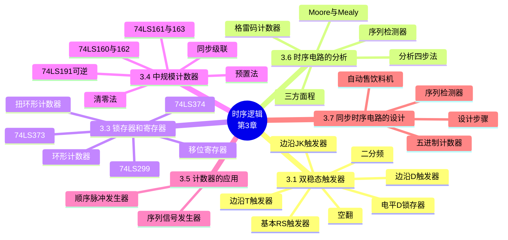

# 第三章 时序逻辑

> **本章主线**：先建立**触发器**这一记忆元件的完整认知（基本 RS → 电平 D 锁存器 → 边沿 D / JK / T）→ 再学习**时序电路的分析**（图 → 三方面程 → 状态表 → 状态图 → 功能）→ 然后系统学习中规模时序部件：**锁存器、寄存器、移位寄存器、计数器**及其应用（顺序脉冲 / 序列信号发生器）→ 最后掌握**同步时序电路的设计**（功能 → 状态图 → 编码 → 激励方程 → 电路 → 自启动检查）。
> 一句话版本：**触发器是"记住过去"的元件，时序电路 = 组合逻辑 + 触发器；分析是"看图识功能"，设计是"按功能画图"，计数器 / 移存器是拿来即用的中规模积木**——本章是第二章组合逻辑的"时间维度"升级。
> 编号说明：沿用课件节号 3.1、3.3、3.4、3.5、3.6、3.7；课件**无 §3.2**；课件讲授顺序为 3.1 → 3.6 → 3.3 → 3.4 → 3.5 → 3.7（编号非顺序出现），本笔记按此讲授顺序编排；计数器应用在课件中标为 §3.5.2，本笔记编为 §3.5。

**时序逻辑电路的定义与特点**（课件引入）：时序逻辑电路任一时刻的输出状态，不仅取决于**当时的输入信号**，而且与**前一时刻电路的状态**有关。其电路结构为**组合电路 + 触发器**（存储电路）。按触发方式分为：

1. **同步时序电路**：所有触发器共用一个时钟信号；
2. **异步时序电路**：触发器无统一的时钟信号。

时序逻辑电路可用**三个方程**来描述（这是全章分析与设计的数学骨架）：

$$Y = F_1(X, Q^n) \quad \text{（输出方程）}$$

$$W = F_3(X, Q^n) \quad \text{（激励方程，又称驱动方程）}$$

$$Q^{n+1} = F_2(W, Q^n) \quad \text{（状态方程）}$$

按输出方式分为：**莫尔型（Moore）**——输出 $Y$ 仅与电路的现态有关（式中无 $X$）；**米勒型（Mealy）**——输出 $Y$ 是电路现态和外部输入量的函数。



---

## 3.1 双稳态触发器

### 3.1.1 触发器概述

**触发器（Flip-Flop）** 是存储 **1 位二值信号**的基本单元电路，是一种**记忆元件**。其特点为：

1. 具有**两个稳定状态**，1 和 0；
2. 输入信号可置输出为 1 或 0；
3. 输入信号消失后，**新状态保存下来**（保持）；
4. 结构上由**逻辑门 + 反馈**构成——正是交叉反馈回路赋予了电路记忆能力。

触发器的分类：

- **按功能分**：RS 触发器、D 触发器、JK 触发器、T 型触发器；
- **按电路结构分**：基本触发器、电平触发器（锁存器）、边沿触发器（寄存器）、主从型。

**现态与次态**：$Q^n$（也写作 $Q$）称为**现态**，是输入信号作用前的状态；$Q^{n+1}$ 称为**次态**，是输入信号作用后的状态。**次态方程**（又称特征方程、状态方程）就是把 $Q^{n+1}$ 表示为输入和 $Q^n$ 的函数式。

### 3.1.2 基本 RS 触发器

**逻辑符号与端子**：输入端 $R$（Reset，复位端，使 $Q = 0$）、$S$（Set，置位端，使 $Q = 1$）；输出端 $Q$ 与 $\bar{Q}$。课件采用**低电平有效**（符号上带小圆圈）的与非门交叉耦合结构，是"直接复位置位 FF"的简称。

**次态方程与约束条件**：

$$Q^{n+1} = \bar{S} + RQ^n \qquad \text{（约束条件：} S + R = 1\text{）}$$

约束的含义：$S$、$R$ 不能同时为 0（即不能同时有效），否则进入**不定态**。

**状态转移真值表**（低电平有效）：

| $S$ | $R$ | $Q^n$ | $Q^{n+1}$ | 功能 |
| :--- | :--- | :--- | :--- | :--- |
| 0 | 0 | × | ×（不定） | 禁止 |
| 0 | 1 | 0 | 1 | 置 "1" |
| 0 | 1 | 1 | 1 | 置 "1" |
| 1 | 0 | 0 | 0 | 置 "0" |
| 1 | 0 | 1 | 0 | 置 "0" |
| 1 | 1 | 0 | 0 | 保持 |
| 1 | 1 | 1 | 1 | 保持 |

**激励表（驱动表）**：列出触发器欲达到目标状态所需加的输入信号（$d$ 表示任意）：

| $Q^n$ | $Q^{n+1}$ | $R$ | $S$ |
| :--- | :--- | :--- | :--- |
| 0 | 0 | $d$ | 1 |
| 0 | 1 | 1 | 0 |
| 1 | 0 | 0 | 1 |
| 1 | 1 | 1 | $d$ |

**状态图**：描述触发器状态转换关系及转换条件的图形——两个状态圈 0 与 1，$0 \to 1$ 标置位条件（$S = 0, R = 1$），$1 \to 0$ 标复位条件（$S = 1, R = 0$），自环标保持条件。

**工作时序图**：反映输入信号与触发器状态之间对应关系的图形。基本触发器以**输入的变化**为关键点（无时钟），初始状态通常设为 "0"；需注意 $RS$ 同时有效时输出不定。

**存在的问题**：

1. $R$、$S$ 之间有**约束关系**（不能同时有效）；
2. **不能进行定时控制**——输出随输入随时变化，无法与系统时钟同步。

**高有效 RS 触发器**：若将低有效输入取反（或改用或非门结构）可得高有效版本，功能表中 $S = 1$ 置 1、$R = 1$ 置 0、$S = R = 0$ 保持、$S = R = 1$ 不定——约束条件变为 $SR = 0$，次态方程为 $Q^{n+1} = S + \bar{R}Q^n$（即课件小结中的**同步 RS 触发器**形式）。

> 口诀：**低有效 RS 记 "0 动 1 静"——输入为 0 时动作（置位 / 复位），全 1 保持，全 0 犯规**。

### 3.1.3 电平（同步）D 触发器（锁存器）

在门控信号 $En$（Gate，又称 $G$）**有效期间**，触发器接收输入信号、状态发生改变；否则状态维持不变。即触发器在 $En$ 有效电平时间内翻转，翻转到何状态由输入信号 $D$ 决定。

**状态方程**：

- $En = 0$ 时：维持原状态，即 $Q^{n+1} = Q^n$；
- $En = 1$ 时：

$$Q^{n+1} = D$$

电路内部由 $D$ 生成互补的 $R$、$S$ 去驱动基本 RS 触发器（**R 和 S 端始终互补**），从而自动满足 RS 的约束条件——这正是 D 触发器"没有约束、功能简单"的原因：**次态与输入信号 D 一致**。

**状态转换真值表**：$D = 0 \Rightarrow Q^{n+1} = 0$；$D = 1 \Rightarrow Q^{n+1} = 1$（在 $En = 1$ 时）。**状态图**：$0 \to 1$ 标 $D = 1$，$1 \to 0$ 标 $D = 0$，自环标 $D = d$（$En = 1$ 时）。

**工作时序图**：以 $En$ 有效沿和 $En$ 有效期间输入的变化为关键点，初始状态为 "0"。

**空翻现象**：在一个门控信号（$En$ 保持有效）的作用下，触发器状态变化**多于一次**的现象。空翻是**锁存器共有的问题**，关键在于**电平使能**——解决方案是**改电平使能为边沿触发**。

**集成同步 D 触发器**：如 4D 同步触发器（多组 $En$ 分组控制）。**存在的问题**：（1）可能出现空翻；（2）逻辑功能比较简单。

### 3.1.4 边沿 D 触发器

**边沿触发器**仅在时钟脉冲 $CP$（clock pulse）的**有效边沿**才接受输入信号、改变状态——从根本上消除空翻。

**逻辑功能**（上升沿触发）：

$$Q^{n+1} = D$$

与电平 D 相同的方程，但只在 $CP$ 上升沿瞬间采样。**时序图**以**有效边沿**为关键点，初始状态为 "0"。将 $Q$ 接回 $D$（即 $T'$ 接法），每个时钟翻转一次，实现**二进制计数（二分频）**——输出方波频率为 $CP$ 的一半。

边沿 D 触发器又称 **D 寄存器（register）**。**集成边沿 D 触发器**：如双 D 触发器，带 $S_D$（异步置 1）、$R_D$（异步清 0，clear）端。**存在的问题**：逻辑功能比较简单——只有"跟随 D"一种行为，无法直接表达"保持 / 翻转"。

### 3.1.5 边沿 JK 触发器

课件采用**负边沿**（下降沿）触发的 JK 触发器。

**状态方程**：

$$Q^{n+1} = J\bar{Q}^n + \bar{K}Q^n$$

特殊功能：$J = K = 0$ 时具有**维持**功能；$J = K = 1$ 时具有**翻转**功能。

**状态表**：

| $J$ | $K$ | $Q^n$ | $Q^{n+1}$ | 功能 |
| :--- | :--- | :--- | :--- | :--- |
| 0 | 0 | 0 | 0 | 保持 |
| 0 | 0 | 1 | 1 | 保持 |
| 0 | 1 | 0 | 0 | 置 "0" |
| 0 | 1 | 1 | 0 | 置 "0" |
| 1 | 0 | 0 | 1 | 置 "1" |
| 1 | 0 | 1 | 1 | 置 "1" |
| 1 | 1 | 0 | 1 | 翻转 |
| 1 | 1 | 1 | 0 | 翻转 |

**激励表**：$0 \to 0$：$J = 0, K = d$；$0 \to 1$：$J = 1, K = d$；$1 \to 0$：$J = d, K = 1$；$1 \to 1$：$J = d, K = 0$。

**状态图**：四个转换方向分别标 $JK = 0d$（$0 \to 0$）、$1d$（$0 \to 1$）、$d1$（$1 \to 0$）、$d0$（$1 \to 1$）。

**时序图**：以 $CP$ 有效边沿为关键点，配合异步 $R$ 端清 "0" 开始；$J$、$K$ 在沿到来前的状态决定本次动作。**集成边沿 JK 触发器**：如双 J-K 触发器，$J = K = 1$ 时每沿翻转，实现**二分频**。

**转换例（JK → D）**：要让 JK 触发器实现 D 触发器功能，令 $J = D$、$K = \bar{D}$ 即可（代入方程验证：$Q^{n+1} = D\bar{Q}^n + D Q^n = D$）。

### 3.1.6 边沿 T 触发器

**逻辑功能**（上升沿触发，$T$ 为控制端）：

$$Q^{n+1} = T\bar{Q}^n + \bar{T}Q^n = T \oplus Q^n$$

- $T = 0$ 时：触发器维持原状态；
- $T = 1$ 时：触发器在 $CP$ 作用下翻转。

T 触发器可由 JK 触发器令 $J = K = T$ 构成。将 $T$ 恒接 1 即得 $T'$ 触发器（每沿必翻转），实现**二进制计数（二分频）**。

**例：综合波形练习（课件 2/4 线译码器 + 触发器）**：电路由 2-4 译码器（地址 $A_1A_0$ 接 $A$、$B$）与四个触发器组成，$D_0 = \bar{Q}_1$、$D_1 = Q_0$ 构成移存结构，$J_2 = K_2 = J_3 = K_3 = 1$ 构成翻转计数。已知 $A$、$B$ 波形，画 $Y_0 \sim Y_3$ 与 $Q$ 波形：译码输出只在选中地址对应线上为 1，触发器状态在 $CP$ 边沿按方程更新，逐拍推演即可。

**例：单个 JK 波形**：电路中 $J = A$、$K = \bar{A}$（经非门），$CP$ 七拍，初始 $Q = 0$，异步 $R$ 清零。由 $Q^{n+1} = A\bar{Q}^n + A Q^n = A$——该接法下次态恒等于 $A$，故 $Q$ 波形跟随 $A$ 在每个 $CP$ 沿采样后的值。

一句话概括：**画时序图的通用技巧——认清触发方式（电平 / 边沿、上升 / 下降沿），以"有效时刻"为采样点，逐拍用次态方程推进**。

**强制对比：四类触发器**

| 触发器 | 次态方程 | 特殊功能 | 约束 | 典型用途 |
| :--- | :--- | :--- | :--- | :--- |
| 基本 RS（低有效） | $Q^{n+1} = \bar{S} + RQ^n$ | 置 1 / 置 0 / 保持 | $S + R = 1$ | 上电初始化、消抖 |
| 电平 D（锁存器） | $En = 1$ 时 $Q^{n+1} = D$ | 电平透明、有空翻 | 无 | 数据暂存 74LS373 |
| 边沿 D | $Q^{n+1} = D$ | 跟随 D、可分频 | 无 | 寄存器、移存器 |
| 边沿 JK | $Q^{n+1} = J\bar{Q}^n + \bar{K}Q^n$ | 保持 / 置位 / 置零 / 翻转 | 无 | 通用、计数 |
| 边沿 T | $Q^{n+1} = T \oplus Q^n$ | 保持 / 翻转 | 无 | 计数、分频 |

> 口诀：**D 跟随、T 翻转、JK 全能、RS 最原始；电平怕空翻，边沿才可靠**。

---

## 3.6 时序电路的分析

分析是**设计的逆过程**：已知电路 → 推导其逻辑功能。**目的**是得到电路状态、外部输出的变化规律。

### 3.6.1 分析步骤（四步法）

1. **写方程式**：由逻辑图写出**输出方程** $Y = F_1(X, Q^n)$、**激励（驱动）方程** $W = F_3(X, Q^n)$、**状态方程** $Q^{n+1} = F_2(W, Q^n)$；
2. **计算、列真值表**：将现态与输入代入状态方程，列出状态转换表；
3. **画状态图**：以状态为节点、转换为有向边（标注 $X/Z$ 或 $输入/输出$）；
4. **确定逻辑功能**：由主循环形状（计数 / 序列检测 / 移位…）、进制、自启动能力作结论。

> 分析与设计互逆：分析是"图→表→方程→功能"，设计是"功能→表→方程→图"。

### 3.6.2 例 1：格雷码六进制计数器（无自启动）

**电路**：三个 JK 触发器（$FF_2, FF_1, FF_0$），$CP$ 下降沿触发；与门输出 $Y$。

**① 写方程式**：

- 输出方程：$Y = Q_2^n \bar{Q}_1^n$
- 激励方程：$J_2 = Q_1^n,\ K_2 = \bar{Q}_1^n$；$J_1 = Q_0^n,\ K_1 = \bar{Q}_0^n$；$J_0 = \bar{Q}_2^n,\ K_0 = Q_2^n$
- 状态方程（代入 JK 特征方程 $Q^{n+1} = J\bar{Q}^n + \bar{K}Q^n$）：

$$Q_2^{n+1} = Q_1^n\bar{Q}_2^n + Q_1^n Q_2^n = Q_1^n$$

$$Q_1^{n+1} = Q_0^n\bar{Q}_1^n + Q_0^n Q_1^n = Q_0^n$$

$$Q_0^{n+1} = \bar{Q}_2^n\bar{Q}_0^n + \bar{Q}_2^n Q_0^n = \bar{Q}_2^n$$

**② 列状态表**（$Q_2 Q_1 Q_0$）：

| 现态 | 次态 | $Y$ |
| :--- | :--- | :--- |
| 000 | 001 | 0 |
| 001 | 011 | 0 |
| 010 | 101 | 0 |
| 011 | 111 | 0 |
| 100 | 000 | 1 |
| 101 | 010 | 1 |
| 110 | 100 | 0 |
| 111 | 110 | 0 |

**③ 画状态图、④ 定功能**：

- **主循环**：$000 \to 001 \to 011 \to 111 \to 110 \to 100 \to 000$（六进制，**格雷码**序——相邻态只差一位）；
- **无效状态**：$010 \leftrightarrow 101$ 互跳，**永远进不了主循环**；
- **自启动**：无（无效态构成封闭小循环）。

一句话概括：**无自启动能力的、格雷码表示的六进制计数器**——主循环六态格雷递增，$Y$ 在 $100$ 态（计满）输出 1；无效态 $010/101$ 死锁，实际电路需加异步清零。

### 3.6.3 例 2：可控 2 位二进制计数器

**电路**：两个 JK 触发器，$J_1 = K_1 = XQ_0^n$，$J_0 = K_0 = X$，与门输出 $Z = XQ_1^nQ_0^n$。

**状态方程**：

$$Q_1^{n+1} = XQ_0^n\bar{Q}_1^n + XQ_1^n, \quad Q_0^{n+1} = X\oplus Q_0^n$$

**状态表**（$Q_1 Q_0$）：

| $X$ | 现态 $Q_1 Q_0$ | 次态 $Q_1^{+} Q_0^{+}$ | $Z$ |
| :--- | :--- | :--- | :--- |
| 0 | 00 / 01 / 10 / 11 | 00 / 01 / 10 / 11 | 0 |
| 1 | 00 → 01 → 10 → 11 → 00 | 加 1 计数 | 仅 11 时 $Z=1$ |

**功能**：**可控 2 位二进制计数器**——$X=0$ 时状态不变、$Z=0$；$X=1$ 时完成加 1 计数，计满（11）且 $X=1$ 时 $Z=1$ 作进位。

### 3.6.4 例 3：可重叠检测序列 101

**状态方程**（D 触发器）：

$$Q_2^{n+1} = X, \quad Q_1^{n+1} = \bar{X}Q_2^n\bar{Q}_1^n, \quad Z = X\bar{Q}_2^n Q_1^n$$

**状态表**（$Q_2 Q_1$）：

| $X$ | 现态 $Q_2 Q_1$ | 次态 | $Z$ |
| :--- | :--- | :--- | :--- |
| 0 | 00→00, 01→00, 10→01, 11→00 | — | 0 |
| 1 | 00→10, 01→10, 10→10, 11→10 | — | 仅 01 时 $Z=1$ |

**状态图**（状态含义：$A=00$ 初始，$B=10$ 已收到 1，$C=01$ 已收到 10）：

- $A \xrightarrow{0/0} A$，$A \xrightarrow{1/0} B$；
- $B \xrightarrow{0/0} C$，$B \xrightarrow{1/0} B$；
- $C \xrightarrow{0/0} A$，$C \xrightarrow{1/1} B$（**检测到 101 输出 $Z=1$；末位 1 可作下一次开头 → 重叠**）；
- 无效态 $11$：$X=0 \to A$，$X=1 \to B$（**可自启动**）。

一句话概括：**可重叠检测序列 101 的 Mealy 型检测器**——收到 101 时 $Z=1$，且检测后回到"已收到 1"态 $B$ 以支持重叠。

### 3.6.5 例 4：可重叠检测 1111 与 10110

**(1) 1111 检测器**（JK 触发器）：

- 输出：$F = XQ_2^nQ_1^n$；激励：$J_2 = XQ_1^n,\ K_2 = \bar{X}$；$J_1 = X,\ K_1 = \overline{XQ_2^n}$；
- 状态方程：$Q_2^{n+1} = X\bar{Q}_2^nQ_1^n + XQ_2^n$，$Q_1^{n+1} = X\bar{Q}_1^n + XQ_2^nQ_1^n$；
- 状态含义：$A$=初始，$B$=1，$C$=11，$D$=111；
- $D \xrightarrow{1/1} D$（或回 $C$，视实现），重叠检测 1111。

**(2) 10110 检测器**（状态图）：

状态含义：$A$=初始，$B$=1，$C$=10，$D$=101，$E$=1011。

| 转换 | 条件 |
| :--- | :--- |
| $A \xrightarrow{0/0} A$，$A \xrightarrow{1/0} B$ | 起始 |
| $B \xrightarrow{0/0} C$，$B \xrightarrow{1/0} B$ | 1 后跟 0 / 1 |
| $C \xrightarrow{1/0} D$，$C \xrightarrow{0/0} A$ | 10 后跟 1 / 0 |
| $D \xrightarrow{1/0} E$，$D \xrightarrow{0/0} C$ | 101 后跟 1 / 0 |
| $E \xrightarrow{0/1} C$，$E \xrightarrow{1/0} B$ | **10110 检出**；重叠时回 $C$（末尾 10 可复用） |

**序列检测器设计要领**（分析题结论汇总）：

| 检测序列 | 状态数 | 重叠处理 | 输出类型 |
| :--- | :--- | :--- | :--- |
| 101 | 3（A/B/C） | 检出后回"已收到 1"态 | Mealy |
| 1111 | 4（A/B/C/D） | 检出后回 C 或保持 D | Mealy |
| 10110 | 5（A/B/C/D/E） | 检出后回 C（复用末尾 10） | Mealy |

> 口诀：**状态 = "已正确收到的最长前缀"**；重叠检测时检出后退到与目标串后缀重合的状态，非重叠则清零回初始态。

---

## 3.3 锁存器和寄存器

**锁存器**立即响应输入（电平触发），**寄存器**依赖时钟响应输入（边沿触发）。二者都是暂时存放二进制代码或数据的电路。

### 3.3.1 锁存器与 74LS373

- **D**：数据输入；**G/LE**（latch enable）：输入使能；**Q**：数据输出；**OE**：输出使能（低电平有效）。
- LE = 1 期间输出随输入变化（**透明**）；LE = 0 时输出保持。
- OE = 0 时输出端工作，OE = 1 时为**高阻态**。
- **集成三态输出 8 位锁存器 74LS373**：常用于总线接口的数据暂存。

### 3.3.2 寄存器与 74LS374

- **CP** 为寄存指令：在 CP 边沿将 $D_i$ 打入触发器。
- **集成三态输出 8 位寄存器 74LS374**：边沿触发，无透明期，抗干扰优于锁存器。

> 对比：**锁存器电平透明（怕空翻），寄存器边沿锁存（可靠）**；74LS373 ↔ 电平，74LS374 ↔ 边沿。

### 3.3.3 移位寄存器

在 CP 作用下，将所存代码移至紧邻的左一位或右一位。

- **单向移存器（右移）**：串行输入 → 逐拍右移 → $n$ 个 CP 后串行数据全部移入，可**串入并出**（串并转换）。
- **双四位移位寄存器**：D 串行输入，CLK 移位，RST 异步清零，$Q_0 \sim Q_3$ 并行输出。

**应用——乘除运算**：左移 $n$ 位 = 乘 $2^n$；右移 $n$ 位 = 除 $2^n$。

### 3.3.4 移存型计数器：环形与扭环形

将移存器末级输出反馈到串行输入端构成的计数器。

| 类型 | 反馈方式 | 模 $M$ | 主循环（4 位示例） | 译码 | 自启动 |
| :--- | :--- | :--- | :--- | :--- | :--- |
| **环形计数器** | 末级**直馈**首级 | $M = N$ | 1000→0100→0010→0001（单 1 循环） | **不需译码器**，直接得顺序脉冲 | 无，需预置 1000 |
| **扭环形（Johnson）** | 末级**反相**馈首级 | $M = 2N$ | 0000→1000→1100→1110→1111→0111→0011→0001 | 需译码，但无竞争-冒险 | 无，需异步清零 |

- $n$ 位移存器可构成模 $M = N$ 环形或模 $M = 2N$ 扭环形计数器。
- 环形优点：**直接输出顺序脉冲**；缺点：触发器利用率低（$M$ 路脉冲用 $M$ 个触发器）、无自启动。
- 扭环形优点：**模翻倍提高利用率**、译码无竞争-冒险；缺点：无自启动。

### 3.3.5 中规模 8 位双向移存器 74LS299

- 异步清零；CP 上升沿有效。
- **$S_1 S_0$ 控制四种操作**：保持 / 右移 / 左移 / 并行置数。
- 并行数据端为**双向口**（输入/输出复用）。
- $\bar{G_1}$、$\bar{G_2}$ 两个低电平有效的输出使能：两者全为 0 时端口为输出方式。

**应用**：并入串出（PISO）、串入并出（SIPO）转换；构成环形计数器实现脉冲分配；乘除运算部件。

---

## 3.4 中规模计数器

**计数器**：记忆输入脉冲个数的电路。**模** $M$：计数器的容量（有效状态数）。

### 3.4.1 计数器分类

- 按触发方式：**同步**计数器 / **异步**计数器；
- 按进位体制：二进制 / 十进制 / 模 $N$ 计数器；
- 按计数功能：加法 / 减法 / **可逆**计数器。

### 3.4.2 74LS161 / 74LS163：四位二进制同步加法计数器

| 型号 | 清零方式 | 预置方式 |
| :--- | :--- | :--- |
| 74LS161 | **异步清零**（CR 低电平即清零） | 同步预置 LD |
| 74LS163 | **同步清零**（CP 沿上清零） | 同步预置 LD |

**控制端功能**（优先级从高到低）：

1. $\overline{CR} = 0$：异步置 0（163 为同步置 0）；
2. $\overline{LD} = 0$ 且 CP↑：并行置数 $D_3 D_2 D_1 D_0$；
3. $EP = 0$ 或 $ET = 0$：保持；
4. $EP = ET = 1$：计数。

**进位输出**：$CO = ET \cdot Q_3 Q_2 Q_1 Q_0$（计满且 ET=1 时 CO=1）。

### 3.4.3 容量扩展——同步级联

- $CP$ 同时接各片时钟端；
- 低位 $CO$ 接高位 $EP/ET$（**进位链**）；
- 例：两片 74LS161 级联 → $M = 16 \times 16 = 256$ 进制。

**级联步骤**：① 排列高低位；② 找到低位向高位的进位信号（$CO \to EP/ET$）。

### 3.4.4 74LS191：同步二进制可逆计数器

- 计数器可逆（$U/\bar{D}$ 控制加/减）、**异步置数**、状态可控；
- 进位（借位）负脉冲输出；**Max/Min** 标志（最大/最小值指示）；
- $En$、$R_C$ 用于同步级联：$En = 0$ 且 Max/Min = 1 时 $R_C = 0$；$En = 1$ 且 Max/Min = 1 时 $R_C = 1$。
- 级联时**不要使用 Max/Min 做进位**，应使用 $R_C$。

### 3.4.5 74LS160 / 74LS162：同步十进制计数器

- 计数范围 0000～1001（十进制）；
- 74LS160：异步清零；74LS162：同步清零；
- 引脚排列与逻辑功能示意图与 74LS161 相同。

### 3.4.6 用中规模计数器构成任意进制计数器

用 $N$ 进制计数器构成 $M$ 进制计数器（$M < N$），核心是**强制归零或跳转**。

**(1) 清零法（复位法）**

- 加法计数器中，将**末态中为 1 的输出端相与**，使复位端有效；
- 异步清零：在 $M$ 状态瞬间产生复位脉冲（毛刺），可靠性略差；
- 同步清零：在 $M$ 状态的 CP 沿上清零，可靠。
- 例：74LS161（$N=16$）构成 $M$ 进制：末态 $M-1$ 的 $Q$ 端相与接 $\overline{CR}$（161 异步）或同步复位逻辑（163）。

**(2) 预置法（置数法）**

- 利用同步预置 $\overline{LD}$ 与数据端 $D$；
- **多次预置**可实现任意进制（跳跃式计数）。
- 例：74LS161 预置数 $D$，计到 1111 时 CO 有效 → $\overline{LD}$ 置入 $D$，模 $M = 16 - D$。

| 方法 | 适用 | 关键信号 | 特点 |
| :--- | :--- | :--- | :--- |
| 清零法 | 异步/同步清零芯片 | $\overline{CR}$ | 末态组合逻辑相与 |
| 预置法 | 有 $\overline{LD}$ 的芯片 | $\overline{LD}$ + $D$ 数据 | 同步、灵活、可多次预置 |

> 口诀：**异步清零看毛刺，同步清零看节拍；预置法最灵活，末态反馈是关键**。

---

## 3.5 计数器的应用

组合与时序的综合应用：**模 $M$ 计数器 + 译码/组合电路** → 顺序脉冲或序列信号。

### 3.5.1 顺序脉冲（节拍）发生器

用计数器的 $M$ 个状态产生 $M$ 路顺序脉冲（节拍）。

**(1) 环形计数器构成**

- 直接从各触发器输出 $M_0 \sim M_{M-1}$，**不必附加译码电路**；
- 结构简单，但 $M$ 路脉冲用 $M$ 个触发器，利用率低。

**(2) 扭环形计数器构成**

- 主循环 $2N$ 态，需译码器得 $M$ 路脉冲；
- 计数器采用扭环型可**从根本上消除竞争-冒险**，译码电路简单；
- 电路利用率较低（只用主循环一半状态）。

**(3) 自然态序计数器 + 译码器**

- 例：74LS191/74LS163 + 74LS138 译码器 → 6/8 路脉冲分配器；
- **电路利用率高**（$N$ 位得 $2^N$ 路），但**有竞争-冒险**。

| 构成方式 | 利用率 | 竞争-冒险 | 译码 |
| :--- | :--- | :--- | :--- |
| 环形 | 低（$N$ 路/N 触发器） | 无 | 不需 |
| 扭环形 | 中（$2N$ 路） | 无 | 简单 |
| 自然态序 + 译码器 | 高（$2^N$ 路） | **有** | 需要 |

### 3.5.2 序列信号发生器

周期性地产生指定二进制序列（如 1101000101）。

- **计数器 + 数据选择器/组合网络**：计数器状态作地址，组合网络输出对应序列位；
- **移存型**：移存器 + 反馈逻辑，可自启动设计；
- 输出序列长度 = 计数器模 $M$。

一句话概括：**节拍发生器重"分时脉冲"，序列发生器重"周期数据"；计数器提供节拍，译码/组合逻辑塑造波形**。

---

## 3.7 同步时序电路的设计

**设计**是分析的逆过程：根据逻辑功能要求，用触发器实现逻辑电路。

**关键**：① 确定应有的状态转换规律；② 根据状态转换规律，求得触发器的激励信号表达式。

### 3.7.1 设计步骤（六步法）

1. **设计要求** → 画**原始状态图**（确定输入/输出、状态数、每状态转移方向）；
2. **状态化简**：合并**等价状态**（相同外部输入下输出相同、次态相同的状态）→ 最简状态图；
3. **状态编码**：确定触发器个数 $n \geq \log_2 S$，状态分配，写出编码形式的状态转换真值表；
4. **选触发器，求方程**：填卡诺图（无效态作无关项），化简得**输出方程、驱动方程**；
5. **画逻辑图**；
6. **检查自启动**：将无效状态代入状态方程，验证能否进入主循环。

> D 触发器要求**状态方程最简**（$D = Q^{n+1}$）；JK 触发器要求**激励方程最简**。

### 3.7.2 例 1：五进制加法计数器（D 触发器）

**要求**：无输入，有进位输出 $C$，5 个状态表示 0～4，$n = 3$。

**① 状态图**：$S_0(000) \to S_1(001) \to S_2(010) \to S_3(011) \to S_4(100) \to S_0$，$S_4$ 时 $C=1$。

**② 化简**：无需化简。**③ 编码**：按自然态序 $000 \sim 100$。

**④ 求方程**（无效态 101/110/111 作无关项）：

- 输出方程：$C = Q_2^n$
- 驱动方程（D 触发器）：

$$D_2 = Q_1^n Q_0^n, \quad D_1 = Q_0^n \oplus Q_1^n, \quad D_0 = \bar{Q}_2^n \bar{Q}_0^n$$

**⑤ 逻辑图**：三个 D 触发器，$CP$ 同步，与门/异或门实现驱动。

**⑥ 自启动检查**：$101 \to 110 \to 100$，$110 \to 100$，$111 \to 100$——均进入主循环，**能够自启动**。

一句话概括：**自然态序编码 + 卡诺图化简 + 无关项利用**，是计数器类设计的标准流程。

### 3.7.3 例 2：可重叠检测 111 序列

**要求**：当连续输入 3 个或 3 个以上 1 时，输出 $Y=1$，否则 $Y=0$；可重叠。

**① 状态图**：$S_0$（无/尾 0）、$S_1$（1）、$S_2$（11）；$S_2 \xrightarrow{1/1} S_2$（重叠保持），$S_2 \xrightarrow{0/0} S_1$。

**③ 编码**：$S_0=00,\ S_1=01,\ S_2=10$，$11$ 无效。

**④ 方程**（D 触发器，11 无关）：

$$Y = X Q_1^n, \quad Q_1^{n+1} = X Q_0^n + X Q_1^n, \quad Q_0^{n+1} = X \bar{Q}_1^n \bar{Q}_0^n$$

**⑥ 自启动**：$11 \xrightarrow{X=0} 00$，$11 \xrightarrow{X=1} 10$——**可自启动**。

一句话概括：**"已连续收到 1 的个数"即状态含义**；可重叠时满 3 个仍留在 $S_2$。

### 3.7.4 例 3：检测 001 或 011（不重叠）

**要求**：输入串中出现 001 或 011 时输出 $Y=1$；不重叠（检出后重新计）。

**① 状态图**：$S_0$（初始/失败）、$S_1$（0）、$S_2$（00）、$S_3$（01）。

- $S_0 \xrightarrow{0/0} S_1$，$S_0 \xrightarrow{1/0} S_0$；
- $S_1 \xrightarrow{0/0} S_2$，$S_1 \xrightarrow{1/0} S_3$；
- $S_2 \xrightarrow{1/1} S_0$（001 检出），$S_2 \xrightarrow{0/0} S_2$（00 后再 0 仍视为 00）；
- $S_3 \xrightarrow{1/1} S_0$（011 检出），$S_3 \xrightarrow{0/0} S_1$（010 → 末位 0 可作新 0 的开头）。

**③ 编码**：$S_0=00,\ S_1=01,\ S_2=10,\ S_3=11$（4 态全用，无无效）。

**④ 方程**：

$$Y = X Q_1^n$$

$$D_1 = \bar{Q}_1^n Q_0^n + Q_1^n \bar{Q}_0^n \bar{X}$$

$$D_0 = \bar{Q}_1^n \bar{Q}_0^n \bar{X} + \bar{Q}_1^n Q_0^n X + Q_1^n Q_0^n \bar{X}$$

一句话概括：**"前缀记忆"状态 + 不重叠时检出清回 $S_0$**；两序列可共享前缀 $S_1$（0）。

### 3.7.5 例 4：自动售饮料机

**要求**：投币口每次只能投入一枚五角（$B$）或一元（$A$）硬币；累计 1.5 元自动给出一杯饮料（$Y$）；投入 2 元在给出饮料的同时找回五角（$Z$）。

**① 状态图**（$S$ = 已累计金额）：

| 状态 | 含义 | $00$（无币） | $01$（5角） | $10$（1元） |
| :--- | :--- | :--- | :--- | :--- |
| $S_0$ | 未投币 | $S_0/00$ | $S_1/00$ | $S_2/00$ |
| $S_1$ | 已投 5 角 | $S_1/00$ | $S_2/00$ | $S_0/10$（满 1.5，出饮） |
| $S_2$ | 已投 1 元 | $S_2/00$ | $S_0/10$（满 1.5，出饮） | $S_0/11$（满 2.0，出饮+找 5 角） |

**③ 编码**：$S_0=00,\ S_1=01,\ S_2=10$，$11$ 无效。

**④ 方程**（输出为 Mealy 型）：

$$Y = \bar{Q}_1^n Q_0^n A + Q_1^n \bar{Q}_0^n B + Q_1^n \bar{Q}_0^n A$$

$$Z = Q_1^n \bar{Q}_0^n A$$

**⑥ 自启动**：$11$ 在 $AB=00$ 时回 $S_0$ 或停留——设计时可令无效态进 $S_0$。

一句话概括：**状态 = 累计金额**；输出是"现态 × 投币"的组合（Mealy）；找零只在 1 元 + 1 元时发生。

### 3.7.6 设计 vs 分析对照

| 维度 | 分析 | 设计 |
| :--- | :--- | :--- |
| 输入 | 逻辑图 | 功能要求 |
| 产出 | 方程 → 表 → 图 → 功能 | 功能 → 图 → 编码 → 方程 → 图 |
| 卡诺图 | 由图推方程 | 由表填图（无效态无关项） |
| 自启动 | 检查（可能无） | 设计时保证或验证 |
| 触发器选择 | 由图确定 | 由设计者选（D 求状态最简，JK 求激励最简） |

> 口诀：**分析从图到功能，设计从功能到图；编码定个数，卡诺定方程，自启动必查**。

---

## 本章知识定位与框架衔接

**在课程体系中的位置**：第 1 章逻辑代数基础 → 第 2 章组合逻辑电路 → **第 3 章时序逻辑电路** → 后续脉冲波形变换、数模/模数转换等。

**框架衔接**：

- **向上**：组合逻辑（第 2 章的门电路、编码器、译码器、数据选择器）为时序电路提供组合网络（驱动逻辑、输出逻辑、译码）；
- **本章核心**：**存储元件（触发器）+ 组合网络 = 时序电路**；三个方程（输出/激励/状态）是统一描述语言；分析与设计互逆；
- **向下**：中规模计数器/移存器是时序电路的芯片级实现；顺序脉冲、序列发生器是"计数器 + 组合"的系统级应用，衔接后续微控制器时序、总线接口等；
- **能力落点**：会给波形/图 → 分析功能；会给功能描述 → 设计电路；会用中规模芯片搭任意进制。

**一图流**：

```text
触发器(RS/D/JK/T)
    ↓ 组合成
同步时序电路 ──分析──→ 功能（计数/检测/移位/…）
    ↑ 设计
功能要求 ←── 中规模芯片(161/191/299/…) ←── 应用(节拍/序列/…)
```

---

## 课件 PDF

<iframe src="https://cognishelf.naimore3.workers.dev/课程笔记/大二上/数字逻辑与数字系统/第三章/第三章.pdf" width="100%" height="800px" style="border: none;"></iframe>

[无法在线查看时，请下载后本地打开](https://cognishelf.naimore3.workers.dev/课程笔记/大二上/数字逻辑与数字系统/第三章/第三章.pdf)
