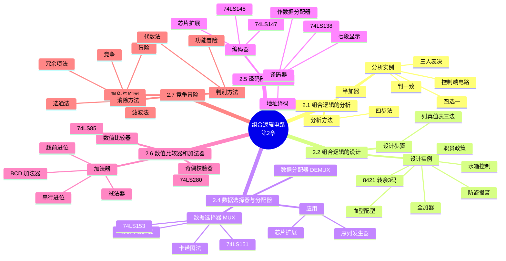

# 第二章 组合逻辑电路

> **本章主线**：组合逻辑电路的**分析**（图 → 表达式 → 真值表 → 功能）与**设计**（功能 → 真值表 → 化简 → 图）是贯穿全章的两条主线 → 中段系统学习中规模组合模块：**数据选择器与分配器、译码器与编码器、数值比较器与加法器** → 最后讨论实际电路非理想因素带来的**竞争冒险**现象、判别与消除。
> 一句话版本：**先学会"看图识功能"与"按功能画图"，再把常用中规模模块（MUX / 译码器 / 编码器 / 比较器 / 加法器）当作积木用于设计，最后认清竞争冒险并学会消除**——本章是第一章布尔代数与卡诺图工具的第一次大规模实战。
> 编号说明：沿用课件编号 2.1、2.2、2.4、2.5、2.6、2.7；课件 **无 §2.3**（原"逻辑函数等价变换"内容已并入第一章 §1.7）；竞争冒险在课件中标为 §2.1.5，因其为独立主题，本笔记按内容位置编为 §2.7。

**组合逻辑电路的定义与特点**（封面课件）：组合逻辑电路的输出与输入关系可写为

$$F = f(X_1, X_2, \dots, X_n)$$

其特点为：

1. 由各种**门电路组合**而成；
2. 电路中**无记忆元件**（无触发器等存储器件）；
3. 电路中**无反馈通路**（输出不回送到输入）；
4. **输出只与当前输入有关**，不具有记忆保持功能——这是组合逻辑与时序逻辑的本质分界线。

---

## 2.1 组合逻辑的分析

### 2.1.1 分析方法

**分析**是指已知逻辑电路图，找出它所实现的逻辑功能。分析步骤（四步法）：

1. **阅读电路图**：根据给定的逻辑电路图，从输入到输出逐级推导；
2. **写出逻辑表达式**：得到输出与输入的**与或式**（必要时用第一章工具化简）；
3. **列出真值表**：把输入变量的全部取值组合与对应输出列成表；
4. **归纳逻辑功能**：根据真值表或表达式，用文字概括电路功能；变量较多时可直接归纳表达式的逻辑含义。

> 口诀：**读图 → 表达式 → 真值表 → 说功能**——分析永远是"从图到功能"的方向。

### 2.1.2 分析实例

**例 1：半加器**

题目：分析下述电路（输入 A、B，输出 C、S）的逻辑功能。

步骤：逐级写出 $C = AB$，$S = A \oplus B$。

答案：一位半加器，实现两个一位二进制数不带低位进位的加法：$C$ 为进位，$S$ 为本位和。

一句话概括：**半加 = 不含低位进位的一位加法，$C = AB$（有进位当且仅当两数均为 1），$S = A \oplus B$（和为模 2 加）**。

**例 2：判一致电路**

题目：三输入电路，列出真值表并说明功能。

步骤：真值表中 $F = 1$ 的行只有 $000$ 与 $111$；表达式 $F = ABC + \bar{A}\bar{B}\bar{C}$。

答案：判一致电路——三输入状态**全为 0 或全为 1 时输出 1**，否则输出 0。

一句话概括：**"一致"就是三个变量取值相同，对应真值表的两行**。

**例 3：三人表决电路**

题目：三人对提案表决，多数（两人及以上）同意则通过，分析表决电路。

步骤：真值表中 $F = 1$ 的行：$011$、$101$、$110$、$111$；卡诺图化简得

$$F = AB + BC + AC$$

答案：三人表决电路，任两人或三人同意即通过。

一句话概括：**表决电路的表达式总是"两两相与再相或"**。

**例 4：控制端电路**

题目：分析带控制端 $S_0$、$S_1$、$S_2$、$S_3$ 的两级门电路。

步骤：第一级 $F_1 = \overline{A + BS_0 + \bar{B}S_1}$，$F_2 = \overline{ABS_2 + A\bar{B}S_3}$；第二级 $F = F_1 \cdot F_2$。

答案：控制端取不同值时，电路实现不同的逻辑函数（控制端相当于"功能选择"）。

一句话概括：**控制端改变内部通路，同一电路可在多种逻辑功能之间切换——这是数据选择器思想的雏形**。

**例 5：四选一电路**

题目：两地址端 $A_1$、$A_0$，四数据端 $D_0 \sim D_3$，分析输出 $F$ 的表达式。

答案：按地址组合逐行展开：

$$F = (\bar{A}_1\bar{A}_0)D_0 + (\bar{A}_1A_0)D_1 + (A_1\bar{A}_0)D_2 + (A_1A_0)D_3$$

即四选一数据选择器的功能表达式——地址 $A_1A_0$ 选中哪一路，$F$ 就等于哪一路数据。

一句话概括：**MUX 的本质是"地址控制的与或开关"**。

**补充**：编码器电路在任意时刻**只允许一端为 1**（否则输出混乱）——这是编码器与译码器方向相反的约束。

---

## 2.2 组合逻辑的设计

### 2.2.1 设计步骤

**设计**（又称逻辑设计 / 逻辑综合）是分析的逆过程：已知逻辑要求，求出实现该功能的电路。

设计流程（课件流程图）：

1. **问题描述**：用文字或图形明确逻辑要求；
2. **列真值表**：把文字要求翻译成表格；
3. **卡诺图化简**：得到最简函数式；
4. **最简与或式**；
5. **适当变换**：根据选定器件（SSI 门电路 / MSI 模块）变换为合适形式；
6. **画逻辑图**：得到最终电路。

列真值表的三种方法：

1. $n$ 变量且 $n$ 较小（$\le 4$）时，**完整列出全部 $2^n$ 行**；
2. 变量较多时，只列出**有意义的行**（无关项记 $\times$）；
3. 逻辑关系特别清晰时，**直接由要求写出表达式**再反推。

### 2.2.2 设计实例

**例 1：全加器**

题目：设计一位全加器（考虑低位进位 $C_i$）。

步骤：真值表三变量 $A$、$B$、$C_i$ → 卡诺图化简：

$$S = A \oplus B \oplus C_i$$

$$C_{i+1} = AB + AC_i + BC_i$$

答案：全加器电路，$S$ 为本位和，$C_{i+1}$ 为向高位的进位。

一句话概括：**全加 = 半加器再叠加低位进位；和是三变量异或，进位是"三人表决"**。

**例 2：8421 码转余 3 码**

题目：设计 8421 BCD 码到余 3 码的转换电路。

步骤：列真值表（输入 $A$、$B$、$C$、$D$，输出 $X$、$Y$、$Z$、$W$）→ 卡诺图化简：

$$X = A + BC + BD,\quad Y = BC\bar{D} + \bar{B}D + \bar{B}C,\quad Z = C\bar{D} + CD,\quad W = \bar{D}$$

若限定用与非门实现，对 $X$ 变换：

$$X = \overline{\bar{A} \cdot \overline{BC} \cdot \overline{BD}}$$

答案：四输出组合转换电路，8421 码加 3 即得余 3 码。

一句话概括：**余 3 码 = 8421 码 + 0011，电路按位独立化简即可**。

**例 3：水箱控制**

题目：水箱水位控制，输入 $A$（水位上限）、$B$（水位下限）、$C$（记忆状态），输出 $M_L$（指示灯）、$M_S$（抽水电机）。

步骤：真值表有效行 $001 \to 01$、$011 \to 10$、$000 \to 00$、$111 \to 11$，其余为无关项 $\times$；卡诺图利用无关项化简：

$$M_L = B,\quad M_S = A + \bar{B}C$$

答案：水位低于下限时电机启动抽水，高于上限时指示灯报警，水位居中时保持。

一句话概括：**无关项是设计的自由度——合理利用可以显著简化电路**。

**例 4：防盗报警**

题目：房间四路信号 $A$、$B$、$C$、$D$（门、窗、阳台、人体红外），设计报警电路。

步骤：列真值表 → 卡诺图化简：

$$F = A\bar{B} + \bar{C}\bar{D} + \bar{A}\bar{D}$$

答案：任一非法入侵组合触发报警输出 $F = 1$。

一句话概括：**多路警情输入用卡诺图统一化简，不必逐路单独设计**。

**例 5：职员政策**

题目：设计判别电路：已婚（$M=1$）男（$A=1$）职员，且未婚（$M=0$）女（$A=0$）职员，工资条件涉及 $S$、$W$（$SW$ 组合表示档位）。

步骤：卡诺图（行 $AM = 00$、$01$、$11$、$10$，列 $SW$，1 填入相应格）→ 表达式

$$F = AMS\bar{S} + \bar{A}\bar{M}S\bar{S} + \bar{A}\bar{M}SW\bar{W} + AMSW\bar{W}$$

提取公因子化简：

$$F = (AM + \bar{A}\bar{M})(\bar{S} + W)$$

答案：$(AM + \bar{A}\bar{M})$ 即 $A \odot M$（同或）判断婚配性别组合，$(\bar{S} + W)$ 判断工资档位条件。

一句话概括：**卡诺图中对角分布的 1 对应异或/同或结构——提取公因子后再识别**。

**例 6：血型配型**（压缩变量真值表——编码法）

题目：四种血型 O、A、B、AB，输血者与受血者配型：O 型可输任何血型；A 型可输 A、AB；B 型可输 B、AB；AB 型只可输 AB。用与非门实现血型配型检测电路，配型成功指示灯亮（$F = 1$）。

步骤：

1. **编码压缩变量**：输血型用 $A$、$B$ 编码，受血型用 $C$、$D$ 编码（$00$ = O、$01$ = A、$10$ = B、$11$ = AB）；
2. 列真值表（16 行），$F = 1$ 的行对应合法配型组合：$0000$、$0001$、$0010$、$0011$（O 型可输任何）、$0101$、$0111$（A 型输 A、AB）、$1010$、$1011$（B 型输 B、AB）、$1111$（AB 型只输 AB）；
3. 卡诺图化简：

$$F = \bar{A}\bar{B} + CD + \bar{A}D + \bar{B}C$$

4. 用与非门实现（或非-与非形式，四项互补相与再整体取反）：

$$F = \overline{AB \cdot CD \cdot AD \cdot BC}$$

答案：四变量配型检测电路，配型成功时 $F = 1$。

一句话概括：**"编码法"把每种血型压成 2 位编码——输入分组编码是压缩变量真值表的核心技巧**。

---

## 2.4 数据选择器与分配器

### 2.4.1 数据选择器 MUX

**数据选择器（Multiplexer，MUX）**：在地址（选择）信号控制下，从多路数据中选择一路送到输出。

**功能表**（以四选一为例）：

| $E$ | $A_1$ | $A_0$ | $F$ |
| :---: | :---: | :---: | :---: |
| 1 | $\times$ | $\times$ | 0 |
| 0 | 0 | 0 | $D_0$ |
| 0 | 0 | 1 | $D_1$ |
| 0 | 1 | 0 | $D_2$ |
| 0 | 1 | 1 | $D_3$ |

使能端 $E$ 低电平有效：$E = 1$ 时输出强制为 0（禁止），$E = 0$ 时按地址选通。功能表达式：

$$F = (\bar{A}_1\bar{A}_0)D_0 + (\bar{A}_1A_0)D_1 + (A_1\bar{A}_0)D_2 + (A_1A_0)D_3$$

**74LS153 实现全加器**：

地址 $A_1 = A$、$A_0 = B$；$S$ 组数据 $D = C$、$\bar{C}$、$\bar{C}$、$C$；$C_{i+1}$ 组数据 $D = 0$、$C$、$C$、$1$。

$$S_i = \bar{A}\bar{B}C + \bar{A}B\bar{C} + A\bar{B}\bar{C} + ABC$$

$$C_{i+1} = \bar{A}BC + A\bar{B}C + AB$$

一句话概括：**把变量送入地址端、其余变量（或其组合）送入数据端，MUX 就能直接实现任意组合函数**。

**卡诺图法**（74LS153 四变量函数）：

题目：$F = \Sigma m(0, 1, 5, 6, 7, 9, 10, 14, 15)$，用四选一 MUX 实现。

步骤：选 $A$、$B$ 为地址，卡诺图按 $AB$ 分行（行序 $00$、$01$、$11$、$10$ 对应 $D_0$、$D_1$、$D_3$、$D_2$）：

| $AB$ \ $CD$ | 00 | 01 | 11 | 10 | 数据端 |
| :---: | :---: | :---: | :---: | :---: | :---: |
| 00 ($D_0$) | 1 | 1 | 0 | 0 | $D_0 = \bar{C}$ |
| 01 ($D_1$) | 0 | 1 | 1 | 1 | $D_1 = C + D$ |
| 11 ($D_3$) | 0 | 0 | 1 | 1 | $D_3 = C$ |
| 10 ($D_2$) | 0 | 1 | 0 | 1 | $D_2 = C \oplus D$ |

答案：$D_0 = \bar{C}$，$D_1 = C + D$，$D_2 = C \oplus D$，$D_3 = C$。

一句话概括：**每个地址行独立圈包化简——只能在地址控制区内化简，不能跨行合并**。

**74LS151 四变量例**：$D_0 = 1$，$D_1 = 0$，$D_2 = D$，$D_3 = 1$，$D_4 = D$，$D_5 = D$，$D_6 = 0$，$D_7 = 1$——数据端可以直接是常量、单变量或其反。

**多输出函数**（两片 74LS153，地址 $A$、$B$）：

$$F_1 = \Sigma m(0,1,5,7,10,13,15),\ F_2 = \Sigma m(8,10,12,13,15),\ F_3 = \Sigma m(1,3,6),\ F_4 = \Sigma m(4,6,8,9,10,11)$$

一句话概括：**多输出函数共用地址、各配数据端——一片 153 两个四选一，正好服务两个输出**。

**序列发生器**：用二分频、四分频计数器输出作地址 $A_2A_1A_0$，数据端预置序列值，循环产生序列 $10100110$。

一句话概括：**计数器 + MUX = 循环序列发生器——地址自动轮转，数据端写死波形**。

**数据选择器的特点**：

1. 数据通路由地址选择，本质是"**多路开关**"；
2. 具有使能端，便于级联扩展；
3. 每个数据端可接常量、变量或其组合（含异或）；
4. 可方便地实现任意组合逻辑；
5. 常与计数器配合构成序列发生器。

**种类**：74LS157（二选一）、74LS153（四选一）、74LS253（四选一·三态）、74LS151（八选一）、74LS150（十六选一）。

**扩展**：

1. 两片 74LS151 扩展为十六选一——$A_3$ 经反相分别接两片片选（或门合并输出）；
2. 一片 74LS153 扩展为八选一——高位地址 $A_2$ 控制两组使能端（一组直连、一组取反），两路输出经或门合并。

### 2.4.2 数据分配器 DEMUX

**数据分配器（Demultiplexer，DEMUX）**：一路输入数据在地址控制下分送到多路输出之一——与 MUX 功能相反，相当于"**带数据输入的译码器**"。

功能：$E = 1$ 时芯片工作，地址 $A_1A_0$ 选中哪路，哪路得到数据 $D$，其余输出为 1；$E = 0$ 时全部输出为 1（禁止）。

一句话概括：**MUX 是多选一，DEMUX 是一分多——数据的"合"与"分"，方向正好相反**。

### 2.4.3 应用

1. **实现任意组合逻辑**：把输入变量（或其组合）分别接到地址端与数据端（卡诺图法）；
2. **构成序列发生器 / 波形发生器**：计数器作地址，数据端预置波形；
3. **总线式数据传输**：多路发送端经 MUX 选通到总线，接收端用 DEMUX 分发；
4. **芯片级扩展**：多片级联扩充输入路数（片选 + 或门）。

---

## 2.5 译码器和编码器

### 2.5.1 译码器

**译码器（Decoder）**：把输入的二进制代码"翻译"成对应的输出有效信号——每个输出对应一个最小项。

**74LS138（3 线-8 线译码器）**：

- 三个使能端：$G_1$ 高电平有效，$\bar{G}_{2A}$、$\bar{G}_{2B}$ 低电平有效；使能条件 $G_1 = 1$、$\bar{G}_{2A} = 0$、$\bar{G}_{2B} = 0$；
- 译码输出低电平有效：$\bar{Y}_i = \bar{m}_i$，即第 $i$ 路输出对应第 $i$ 个最小项的非；
- 使能无效时，全部输出为 1。

**地址译码实例**（存储/外设片选）：

- $A_{12} \to G_1$，$A_{13} \to \bar{G}_{2A}$，$A_{14}$、$A_{15}$ 经或门 $\to \bar{G}_{2B}$，地址 $A_{11}$、$A_{10}$、$A_9 \to C$、$B$、$A$；
- 使能条件对应 $A_{15}A_{14}A_{13}A_{12} = 0001$，即地址范围 **1000H–1FFFH**；
- $\bar{Y}_0$：**1000H–11FFH**；$\bar{Y}_1$：**1200H–13FFH**；$\bar{Y}_2$：**1400H–15FFH**。

**外设片选实例**：三块外设地址空间 **A = 20H–2F、B = 40H–4F、C = 70H–7F**，对应 $A_6A_5A_4$ 模式 **010、100、111**，分别由 $\bar{Y}_2$、$\bar{Y}_4$、$\bar{Y}_7$ 片选（使能端由更高位地址控制，地址低 4 位无关）。

一句话概括：**译码器输出 = 最小项的非；使能端多路"与"起来就是地址范围窗口**。

**BCD 码大于 9 判别**：$A \to G_1$，$B$、$C$、$D \to$ 地址端，输出经与非门合并，$F = 1$ 当且仅当输入大于 9（1010–1111 时 $F = 1$）——8421 码合法值（0000–1001）恒输出 0。

**表决判定电路**：主裁 $A \to G_1$，副裁 $B$、$C$、$D \to$ 地址端；$F = m_3 + m_5 + m_6 + m_7$（$\bar{Y}_3$、$\bar{Y}_5$、$\bar{Y}_6$、$\bar{Y}_7$ 经与非门），真值表中 $1011$、$1101$、$1110$、$1111$ 输出 1——即"主裁同意**且**副裁多数（≥2）同意"时判决通过。

**军民联欢入场判别**：$Y = m_1 + m_3 + m_6 + m_7$（$\bar{Y}_1$、$\bar{Y}_3$、$\bar{Y}_6$、$\bar{Y}_7$ 经与非门），真值表中 $001$（O+黄）、$011$（黄）、$110$（黄）、$111$（黄）等组合输出 1——按编码压缩变量后用译码器最小项直接圈定合法组合。

**译码器作数据分配器**：74LS138 的 $\bar{G}_{2A}$、$\bar{G}_{2B}$ 中一路接数据输入、另一路接固定电平，地址端控制数据从哪一路输出——**译码器 = 无数据输入的 DEMUX，补上数据输入就是完整 DEMUX**。

**74LS42（4 线-10 线译码器）**：8421 BCD 输入，10 路输出；对**冗余码**（1010–1111），全部输出均为 1（无任何一路有效）——天然过滤非法码。

**七段显示译码器**：

- **74LS47**：驱动**共阳**数码管（输出低电平有效，集电极开路）；
- **74LS48**：驱动**共阴**数码管（输出高电平有效）；
- 引脚复用：$\overline{LT}$（试灯）、$\overline{BI}$（灭灯）、$\overline{RBI}$（灭零输入）、$\overline{RBO}$（灭零输出）；
- **动态灭零**：整数最高位前、小数最低位后的零可以熄灭；高位 $\overline{RBO}$ 接次高位 $\overline{RBI}$ 级联，实现全链灭零——显示 "003.40" 时前导零与末尾零熄灭为 "3.4"。

**译码器的特点**：

1. 输出与输入代码一一对应，每路输出对应一个最小项（的非）；
2. 多使能端相"与"，便于地址窗口译码与级联扩展；
3. 可扩展为更多线（4-16、5-32 等）；
4. 可作数据分配器使用。

### 2.5.2 编码器

**编码器（Encoder）**：把多路输入中的有效信号编码为二进制输出——与译码器方向相反；任意时刻**只允许一路输入有效**（普通编码器）。

**74LS148（8 线-3 线优先编码器）**：

- 输入低电平有效，**$I_7$ 优先级最高**、$I_0$ 最低；高位有效时低位被屏蔽；
- 输出为**反码**：$I_7$ 有效 $\to$ 输出 $000$（$\bar{7}$），$I_0$ 有效 $\to$ 输出 $111$（$\bar{0}$）；
- 扩展端：$\overline{GS}$（有有效输入时为 0）、$\overline{EO}$（无任何输入请求时为 0）；
- 三种状态：**被禁止**（$\overline{EI} = 1$）$\to$ 输出全 1、$\overline{GS} = 1$、$\overline{EO} = 1$；**无请求**（$\overline{EI} = 0$ 且无输入）$\to$ 输出全 1、$\overline{GS} = 1$、$\overline{EO} = 0$；**有效编码**$\to$ 输出反码、$\overline{GS} = 0$、$\overline{EO} = 1$。

**74LS147（10 线-4 线 BCD 优先编码器）**：

- 输入 $I_1 \sim I_9$ 低电平有效（无 $I_0$ 输入端），$I_9$ 优先级最高；
- 输出为 **BCD 码反码**：$I_9$ 有效 $\to$ 输出 $0110$（$\overline{1001}$），$I_8$ 有效 $\to$ 输出 $0111$，…，$I_1$ 有效 $\to$ 输出 $1110$。

**16 线-4 线扩展（两片 74LS148）**：

- 高位片（$I_{15} \sim I_8$）优先于低位片；高位片 $\overline{EO}$ 接低位片 $\overline{EI}$；
- $A_3 = $ 高位片 $\overline{GS}$（高位片有有效输入时 $A_3 = 0$，即反码形式）；
- 总 $\overline{GS} = \overline{GS}_1 \cdot \overline{GS}_2$；输出 $A_3A_2A_1A_0$ 为输入序号的**反码**：输入 $15 \to 0000$，输入 $0 \to 1111$。

**8 线-3 线转 BCD（原码输出）**：74LS148 输出经反相器得原码，高位 $\overline{GS}$ 控制百位/千位标志，实现 $9 \to 1001 \dots 0 \to 0000$ 的 BCD 原码输出。

**应用**：

1. **数字键盘编码**：$0 \sim 9$ 按键输入，优先编码器输出按键号（多键同按取最高）；
2. **8051 中断优先级编码**：多个中断源同时请求时，编码器选出最高优先级中断号供 CPU 响应。

**编码器的特点**：

1. 多路输入、二进制输出，输入输出方向与译码器相反；
2. 优先编码器允许同时多路有效，输出最高优先级——普通编码器只允许一路有效；
3. 高位优先屏蔽低位（74LS148）；
4. 多片可级联扩展（$\overline{EO} \to \overline{EI}$ 链）。

---

## 2.6 数值比较器和加法器

### 2.6.1 数值比较器

**数值比较器**：比较两个二进制数 $A$ 与 $B$ 的大小，输出 $A > B$、$A < B$、$A = B$ 三种结果之一。

**74LS85（4 位数值比较器）**：

- 输入：4 位 $A_3A_2A_1A_0$ 与 $B_3B_2B_1B_0$，以及三路级联输入 $A > B$、$A < B$、$A = B$；
- 比较规则：**高位优先**——先比最高位，相等再比次高位，全部相等时看级联输入；
- 级联约束：三路级联输入**只能一路为 1**（三选一），若全部为 0 则输出混乱。

**3 位二进制数比较（单片 74LS85）**：

接法：$a_2b_2 \to A_3B_3$，$a_1b_1 \to A_2B_2$，$a_0b_0 \to A_1B_1$，$A_0 = 0$、$B_0 = 0$（空余位补 0）；级联输入固定接 **$A > B = 0$、$A < B = 0$、$A = B = 1$**。

一句话概括：**空余高位补 0、级联输入接"默认相等"，单片就能比较位数更少的数**。

**8 位比较（两片 74LS85 级联）**：

- 分为高、低 4 位两片；低片输出接高片级联输入；
- 比较顺序：**由高位向低位**——高位片先比，相等才看低位片结果。

### 2.6.2 加法器

**串行进位加法器**：

逐位相加，低位进位串行传给高位：

$$S_i = A_i \oplus B_i \oplus C_{i-1}$$

$$C_i = A_iB_i + (A_i \oplus B_i)C_{i-1}$$

特点：结构简单，但进位逐级传递，**位数越多延迟越大（速度慢）**。

**超前进位加法器**：

定义进位生成 $G_i = A_iB_i$、进位传播 $P_i = A_i \oplus B_i$，则

$$C_i = G_i + P_iC_{i-1}$$

$$S_i = P_i \oplus C_{i-1}$$

各级进位可展开为只与输入有关的表达式（如 $C_1 = G_0 + P_0C_{-1}$，$C_2 = G_1 + P_1G_0 + P_1P_0C_{-1}$，依此类推），**消除了串行等待**，速度大大提高，代价是电路更复杂。

**74LS83**：4 位超前进位加法器；级联可扩展为 16 位（低位片 $C_3$ 接高位片 $C_{-1}$）。

**减法器（加补实现）**：

利用补码把减法变加法：

$$A - B = A + \bar{B} + 1$$

即对 $B$ 逐位取反再加 1。实例：

- $9 - 6$：$1001 + 1010 = 1\ 0011$，**有进位输出，差为正**，差值 $+3$；
- $6 - 9$：$0110 + 0111 = 0\ 1101$，**无进位输出，差为负**，差值 $-3$。

结论：**有进位输出的差是正数，无进位输出的差是负数**。

**并行加法/减法器**：

- $M$ 为加减控制端；$M = 0$ 时做加法（$C_{-1} = 0$，$B \oplus M = B$），$M = 1$ 时做减法（$C_{-1} = 1$，$B \oplus M = \bar{B}$）；
- 每位 $B_i$ 经异或门受 $M$ 控制：异或门一端接 $B_i$、另一端接 $M$，同时 $M$ 接最低位进位输入 $C_{-1}$——**一个 $M$ 同时完成"求反"与"加 1"两件事**。

**BCD 加法器**：

两个 8421 BCD 码相加，和超过 9（或有进位）时需加 6（0110）修正：

- 加 6 条件：$F = CO + S_3S_2 + S_3S_1$（$CO$ 为二进制和的进位，$S_3S_2$ 或 $S_3S_1$ 同时为 1 表示和 $\ge 12$）；
- 实现：第一级全加器求二进制和 → 判 9 加 6 逻辑 → 第二级全加器加 0110 → 输出 BCD 码；
- 实例：$7 + 5 = 12$（1100 → 加 6 修正 → 0001 0010）；$7 + 9 = 16$（进位 + 0110 修正）。

### 2.6.3 奇偶校验器

**奇偶校验**：在数据外附加一位校验位，使整个码组中 "1" 的个数为奇数（奇校验）或偶数（偶校验），用于检测传输中**一位**错误。

**74LS280（9 位奇偶校验器/发生器）**：

- 9 路输入 $A \sim I$；偶数个 1 输入时 $\text{EVEN} = 1$、$\text{ODD} = 0$；奇数个 1 输入时 $\text{ODD} = 1$、$\text{EVEN} = 0$；
- 核心关系：$\text{ODD} = A \oplus B \oplus C \oplus \dots \oplus I$，$\text{EVEN} = \overline{\text{ODD}}$；
- **8 位数据校验**：8 位数据接 $A \sim H$，$I$ 接固定电平即可；**17 位校验**可两片级联。

**奇偶校验位生成**：

- 偶校验位：$P = C_1 \oplus C_2 \oplus C_3 \oplus C_4$（对 4 位数据，$P$ 使总的 "1" 的个数为偶）；
- 奇校验位：在偶校验基础上多异或一个 "1"（$\text{ODD}$ 输出接 "1"）。

**收发校验**：发送端用 74LS280 生成校验位 $P$ 并随数据发送；接收端再用一片 74LS280 校验——数据 + 校验位一起送入，若 $\text{EVEN}$（偶校验约定）输出异常则说明传输出错，再配合接收门把错误数据挡住。

一句话概括：**校验的本质是异或——奇偶校验器 = 多输入异或树；一位错能检，两位错检不出**。

---

## 2.7 组合逻辑电路的竞争冒险

### 2.7.1 现象与原因

**竞争（Race）**：同一输入信号经过不同路径（不同门数、不同延迟）到达同一门的输入端，到达时间有先后——这种现象称为竞争。

**冒险（Hazard）**：由于竞争的存在，输出端可能在极短时间内产生**不应有的干扰脉冲（毛刺）**——这种现象称为冒险。

两种基本形式：

- **"1" 冒险（正尖脉冲）**：$F = A \cdot \bar{A}$，理想情况下恒为 0，但由于 $\bar{A}$ 比 $A$ 晚到一小段时间，输出产生一个**正尖脉冲**；
- **"0" 冒险（负尖脉冲）**：$F = A + \bar{A}$，理想情况下恒为 1，由于 $\bar{A}$ 晚到，输出产生一个**负尖脉冲**。

一句话概括：**竞争是原因（路径延迟不同），冒险是结果（毛刺）；$A \cdot \bar{A}$ 出正尖，$A + \bar{A}$ 出负尖**。

### 2.7.2 判别方法

**功能冒险**：由逻辑功能本身决定的竞争冒险——输入变量发生变化时，输出理想值应不变，但由于各变量到达时间不同，变化过程中经过了不该经过的中间状态，产生毛刺。例如译码器在输入变化时输出出现的毛刺；加使能信号后输出才有效；格雷码相邻编码切换时可避免功能冒险。

**代数法（两步判别）**：

1. 写出输出表达式，检查是否存在 $A \cdot \bar{A}$ 或 $A + \bar{A}$ 型的互补项对；
2. 判断这些互补项对应的其他变量取值能否使该项"起作用"（即毛刺能否传到输出）。

**判别实例 1**：$F = \bar{A}D + \bar{A}C + AB\bar{C}$

- 考察变量 $A$：$F$ 中含 $\bar{A}(D + C) + A \cdot B\bar{C}$——当 $BCD = 101$ 时，$F = \bar{A} \cdot 1 + A \cdot 0 = \bar{A}$，$A$ 变化时输出出现 **"0" 冒险**（负尖脉冲）；
- 考察 $C$：不存在使 $C$ 产生互补项竞争的条件组合——$C$ 变化**无险象**。

**判别实例 2**：$F = (A + B)(\bar{A} + C)(\bar{B} + C)$

- 考察 $A$：当 $BC = 00$ 时，$F = (A + 0)(\bar{A} + 0)(1) = A \cdot \bar{A}$，产生 **"1" 冒险**（正尖脉冲）；
- 考察 $B$：当 $AC = 00$ 时，$F = (0 + B)(1)(\bar{B}) = B \cdot \bar{B}$，产生 **"1" 冒险**。

一句话概括：**代数法 = 找互补项 + 找使能条件——其他变量"恰好让互补项独占输出"时才有险象**。

### 2.7.3 消除方法

**冗余项法（加冗余项）**：在表达式中加入多余项，使竞争路径在关键取值组合下被"封死"，破坏毛刺产生的条件。

- 实例：$F = \bar{A}D + \bar{A}C + AB\bar{C}$（$BCD = 101$ 时有"0"冒险）——加入冗余项 $B\bar{C}D$：

$$F = \bar{A}D + \bar{A}C + AB\bar{C} + B\bar{C}D$$

当 $BCD = 101$ 时，冗余项 $B\bar{C}D = 1$，$F$ 恒为 1，**消除了"0"冒险**——代价是多用一个与门。

**选通法**：在电路输出端加一个选通门（与门），用**选通信号 $P$** 在电路稳定后才打开输出：

- $P = 0$ 时封锁输出（毛刺被挡住），$P = 1$ 时电路正常输出；
- 适用于时序系统：在时钟无效期间封锁组合逻辑输出，待电路稳定后再选通采样。

**滤波法**：在输出端并联一个**小电容**（通常 4pF–20pF），利用电容的充放电特性滤除毛刺的高频分量——代价是使输出信号边沿变缓，只适用于对速度要求不高的场合。

**强制对比：三种消除方法**

| 方法 | 原理 | 代价 | 适用场合 |
| :--- | :--- | :--- | :--- |
| 冗余项法 | 加项封死毛刺条件 | 增加门电路 | 组合逻辑内部消除 |
| 选通法 | 稳定后再打开输出 | 需要选通信号 | 时序系统采样 |
| 滤波法 | 电容滤除高频毛刺 | 边沿变缓 | 低速场合 |

> 口诀：**加项封死、选通稳后、电容滤波**——三种手段从"消除条件、延后观察、物理滤除"三个角度解决同一个问题。

---

## 本章知识定位与框架衔接

**前置知识**：第一章的**布尔代数、卡诺图化简、逻辑函数等价变换**是本章分析与设计的直接工具；门电路、三态门、74 系列芯片是硬件基础。

**后置衔接**：

- 本章的组合逻辑是**时序逻辑**（第三章触发器、第四章时序电路）的基础——时序电路 = 组合逻辑 + 存储元件（触发器）+ 反馈回路；
- MSI 模块（译码器、编码器、MUX、加法器等）是后续实验和系统设计的"积木"；
- **竞争冒险**的概念在时序电路中同样重要——毛刺可能造成误触发，是时序分析的伏笔。

**比喻**：本章像"**乐高说明书**"——第一章教你认识每一块积木的形状（门电路）和拼接规则（布尔代数），本章则给你一组官方套件（MSI 模块），教你看图拼装（分析）和照需求自创图纸（设计）。

**灵魂问题**：

1. 为什么"分析"与"设计"互为逆过程，但设计比分析难？（多解性与最优化）
2. 数据端比地址端多一位变量时，为什么"数据 = 剩余变量的函数"？（卡诺图行/列的物理含义）
3. 竞争冒险的毛刺宽度由什么决定？（门电路延迟差）——为什么深亚微米工艺下冒险问题更突出？

**一句话总结本章**：**分析是"看图识功能"，设计是"按需画图"；中规模模块（MUX / 译码器 / 编码器 / 比较器 / 加法器）是设计的积木；竞争冒险提醒我们——理想逻辑与物理电路之间永远隔着一层"时间"**。

---

## 课件 PDF

<iframe src="https://cognishelf.naimore3.workers.dev/课程笔记/大二上/数字逻辑与数字系统/第二章/第二章.pdf" width="100%" height="800px" style="border: none;"></iframe>

[无法在线查看时，请下载后本地打开](https://cognishelf.naimore3.workers.dev/课程笔记/大二上/数字逻辑与数字系统/第二章/第二章.pdf)
