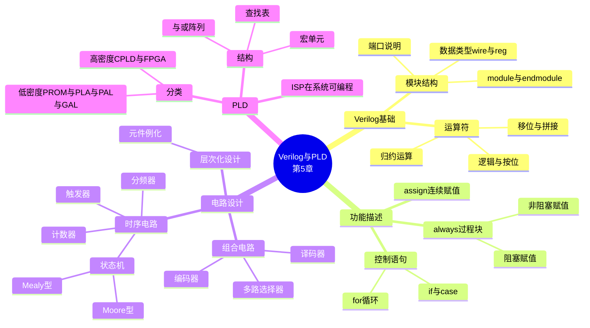

# 第五章 Verilog语言与可编程逻辑器件

> **本章主线**：先学习硬件描述语言 **Verilog** 的基本语法（模块结构、数据类型、运算符、功能描述语句），掌握组合电路、时序电路与状态机的 Verilog 设计方法；随后介绍可编程逻辑器件 **PLD** 的基本结构与分类，以及 **CPLD/FPGA** 两大主流器件和 **ISP** 在系统可编程技术。
>
> **一句话版本**：Verilog 语法（模块 + 运算符 + 行为描述）→ 电路设计（组合 + 时序 + 状态机 + 层次化）→ PLD 硬件载体（PROM/PLA/PAL/GAL → CPLD/FPGA → ISP）。
>
> **编号说明**：课件含 §5.5 Verilog 语言（主体内容）、§5.1 PLD 基本概念、§5.2 CPLD/FPGA、§5.3 ISP，本笔记按此编号组织。



## 5.5 Verilog语言程序基本结构

现代电路设计方法 = **硬件设计 + 编程设计**。EDA（Electronic Design Automation，电子设计自动化）技术三要素：

- **描述方式**：硬件描述语言（本课学 **Verilog**，还有 ABEL、AHDL、VHDL）；
- **设计工具**：集成化开发系统（QuartusII、Vivado、ispDesignEXPERT 等）；
- **实现载体**：PLD（可编程逻辑器件）。

**HDL**（Hardware Description Language）用于描述数字系统的**结构、行为、功能和接口**；设计开始之前都应当有一个硬件框图。Verilog 遵循 IEEE Std 1364 标准（1987/1995/2000）。

### 5.5.1 Verilog模块的基本结构

**标识符规则**：

- 合法：`a`、`fft`、`and_4`、`max2uc`、`buf$m`；
- 非法：`21A`（首字符不能是数字）、`max#2uc`、`a-b`（含非法字符）；
- **区分大小写**，不能与保留字相同；**关键字必须小写**；
- 存盘文件名应与**模块名相同**；模块名不能用中文；
- 完整语句以 `;` 结尾；注释 `//` 与 `/* */` 不参与编译。

**四种基本逻辑值**：`0`、`1`、`x`（不定）、`z`（高阻）。

**模块框架**——由**描述接口**和**描述功能**两部分构成：

```verilog
module 模块名（端口列表）;   // 接口
    input  ...;             // 端口模式说明（无分号要求之外注意格式）
    output ...;
    wire/reg ...;           // 信号类型说明
    // 功能描述：assign / always / 元件例化（并发语句）
endmodule
```

**例 1：一位全加器**（数据流描述）

```verilog
module adder ( a, b, cin, sum, co );
    input  a, b, cin;
    output sum, co;
    assign {co, sum} = a + b + cin;   // 连续赋值
endmodule
```

**例 2：一位 D 寄存器**（行为描述）

```verilog
module dff ( clk, data, q );
    input  clk, data;
    output q;
    reg q;                            // always 中赋值的信号须为 reg
    always @ (posedge clk)
        q <= data;                    // 非阻塞赋值 → 时序逻辑
endmodule
```

**端口方向（3 种）**：

| 方向 | 关键字 | 含义 |
| :--- | :--- | :--- |
| 输入 | `input` | 只读 |
| 输出 | `output` | 在 `assign` 中只写 |
| 输入输出 | `inout` | 双向，只能用 `assign` 驱动 |

**数据类型（3 种）**：

| 类型 | 含义 | 要点 |
| :--- | :--- | :--- |
| `wire` | 线网型 | 结构化器件的物理连线；**端口默认为 wire 型** |
| `reg` | 寄存型 | 描述存储单元或组合逻辑；**always 中被赋值的信号必须用 reg**；输入/双向端口不能声明为 reg |
| `parameter` | 运行时常数 | 符号常量，仅本模块有效；实例引用时可改参数；可表示存储器大小 |

```verilog
wire a;
wire [15:0] busa;                 // 16 位数据总线
reg  [3:0]  v;
reg  [15:0] MEM [0:1023];         // 1K × 16 位存储器
parameter wordsize = 16, memsize = 1024;
reg  [wordsize-1:0] MEM3 [0:memsize-1];
```

**parameter 示例**（用参数说明位宽的 2 选 1 多路选择器）：

```verilog
module mux ( i1, i2, sel, out );
    parameter width = 4;
    input sel;
    input  [width-1:0] i1, i2;
    output [width-1:0] out;
    assign out = sel ? i1 : i2;
endmodule
```

**数的表示**：`<位宽>'<进制><数字>`

- `8'b0001_0000`、`8'd16`、`8'h10` 等价（下划线分隔可读性）；
- `32'bx`：32 位不定值；`2'b?`：`?`、`z`、`Z` 都表示**高阻**。

---

### 5.5.2 Verilog的运算符

使用 `()` 改变优先级。

#### （1）逻辑非与按位反

- `!` 逻辑非：结果只有 1 位（`1'b0`、`1'b1` 或 `x`）；
- `~` 按位反：结果与操作数**位数相同**。

```verilog
rega = 4'b1011;
bit = ~rega;   // bit = 4'b0100
log = !rega;   // log = 1'b0
```

#### （2）逻辑、按位、归约运算

- **逻辑操作**、**归约操作**的结果只有 **1 位**；按位操作结果与操作数同宽。

```verilog
a = 4'b0100;  b = 4'b0111;
a && b ;      // 逻辑与：结果 = 1'b1
a &  b ;      // 按位与：结果 = 4'b0100
&a   ;        // 归约与：1'b0（逐位与，判断是否全 1）
```

**归约（一元）运算符**——单目，对操作数所有位逐位运算，结果 1 位：

| 运算符 | 功能 | 示例（`rega = 4'b0100`） |
| :--- | :--- | :--- |
| `&` / `~&` | 归约与 / 与非 | `&rega` → `1'b0`（判全 1）；`~&rega` → `1'b1`（判是否有 0） |
| `\|` / `~\|` | 归约或 / 或非 | `\|rega` → `1'b1`（判非全 0）；`~\|rega` → `1'b0`（判全 0） |
| `^` | 归约异或 | `^rega` → `1'b1`（判断 1 的奇偶） |
| `~^` | 归约同或 | 与 `^` 结果相反 |

#### （3）移位运算符

`>>` 右移、`<<` 左移：

```verilog
a = 8'b11010001;  a << 4;   // a = 8'b00010000
b = 8'b11010001;  b >> 4;   // b = 8'b00001101
```

#### （4）位拼接运算符

`{ }`：将两个或多个信号的某些位拼接起来。**不允许连接非定长常数**。

```verilog
wire [5:0] a, b, d;
wire [1:0] c;
assign a = 6'b101101;
assign b = 6'b111000;
assign c = 2'b11;
assign d = {a[5], b[2:0], c};   // d = 6'b100011
assign b = {d, 1};              // ✗ 不允许拼接非定长常数
```

#### （5）位宽自动调整

- 运算表达式结果长度由**最长的操作数**决定；
- 操作结果最终长度由**赋值左端目标**长度决定。

```verilog
wire [3:0] arc, bar, crt;
wire [5:0] frx;
assign arc = bar + crt;   // 4 位，加法溢出部分被丢弃
assign frx = bar + crt;   // 6 位，溢出位存入 frx[4]
4'b0110 ^ 5'b10000        // 结果 5'b10110（短操作数高位补 0）
```

### 5.5.3 Verilog的功能描述语句

功能描述的三种方式：**assign、always、元件例化**——都是**并发语句**。

#### （1）连续赋值 assign

**语法**：`assign 赋值目标 = 表达式;`

规则要点：

- 连续赋值运算符为 `=`；`assign` 后面只能是一个表达式；
- **赋值目标必须是 wire 型**；输出引脚在 assign 中只写；`inout` 型引脚只能用在 assign 语句中；
- 多个 assign 之间是**并行关系**；只能逐句使用，完成简单的组合逻辑；
- 不能对同一个信号多次赋值（多源驱动）；更新赋值要避免反馈（`assign a = b + a;` ✗）。

```verilog
module exp1 ( a, b, c, d, g );
    input a, b, c, d;
    output g;
    wire e, f;
    assign e = a | b;        // 三条 assign 并行执行
    assign f = ~(c | d);
    assign g = e & f;
endmodule
```

**例：四位二进制全加器**

```verilog
module adde ( ain, bin, cin, sum, co );
    input  [3:0] ain, bin;
    input  cin;
    output [3:0] sum;
    output co;
    assign {co, sum} = ain + bin + cin;
endmodule
```

#### （2）过程赋值 always 语句块

**语法**：

```verilog
always @ (敏感信号表)
begin
    ...
end
```

- 可描述所有功能；**赋值目标必须是 reg 型**；
- 块内可含 `=`、`<=` 赋值、`if` 语句、`case` 语句。

**过程赋值运算符**：

| 运算符 | 名称 | 行为 | 用途 |
| :--- | :--- | :--- | :--- |
| `=` | **阻塞赋值** | 立即更新数值 | **组合逻辑** |
| `<=` | **非阻塞赋值** | 延迟更新，所有赋值语句**同时完成更新** | **时序逻辑** |

**敏感信号表**：

- 敏感信号的**变化**才能启动进程；
- 组合逻辑中**所有输入都必须作为敏感信号**，否则仿真结果与综合结果不一致；
- 边沿敏感（`posedge`/`negedge`）与电平敏感：

```verilog
always @ (posedge 信号名)    // 上升沿触发
always @ (negedge 信号名)    // 下降沿触发
always @ (信号名)            // 电平触发
always @ ( * )               // 所有输入均触发（组合逻辑通配符）
```

**例：一位全加器两种写法对比**

```verilog
// 行为描述（always + 阻塞赋值，顺序执行，reg 类型）
module adder ( a, b, cin, s, cout );
    input a, b, cin;
    output s, cout;
    reg s, cout;
    always @ ( * ) begin
        s    = a ^ b ^ cin;
        cout = a & b | b & cin | a & cin;
    end
endmodule

// 数据流描述（assign，并发执行，wire 类型）
module exp ( a, b, cin, s, cout );
    input a, b, cin;
    output s, cout;
    assign cout = a & b | b & cin | a & cin;
    assign s    = a ^ b ^ cin;
endmodule
```

**例：D 触发器**（时钟上升沿触发，综合后生成寄存器 register）

```verilog
module qff ( clk, d, q );
    input clk, d;
    output q;
    reg q;
    always @ ( posedge clk )
        q <= d;
endmodule
```

#### （3）阻塞赋值与非阻塞赋值的比较

**注意**：

- 不要在组合逻辑中使用 `<=`；
- `<=` 用于实现时序逻辑；
- **在同一个 always 块里不要混用两种赋值语句**。

**例 1：组合逻辑中两种赋值的结果差异**

```verilog
// 阻塞赋值：立即更新 → d 先后取 a、b，中间结果被后续语句看到
// 结果：x = c·a，y = c·b
always @ ( * ) begin
    d = a;  x = c & d;
    d = b;  y = c & d;
end

// 非阻塞赋值：所有 RHS 用旧值，end 后统一更新 → x、y 都读到旧 d
// 结果：x = c·b，y = c·b（不要在 always 中对同一信号多次非阻塞赋值）
always @ ( * ) begin
    d <= a;  x <= c & d;
    d <= b;  y <= c & d;
end
```

**例 2：时序逻辑中的差异（关键考点）**

```verilog
// 阻塞赋值串行移位：a=d; b=a; q=b → 每级立即传递
// 综合后：3 个寄存器并联（都装 d 的值）——存储器不要使用阻塞赋值
always @ ( posedge clk ) begin
    a = d;  b = a;  q = b;
end

// 非阻塞赋值：同时读旧值 → 真正移位
// 综合后生成移位寄存器
always @ ( posedge clk ) begin
    a <= d;  c <= a;  q <= c;
end
```

> 口诀：**组合用 `=`，时序用 `<=`；同块不混用，存储不用 `=`**。

#### （4）assign 与 always 并发

**例：4 位二进制计数器**

```verilog
module count4 ( clk, q );
    input clk;
    output [3:0] q;
    reg [3:0] qtemp;
    always @ (posedge clk)
        qtemp <= qtemp + 1;
    assign q = qtemp;          // 信号可在多个 always、assign 间传递
endmodule
```

注意：不要在一个 always 中同时使用 `=`、`<=`；不要对一个信号多次驱动；不能在多个 always 与 assign 中对同一信号多次赋值。

#### （5）转向控制语句

主要有 **if 语句、case 语句、for 语句**——通过条件控制决定是否执行或重新执行语句，仿真时顺序进行。**if、case、for 语句必须在 always 块中**。

**1）if 语句**

- **不完全 if**：综合器会引进时序元件保持当前状态值 → 生成**锁存器**（电平触发），**不建议使用**。

```verilog
// 不完全 if → 锁存器（不推荐）
always @ ( en, d )
    if ( en ) q <= d;
    // 缺 else 时 q 保持 → 锁存器
```

- **完整 if...else**：最先出现的条件**优先级最高**（自上而下优先）；可有多个 `else if`，但组合逻辑**必须有 else**（所有分支都要对变量赋值）。

```verilog
// 2 选 1 选择器（两种写法）
always @ ( * ) begin
    if ( sel ) out1 = a;
    else       out1 = b;
end
// 等价数据流：assign out1 = sel ? a : b;
```

**2）case 语句**

根据某个表达式的值选择执行体，**无优先级**。

要点：

- 选择表达式必须加 `()`；
- 分支条件须在表达式范围内且**不能重合**；执行时必须选中且只能选中一个分支；
- 描述组合逻辑真值表时每个条件都要赋值；**所有值必须列举穷尽，组合、时序都建议写 default**。

```verilog
// 4 选 1 多路选择器
module mux4 ( sel, din, f );
    input  [1:0] sel;
    input  [3:0] din;
    output f;
    reg f;
    always @ ( * ) begin
        case (sel)
            2'b00:   f = din[0];
            2'b01:   f = din[1];
            2'b10:   f = din[2];
            default: f = din[3];
        endcase
    end
endmodule
```

**3）for 语句（不提倡使用）**

- 表达式 1 设循环变量初值（必须定义循环变量）；表达式 2 为判断条件；表达式 3 更新循环变量（`i=i+1` 或 `i=i-1` 形式）；
- 循环次数不定的循环**无法被综合**；初值、步长、循环条件中**不能有变量**。

**例：n 位串行加法器**

```verilog
module adde ( ain, bin, cin, sum, co );
    parameter n = 4;
    input  [n-1:0] ain, bin;
    input  cin;
    output [n-1:0] sum;
    output co;
    reg [n-1:0] sum;
    reg co;
    reg [n:0] ci;
    integer k;
    always @ ( * ) begin
        ci[0] = cin;
        for ( k = 0; k < n; k = k + 1 ) begin
            sum[k]    = ain[k] ^ bin[k] ^ ci[k];
            ci[k+1]   = ain[k] & bin[k] | (ain[k] ^ bin[k]) & ci[k];
        end
        co = ci[n];
    end
endmodule
```

#### （6）三种描述风格

| 风格 | 语句 | 描述方式 |
| :--- | :--- | :--- |
| **行为描述** | always 语句 | 使用功能描述 |
| **数据流描述** | assign 语句 | 使用布尔代数式描述 |
| **结构化描述** | 元件例化 | 连接已有模块 |

---

### 5.5.4 基本逻辑电路的Verilog设计

#### （1）组合电路设计

**五原则**：

1. always 中用到的**所有输入信号**都出现在敏感信号列表中；
2. 电路的**真值表必须在代码中完整反映**（使用 default），否则会生成**锁存器**；
3. 使用 `if...else...` 必须**完全互斥**；
4. 不能在一个表达式中对某个信号**既读又写**（不能反馈）；
5. **不能使用 `<=` 非阻塞赋值**。

**1）三态门及总线缓冲器**

```verilog
// 写法一：assign + 条件表达式（高阻 z）
module tri ( din, en, dout );
    input  din, en;
    output dout;
    assign dout = en ? din : 1'bz;
endmodule

// 写法二：always + if
module tri ( din, en, dout );
    input  din, en;
    output dout;
    reg dout;
    always @ ( en, din ) begin
        if ( !en ) dout = din;
        else       dout = 1'bz;
    end
endmodule
```

**2）3:8 译码器**（使能端用 if 描述，输出低电平有效）

```verilog
module decode3_8 ( A, G1, G2, G3, Y );
    input  G1, G2, G3;
    input  [2:0] A;
    output [7:0] Y;
    reg [7:0] Y;
    reg s;
    always @ ( * ) begin
        s = G2 | G3;
        if ( G1 == 0 || s == 1 )
            Y = 8'b1111_1111;              // 未使能：全 1
        else
            case ( A )
                3'b000: Y = 8'b1111_1110;
                3'b001: Y = 8'b1111_1101;
                3'b010: Y = 8'b1111_1011;
                3'b011: Y = 8'b1111_0111;
                3'b100: Y = 8'b1110_1111;
                3'b101: Y = 8'b1101_1111;
                3'b110: Y = 8'b1011_1111;
                3'b111: Y = 8'b0111_1111;
                default: Y = 8'b1111_1111;
            endcase
    end
endmodule
```

**3）8-3 优先编码器**（`else if` 自上而下体现优先级，低电平输入有效）

```verilog
module encode_83 ( I, EI, A, GS, EO );
    input  [7:0] I;
    input  EI;
    output [2:0] A;
    output GS, EO;
    reg [2:0] A;
    reg GS, EO;
    always @ ( * ) begin
        if ( EI ) begin               // EI=1：禁止工作
            A = 3'b111; GS = 1'b1; EO = 1'b1;
        end
        else if ( I[7] == 0 ) begin   // 最高优先
            A = 3'b000; GS = 1'b0; EO = 1'b1;
        end
        // ……中间 I[6]~I[1] 类似（优先级依次降低）
        else if ( I[0] == 0 ) begin
            A = 3'b111; GS = 1'b0; EO = 1'b1;
        end
        else begin                    // 无输入请求
            A = 3'b111; GS = 1'b1; EO = 1'b0;
        end
    end
endmodule
```

**4）七段显示译码器**（case 描述真值表，共阴极段码）

```verilog
module seg_7 ( A, seg );
    input  [3:0] A;
    output [6:0] seg;               // seg[6:0] = g f e d c b a
    reg [6:0] seg;
    always @ ( * ) begin
        case ( A )
            4'd0: seg = 7'b111_1110;
            4'd1: seg = 7'b011_0000;
            4'd2: seg = 7'b110_1101;
            4'd3: seg = 7'b111_1001;
            4'd4: seg = 7'b011_0011;
            4'd5: seg = 7'b101_1011;
            4'd6: seg = 7'b101_1111;
            4'd7: seg = 7'b111_0000;
            4'd8: seg = 7'b111_1111;
            4'd9: seg = 7'b111_1011;
            default: seg = 7'b000_0001;   // 全灭
        endcase
    end
endmodule
```

**5）8 位奇偶校验位产生电路**（归约运算的典型应用）

```verilog
module odd_che ( bus, check );
    input  [7:0] bus;
    output check;
    assign check = ^bus;            // 偶校验：归约异或
    // assign check = ~^bus;        // 奇校验：归约同或
endmodule
```

#### （2）时序逻辑电路设计

常见时序电路：锁存器、寄存器、计数器、分频器、节拍发生器、状态机等。

**时钟边沿敏感**：`always @ (posedge clk)` 上升沿；`always @ (negedge clk)` 下降沿。

**六原则**：

1. 边沿触发信号不能在 always 过程中再次出现；
2. 电平触发信号（或异步控制信号）在 always 过程中必须用 `if` 条件语句对其有匹配表述，明示逻辑行为；
3. 同步控制信号**不能出现在敏感信号表中**；
4. 敏感信号列表中**不能同时出现边沿触发和电平触发**；
5. 异步控制信号在敏感信号表里是**边沿敏感**，但电路性能上是**电平敏感**；
6. 尽量采用**同步时序**。

**1）同步复位 D 触发器**（敏感信号表中只有时钟；先检查同步信号，if...else 都对应时钟沿）

```verilog
module dff ( clk, d, reset, q, q_not );
    input  clk, d, reset;
    output q, q_not;
    reg qtemp;
    always @ ( posedge clk ) begin      // 仅时钟敏感 → 同步复位
        if ( !reset ) qtemp <= 1'b0;
        else          qtemp <= d;
    end
    assign q     = qtemp;
    assign q_not = ~qtemp;
endmodule
```

**2）异步复位 D 触发器**（敏感信号表中除时钟外还有异步信号；必须都是边沿；先 if 描述异步）

```verilog
always @ ( posedge clk, negedge reset ) begin
    if ( !reset ) q <= 1'b0;            // 先 if 异步
    else          q <= din;
end
```

> 同步/异步区别看**敏感信号表**：仅时钟 → 同步；时钟 + 异步控制（均为边沿）→ 异步。

**3）带复位的锁存器**（所有输入放敏感信号表；均为电平；不建议综合成锁存器）

```verilog
always @ ( en, d, reset ) begin
    if ( !reset )  q <= 1'b0;
    else if ( en ) q <= d;
    else           q <= q;
end
```

**4）计数器**

**例 A：同步置数（低有效）的 10 进制计数器**

```verilog
module count10 ( clk, load, din, q, co );
    input  clk, load;
    input  [3:0] din;
    output [3:0] q;
    output co;
    reg [3:0] qtemp;
    always @ ( posedge clk ) begin
        if ( !load )                  qtemp <= din;       // 同步置数
        else if ( qtemp == 4'd9 )     qtemp <= 4'd0;      // 模 10 回零
        else                          qtemp <= qtemp + 4'b1;
    end
    assign q  = qtemp;
    assign co = ( qtemp == 4'd9 );    // 进位输出
endmodule
```

**模 m 计数器通用模板**：

```verilog
always @ ( posedge clk ) begin
    if ( qtemp == n'd(m-1) ) qtemp <= n'd0;
    else                     qtemp <= qtemp + n'b1;
end
assign q = qtemp;
assign c = ( qtemp == n'd(m-1) );
```

**例 B：74LS161**（异步清零 + 同步置数 + 使能）

```verilog
module count161 ( clk, EP, ET, cr, ld, din, qout, co );
    input  clk, EP, ET, cr, ld;
    input  [3:0] din;
    output [3:0] qout;
    output co;
    reg [3:0] qtemp;
    always @ ( posedge clk, negedge cr ) begin
        if ( !cr )                    qtemp <= 4'b0000;    // 异步清零
        else if ( !ld )               qtemp <= din;        // 同步置数
        else if ( ET && EP )          qtemp <= qtemp + 1'b1;
        else                          qtemp <= qtemp;
    end
    assign co   = ET & ( qtemp == 4'd15 );
    assign qout = qtemp;
endmodule
```

**例 C：异步清零的 24 进制（小时）计数器**（个位、十位分别计数）

```verilog
module count_24 ( clk, clr, s1, s10, co );
    input  clk, clr;
    output [3:0] s1, s10;             // s1 个位、s10 十位
    output co;
    reg [3:0] s1tmp, s10tmp;
    always @ ( posedge clk, negedge clr ) begin
        if ( !clr ) begin             // 异步清零
            s1tmp  <= 4'd0;
            s10tmp <= 4'd0;
        end
        else if ( s10tmp == 4'd2 && s1tmp == 4'd3 ) begin  // 到 23 回零
            s10tmp <= 4'd0;
            s1tmp  <= 4'd0;
        end
        else if ( s1tmp == 4'd9 ) begin                   // 个位进十位
            s1tmp  <= 4'd0;
            s10tmp <= s10tmp + 4'd1;
        end
        else
            s1tmp <= s1tmp + 4'd1;
    end
    assign s1  = s1tmp;
    assign s10 = s10tmp;
    assign co  = ( s10tmp == 4'd2 ) && ( s1tmp == 4'd3 );
endmodule
```

**例 D：模可控计数器**（M = 3/4/6/7，组合过程选模 + 时序过程计数）

```verilog
module count ( clk, x, y, q, co );
    input  clk, x, y;
    output [2:0] q;
    output co;
    reg [2:0] qtemp, m;
    always @ ( x, y ) begin          // 组合过程：选择模值
        case ( {x, y} )
            2'b00:   m = 3'd3;
            2'b01:   m = 3'd4;
            2'b10:   m = 3'd6;
            default: m = 3'd7;
        endcase
    end
    always @ ( posedge clk ) begin   // 时序过程：计数
        if ( qtemp == m - 3'd1 ) qtemp <= 3'd0;
        else                     qtemp <= qtemp + 3'd1;
    end
    assign q  = qtemp;
    assign co = ( qtemp == m - 3'd1 );
endmodule
```

**5）分频器**

**例 A：6 分频器，占空比 50%**（计数到 2 翻转，周期为 6 个时钟）

```verilog
module devider ( clk, clkout );
    input  clk;
    output clkout;
    reg [1:0] count;
    reg clktemp;
    always @ ( posedge clk ) begin
        if ( count == 2'd2 ) count <= 2'd0;
        else                 count <= count + 2'd1;
    end
    always @ ( posedge clk ) begin
        if ( count == 2'd2 ) clktemp <= ~clktemp;   // 每 3 拍翻转
        else                 clktemp <= clktemp;
    end
    assign clkout = clktemp;
endmodule
```

**例 B：5 分频器，占空比 50%**（奇数分频：上升沿、下降沿各产生一个半周期，再或运算）

```verilog
module devider ( clk, clkout );
    input  clk;
    output clkout;
    reg [2:0] count;
    reg temp1, temp2;
    always @ ( posedge clk ) begin   // 计数 0~4
        if ( count == 3'd4 ) count <= 3'd0;
        else                 count <= count + 3'd1;
    end
    always @ ( posedge clk ) begin   // 上升沿版本
        if ( count == 3'd2 )      temp1 <= 1'b1;
        else if ( count == 3'd4 ) temp1 <= 1'b0;
        else                      temp1 <= temp1;
    end
    always @ ( negedge clk ) begin   // 下降沿版本（错开半拍）
        if ( count == 3'd2 )      temp2 <= 1'b1;
        else if ( count == 3'd4 ) temp2 <= 1'b0;
        else                      temp2 <= temp2;
    end
    assign clkout = temp1 | temp2;   // 或运算补齐占空比
endmodule
```

> 奇数分频口诀：**上升沿 + 下降沿各做一个半周期信号，或起来得 50% 占空比**。

**6）移存型计数器**

**例：4 位环形移位寄存器**（左移/右移可控，异步置数 1000）

```verilog
module shift ( clk, con, rst, qout );
    input  clk, con, rst;
    output [3:0] qout;
    reg [3:0] qtemp;
    always @ ( posedge clk, negedge rst ) begin
        if ( !rst )    qtemp <= 4'b1000;                          // 异步置数
        else if ( con ) qtemp <= { qtemp[2:0], qtemp[3] };        // 循环左移
        else            qtemp <= { qtemp[0], qtemp[3:1] };        // 循环右移
    end
    assign qout = qtemp;
endmodule
```

#### （3）状态机

**两段式描述**：

1. 第一段：描述**时序逻辑**（状态改变，`current_state <= next_state`，敏感时钟）；
2. 第二段：描述**组合逻辑**（次态、输出，敏感现态与输入）。

**状态编码**（用 parameter 定义各状态）：

| 编码方式 | 示例 | 特点 |
| :--- | :--- | :--- |
| 二进制码 binary | `s0=2'b00, s1=2'b01, s2=2'b11, s3=2'b10` | 位数少 |
| 格雷码 Gray | 相邻状态仅 1 位变化 | 译码毛刺少 |
| 独热码 one-hot | `s0=4'b0001, s1=4'b0010, s2=4'b0100, s3=4'b1000` | **（大型）**状态机常用，速度快 |

**状态机要复位**：避免进入挂起状态。

**Moore 型**：输出**只与现态有关**。

```verilog
module moore ( clk, x, reset, y );
    input  clk, x, reset;
    output y;
    parameter s0 = 2'b00, s1 = 2'b01, s2 = 2'b11, s3 = 2'b10;
    reg [1:0] current_state, next_state;
    reg y;
    // 第一进程：时序逻辑（状态转换），必须包含时钟敏感信号
    always @ ( posedge clk, negedge reset ) begin
        if ( !reset ) current_state <= s0;
        else          current_state <= next_state;
    end
    // 第二进程：组合逻辑（输出和次态），必须包含现态、输入等敏感信号
    always @ ( current_state, x ) begin
        case ( current_state )
            s0: begin
                y = 1'b0;
                if ( x == 1'b0 ) next_state = s0;
                else             next_state = s1;
            end
            s1: begin
                y = 1'b1;
                next_state = ( x == 1'b0 ) ? s2 : s1;
            end
            s2: begin
                y = 1'b0;
                next_state = ( x == 1'b0 ) ? s3 : s2;
            end
            s3: begin
                y = 1'b0;
                next_state = ( x == 1'b0 ) ? s1 : s0;
            end
            default: begin
                y = 1'b0;
                next_state = s0;
            end
        endcase
    end
endmodule
```

**Mealy 型**：输出**与现态和输入都有关**。

```verilog
module mealy ( clk, x, reset, y );
    input  clk, x, reset;
    output y;
    parameter s0 = 2'b00, s1 = 2'b01, s2 = 2'b11, s3 = 2'b10;
    reg [1:0] current_state, next_state;
    reg y;
    always @ ( posedge clk, negedge reset ) begin
        if ( !reset ) current_state <= s0;
        else          current_state <= next_state;
    end
    always @ ( current_state, x ) begin
        case ( current_state )
            s0: begin
                if ( x == 1'b0 ) begin next_state = s0; y = 1'b0; end
                else             begin next_state = s1; y = 1'b0; end
            end
            s1: begin
                if ( x == 1'b0 ) begin next_state = s0; y = 1'b0; end
                else             begin next_state = s2; y = 1'b0; end
            end
            s2: begin
                if ( x == 1'b0 ) begin next_state = s0; y = 1'b0; end
                else             begin next_state = s3; y = 1'b0; end
            end
            s3: begin
                if ( x == 1'b0 ) begin next_state = s0; y = 1'b1; end
                else             begin next_state = s3; y = 1'b0; end
            end
            default: begin y = 1'b0; next_state = s0; end
        endcase
    end
endmodule
```

| 对比项 | Moore 型 | Mealy 型 |
| :--- | :--- | :--- |
| 输出依赖 | 仅现态 | 现态 + 输入 |
| 输出时刻 | 时钟沿后（滞后一拍） | 随输入即时变化 |
| 状态数 | 相对多 | 相对少 |
| 安全性 | 对输入毛刺不敏感 | 对输入毛刺敏感 |

> 口诀：**Moore 输出看状态，Mealy 输入也要看**。

### 5.5.5 Verilog的层次化（结构化）设计

在多层次设计中，**高层次模块调用低层次模块**，构成模块化设计；重点描述**模块间的连接关系**。

**例化语法**：

```verilog
子模块名  例化名 ( 父子模块端口关联表 );
AND u1 ( a, b, and_out );              // 位置关联
AND u1 ( .a(a), .b(b), .o(and_out) );  // 名字关联（推荐，不易出错）
```

**被例化元件的来源**：Verilog 设计模块、其它 HDL 设计实体、厂商工艺库元件/IP 核。

**注意**：一个元件是一段结构完整的 module 模块；**不能在 always 语句内部引用子模块**。

**例：全加器 = 两个半加器 + 一个或门**（位置关联与名字关联混用）

```verilog
// 顶层
module adde ( ain, bin, cin, sum, cout );
    input  ain, bin, cin;
    output sum, cout;
    wire d, e, f;
    h_adder u1 ( ain, bin, e, d );                         // 位置关联
    h_adder u2 ( .a(e), .b(cin), .so(sum), .co(f) );      // 名字关联
    or_2    u3 ( d, f, cout );
endmodule
// 半加器
module h_adder ( a, b, so, co );
    input  a, b;
    output so, co;
    assign so = a ^ b;
    assign co = a & b;
endmodule
// 或门
module or_2 ( a, b, c );
    input  a, b;
    output c;
    assign c = a | b;
endmodule
```

**例：8 个彩灯、4 花样自动切换的彩灯控制器**（32 个状态循环：右移左移扫描、两边向中间、双灯移动、间隔亮等花样）

```verilog
module lampion ( clk, clr, y );
    input  clk, clr;
    output [7:0] y;
    reg [4:0] count;                 // 0~31 共 32 个节拍
    reg [7:0] y;
    always @ ( posedge clk, negedge clr ) begin
        if ( !clr ) count <= 5'd0;
        else        count <= count + 5'b1;
    end
    always @ ( count ) begin         // 节拍 → 花样码
        case ( count )
            5'd0:  y = 8'b0000_0001;  // …… 依次右移点亮
            5'd7:  y = 8'b1000_0000;
            5'd8:  y = 8'b1000_0000;  // 反向左移
            5'd15: y = 8'b0000_0001;
            5'd16: y = 8'b0000_0000;  // 全黑
            5'd17: y = 8'b1111_1111;  // 全亮
            5'd18: y = 8'b1000_0001;  // 两边向中间
            // …… 共 32 个花样码
            default: y = 8'b0000_0000;
        endcase
    end
endmodule
```

**设计流程**：文本输入/编译 → 功能仿真 → 综合 → 适配（逻辑综合器 + 结构综合器）→ 时序仿真 → 编程下载（FPGA/CPLD）→ 器件和电路系统；有问题则修改重来。

---

## 5.1 PLD的基本概念

**PLD**（Programmable Logic Device，可编程逻辑器件）：由**用户自己编程**来决定最终逻辑功能和结构的器件。使用 PLD 的意义：将多个分立逻辑部件集成在一个芯片（如 FPGA）中。

**现代数字系统三种积木块**：**CPU + PLD + RAM**。

**PLD 家族**：PLA、PAL、GAL、ISP、CPLD、FPGA、SoPC（System On a Programmable Chip）。

### 5.1.1 按集成度分类

| 大类 | 全称 | 包含 |
| :--- | :--- | :--- |
| 低密度 LDPLD | Low Density PLD | **PROM、PLA、PAL、GAL** |
| 高密度 HDPLD | High Density PLD | **CPLD、FPGA** |

### 5.1.2 PLD的基本结构与表示法

PLD 的核心结构 = **与阵列 + 或阵列**。

- **与阵列**：N 个输入变量，有 **2N 条列线**（每变量的原码 + 反码各一条），一个与项最多有 **N 个编程点**；
- 编程点表示：**● 硬连线**（固定连接）、**× 断开连接**（可编程熔丝未接通）、空白为不连接。

**由 PLD 阵列图读逻辑式**（课件示例，三输入 A、B、C，三条与项线，三个或输出）：

$$Y_1 = \bar{A}\bar{B}\bar{C} + \bar{A}\bar{B}C + \bar{A}B\bar{C}$$

$$Y_2 = \bar{A}\bar{B}C + \bar{A}B\bar{C}$$

$$Y_3 = \bar{A}\bar{B}\bar{C} + \bar{A}BC$$

读法：每个与行上的 ● 确定该与项；每个或列收集哪些与行有 ●，即为该输出的或表达式。

### 5.1.3 按可编程部位分类

| 类型 | 与阵列 | 或阵列 | 输出电路 |
| :--- | :--- | :--- | :--- |
| **PROM**（即可编程 ROM） | 固定 | **可编程** | 固定 |
| **PLA**（可编程逻辑阵列） | **可编程** | **可编程** | 固定 |
| **PAL**（可编程阵列逻辑） | **可编程** | 固定 | 固定 |
| **GAL**（通用阵列逻辑） | **可编程** | 固定 | **可组态** |

> 口诀：**PROM 或编程，PLA 都编程，PAL 只与编程，GAL 输出可组态**。

### 5.1.4 按编程方法分类

| 编程方法 | 器件 |
| :--- | :--- |
| 熔丝 / 反熔丝编程 | PROM、PAL（一次性） |
| 掩膜编程 | 出厂定制 |
| 浮栅编程 | GAL、EPLD |
| 静态存储器（SRAM）编程 | **FPGA**（掉电丢失，需外挂存储器） |
| E²PROM / Flash 编程 | CPLD（掉电保持） |

设计方法提示：**先设计、再仿真，看占用资源数，最后去买器件**。

### 5.1.5 PROM实现组合逻辑（详细例题）

**题目**：用 PROM 构成一个将 4 位二进制码转换为格雷码的逻辑电路。

**步骤 1：列转换真值表**，并写出各输出的最小项表达式：

$$G_3 = \sum m(8,9,10,11,12,13,14,15)$$

$$G_2 = \sum m(4,5,6,7,8,9,10,11)$$

$$G_1 = \sum m(2,3,4,5,10,11,12,13)$$

$$G_0 = \sum m(1,2,5,6,9,10,13,14)$$

（即 $G_3=B_3$，$G_2=B_3 \oplus B_2$，$G_1=B_2 \oplus B_1$，$G_0=B_1 \oplus B_0$ 的展开形式。）

**步骤 2：确定 ROM 容量**：4 位地址全译码 → 16 个最小项，4 位数据输出：

$$\text{ROM 容量} = 16 \times 4$$

**步骤 3：实现结构**：地址 $B_3B_2B_1B_0$ 接 **译码器（与阵列，全译码产生全部最小项）**，**存储体（或阵列）** 按上表烧写内容，输出 $G_3G_2G_1G_0$。

一句话概括：**PROM = 全译码与阵列 + 可编程或阵列**；实现组合逻辑 = 列真值表 + 写最小项式 + 定 ROM 容量。

## 5.2 CPLD、FPGA

目前使用较广泛的 PLD 有 **CPLD** 和 **FPGA** 两大类。

### 5.2.1 CPLD的结构

- **可编程逻辑阵列块 LAB**（Logic Array Block，与或结构较复杂，内含 SPLD/宏单元）；
- **可编程 I/O 模块**（I/O Cell）；
- **可编程内部连线 PIA**（Programmable Interconnect Array，**固定长度**的金属线）；
- **内部延时时间固定，可预测**。

### 5.2.2 FPGA的结构

- **可编程逻辑功能块 CLB**（Cell Logic Block）：实现用户功能的基本单元，由「**查找表 LUT**（Look Up Table，16×1 的 SRAM 作为函数发生器）+ **触发器** + **进位控制逻辑**」构成；
- **可编程 I/O 模块**（IOB）；
- **可编程互连资源 PIR**（global / local interconnects，**不同长度**的金属线）；
- **内部延时时间不固定，预测性差**。

### 5.2.3 CPLD与FPGA对比

| 对比项 | CPLD | FPGA |
| :--- | :--- | :--- |
| 内部结构 | **Product-term**（乘积项） | **Look-up Table**（查找表） |
| 程序存储 | 内部 E²PROM / Flash（掉电保持） | **SRAM**，外挂 E²PROM（掉电丢失） |
| 资源类型 | **组合电路资源丰富** | **触发器资源丰富** |
| 集成度 | 低 | **高** |
| 使用场合 | 完成**控制逻辑** | 能完成**比较复杂的算法** |
| 速度 | 慢 | **快** |
| 其他资源 | — | **EAB**（Embedded Array Block 嵌入式阵列块）、锁相环 |
| 保密性 | **可加密** | 一般不能保密 |

> 口诀：**CPLD 乘积项、组合强、掉电不丢、可加密；FPGA 查找表、触发器多、集成度高、要外挂配置**。

## 5.3 在系统可编程ISP

**ISP**（In System Programmable，在系统可编程）技术：

- **传统 PLD**：用于生产时，**先编程后装配**；
- **ISP**：可以在**装配之前、装配过程中和装配之后**再编程——无需从电路板上取下芯片即可升级。

一句话概括：**ISP 把"编程"从工厂流水线搬到电路板上，实现现场升级**。

## 知识定位与框架衔接

**本章定位**：从"手工画电路图"跨入"用硬件描述语言设计数字系统"，并给出实现载体（PLD）。

**与前章衔接**：

- Verilog 的**组合电路设计**（译码器、编码器、多路选择器、三态门）直接复用**第二章 MSI 器件**的逻辑功能；
- **时序电路设计**（触发器、计数器、分频器、移存器）复用**第一、三章**触发器与计数器知识；
- **状态机**是**第三章时序电路设计方法**（状态化简 → 状态分配 → 状态转移 → 求驱动方程）的行为级描述——不再手工列激励表，而用 case 语言直接写转移逻辑；
- **PROM 实现组合逻辑**呼应**第四章 ROM 的逻辑构成**（与阵列 + 或阵列）。

**向后延伸**：

- 层次化设计 + 元件例化是**自顶向下设计方法**的落地，为计算机组成原理中 CPU 数据通路设计打基础；
- CPLD/FPGA 是后续数字系统课程大作业的实际载体；状态机 + Verilog 是 FPGA 设计的核心技能。

**框架一句话**：**语法（模块/运算符/赋值）→ 描述（组合/时序/状态机/层次化）→ 载体（PLD 家族 → CPLD/FPGA → ISP）**。

---

## 课件 PDF

<iframe src="https://cognishelf.naimore3.workers.dev/课程笔记/大二上/数字逻辑与数字系统/第五章/第五章.pdf" width="100%" height="800px" style="border: none;"></iframe>

[点击下载课件 PDF](https://cognishelf.naimore3.workers.dev/课程笔记/大二上/数字逻辑与数字系统/第五章/第五章.pdf)
