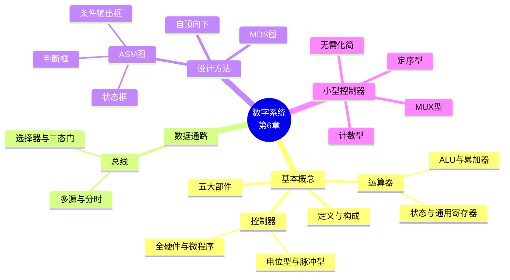

# 第六章 数字系统

> **本章主线**：先建立 **数字系统** 的整体概念（数据通路 + 控制逻辑、五大部件、运算器与控制器），再理解 **数据通路** 与总线结构；随后学习 **自顶向下设计方法**（划分子系统 → 数据通路 → ASM/MDS 图 → 设计控制器），最后落实到 **小型控制器** 的三种硬件实现（计数型 / 定序型 / MUX型）及完整例题。
>
> **一句话版本**：概念（数据通路 + 控制器）→ 设计方法（自顶向下 + ASM 图）→ 控制器实现（计数型 / 定序型 / MUX型）。
>
> **编号说明**：课件含 §6.1 数字系统基本概念、§6.2 数据通路、§6.3 数字系统的设计方法、§6.4 小型控制器的设计，本笔记按此编号组织。

## 6.1 数字系统的基本概念

### 数字系统的定义

**数字系统**：具有存储、传输、处理信息能力的**逻辑系统集合**。

- 由「**数据通路 + 控制逻辑**」构成；
- 其工作具有**周期性**（按状态周期循环推进）。

### 数字系统的基本构成

数字系统由**五大部件**组成，通过**总线和接口**连接。以 CPU 为典型代表：

| 层次 | 部件 | 说明 |
| :--- | :--- | :--- |
| **控制部件** | 控制器 | 发出控制命令，指挥各部件协调工作 |
| **执行部件** | 运算器 | 对信息进行加工处理（算术、逻辑、传输） |
| | 存储器 | 存放程序与数据 |
| | 输入设备 | 输入信息 |
| | 输出设备 | 输出结果 |

数据通路结构：**控制部件** 控制 **执行部件**（运算器、寄存器、存储器）之间的数据流动。

### 运算器

运算器对信息进行加工处理，全部操作由控制器发出的控制信号指挥。由四部分构成：

| 组成 | 功能 |
| :--- | :--- |
| **算术逻辑单元 ALU** | 执行算术与逻辑运算 |
| **累加寄存器** | 暂存操作数和运算结果 |
| **状态寄存器** | 存放 ALU 工作中产生的状态信息（标志位） |
| **通用寄存器** | 暂存操作数或数据地址，减少访问内存，提高速度 |

**状态标志寄存器**：每一位对应一个特征（如进位、溢出、零、负等），ALU 运算后将状态写入。

### 控制器

**数字系统与逻辑功能部件的根本区别**：有无**控制器**。

控制器是发出**控制命令**、指挥和控制各部件协调工作的**中心部件**。

**实现方法**：

- **全硬件控制器**（硬布线）：用逻辑门电路直接实现；
- **微程序控制器**：将控制命令序列存入控制存储器，逐条取出执行。

**控制命令**分为两类：

| 类型 | 用途 | 典型应用 |
| :--- | :--- | :--- |
| **电位型** | 控制门电路 | 控制信号在状态周期内保持稳定 |
| **脉冲型** | 控制数据打入寄存器 | 打入脉冲，需与节拍脉冲 T 相与 |

---

## 6.2 数据通路

### 数据通路的定义

由控制器控制，数据流通过 **BUS 总线**在各子系统之间流动。

- **数据通路**：由**数据信号**和**控制信号**组成，在各部件之间传送信息的公共通路；
- 由**总线**连接的**运算单元**（组合电路）和**存储单元**（时序电路）构成。

### 总线

**总线**：用来**分时地**发送与接收各部件信息的公共传送线路。

**特点**：

- **多源**：多个部件共享同一条总线；
- **分时**：同一时刻只允许一个部件发送数据。

### 总线的逻辑结构

| 类型 | 实现方式 | 说明 |
| :--- | :--- | :--- |
| **单向总线** | **选择器方式** | 数据只能从源流向目的地，用多路选择器实现 |
| **双向总线** | **三态门方式** | 数据可双向流动，用三态门控制总线驱动权 |

> 口诀：**单向选择器、双向三态门；多源分时用，打入脉冲控**。

---

## 6.3 数字系统的设计方法

### 6.3.1 自顶向下设计步骤

**自顶向下方法**（from top to down）：

| 步骤 | 内容 | 说明 |
| :--- | :--- | :--- |
| 1 | **划分子系统、模块** | 分为**数据处理器**（受控电路）和**控制器**（控制电路）；将大系统从逻辑上划分为「控制电路 + 受控电路」 |
| 2 | **设计数据通路** | 连接各运算单元与存储单元（方案**不唯一**） |
| 3 | **描述控制过程** | 用数学语言/工具描述，如 **ASM 图**、**MDS 图** |
| 4 | **设计控制器** | 硬布线控制器、微程序控制器 |
| 5 | **设计数据处理器** | 实现受控的运算与寄存操作 |

### 6.3.2 算法状态机ASM图

**ASM 图**（Algorithmic State Machine Flowchart，算法状态机流程图）：用**状态框、判断框、条件输出框**和文字描述数字系统控制器在不同时间内完成的操作。

**特点**：

1. 描述控制器的**控制状态及其转换关系**；
2. 可精确表示状态转换的**时间关系**（状态周期）。

**三种框**：

| 框类型 | 形状 | 框内内容 | 作用 |
| :--- | :--- | :--- | :--- |
| **状态框** | 矩形 | 控制命令 | 代表系统一个状态，在规定数量脉冲作用下实现状态转换 |
| **条件判断框** | 菱形 | 检测条件 | 对控制器输入信号判断，条件满足时才发生相应输出 |
| **条件输出框** | 平行四边形 | 控制命令 | 与状态框相连的判断框、条件输出框都属于该状态框，**同一状态周期**完成 |

**状态周期**：每一个状态所经历的时间。一个状态周期内包含节拍脉冲（如 T1、T2），状态改变与打入命令发生在特定节拍。

**MDS 图**（Mnemonic Documented State）与 ASM 图可相互转换，用助记符文档化状态转移关系。

### 6.3.3 数据通路实例

典型数据通路组件：

- **ALU**：算术逻辑运算单元；
- **通用寄存器组**：如 16 字通用寄存器 R，具有 A 输出、B 输出，以及 RDA/RDB 读使能、WRB 写使能、LA/LB 打入脉冲；
- **存储器 RAM**：通过 MAR（地址寄存器）寻址，LDAR 打入地址，MRD/MWR 读写控制；
- **指令寄存器 IR**：LDIR 打入；
- **BUS**：连接各部件的总线。

**寄存器控制信号约定**：

- **接受方**：打入脉冲（LA、LB、LC 等，脉冲型）；
- **发送方**：三态门使能（RDA、RDB 等）。

**双总线通路 vs 单总线通路**：

| 类型 | 特点 | 操作节拍 |
| :--- | :--- | :--- |
| **双总线** | 两个操作数可同时从 A、B 口输出到不同总线 | 一个状态周期可完成 RA+RB→RB（ADD、LC） |
| **单总线** | 所有数据分时走同一条总线 | 需多个节拍：先 RDA→ALU→LC 暂存，再 RDB 与暂存结果相加→WRB |

### 6.3.4 设计实例：大数存入寄存器A

**题目**：将四位二进制数 X、Y 分别存入寄存器 A 和 B 中，然后比较两数大小，使**大数存入寄存器 A**，设计控制器的 ASM 图。

**步骤一：逻辑划分**

- 控制器；
- 执行部件：2 个四位寄存器 A（存 X）、B（存 Y），四位比较器（$C=1$ 表示 $A \ge B$），一个控制器。

**步骤二：数据通路**

- 控制器 → 比较器、寄存器 A、寄存器 B；
- 控制信号：$L_B$（打入 B）、$L_A$（打入 A）、$CAP$（比较）、$A>B$ 输出 $C$。

**步骤三：系统工作过程**

1. X 送 B；
2. (B) 送 (A)（即 X 存入 A）；
3. Y 送 B；
4. 比较 (A) 与 (B)，若 $A>B$ 则结束，否则交换。

**步骤四：控制命令分配**

| 状态 | 控制命令 | 类型 | 操作 |
| :--- | :--- | :--- | :--- |
| S0 | $L_B$ | **脉冲** | $X \rightarrow B$ |
| S1 | $L_A$ | **脉冲** | $(B) \rightarrow (A)$ |
| S2 | $L_B$ | **脉冲** | $Y \rightarrow B$ |
| S3 | $CAP$ | **电位** | 比较 $(A)$ 与 $(B)$，输出 $C$ |

**步骤五：控制器 ASM 图**

- S0（$L_B$）→ S1（$L_A$）→ S2（$L_B$）→ S3（$CAP$）；
- S3 判断 $C$：$C=1$（$A \ge B$）→ 回到 S0（或结束）；$C=0$（$A < B$）→ 需交换，转至相应状态。

**一句话概括**：先用脉冲命令把 X、Y 依次装入 A、B，再用电位命令比较，根据比较结果决定是否交换——**脉冲管装载，电位管比较**。

---

## 6.4 小型控制器的设计

**小型控制器**由硬件实现，由**控制命令译码器** + **状态寄存器**构成，产生寄存器打入脉冲等控制信号。**无需化简**（状态数少、直接按 ASM 图实现）。

### 6.4.1 三种类型对比

| 类型 | 状态寄存器 | 译码电路 | 适用场景 | 设计方法 |
| :--- | :--- | :--- | :--- | :--- |
| **计数型** | **少**（$n$ 个触发器 → $2^n$ 状态） | 相同（较复杂） | 状态数较多 | 同时序电路：编码 → 控制表达式 → 状态转移表 → 驱动方程 |
| **定序型（一对一）** | **多**（$n$ 个状态 → $n$ 个触发器） | **简单** | 状态数较少 | 分配触发器 → 控制表达式 → MDS 表 → 次态方程 |
| **MUX型** | $n$ 个触发器（同计数型） | —（用 $n$ 个数据选择器代替译码） | 状态数较多 | 编码 → 控制表达式 → 真值表 → 数据选择器数据端 |

> 口诀：**计数省触发器、定序一对一、MUX 选择器**。

### 6.4.2 计数型控制器设计步骤

适用于状态数较多，$n$ 个触发器可构成 $2^n$ 个控制状态。设计方法同时序电路：

1. 给 ASM 图的状态框**编码**；
2. 由 ASM 图得**控制信号表达式**（译码）；
3. 画控制器的**状态转移表**；
4. 求**触发器驱动方程**；
5. **电路实现**。

### 6.4.3 计数型实例：8位累加器控制器

**题目**：设计计数型 8 位累加器的控制器。

**逻辑划分**：控制器、寄存器、加法器。

- 2 个八位寄存器：A（加数）、B（加数、和）；
- 1 个一位寄存器：C（进位）。

**ASM 图控制命令**：

- S0：$L_A$、$\overline{CLR}$（清零）；
- S1：$L_B$；
- S2：$L_A$；
- S3：$ADD$、$L_B$、$L_C$。

**状态编码**：$S_0=00$，$S_1=01$，$S_2=11$，$S_3=10$（$Q_2Q_1$）。

**控制信号表达式**：

$$L_A = (\bar{Q}_2\bar{Q}_1 + Q_2Q_1)T_2 = (Q_1 \oplus \bar{Q}_2)T_2$$

$$L_B = (\bar{Q}_2Q_1 + Q_2\bar{Q}_1)T_2 = (Q_1 \oplus Q_2)T_2$$

$$L_C = Q_2\bar{Q}_1 T_2$$

$$\overline{CLR} = \bar{Q}_2\bar{Q}_1, \quad CLR = Q_2 + Q_1 \text{（电位型）}$$

$$ADD = Q_2\bar{Q}_1 \text{（电位型）}$$

**状态转移表**：

| 现态 $Q_2Q_1$ | 次态 $Q_2^{n+1}Q_1^{n+1}$ |
| :---: | :---: |
| 00 | 01 |
| 01 | 11 |
| 11 | 10 |
| 10 | 11 |

**次态方程与驱动方程**：

$$Q_2^{n+1} = \bar{Q}_2Q_1 + Q_2Q_1 + Q_2\bar{Q}_1 = Q_2 + Q_1, \quad J_2 = Q_1^n,\ K_2 = 0$$

$$Q_1^{n+1} = \bar{Q}_2\bar{Q}_1 + \bar{Q}_2Q_1 + Q_2\bar{Q}_1 = \bar{Q}_2 + \bar{Q}_1, \quad J_1 = 1,\ K_1 = Q_2^n$$

> **注意**：脉冲型控制信号（$L_A$、$L_B$、$L_C$）必须与节拍脉冲 $T_2$ 相与；电位型（$CLR$、$ADD$）不需要。

### 6.4.4 定序型控制器设计步骤

适用于状态数较少的控制器，$n$ 个控制状态需 $n$ 个触发器（**一对一**编码）：

1. 给 ASM 图的状态框**分配触发器**；
2. 由 ASM 图得**控制信号表达式**；
3. 画控制器的 **MDS 表**；
4. 写**次态方程**；
5. **电路实现**。

### 6.4.5 定序型实例：通用例

**ASM 图**：状态 P（$C_1$）→ 判断 $X$：$X=1$ → 状态 Q（$C_3$）→ P；$X=0$ → 条件输出 $C_2$ → 状态 R → P。

**分配**：$P=Q_1$，$Q=Q_3$，$R=Q_2$。

**控制信号**：

$$C_1 = Q_1^n, \quad C_2 = Q_1^n\bar{X}$$

**MDS 表**：

| 现态 | 次态 | 转移条件 |
| :---: | :---: | :---: |
| $Q_1$ | $Q_2$ | $\bar{X}$ |
| $Q_1$ | $Q_3$ | $X$ |
| $Q_2$ | $Q_1$ | |
| $Q_3$ | $Q_1$ | |

**次态方程**：

$$Q_1^{n+1} = Q_2^n + Q_3^n$$

$$Q_2^{n+1} = Q_1^n\bar{X}$$

$$Q_3^{n+1} = Q_1^n X$$

### 6.4.6 定序型实例：大数存入寄存器A（比较器控制器）

**分配触发器**：$S_0=Q_0,\ \ldots,\ S_3=Q_3$。

**控制信号**：

$$L_B = (Q_0^n + Q_2^n)T_2, \quad L_A = Q_1^n T_2, \quad CAP = Q_3^n$$

**MDS 表**：

| 现态 | 次态 | 转移条件 |
| :---: | :---: | :---: |
| $Q_0$ | $Q_1$ | |
| $Q_1$ | $Q_2$ | |
| $Q_2$ | $Q_3$ | |
| $Q_3$ | $Q_1$ | $\bar{C}$ |
| $Q_3$ | $Q_2$ | $C$ |

**次态方程**：

$$Q_1^{n+1} = Q_0^n + Q_3^n\bar{C}$$

$$Q_2^{n+1} = Q_1^n + Q_3^n C$$

$$Q_3^{n+1} = Q_2^n$$

$$Q_0^{n+1} = 0$$

**电路实现**：按上述次态方程用触发器 + 门电路实现即可。

### 6.4.7 MUX型控制器设计步骤

用数据选择器代替译码器：$n$ 个触发器需 $n$ 个数据选择器。

- 数据选择器输出 $F^{(n)}$ 接触发器 $D^{(n)}$；
- 地址输入（共用）接触发器 $Q$；
- **数据端**由**转移条件**确定。

设计步骤：

1. 给 ASM 图的状态框**编码**；
2. 由 ASM 图得**控制信号表达式**；
3. 画控制器的**状态真值表**；
4. 确定**数据选择器的数据端**。

### 6.4.8 MUX型实例：通用例

**状态编码**：$P=00$（$C_1$），$R=10$，$Q=11$。

**控制信号**：

$$C_1 = \bar{Q}_1^n\bar{Q}_0^n, \quad C_2 = \bar{Q}_1^n Q_0^n\bar{X}$$

**状态真值表**：

| $Q_1^n$ | $Q_0^n$ | $Q_1^{n+1}$ | $Q_0^{n+1}$ | 转移条件 |
| :---: | :---: | :---: | :---: | :---: |
| 0 | 0 | 1 | 0 | $\bar{X}$ |
| 0 | 0 | 1 | 1 | $X$ |
| 1 | 0 | 0 | 0 | |
| 1 | 1 | 0 | 0 | |
| 0 | 1 | 0 | 0 | |

**次态方程**：

$$D_1 = \bar{Q}_1^n\bar{Q}_0^n(X + \bar{X}) = \bar{Q}_1^n\bar{Q}_0^n$$

$$D_0 = \bar{Q}_1^n\bar{Q}_0^n X$$

**数据选择器数据端**（$A_1A_0 = Q_1^n Q_0^n$）：

- **MUX1**（$D_1$）：$d_0 = X + \bar{X} = 1$，$d_1 = d_2 = d_3 = 0$；
- **MUX0**（$D_0$）：$d_0 = X$，$d_1 = d_2 = d_3 = 0$。

### 6.4.9 MUX型实例：大数存入寄存器A（比较器控制器）

**状态编码**：$A_1A_0 = Q_1^n Q_0^n$。

**状态真值表**：

| $Q_1^n$ | $Q_0^n$ | $Q_1^{n+1}$ | $Q_0^{n+1}$ | 转移条件 |
| :---: | :---: | :---: | :---: | :---: |
| 0 | 0 | 0 | 1 | |
| 0 | 1 | 1 | 0 | |
| 1 | 0 | 1 | 1 | |
| 1 | 1 | 0 | 1 | $\bar{C}$ |
| 1 | 1 | 1 | 0 | $C$ |

**数据选择器数据端**：

- **MUX1**（$Q_1$）：$d_0 = 0$，$d_1 = 1$，$d_2 = 1$，$d_3 = C$；
- **MUX0**（$Q_0$）：$d_0 = 1$，$d_1 = 0$，$d_2 = 1$，$d_3 = \bar{C}$（课件标注为 $C$，按真值表应为 $\bar{C}$）。

> **一句话概括**：MUX 型控制器把"状态转移逻辑"直接映射到数据选择器的数据端，省去显式译码器，电路规整、易于修改。

---

## 知识定位与框架衔接

**本章定位**：将前几章的组合电路、时序电路、MSI 器件和 Verilog 状态机整合为**系统级设计方法**——从"设计一个电路"上升到"设计一个数字系统"。

**与前章衔接**：

- **控制器**的核心是**状态机**，直接复用**第三章**时序电路设计方法（状态化简 → 状态分配 → 状态转移 → 求驱动方程）；
- **运算器**中的 ALU 呼应**第二章** MSI 器件（加法器、比较器）；
- **总线**与三态门呼应**第二章**总线结构；
- **数据通路**中的寄存器、计数器复用**第一、三章**知识；
- **ASM 图**是 Verilog 中 **状态机**（Moore/Mealy 型）的图形化描述，第五章的 `always` + `case` 状态机是其代码实现。

**向后延伸**：

- 本章的自顶向下设计方法和数据通路概念是**计算机组成原理**中 CPU 设计的基础；
- 控制器设计（硬布线/微程序）是理解 CPU 控制单元的关键；
- 数据通路 + 控制器 = 完整的数字系统，可进一步扩展到 SoC、总线协议等。

**框架一句话**：**概念（数据通路 + 控制器）→ 设计方法（自顶向下 + ASM/MDS）→ 控制器实现（计数型 / 定序型 / MUX型）**。

---

## 课件 PDF

<iframe src="https://cognishelf.naimore3.workers.dev/课程笔记/大二上/数字逻辑与数字系统/第六章/第六章.pdf" width="100%" height="800px" style="border: none;"></iframe>

[点击下载课件 PDF](https://cognishelf.naimore3.workers.dev/课程笔记/大二上/数字逻辑与数字系统/第六章/第六章.pdf)
