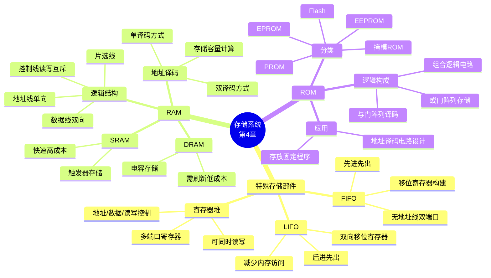

# 第四章 存储系统

> **本章主线**：存储系统是计算机的记忆部件。本章从 CPU 内部的特殊存储部件（寄存器堆、FIFO、LIFO）出发，重点讲解大容量存储器 **RAM**（随机读写存储器）与 **ROM**（只读存储器）的逻辑结构、地址译码方式、读写操作、SRAM/DRAM 对比，以及 ROM 作为组合逻辑电路的应用与地址译码电路设计。
>
> **一句话版本**：特殊存储部件（寄存器级）→ RAM（读写级）→ ROM（只读级）；核心是"地址译码选中存储单元 + 数据总线传输"。
>
> **编号说明**：课件仅含 §4.1 特殊存储部件、§4.2 随机读写存储器 RAM、§4.3 只读存储器 ROM 三节，按课件顺序编号。



## 4.1 特殊存储部件

微机拥有不同类型的存储部件，构成**多层/多级存储结构**（从快到慢、从小到大）：寄存器堆 → 高速缓存 Cache → 主存储器 → 联机外存 → 脱机外存。

**特殊存储部件**由寄存器（D 触发器）构成，位于 CPU 内部，用于缓存和传输操作，**容量小、速度快**。主要包括：

- 通用寄存器堆
- 寄存器队列
- 寄存器栈

### 4.1.1 寄存器堆（缓冲存储器）

由**多个寄存器构成的集合**，常用于数据寄存。可视为**多端口寄存器**——可同时读、写，可同时输出两个数。

**三组外部信号**：

| 信号类型 | 方向 | 说明 |
| :--- | :--- | :--- |
| 地址（短地址） | 输入 | 选择要访问的寄存器编号 |
| 数据 | 双向 | 读出或写入的数据 |
| 读/写控制 | 输入 | 指定操作类型 |

**Verilog 描述要点**：

- `reg [7:0] regs [0:7]`：8 个 8 位寄存器构成的数组；
- 写操作：`always @(posedge clk)` 中根据写使能与地址译码（`we && wa == 2'bxx`）将 `d_in` 写入对应寄存器；
- 读操作：`always @(ra)` 中用 case 语句作**数据选择器**，将 `regs[ra]` 输出到 `d_out`；
- 异步复位：`negedge rst_n` 将所有寄存器清零。

一句话概括：**寄存器堆 = 多寄存器 + 地址译码读写**；写用同步时钟，读用组合选择。

### 4.1.2 寄存器队列（FIFO）

**FIFO**（First In First Out，先进先出）：用若干个**移位寄存器**构建的小型存储部件，常用于**指令队列**。

**特点**：

- **无地址线**，双端口存储器，可同时读写；
- 数据按写入顺序依次弹出，先入先出。

**应用**：两个不同系统通信、数据采集传送、串并转换。

**速率匹配场景**：A 速率数据与 B 速率数据分别经 CPa、CPb 写入 FIFO，FIFO 作为弹性缓冲，协调两个不同时钟域的数据流。

一句话概括：**FIFO 用移位实现"顺序存取"，无需地址，天然适配异步接口与速率匹配**。

### 4.1.3 寄存器栈（LIFO）

**LIFO**（Last In First Out，后进先出）：用若干个**双向移位寄存器**构建的小型存储部件。

**用途**：减少函数调用时对内存的访问——函数调用的现场（返回地址、局部变量）压入栈，返回时弹出，避免频繁访问主存。

一句话概括：**LIFO 后进先出，双向移位实现压栈/出栈，是函数调用的硬件加速结构**。

### 4.1.4 三种特殊存储部件对比

| 部件 | 构成 | 访问顺序 | 地址线 | 典型应用 |
| :--- | :--- | :--- | :--- | :--- |
| 寄存器堆 | 多寄存器集合 | 随机（按地址） | 有（短地址） | 数据寄存、通用寄存器 |
| FIFO | 移位寄存器 | 先进先出 | **无** | 指令队列、系统通信、串并转换 |
| LIFO | 双向移位寄存器 | 后进先出 | **无** | 函数调用现场保护 |

> 口诀：**堆按地址随机访，FIFO 先进先出排，LIFO 后进先出栈**。

---

## 4.2 随机读写存储器 RAM

**RAM**（Random Access Memory，随机读写存储器）：存储内容**可读可写**，断电后信息丢失（**易失性**）。

### 4.2.1 RAM 的逻辑结构

| 信号 | 方向 | 说明 |
| :--- | :--- | :--- |
| 数据线 | **双向** | 既可输入（写）又可输出（读） |
| 读/写控制线 | 输入 | 读、写命令**互斥**，不能同时有效 |
| 片选线 CS | 输入 | 选中该芯片，多片扩展时使用 |
| 地址线 | 输入（单向） | 选择存储单元，单向传送地址码 |

与 ROM 对比：ROM 数据线**单向**（只读输出），RAM 数据线**双向**。

一句话概括：**地址选单元、片选选芯片、读写控方向、数据走总线**。

### 4.2.2 存储器地址译码方式

基本概念：

- **位线**：数据线，连接存储元的数据端；
- **字线**：存储单元选通线，译码输出控制某字/某行是否被选中。

#### （1）单译码方式

**一个译码器**，选中**一个字的所有存储元**（按字寻址，整行选通）。课件示例为**二维存储阵列**：3 根地址线 → $2^3 = 8$ 条字线，每字 8 位。

$$\text{容量} = 8 \times 8 \text{ bit}$$

#### （2）双译码方式

**两个译码器**（行译码器 + 列译码器），选中**交叉点的存储元**，用于构成**大容量存储器**。课件示例为**三维存储阵列**：6 根地址线拆为行 3 根 + 列 3 根，行/列交叉选中：

$$\text{容量} = 64 \times 8 \text{ bit} = 2^6 \times 8 \text{ bit}$$

| 译码方式 | 译码器个数 | 选中粒度 | 适用 |
| :--- | :--- | :--- | :--- |
| 单译码 | 1 个 | 一个字（整行） | 小容量 |
| 双译码 | 2 个（行+列） | 交叉点存储元 | 大容量 |

#### （3）存储器容量

$$\text{容量} = \text{字数} \times \text{字长} = \text{单元数} \times \text{每单元的位数}$$

常用单位：KB、MB、GB 等，其中 $K = 2^{10}$，$M = 2^{20}$，$G = 2^{30}$，$B(\text{Byte}) = 8\,\text{bit}$。

#### （4）存储器的读写操作

**写操作**（三步）：

1. **地址有效**——地址码送上地址总线，译码选中单元；
2. **数据放总线**——写入数据放到数据总线；
3. **写命令有效**——数据在写脉冲作用下存入选中单元。

**读操作**（三步）：

1. **地址有效**；
2. **读命令有效**；
3. **数据被复制到总线并打入寄存器**。

> 口诀：**写——先址、后数、再写；读——先址、后读、数上总线**。

### 4.2.3 SRAM 存储器

**SRAM**（Static RAM，静态 RAM）：**靠触发器记忆数据**（6 管 MOS 锁存器），存储信息稳定，**非破坏性读出**。

**读周期**：

1. 地址有效；
2. 片选信号 CS 有效；
3. 输出使能 OE 有效；
4. 数据经三态门输出到总线。

**写周期**：

1. 地址有效；
2. 片选信号 CS 有效；
3. 数据经三态门放到总线；
4. 写信号 WE 有效。

**Verilog 建模示例**（双向数据端口 + 读写控制）：

```verilog
module memory_e (cs, oen, wen, addr, data);
   parameter DATA_WIDTH = 8;
   parameter ADDR_WIDTH = 2;
   parameter MEM_WIDTH  = 4;
   input  cs, oen, wen;
   input  [ADDR_WIDTH-1:0] addr;
   inout  [DATA_WIDTH-1:0] data;            // 双向数据端口
   reg  [DATA_WIDTH-1:0] memory [0:MEM_WIDTH-1];
   reg  [DATA_WIDTH-1:0] data_out;
   wire [DATA_WIDTH-1:0] data_in;

   assign data     = data_out;
   assign data_in  = data;

   always @(cs, oen)                        // 读操作
     if (!cs && !oen) data_out = memory[addr];
     else             data_out = {DATA_WIDTH{1'bz}};  // 高阻

   always @(cs, wen)                        // 写操作
     if (!cs && !wen) memory[addr] = data_in;
endmodule
```

要点：读/写均以**低电平有效**的 cs 配合 oen/wen；未选中时数据线呈**高阻态** $z$，实现双向端口隔离。

一句话概括：**SRAM = 触发器 + CS/OE/WE 时序**，读非破坏、无需刷新。

### 4.2.4 DRAM 存储器

**DRAM**（Dynamic RAM，动态 RAM）：**靠 MOS 管栅极电容记忆数据**（1 管 + 1 电容），电容漏电信息不稳定，**必须定时刷新**。

**刷新电路**：将刚读出的数据**再写回去**（读出即破坏，刷新兼恢复）。

DRAM 操作包含**写、读、刷新**三个操作。

**结构特点**：

- **地址线分两次送**（行地址、列地址分时复用）——减少总线数与芯片引脚；
- **读、写数据线分开**（与 SRAM 的双向数据线不同）。

一句话概括：**DRAM 靠电容、要刷新、地址分两次送**，换来的高集成度与低成本。

### 4.2.5 SRAM 与 DRAM 对比

| 比较项 | SRAM | DRAM |
| :--- | :--- | :--- |
| 存储信息 | **触发器** | **电容** |
| 破坏性读出 | 非 | **是** |
| 需要刷新 | 不要 | **需要** |
| 送行列地址 | 同时送 | **分两次送** |
| 运行速度 | 快 | 慢 |
| 集成度 | 低 | **高** |
| 发热量 | 大 | 小 |
| 存储成本 | 高 | **低** |

> 口诀：**SRAM 触发器、快、贵、不刷新；DRAM 电容、慢、便宜、要刷新**。

**RAM 系列谱系**：

- **SRAM**：异步 SRAM（ASRAM）、具有突发特性的同步 SRAM（SB SRAM）；
- **DRAM**：快速页模式 DRAM（FPM DRAM）、扩充数据输出 DRAM（EDO DRAM）、突发 EDO DRAM（BEDO DRAM）、同步 DRAM（SDRAM）。

典型应用分工：SRAM 用于**小容量高速系统**（Cache），DRAM 用于**大容量主存系统**。

---

## 4.3 只读存储器 ROM

**ROM**（Read-Only Memory，只读存储器）：存储内容**掉电不丢失**（**不易失性**），正常工作时只读不写。PC 机中用于存储 **BIOS 程序、机器码、出厂信息**。

### 4.3.1 ROM 的分类

| 类型 | 全称 | 可编程/可擦除性 |
| :--- | :--- | :--- |
| 掩模 ROM | Mask ROM | 出厂时一次性写入，不可改 |
| 可编程 ROM | PROM | 用户可编程**一次** |
| 紫外线可擦除 ROM | EPROM（UV EPROM） | 紫外线擦除后可重编程 |
| 电可擦除 ROM | EEPROM（E²PROM） | 电信号**可擦可写** |
| 闪存 | Flash Memory | 高密度电可擦除，如 U 盘（USB flash disk） |

演进主线：**掩模 → 一次可编程 → 紫外线擦除 → 电可擦除 → 闪存**，灵活性与集成度不断提高。

### 4.3.2 ROM 的逻辑构成

**核心结论**：

$$\text{ROM} = \underbrace{\text{与门阵列（地址译码器）}}_{\text{产生全部最小项}} + \underbrace{\text{或门阵列（存储矩阵）}}_{\text{按内容选通位线}}$$

即 ROM 是一个**组合逻辑电路**：地址作输入、存储内容作输出，真值表就是其"存储内容表"。

**ROM 真值表**（课件示例，2 位地址、4 位数据）：

| 地址 $A_1 A_0$ | 存储内容 $b_3 b_2 b_1 b_0$ |
| :---: | :---: |
| 0 0 | 0 1 0 1 |
| 0 1 | 1 0 1 0 |
| 1 0 | 0 1 1 1 |
| 1 1 | 1 1 1 0 |

对应逻辑函数（以 $b_3$ 为例）：

$$b_3 = \bar{A}_1 A_0 + A_1 A_0$$

**实现结构**：地址译码器产生字线 $W_0 \sim W_3$（全部最小项），各输出位由**或门**把相应字线"或"起来——$b_3$ 接 $W_1、W_3$；$b_2$ 接 $W_0、W_2、W_3$；$b_1$ 接 $W_1、W_2、W_3$；$b_0$ 接 $W_0、W_2$。

一句话概括：**ROM = 译码器（与阵列）+ 或阵列**；写 ROM 真值表 = 实现一组组合逻辑函数。

### 4.3.3 思考题（容量计算）

**例 1**：$32K \times 16$ 表示什么意思？

**解**：$32K = 2^5 \times 2^{10} = 2^{15}$，即

- 存储 **32K（32768）个单元**，每单元 **16 位**；
- 需 **15 根地址线**、**16 根数据线**。

**例 2**：构成 $4M \times 32$ 存储器需要 $16K \times 8$ 的芯片多少片？

**解**：

$$\frac{4M}{16K} \times \frac{32}{8} = \frac{2^{22}}{2^{14}} \times 4 = 2^8 \times 4 = \textbf{1024 片}$$

（字向扩展 $2^8 = 256$ 片并联，位向扩展 4 片并联。）

**例 3**：奔腾 CPU 数据总线宽度 64 位、地址总线宽度 32 位，主存最大物理地址空间为多少？

**解**：

$$2^{32} \times 64 = 4 \times 2^{30} \times 8 \times 8 = \textbf{32 GB}$$

一句话概括：**地址线定字数（$2^n$），数据线定字长，容量 = 字数 × 字长**。

### 4.3.4 地址译码电路设计（详细例题）

**题目**：已知存储器地址空间——ROM 为 0000H~3FFFH，PROM 为 4000H~7FFFH，EPROM 为 C000H~DFFFH，RAM 为 E000H~FFFFH。用 **2:4 译码器**和适当的门设计地址译码电路。

**步骤 1：列出各芯片地址范围的高位特征**

| 芯片 | 地址范围 | $A_{15}A_{14}$ | $A_{13}$ |
| :--- | :--- | :--- | :--- |
| ROM | 0000H~3FFFH | **00** | — |
| PROM | 4000H~7FFFH | **01** | — |
| （未用） | 8000H~BFFFH | 10 | — |
| EPROM | C000H~DFFFH | **11** | **0** |
| RAM | E000H~FFFFH | **11** | **1** |

**步骤 2：选择译码方案**

- $A_{15}A_{14}$ 恰好 4 种组合 → 用一个 **2:4 译码器**输入 $A_{15}、A_{14}$，输出 $Y_0 \sim Y_3$（低电平有效）；
- ROM、PROM 各自独占一个输出：$\overline{\text{ROM CS}} = Y_0$，$\overline{\text{PROM CS}} = Y_1$；
- EPROM 与 RAM **共用 $Y_3$**（$A_{15}A_{14} = 11$），再用 $A_{13}$ 区分。

**步骤 3：写出片选表达式**（片选低电平有效）

$$\overline{\text{EPROM CS}} = Y_3 + A_{13} \qquad \overline{\text{RAM CS}} = Y_3 + \bar{A}_{13}$$

（用**或门**实现：仅当 $Y_3 = 0$ 且 $A_{13}$（或 $\bar{A}_{13}$）= 0 时片选才有效。）

**步骤 4：检查**

- $Y_3 = 0$（即 $A_{15}A_{14} = 11$）且 $A_{13} = 0$ → 地址 C000H~DFFFH → 选中 EPROM ✔
- $Y_3 = 0$ 且 $A_{13} = 1$ → 地址 E000H~FFFFH → 选中 RAM ✔
- $Y_0 = 0$ → ROM；$Y_1 = 0$ → PROM；$Y_2$ 未使用 ✔

**答案**：2:4 译码器输入接 $A_{15}A_{14}$；$Y_0$ 直接作 ROM 片选，$Y_1$ 直接作 PROM 片选；$Y_3$ 与 $A_{13}$ 经或门作 EPROM 片选，$Y_3$ 与 $\bar{A}_{13}$ 经或门作 RAM 片选。

**一句话概括**：**先看地址高位定译码器输入，再找"共用高位"的芯片用低位细选；低电平有效的片选用或门合并条件**。

## 知识定位与框架衔接

**本章定位**：存储系统是数字系统（计算机）的"记忆"子系统，位于 CPU 与外设之间的核心层级。

**与前章衔接**：

- §4.1 寄存器堆/FIFO/LIFO 的硬件基础是**第一、二章的触发器与寄存器、移位寄存器**——本章将其"打包"成部件；
- §4.2 地址译码器直接应用**组合逻辑中的译码器**（第二章 MSI 器件）；
- §4.3 ROM 实现组合逻辑函数——与**第二章"用 MSI 器件实现组合逻辑"**呼应：ROM 是通用组合逻辑器件，真值表即函数表。

**向后延伸**：

- 存储容量扩展（字扩展、位扩展）是系统设计的常见考点；
- Cache（高速缓存）基于 SRAM，主存基于 DRAM，外存基于 Flash/磁盘——构成**多级存储层次**，兼顾速度、容量与成本；
- 后续课程（计算机组成原理）将在此基础上展开 CPU 与存储系统的互连设计。

**框架一句话**：**触发器做部件（§4.1）→ 译码器选地址（§4.2）→ 或阵列存内容（§4.3）→ 层次结构权衡速度/容量/成本**。

---

## 课件 PDF

<iframe src="https://cognishelf.naimore3.workers.dev/课程笔记/大二上/数字逻辑与数字系统/第四章/第四章.pdf" width="100%" height="800px" style="border: none;"></iframe>

[点击下载课件 PDF](https://cognishelf.naimore3.workers.dev/课程笔记/大二上/数字逻辑与数字系统/第四章/第四章.pdf)
