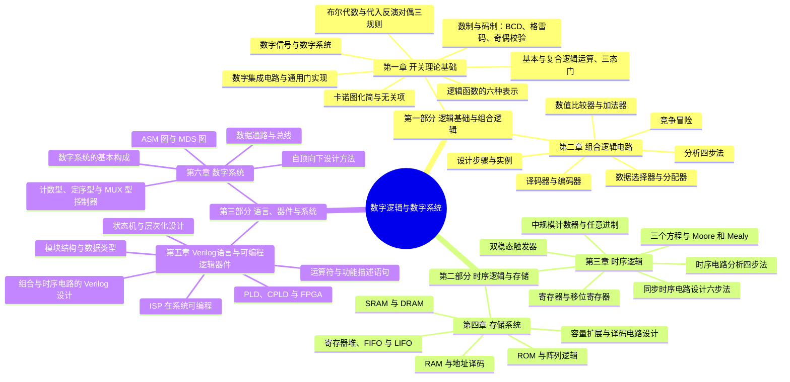

# 课程概览
## 基本信息
- 授课老师：方维
- 课程成绩：90 分
- 这门课程难度不高，只要上课认真听讲，课下按时完成练习，期末考试之前把错题看了即可。老师授课水平一流，对学生热情有耐心，可以说是T0级别。
## 知识结构

本课程分为**逻辑基础与组合逻辑**（第一~二章）、**时序逻辑与存储**（第三~四章）与**语言、器件与系统**（第五~六章）三大部分：第一章从"信息如何变成 0/1"出发，交出布尔代数与卡诺图两把数学武器；组合逻辑用"分析与设计互逆"这对镜头刻画无记忆的因果电路；时序逻辑以"触发器 + 组合逻辑 + 反馈"引入时间维度，存储系统再把触发器组织成部件；第五章换上 Verilog 与 PLD 提高设计生产率，第六章以"数据通路 + 控制器"的自顶向下方法收束——"描述 → 化简/实现 → 分析验证"这套循环贯穿始终。整体框架如下：

1. **第一章 开关理论基础**
    - 全课程的工具章：从模拟信号与数字信号的分野出发，用数制与码制（BCD 码、格雷码、奇偶校验码）把信息变成 0/1 代码——先编码，再描述。
    - 逻辑函数的六种表示方法与基本/复合逻辑运算，三态门与总线——建立"因果关系如何用电路刻画"的语言。
    - 两把数学武器：布尔代数（基本公式、定理、代入/反演/对偶三规则、公式法化简）与卡诺图（最小项、合并规律、无关项化简），背后是"最简 = 最省"的工程价值观。
    - 最后落到器件：数字集成电路的分类、封装与使用特性，以及与非门/或非门的等价变换实现，为第二章备齐全套工具。
2. **第二章 组合逻辑电路**
    - 两条互逆的主线：分析（电路 → 表达式 → 真值表 → 功能）与设计（功能 → 真值表 → 化简 → 电路），是第一章工具的第一次大规模实战。
    - 中规模积木：数据选择器 MUX 与分配器 DEMUX、译码器与编码器（74LS138 等）、数值比较器、加法器与奇偶校验器——设计题从"画门"升级为"选模块"。
    - 竞争冒险：理想逻辑与物理电路的第一次正面冲突——现象、判别与消除方法，为时序电路的毛刺问题埋下伏笔。
3. **第三章 时序逻辑**
    - 记忆元件家族：基本 RS 触发器 → 电平 D 锁存器（空翻问题）→ 边沿 D/JK/T 触发器，直到二分频——时序逻辑的地基。
    - 三个方程（输出方程、激励方程、状态方程）是全章的数学骨架；分析四步法与设计六步法互为逆过程，Moore 型与 Mealy 型是两种输出范式，自启动检查收尾。
    - 中规模时序部件：锁存器与寄存器（74LS373/374）、移位寄存器与环形/扭环形计数器、74LS161/160/191 及清零法、预置法搭任意进制，外加顺序脉冲发生器与序列信号发生器两个经典应用。
    - 经典设计题型：序列检测（101、1111 等）、自动售饮料机——把"功能描述"翻译成状态图的完整训练。
4. **第四章 存储系统**
    - 特殊存储部件：寄存器堆（多端口同时读写）、FIFO（先进先出）、LIFO（后进先出）——把第三章的寄存器、移存器"打包"成部件。
    - RAM 的逻辑结构与单译码/双译码方式、容量计算，SRAM（触发器、快而贵）与 DRAM（电容、需刷新）的对比。
    - ROM 的分类（掩模、PROM、EPROM、EEPROM、Flash）与"与阵列 + 或阵列"的逻辑构成——ROM 本身就是通用组合逻辑器件，地址译码电路设计是常考例题。
5. **第五章 Verilog语言与可编程逻辑器件**
    - 硬件描述语言 Verilog：模块结构、`wire`/`reg` 数据类型、运算符、`assign` 连续赋值与 `always` 过程块（阻塞/非阻塞赋值）、`if`/`case`/`for` 控制语句。
    - 用代码设计电路：组合电路、时序电路、状态机（Moore/Mealy）与层次化元件例化——第三章的手工设计六步法在这里变成 `case` 里几行转移逻辑。
    - 实现载体 PLD：低密度的 PROM/PLA/PAL/GAL 到高密度的 CPLD/FPGA（与或阵列、宏单元、查找表），再到 ISP 在系统可编程——设计从面包板搬进芯片。
6. **第六章 数字系统**
    - 系统级概念：数字系统 = 数据通路 + 控制逻辑，五大部件、运算器与控制器的分工，总线与三态门实现分时传输。
    - 自顶向下设计方法：划分子系统 → 定数据通路 → 画 ASM 图/MDS 图 → 设计控制器——从"设计一个电路"上升到"设计一个系统"。
    - 小型控制器的三种硬件实现：计数型、定序型、MUX 型，各配完整设计步骤与实例——全课程在此收束。

### 知识定位与框架衔接

**前置知识**：命题逻辑与集合的直觉（第一章布尔代数的前身）、十进制与二进制互化（第一章开篇即复习，几乎不设门槛），另有 C 语言（第五章 Verilog 的变量、运算符、控制语句与之高度对照）和电路中高/低电平概念作为辅助。这门课的门槛不在先修课程，而在环环相扣——每一章都是下一章的工具，断一环后面处处卡壳。

**后置知识**：计算机组成原理（CPU 数据通路与控制器正是第六章方法的完整落地、存储层次建立在第四章之上）、微机原理与接口技术（总线、译码、时序）、FPGA 与数字系统课程设计（Verilog + 状态机是核心技能），以及考研 408 中计算机组成原理模块。

**故事比喻**：这门课像"从识字造句到写成一篇文章"——第一章先造字（0/1 编码）和语法（布尔代数 + 卡诺图），第二章写没有记忆的短句（组合逻辑），第三、四章给句子加上时态与记忆（时序逻辑、存储系统），第五章换上打字机和排版软件（Verilog、PLD）提高生产率，第六章学会统筹成稿（数字系统设计）。每一章都在重复回答三个问题：**怎么描述**（真值表、三个方程、ASM 图）、**怎么化简或实现**（卡诺图、MSI 积木、芯片）、**对不对**（分析验证、自启动检查、消除毛刺）。

**四个灵魂问题**：

1. **卡诺图凭什么"圈在一起就能化简"，"最简 = 最省"到底省的是什么？** —— 格雷码编码使几何相邻即逻辑相邻（还有首尾相接），每合并一圈就消去一个变量；落到硬件上，乘积项最少对应门的数量最少、因子最少对应门的输入端最少——化简的动机是成本与可靠性，这正是开关理论的全部工程价值。
2. **分析与设计为何互为逆过程，设计却总是更难？** —— 分析是唯一解的"翻译"，设计是多解中的"选优"：同一功能可由不同化简方案、不同 MSI 器件实现，必须在门数、延迟、器件种类之间权衡。这对镜头在第二章（组合）与第三章（时序）原样重演，是全课程统一的方法论。
3. **组合与时序的本质分界在哪，为什么时序电路恰好 = 组合逻辑 + 触发器 + 反馈？** —— 组合电路输出只与当前输入有关，无记忆；时序电路输出还与过去状态有关，而"记住过去"只能靠存储元件，状态的自我维持又必须有反馈回路——三个方程（输出、激励、状态）就是这一结构的数学肖像。
4. **为什么从手工画电路图，还要走到 Verilog，再走到"自顶向下 + 数据通路/控制器分离"？** —— 手工画图在规模面前失效，HDL 把设计抬到行为抽象层；系统级复杂度则必须靠划分（子系统、数据通路、控制器）与图形化描述（ASM/MDS 图）来管理——抽象每抬高一层，就能驾驭大一个数量级的电路，这正是第五、六章存在的理由。
