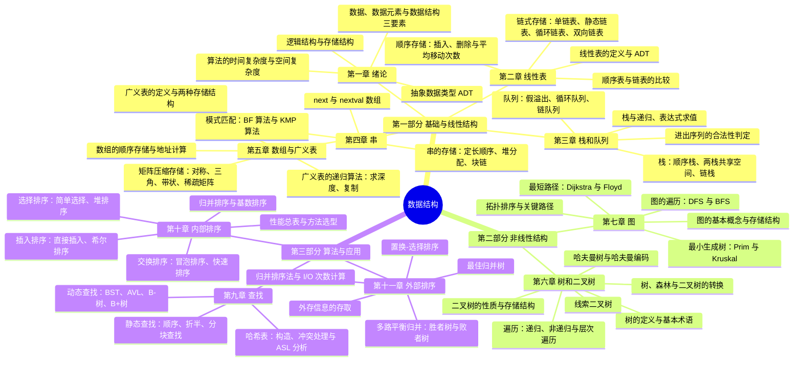

# 课程概览
## 基本信息
- 授课老师：郭岗
- 课程成绩：84
- 这门课难度大，知识点多，都需要背下来。期末考试难度适中，考点比较常规。这门课授课老师水平一般，且脾气比较怪，基本得靠自学。能拉开差距的不是期末考试，而是平时作业和大作业。
## 知识结构

本课程分为**基础与线性结构**（第一~五章）、**非线性结构**（第六~七章）与**算法与应用**（第九~十一章）三大部分：第一章从"程序 = 算法 + 数据结构"出发，建立逻辑结构、存储结构与复杂度分析的概念骨架；线性部分依次展开线性表、栈和队列、串、数组与广义表四种一维结构及其顺序/链式两种实现；非线性部分用树与图刻画层次关系与网状关系；最后以查找与（内、外）排序两大算法主题收束——复杂度分析这把尺子贯穿始终。整体框架如下：

1. **第一章 绪论**
    - 建立全课程的概念骨架：数据、数据元素、数据项、数据对象等基本术语，数据结构的"逻辑结构 + 存储结构 + 运算"三要素，以及抽象数据类型（ADT）"做什么"与"怎么实现"的分离。
    - 逻辑结构（集合、线性、树形、图形）与存储结构（顺序、链式、索引、散列）两套分类，回答"结构如何落地到内存"。
    - 算法的五大评价标准与时间/空间复杂度分析：时间频度、大 $O$ 表示法、推导大 $O$ 阶的方法、最好/最坏/平均情况，以及时间与空间的权衡——这是评价后续一切算法的统一语言。
2. **第二章 线性表**
    - 线性结构的总纲：线性表的形式定义与 ADT，为栈、队列、串等"受限线性表"打底。
    - 顺序存储——地址计算、插入删除的移动次数分析、优缺点；链式存储——单链表运算、头插法/尾插法建表、头结点的作用，以及静态链表、循环链表、双向链表三种变体。
    - 顺序表与链表的系统比较（随机存取 vs 增删成本、空间预分配 vs 指针开销），"22 种实现"全景与必会操作清单。
3. **第三章 栈和队列**
    - 两种受限线性表：栈（后进先出）的顺序栈、两栈共享空间、链栈实现；队列（先进先出）的假溢出问题、循环队列的"牺牲一个位置"判满技巧与链队列实现。
    - 栈与递归的关系：函数调用栈、递归执行过程、表达式求值（中缀转后缀）——递归是"系统替你管理的栈"。
    - 进出序列的合法性判定等经典综合题，把栈队列从"定义"推向"推理"。
4. **第四章 串**
    - 串作为"元素为字符的特殊线性表"：定长顺序存储、堆分配存储、块链存储三种方案及其取舍。
    - 核心是模式匹配：BF 朴素算法（暴力回溯）→ KMP 算法（利用已匹配前缀避免主串指针回退），next 数组的定义、手算与 nextval 改进——本章最难也最常考的部分。
    - 文本编辑等应用示例，展示串结构的实际用途。
5. **第五章 数组与广义表**
    - 数组作为"操作受限的线性表"：多维数组的顺序存储（行优先/列优先）与地址计算公式，是"下标变地址"的机械推导。
    - 矩阵压缩存储：对称矩阵、三角矩阵、带状矩阵的下标映射，稀疏矩阵的三元组表（含快速转置）与十字链表——用"存得下"换"算得动"。
    - 广义表突破"元素同构"限制：头尾链表与扩展线性链表两种存储，求深度、复制两个递归算法——为第六章树的递归思想预演。
6. **第六章 树和二叉树**
    - 树作为第一个非线性结构：递归定义、基本术语、二叉树的五条性质与顺序/链式存储。
    - 遍历是本章灵魂：先/中/后序递归遍历、递归改非递归（显式栈）、层次遍历（队列），以及"由遍历序列恢复二叉树"的判定方法；线索二叉树利用空指针找回前驱后继。
    - 哈夫曼树（最优二叉树）与前缀编码，直接通向第十一章的最佳归并树；树与二叉树的左孩子右兄弟转换、森林遍历，把树的算法统一到二叉树上。
7. **第七章 图**
    - 图是结构最复杂的数据结构：基本术语（有向/无向、完全图、连通分量、度），四种存储结构——邻接矩阵、邻接表、十字链表、邻接多重表，及其与图类型的对应。
    - DFS 与 BFS 两种遍历范式，是本章所有算法的骨架。
    - 四大经典问题：连通性（最小生成树 Prim/Kruskal）、DAG 应用（拓扑排序、AOE 网关键路径）、单源最短路径（Dijkstra）、多源最短路径（Floyd）——每个都是"遍历 + 贪心/动态规划"的组合。
8. **第九章 查找**
    - 概念体系：查找表、关键字、静态/动态查找表，平均查找长度 ASL 是评价查找算法的统一指标。
    - 静态查找：顺序查找、折半查找（判定树与比较次数）、索引顺序表（分块查找）；动态查找：二叉排序树、平衡二叉树（AVL 旋转）、B- 树与 B+ 树（磁盘友好的多路查找树）、键树。
    - 哈希表：以"计算地址"取代"逐个比较"——哈希函数构造、开放定址/链地址法处理冲突、装填因子与 ASL 分析，把期望查找代价压到常数级。
9. **第十章 内部排序**
    - 排序的分类、稳定性与四大衡量指标；六大家族——插入（直接插入、希尔）、交换（冒泡、快速）、选择（简单选择、树形选择、堆排序）、归并、基数排序，逐一给出思想、过程、复杂度与稳定性。
    - 性能总表（时间、空间、稳定性、适用场景）与方法选型：为什么快排平均最快、堆排最省空间、归并稳定但费空间、基数排序不比较关键字。
    - 计数排序与桶排序作为拓展，衔接现代排序算法。
10. **第十一章 外部排序**
    - 数据大到内存放不下时的排序：外存（磁带、磁盘）的存取特性，归并排序法两步骤（生成初始归并段 + 多趟归并），总时间公式与"瓶颈在读写次数 $d$ 而非比较次数"的核心结论。
    - 提效四板斧：多路平衡归并（胜者树、败者树降低每选一个的比较代价）、置换-选择排序（突破"段长 ≤ 内存"，平均段长翻倍）、最佳归并树（$k$ 叉哈夫曼 + 补虚段，总 I/O 最省）。
    - 第十章的内排序是它的预处理器，第六章的哈夫曼是它的账房先生——全课程在此收束。

### 知识定位与框架衔接

**前置知识**：C 语言（数组、结构体、指针、`malloc`/`free`——链式存储的唯一实现手段）与离散数学（集合与映射、树与图、函数增长率——逻辑结构的数学模型与复杂度分析的语言），另有计算机组成原理（内存与地址）和高等数学（求和、对数与极限）作为辅助。第一章的"逻辑结构 + 存储结构 + 运算"与大 $O$ 分析法贯穿全书，是后续一切章节的起点。

**后置知识**：操作系统（内存管理的空闲链表与分配算法、进程调度中的队列）、数据库系统（B+ 树索引、散列文件、归并连接）、算法设计与分析（分治、贪心、动态规划在图算法中的完整体现）、分布式与大数据处理（MapReduce 的 shuffle 阶段就是分布式多路归并，LSM-Tree 的 compaction 就是归并范式），以及 408 考研专业课的核心模块。

**故事比喻**：这门课像"从管理一支队伍到治理一张交通网"——先是排队的人（线性表 → 栈和队列 → 串 → 数组），再是家族谱系（树）和城市路网（图）；每引入一种结构，都重复回答三个问题：**怎么存**（存储结构）、**怎么走**（遍历与运算）、**走得多快**（复杂度）。查找与排序是这套工具的两大实战战场，外排序则把战场从内存搬到了磁盘上。

**四个灵魂问题**：

1. **顺序存储与链式存储到底怎么选？** —— 顺序存储换来 $O(1)$ 随机存取，代价是插入删除要移元素；链式存储正好相反。选型取决于运算频率：多查少改用顺序（顺序表、循环队列），频繁增删用链式（链表、链栈）；空间上一个预分配、一个付指针开销。这正是第一章"存储结构服务于运算"的第一次落地。
2. **为什么说遍历是全课程的万能钥匙？** —— 二叉树的先/中/后序、图的 DFS/BFS 是最小生成树、拓扑排序、最短路径、连通分量、由遍历序列重建结构等几乎所有非线性算法的骨架；递归遍历改写为显式栈/队列，体现的正是"递归 ↔ 栈、层次遍历 ↔ 队列"这对通用转换。
3. **查找与排序为何互相成就，哈希凭什么接近 $O(1)$？** —— 折半查找以"有序"为前提，排序因此成为查找的预处理器；动态查找沿 BST → AVL → B/B+ 树把查找压到 $O(\log n)$ 且支持动态更新；哈希则用"计算地址"取代"逐个比较"，以冲突处理和 ASL 分析为代价换取常数级期望查找时间。
4. **内外排序的分界为何是内存容量，外排序的瓶颈为何是 I/O 而非比较？** —— 数据装不下内存只能分块生成初始段再归并，而 $t_{IO} \gg t_{IS}$ 使总时间由读写次数 $d$ 决定；于是多路归并、败者树、置换-选择、最佳归并树四板斧全部围绕"减少 I/O 次数"设计，比较次数反而退居其次。
