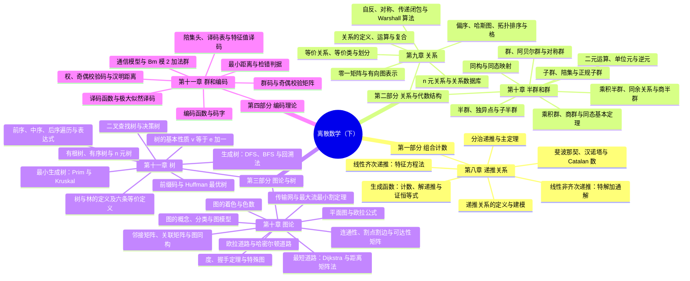

# 课程概览
## 基本信息
- 授课老师：吴斌
- 课程成绩：86分
- 这门课难度较高，知识抽象、证明密集，概念之间的依赖链很长，基本得靠平时一步步推演和动手算题来消化。期中考试难度适中，考点集中在定义判定与套路化计算；期末考试难度偏大，常把多个章节的知识点串成一道综合题。能拉开差距的不是死记定义，而是把"关系、代数结构、图论"三条主线的语言打通，并能熟练完成闭包、陪集、Huffman、最短路这类动手题。
## 知识结构

本课程分为**组合计数**（第八章）、**关系与代数结构**（第九~十章）、**图论与树**（第十~十一章）与**编码理论**（第十一章）四大部分：第八章以递推关系为"建模工具"，把序列规律写成方程并给出求解体系，同时用分治递推与主定理接上算法复杂度分析；紧接着用关系刻画"元素之间是否相连"——等价关系负责分类、偏序关系负责排序，进而把偏序代数化为格；再按"叠加条件"的阶梯从二元运算砌出半群、独异点与群，并用同态、同余、商结构把抽象代数骨架搭好；第三部分用图与树刻画对象之间的连接关系，从连通性、欧拉/哈密顿、最短路一路走到平面图、着色与最大流；最后以群码与纠错译码收束——把群论的"核、正规子群、商群"第一次落到真实通信问题上。整体框架如下：

1. **第八章 递推关系**
    - 全课程的"算法复杂度工具箱"与"高级计数武器库"：把序列的规律写成 $a_n$ 与先前项的方程，即**建模**；再用迭代展开、特征方程、生成函数等工具把它化成只含 $n$ 的显式公式，即**求解**。
    - 经典模型三个必会：复利与斐波那契（线性齐次）、汉诺塔（迭代展开得 $2^n - 1$）、Catalan 数（非线性递推，对应三角剖分、括号化、路径不越对角线等一大批同构问题）。
    - 求解体系两套钥匙：**特征方程法**处理线性常系数递推（两不同实根、重根要乘 $n$、非齐次再加特解），**生成函数**把序列编码成幂级数，用系数运算通吃计数、解递推与证明恒等式。
    - 分治递推与**主定理**只有三种情形，分界线是 $a$ 与 $b^d$ 的比大小——归并排序 $O(n \log n)$、快速乘法 $O(n^{\log_2 3})$、Strassen $O(n^{\log_2 7})$ 都能"一眼读出"。递推关系还是后续动态规划、概率母函数的共同基础。
2. **第九章 关系**
    - 关系是**"元素之间是否相连"的精确数学语言**，本质是笛卡尔积 $A \times B$ 的子集；函数是"恰好一对一"的特殊关系，关系是函数的推广。
    - 刻画工具有三套：**六大性质**（自反/反自反、对称/反对称/非对称、传递）、**零一矩阵**（性质判定变成看矩阵）、**有向图**（性质判定变成看图），三视角对照是本章的解题捷径。
    - **闭包**是"用最少代价补全性质"：自反闭包 $r(R)=R \cup I_A$、对称闭包 $s(R)=R \cup R^{-1}$、传递闭包 $t(R) = R \cup R^2 \cup \cdots$，而传递闭包本质就是"沿路径可达"，故可用 **Warshall 算法**高效计算。
    - 两类最重要的特例撑起后半章：**等价关系=分类器**（等价类互不相交，等价关系与集合划分一一对应，商集 $A/R$ 就是"分堆"的结果）；**偏序关系=排序器**（哈斯图、极大/最大元、上下界与 LUB/GLB、拓扑排序），并最终由**格**（每对元素都有 LUB 与 GLB 的偏序集）汇入代数结构。
3. **第十章 半群和群**
    - 本章相当于盖房子的"砖块与水泥"，主线是"按叠加条件砌阶梯"：**二元运算**（处处定义的函数）→ 加**结合律**得**半群** → 加**幺元**得**独异点** → 加**逆元**得**群**。
    - 每加一条公理就多一层"可算性"：没有结合律连"无括号乘积"都不合法，没有幺元就没有 $a^0$，没有逆元就没有消去律与方程 $ax=b$ 的解。单位元与逆元的唯一性、运算表、阿贝尔群、对称群 $S_3/S_n$ 与小阶群的分类是这一阶梯的直接产物。
    - 三种"结构之间的关系"把阶梯串起来：**同态/同构**（保运算的映射，同构 = 双射同态）、**同余关系**（保运算的等价关系）、**商结构**（$S/R$、$G/N$，由等价类构成的新结构）。
    - 收官是**同态基本定理**：任何满同态都可分解为"自然同态 + 同构"（$S \twoheadrightarrow S/R \cong T$）；而商群良定的前提是**正规子群**（左右陪集重合，$aH = Ha$ 只是集合相等而非逐元可交换）。正规子群、同余关系、群同态三者互为化身，这一结论将在群和编码中完成第一次实战。
4. **第十一章 图论**
    - 图是离散数学的**"建模工具箱"**：关系的"相不相关"被可视化为图的"连不连"，再配上度、路径、回路、平面性、着色、流量这些度量与判定工具。
    - 基础层：图的定义 $G=(V,E)$ 与分类、**握手定理**（$\sum \deg(v) = 2e$，奇度顶点必为偶数个）、特殊图（完全图、环图、轮图、$n$-立方体、二分图）、邻接表/邻接矩阵/关联矩阵三种表示与图同构的不变量判定。
    - 结构与路径层：**连通性**（连通分量、强连通/弱连通、割点割边、可达性矩阵与路径计数 $(A^k)_{ij}$）；**欧拉**看边（度数奇偶即可判定，哥尼斯堡七桥、Fleury 算法、中国邮递员问题），**哈密尔顿**看点（无简洁判据，$K_n$ 有 $\frac{(n-1)!}{2}$ 条候选回路，本质是 NP-complete）；**Dijkstra** 用贪心加松弛求最短路，其非负权要求正是"已认领顶点标签不再变"的前提。
    - 平面与优化层：**欧拉公式** $v - e + \gamma = 2$ 推出 $e \le 3v-6$（卡住 $K_5$）与 $e \le 2v-4$（卡住 $K_{3,3}$），配合同胚与库拉托夫斯基定理判定非平面；**着色**（色数、四色定理、着色多项式）刻画冲突调度；**传输网与最大流**由标记算法（Ford-Fulkerson）与最大流最小割定理收官——"标不动宿端"时当前流即为最大。
5. **第十一章 树**
    - 树是"最省材料的连通结构"（$v-1$ 条边撑起 $v$ 个顶点），也是图论中"既简单又处处出现"的结构：简单到只有 $v-1$ 条边，又强大到能编码、能决策、能压缩、能连通。
    - 全章主线可记为 **"识别 → 加构 → 应用 → 访问 → 提炼 → 优化"**：先用**六条等价定义**与基本性质 $v = e + 1$ 识别一棵树（$v=e+1$ 是它最有力的"数量身份证"，因为它把结构性质转化为可计算的等式）；再加根与次序得有根树、有序树、$n$ 元树与层/高度/完全树/平衡树等家族术语。
    - **树的应用**让"结构"变成"工具"：二叉查找树（查找与插入）、决策树（用 $\lceil \log_2 n! \rceil$ 给出排序下界）、**前缀码与 Huffman 最优树**（每次合并最小的两个权必然全局最优，因为最小两权叶必是兄弟且深度最深）。
    - **遍历**让"访问"有章可循：通用地址系统、前序/中序/后序遍历，以及中缀/前缀/后缀表达式的相互转换；**生成树**是从复杂图中提炼的最小连通骨架（DFS 树、BFS 树、回溯法），**最小生成树**则是"最省的骨架"——Prim 加点、Kruskal 加边，两个贪心算法都由严格的归纳证明（贪心选择性质 + 最优子结构）确保全局最优。

### 知识定位与框架衔接

**前置知识**：离散数学（上）的集合论（子集、笛卡尔积、集合运算）、函数（单射/满射/双射、映射）、数学归纳法、组合计数（$\binom{n}{k}$、加法与乘法法则、二项式定理）与数列求和（等差/等比求和）构成本课程的地基——关系本身就是笛卡尔积的子集，同态/同构的定义就是"保运算的函数"，树的基本性质证明与 Prim 正确性证明都依赖归纳法，而递推关系的建模与生成函数的闭式全部建立在计数与求和之上。

**后置知识**：数据结构与算法（二叉查找树、堆、Huffman 编码、图的邻接表/邻接矩阵存储、DFS/BFS 模板、Prim/Kruskal 贪心范例）、算法设计与分析（主定理与分治复杂度分析、决策树下界、NP-complete 的经典例子、近似算法）、操作系统与网络（拓扑排序用于工程依赖与任务调度、最大流用于网络与物流）、数据库系统（n 元关系直接对应关系数据库的键/选择/投影/连接）、近世代数（同态基本定理、正规子群、商群是环、域、模的通用语言，也是伽罗瓦理论的基石），以及通信与存储工程（群码是线性码的原型，直接通向汉明码、循环码、BCH/RS 码，并落到 ECC 内存、磁盘与 RAID、二维码、深空通信等应用）。

**故事比喻**：这门课像"从数清有多少种可能，到给混乱的东西分堆、排队，再给它们立规矩、搭架子"——先学会把序列规律写成方程（递推关系，数数）；再给元素配上"是否相连"的关系，用等价关系分堆、用偏序关系排队（关系）；接着从最朴素的"一个集合加一个运算"出发，一层层砌出半群、独异点、群（半群和群）；然后把"相连"画成图、把"最省连通"抽成树，解决走路、铺线、排班、运输的工程问题（图论与树）；最后用群论造码，让数据在被噪声损坏后还能被检出、被纠回（群和编码）——**每条主线都在重复回答三个问题：怎么定义、怎么操作、结构之间如何相互转换**。

**四个灵魂问题**：

1. **一个递推关系到底确定了什么？为什么重根要"乘 $n$"、为什么生成函数能把递推变成代数方程？** —— 递推关系只约束"后项与前项的关系"，不约束初值，只有补上 $k$ 个初始条件解才唯一；重根意味着 $r_0^n$ 与 $n r_0^n$ 都是解，乘 $n^{0}, \ldots, n^{k-1}$ 正是为了凑满 $k$ 个独立解以匹配 $k$ 个初值；生成函数把递推式两边同时"乘 $x^k$ 求和"，系数关系就转化为关于 $G(x)$ 本身的代数方程。
2. **为什么等价关系与划分一一对应，而偏序"极大的未必最大"？闭包与可达性为什么是一回事？** —— 等价类互不相交且并为全集，故构成划分，反之划分也定义等价关系；极大元只要求"内部无敌"，最大元要求"与全体可比且最大"，后者蕴含前者；传递闭包 $t(R)$ 的矩阵等于各次布尔幂取并，其元素恰表示"是否存在从 $i$ 到 $j$ 的通路"，这与图的连通性、Warshall 算法同源。
3. **为什么"结合律、幺元、逆元"要一步步加，而正规子群又为什么非"正规"不可？** —— 每加一条公理结构就"更好算"一层，缺一条就失去对应的性质（无逆元则无消去律）；$aH = Ha$ 只要求左右陪集作为集合相等（即 $ha = ah'$ 对某个 $h'$），与逐元可交换 $ah = ha$ 不同——只有在正规子群前提下，$G/N$ 上的运算 $(aN)(bN) = abN$ 才不依赖代表元的选取而良定。
4. **为什么欧拉回路有简洁判据而哈密尔顿回路没有？为什么群码的最小距离等于非零最小权，特征值又凭什么加速译码？** —— 欧拉覆盖的是"边"，每条边只贡献 2 个端点度，度数奇偶性直接刻画可行性；哈密尔顿覆盖的是"顶点"，访问顺序构成组合爆炸，本质是 NP-complete。群码中 $x \oplus y$ 仍是码字，于是 $\delta(x,y) = |x \oplus y|$，两两比较退化为"数 1 的个数"；而 $x \mapsto x * H$ 把 $B^n$ 按同陪集分成 $2^r$ 类且同类同特征值，于是译码从全表扫描压缩为"一次矩阵乘 + 查 $2^r$ 行小表"。

 

