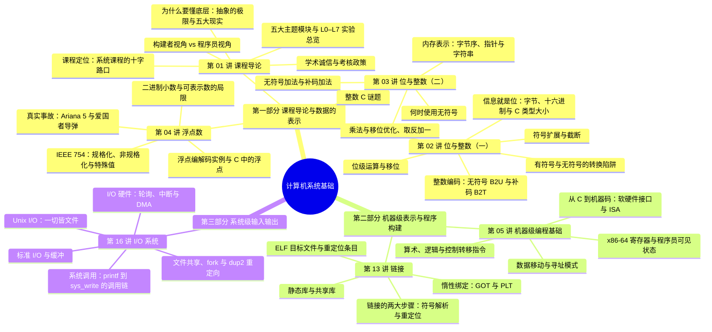

# 课程概览
## 基本信息
- 授课老师：姚文斌
- 课程成绩：89 分
- 这门课非常抽象，也非常难。老师非常厉害，但是讲课水平不高，导致根本听不懂。而且老师上课喜欢提问，回答问题加分，对总分帮助特别大，这部分非常重要。老师一般都是问一些和PPT不相关的内容。个人建议回答不上不用焦虑，直接举手回答就行，错了没关系。这门课期中和期末都非常抽象，难度大，不容易得分。建议多练练题，上网搜一下往年学长学姐的总结。
## 知识结构

本课程沿着"**一个 C 程序的一生**"这条主线展开：数据如何被**表示**成位与浮点（第 02–04 讲），程序如何被**翻译**成机器码（第 05 讲），多个目标文件如何被**装配**成可执行文件（第 13 讲），运行中的程序又如何与外界**交换数据**（第 16 讲）——第 01 讲的"五大现实"则是贯穿全程的动机引擎：抽象是好的，但要随时意识到整数/浮点的表示极限、汇编的存在、内存的真实结构、性能的非渐近因素与系统的协同执行。整体框架如下：

1. **第 01 讲 课程导论**
    - 课程定位——"系统课程的十字路口"：前面是编程（命令式编程/C 语言），后面是操作系统、体系结构、编译器、网络、数据库等一大批系统课程。
    - **五大现实**是全课程的动机引擎：整数不是整数、浮点不是实数；必须懂汇编；内存并非理想随机存取抽象；性能不止渐近复杂度；计算机不止执行程序。
    - 构建者中心 vs 程序员中心两种视角；五大主题模块（程序与数据、内存层次、异常控制流、虚拟内存、网络与并发）与 L0–L7 实验的对照总览；学术诚信红线与考核政策。
2. **第 02 讲 位与整数（一）**
    - "信息就是位"：二进制与电子实现、字节与十六进制编码、C 数据类型的大小——一切数据表示的地基。
    - 位级运算：布尔代数、位向量与集合表示、C 的位运算符与移位，以及与逻辑运算的对比。
    - 整数编码：无符号编码 B2U 与补码编码 B2T、数值范围；有符号与无符号的转换（T2U/U2T 映射、混合表达式陷阱、无符号循环陷阱）；符号扩展与截断规则。
3. **第 03 讲 位与整数（二）**
    - 整数运算手册：无符号加法与补码加法的模运算本质、溢出的判定；乘法与用移位优化乘除（左移、逻辑右移、算术右移的缺陷与偏置修正）；取反加一求负。
    - 何时使用无符号及其风险；数据在内存中的表示——字节寻址、机器字长、大小端字节序、整数/指针/字符串的内存布局与反汇编阅读。
    - 整数 C 谜题：用位级直觉解释 `sizeof`、隐式转换与循环边界等经典陷阱。
4. **第 04 讲 浮点数**
    - 从科学计数法与二进制小数出发，理解"可表示数的局限"（间隔、精度丢失），进而理解 IEEE 754 为何成为标准。
    - 浮点编码（符号/指数/尾数）与三类数值：规格化数、非规格化数、特殊值（±0、±∞、NaN）；十进制 ↔ 浮点的编解码实例。
    - C 中的浮点转换规则与浮点谜题；Ariana 5 火箭爆炸（转换溢出）与爱国者导弹事故（0.1 的表示误差）两个真实案例；浮点加法不满足结合律等性质总结。
5. **第 05 讲 机器级编程基础**
    - 程序转换概述：指令的层次（微指令/机器指令/汇编指令）、ISA 作为软硬件接口、从 C 到机器码的完整链条；本章五讲地图（本讲为第一讲）。
    - 机器级视角：架构 vs 微架构、程序员可见状态、x86-64 整数寄存器；数据移动——操作数类型、`movq`、`D(Rb, Ri, S)` 寻址模式。
    - 算术与逻辑运算：LEA、传送、定点算术、乘除、按位与控制转移指令；以 `arith` 函数的反汇编为综合实例。
6. **第 13 讲 链接**
    - 链接的动机（模块化与效率）与本质（合并相同的"节"）；两大步骤——符号解析与重定位。
    - 符号解析：三种链接器符号、强符号与弱符号、多重定义的解析规则与链接器谜题、`extern` 的正确用法；静态库的 E/U/D 解析算法与链接顺序陷阱。
    - 重定位：三种目标文件、ELF 格式、`R_386_PC32`/`R_386_32` 重定位条目与完整例题、加载可执行文件。
    - 共享库与动态链接的两种时机，惰性绑定——GOT 与 PLT 的协作机制。
7. **第 16 讲 I/O 系统**
    - 概述：计算机的职责与 I/O 挑战、操作系统的三部分五大功能、I/O 软件的四层结构。
    - Unix I/O：一切皆文件、文件类型与目录路径、打开/读/写、短计数、文件元数据；文件共享的两种方式、`fork` 进程图与 `dup2` 重定向（ffiles 系列例题）。
    - 标准 I/O 与缓冲的动机、与 Unix I/O 的对比及选择规则；系统调用与 API——`printf → sys_write` 的完整调用链。
    - I/O 硬件与三种控制方式：程序查询（轮询）、中断、DMA 的原理与定量比较。

> **注**：课程还包含**机器级编程第二~五讲**（指令系统、C 控制与过程调用的机器级表示、数组/结构体与对齐、缓冲区溢出）、**内存层次与缓存**、**异常控制流**、**虚拟内存**、**网络与并发**等主题模块（对应 L4–L7 实验），这些讲次的笔记暂缺，可先参考第 01 讲的"五大主题与实验对照表"建立全局观。

### 知识定位与框架衔接

**前置知识**：C 语言程序设计（命令式编程）——本课直接从 C 出发，L0 即为 C 编程实验，后续所有机器级分析都以 C 程序为对象；另有计算机基本组成概念（CPU、内存、I/O 设备）作为常识性地基，本课会把这些概念"拆开重讲"。

**后置知识**：课程自身的后续主题（内存层次 → 异常控制流 → 虚拟内存 → 链接/系统级 I/O → 网络与并发）逐一回应五大现实；再往后是操作系统、计算机体系结构、编译器、网络、数据库、并行计算、嵌入式等一大批系统类课程——本课为它们提供底层原理地基。缓存与局部性是体系结构与性能优化的入口，虚拟内存与进程是操作系统的两大支柱，链接与加载是编译器与安全（代码注入、缓冲区溢出）的交汇点。

**故事比喻**：整门课像"跟踪一个 C 程序的一生"——先看它处理的**数据**怎样被编码成位、整数与浮点（第 02–04 讲），再看它的**代码**怎样被翻译成机器指令（第 05 讲），多个目标文件怎样被链接器**装配**成可执行文件（第 13 讲），最后看它运行时怎样通过 I/O 与世界**交换数据**（第 16 讲）。每一步都用"抽象很好，但现实如此"的五大现实提醒你：掉进坑里之前，最好先知道坑在哪。

**四个灵魂问题**：

1. **为什么整数乘法可能得到负数，而浮点加法不满足结合律？** —— 根源是**表示的有限性**：整数位宽有限导致溢出回绕（$50000 \times 50000$ 为负），浮点精度有限导致舍入（$1\mathrm{e}20$ 吞掉 $3.14$，$(a+b)+c \ne a+(b+c)$）。这是五大现实的第一条，也是位与整数、浮点两讲的总纲。
2. **有符号与无符号的隐式转换为什么是 C 的经典陷阱？** —— 同一串位在两种解释下映射到不同数值：`-1 < 0u` 会把 -1 转成无符号后判假，`for (unsigned i = ...; i >= 0; i--)` 永不终止。理解 B2U/B2T 与 T2U/U2T 映射，才能预判编译器替你做了什么。
3. **一个 `.c` 文件如何变成运行中的进程，链接器在中间做了什么？** —— 编译汇编生成可重定位目标文件后，链接器做两件事：**符号解析**（按强弱符号规则把每个引用绑定到定义）与**重定位**（按 ELF 重定位条目把相对偏移、绝对地址修补正确），再由加载器装入内存启动执行。重复定义、链接顺序等报错都源于此。
4. **`printf` 输出一行字，到底经过了多少层？** —— 标准 I/O 缓冲（用户层库）→ `write` 系统调用（陷入内核）→ 内核 I/O 软件 → 设备驱动 → 硬件控制方式（轮询/中断/DMA）。分层让"一切皆文件"的统一接口成立，也解释了缓冲、短计数与重定向等一切 I/O 现象。
