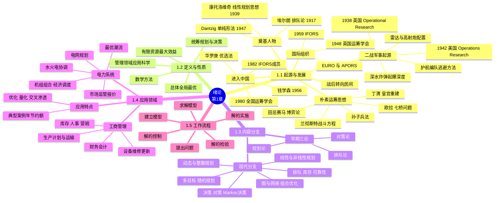

# 绪论（Introduction）

> **本章主线**：运筹学从哪来（二战军事起源 → 战后民用化 → 学科奠基与组织化 → 朴素思想与进入中国）→ 它是什么（**定义与性质**）→ 它研究什么（**分支学科**）→ 它能干什么（**工商、电力等应用**）→ 它怎么干（**提出问题 → 建立模型 → 求解 → 检验 → 控制 → 实施**的工作流程）。
> 一句话版本：**运筹学是在管理领域用数学方法统筹规划、作出决策的应用科学**——本章相当于整门课的"学科地图"，后面九章都是图中景点的放大。

---

## 1.1 运筹学的起源与发展过程

### 1.1.1 二战军事起源：Operational Research

**运筹学（Operational Research / Operations Research，缩写 OR）** 直接诞生于第二次世界大战的军事实践：

1. **1938 年**，英国最早出现军事运筹学，命名为 **"Operational Research"**；
2. **1942 年**，美国从事这方面工作的科学家命其名为 **"Operations Research"**，这个名字一直沿用至今。

**命名直译**："作战研究"——研究已有装备、兵力如何**巧妙运用**才能发挥最大作战效能，而非研究造更好的武器。这一"给定资源、优化运用"的基因贯穿了运筹学此后全部发展。

### 1.1.2 经典军事案例

**案例一：深水炸弹起爆深度**。这是美国运筹学早期著名工作之一。当飞机发现潜艇后，面临两个决策变量：**何时投掷炸弹**与**引爆深度是多少**。运筹学工作者对大量统计数字进行认真分析后，提出如下决策：

1. 仅当潜艇**浮出水面或刚下沉**时，方投掷深水炸弹；
2. 炸弹的起爆深度为**离水面 25 英尺**（这是当时深水炸弹所容许的最浅起爆点）。

空军采用上述决策后，使德军潜艇被摧毁数**增加到 400%**。

**案例二：护航舰队编队与逃避方法**。研究船队遭受德国潜艇攻击时如何使损失最少，提出了逃避方法：受攻击时**大船应急转向、小船应缓慢转向**。结果：船只在受到敌机攻击时，**中弹数由 47% 降到 29%**。

**类似军事工作**还有：

1. 英、美为对付德国空袭，将雷达作为防空系统的一部分，研究如何**合理运用雷达**；
2. **高射炮阵地火力的最佳配置**；
3. 护航舰队**规模的大小**以及开展反潜艇作战的**侦察**等方面。

这些案例的共同特征：**不添置新装备，只靠数据分析 + 改变运用策略，效能就成倍提升**——这正是运筹学的立身之本。

### 1.1.3 战后转向民间

二次大战胜利后，美英各国运筹学的研究不但在军事部门**继续扩大和发展**，同时在**政府和工业部门也开始推行**。组织形态相应多元化：

1. **大学与研究所**：学科进入学术体制；
2. **学会组织**：专业共同体形成；
3. **咨询机构**——以**兰德公司（RAND）**为代表；
4. **各种工商业公司**：企业内部应用。

军事上验证过的"定量分析 + 全局优化"方法论，平移到了生产、运输、库存、调度等民用管理场景——这是运筹学从"战法"变成"管理科学"的关键一跃。

### 1.1.4 三个重要人物：三大学派的奠基

现代运筹学三大分支各有奠基人，时间跨度远早于二战组织化时期：

| 人物 | 时间 | 贡献 | 对应后置章节 |
|---|---|---|---|
| 埃尔朗（丹麦工程师，哥本哈根电话公司） | 1917 年 | 研究电话通讯系统时提出**排队论**的一些著名公式 | 第 9 章排队论 |
| 康托洛维奇（苏联数学家） | 1939 年 | 出版《生产组织和计划中的数学方法》，提出**线性规划**的思想，当时未引起重视；1972 年出版《经济最优决策》，**1975 年获诺贝尔奖** | 第 2 章线性规划 |
| G. B. Dantzig（美国数学家） | 1947 年 | 提出求解线性规划的**有效方法——单纯形法** | 第 2 章线性规划与单纯形表 |

> 口诀：**埃尔朗数电话催生排队论，康托洛维奇种下规划思想，Dantzig 造出单纯形法打开实用大门**——一个提供模型原型、一个提供数学思想、一个提供算法引擎。

### 1.1.5 国际组织的发展

1. **1948 年**，英国成立运筹学会；
2. **1952 年**美国、**1956 年**法国、**1957 年**日本与印度均成立运筹学会；至 **1986 年**，已有 **38 个国家（地区）**成立学会；
3. **1959 年**，英、法、美发起成立**国际运筹学联合会（IFORS）**；
4. 地区性组织：**EURO**（1976，欧洲）、**APORS**（1985，亚太）等。

学会—国际联合会—地区组织的三层结构，标志着运筹学成为一门**国际性的独立学科**。

### 1.1.6 朴素的运筹思想自古有之

运筹学的定量优化思想在东西方文明中均有先声，现代学科是对这些朴素思想的形式化与系统化。

**中国古代**：

1. **田忌赛马**——对应**博弈论**：通过调整出场顺序（策略选择）以弱胜强，是"竞争决策"的雏形；
2. **《孙子兵法》**——1981 年美国军事运筹学会出版 "Systems Analysis Modeling" 一书，书中称**孙武子是世界上第一位军事运筹学的实践家**；
3. **丁渭修皇宫**（宋真宗时，公元 1008–1017 年）：宫廷失火、皇宫被毁，朝廷决定重建，当时亟待解决**"取土""外地材料的储运"和"处理瓦砾"**三项任务。皇宫负责人**丁渭**精心策划，巧妙解决了上述三项任务（完整分析见 [1.5.2 节](#152)）。

**西方**：

1. **阿基米德**——保卫叙拉古城；
2. **皮耶·德·费尔马**（法国数学家）——1638 年"费尔马问题"，对应**斯坦纳树问题**；
3. **艾萨克·牛顿**（1643–1727）——"牛顿法"；
4. **莱昂哈德·欧拉**——1736 年哥尼斯堡**"七桥问题"**，开创**图论**；
5. **拉格朗日**——"拉格朗日乘子""拉格朗日松弛"；
6. **柯西**——"梯度法"（最速下降法），**梯度法可以说是非线性优化的基础**；
7. **兰彻斯特战斗方程**（1914 年）——用微分方程描述双方兵力损耗。

这些人物的工具（图论、梯度法、变分思想、博弈策略）日后分别成为运筹学各分支的数学底座。

### 1.1.7 现代运筹学进入中国

1. **钱学森**——1956 年，中科院力学所；
2. **华罗庚**——1959 年，中科院数学所；
3. **许国志**——"运筹帷幄之中，决策千里之外"（化用《史记》，点出"运筹"一词的中文渊源）。

**群众化推广与建制**：

1. **"华罗庚小分队"**推广**"优选法"**——把数学优化方法直接送到生产一线；
2. **1980 年**成立**全国运筹学会**；
3. **1982 年**中国运筹学会成为 **IFORS 正式成员**。

至此，中国完成了从"朴素运筹思想"到"现代运筹学建制化"的闭环：古代有思想、近代有中断、现代有钱学森与华罗庚等大家重新奠基并接入国际共同体。

---

## 1.2 运筹学的定义与性质

**运筹学的定义**：**运筹学是在管理领域，运用数学方法，对需要管理的问题统筹规划，作出决策的一门应用科学**。

**研究目的**：在人类对各种资源的运用及筹划活动中，运筹学的研究目的在于**了解和发现这种运用及筹划活动的基本规律**，以便**发挥有限资源的最大效益**，来达到**总体、全局最优**的目标。

对定义逐词拆解（抓住五个关键词，定义即自然记住）：

1. **管理领域**——运筹学不是纯数学，问题永远来自管理/决策场景；
2. **数学方法**——定量化、建模、算法求解是其手段；
3. **统筹规划**——强调多因素、多任务的**整体协调**，而非单点优化；
4. **作出决策**——产出是可执行的决策方案，不止于理论结论；
5. **应用科学**——以落地见效为检验标准。

**"资源"一词的范围**：这里所说的"资源"**既包括物质材料，也包括人力配备；既包括技术装备，也包括社会结构**——凡是有限、需要分配与调度的对象，都在运筹学的视野之内。

**核心性质归纳**：运筹学处理问题的基本立场是——在**约束条件**下，通过**建立数学模型**与**算法求解**，找到使**目标函数**达到最优（或满意）的方案，追求的是**总体、全局最优**而非局部最优。这一"约束—模型—目标—全局"的四要素框架，是后续所有分支（线性规划、动态规划、图优化、排队论……）共享的底层范式。

---

## 1.3 运筹学的内容：分支学科

运筹学的分支经历了从"三大早期方向"到"庞大现代家族"的扩张：

1. **早期**：**规划论、排队论、对策论**；
2. **现在**：**线性规划、非线性规划、动态规划、整数规划、图与网络分析、组合优化、多目标规划、随机规划、排队论、库存论、可靠性理论、决策论、对策论、Markov 决策过程、搜索论、随机模拟、管理信息系统**等。

为建立整体感，可按"研究对象的气质"把现代分支归约为四类（合并同类，便于迁移）：

| 类别 | 共同气质 | 代表分支 | 本课程对应章节 |
|---|---|---|---|
| **优化决策类** | 在约束下选最优方案 | 线性规划、非线性规划、动态规划、整数规划、多目标规划、随机规划 | 第 2–7 章 |
| **网络结构类** | 优化对象本身是图/网络 | 图与网络分析、组合优化 | 第 8 章 |
| **随机服务类** | 对象含随机性，研究服务与等待规律 | 排队论、库存论、可靠性理论、随机模拟、Markov 决策过程、搜索论 | 第 9 章 |
| **竞争与决策类** | 多方博弈或序贯决策 | 对策论、决策论 | 第 10 章 |

> 口诀：**优化、网络、随机、博弈，四袋装下十几门分支**——每门分支只是"同一套建模范式 + 不同的问题气质"。

**管理信息系统**等分支则体现了运筹学与计算机技术的交叉：运筹学提供优化内核，信息系统提供数据与执行载体。

---

## 1.4 运筹学的应用

### 1.4.1 工商管理中的应用

运筹学在**工商管理**中的典型应用领域：

1. **生产计划**；
2. **运输问题**；
3. **人事管理**；
4. **库存管理**；
5. **市场营销**；
6. **财务和会计**；
7. **设备维修更新和可靠性分析**；
8. **项目的选择与评价，工程优化设计**。

这八项几乎覆盖了企业价值链的全部环节（供、产、销、人、财、物）——凡是"资源有限、需要权衡"的管理问题，都是运筹学的用武之地。

### 1.4.2 电力系统中的应用

运筹学在**电力系统**中的应用：

1. **电源计划、输电网规划、配电网规划**；
2. **水火电协调优化**；
3. **机组组合优化**；
4. **经济调度、安全约束调度**；
5. **最优潮流、电压无功优化**；
6. **预防控制、紧急控制**；
7. **配电网络重构**；
8. **电力市场监管、机组报价**；
9. **可用传输容量计算**。

电力系统是运筹学的"高强度练兵场"：发电调度是**线性/非线性规划**，机组组合是**整数规划**，网络潮流是**图与网络优化**，市场报价是**博弈论**，负荷随机与旋转备用是**随机规划**——第 1.3 节的四类分支几乎全部登场。

### 1.4.3 应用效果一览：数据说话

运筹学应用的经济效果可以用量级说明。典型的**运筹学应用案例及其年节约额/增收额**（节选自教材引用的经典汇总表）：

| 机构 | 应用领域 | 年节约/增收 |
|---|---|---|
| Continental Airlines | 航班计划扰动时机组重新分配 | 4000 万美元 |
| Swift & Company | 改进销售与制造绩效 | 1200 万美元 |
| Memorial Sloan-Kettering Cancer Center | 放射治疗方案设计 | 4.59 亿美元 |
| INDEVAL | 墨西哥证券交易结算 | 增收 2 亿美元 |
| Samsung Electronics | 缩短制造时间、降低库存水平 | 净现值 3.98 亿美元 |
| U.S. Military | "沙漠风暴"行动后勤规划 | 7 亿美元 |
| MISO | 13 州电力传输管理 | 1.05 亿美元 |
| Deere & Company | 供应链全程库存管理 | 库存减少 10 亿美元 |
| InterContinental Hotels | 收益管理 | 增收 4 亿美元 |
| FAA | 恶劣天气下空中交通流管理 | 2 亿美元 |

此外如 Federal Express 的**货物运输物流规划**、United Airlines 的**飞机重新分配**、荷兰铁路的**路网运营优化**、DHL 的**营销资源优化**、Sears 的**上门服务车辆路径与调度**等，均是运筹学规模化落地的标志。这张表传达的要点是：**运筹学的价值不是论文指标，而是真金白银的年度节约**。

### 1.4.4 应用特点：优化、量化、交叉渗透

综合各领域应用，可提炼出运筹学应用的三个关键词：

1. **优化**——目标是寻找更优（而非可行即止）的方案；
2. **量化**——一切判断尽量化为数据、模型与指标，减少拍脑袋；
3. **交叉渗透**——运筹学与具体行业深度交叉：**生产管理、运输**（工商主战场）、**工程的优化设计**、**计算机和信息系统**（实现载体）、**城市管理**，等等。

> 口诀：**入口是问题，出口是优化方案；过程全量化，落地靠交叉**——三词概括运筹学的应用姿态。

---

## 1.5 运筹学的工作流程

### 1.5.1 六步工作过程

运筹学解决一个实际问题，遵循如下**六个环节**的工作流程（环环相扣，缺一不可）：

1. **提出问题**——明确决策对象、目标与背景，把模糊的管理困境转化为"可优化的问题"；
2. **建立模型**——用数学语言（决策变量、约束条件、目标函数）刻画问题，即从现实世界进入数学世界；
3. **求解模型**——用算法（如单纯形法、动态规划、图算法）求出模型的最优解或满意解；
4. **解的检验**——检验模型假设是否合理、解在现实中是否可行，把数学世界的结果放回现实世界验证；
5. **解的控制**——分析解对参数变化的敏感程度（灵敏度），确定解的适用范围与触发调整的条件；
6. **解的实施**——把通过检验、明确控制规则的解落实为可执行的管理方案，并在实施中持续反馈。

**贯穿理解**：这六步是一个"现实 → 数学 → 现实"的往返：**提出问题、建立模型**是抽象（上山），**求解模型**在数学世界内部完成（山顶），**检验、控制、实施**是回归现实（下山）。只会上山不会下山——会建模不会落地——不是合格的运筹学工作。

### 1.5.2 完整例题：皇宫重建（丁渭方案）

**题目陈述**：宋真宗时（公元 1008–1017 年）宫廷失火，皇宫被毁，朝廷决定重建。当时亟待解决三项任务：

1. **取土**（烧制砖瓦、夯实地基需要大量土方）；
2. **外地材料的储运**（木材、石料等需从外地运入京城）；
3. **处理瓦砾**（废墟垃圾需要清运出城）。

在三项任务彼此牵制、各自为战必然旷日持久的情况下，皇宫修建负责人**丁渭**精心策划，巧妙地解决了上述三项任务。请用运筹学工作流程分析该方案。

**解题步骤**：

1. **提出问题**：三项任务相互耦合——取土要挖地（可能破坏道路与场地），瓦砾要外运（占用运力与通道），材料要进场（需要通道与堆放场地）。若三线分兵、各自施工，将出现场地争抢、运力空耗、工期拖长。**目标**：在资源与工期约束下使总体代价最小、一举解决三项任务。
2. **建立模型**：把三项任务视为同一时空下的**资源流问题**——土方（挖）、瓦砾（废）、材料（运）都是"物料"，通道与场地是共享资源。关键洞察：**一项任务的"输出"可以成为另一项任务的"输入"**。
3. **求解模型**（丁渭方案）：
    1. 在皇宫前大街**挖沟取土**——就地解决土方来源，不必远距离运土；
    2. **引汴水入沟成渠**，使沟化为水道——外地材料可**乘船直接运到宫前**，解决材料储运；
    3. 工程完工后，将**瓦砾废料倒入沟中**，沟渠**复原为大街**——解决瓦砾处理，且省去重新铺路。
4. **解的检验**：方案利用了"挖土—水运—填沟"三个动作的物料衔接，物理上完全可行；历史上该方案落地并顺利完成了皇宫重建。
5. **解的控制**：方案成立依赖于皇宫前恰好可挖沟通汴水这一地理条件——若无临近水系，"以沟代路、以水代车"的环节失效，需退化为分步方案（这提示我们：**模型的地理/拓扑假设就是解的适用边界**）。
6. **解的实施**：丁渭作为工程负责人统一调度三项任务，按"先挖沟引水、再运料施工、最后填沟复街"的顺序实施，一次工程解决三个问题。

**最终答案**：丁渭方案以**空间换时间、以废料换建材通道**，将三项孤立任务耦合为一条物料循环链，一举三得——这是**总体、全局最优**思想在古代工程管理中的经典范例。

**一句话概括**：本例演示的核心技巧是**系统耦合思维**——把多个问题放进同一模型里找"一石多鸟"的解；易错点是**分项优化**（每项任务各自最优却相互掣肘），恰是运筹学定义中"总体、全局最优"要反对的对立面。

---

## 1.6 课程结构与参考书目

### 1.6.1 全书目录：后续九章的地图

本课程共十章，绪论之后的章节按方法体系展开：

1. **第一章　绪论**（本章）；
2. **第二章　线性规划与单纯形表**；
3. **第三章　对偶理论与灵敏度分析**；
4. **第四章　运输问题**；
5. **第五章　整数规划**；
6. **第六章　动态规划**；
7. **第七章　非线性规划的概念和原理**；
8. **第八章　图与网络优化**；
9. **第九章　排队论**；
10. **第十章　博弈论**。

与 [1.3 节](#13)的分支表对照可见：课程主线正是"**优化决策类（第 2–7 章）→ 网络结构类（第 8 章）→ 随机服务类（第 9 章）→ 竞争决策类（第 10 章）**"四类分支的逐一展开；绪论 1.1.4 节的三位奠基人物（埃尔朗、康托洛维奇、Dantzig）分别对应第 9、2、2 章。

### 1.6.2 参考书目

1. 《运筹学》，清华大学出版社；
2. 《运筹学（第 2 版）》，卓新建编，北京邮电大学出版社，2022 年 11 月；
3. 《运筹学基础及应用》，胡运权主编，高等教育出版社；
4. 《运筹学基础手册》，徐光辉主编，科学出版社；
5. 《运筹学导论》（第 10 版），（美）弗雷德里克·S. 希利尔（Frederick S. Hillier）、杰拉尔德·J. 利伯曼（Gerald J. Lieberman）著，*Introduction to Operations Research (Tenth Edition)*，清华大学出版社，2015 年；
6. 《运筹学导论》（英文版，第九版，基础篇），哈姆迪·A. 塔哈（Hamdy A. Taha），中国人民大学出版社，2014 年。

其中清华版《运筹学》与卓新建版为国内高校通行教材体系，Hillier & Lieberman 与 Taha 为国际经典导论（第 1.4.3 节的案例汇总表即出自 Hillier 体系教材的应用案例集）。

---

### 知识定位与框架衔接

**前置知识（地基，来自先修课程）**：

1. **高等数学**：函数与最优化直觉、拉格朗日乘子（1.1.6 节的拉格朗日、柯西梯度法即其源头）——非线性规划与对偶理论的数学语言；
2. **线性代数**：矩阵、线性方程组——线性规划的模型语言与单纯形法的代数基础；
3. **概率论与数理统计**：随机变量、期望与分布——排队论、库存论、随机规划处理不确定性的前提；
4. **高中数学建模思想**（可选）：不等式约束下求目标函数极值——与线性规划的雏形同构。

**后置知识（上层建筑，本课程后续章节）**：

1. **优化决策主线**：第 2 章线性规划与单纯形表（回收 1.1.4 节 Dantzig 单纯形法）→ 第 3 章对偶理论与灵敏度分析（呼应 1.5.1 节"解的控制"）→ 第 4 章运输问题 → 第 5 章整数规划 → 第 6 章动态规划 → 第 7 章非线性规划的概念和原理（回收柯西梯度法）；
2. **网络优化主线**：第 8 章图与网络优化（回收欧拉七桥问题开创的图论）；
3. **随机服务主线**：第 9 章排队论（回收埃尔朗 1917 年的电话交换研究）；
4. **竞争决策主线**：第 10 章博弈论（回收田忌赛马与对策论）。

**学科地图比喻**：本章相当于**旅行前的导游图 + 行李清单**：1.1 节告诉你这门学科"从哪来"（历史沿革），1.2–1.3 节告诉你"它是什么、装着什么"（定义与分支），1.4 节告诉你"能拿它去哪玩"（应用），1.5 节教你"游览的标准动作"（六步工作流程）。后面九章则是逐个景点的深度游——每学一章，回来对照地图上补一笔，全图便渐次点亮。

**核心灵魂问题（学完本章应能回答）**：

1. **为什么运筹学强调"总体、全局最优"而非各子问题局部最优？丁渭方案若把"取土、运料、清瓦砾"拆成三个独立工程各自优化，会失去什么？** ——分项优化会丢失任务间的耦合收益（沟渠同时充当水道与填埋场），局部最优之和往往劣于全局最优；这正是运筹学"统筹规划"区别于普通管理的核心。
2. **二战的深水炸弹案例中，运筹学者做的是"发明新武器"还是"改变使用武器的方式"？这对理解运筹学与工程技术的分工有何启示？** ——他们只分析统计数据、调整投掷时机与起爆深度，效能即提升 4 倍。运筹学的定位是**给定资源下的运用优化**，与"造更好的硬件"的工程技术互补而非替代。
3. **六步工作流程中，"解的检验"和"解的控制"为什么不可省略？若跳过它们直接实施数学最优解，可能付出什么代价？** ——模型必然是现实的简化，数学最优解可能违反未建模的约束；跳过检验与灵敏度分析，会在环境变化时脆性失效。第 3 章对偶理论与灵敏度分析正是"解的控制"的系统化展开。

> **一句话总结本章**：**运筹学 = 管理领域 + 数学方法 + 统筹规划 + 决策落地**——从二战的深水炸弹到今天的电网调度，它一以贯之的主题是：**资源总是有限的，但运用资源的智慧可以无限；用数学把"拍脑袋"变成"可求解"，把"各扫门前雪"变成"全局一盘棋"**。

---

## 课件 PDF

<iframe src="https://cognishelf.naimore3.workers.dev/课程笔记/大二上/运筹学/01绪论/01绪论.pdf" width="100%" height="800px" style="border: none;"></iframe>

[打开 PDF](https://cognishelf.naimore3.workers.dev/课程笔记/大二上/运筹学/01绪论/01绪论.pdf)
