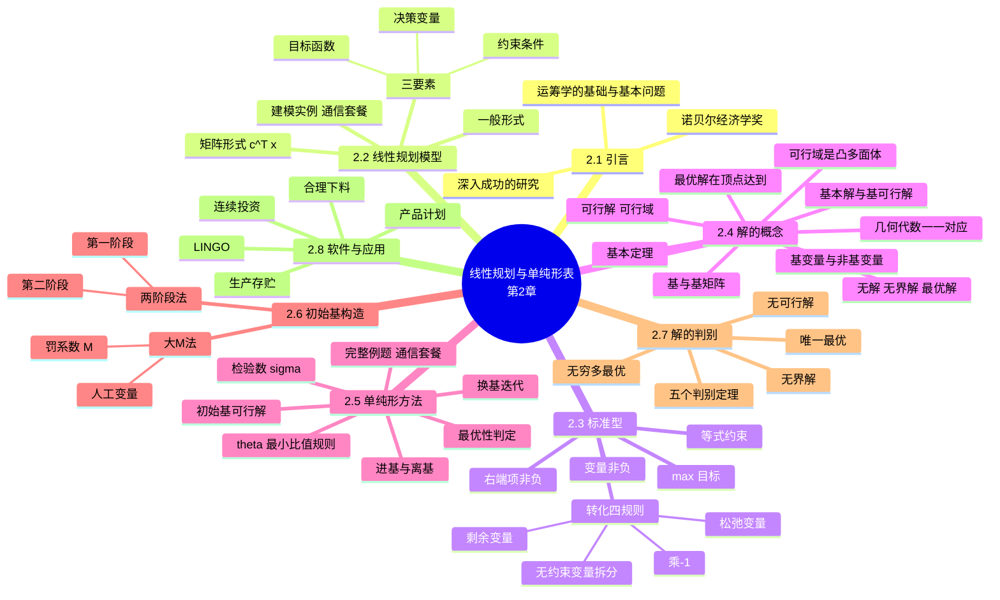
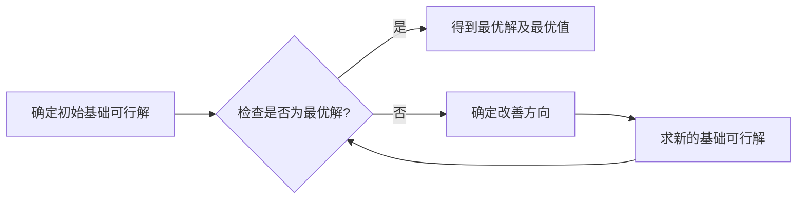

# 第二章 线性规划与单纯形表（Linear Programming and the Simplex Method）

> **本章主线**：什么是线性规划（**建模 → 标准型**）→ 解在哪里（**几何：可行域顶点 ⇔ 代数：基可行解**）→ 怎么找最优解（**单纯形法：初始基可行解 → 检验数判定 → 换基迭代**）→ 找不到初始基怎么办（**大M法 / 两阶段法**）→ 结果有哪几种（**唯一最优、无穷多最优、无界、无可行**）。
> 一句话版本：**单纯形法沿着可行域的顶点逐个改进，直到检验数全部非正**——几何上是"沿凸多面体棱边爬山"，代数上是"在基可行解之间换基"，两者一一对应。

---

## 2.1 引言

**线性规划（Linear Programming，缩写 LP）** 在运筹学中的地位：

1. 线性规划是**运筹学的基础、基本问题**——后续的对偶理论、运输问题、整数规划、目标规划等均以其为母体；
2. 对线性规划**深入和成功的研究**使其成为运筹学最成熟的分支之一；
3. 与线性规划相关的研究曾获得**诺贝尔经济学奖**（如康托洛维奇的工作，见第 1 章 1.1.4 节）。

本章结构与课件一致，分四大部分：**线性规划模型**（2.2–2.3）→ **线性规划的基本概念**（2.4）→ **单纯形算法**（2.5–2.6）→ **单纯形算法的进一步讨论**（2.7–2.8）。

---

## 2.2 线性规划模型

### 2.2.1 建模实例：通信套餐问题（例 2.2.1）

**题目陈述**：某通信服务公司计划推出 A、B、C 三种通信套餐服务，每种套餐服务后的利润分别为 **60 元/月/用户、30 元/月/用户与 20 元/月/用户**。每个套餐需要给每位用户提供带宽 8M/秒、6M/秒和 1M/秒；每月需要占用服务器时间 4 小时、2 小时和 1.5 小时；每月需要咨询、服务及维修等人工服务预计为 2 小时、1.5 小时和 0.5 小时。公司可提供的带宽为 48000M/秒，总服务器时间为 20000 小时，人员服务每月可提供 8000 小时。问该公司应推销 A、B、C 三种套餐各多少用户，才能使总利润最大？

**资源条件汇总表**：

| 资源 | 套餐 A 需资源 | 套餐 B 需资源 | 套餐 C 需资源 | 总资源 |
|---|---|---|---|---|
| 带宽（M/秒） | 8 | 6 | 1 | 48000 |
| 服务器（小时） | 4 | 2 | 1.5 | 20000 |
| 人工服务（小时） | 2 | 1.5 | 0.5 | 8000 |
| 利润（元/户） | 60 | 30 | 20 | — |

**建模过程**：

1. **设决策变量**：设 $x_1, x_2, x_3$ 为公司应推销 A、B、C 三种套餐的用户数；
2. **写目标函数**：总利润 $z = 60x_1 + 30x_2 + 20x_3$，要求 $\max z$；
3. **写约束条件**：每种资源的消耗不能超过供给，且用户数非负：

$$\max\ z = 60x_1 + 30x_2 + 20x_3$$

$$\text{s.t.}\ \begin{cases} 8x_1 + 6x_2 + x_3 \le 48000 & \text{（带宽）} \\ 4x_1 + 2x_2 + 1.5x_3 \le 20000 & \text{（服务器）} \\ 2x_1 + 1.5x_2 + 0.5x_3 \le 8000 & \text{（人工）} \\ x_1, x_2, x_3 \ge 0 & \end{cases}$$

本例将贯穿 2.5 节作为完整求解的例题。

### 2.2.2 一般形式与矩阵形式

**一般形式**（决策变量、目标函数与约束均为线性）：

$$\max\ (\text{或}\ \min)\ z = c_1x_1 + c_2x_2 + \cdots + c_nx_n$$

$$\text{s.t.}\ \begin{cases} a_{11}x_1 + a_{12}x_2 + \cdots + a_{1n}x_n \ (\le,\ =,\ \ge)\ b_1 \\ a_{21}x_1 + a_{22}x_2 + \cdots + a_{2n}x_n \ (\le,\ =,\ \ge)\ b_2 \\ \vdots \\ a_{m1}x_1 + a_{m2}x_2 + \cdots + a_{mn}x_n \ (\le,\ =,\ \ge)\ b_m \\ x_1, x_2, \ldots, x_n \ge 0 \ (\text{或} \le 0,\ \text{或取值无约束}) \end{cases}$$

用求和号简写为 $\max\ (\text{或}\ \min)\ z = \sum_{j=1}^{n} c_j x_j$，$\text{s.t.}\ \sum_{j=1}^{n} a_{ij}x_j \ (\le,\ =,\ \ge)\ b_i\ (i=1,\ldots,m)$。

**矩阵形式**：引入系数矩阵、列向量记号

$$A = (a_{ij})_{m \times n} = (P_1, P_2, \ldots, P_n),\quad c = (c_1, \ldots, c_n)^T,\quad b = (b_1, \ldots, b_m)^T,\quad x = (x_1, \ldots, x_n)^T$$

其中 $P_j = (a_{1j}, a_{2j}, \ldots, a_{mj})^T$ 为 $A$ 的第 $j$ 个列向量。整个线性规划可统一写成：

$$\max\ (\text{或}\ \min)\ z = c^T x \quad \text{s.t.}\ \begin{cases} Ax \ (\le,\ =,\ \ge)\ b \\ x \ge 0 \end{cases}$$

> **建模三要素口诀**：**变量定"选什么"，目标定"要什么"，约束定"剩什么"**——三者齐备即成线性规划模型；"线性"要求目标与约束中变量只能以一次项、系数相乘的形式出现。

---

## 2.3 线性规划的标准型

### 2.3.1 标准型的定义

单纯形法等代数方法要求问题具有统一格式，即**标准型**：

$$\max\ z = c^T x \quad \text{s.t.}\ \begin{cases} Ax = b \\ x \ge 0 \end{cases}$$

分量形式为 $\max\ z = \sum_{j=1}^{n} c_j x_j$，$\text{s.t.}\ \sum_{j=1}^{n} a_{ij} x_j = b_i\ (i = 1,\ldots,m)$，$x_j \ge 0\ (j = 1,\ldots,n)$。

**标准型的四条约定**：

1. 目标函数统一为 **max**（若原问题是 min，可将目标取负化为 max）；
2. 约束条件统一为**等式**；
3. 等式右端项 $b_i \ge 0$；
4. 所有决策变量 $x_j \ge 0$。

### 2.3.2 化标准型的四条规则与完整例子

**转化规则**：

1. **目标函数**：若是 $\min z$，令 $z' = -z$，则 $\min z \Leftrightarrow \max z'$；
2. **右端项**：当 $b_i < 0$ 时，只需将等式或不等式**两端同乘 $(-1)$**，则等式右端项必大于零（同时不等号方向改变）；
3. **约束条件为不等式**：当约束条件为 "$\le$" 时，**加入松弛变量**；当约束条件为 "$\ge$" 时，**减去剩余变量**（等价于在等式左边减去一个非负变量）；松弛/剩余变量在目标函数中的系数**均为零**；
4. **取值无约束的变量**：若 $x_k$ 无约束，令 $x_k = x_k' - x_k''$，其中 $x_k', x_k'' \ge 0$。

**完整例子**：将下列线性规划化为标准型：

$$\min\ z = x_1 + 2x_2 + 3x_3$$

$$\text{s.t.}\ \begin{cases} -2x_1 + x_2 + x_3 \le 9 \\ -3x_1 + x_2 + 2x_3 \ge 4 \\ 4x_1 - 2x_2 - 3x_3 = -6 \\ x_1 \le 0,\ x_2 \ge 0,\ x_3 \text{取值无约束} \end{cases}$$

**逐步转化**：

1. **目标化 max**：令 $z' = -z$，得 $\max z' = -x_1 - 2x_2 - 3x_3$；
2. **处理变量符号**：$x_1 \le 0$ 令 $x_1' = -x_1 \ge 0$（即 $x_1 = -x_1'$）；$x_3$ 无约束令 $x_3 = x_3' - x_3''$，$x_3', x_3'' \ge 0$；$x_2 \ge 0$ 保持不变；
3. **第三式右端项化非负**：$4x_1 - 2x_2 - 3x_3 = -6$ 两端乘 $(-1)$ 得 $-4x_1 + 2x_2 + 3x_3 = 6$；
4. **加松弛/剩余变量**：第一式 "$\le$" 加松弛变量 $x_4$；第二式 "$\ge$" 减剩余变量 $x_5$（即 $-3x_1 + x_2 + 2x_3 - x_5 = 4$，$x_5 \ge 0$）。

**最终标准型**（变量替换整理后）：

$$\max\ z' = x_1' - 2x_2 - 3x_3' + 3x_3'' + 0\cdot x_4 + 0\cdot x_5$$

$$\text{s.t.}\ \begin{cases} 2x_1' + x_2 + x_3' - x_3'' + x_4 = 9 \\ 3x_1' + x_2 + 2x_3' - 2x_3'' - x_5 = 4 \\ 4x_1' + 2x_2 + 3x_3' - 3x_3'' = 6 \\ x_1', x_2, x_3', x_3'', x_4, x_5 \ge 0 \end{cases}$$

> 注意：第 3 式原为等式约束，转化时只做了右端项与变量替换，无松弛/剩余变量。**一句话概括**：化标准型的动作清单是"**min 取负、负端乘、不等配补、无约束拆分**"，四步各有固定套路，缺一不可。

---

## 2.4 线性规划的基本概念：解的几何与代数

### 2.4.1 可行解、可行域与四类解

1. **可行解（feasible solution）**：满足全部约束条件的解 $x$；
2. **可行域（feasible region）**：全体可行解构成的集合 $D$；
3. **最优解**：使目标函数达到最优（最大或最小）的可行解；
4. **无解（无可行解）**：可行域 $D = \varnothing$，不存在任何满足约束的解；
5. **无界解**：可行域非空，但目标函数在可行域上无上界（或无下界），最优值趋于无穷。

### 2.4.2 几何解法的三条结论

1. **可行区域 $D$ 是若干个半平面的交集**，即**凸多面体（多面凸集，也可能是空集）**；
2. **最优解总可以在可行域 $D$ 的某个顶点上达到**。据此分两种情形：目标函数只在一个顶点上达到最优时为**唯一最优解**；在多于一个顶点上同时达到最优时为**无穷多最优解**（两顶点连线上的点都是最优解）；
3. 如果**可行域无界**，线性规划问题的目标函数**可能**有无界的情况（也可能仍有有限最优解，视目标函数方向而定）。

> 口诀：**可行域是凸多面体，最优解在顶点上找；顶点唯一则解唯一，顶点连线则解无穷，域无界未必无解**。

### 2.4.3 基、基变量与基本可行解

从几何走向代数。对标准型 $\max\ z = c^T x$，$\text{s.t.}\ Ax = b,\ x \ge 0$（设 $A$ 为 $m \times n$ 矩阵、$\mathrm{rank}(A) = m$），引入一族概念（按依赖顺序）：

1. **基（基矩阵）**：从 $A$ 中取出 $m$ 个线性无关的列构成的 $m \times m$ 矩阵 $B$，要求**行列式 $\ne 0$**；
2. **基向量**：$B$ 的各列；
3. **基变量**：与基列对应的 $m$ 个变量，记 $x_B$；
4. **非基变量**：其余 $n - m$ 个变量，记 $x_N$；
5. **基本解（基解）**：令全部非基变量 $= 0$，解方程 $Bx_B = b$ 得到的解 $x$；
6. **基本可行解（基可行解，BFS）**：基本解中若 $x_B \ge 0$（满足非负约束），则称为基本可行解；
7. **可行基**：对应基本可行解的基 $B$；
8. **非退化的**：若基变量全部严格大于零，称基本可行解（或基）是**非退化的**；若有基变量等于零，则称**退化的**。

### 2.4.4 几何与代数的对应及基本定理

**几何概念与代数概念一一对应**（本节核心对照表）：

| 几何概念 | 代数概念 |
|---|---|
| 约束直线 | 满足一个等式约束的解 |
| 约束半平面 | 满足一个不等式约束的解 |
| 约束半平面的交集：凸多边形 | 满足一组不等式约束的解（可行域） |
| **约束直线的交点** | **基本解** |
| **可行域的极点** | **基本可行解** |
| 目标函数等值线：一组平行线 | 目标函数值等于一个常数的解 |

两条结构性结论：

1. **线性规划的可行域是凸多面体**（凸集的交集仍为凸集）；
2. **线性规划的基可行解与可行域的极点（顶点）一一对应**——极点个数有限，基可行解个数也有限（至多 $C_n^m$ 个）。

**完整对应实例**：对问题 $\max\ z = x_1 + 3x_2$，$\text{s.t.}\ x_1 + x_2 + x_3 = 6$，$-x_1 + 2x_2 + x_4 = 8$，$x_1,\ldots,x_4 \ge 0$（图中顶点 $O, A, B, C, D, E$），全部 $C_4^2 = 6$ 个基及其解的情况：

| 基变量 | 非基变量 | 是否基可行解 | 对应顶点 |
|---|---|---|---|
| $x_3\ x_4$ | $x_1\ x_2$ | **是** | $O$ |
| $x_1\ x_4$ | $x_2\ x_3$ | 否（$x_4 < 0$） | — |
| $x_1\ x_2$ | $x_3\ x_4$ | **是** | $C$ |
| $x_2\ x_3$ | $x_1\ x_4$ | **是** | $B$ |
| $x_2\ x_4$ | $x_1\ x_3$ | 否（$x_4 < 0$） | — |
| $x_1\ x_3$ | $x_2\ x_4$ | 否（$x_3 < 0$） | — |

可见：六个基中只有部分对应可行域的极点——**基本解 ⊇ 基本可行解 ⇔ 约束直线交点 ⊇ 可行顶点**。

**线性规划基本定理**：

**定理**：若线性规划问题可行域**有界而且非空**，则**存在一个基可行解是最优解**。

**推论式注记**：

1. 当目标函数**只在一个极点**上达到最优，则问题有**唯一最优解**；
2. 当目标函数在**多于一个极点**上同时达到最优，则问题有**无穷多最优解**；
3. 如果**可行域为无界**，则**可能无最优解**（无界），**若有也必定在某极点上得到**。

> 一句话总结本节：**几何上看顶点，代数上看基可行解；"最优解必在极点"把无穷多个可行点的搜索压缩成有限个基可行解的枚举——这正是单纯形法可行的根本依据**。

---

## 2.5 求解线性规划问题的单纯形方法

### 2.5.1 方法思想与前提假设

**单纯形法（Simplex Method）** 的总体流程是一个"**构造 → 判定 → 改进**"的循环：

即：**构造一个初始基可行解 → 判断当前基可行解是否为最优解 → 改进基可行解**，循环直至得到最优解或判定无界。

**理论叙述中的四个假设**（假设 2.6.1–2.6.4）：

1. **假设 2.6.1**：可行域非空；
2. **假设 2.6.2**：右端项 $b \ge 0$（便于直接取初始基）；
3. **假设 2.6.3**：$A$ 中存在 $B$，s.t. $|B| \ne 0$（即 $A$ 中含可直接作初始基的结构）；
4. **假设 2.6.4**：非退化。

**注意**：这四条假设**只为叙述方便，都不需要**——实际算法用大M法/两阶段法构造初始基，退化情形可借助 Bland 规则等避免循环。

### 2.5.2 算法步骤：检验数、θ 规则与换基迭代

对标准型问题，单纯形法的完整步骤如下（设当前基为 $B$，基变量为 $x_B$，非基变量为 $x_N$）：

1. **第 1 步**：找一个**初始可行基** $B$，得到初始基可行解 $x_B = B^{-1}b$，$x_N = 0$；
2. **第 2 步**：求出对应**检验数向量** $\sigma$（判别向量）。对每个变量 $x_j$，检验数为

    $$\sigma_j = c_j - z_j = c_j - c_B B^{-1} P_j$$

    其中 $c_B$ 为基变量的目标系数行向量；基变量检验数恒为零，非基变量检验数一般不为零；
3. **第 3 步**：计算基变量值 $x_B = B^{-1} b$ 与目标函数值 $z = c_B x_B$；
4. **第 4 步**：若 $\max\{\sigma_j \mid 1 \le j \le n\} \le 0$，**停止**——当前基可行解为**最优解**，$z$ 为最优值；
5. **第 5 步**：否则若存在 $\sigma_k > 0$，且相应列向量 $P_k$（当前表中的第 $k$ 列）中**全部分量 $\le 0$**，**停止**——原问题**无界**（无最优解）；
6. **第 6 步**：若 $\sigma_k > 0$ 且存在 $a_{ik} > 0$（$i = 1,\ldots,m$），按 **θ 规则（最小比值规则）** 确定换出行：

    $$\theta_r = \min\left\{ \frac{b_i}{a_{ik}} \ \bigg|\ a_{ik} > 0,\ i = 1,\ldots,m \right\}$$

    取达到最小比值的基变量 $x_r$ **离基**（并列时可任取）；$x_k$ 为**换入变量**（进基）；
7. **第 7 步**：以 $a_{rk}$ 为**主元**作初等行变换（**换基操作**），使第 $k$ 列化为单位列向量，得到新的基与新的单纯形表，**转第 2 步**。

**几何直观**：每次换基 = 沿可行域的一条棱走向相邻顶点；检验数 $\sigma_k > 0$ 指出"沿 $x_k$ 增大方向目标还能改进"；θ 规则保证下一步仍在可行域内。

### 2.5.3 完整例题：通信套餐问题的单纯形表求解

**题目**：求解 2.2.1 节的通信套餐问题。

**第 1 步：化标准型，构造初始基可行解**。引入松弛变量 $x_4, x_5, x_6 \ge 0$：

$$\max\ z = 60x_1 + 30x_2 + 20x_3 + 0x_4 + 0x_5 + 0x_6$$

$$\text{s.t.}\ \begin{cases} 8x_1 + 6x_2 + x_3 + x_4 = 48000 \\ 4x_1 + 2x_2 + 1.5x_3 + x_5 = 20000 \\ 2x_1 + 1.5x_2 + 0.5x_3 + x_6 = 8000 \\ x_1, \ldots, x_6 \ge 0 \end{cases}$$

系数矩阵中含单位矩阵（对应基变量 $x_4, x_5, x_6$）。初始单纯形表与初始基可行解：

$$x^{(0)} = (0,\ 0,\ 0,\ 48000,\ 20000,\ 8000)^T,\quad z^{(0)} = 0$$

初始检验数即目标系数：$\sigma_1 = 60$，$\sigma_2 = 30$，$\sigma_3 = 20$，$\sigma_4 = \sigma_5 = \sigma_6 = 0$。

**第 1 次迭代（$x_1$ 进基，$x_6$ 离基）**：

1. **选进基变量**：$\sigma_1 = 60$ 最大，**$x_1$ 进基**；
2. **θ 比值选离基变量**：$x_1$ 列系数为 $8, 4, 2$（全正），比值 $48000/8 = 6000$，$20000/4 = 5000$，$8000/2 = \mathbf{4000}$——最小者 $4000$，故 **$x_6$ 离基**，主元为第 3 行的 $2$；
3. **换基运算**：第 3 行除以 $2$ 得 $x_1$ 行（$1,\ 0.75,\ 0.25,\ 0,\ 0,\ 0.5$），再消去其他行的 $x_1$ 项；
4. **新基可行解**：$x^{(1)} = (4000,\ 0,\ 0,\ 16000,\ 4000,\ 0)^T$，此时 $z = 60 \times 4000 = 240000$；检验数更新为 $\sigma_2 = -15$，$\sigma_3 = 5$，$\sigma_6 = -30$。

**第 2 次迭代（$x_3$ 进基，$x_5$ 离基）**：

1. $\sigma_3 = 5 > 0$，**$x_3$ 进基**；
2. $x_3$ 列在 $x_4$ 行为 $-1$（不参与比值）、$x_5$ 行为 $0.5$、$x_1$ 行为 $0.25$；比值 $4000/0.5 = 8000$，$4000/0.25 = 16000$——最小者 $8000$，故 **$x_5$ 离基**，主元 $0.5$；
3. 换基运算后新基为 $(x_4, x_3, x_1)$；
4. **新基可行解**：$x^{(2)} = (2000,\ 0,\ 8000,\ 24000,\ 0,\ 0)^T$，即 $x_1 = 2000$，$x_3 = 8000$，其余为 $0$；此时

    $$z = 60 \times 2000 + 20 \times 8000 = 120000 + 160000 = 280000$$

5. **最优性检验**：新表检验数为 $\sigma_2 = -5$，$\sigma_4 = 0$，$\sigma_5 = -10$，$\sigma_6 = -10$——**全部 $\le 0$**，算法终止。

**最终答案**：最优解 $x^* = (2000,\ 0,\ 8000)^T$，即推销 A 套餐 2000 用户、B 套餐 0 用户、C 套餐 8000 用户；**最优值 $z^* = 280000$ 元/月**。

**一句话概括**：本例的核心技巧是"**检验数选进基、θ 比值定离基、主元行变换换基**"三部曲；易错点是 **θ 比值只对正系数行取**（负系数行不约束增长），以及比值并列时需按规则（如 Bland 规则）确定离基变量以避免循环。

---

## 2.6 单纯形算法的进一步讨论：初始基可行解的构造

当约束中没有现成的单位矩阵可作初始基（存在 "$\ge$" 约束或等式约束）时，需要人为构造初始基可行解，课件给出两种方法。

### 2.6.1 大M法（人工变量法）

**思路**：对等式约束 $Ax = b$（$b \ge 0$），**引入人工变量** $a_i \ge 0$（$i = 1,\ldots,m$），化为辅助问题：

$$\max\ z = c^T x - M(a_1 + a_2 + \cdots + a_m) \quad (* )$$

$$\text{s.t.}\ \begin{cases} Ax + a = b \\ x \ge 0,\ a \ge 0 \end{cases}$$

其中 $M$ 为**足够大的正数**（罚系数）。此时单位矩阵直接可作初始基，基变量为人工变量。

**判定逻辑**：

1. 若辅助问题 $(*)$ 的最优解对应的人工变量**全部为零**，则两个规划的最优值（有限值）相等，$(*)$ 的最优解**去掉人工变量**就是原问题的最优解；
2. 否则（最优时人工变量大于零），**原问题没有可行解**。

**原理**：人工变量没有实际意义，目标函数中给它配上 $-M$ 的巨额罚系数（max 形式下相当于"用尽一切代价把人工变量压回零"）——若压不回去，说明原约束本身互相矛盾。

### 2.6.2 两阶段法

**思路**：把"判断可行性"与"优化原目标"拆成两个阶段，避免直接处理大 $M$ 的数值稳定性问题。

**第一阶段**：引入人工变量，构造辅助问题（目标为人工变量之和取最小/等价地取负后取最大），**判断原问题是否有可行解**——若第一阶段最优值中人工变量不能全化零，原问题无可行解；

**第二阶段**：在第一阶段得到的**基可行解的基础上**（去掉取值为零的人工变量后重新以原目标函数出发），继续用单纯形法迭代，得到**最优解（或判断出无界解）**。

> 口诀：**大M用罚系数一锅炖，两阶段先验票再赶路**——大M法一步到位但依赖 $M$ 取值，两阶段法更稳健、更常用。

### 2.6.3 大M法求解示例

**题目**：用大M法求解

$$\max\ z = -3x_1 + 0\cdot x_2 + x_3$$

$$\text{s.t.}\ \begin{cases} x_1 + x_2 + x_3 \le 4 \\ -2x_1 + x_2 - x_3 \ge 1 \\ 3x_2 + x_3 = 9 \\ x_1, x_2, x_3 \ge 0 \end{cases}$$

**解题步骤**：

1. **标准化**：第 1 式加松弛变量 $x_4$；第 2 式乘 $(-1)$ 后加剩余变量（整理为 $2x_1 - x_2 + x_3 + x_5 = -1$ 再乘 $-1$ 的等价处理，课件中直接以 $-2x_1 + x_2 - x_3 - x_5 + x_6 = 1$ 形式引入剩余 $x_5$ 与人工 $x_6$）；第 3 式引入人工变量 $x_7$。人工变量 $x_6, x_7$ 在目标中系数为 $-M$，松弛/剩余变量系数为 $0$：

    $$\max\ z = -3x_1 + x_3 + 0x_4 + 0x_5 - Mx_6 - Mx_7$$

2. **初始表**：基变量为 $(x_4, x_6, x_7)$，$c_B = (0, -M, -M)$，初始基可行解 $(0,0,0,4,1,0,0)^T$（人工变量为正）；
3. **迭代**：按 2.5.2 的步骤迭代。第 1 轮后基变为 $(x_4, x_2, x_7)$，目标值含 $M$ 项；第 2 轮后基变为 $(x_4, x_2, x_3)$，人工变量全部离基（检验数中与人工变量相关项已不构成威胁）；
4. **终止判定**：最终表检验数中对非基变量全部 $\le 0$（含 $-3/4$、$-M+3/4$、$-M-1/4$ 等形式，$M$ 足够大时均为负），**达到最优**；
5. **读出结果**：最优基可行解对应 $x_1 = 0$，$x_2 = 4/3$，$x_3 = 5/2$ 一类的组合（以最终表基变量列读出），**人工变量均为零**，故原问题可行且得到最优解。

**若出现"最优时人工变量不为零"**：按 2.6.1 的判定逻辑，**原问题无可行解**——这也是大M法顺带完成可行性检验的原因。

**一句话概括**：大M法的操作要点是"**等式配人工、目标挂罚项、迭代到检验数非正、再看人工是否归零**"；$M$ 必须取"足够大"，否则罚不动人工变量会得到假最优。

---

## 2.7 关于解的判别

### 2.7.1 五个判别定理

设 $x$ 为与基 $B$ 对应的基可行解，目标函数已用非基变量表示（判别向量为 $\sigma$，第 $k$ 个分量 $\sigma_k$ 对应列向量为 $P_k$）：

**定理 1（最优性准则 / 最优解的判定）**：若 $x$ 为与基 $B$ 对应的一个基可行解，目标函数用非基变量表示，且对于**所有非基变量的系数都为非正**（即 $\sigma \le 0$），则 $x$ 为最优解；否则，只要有一个非基变量的系数是正数，$x$ 就不是最优解。

**定理 2（可改善性）**：对**非退化**的基本可行解 $x$，若判别向量 $\sigma$ 的第 $k$ 个分量 $\sigma_k > 0$，而相应列向量 $P_k$ 中**至少有一个正分量**，则可以找到一个新的基本可行解使目标函数**增大**（对 max 问题）。

**定理 3（无界性）**：如果判别向量 $\sigma$ 的第 $k$ 个分量 $\sigma_k > 0$，而相应的列向量 $P_k$ **中没有正分量**（全部 $\le 0$），则原问题有**无界解**（或称无最优解）。

**定理 4（无穷多最优）**：若判别向量 $\sigma \le 0$，但有某个非基变量 $x_k$，其判别数 $\sigma_k = 0$，且相应列向量 $P_k$ 中**至少有一个正分量**，则还存在另一个最优基可行解——此时有**无穷多个最优解**。

**定理 5（无可行解）**：如果由大M法/两阶段法得到的最优解中**人工变量不等于 0**，则原问题**没有可行解**。

### 2.7.2 五种结果对照表

综合 2.5–2.7，单纯形法终止时可能得到的结果及其表上特征：

| 结果 | 检验数特征 | 其他特征 | 备注 |
|---|---|---|---|
| **唯一最优解** | 全部 $\sigma_j \le 0$，且非基变量检验数**均 $< 0$** | 人工变量（若有）已全部为 0 | 目标仅在一个极点取最优 |
| **无穷多最优解** | 全部 $\sigma_j \le 0$，但存在**某个非基变量 $\sigma_k = 0$** 且其列有正分量 | 人工变量已为 0 | 可沿检验数为 0 的方向继续换基得到另一最优顶点 |
| **无界解** | 存在 $\sigma_k > 0$，且 $x_k$ 列**无正分量** | 可行域非空 | 无法用 θ 规则限制该变量增长 |
| **无可行解** | （经辅助问题求解） | **最优时人工变量 $> 0$** | 大M法/两阶段法第一阶段发现 |
| **退化/循环风险** | 可能出现 θ 最小比值为 0 | 基变量中有零分量 | 理论上可能循环，实际可用 Bland 规则等避免 |

**完整单纯形算法（大M法）总框图**（课件的算法全景，串联 2.5–2.7 全部判定分支）：

1. 建立**初始表**；
2. 计算非基变量**检验数**：若所有 $\sigma_j \le 0$——检查**基中是否有人工变量**：若有人工变量且非基变量检验数 $= 0$（需继续处理退化/循环分支）或人工变量值非零 → **无可行解**；若无人工变量 → 转"唯一最优解"或"无穷多最优解"（存在非基检验数 $=0$ 时）；
3. 若存在 $\sigma_k > 0$：**找最大** $\sigma_k$ 定进基变量；其列**存在** $a_{ik} > 0$ 否？若**不存在** → **无界解**；若存在 → 按 $\theta = \min_i \{b_i / a_{ik}\}$ **找主元** $a_{lk}$；
4. **用初等变换换基操作**，返回第 2 步。

> 口诀：**检验数全非正看人工、有正检验数看主元列；人工残留无可行、主元列空无界、其余都是往山顶走**。

---

## 2.8 软件求解与典型应用问题

### 2.8.1 LINGO 软件

**LINGO** 是求解数学规划问题的软件包：

1. 由美国芝加哥大学 **Linus Schrage 教授**开发（1980 年）；
2. 用于求解**线性规划、非线性规划、二次规划、动态规划和整数规划**等问题，也可求解一些线性和非线性方程组及代数方程求根等；
3. LINGO **内置了建立最优化模型的语言和大量的常用函数**，可以简便地表达大规模问题，利用 LINGO 高效的求解器可快速求解并分析结果。

> 课程考试若允许或要求软件辅助，LINGO 是指定工具；即使手算，也应理解"建模语言 ↔ 标准型 ↔ 单纯形表"的对应关系。

### 2.8.2 几类实际生活中的线性规划问题举例

课件列举的典型问题类型：

1. **产品计划问题**——在多种产品共享有限资源时决定各自产量使利润最大（2.2.1 节即此类）；
2. **生产存贮问题**——生产与库存的联合优化，平衡生产成本与库存成本；
3. **作物布局问题**——在不同土地上分配不同作物，受土地面积与产量约束；
4. **合理下料问题**——将原材料切割为多种规格毛坯，使废料最少或所用原料最少；
5. **连续投资问题**——在多个投资渠道、多个时间段之间分配资金，使最终收益最大。

这五类问题的共同结构：**决策变量 = "分多少"，目标 = 收益最大或成本最小，约束 = 资源/需求/平衡等**——抓住 2.2 节的建模三要素即可完成抽象。

---

### 知识定位与框架衔接

**前置知识（地基，来自先修课程）**：

1. **线性代数**：矩阵、行列式、线性方程组求解、逆矩阵、线性无关与秩——基矩阵、$B^{-1}b$、换基运算（初等行变换）全部建立在其上；
2. **高等数学**：多元函数极值与约束优化直觉——理解"为什么要找最优"；凸集的初步概念（对应 2.4 节可行域）；
3. **第 1 章绪论**：运筹学"约束—模型—目标—全局"四要素框架与六步工作流程——本章是该框架在"线性"这一最简单场景下的完整落地。

**后置知识（上层建筑，本课程后续章节）**：

1. **第 3 章对偶理论与灵敏度分析**：每个 LP 有一个"影子"对偶问题；本章的检验数 $\sigma_j$ 与对偶价格直接相关；"解的控制"（1.5.1 节）在 LP 中的系统化就是灵敏度分析；
2. **第 4 章运输问题**：一类具有特殊结构的 LP，可用表上作业法（单纯形法的专用化）更快求解；
3. **第 5 章整数规划**：LP 的决策变量增加整数约束——先求 LP 松弛再分支定界；
4. **第 6 章动态规划**：多阶段决策问题的另一种求解范式，与单纯形法的"逐顶点改进"思想互补；
5. **第 7 章非线性规划**：目标或约束非线性时，"顶点最优"不再成立，需要梯度类方法（呼应第 1 章柯西梯度法）。

**打地基比喻**：本章是整门运筹学的**承重墙**——对偶理论（第 3 章）研究这面墙的"镜像"，运输/整数规划（第 4–5 章）是在墙上开特定形状的门（特殊结构），动态规划（第 6 章）是换一种搭法（多阶段），非线性规划（第 7 章）则面对"墙不再是平的"的情形。地基（标准型、基可行解、检验数、换基）不牢，后面每章都会摇晃。

**核心灵魂问题（学完本章应能回答）**：

1. **为什么最优解"总可以在顶点上找到"？若目标函数等值线恰好与某条约束边界平行，会发生什么？** ——可行域是凸多面体、目标是线性的：若内部某点更优，沿目标增加方向投影总能走到边界顶点；等值线与边界平行时，该边界整条线段上的点都是最优解——对应检验数 $\sigma_k = 0$ 与"无穷多最优解"（定理 4）。
2. **θ 最小比值规则为什么只对正系数行取比值？若漏掉负系数行或取了非最小比值，会发生什么？** ——负系数行中该变量增大反而使基变量增大，不会破坏非负性；若不取最小比值，某个基变量会先变成负数，走出可行域——θ 规则的本质是"在保持 $x \ge 0$ 的前提下让进基变量尽量增大"。
3. **大M法中 $M$ "足够大"到底是什么意思？$M$ 取小了会怎样？** ——$M$ 需大到使"人工变量非零"的代价永远高于任何实际目标改善量；取小了罚不动人工变量，算法可能停在"人工变量仍为正的假最优"，把一个无可行解的问题误判为有解。两阶段法正是为了绕开对 $M$ 数值敏感性而设计的。

> **一句话总结本章**：**线性规划 = 建模三要素 + 标准型四约定**；**单纯形法 = 顶点（基可行解）之间按"检验数选方向、θ 规则定步长、换基迭代"爬山**；几何与代数一一对应，结果五态（唯一最优、无穷多、无界、无可行、退化）各有判别定理——这是整个运筹学最成熟、最核心的一块基石。

---

## 课件 PDF

<iframe src="https://cognishelf.naimore3.workers.dev/课程笔记/大二上/运筹学/02线性规划与单纯形表/02线性规划与单纯形表.pdf" width="100%" height="800px" style="border: none;"></iframe>

[打开 PDF](https://cognishelf.naimore3.workers.dev/课程笔记/大二上/运筹学/02线性规划与单纯形表/02线性规划与单纯形表.pdf)
