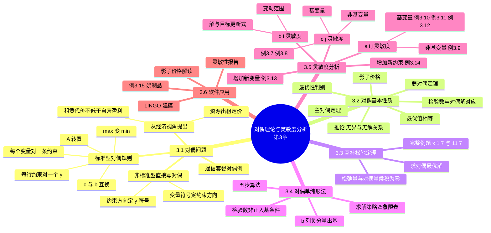

# 第三章 对偶理论与灵敏度分析（Duality Theory and Sensitivity Analysis）

> **本章主线**：一个 LP 从"两面镜子"看（**原问题 ⇔ 对偶问题**：谁是最大化谁就是另一个的最小化）→ 两面镜子读数一致吗（**弱对偶 → 主对偶定理：最优值相等、影子价格**）→ 怎么互相"抄答案"（**互补松弛定理：由原最优解直接解出对偶最优解**）→ 不解原问题能解吗（**对偶单纯形法：检验数先合格、b 列负值逐步转正**）→ 数据变了答案还对吗（**灵敏度分析：$b_i$、$c_j$、$a_{ij}$、增变量、增约束的变动范围**）。
> 一句话版本：**对偶理论 = 给 LP 配一面镜子（影子价格读资源价值），灵敏度分析 = 检验这面镜子和镜子前的数据晃动时结论还稳不稳**。

---

## 3.1 对偶问题的提出与形式

### 3.1.1 经济视角：同一个资源的两种卖法

以第 2 章通信套餐问题为母体，换一个提问角度：一家投资公司想**租赁**你公司的三种资源（带宽、服务器时间、人工）。出租条件是：**租赁代价不低于自营盈利**——否则不如自己经营。于是问题变为"出租方最少要收多少钱才愿意放弃自营"：

$$\min\ w = 48000y_1 + 20000y_2 + 8000y_3$$

$$\text{s.t.}\ \begin{cases} 8y_1 + 4y_2 + 2y_3 \ge 60 \\ 6y_1 + 2y_2 + 1.5y_3 \ge 30 \\ y_1 + 1.5y_2 + 0.5y_3 \ge 20 \\ y_1, y_2, y_3 \ge 0 \end{cases}$$

其中 $y_i$ 表示**单位资源 i 的出租单价**（影子价格的雏形）：每条约束表示"卖出资源制造该套餐，收入不得低于其利润"。原问题求"产品组合使利润最大"，对偶问题求"资源定价使总收入最少"——**同一笔资源，自营算一份账，出租算另一份账，两本账在最优处必然相等**。

### 3.1.2 标准型的对偶规则与对偶问题定义

**抽象上提**：设原问题（P）与对偶问题（D）的标准型为

$$\text{(P)}\ \max\ z = c^Tx,\ \ Ax \le b,\ x \ge 0 \qquad \Longleftrightarrow \qquad \text{(D)}\ \min\ w = b^Ty,\ \ A^Ty \ge c,\ y \ge 0$$

**标准型对偶变换六规则**（口诀"**max 变 min、行对变量、列对约束、$c$ $b$ 互换、$A$ 转置**"）：

1. 目标函数 **max 变 min**（反之亦然）；
2. 原问题**每一个约束行**对应一个**非负对偶变量** $y_i \ (i = 1,\ldots,m)$；
3. 原问题**每一个变量**对应对偶问题**一条 $\ge$ 型约束**（共 $n$ 条）；
4. 原问题目标系数 $c$ → 对偶问题**右端项**；
5. 原问题右端项 $b$ → 对偶问题**价值系数**；
6. 系数矩阵 $A$ → **$A^T$**（行列转置）。

### 3.1.3 非标准型的直接写出（对偶变换总规则）

对偶变换的**强制对比表**（原问题要素 ↔ 对偶问题要素）：

| 原问题 | 对偶问题 |
|---|---|
| 系数矩阵 $A$ 的行/列 | $A^T$ 的行/列 |
| 价值系数 $c$ | 右端项 $b$ |
| 右端项 $b$ | 价值系数 $c$（**$b \leftrightarrow c$ 互换**） |
| 行约束 $\le$ | 对偶变量 $y_i \ge 0$ |
| 行约束 $\ge$ | 对偶变量 $y_i \le 0$ |
| 行约束 $=$ | 对偶变量 $y_i$ 取值无约束 |
| 变量 $x_j \ge 0$ | 对应约束为 $\ge$ 型 |
| 变量 $x_j \le 0$ | 对应约束为 $\le$ 型 |
| 变量 $x_j$ 无约束 | 对应约束为 $=$ 型 |

> **口诀**：**"行对变量看不等号，列对约束看变量号；谁是 $c$ 谁当 $b$"**——即原约束的不等号方向决定对偶变量的符号，原变量的符号决定对偶约束的方向，$c$ 与 $b$ 永远互换位置。

**例**：原问题 $\max\ f = 4x_1 + 5x_2$，$\text{s.t.}\ 3x_1 + 2x_2 \le 20,\ 4x_1 - 3x_2 \ge 10,\ x_1 + x_2 = 5$，$x_2$ 无约束、$x_1 \ge 0$。

- **直接写出的对偶**：$\min\ g = 20y_1 + 10y_2 + 5y_3$，$\text{s.t.}\ 3y_1 + 4y_2 + y_3 \ge 4$，$2y_1 - 3y_2 + y_3 = 5$（原第二变量 $x_2$ 无约束 → 对应等式），$y_1 \ge 0$（原 $\le$）、$y_2 \le 0$（原 $\ge$）、$y_3$ 无约束（原 $=$）。
- **先化标准型再取对偶**：将 $x_2$ 拆为 $x_2', x_2'' \ge 0$、把 "$\ge$ "$ 乘 $(-1)$ 化为 $\le$、等式拆为两条 $\le$，得到含 4 个变量 $w_1 \sim w_4$ 的对偶；两法结果经代换 $y_1 = w_1,\ y_2 = -w_2,\ y_3 = w_3 - w_4$ 可互相化简——**路径不同，殊途同归，且"对偶的对偶是原问题"**。

---

## 3.2 对偶问题的基本性质

### 3.2.1 弱对偶定理与推论

**弱对偶定理**：设 $X_0$ 为原问题（max）的任一可行解，$Y_0$ 为对偶问题（min）的任一可行解，则 $Y_0$ 的目标值 $\ge X_0$ 的目标值，即 $c^TX_0 \le b^TY_0$。

**证明**：由 $AX_0 \le b$、$X_0 \ge 0$、$Y_0 \ge 0$ 得 $Y_0^TAX_0 \le Y_0^Tb$；由 $A^TY_0 \ge c$、$X_0 \ge 0$ 得 $c^TX_0 \le Y_0^TAX_0$。链起来即 $c^TX_0 \le Y_0^TAX_0 \le Y_0^Tb$。$\square$

**推论**（弱对偶定理的三个直接后果）：

1. 原问题（max）**任一可行解的目标值**是对偶问题最优值的**下限**，对偶问题（min）**任一可行解的目标值**是原问题最优值的**上限**——两面镜子互相"夹逼"；
2. 原问题**无界** $\Rightarrow$ 对偶问题**无可行解**；
3. 原问题有可行解而对偶问题无可行解 $\Rightarrow$ 原问题**无界**。

### 3.2.2 最优性判别与主对偶定理

**最优性判别**：若原问题某可行解 $X_0$ 与对偶问题某可行解 $Y_0$ 的目标值相等（$c^TX_0 = b^TY_0$），则二者**分别为各自问题的最优解**（弱对偶"夹逼"上下界重合）。

**主对偶定理**：若原问题与对偶问题**都有可行解**，则二者**都有最优解，且最优值相等**。

**证明思路**：设原问题最优解 $x_0$ 对应基 $B$，$x_0 = B^{-1}b$，检验数 $c - c_B^TB^{-1}A \le 0$。令 $y_0 = c_B^TB^{-1}$，则由检验数条件得 $A^Ty_0 \ge c$ 且 $y_0 \ge 0$（由松弛变量检验数 $\le 0$），故 $y_0$ 是对偶可行解；其目标值 $b^Ty_0 = b^Tc_B^TB^{-1} = c_B^TB^{-1}b = c^Tx_0$，与原最优值相等，由判别法 $y_0$ 即对偶最优解。$\square$

> **定理要点（加粗记忆）**：**对偶变量最优解 $y_0 = c_B^TB^{-1}$ 恰是原问题松弛变量的检验数的相反数所对应的影子价格——对偶变量的经济含义是原问题资源的影子价格**。

### 3.2.3 影子价格与检验数—对偶解对应关系

**影子价格（shadow price）**：对偶最优解 $y_i^*$ 表示原问题第 $i$ 种资源**每增加一个单位**时最优目标值的增量——是资源的"隐含价值"，不是市场价格。

**一般结论（实变量与虚变量的镜像对应）**：

| 原问题 | 对偶问题 |
|---|---|
| 虚变量（松弛/剩余变量）的**检验数** | 对偶问题**实变量（对偶变量）** 的最优解（$\min$ 对偶时 $y_i^* = |(\sigma_{\text{松弛},i})|$） |
| 实变量的**检验数** | 对偶问题**虚变量（对偶剩余变量）** 的最优解 |
| 最优值 $z^*$ | 最优值 $w^*$（相等） |

**推论**：原问题与对偶问题**只需解其中一个**——另一个的答案可直接"读表"得到。

**完整对照例**：原问题 $\max\ z = 5x_1 + 3x_2 + 6x_3$，$\text{s.t.}\ x_1 + 2x_2 + x_3 \le 18$，$2x_1 + x_2 + 3x_3 \le 16$，$x_1 + x_2 + x_3 = 10$，$x_1, x_2 \ge 0$，$x_3$ 无约束。

- **对偶**：$\min\ w = 18y_1 + 16y_2 + 10y_3$，$\text{s.t.}\ y_1 + 2y_2 + y_3 \ge 5$，$2y_1 + y_2 + y_3 \ge 3$，$y_1 + 3y_2 + y_3 = 6$（原第三约束为 $=$ → 对偶第三个变量由 $x_3$ 拆分后两式相加导出 $y_1 + 3y_2 + y_3 = 6$），$y_1, y_2 \ge 0$，$y_3$ 无约束；
- **解原问题**（大 M 法，人工变量 $x_6$）：最优 $x_1 = 14,\ x_2 = 0,\ x_3 = -4,\ x_4 = 8$，$\text{OBJ} = 46$；由松弛检验数读出对偶 $y_1 = 0,\ y_2 = 1,\ y_3 = 3$；
- **解对偶问题**（也用单纯形法）：得 $y_1 = 0,\ y_2 = 1,\ y_3 = 3$，$\text{OBJ} = 46$——**两面镜子给出同一个答案**。

---

## 3.3 互补松弛定理及应用

### 3.3.1 定理表述与证明

设 $X_0$、$Y_0$ 分别为原问题与对偶问题的可行解，$u_0$ 为**原问题松弛变量**的取值，$v_0$ 为**对偶问题剩余变量**的取值，则：

**$$X_0,\ Y_0 \text{ 分别最优} \iff u_0^TY_0 + v_0^TX_0 = 0 \iff y_i u_i = 0\ (i=1,\ldots,m),\quad v_j x_j = 0\ (j=1,\ldots,n)$$**

**证明**：由 $AX_0 + u_0 = b$、$A^TY_0 - v_0 = c$，第一式左乘 $Y_0^T$、第二式左乘 $X_0^T$ 后相减：$Y_0^Tu_0 + X_0^Tv_0 = Y_0^Tb - X_0^Tc$。右端恰为"对偶目标值 $-$ 原目标值"，由弱对偶定理该差 $\ge 0$ 且取等当且仅当两边同时最优；左端各项均为非负数之和，为零当且仅当每项为零。$\square$

> **直观理解（两条互补规则）**：**$x_j > 0 \Rightarrow$ 对偶第 $j$ 条约束取等；对偶第 $i$ 条约束是松的 $\Rightarrow y_i = 0$**——"用了的资源才有价格，没卡紧的约束没有影子"。

### 3.3.2 完整例题：由原最优解求对偶最优解

**题目陈述**：已知下列问题的最优解为 $x^* = (1/7,\ 11/7)$，用互补松弛定理求其对偶问题的最优解：

$$\max\ z = x_1 + 2x_2 \quad \text{s.t.}\ \begin{cases} 3x_1 + x_2 \le 2 \\ -x_1 + 2x_2 \le 3 \\ x_1 - 3x_2 \le 1 \\ x_1, x_2 \ge 0 \end{cases}$$

其对偶为 $\min\ w = 2y_1 + 3y_2 + y_3$，$\text{s.t.}\ 3y_1 - y_2 + y_3 \ge 1$，$y_1 + 2y_2 - 3y_3 \ge 2$，$y_1, y_2, y_3 \ge 0$。

**分步求解**：

1. **判断原约束松紧**：将 $x^* = (1/7, 11/7)$ 代入三个约束：
    - 第 1 条：$3 \times \frac{1}{7} + \frac{11}{7} = \frac{14}{7} = 2$，**紧**（取等）；
    - 第 2 条：$-\frac{1}{7} + 2 \times \frac{11}{7} = \frac{21}{7} = 3$，**紧**（取等）；
    - 第 3 条：$\frac{1}{7} - 3 \times \frac{11}{7} = -\frac{32}{7} < 1$，**松**（严格小于）。
2. **由互补规则定对偶变量符号**：第 3 条原约束为松 $\Rightarrow y_3^* = 0$；对偶中 $x_1^* > 0,\ x_2^* > 0 \Rightarrow$ 对偶**前两条约束取等**：

    $$\begin{cases} 3y_1 - y_2 + y_3 = 1 \\ y_1 + 2y_2 - 3y_3 = 2 \end{cases}$$

3. **解方程组**：代入 $y_3 = 0$ 得 $3y_1 - y_2 = 1$、$y_1 + 2y_2 = 2$，解得 $y_1^* = \frac{4}{7},\ y_2^* = \frac{5}{7}$，即 **$y^* = (4/7,\ 5/7,\ 0)$**。
4. **验证最优值相等**：$z^* = \frac{1}{7} + 2 \times \frac{11}{7} = \frac{23}{7}$；$w^* = 2 \times \frac{4}{7} + 3 \times \frac{5}{7} + 0 = \frac{8+15}{7} = \frac{23}{7}$——**两值相等，符合主对偶定理**，答案无误。

**一句话概括**：本例的技巧是"**先代入判松紧、再用 $x > 0$ 定约束取等、$y$ 补零**"——互补松弛定理把解方程组的规模从"对偶全部变量"压缩到"松紧关系筛过的少数方程"，易错点是忘记 $y_i = 0$ 这一支只由**原约束为松**触发，而非由原变量取零触发。

---

## 3.4 对偶单纯形法

### 3.4.1 方法思想：两面镜子的"可行性"可以互换

普通单纯形法要求**原问题始终可行**（$b$ 列非负）、检验数逐步达到非正；**对偶单纯形法**则相反——**检验数始终非正**（对偶问题始终可行）、让 $b$ 列的负分量逐步转正（原问题从"非可行"走向可行）。其代数基础来自最终表的结构：

初始表片段为 $(c_B, x_B, b \mid x_B, x_N, x_s)$，其中检验数行 $(\sigma, 0 \mid c_B^T, c_N^T, 0)$；经换基变换后变为 $(c_B, x_B, B^{-1}b \mid I, B^{-1}N, B^{-1})$，检验数行变为 $(\sigma,\ -c_B^TB^{-1}b \mid 0,\ c_N^T - c_B^TB^{-1}N,\ -c_B^T)$。

### 3.4.2 算法五步（$max$，检验数非正）

1. **列初始单纯形表**：要求检验数非正（$\max$ 目标；若为 $\min$ 则要求检验数非负），对右端项 $b$ **无非负要求**。若 $b$ 非负，已得最优解 $x = (x_B; x_N) = (\bar{b}; 0)$，$z = c_B^T\bar{b}$；若 $b$ 列存在负分量，转入下一步；
2. **选出基变量**：在 $b$ 列负分量中选**绝对值最大者** $\min\{b_i \mid b_i < 0\}$（即绝对值最大），该分量所在行为主行，主行对应基变量为出基变量；
3. **选入基变量**：若主行**所有元素均非负**，则问题**无可行解**，停止；若主行存在负元素，计算 **$\theta = \min\{\sigma_j / a_{ij} \mid a_{ij} < 0\}$**（$a_{ij}$ 为主行元素，注意分母只取**负**元素，方向与原单纯形法的 $\theta$ 规则相反），最小比值发生的列对应变量为入基变量；
4. **迭代**：同单纯形法，以主元素为轴旋转；
5. **重复步骤 2–4**，直到 $b$ 列全部非负，即得原问题最优解。

### 3.4.3 求解策略总表（表 3-13）

原问题与对偶问题的"可行性象限"决定该用哪种方法——**强制对比**：

| 原问题 | 对偶问题 | 结论或继续计算的步骤 |
|---|---|---|
| 可行 | 可行 | **已是最优解**（主对偶定理直接兑现） |
| 可行 | 非可行 | 用**单纯形法**求解最优解 |
| 非可行 | 可行 | 用**对偶单纯形法**求解最优解 |
| 非可行 | 非可行 | **引入人工变量**求解最优解 |

> **口诀**：**"谁可行推谁，都可行直接收，都不可行上人工"**——单纯形法走"原问题可行"的镜子，对偶单纯形法走"对偶可行"的镜子，两面都碎才需要人工变量重铸一面。

---

## 3.5 灵敏度分析

LP 是**静态模型**，而现实数据（$c, b, A$）总在波动。灵敏度分析回答三个问题：**参数变化后原最优解是否仍最优？哪些参数最容易变？每类参数变多大不破坏最优解？**——灵敏度范围越大，解的稳定性越好。

### 3.5.1 右端项 $b_i$ 的灵敏度

$b_i$ 变化**不影响检验数**（检验数只与 $c$、$A$ 有关），只影响 $b$ 列 $= B^{-1}b$，可能使原最优解变为**非可行**（出现负分量）。

**推导**：设 $X_B = B^{-1}b \ge 0$ 为最优解，第 $i$ 个资源变化 $b_i + \Delta b_i$，则第 $k$ 个基变量取值变为 $\bar{b}_k + \bar{a}_{k,n+i}\Delta b_i \ge 0\ (k = 1,\ldots,m)$，其中 $\bar{a}_{k,n+i}$ 为最终表中与 $b_i$ 对应的**初始松弛变量 $x_{n+i}$ 列**的元素。对所有 $k$ 同时成立给出**变动范围**：

$$\max_k\left[\frac{-\bar{b}_k}{\bar{a}_{k,n+i}} \ \middle|\ \bar{a}_{k,n+i} > 0\right] \le \Delta b_i \le \min_k\left[\frac{-\bar{b}_k}{\bar{a}_{k,n+i}} \ \middle|\ \bar{a}_{k,n+i} < 0\right]$$

此时基变量解值与目标函数**同步更新**（无需重新迭代）：

$$X^N = X^0 + \Delta b_i \cdot \bar{P}_{n+i}, \qquad \text{OBJ}^N = \text{OBJ}^0 + \Delta b_i \cdot C_B\bar{P}_{n+i}$$

**数值例**：最终表 $c_j = (1, 5, 3, 4, 0, 0, 0)$，基为 $x_5 = 100,\ x_4 = 200,\ x_2 = 100$，检验数 $c_j - z_j = (-3.25, 0, -2.75, 0, 0, -0.25, -1)$。以 $b_2$ 为例，$x_6$ 是其对应初始基变量，其列 $(0.25, 1, -0.75)^T$：

$$\max\left[\frac{-100}{0.25},\ \frac{-200}{1}\right] \le \Delta b_2 \le \min\left[\frac{-100}{-0.75}\right] \Rightarrow -200 \le \Delta b_2 \le 133.3 \text{，即 } 1000 \le b_2 \le 1333.3$$

令 $\Delta b_2 = 100$，直接代入更新式：

$$X^N = (100; 200; 100) + 100 \cdot (0.25; 1; -0.75) = (125; 300; 25)$$

$$\text{OBJ}^N = 125 \times 0 + 300 \times 4 + 25 \times 5 = 1325$$

### 3.5.2 价值系数 $c_j$ 的灵敏度

$c_j$ 变动源于**市场价格波动或生产成本变动**；分析目标是**保持最优基不变**前提下求 $\Delta c_j$ 的允许范围。$c_j$ 变化引起检验数变化，分两种情形：

**（1）$c_j$ 对应非基变量**：其变化**只影响自己的检验数**，不影响其它。要保持最优条件 $(c_j + \Delta c_j) - z_j \le 0$：

$$-\infty \le \Delta c_j \le -(c_j - z_j) = \sigma_j \text{ 的相反数}$$

**（2）$c_j$ 对应基变量**：$c_{j'}$ 出现在 $C_B$ 中，**影响所有非基变量的检验数**。设 $c_{j'}$ 在 $C_B$ 中位于第 $k$ 行，变化量 $\Delta c_{j'}$，则非基变量 $j$ 的新检验数要求 $c_j - z_j \le \bar{a}_{kj}\cdot\Delta c_{j'}$，对所有非基变量同时成立：

$$\max_j\left[\frac{c_j - z_j}{\bar{a}_{kj}} \ \middle|\ \bar{a}_{kj} > 0\right] \le \Delta c_{j'} \le \min_j\left[\frac{c_j - z_j}{\bar{a}_{kj}} \ \middle|\ \bar{a}_{kj} < 0\right]$$

**例 3.7（非基变量情形，完整求解）**：已知 LP：$\max\ z = 2x_1 + 3x_2 + x_3$，$\text{s.t.}\ x_1 + x_2 + x_3 + x_4 = 3$，$x_1 + 4x_2 + 7x_3 + x_5 = 9$，$x_1 \sim x_5 \ge 0$；最终单纯形表（表 3.17）为 $c_j = (2, 3, 1, 0, 0)$，基 $x_1 = 1$（行 $(1, 0, -1, 4/3, -1/3)$，$C_B = 2$）、$x_2 = 2$（行 $(0, 1, 2, -1/3, 1/3)$，$C_B = 3$），$\sigma_j$ 行 $(-8;\ 0, 0, -3, -5/3, -1/3)$。问：(1) $c_3$ 在什么范围内变化时最优解不变？(2) $c_3$ 由 1 增为 6，求新最优解。

**解(1)**：$x_3$ 是非基变量，其变化只影响 $\sigma_3$：

$$\sigma_3 = c_3 - (2, 3)\cdot(-1;\ 2) = c_3 - 4 \le 0 \Rightarrow c_3 \le 4$$

即只要 $c_3 \le 4$，最优解保持不变（验证：$c_3 = 1$ 时 $\sigma_3 = -3$ ✓）。

**解(2)**：将 $c_3 = 6$ **直接反映进最终单纯形表**（$c_j$ 行改为 $2, 3, 6, 0, 0$），$\sigma_3$ 由 $-3$ 变为 $6 - 4 = 2 > 0$，$x_3$ 入基（主元 $2$），继续迭代：

- **迭代 1**（主元 $= x_2$ 行的 2）：新表为 $x_1 = 2$（行 $(1, 1/2, 0, 7/6, -1/6)$）、$x_3 = 1$（行 $(0, 1/2, 1, -1/6, 1/6)$），$\sigma_j$ 行 $(-10;\ 0, -1, 0, -4/3, -2/3)$——全部非正，**迭代停止**。

**答案**：新最优解 **$x^* = (2, 0, 1, 0, 0)^T$，$z^* = 2 \times 2 + 6 \times 1 = 10$**。

**一句话概括**：非基变量 $c_j$ 越界只需"**改数、重算 $\sigma$、从原处再迭代一两步**"——因为最优基结构未预先破坏，改动直接反映进表即可，易错点是忘记 $\sigma$ 的计算要用**最终表**的 $C_B$ 与列向量，而非初始表。

**例 3.8（基变量情形，完整求解）**：对同一 LP，问：(1) $c_1$ 在什么范围内变化时最优解不变？(2) $c_1$ 由 2 增至 6，求新最优解。

**解(1)**：$x_1$ 是基变量（$C_B$ 第 1 行），变化影响所有非基变量检验数，三式须同时成立：

$$\sigma_3 = 1 - (c_1, 3)\cdot(-1;\ 2) = c_1 - 5 \le 0 \Rightarrow c_1 \le 5$$

$$\sigma_4 = 0 - (c_1, 3)\cdot(4/3;\ -1/3) = -\frac{4}{3}c_1 + 1 \le 0 \Rightarrow c_1 \ge \frac{3}{4}$$

$$\sigma_5 = 0 - (c_1, 3)\cdot(-1/3;\ 1/3) = \frac{1}{3}c_1 - 1 \le 0 \Rightarrow c_1 \le 3$$

取交集：**$c_1 \in [3/4,\ 3]$**。

**解(2)**：$c_1 = 6 \notin [3/4, 3]$，最优基必变。将 $c_1 = 6$ 反映进表（$c_j$ 行 $6, 3, 1, 0, 0$）继续迭代（表 3.19）：

- **迭代 1**（$\sigma_3 = 1 > 0$，主元 2，$x_3$ 入基）：$x_1 = 2,\ x_3 = 1$，$\sigma_j = (-13;\ 0, -1/2, 0, -41/6, 5/6)$——仍有 $\sigma_5 = 5/6 > 0$；
- **迭代 2**（主元 $1/6$，$x_5$ 入基）：$x_1 = 3,\ x_5 = 6$，$\sigma_j = (-18;\ 0, -3, -5, -6, 0)$——全部非正。

**答案**：新最优解 **$x^* = (3, 0, 0, 0, 6)^T$，$z^* = 6 \times 3 = 18$**。

**一句话概括**：基变量 $c_j$ 越界要"**多步换基**"——因为它一动就"牵一发而动全身"（所有 $\sigma$ 同步变），往往需要连续迭代多次才能回到最优，易错点是只改 $c_j$ 行而忘了 $C_B$ 列的 $C_B$ 值也须同步更新。

### 3.5.3 技术系数 $a_{ij}$ 的灵敏度

技术系数变化比 $b_i$、$c_j$ 复杂，因为它直接改变矩阵 $A$、进而改变 $B^{-1}$。按变动类型分为四种情形：

1. $a_{ij}$ 对应**非基变量**；
2. $a_{ij}$ 对应**基变量**；
3. **增加一个变量**（同时增加对应的一列技术系数）；
4. **增加一个约束条件**（增加一行技术系数）。

**情形 1（非基变量列）——例 3.9**：对例 3.7 的 LP，问 $a_{23}$ 在什么范围内变化时最优解保持不变？

**解**：$a_{23}$ 属于非基变量 $x_3$ 的列，只影响 $\sigma_3$（用 $B^{-1}$ 乘新的列向量）：

$$\sigma_3 = c_3 - C_B B^{-1}P_3 = 1 - (2, 3)\begin{pmatrix}4/3 & -1/3 \\ -1/3 & 1/3\end{pmatrix}\begin{pmatrix}1 \\ a_{23}\end{pmatrix} = -\frac{1}{3}a_{23} - \frac{2}{3}$$

令 $\sigma_3 \le 0$：$-\frac{1}{3}a_{23} - \frac{2}{3} \le 0 \Rightarrow$ **$a_{23} \ge -2$**，即 $a_{23} \in [-2, +\infty)$。

**情形 2（基变量列）**：基变量的 $a_{ij}$ 变化会改变该基变量在最终表中的列向量 $P' = B^{-1}P_j$，进而可能破坏"单位列向量"结构，需要重新检查可行性与最优性。三种典型子情形：

- **例 3.10**：对例 3.7 的 LP，$a_{11}$ 由 1 变为 3 时是否改变最优解？**解**：先算 $P'_1 = B^{-1}P_1 = \begin{pmatrix}4/3 & -1/3 \\ -1/3 & 1/3\end{pmatrix}\begin{pmatrix}3 \\ 1\end{pmatrix} = \begin{pmatrix}11/3 \\ -2/3\end{pmatrix}$，反映进最终表（表 3.20），得 $x_1$ 行系数 $(11/3, 0, -1, 4/3, -1/3)$、$x_2$ 行 $(-2/3, 1, 2, -1/3, 1/3)$；用**对偶单纯形法**（出现负 $b$ 或破坏可行性时的标准动作）迭代后，原最优基未变，新最优解 **$x^* = (3/11,\ 24/11,\ 0,\ 0,\ 0)^T$**。
- **例 3.11**：对例 3.6 的 LP（$\max\ z = 5x_1 + 12x_2 + 4x_3 + 0x_4 - Mx_5$，$\text{s.t.}\ x_1 + 2x_2 + x_3 + x_4 = 5$，$2x_1 - x_2 + 3x_3 + x_5 = 2$），$a_{11}$ 由 1 变为 5。**解**：$P'_1 = \begin{pmatrix}2/5 & -1/5 \\ 1/5 & 2/5\end{pmatrix}\begin{pmatrix}5 \\ 2\end{pmatrix} = \begin{pmatrix}8/5 \\ 9/5\end{pmatrix}$，反映进表 3.14 形成表 3.21，迭代后**原最优解已变**，新解 **$x^* = (0,\ 13/7,\ 9/7)^T$，$z^* = 192/7$**。
- **例 3.12（最坏情形）**：对例 3.7 的 LP，$a_{11}$ 由 1 变为 0。**解**：$P'_1 = \begin{pmatrix}4/3 & -1/3 \\ -1/3 & 1/3\end{pmatrix}\begin{pmatrix}0 \\ 1\end{pmatrix} = \begin{pmatrix}-1/3 \\ 1/3\end{pmatrix}$，表 3.22 中出现 $b$ 列负值且**原、对偶均不可行**（对应表 3-13 第四象限）：先将负端项方程 $x_1 + 3x_3 - 4x_4 + x_5 = -3$ 两端乘 $(-1)$ 并引入人工变量 $x_6$：$-x_1 - 3x_3 + 4x_4 - x_5 + x_6 = 3$，以 $x_6$ 为基变量按大 M 法求解（表 3.23），最终新最优解 **$x^* = (9,\ 0,\ 0,\ 3,\ 0)^T$，$z^* = 18$**。

### 3.5.4 增加新变量——例 3.13

对例 3.7 的 LP 增加新变量 $x_6$，$c_6 = 3$，技术系数向量 $P_6 = (1,\ 1)^T$，问原最优解是否改变。

**解**：

1. 将 $P_6$ 反映进最终单纯形表：$P'_6 = B^{-1}P_6 = \begin{pmatrix}4/3 & -1/3 \\ -1/3 & 1/3\end{pmatrix}\begin{pmatrix}1 \\ 1\end{pmatrix} = \begin{pmatrix}1 \\ 0\end{pmatrix}$；
2. 计算检验数：$\sigma_6 = 3 - (2, 3)\cdot(1;\ 0) = 1$；
3. 因 $\sigma_6 = 1 > 0$，**原最优解发生变化**，$x_6$ 入基（主元 1）继续迭代（表 3.24）。

**结果**：新最优解 **$x^* = (0,\ 2,\ 0,\ 0,\ 0,\ 1)^T$，$z^* = 9$**。由于非基变量 $x_5$ 的检验数为 0，此最优解是**无穷多最优解中的一个**。

> **规律**：加新变量**不破坏原表结构**，只需"算一列、算一个 $\sigma$"——$\sigma_{\text{新}} \le 0$ 则原最优解不变（新变量不值得生产），$> 0$ 则入基再迭代。

### 3.5.5 增加新约束——例 3.14

对例 3.7 的 LP 分别增加约束 $x_1 + 2x_2 + x_3 \le 10$ 与 $x_1 + 2x_2 + x_3 \le 4$。

**分析**：

1. **新增约束 $x_1 + 2x_2 + x_3 \le 10$**：原最优解 $X^* = (1, 2, 0, 0, 0)^T$ 代入，$1 + 4 + 0 = 5 \le 10$ 成立——新约束**不破坏原最优解**，直接仍为最优；
2. **新增约束 $x_1 + 2x_2 + x_3 \le 4$**：代入得 $5 > 4$ **不成立**，原最优解发生变化。处理步骤（表 3.25）：
    - 在新约束中引入松弛变量 $x_6$ 并让 $x_6$ **充当基变量**，将新约束**直接反映进最终单纯形表**（新增一行）；
    - 新增一行会**破坏原基变量的单位列向量**，需先用行变换把原基变量对应列**恢复为单位向量**；
    - 恢复后若出现 $b$ 列负分量（本例 $x_6$ 行 $b = -1$），按**表 3-13** 策略用**对偶单纯形法**迭代（出基 $x_6$，主元 $-1/3$）。

**结果**：新最优解 **$x^* = (2,\ 1,\ 0,\ 0,\ 3,\ 0)^T$，$z^* = 7$**。

> **通用规律**：增加约束**绝不会使最优值变好**（只会不变或变差）；判断口诀"**代入试一试：满足即不动，不满足再迭代**"。

---

## 3.6 软件应用：例 3.15 的 LINGO 求解与灵敏性分析

**题目陈述（奶制品生产计划）**：用牛奶生产甲、乙两种奶制品，1 桶牛奶可在甲车间用 12 小时生产 3 kg A1，或在乙车间用 8 小时生产 4 kg A2；A1 利润 24 元/kg，A2 利润 16 元/kg。每天有 50 桶牛奶、480 小时劳动，甲车间设备每天至多加工 100 kg A1，乙车间不限。问：

1. 若市场上牛奶 35 元/桶，是否值得买进？最多买多少？
2. 临时工工资最多出每小时几元仍值得雇佣？
3. 若 A1 利润增至 30 元/kg，应否改变生产计划？

**LINGO 模型**（设 $x_1$ 为 A1 产量、$x_2$ 为 A2 产量；1 桶奶产 3 kg A1 即利润 $72x_1$ 桶当量、1 桶奶产 4 kg A2 即 $64x_2$）：

```
max = 72*x1 + 64*x2;
x1 + x2 <= 50;
12*x1 + 8*x2 <= 480;
3*x1 <= 100;
```

**求解输出（Solution Report）**：Global optimal solution found；Objective value = **3360**；$x_1 = 20$，$x_2 = 30$；约束的 Slack/Surplus 与 Dual Price（影子价格）：

| 约束 | 含义 | Slack | Dual Price |
|---|---|---|---|
| Row1 | 目标 | 3360 | 1 |
| Row2 | 牛奶 50 桶 | 0 | **48** |
| Row3 | 劳动 480 小时 | 0 | **2** |
| Row4 | 甲车间 100 kg | 40 | 0 |

**三个问题的答案**：

1. **买牛奶**：第 1 桶牛奶的影子价格为 **48 元**（每多 1 桶奶，最优利润增 48 元），远高于市价 35 元——**值得买**；影子价格 48 对应的 $b_1$ 允许范围需用灵敏度报告的右端项范围判断（最多可购入至范围上限，本例中每桶至少赚 $48 - 35 = 13$ 元）；
2. **临时工工资**：劳动的影子价格为 **2 元/小时**——每加班 1 小时多赚 2 元，故工资**最多 2 元/小时**仍值得雇（超过则亏）；
3. **A1 利润增至 30 元/kg**：$x_1$ 的价值系数（每桶当量 72 元）变为 $30 \times 3 = 90$，变动 $+18$；由灵敏性报告 $x_1$ 系数允许范围 **$(64, 96)$**（$72 - 8$ 到 $72 + 24$），$90$ 在范围内——**最优基不变、不改计划**，仅最优值变为 $90 \times 20 + 64 \times 30 = 3720$。（同理 $x_2$ 系数允许范围为 $(48, 72)$。）

**一句话概括**：LINGO 的灵敏性报告把本章全部公式"打包"成两列数——**Dual Price 看影子价格答"值不值得多买"，Reduced Cost/系数范围看 $c_j$ 灵敏度答"要不要改计划"**，易错点是把影子价格当成市场价、或忽略"范围之内只变值、范围之外才换基"这条分界线。

---

### 知识定位与框架衔接

**前置知识**：第 2 章的**标准型、基可行解、单纯形表与检验数**是本章全部推导的算尺——没有"$\sigma_j = c_j - C_BB^{-1}P_j$"就写不出对偶定理证明，没有"最终表结构"就读不出影子价格；对偶变换本身还依赖第 2 章"约束方向与变量符号"的规范处理。

**后置知识**：

1. **第 4 章运输问题**：产销平衡表的"位势法"本质就是对偶变量法——对偶价格在运输问题中化为行位势、列位势；
2. **第 5 章整数规划**：分支定界法的松弛 LP 常用对偶界剪枝；
3. **第 6 章动态规划**：资源的"边际价值"思想与影子价格一脉相承；
4. **第 7 章非线性规划**：KKT 条件中的乘子正是拉格朗日对偶的连续推广——**对偶理论是通往非线性对偶的桥头堡**。

**比喻**：如果说第 2 章单纯形法是"**学会开车**"，本章就是"**后视镜与仪表盘**"——对偶理论（3.1–3.4）是从镜子里看同一段路（镜像问题、镜像最优、镜像算法），灵敏度分析（3.5–3.6）是仪表盘告诉你"油、路、车怎么晃时结论还稳"。车没学会（第 2 章），镜子和仪表都是摆设。

**核心灵魂问题（学完本章应能回答）**：

1. **为什么对偶最优解 $y^* = c_B^TB^{-1}$ 恰好就是影子价格？**——它是松弛变量检验数的镜像，而检验数的经济含义正是"资源每多一单位对目标的边际贡献"；从 $y^* = c_B^TB^{-1}$ 与 $z^* = c_B^TB^{-1}b = y^{*T}b$ 一式即可看出"资源单价 × 资源量 = 总价值"。
2. **互补松弛定理的两支条件为什么不能"反着用"？**——$x_j > 0 \Rightarrow$ 对偶约束取等，但约束取等**推不出** $x_j > 0$（取等时变量仍可能为零，只是此时须另由方程判定）；同样"原约束松 $\Rightarrow y_i = 0$"，而 $y_i = 0$ 推不出原约束松——单向蕴含用反了就会漏解或错解。
3. **对偶单纯形法的 $\theta$ 规则为什么分母只取负元素，与原单纯形法正好相反？**——原法要在"保持 $b \ge 0$"下让进基变量尽量大（分母取正、防 $b$ 变负）；对偶法要在"保持 $\sigma \le 0$"下让负 $b$ 尽快转正，旋转方向相反，比值规则随之镜像——若照抄原法规则会立刻破坏对偶可行性。

> **一句话总结本章**：**对偶理论 = "一面镜子两个读数"：镜像问题（变换规则）、镜像最优（主对偶定理）、镜像求解（互补松弛、对偶单纯形法）；灵敏度分析 = "数据晃动时先查范围再决定迭代"：$b_i$ 只动 $b$ 列、$c_j$ 只动检验数、$a_{ij}$ 动 $B^{-1}$ 最伤，范围之内直接更新公式、范围之外才重新换基**——影子价格把"资源值多少钱"第一次变成了可计算的数。

---

## 课件 PDF

<iframe src="https://cognishelf.naimore3.workers.dev/课程笔记/大二上/运筹学/03对偶理论与灵敏度分析/03对偶理论与灵敏度分析.pdf" width="100%" height="800px" style="border: none;"></iframe>

[打开 PDF](https://cognishelf.naimore3.workers.dev/课程笔记/大二上/运筹学/03对偶理论与灵敏度分析/03对偶理论与灵敏度分析.pdf)
