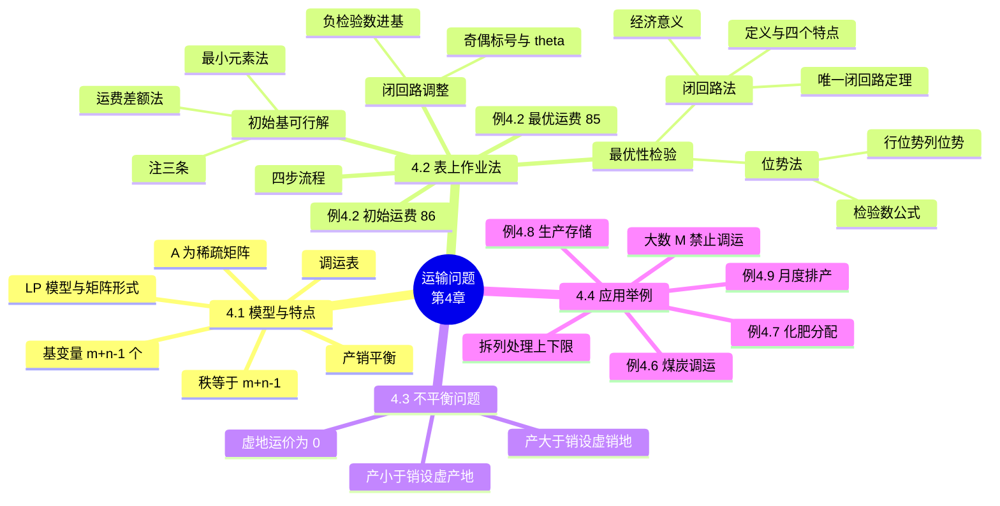

# 第四章 运输问题（Transportation Problem）

> **本章主线**：一类**产销平衡的特殊 LP**（$m$ 个产地、$n$ 个销地、运价矩阵 $C$）→ 模型结构特殊（**系数矩阵每列只有两个 1，秩 = $m+n-1$，基变量恰 $m+n-1$ 个**）→ 不用单纯形法而用**表上作业法**（求初始方案 → 检验数判优 → 闭回路调整，循环迭代）→ 产销不平衡时**加虚拟产地/销地化为平衡问题** → 把生产存储、上下限约束等问题**化归为运输模型**求解。
> 一句话版本：**表上作业法 = 在运价表上做单纯形法：最小元素法找初始基、闭回路或位势法算检验数、闭回路标号调整换基**。

---

## 4.1 运输问题的模型及其特点

### 4.1.1 问题背景与数据表

把 $m$ 个产地 $A_1,\dots,A_m$ 的物品运往 $n$ 个销地 $B_1,\dots,B_n$：产地 $i$ 的产量为 $a_i \ge 0$，销地 $j$ 的销量为 $b_j \ge 0$，从 $A_i$ 到 $B_j$ 的单位运价为 $c_{ij} \ge 0$。

- $\sum_{i=1}^{m} a_i = \sum_{j=1}^{n} b_j$：**产销平衡**（本章 4.1–4.2 默认前提）；
- 两者不等：**产销不平衡**，留到 4.3 处理。

同一份数据常用三张表组织（表 4-1 产销表、表 4-2 单位运价表、表 4-3 把两者合并的数据表），**表上作业法的全部计算都在合并后的数据表上完成**。

### 4.1.2 数学模型

设 $x_{ij}$ 为从 $A_i$ 运往 $B_j$ 的运量，产销平衡条件下总运费最小的模型为：

$$\min\ z = \sum_{i=1}^{m}\sum_{j=1}^{n} c_{ij}x_{ij}$$

$$\text{s.t.}\ \begin{cases} \sum_{j=1}^{n} x_{ij} = a_i, & i = 1,\dots,m \quad \text{（产量约束）} \\ \sum_{i=1}^{m} x_{ij} = b_j, & j = 1,\dots,n \quad \text{（销量约束）} \\ x_{ij} \ge 0, & i = 1,\dots,m;\ j = 1,\dots,n \end{cases}$$

**矩阵形式**：记 $X = (x_{11},\dots,x_{mn})^T$，$C = (c_{11},\dots,c_{mn})^T$，$b = (a_1,\dots,a_m,b_1,\dots,b_n)^T$，则

$$\min\ z = C^T X \quad \text{s.t.}\ AX = b,\ X \ge 0$$

其中 $A$ 是 $(m+n)$ 行、$mn$ 列的**稀疏矩阵**：第 $i$ 个分量为 1 的 $m+n$ 维单位列向量记为 $e_i$，则 $A$ 的列向量 $P_{ij} = e_i + e_{m+j}$——**每一列恰好两个 1**（一个在产量约束块，一个在销量约束块）。

### 4.1.3 模型特点：三条定理与调运表

| 定理 | 内容 | 直觉解释 |
|---|---|---|
| **定理 4.1** | 产销平衡运输问题必有可行解，也必有最优解 | 平衡条件 $\sum a_i = \sum b_j$ 保证至少有一个调运方案；可行域非空有界 |
| **定理 4.2** | 约束方程系数矩阵的秩 $= m+n-1$ | $m+n$ 个约束中恰有一个是多余的（把 $m$ 个产量约束全加起来 = 把 $n$ 个销量约束全加起来） |
| **定理 4.3** | 基可行解中恰包含 $m+n-1$ 个基变量 | 由秩的定义直接得到——**这也是"退化时仍要补 0 基变量"的原因** |

运输问题的解写成**调运表**（表 4-4）：表格的每个格子填运量 $x_{ij}$，右侧列是产量 $a_i$，底部行是销量 $b_j$。**表上作业法的一切操作（划线、闭回路、标号、位势）都发生在这张表上。**

---

## 4.2 表上作业法

### 4.2.1 总体步骤

表上作业法又称**运输单纯形法**，四步循环：

1. **求初始基可行解**（初始调运方案）；
2. **最优性检验**：算检验数，若全部 $\sigma_{ij} \ge 0$（极小化目标）则停止，得到最优解；否则转下一步；
3. **调整（换基）**：确定换入、换出变量，用闭回路法调整出新的基可行解；
4. **返回第 2 步**。

### 4.2.2 初始基本可行解的确定

**（一）最小元素法**——遵循规则：**优先安排单位运价最小的产地与销地之间的运输业务**，尽可能把物资走最便宜的路。做法是在数据表中找当前未划去的最小运价格，填入 $\min\{\text{该格剩余产量},\ \text{该格剩余销量}\}$，然后划去已饱和的行或列，重复直到划完。

**（二）运费差额法**——每次考虑：若某供应地**不能**按最小运费路线供货，就得走次小运费，最小与次小之差就是**差额**。差额越大，说明不走最小运费的代价越大，因此**对差额最大的供应地（或需求地），一定要按最小运费路线调运**。直觉上最小元素法"贪小便宜"，差额法多看一步"不走这条路会亏多少"。

**（三）三条注意事项**（最小元素法与差额法通用）：

1. 填入一个数后若**行和列同时饱和**，规定同时划去该行和该列，但还必须在被划去的行或列的任意空格处**取对应变量为 0 并填入**——该变量是**取 0 值的基变量**，要明确写出以区别于非基变量的 0；
2. 选取最小值若有多个可同时选择，**任选其一**；
3. 只剩最后一个空格时只能填数（必要时取 0），并划去所在行和列。

**（四）定理 4.4**：用最小元素法以及运费差额法等规则给出的调运方案是产销平衡运输模型的一个**基本可行解**。所得变量非负、满足全部约束，且变量总数恰好 $m+n-1$ 个。

> **口诀**："贪最便宜先发货，行列划完补零格；末格必填凑足数，$m{+}n{-}1$ 个是基格。"

### 4.2.3 最优性检验：闭回路法与位势法

最优性检验与单纯形法原理相同——**计算检验数**。目标是极小化，故**所有检验数 $\sigma_{ij} \ge 0$ 时方案最优**，否则需调整。课件给出两种求检验数的方法。

**（一）闭回路法**

**定义 4.1**：在调运表的决策变量格中，凡是能排列成形如 $x_{ab}, x_{ad}, x_{dc}, x_{de}, \dots, x_{st}, x_{sb}$（或 $x_{ab}, x_{cb}, x_{cd}, x_{ed}, \dots, x_{st}, x_{at}$）的变量序列，其中行下标 $a,d,\dots,s$ 各不相同、列下标 $b,c,\dots,t$ 各不相同，就称为变量集合的一个**闭回路**，式中变量称为闭回路的**顶点**。

闭回路的四个明显特点：

1. 每一个顶点都是**转角点**；
2. 每一行（或列）若有闭回路的顶点，则**必有两个**顶点；
3. 每两个顶点格子的连线都是**水平或垂直**的；
4. 闭回路中顶点的个数必为**偶数**。

（图示中闭回路可画成矩形、阶梯形、带凹角的多边形，均由水平/垂直折线首尾相接。）

**定理 4.5**：设 $x_{i_1j_1},\dots,x_{i_sj_s}$（$s = m+n-1$）是一组基变量，$x_{ij}$ 是非基变量，则在变量组中**存在唯一的**以 $x_{ij}$ 为顶点的闭回路。（证明略——这保证了检验数算法是良好定义的。）

**检验数的经济意义**：$\sigma_{ij}$ 是非基变量 $x_{ij}$ 对运费的影响——当其余非基变量保持不变时，$x_{ij}$ 增加一个单位时**总运费的增加量**。注意：若只让 $x_{ij}$ 变化而基变量不变，约束会被破坏，所以 $x_{ij}$ 增加时**部分基变量一定会跟着变化**（沿闭回路一增一减），检验数正是把这一连锁调整的净效果算出来的。

**计算方法**：以非基变量为起点作唯一闭回路，从起点开始沿闭回路**交替取 $+c$、$-c$** 求和即得检验数。例：

- $\sigma_{22} = 9 - 4 + 5 - 10 + 3 - 2 = 1$（回路 $x_{22} \to x_{32} \to x_{34} \to x_{14} \to x_{13} \to x_{23}$）；
- $\sigma_{24} = 8 - 10 + 3 - 2 = -1$（回路 $x_{24} \to x_{14} \to x_{13} \to x_{23}$，顺时针逆时针结果相同）。

**（二）位势法**

对每个产地引入**行位势** $u_i$、每个销地引入**列位势** $v_j$，令**基变量格**满足

$$u_i + v_j = c_{ij} \quad (\text{基变量所在格})$$

由于基变量恰 $m+n-1$ 个、位势共 $m+n$ 个，可任取一个位势值作锚点解出全部位势，则**非基变量的检验数**为

$$\sigma_{ij} = c_{ij} - u_i - v_j \quad (\text{非基变量所在格})$$

**定理 4.6**：检验数 $\sigma_{ij}$ 的取值与任意位势的取值无关（证明略）——**锚点随便选，算出的检验数不变**。位势法比闭回路法省事：不必逐个画回路，解一次线性方程组后逐格相减即可。

### 4.2.4 基本可行解的调整（换基）

当非基变量检验数出现负值时，当前解不是最优解，需要**换基（主元变换）**找到使目标值下降的新基可行解。五步算法：

1. 选负检验数中最小者 $\sigma_{ik}$，以 $x_{ik}$ 为**主元**作进基变量；
2. 以 $x_{ik}$ 为起点找一条闭回路，**除 $x_{ik}$ 外其余顶点必须是基变量格**；
3. 对闭回路的每个顶点标号：$x_{ik}$ 标为 **0**，沿一个方向（顺/逆时针）依次标 $1,2,3,\dots$；
4. 求调整量 $\theta = \min\{x_{ij} \mid x_{ij} \text{ 为闭回路上奇数标号格}\}$，达到最小值的 $x_{pq}$ 作**出基变量**（若干个并列时任选其一），$\theta$ 为调整量；
5. **偶数标号格 $+\theta$，奇数标号格 $-\theta$**；特别地 $x_{pq} - \theta = 0$ 变为非基变量，进基变量 $x_{ik} = 0 + \theta$。

调整后得到新的基可行解，**返回检验**（常用位势法重算检验数），重复直到全部 $\sigma_{ij} \ge 0$。

### 4.2.5 完整例题：例4.2 表上作业法全流程

**题目**：某通讯公司将一批路由器从三个设备提供商运往四个分公司安装。供应量 $A_1 = 7$、$A_2 = 4$、$A_3 = 9$（共 20 台）；需求量 $B_1 = 3$、$B_2 = 6$、$B_3 = 5$、$B_4 = 6$（共 20 台）。单位运价（千元）如下表，问如何调运使总运费最小？

| 产地/销地 | $B_1$ | $B_2$ | $B_3$ | $B_4$ | 产量 |
|---|---|---|---|---|---|
| $A_1$ | 3 | 11 | 3 | 10 | 7 |
| $A_2$ | 1 | 9 | 2 | 8 | 4 |
| $A_3$ | 7 | 4 | 10 | 5 | 9 |
| 销量 | 3 | 6 | 5 | 6 | 20 |

**第 1 步：最小元素法求初始基可行解**（优先走最便宜的路）：

1. 全表最小运价 $c_{21} = 1$：填 $x_{21} = \min(4, 3) = 3$，$B_1$ 列饱和划去（$A_2$ 剩 1）；
2. 剩余最小 $c_{23} = 2$：填 $x_{23} = \min(1, 5) = 1$，$A_2$ 行饱和划去（$B_3$ 剩 4）；
3. 剩余最小 $c_{13} = 3$：填 $x_{13} = \min(7, 4) = 4$，$B_3$ 列饱和划去（$A_1$ 剩 3）；
4. 剩余最小 $c_{32} = 4$：填 $x_{32} = \min(9, 6) = 6$，$B_2$ 列饱和划去（$A_3$ 剩 3）；
5. 剩余最小 $c_{34} = 5$：填 $x_{34} = \min(3, 6) = 3$，$A_3$ 行饱和划去（$B_4$ 剩 3）；
6. 最后只剩 $A_1 \to B_4$ 一个空格：填 $x_{14} = 3$，行列同时划去。

**初始方案**：$X^{(0)} = [0,0,4,3,\ 3,0,1,0,\ 0,6,0,3]^T$，共 $6 = m+n-1$ 个基变量，**初始总运费**

$$Z^{(0)} = 4\times3 + 3\times10 + 3\times1 + 1\times2 + 6\times4 + 3\times5 = 86 \text{（千元）}$$

**第 2 步：检验数判优**（闭回路法逐格算，或位势法解方程）：

| 产地/销地 | $B_1$ | $B_2$ | $B_3$ | $B_4$ |
|---|---|---|---|---|
| $A_1$ | $3\ [1]$ | $11\ [2]$ | $3\ \mathbf{4}$ | $10\ \mathbf{3}$ |
| $A_2$ | $1\ \mathbf{3}$ | $9\ [1]$ | $2\ \mathbf{1}$ | $8\ [-1]$ |
| $A_3$ | $7\ [10]$ | $4\ \mathbf{6}$ | $10\ [12]$ | $5\ \mathbf{3}$ |

（粗体为基变量值，方括号为非基变量检验数。）例如 $\sigma_{24}$ 的闭回路为 $x_{24} \to x_{14} \to x_{13} \to x_{23}$，$\sigma_{24} = 8 - 10 + 3 - 2 = -1 < 0$——**不是最优，需调整**。

**第 3 步：闭回路调整**（五步法）：

1. 负检验数只有 $\sigma_{24} = -1$，取 $x_{24}$ 为进基变量；
2. 作闭回路 $x_{24} \to x_{14} \to x_{13} \to x_{23} \to x_{24}$（其余顶点都是基变量格）；
3. 标号：$x_{24}$ 标 0，沿方向依次 $x_{14}$ 标 1、$x_{13}$ 标 2、$x_{23}$ 标 3；
4. $\theta = \min\{\text{奇数标号格}\} = \min\{x_{14}, x_{23}\} = \min\{3, 1\} = 1$，故 $x_{23}$ 出基；
5. 偶数标号格 $+\theta$、奇数标号格 $-\theta$：$x_{24} = 0 + 1 = 1$，$x_{14} = 3 - 1 = 2$，$x_{13} = 4 + 1 = 5$，$x_{23} = 1 - 1 = 0$（出基）。

**新方案**：$x_{13}=5,\ x_{14}=2,\ x_{21}=3,\ x_{24}=1,\ x_{32}=6,\ x_{34}=3$，总运费

$$Z = 3\times5 + 10\times2 + 1\times3 + 8\times1 + 4\times6 + 5\times3 = 85 \text{（千元）}$$

**第 4 步：位势法复检**：取锚点 $u_3 = 0$，由基变量格 $u_i + v_j = c_{ij}$ 依次解出 $v_2 = 4,\ v_4 = 5,\ u_1 = 5,\ v_3 = -2,\ u_2 = 3,\ v_1 = -2$；非基变量检验数 $\sigma_{11} = 0,\ \sigma_{12} = 2,\ \sigma_{22} = 2,\ \sigma_{23} = 1,\ \sigma_{31} = 9,\ \sigma_{33} = 12$，**全部 $\ge 0$ → 已是最优解**，$Z^* = 85$。

**一句话概括**：例4.2 用一张表走完"**最小元素法起步（86）→ 负检验数找病灶（$\sigma_{24}=-1$）→ 闭回路标号换基 → 位势法验收（全非负，85）**"全流程——这就是表上作业法的固定套路。

---

## 4.3 不平衡的运输问题

### 4.3.1 总产量大于总销量

此时产量约束变为 $\sum_{j} x_{ij} \le a_i$（产地可以有货不出门）。为借助平衡问题的表上作业法，**增加一个假想销地 $B_{n+1}$**：由 $A_i$ 运往 $B_{n+1}$ 的"运量" $x_{i,n+1}$ 实际上是**就地存贮量**（相当于松弛变量），不发生运输，故单位运价 $c_{i,n+1} = 0$；假想销地的销量为

$$b_{n+1} = \sum_{i=1}^{m} a_i - \sum_{j=1}^{n} b_j$$

**例4.4**：两产地 $A_1, A_2$ 各产 300，三销地销量 150、150、200（产 600 > 销 500）：

| 产地/销地 | $B_1$ | $B_2$ | $B_3$ | 产量 |
|---|---|---|---|---|
| $A_1$ | 6 | 4 | 6 | 300 |
| $A_2$ | 6 | 5 | 5 | 300 |
| 销量 | 150 | 150 | 200 | |

**解**：增设虚销地 $B_4$，销量 $600 - 500 = 100$，运价全为 0，化为平衡问题按 4.2 表上作业法求解，**求完后把 $B_4$ 列去掉**即得原问题最优解——该列各格运量就是各产地的就地存贮量。

### 4.3.2 总产量小于总销量

此时销量约束变为 $\sum_{i} x_{ij} \le b_j$（销地可能拿不够货）。对称地**增加一个假想产地 $A_{m+1}$**：其产量

$$a_{m+1} = \sum_{j=1}^{n} b_j - \sum_{i=1}^{m} a_i$$

由 $A_{m+1}$ 运往 $B_j$ 的运量 $x_{m+1,j}$ 是各销地的**欠缺额**，一般取 $c_{m+1,j} = 0$；**但当短缺有违约赔偿或机会成本时，运价应取该成本而非 0**。

**例4.5**：$A_1$ 产 200、$A_2$ 产 300，三销地需求 250、200、200（产 500 < 销 650）：

| 产地/销地 | $B_1$ | $B_2$ | $B_3$ | 产量 |
|---|---|---|---|---|
| $A_1$ | 6 | 4 | 6 | 200 |
| $A_2$ | 6 | 5 | 5 | 300 |
| $A_3$（虚产地） | 0 | 0 | 0 | 150 |
| 销量 | 250 | 200 | 200 | |

**解**：增设虚产地 $A_3$（产量 $650 - 500 = 150$，运价全 0）化为平衡问题求解，虚产地行的运量即各销地欠缺额。

> **口诀**："**产大加虚销（列运 0，存起来），产小加虚产（行运 0 或违约价，缺起来）**；虚地只是补差额的会计手段，解完拆掉即可。"

---

## 4.4 运输问题的应用举例

很多线性规划问题在**变量个数相等**时表上作业法远比单纯形法简单，因此实际问题常被"凑"成运输模型——关键技巧是**设大数 $M$ 禁止调运、拆列处理上下限、把时间/阶段维度摊成产地销地**。

### 4.4.1 例4.6 煤炭调运：需求有上下限 + 供不应求

**题目**：某大学三个校区每年用煤 3000、1000、2000 吨，由 A、B 两煤矿供应（A 产能 4000、B 产能 1500，运价 A：1.65/1.7/1.75，B：1.60/1.65/1.70）。需 6000 > 供 5500，且规定：一区供应量可减少 0–300 吨，二区必须满足，三区不少于 1700 吨。求总费用最低方案。

**解**（拆列 + 虚产地 + M）：

- 总缺口 $6000 - 5500 = 500$，设**假想生产点**（虚产地）产量 500；
- 一区拆成两列：**必供列 2700** 与**可减列 300**；三区拆成**必保列 1700** 与**余量列 300**；二区 1000 必供不拆；
- 虚产地运价：对**必供/必保列取大数 $M$**（强迫 $x_{31}, x_{33}, x_{34} = 0$，即缺口不能落在必供需求上），对**可减/余量列取 0**——缺口只能由允许缩减的量吸收。

| 产地/销地 | 一区（必供） | 一区（可减） | 二区 | 三区（必保） | 三区（余量） | 产量 |
|---|---|---|---|---|---|---|
| A | 1.65 | 1.65 | 1.7 | 1.75 | 1.75 | 4000 |
| B | 1.60 | 1.60 | 1.65 | 1.70 | 1.70 | 1500 |
| 假想生产点 | $M$ | 0 | $M$ | $M$ | 0 | 500 |
| 需要量 | 2700 | 300 | 1000 | 1700 | 300 | |

### 4.4.2 例4.7 化肥分配：最低/最高需求拆列

**题目**：A、B、C 三个化肥厂（产 50、60、50）供应四个地区，各地需求有最低/最高要求：地区1 最低 30 最高 50；地区2 恒为 70；地区3 最低 0 最高 30；地区4 最低 10、无上限。求总费用最低方案。

**解**：

- 每地区拆成**必供列**（= 最低需求，虚产地运价取 $M$，必须真供）与**可选列**（= 最低与最高之差，虚产地运价取 0，可真供可不供）：$1'(30)+1''(20)$、$2(70)$、$3(30)$、$4'(10)+4''(50)$；
- 4'' 的销量 50 是**根据问题适当取的数据**（无上限则人为定一个合理上限）；
- 虚产地 $D$ 的产量由产销平衡反推：$D = 210 - 160 = 50$；C 厂无到地区 4 的路径，运价取 $M$。

| 产地/销地 | $1'$ | $1''$ | $2$ | $3$ | $4'$ | $4''$ | 产量 |
|---|---|---|---|---|---|---|---|
| A | 16 | 16 | 13 | 22 | 17 | 17 | 50 |
| B | 14 | 14 | 13 | 19 | 15 | 15 | 60 |
| C | 19 | 19 | 20 | 23 | $M$ | $M$ | 50 |
| $D$（虚产地） | $M$ | 0 | $M$ | 0 | $M$ | 0 | 50 |
| 需求 | 30 | 20 | 70 | 30 | 10 | 50 | |

（$D$ 行运量 = 各可选列未被满足的量，即"允许但不必满足"的需求。）

### 4.4.3 例4.8 柴油机生产存储：时间摊成表

**题目**：某厂合同要求四个季度末分别交付 10、15、25、20 台柴油机；各季度产能 25、35、30、10 台，单位成本 10.8、11.1、11.0、11.3 万元；当季不交货每台每积压一季度加 0.15 万元储存维护费。求完成合同的最小总费用方案。

**解**：设 $x_{ij}$ = 第 $i$ 季度生产、第 $j$ 季度交货的台数——**把"生产季度"当产地、"交货季度"当销地**：

- 交货约束（每季合同量）：$x_{11}=10$；$x_{12}+x_{22}=15$；$x_{13}+x_{23}+x_{33}=25$；$x_{14}+x_{24}+x_{34}+x_{44}=20$；
- 生产约束（产能上限）：$\sum_j x_{ij} \le$ 各季产能——化为平衡须设**虚销地 $D$ 吸收剩余产能 $100-70=30$**，运价 0；
- 运价（= "运费"）：**对角线**（当季交货）= 当季成本；**右上三角**（延迟 $j-i$ 季）= 成本 $+\,0.15(j-i)$；**左下三角**（提前交货）$= M$（合同不允许）。

| 产地/销地 | 一季度 | 二季度 | 三季度 | 四季度 | $D$ | 产量 |
|---|---|---|---|---|---|---|
| 一季度 | 10.80 | 10.95 | 11.10 | 11.25 | 0 | 25 |
| 二季度 | $M$ | 11.10 | 11.25 | 11.40 | 0 | 35 |
| 三季度 | $M$ | $M$ | 11.00 | 11.15 | 0 | 30 |
| 四季度 | $M$ | $M$ | $M$ | 11.30 | 0 | 10 |
| 销量 | 10 | 15 | 25 | 20 | 30 | |

### 4.4.4 例4.9 绣花机月度排产：库存 + 加班 + 期末留库

**题目**：光明仪器厂 1–6 月正常产能 60/50/90/100/100/80，加班产能 10/10/20/40/40/40，合同销量 104/75/115/160/103/70，单台成本 15/14/13.5/13/13/13.5 万元。上年末库存 103 台；当月生产当月不交货需运到分厂库房每台 +0.1 万元运输费、每月仓储维护 0.2 万元；7–8 月停产，故 6 月交完合同后还要留库存 80 台；加班每台 +1 万元。求最小总费用排产方案。

**解**（把"生产来源"与"交货月份"摊成产销表）：

- 产能合计（含年初库存）$103 + 480 + 160 = 743$，销量合计 707 → 设**虚销地销量 36**（= 闲置产能），运价 0；
- **上年末库存 103 台列为第 0 行**：只有仓储运输费没有生产成本（当月 0.3 = 0.1 运输 + 0.2 仓储，此后每月 +0.2）；
- **6 月销量 = 70 + 80 = 150**（合同 + 留库）；
- 行 = 生产来源（1–6 月正常行 + 1'–6' 加班行），列 = 1–6 月交货 + 虚销地；**加班行 = 正常成本 + 1**；**提前交货格（左下三角）= $M$**（不能先交货后生产）。

| 行（来源） | 1月 | 2月 | 3月 | 4月 | 5月 | 6月 | 虚销地 | 产量 |
|---|---|---|---|---|---|---|---|---|
| 0：上年末库存 | 0.3 | 0.5 | 0.7 | 0.9 | 1.1 | 1.3 | 0 | 103 |
| 1月正常 | 15 | 15.3 | 15.5 | 15.7 | 15.9 | 16.1 | 0 | 60 |
| 1月加班 | 16 | 16.3 | 16.5 | 16.7 | 16.9 | 17.1 | 0 | 10 |
| 2月正常 | $M$ | 14 | 14.3 | 14.5 | 14.7 | 14.9 | 0 | 50 |
| 2月加班 | $M$ | 15 | 15.3 | 15.5 | 15.7 | 15.9 | 0 | 10 |
| 3月正常 | $M$ | $M$ | 13.5 | 13.8 | 14 | 14.2 | 0 | 90 |
| 3月加班 | $M$ | $M$ | 14.5 | 14.8 | 15 | 15.2 | 0 | 20 |
| 4月正常 | $M$ | $M$ | $M$ | 13.0 | 13.3 | 13.5 | 0 | 100 |
| 4月加班 | $M$ | $M$ | $M$ | 14 | 14.3 | 14.5 | 0 | 40 |
| 5月正常 | $M$ | $M$ | $M$ | $M$ | 13.0 | 13.3 | 0 | 100 |
| 5月加班 | $M$ | $M$ | $M$ | $M$ | 14.0 | 14.3 | 0 | 40 |
| 6月正常 | $M$ | $M$ | $M$ | $M$ | $M$ | 13.5 | 0 | 80 |
| 6月加班 | $M$ | $M$ | $M$ | $M$ | $M$ | 14.5 | 0 | 40 |
| 销量 | 104 | 75 | 115 | 160 | 103 | 150 | 36 | 743 |

**套路总结**：应用题三板斧——**$M$ 禁止格（提前交货/不可达路径/必供项）、拆列（上下限需求）、虚产销地（产能闲置或短缺）**；把时间维度、库存维度都摊成"行 = 生产来源，列 = 交付去向"即可套表上作业法。

---

### 知识定位与框架衔接

**前置知识**：第 2 章的**线性规划模型、基可行解、检验数与单纯形迭代**是本章的骨架——表上作业法就是单纯形法在运输结构上的"特化皮肤"：基变量数 $m+n-1$ 对应基的维数、闭回路调整对应主元变换、检验数 $\sigma_{ij} \ge 0$ 对应最优性条件。第 3 章的对偶视角则是位势法的来源。

**后置知识**：

1. **第 5 章整数规划**：指派问题（运输问题的 $a_i=b_j=1$ 特例）需要整数解，匈牙利算法由此展开；
2. **第 6 章动态规划**：例4.8/4.9 这类多阶段生产存储问题也是 DP 的经典战场——运输模型给出线性规划视角，DP 给出递推视角；
3. **网络优化（图论）**：运输问题是最小费用流的特殊情形，闭回路对应图上的环路；
4. **第 7 章非线性规划**：运价非线性（如数量折扣）时表上作业法失效，需回到一般非线性方法。

**比喻**：第 2 章单纯形法是"**在通用棋盘上按规则走**"，本章表上作业法是"**给运输问题定制的专用棋盘**"——盘面就是那张运价表，划线定基、闭回路换基、位势验收，规则不变但每步都快得多。若说第 3 章对偶理论是给 LP 配镜子，本章就是**把 LP 的西装换成工装**——干活的还是单纯形法那颗心。

**核心灵魂问题（学完本章应能回答）**：

1. **为什么基变量恰好 $m+n-1$ 个，退化时"取 0 的基变量"也必须保留？**——因为矩阵秩就是 $m+n-1$（定理 4.2/4.3），少一个格子位势方程组就解不出来、闭回路也不再唯一；0 值基变量是"占座的"，它保留了基的结构，所以最小元素法注 1 要求行列同时饱和时必须补填一个 0。
2. **检验数 $\sigma_{ij}$ 的经济意义为什么是"总运费增加量"而不是简单运价差？**——因为 $x_{ij}$ 增加会沿闭回路连锁调整多个基变量（约束必须保住），$\sigma_{ij} = \sum_{\text{回路}} \pm c_{ij}$ 正是这串增减的**净效果**；只看 $c_{ij}$ 本身会漏掉"拆东墙补西墙"的成本。
3. **产不平衡为什么要加"运价为 0 的虚地"，虚地运量的经济含义是什么？**——虚销地运量 = 就地存贮（产大于销），虚产地运量 = 缺货/欠缺额（产小于销）；0 运价表示这笔量不发生真实运输，短缺有赔偿时把 0 换成赔偿价，模型结构不变——**虚地是把不等式约束补成等式的松弛变量的"表格化身"**。

> **一句话总结本章**：**运输问题 = 结构特殊的 LP（秩 $m+n-1$、每列两个 1），表上作业法 = 单纯形法的专用棋盘：最小元素法/差额法找初始基（定理 4.4 保证是基可行解），闭回路法或位势法算检验数（全 $\ge 0$ 则最优），负检验数沿闭回路标号换基；不平衡加虚产/虚销地化平衡，上下限拆列、禁区设 $M$，一切应用题都能摊回那张运价表**——例4.2 的 86→85 就是这套动作的最小完整演示。

---

## 课件 PDF

<iframe src="https://cognishelf.naimore3.workers.dev/课程笔记/大二上/运筹学/04运输问题/04运输问题.pdf" width="100%" height="800px" style="border: none;"></iframe>

[打开 PDF](https://cognishelf.naimore3.workers.dev/课程笔记/大二上/运筹学/04运输问题/04运输问题.pdf)
