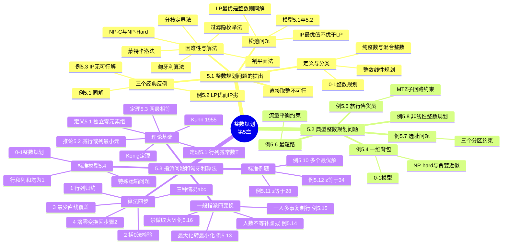

# 第五章 整数规划

> **本章主线**：整数规划 = **线性规划 + 整数约束**。把整数约束松弛掉得到 LP：若 LP 最优恰好是整数点，则**同为 IP 最优**；否则 LP 只是"参考界"，**直接取整必踩坑**。一般 IP 是 NP-C/NP-Hard，通用武器是**分枝定界、割平面、过滤隐枚举、蒙特卡洛**；当变量只有 0/1 且约束为"行和=列和=1"的**指派问题**，则有组合秒杀技——**匈牙利算法**：行列归约出零 → 括0法找独立零 → 不够 n 个就**最少直线覆盖 + 增零** → 回步骤2 重括。一般指派的四类变形（最大化、人数不等、一人多事、禁止指派）全部先**化归标准型**再套匈牙利算法。

## 5.1 整数规划问题的提出

### 5.1.1 定义与分类

- 若在**线性规划**模型中，某些或全部变量限制为整数，则称为**整数线性规划**；
- 若在**非线性规划**模型中，某些或全部变量限制为整数，则称为**非线性整数规划**；
- 整数规划严格说来就是**带有整数约束的规划问题**，但由于目前最常见的整数规划大都为整数线性规划，所以一般提到的整数规划，实际上就是指**整数线性规划**。

**分类**（按变量取整范围）：

| 类型 | 含义 | 特点 |
|---|---|---|
| **纯（完全）整数规划** | 变量**全部**限制为整数 | 如背包、指派、TSP |
| **混合整数规划** | **部分**变量限制为整数 | 如选址（0-1 变量+连续投资量） |
| **0-1 整数规划** | 变量只能取 0 或 1 | 逻辑开关：选/不选、去/不去 |

### 5.1.2 松弛问题及其性质

**整数规划（5.1）**：

$$\max z = \mathbf{c}^T \mathbf{x} \quad \text{s.t.}\ \begin{cases} A\mathbf{x} \le \mathbf{b} \\ \mathbf{x} \ge \mathbf{0} \\ \mathbf{x} \text{ 为整数向量} \end{cases} \tag{5.1}$$

**松弛问题（5.2）**——把整数约束整条扔掉：

$$\max z = \mathbf{c}^T \mathbf{x} \quad \text{s.t.}\ \begin{cases} A\mathbf{x} \le \mathbf{b} \\ \mathbf{x} \ge \mathbf{0} \end{cases} \tag{5.2}$$

两条基本性质（**必背**）：

1. 如果 **(5.2) 的最优解是整数**，则此最优解显然也是 **(5.1) 的最优解**（松弛解恰好整数 → 直接抄答案）；
2. 如果 (5.1) 和 (5.2) 都有最优解，则 **(5.1) 的最优值一定不会优于 (5.2) 的最优值**——即 max 问题中 $z^*_{\text{IP}} \le z^*_{\text{LP}}$（松弛放宽了约束，天花板只升不降；min 问题反之 $z^*_{\text{IP}} \ge z^*_{\text{LP}}$）。

### 5.1.3 三个经典对照例

#### （一）例5.1：同解——LP 最优恰好是整数

$$\text{ILP: } \max z = x_1 + x_2,\ \text{s.t.}\ x_1 + 2x_2 \le 4,\ x_1,x_2 \ge 0,\ x_1,x_2 \in \mathbb{Z}$$

其松弛问题 LP 去掉"整数"一条即可。

**解**：LP 的最优顶点在 $x_1=4,\ x_2=0$，**恰为整数点**，由性质1，它也是 ILP 的最优解：

$$\boxed{x_1 = 4,\ x_2 = 0,\ z^* = 4}$$

**一句话概括**：运气好时 LP 最优顶点天然落在格点上，松弛问题的答案**直接就是**整数规划的答案——但这是巧合而非常态。

#### （二）例5.2：LP 优而 IP 劣——取整取不出最优

$$\text{ILP: } \max z = x_1 + x_2,\ \text{s.t.}\ 2x_1 + 3x_2 \le 3,\ x_1,x_2 \ge 0,\ x_1,x_2 \in \mathbb{Z}$$

**解**：LP 最优在顶点 $(3/2,\,0)$，$z = 3/2$——**不是整数**；ILP 的可行整数点只有 $(0,0),(1,0),(0,1)$，逐一比较：

$$\boxed{\text{ILP: } x^* = (0,1),\ z^* = 1 \qquad \text{LP: } x^* = (3/2,\,0),\ z^* = 3/2}$$

**一句话概括**：LP 最优取整得 $(1,0)$ 虽可行却**不是最优**——IP 最优是 $(0,1)$，**向下取整/四舍五入都会错过真正的格点**。

#### （三）例5.3：IP 无可行解而 LP 有解

$$\text{ILP: } \max z = x_1 + x_2,\ \text{s.t.}\ 2x_1 + 4x_2 = 5,\ x_1,x_2 \ge 0,\ x_1,x_2 \in \mathbb{Z}$$

**解**：$2x_1+4x_2$ 恒为偶数，**永远不等于 5** → ILP 可行域为空、无最优解；LP 却有解：

$$\boxed{\text{ILP: 无可行解} \qquad \text{LP: } x^* = (5/2,\,0),\ z^* = 5/2}$$

**一句话概括**：LP 可行甚至有最优，IP 却可能**整域皆空**——**奇偶性**在整数世界是刀砍不断的约束，LP 的可行性完全担保不了 IP。

### 5.1.4 为什么"先松弛再取整"不可行

课件图示（p10）：坐标平面上画出**细长的 LP 可行条带**（阴影），**LP 最优解**在条带右上顶点（非格点），**ILP 最优解**是条带内靠下的某个**整数格点**，两者相距可能很远。

- LP 最优解取整后可能**不在可行域内**，或虽可行但**不是 IP 最优**；
- 条带细长时，LP 最优顶点附近的整数点可能离顶点很远——**直接四舍五入/向下取整都会出错**。

> **口诀**：松弛给的是**天花板**，不是**答案**；整数解要靠**搜索**（分枝定界）或**切割**（割平面）把 LP 的非整数最优"切掉"再逼近。

### 5.1.5 困难性与常见解法

目前，很多典型的"困难"问题（**NP-C、NP-Hard** 问题）都可以表示为整数规划问题，现实生活中的许多领域中也都有整数规划的实例，比如：

- 投资决策问题
- 设备购置问题
- 工厂选址问题
- 下料问题
- 旅行售货员问题
- 背包问题
- 指派问题等等

**常见解法**：

| 解法 | 一句话定位 |
|---|---|
| **分枝定界法** | 对小数变量"分枝"成两支加整数界，剪掉劣枝 |
| **割平面法** | 加切割约束把 LP 非整数最优割掉 |
| **过滤隐枚举法** | 专攻 0-1 规划：枚举时用条件提前"过滤"掉不可能分支 |
| **蒙特卡洛法** | 随机取样试探，简单但不保证最优 |
| **匈牙利算法** | 指派问题专用的多项式组合算法（本章 5.3） |

## 5.2 几个典型的整数规划问题

### 5.2.1 例5.4 一维背包问题

**问题**：有一个人带一个背包上山，其可携带物品重量的限度为 $b$。设有 $n$ 种不同的物品可供他选择装入背包中，已知第 $j$ 种物品的重量为 $a_j > 0$，价值为 $c_j > 0$（$j=1,\dots,n$）。问此人应如何选择携带物品的方案，使总价值最大？

**分析**：设 $x_j$ 为第 $j$ 种物品的装入件数（取 0/1），则数学模型为：

$$\max z = \sum_{j=1}^{n} c_j x_j \quad \text{s.t.}\ \begin{cases} \sum_{j=1}^{n} a_j x_j \le b \\ x_j = 0 \text{ 或 } 1,\ j = 1,2,\dots,n \end{cases}$$

- **一维背包问题是经典的 NP-hard 问题**；课件提示可用**改进的贪婪算法**求**近似解**（按"价值/重量比"排序装入，需关注做法与近似程度）；
- 应用价值：信息加密、预算控制、项目选择、材料切割、货物装载、网络信息安全等。

**一句话概括**：背包 = **"容量有限、逐件二选一"的 0-1 规划**——目标/约束都是线性的，但"整数"二字把它推进 NP-hard 深渊，贪婪只能求近似。

### 5.2.2 例5.5 旅行售货员问题（TSP）

**问题**：有一推销员，从城市 $v_0$ 出发，要遍访 $n$ 个城市各一次，最后返回 $v_0$，已知从 $v_i$ 到 $v_j$ 的旅费为 $c_{ij}$，问他应该按怎样的次序访问这些城市，使得总旅费最少？

对每对城市 $v_i, v_j$ 定义 0-1 变量 $x_{ij}$（$=1$ 表示弧 $i \to j$ 被走），数学模型为：

$$\min z = \sum_{i,j=0}^{n} c_{ij} x_{ij} \quad \text{s.t.}\ \begin{cases} \sum_{i=0}^{n} x_{ij} = 1, & j = 0,\dots,n \quad \text{（每城恰有一条进入弧）} \\ \sum_{j=0}^{n} x_{ij} = 1, & i = 0,\dots,n \quad \text{（每城恰有一条离开弧）} \\ u_i - u_j + n\,x_{ij} \le n-1, & 1 \le i \ne j \le n \quad \text{（MTZ 子回路消去）} \\ x_{ij} \in \{0,1\}, & i,j = 0,\dots,n \\ u_i \in \{0,1,\dots,n-2\}, & i = 1,\dots,n \end{cases}$$

**一句话概括**：TSP = **行和列和都是 1 的运输结构 + MTZ 约束剪掉"各自绕圈"**——度约束只保证每城一进一出，不保证连成一条路，**子回路消去**才是 TSP 的灵魂。

### 5.2.3 例5.6 最短路问题

**问题**：给定有 $m$ 个节点、$n$ 条弧的网络 $N=(V,E)$，每条弧 $(i,j)$ 长度为 $c_{ij}$，求从 $v_1$ 到 $v_m$ 总长度最短的路。

$$\min \sum_{(i,j)\in E} c_{ij} x_{ij} \quad \text{s.t.}\ \begin{cases} \displaystyle\sum_{(i,j)\in E} x_{ij} - \sum_{(k,i)\in E} x_{ki} = \begin{cases} 1, & i = 1 \\ 0, & i = 2,\dots,m-1 \\ -1, & i = m \end{cases} \\ x_{ij} \in \{0,1\}, & (i,j) \in E \end{cases}$$

**一句话概括**：0-1 版最短路 = **流量平衡约束**（起点发 1、终点收 1、中间点净流量为 0）——它本质是单商品网络流的整数特例，LP 松弛自动给出整数解。

### 5.2.4 例5.7 选址问题

**问题**：某公司拟在市东、西、南三区建立分公司，从 7 个位置 $A_i\ (i=1,\dots,7)$ 中选择。规定：**东区** $A_1,A_2,A_3$ 至多选两个；**西区** $A_4,A_5$ 至少选一个；**南区** $A_6,A_7$ 至少选一个。选 $A_i$ 需设备投资 $b_i$ 元、年利润 $c_i$ 元，投资总额不超过 $B$ 元。问选哪几个点使年利润最大？

引入 0-1 变量 $x_i$（$=1$ 表示 $A_i$ 被选中）：

$$\max z = \sum_{i=1}^{7} c_i x_i \quad \text{s.t.}\ \begin{cases} \displaystyle\sum_{i=1}^{7} b_i x_i \le B \\ x_1 + x_2 + x_3 \le 2 \quad \text{（东区至多两个）} \\ x_4 + x_5 \ge 1 \quad \text{（西区至少一个）} \\ x_6 + x_7 \ge 1 \quad \text{（南区至少一个）} \\ x_i \in \{0,1\},\ i = 1,\dots,7 \end{cases}$$

**一句话概括**：选址 = **"至多/至少"逻辑 + 预算约束**天然写成 0-1 规划——分区限制各是一条线性不等式，0-1 变量把"选或不选"的开关语义直接代数化。

### 5.2.5 例5.8 非线性整数规划

$$\max z = x_1^2 + x_2^2 + 3x_3^2 + 4x_4^2 + 2x_5^2 - 8x_1 - 2x_2 - 3x_3 - x_4 - 2x_5$$

$$\text{s.t.}\ \begin{cases} 0 \le x_i \le 99,\ i = 1,\dots,5 \\ x_1 + x_2 + x_3 + x_4 + x_5 \le 400 \\ x_1 + 2x_2 + 2x_3 + x_4 + 6x_5 \le 800 \\ 2x_1 + x_2 + 6x_3 \le 200 \\ x_3 + x_4 + 5x_5 \le 200 \end{cases}$$

**一句话概括**：目标函数带**平方项** → 这是非线性整数规划——提醒你 **IP 不一定是线性的**，"整数规划"四字约束的是变量，管不着目标与约束的形状。

## 5.3 指派问题和匈牙利算法

### 5.3.1 标准指派问题的数学模型

设有 $n$ 个人（$A_1,\dots,A_n$）与 $n$ 件工作（$B_1,\dots,B_n$），第 $i$ 人做第 $j$ 件工作的费用为 $c_{ij}$，每人恰做一件、每件恰由一人做，如何指派使总费用最小？

$$\min z = \sum_{i=1}^{n}\sum_{j=1}^{n} c_{ij} x_{ij} \quad \text{s.t.}\ \begin{cases} \displaystyle\sum_{j=1}^{n} x_{ij} = 1, & i = 1,\dots,n \quad \text{（每人恰做一件）} \\ \displaystyle\sum_{i=1}^{n} x_{ij} = 1, & j = 1,\dots,n \quad \text{（每件恰由一人做）} \\ x_{ij} \in \{0,1\}, & i,j = 1,\dots,n \end{cases} \tag{5.4}$$

**术语**：$c_{ij}$ 称**费用系数**（也叫资源/价值/效率系数）；矩阵 $C=(c_{ij})_{n\times n}$ 称**费用矩阵**；$x_{ij}$ 排成的矩阵称**决策变量矩阵**。

**三个认识**（模型定位，必背）：

1. 指派问题是产量 $a_i$、销量 $b_j$ 相等，且 $a_i = b_j = 1$ 的**特殊运输问题**；
2. 指派问题是 **0-1 型整数线性规划问题**；
3. 求解指派问题有专门的**匈牙利算法**。

### 5.3.2 理论基础：独立零元素与匈牙利算法由来

**定义5.1**：在费用矩阵 $C$ 中，有一组**在不同行不同列的零元素**，称为**独立零元素组**，此时每个元素称为**独立零元素**。

**例5.10**（多个最优解的直观演示）：已知费用矩阵

$$C = \begin{pmatrix} 5 & 0 & 2 & 0 \\ 2 & 3 & 0 & 0 \\ 0 & 5 & 6 & 7 \\ 4 & 8 & 0 & 0 \end{pmatrix}$$

容易验证下面两个解都是指派问题的最优解（$z^*=0$，四人全派在零费用格上）：

$$X(1) = \begin{pmatrix} 0&1&0&0 \\ 0&0&0&1 \\ 1&0&0&0 \\ 0&0&1&0 \end{pmatrix}, \qquad X(2) = \begin{pmatrix} 0&1&0&0 \\ 0&0&1&0 \\ 1&0&0&0 \\ 0&0&0&1 \end{pmatrix}$$

> 若 $C$ 中能找到**含 $n$ 个**独立零元素组，令对应 $x_{ij}=1$、其余为 0，即得最优解；但有的矩阵独立零元素**不够 $n$ 个**，无法直接读出方案。

**匈牙利算法由来**：**1955 年，库恩（W.W.Kuhn）**在此基础上提出指派问题的解法，他引用匈牙利数学家**康尼格（D.Konig）**关于矩阵中 0 元素的定理：

> **系数矩阵上独立 0 元素的最多个数 = 能覆盖所有 0 元素的最少直线数。**

这解法称为**匈牙利法**，此后方法不断改进，但仍沿用此名。

**定理5.1**（减常数，最优解不变）：设指派问题费用矩阵为 $C=(c_{ij})_{n\times n}$，若将某一行（或某一列）的各元素都减去统一常数 $T$（$T$ 可正可负），得新矩阵 $C'$，则以 $C'$ 为费用矩阵的新问题与原问题的**最优解相同**，但其**最优值比原最优值减少 $T$**。

> 直觉：每个可行指派在该行（列）上**必取且仅取一个**元素，全体方案的总费用**同减 $T$**——排序不变，冠军还是原来那个。

**推论5.2**（算法第一步的依据）：若将费用矩阵**每一行及每一列**分别减去**各行及各列的最小元素**，则得到的新指派问题与原问题**有相同的最优解**。

**零元素的含义**：行减、列减之后的 $c'_{ij}=0$，从第 $i$ 行看表示"第 $i$ 人干第 $j$ 项工作**相对最省**"，从第 $j$ 列看表示"第 $j$ 项工作让第 $i$ 人干**相对最省**"。

**定理5.3**（算法第三步的依据）：费用矩阵中**独立零元素的最多个数 = 能覆盖所有零元素的最少直线数**。（证明略，用例题说明。）

### 5.3.3 匈牙利算法四步（标准型）

**步骤1）变换费用矩阵**：将各行各列都减去当前各行、各列中的最小元素，使每行每列**必然出现零元素**（由定理5.1/推论5.2，最优解不变）。

**步骤2）括0法找独立零元素**：

1. **行检验**：逐行扫描，对**只有一个**未标记零元素的行，用"（ ）"将其括起，然后把该零元素**所在列**的其它未标记零元素用 **×** 划去；重复直到每行都没有未标记零、或至少有两个未标记零；
2. **列检验**：逐列同样操作——唯一零则括起，并把**所在行**其它未标记零划 ×；重复直到每列都无未标记零或至少两个未标记零；
3. 检验完毕出现三种情况：

| 情况 | 判别条件 | 处理 |
|---|---|---|
| **(a)** | 每行都有被括的 0，个数 $m = n$ | 令被括零对应的 $x_{ij}=1$、其余为 0 → **最优解，停止** |
| **(b)** | 存在未标记零，且所在行列的未标记零都 ≥ 2 | **多个最优解**：从剩 0 最少的行/列入手试探（选择多的"礼让"选择少的），继续括0/划 ×，直到 (a) 或 (c) |
| **(c)** | 无未标记零，但括 0 个数 $m < n$ | 转**步骤3）最少直线覆盖** |

**步骤3）做最少直线覆盖当前所有零元素**（打 √ 法）：

1. 对所有**不含被括0元素的行**打 √；
2. 对打√行中**所有零元素所在列**打 √；
3. 对打√列中**被括0元素所在行**打 √；
4. 重复 2)–3) 直到不能再打√；
5. 对**未打√的每一行**划一横线、**已打√的每一列**划一纵线 → 得到覆盖全部 0 的最少直线。

**步骤4）增零变换，回到步骤2）**：在**未被直线覆盖**的元素中找最小元素 $m_0$，将**打√行**（未覆盖行）各元素**减去** $m_0$，将**打√列**（已覆盖列）各元素**加上** $m_0$（避免负数）——零元素个数增加，回到步骤2）重新括0。

> **口诀**：**行减列减出零 → 括0划叉检验 → 够 n 个就收工；不够打√画线 → 未覆盖行减、覆盖列加 → 回头再括**。

### 5.3.4 例5.11：标准型完整求解（一气呵成版）

给定费用矩阵（标准指派）：

$$C = \begin{pmatrix} 2 & 15 & 13 & 4 \\ 10 & 4 & 14 & 15 \\ 9 & 14 & 16 & 13 \\ 7 & 8 & 11 & 9 \end{pmatrix}$$

**解**：

1）**行列归约**：各行减行最小 $(2,4,9,7)$，再各列减列最小 $(0,0,3,0)$：

$$C' = \begin{pmatrix} 0 & 13 & 7 & 0 \\ 6 & 0 & 6 & 9 \\ 0 & 5 & 3 & 2 \\ 0 & 1 & 0 & 0 \end{pmatrix}$$

2）**括0法**：行1 只剩零在列4 → 括 $c_{14}$、划 ×$c_{11}$；行2 括 $c_{22}$；行3 括 $c_{31}$；行4 括 $c_{43}$、划 ×$c_{41},c_{44}$。逐行逐列检验后**被括0恰 4 个 = n**，出现**情况(a)**：

$$X^* = \begin{pmatrix} 0&0&0&1 \\ 0&1&0&0 \\ 1&0&0&0 \\ 0&0&1&0 \end{pmatrix}$$

即 **A1→B4，A2→B2，A3→B1，A4→B3**，最优值

$$\boxed{z^* = 4 + 4 + 9 + 11 = 28}$$

**一句话概括**：例5.11 是匈牙利算法的**标准剧本**——归约出零、括0直接凑满 n 个，一次命中，无需画线增零。

### 5.3.5 例5.12：直线覆盖 + 增零（情况(c) 全流程）

某商业公司由 5 家建筑公司 $A_i$ 承建 5 个新商店 $B_j$，建造费用（万元）：

| $c_{ij}$ | $B_1$ | $B_2$ | $B_3$ | $B_4$ | $B_5$ |
|---|---|---|---|---|---|
| $A_1$ | 4 | 8 | 7 | 15 | 12 |
| $A_2$ | 7 | 9 | 17 | 14 | 10 |
| $A_3$ | 6 | 9 | 12 | 8 | 7 |
| $A_4$ | 6 | 7 | 14 | 6 | 10 |
| $A_5$ | 6 | 9 | 12 | 10 | 6 |

**解**：

1）行列归约后括0，得独立零 **4 个 < 5**，出现**情况(c)**。

3）**打√画线**：不含被括0的行是第3行 → 打√；第3行的零在第1列 → 第1列打√；第1列的被括0在第2行 → 第2行打√；不能再扩。**未打√的第1,4,5行划横线、已打√的第1列划纵线**——4 条线覆盖全部零（< 5，验证定理5.3：独立零最多 4 个）。

4）**增零**：未被覆盖元素最小值 $m_0 = c_{21} = c_{35} = 1$，打√的第2,3行各减 1、打√的第1列各加 1：

$$C''' = \begin{pmatrix} 1 & 3 & 0 & 11 & 8 \\ 0 & 0 & 6 & 6 & 2 \\ 0 & 1 & 2 & 1 & 0 \\ 1 & 0 & 5 & 0 & 4 \\ 1 & 2 & 3 & 4 & 0 \end{pmatrix}$$

回到步骤2）重新括0，最终得到 5 个独立零元素，最优指派：

$$\boxed{A_1 \to B_3,\ A_2 \to B_2,\ A_3 \to B_1,\ A_4 \to B_4,\ A_5 \to B_5,\quad z^* = 7+9+6+6+6 = 34 \text{（万元）}}$$

**一句话概括**：例5.12 是**画线增零**的教科书案例——独立零不够就用"未覆盖行减、覆盖列加"制造新零，**多一轮括0就多一批候选格**，直到凑满 n 个。

### 5.3.6 一般指派问题的四类变换

实际问题往往**不标准**，解决思路统一为：**先化成标准形式，再用匈牙利法求解**。

#### （一）最大化问题 → 最小化（例5.13）

**处理办法**：设最大化指派问题的系数矩阵为 $C=(c_{ij})_{n\times n}$，令

$$m = \max_{i,j}\{c_{ij}\}, \qquad B = (b_{ij})_{n\times n},\ b_{ij} = m - c_{ij}$$

则以 $B$ 为系数矩阵的**最小化**问题与以 $C$ 为系数矩阵的**最大化**问题有**相同的最优解**。

**例5.13**：4 名工人 $A_1..A_4$ 操作 4 台车床 $B_1..B_4$，每小时单产量（产值）：

| 产值 | $B_1$ | $B_2$ | $B_3$ | $B_4$ |
|---|---|---|---|---|
| $A_1$ | 10 | 9 | 8 | 7 |
| $A_2$ | 3 | 4 | 5 | 6 |
| $A_3$ | 2 | 1 | 1 | 2 |
| $A_4$ | 4 | 3 | 5 | 6 |

**解**：$m = \max\{c_{ij}\} = 10$，取 $b_{ij} = 10 - c_{ij}$：

$$B = \begin{pmatrix} 0&1&2&3 \\ 7&6&5&4 \\ 8&9&9&8 \\ 6&7&5&4 \end{pmatrix} \xrightarrow{\text{行变换}} \begin{pmatrix} 0&1&2&3 \\ 3&2&1&0 \\ 0&1&1&0 \\ 2&3&1&0 \end{pmatrix} \xrightarrow{\text{列变换}} B' = \begin{pmatrix} 0&0&1&3 \\ 3&1&0&0 \\ 0&0&0&0 \\ 2&2&0&0 \end{pmatrix}$$

由 $B'$ 读出最优解：

$$X^* = \begin{pmatrix} 1&0&0&0 \\ 0&0&0&1 \\ 0&1&0&0 \\ 0&0&1&0 \end{pmatrix}, \qquad \boxed{z^* = 10+6+1+5 = 22}$$

即 **A1→B1，A2→B4，A3→B2，A4→B3**。

**一句话概括**：最大化化最小化的本质是**"按距最高值的差距排序"**——差得越少越好，最优指派与原问题逐格对应。

#### （二）人数 ≠ 事数 → 补虚拟行/列（例5.14）

**例5.14**：现有 4 个人、5 件工作，每人做每件工作所耗时间：

| 时间 | $B_1$ | $B_2$ | $B_3$ | $B_4$ | $B_5$ |
|---|---|---|---|---|---|
| $A_1$ | 10 | 11 | 4 | 2 | 8 |
| $A_2$ | 7 | 11 | 10 | 14 | 12 |
| $A_3$ | 5 | 6 | 9 | 12 | 14 |
| $A_4$ | 13 | 15 | 11 | 10 | 7 |

**解**：4 人 < 5 事，**添加虚拟人 $A_5$**（费用全 0，表示"这活没人干"），构造标准耗时矩阵再行/列变换：

$$C = \begin{pmatrix} 10&11&4&2&8 \\ 7&11&10&14&12 \\ 5&6&9&12&14 \\ 13&15&11&10&7 \\ 0&0&0&0&0 \end{pmatrix} \xrightarrow{\text{行变换}} C' = \begin{pmatrix} 8&9&2&0&6 \\ 0&4&3&7&5 \\ 0&1&4&7&9 \\ 6&8&4&3&0 \\ 0&0&0&0&0 \end{pmatrix}$$

继续匈牙利法（覆盖 + 增零若干轮），得最优指派：

$$X^* = \begin{pmatrix} 0&0&0&1&0 \\ 1&0&0&0&0 \\ 0&1&0&0&0 \\ 0&0&0&0&1 \\ 0&0&1&0&0 \end{pmatrix}, \qquad \boxed{z^* = 2+7+6+7 = 22}$$

即 **A1→B4，A2→B1，A3→B2，A4→B5，B3 由虚拟人承接（实际无人做）**。

**一句话概括**：人少事多就**补虚拟人（整行 0）**——它把"允许有的事没人干"编码成"虚拟人白送"，选出的方案自动告诉你哪件事被放弃了。

#### （三）一人可做几件事 → 复制"人"（例5.15）

**处理办法**：若某人可做几件事，则将该人**化作相同的几个"人"**来接受指派——这几个"人"做同一件事的费用系数当然一样。

**例5.15**：对例5.12 的指派问题，舍弃 $A_4,A_5$，只让 $A_1,A_2,A_3$ 承建，且**每家最多承建两家**商店，求总费用最少方案。

**解**：把每家公司**复制成两家**（$A_i$ 与 $A_i'$，$i=1,2,3$），系数矩阵变 6 行 5 列；再**引入虚拟事 $B_6$** 补成 6×6 标准型，匈牙利法求解得：

$$\boxed{A_1 \text{ 承建 } B_1, B_3;\quad A_2 \text{ 承建 } B_2;\quad A_3 \text{ 承建 } B_4, B_5;\quad z^* = 7+4+9+7+8 = 35 \text{（万元）}}$$

（$B_6$ 为虚拟工程；$A_2$ 只占一店，另一份"复制人"派给虚拟事。）

**一句话概括**：一人多事就**复制几行**——"一人干两件"变成"两个相同的人各干一件"，行数按**可做事次数**扩，再用虚拟列配平。

#### （四）某事不能由某人做 → 费用取大 M（例5.16）

**处理办法**：某事不能由某人去做，**将此人做此事的费用取作足够大的 $M$**。

**例5.16**：甲、乙、丙、丁 4 人完成 A、B、C、D、E 五项任务，每人耗时：

| 人\任务 | A | B | C | D | E |
|---|---|---|---|---|---|
| 甲 | 25 | 29 | 31 | 42 | 37 |
| 乙 | 39 | 38 | 26 | 20 | 33 |
| 丙 | 34 | 27 | 28 | 40 | 32 |
| 丁 | 24 | 42 | 36 | 23 | 45 |

**a)** 任务 E **必须完成**，其它 4 项可选 3 项完成，但**甲不能做 A**。

**解**：任务多于人数 → 补**虚拟人戊**；E 必须完成 → **戊做 E 的时间设为 $M$**（戊不能做 E，逼真活必落真人头），其余假想时间 0；甲不能做 A → **甲做 A 的时间 25 改为 $M$**：

| 人\任务 | A | B | C | D | E |
|---|---|---|---|---|---|
| 甲 | **M** | 29 | 31 | 42 | 37 |
| 乙 | 39 | 38 | 26 | 20 | 33 |
| 丙 | 34 | 27 | 28 | 40 | 32 |
| 丁 | 24 | 42 | 36 | 23 | 45 |
| 戊 | 0 | 0 | 0 | 0 | **M** |

匈牙利法求解得：

$$\boxed{\text{甲做B，乙做D，丙做E，丁做A；戊做C（虚拟，实际 C 无人做）}；\ z^* = 29+20+32+24 = 105}$$

**b)** 其中**有一人完成两项**，其他人每人完成一项。

**解**：设虚拟人戊"集五人优势为一身"——戊做每项工作的费用取**每人做该项的最低费用**：戊行 $= (24,\,27,\,26,\,20,\,32)$。行、列变换 → 括0 仅 3 个 < 5 → 画线覆盖 + 增零 → 再括0 仍 3 个 < 5 → 再画线增零得 $C'''$ → 最优指派：甲B、乙D、丙E、丁A、**戊C**。但戊是虚拟人不能真做，它指派的 C 是**借乙的优势**（C 列最小 26 是乙的成绩），应由**乙来做 C**——即乙做两件工作：

$$\boxed{\text{甲做B，乙做C、D，丙做E，丁做A}}$$

**一句话概括**：**禁做取 M、必做反向取 M、一人多活复制行、人少事多补虚拟**——四把钥匙开四把锁，最后都插回"行列相等的 0-1 标准型"这一把总锁。

### 5.3.7 四类变换速查表

| 情形 | 变换手法 | 例题 | 关键数 |
|---|---|---|---|
| **最大化** | $b_{ij} = m - c_{ij}$，$m=\max\{c_{ij}\}$ | 例5.13 | $m=10$，$z^*=22$ |
| **人数 ≠ 事数** | 补虚拟行/列（费用全 0） | 例5.14 | $z^*=22$，B3 被放弃 |
| **一人可做多事** | 复制该"人"若干行 | 例5.15 | $z^*=35$，另补虚拟事 |
| **某事不能某人做** | 该格费用 $\to M$（必做则反向：虚拟人该格 $\to M$） | 例5.16 | a) $z^*=105$；b) 乙兼 C、D |

> **总口诀**：**标准化 → 归约出零 → 括0检验 → 不够画线 → 增零回头**；变形题先"翻译"，再进流水线。

### 知识定位与框架衔接

**前置知识**：第 2 章的**线性规划与图解法**是本章的地基——松弛问题 (5.2) 就是 LP，例5.1–5.3 的对照全靠 LP 最优顶点与整数格点的比较；第 4 章的**运输问题**是 5.3.1 的直接血亲——指派就是 $a_i=b_j=1$ 的运输表；"至多/至少"的 0-1 写法本质是**逻辑命题的代数化**（布尔代数进不等式）。

**后置知识**：

1. **分枝定界与割平面**：本章只列出名字，真正展开在后续算法课程——分枝定界用 LP 松弛做"界"去剪枝，割平面不断加约束逼近整数顶点，二者都以本章"松弛性质"为正确性根基；
2. **组合优化与近似算法**：背包、TSP、指派是 NP-hard / 多项式算法的两个极端样本——指派有匈牙利算法（多项式），TSP 一般情形没有（除非 P=NP），贪婪近似给背包一条工程出路；
3. **计算机科学的复杂性理论**：NP-C、NP-Hard 的"困难问题都能写成 IP"提示了**整数规划是复杂性的通用语言**——认证一个解容易（代入验算），找一个解难（搜索空间指数爆炸）；
4. **第 6 章动态规划**：背包、最短路同样可以用 DP 解——DP 用"阶段+状态"绕开整数约束，IP 用"松弛+切割"正面强攻，**同一问题的两种思维范式**。

**比喻**：LP 是**在连续的房间里自由滑翔**取最高点，IP 是**只允许落在房间里的棋盘格点上**——滑翔的最高点落不了地（例5.2/5.3），所以要么**把房间切成格子间**（割平面），要么**沿着格子分岔搜索**（分枝定界）；而指派问题的棋盘经过"行列归约"后自带**零元素星图**，匈牙利算法就是沿星图连线的**组合寻路术**。

**核心灵魂问题（学完本章应能回答）**：

1. **为什么"先解 LP 再取整"不是整数规划的解法？**——因为 LP 最优顶点附近的格点可能**既不可行也不最优**（例5.2 取整错过 $(0,1)$），细长可行域里 LP 顶点与最近格点能隔十万八千里（p10 图示）；更极端时 LP 有解而 IP **无可行**（例5.3 的奇偶性）。LP 只提供**界**（max 时 $z^*_{IP}\le z^*_{LP}$），不提供**解**。
2. **定理5.1"行/列减常数最优解不变"的直觉是什么？**——任何可行指派在该行该列**必取且只取一个元素**，减 $T$ 等于给**所有方案的总费用同减 $T$**：大家同罚，排序不动，冠军不变、最优值平移 $T$。于是可以把矩阵**随便归约**（减行最小、列最小）直到零元素成批出现——这是匈牙利算法一切操作的**合法性来源**。
3. **Konig 定理"独立零最多个数 = 覆盖零的最少直线数"为什么是算法的心脏？**——它是一个**对偶式平衡条件**：左边是"能配出多少对不冲突的零"（方案质量），右边是"最少几条线能罩住所有零"（障碍数量）。若直线数 < n，则**必有零没被充分使用**，算法就知道"还差火候"，画线增零**制造新零**；一旦独立零攒够 n 个，立刻读出最优——**数不够 → 加零，数够了 → 收工**，判停与推进全靠这一个等式。
4. **指派问题为什么既是最简单的运输问题、又是"最难"的 0-1 规划？**——简单在结构：行和列和都锁死为 1，可行域只有 $n^n$ 级的排列组合、约束矩阵全幺模，**LP 松弛的顶点天然整数**（这是它能被多项式求解的深层原因）；"难"在一般 0-1 规划没有这种对称性——所以四类变形题的第一步全是**变回这种对称结构**（补虚拟、复制行、取 M），匈牙利算法只认标准型这一张脸。
5. **例5.16b 中"戊借乙的优势"说明了什么？**——虚拟人的角色是"**占位不干活**"：它带着各列最小费用进场把方阵配平，一旦它被选中干了某活，就意味着**那件活其实该由创造这个最小值的真人去做**——但一个人只能做一件，冲突（乙被派了 D 又被借了 C）就通过"复制一人"的思路解开。**虚拟元素是配平工具，不是真实决策**——读解时必须把虚拟行列翻译回现实语义。

> **一句话总结本章**：**整数规划 = LP 松弛 + 整数约束（NP-C 难题）：先验松弛——LP 最优是整数则同解、否则只是界，直接取整必错；通用解法靠分枝定界/割平面/隐枚举/蒙特卡洛；指派问题是 0-1 规划的"结构化甜点"——行列归约出零 → 括0法数独立零 → 够 n 个读最优，不够画最少直线覆盖 → 未覆盖行减、覆盖列加 → 回头重括（Konig 定理保正确），四类变形（最大化取补、人少补虚拟、一人多活复制行、禁做取 M）先化归标准型再进匈牙利流水线**。

---

## 课件 PDF

<iframe src="https://cognishelf.naimore3.workers.dev/课程笔记/大二上/运筹学/05整数规划/05整数规划.pdf" width="100%" height="800px" style="border: none;"></iframe>

[打开 PDF](https://cognishelf.naimore3.workers.dev/课程笔记/大二上/运筹学/05整数规划/05整数规划.pdf)
