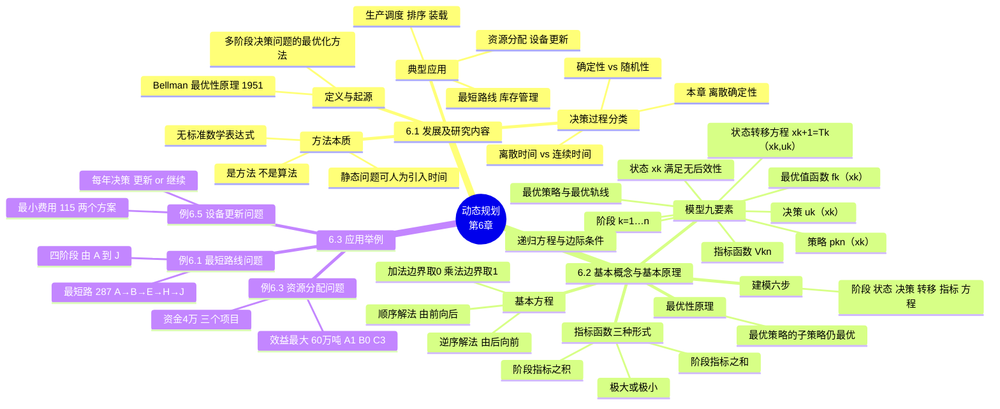
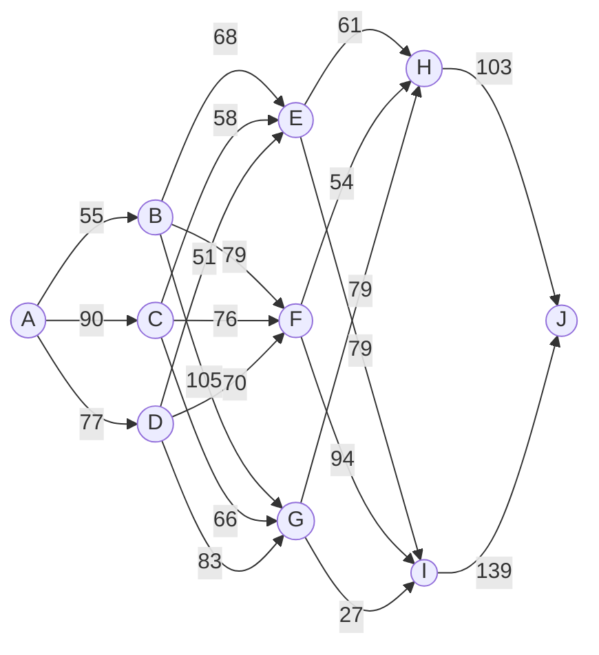

# 第六章 动态规划（Dynamic Programming）

> **本章主线**：动态规划是求解**多阶段决策问题**的最优化方法。本章沿"为什么（方法定位）→ 是什么（模型要素与基本方程）→ 怎么用（三类经典应用）"展开：6.1 节交代动态规划的起源与方法本质；6.2 节系统给出模型的九大要素、指标函数的常见形式、递归方程（基本方程）与最优性原理，并归纳出**建模六步**；6.3 节以最短路线、资源分配、设备更新三个经典问题，完整演示"**建模 → 逆序递推 → 结果回溯**"的求解流程。
>
> 一句话版本：**动态规划 = "从终点倒推的接力优化"**——把多阶段问题拆成一串单阶段问题，由后向前逐个求出最优值函数，最后从起点回溯拼出全局最优策略。

---

## 6.1 动态规划的发展及研究内容

### 6.1.1 起源与定义：从多阶段决策到最优性原理

**动态规划（dynamic programming）**是运筹学的一个分支，是**求解多阶段决策问题的一种常见的最优化方法**。

20 世纪 50 年代初，**R. E. Bellman** 等人在研究**多阶段决策过程（multistep decision process）**的优化问题时，提出了著名的**最优性原理（principle of optimality）**：把多阶段过程转化为一系列单阶段问题，逐个求解，从而创立了解决这类过程优化问题的新方法——动态规划。

动态规划问世以来，在经济管理、生产调度、工程技术和最优控制，以及工农业生产和军事等部门都有广泛应用并取得显著成果。典型的适用问题包括：**最短路线、库存管理、资源分配、设备更新、生产调度、排序、装载**等——对这些问题，用动态规划方法比用其他方法求解常常更为方便和有效。

### 6.1.2 决策过程的分类：四种基本类型

根据两个划分维度，多阶段决策问题可以分成四类：

1. **按过程的时间变量**：**离散时间决策过程（discrete-time decision process）**与**连续时间决策过程（continuous-time decision process）**；
2. **按过程的演变性质**：**确定性决策过程（deterministic decision process）**与**随机性决策过程（stochastic decision process）**。

两个维度两两组合，得到如下分类：

| 时间 \ 演变 | 确定性 | 随机性 |
|---|---|---|
| 离散时间 | 离散确定性决策过程 ✓ | 离散随机性决策过程 |
| 连续时间 | 连续确定性决策过程 | 连续随机性决策过程 |

其中**应用最广、也最基本的是离散确定性决策过程**，本章内容主要介绍离散确定性决策过程。领会分类的意义在于：掌握这一类，其余三类本质上只是"阶段划分方式"或"转移规律是否含随机性"的变体。

### 6.1.3 方法本质：是一种方法，而非一种算法

虽然动态规划主要用于求解以时间划分阶段的动态过程的优化问题，但一些**与时间无关的静态规划**（如线性规划、非线性规划），只要**人为地引进时间因素**，把它视为多阶段决策过程，也可以用动态规划方法方便地求解。

需要特别强调：**动态规划是求解某类问题的一种方法，是考察问题的一种途径，而不是一种特殊算法**（如线性规划是一种算法）。因此，它不像线性规划那样有一个标准的数学表达式和明确定义的一组规则，而**必须对具体问题进行具体分析处理**。在学习时，除了要对基本概念和方法正确理解外，还应以丰富的想象力去建立模型，用创造性的技巧去求解。

将动态规划与线性规划强制对比，有助于立刻抓住它的"性格"：

| 维度 | 线性规划 | 动态规划 |
|---|---|---|
| 学科定位 | 是一种**算法** | 是一种**方法 / 考察问题的途径** |
| 表达形式 | 有**标准数学表达式**（目标 + 约束的标准型）与明确规则 | **无标准形式**，须对具体问题具体建模 |
| 适用对象 | 静态规划问题 | 多阶段决策问题（静态问题经"引入时间"也可用） |
| 求解思路 | 单纯形法统一求解 | 拆阶段 → 定状态 → 逆序递推 → 回溯 | 
| 学习难点 | 算法步骤的熟练运用 | 模型的想象力与创造性 |
| 一句话 | 有固定模板可套 | 只有"拆阶段、定状态"的心法可循 |

> 口诀：**线性规划是"算法"，有模板；动态规划是"方法"，靠建模**。

---

## 6.2 动态规划的基本概念、基本方程、最优性原理和基本步骤

### 6.2.1 动态规划模型的九大要素

一个多阶段决策过程最优化问题的动态规划模型，通常包含以下九类要素：

**（1）阶段（step）**：阶段是对整个过程的**自然划分**，通常根据**时间顺序或空间顺序**特征来划分。阶段变量一般用 $k=1,2,\cdots,n$ 表示。划分阶段的依据随问题而定：例 6.1 按网络层数划分，例 6.3 按投资项目逐个划分，例 6.5 按运行年份划分。

**（2）状态（state）**：状态表示每个阶段开始时过程所处的**自然状况或客观条件**。它描述过程的特征，并且**满足无后效性**（补充说明/拓展：无后效性，即马尔可夫性——将来只由当前状态和当前决策决定，与更早的历史无关；这是递推能够"只看当前"的前提）。描述状态的变量称**状态变量（state variable）**，变量允许取值的范围称**允许状态集合（set of admissible states）**。用 $x_k$ 表示第 $k$ 阶段的状态变量，它可以是一个数或一个向量；用 $X_k$ 表示第 $k$ 阶段的允许状态集合。**$n$ 个阶段的决策过程有 $n+1$ 个状态变量**，$x_{n+1}$ 表示 $x_n$ 演变的结果。状态变量可以是离散的或连续的。

**（3）决策（decision，最优控制中也称控制 control）**：当一个阶段的状态确定后，可以作出各种选择从而演变到下一阶段的某个状态，这种选择手段称为**决策**。描述决策的变量称**决策变量（decision variable）**，变量允许取值的范围称**允许决策集合（set of admissible decisions）**。用 $u_k(x_k)$ 表示第 $k$ 阶段处于状态 $x_k$ 时的决策变量，它是 $x_k$ 的函数；用 $U_k(x_k)$ 表示 $x_k$ 的允许决策集合。

**（4）策略（policy）**：**决策组成的序列称为策略**。由初始状态 $x_1$ 开始的全过程的策略记作 $p_{1n}(x_1)$；由第 $k$ 阶段的状态 $x_k$ 开始到终止状态的后部子过程的策略记作 $p_{kn}(x_k)$；类似地，由第 $k$ 到第 $j$ 阶段的子过程的策略记作 $p_{kj}(x_k)$：

$$p_{1n}(x_1)=\{u_1(x_1),u_2(x_2),\cdots,u_n(x_n)\}$$

$$p_{kn}(x_k)=\{u_k(x_k),u_{k+1}(x_{k+1}),\cdots,u_n(x_n)\},\quad k=1,2,\cdots,n-1$$

$$p_{kj}(x_k)=\{u_k(x_k),u_{k+1}(x_{k+1}),\cdots,u_j(x_j)\}$$

可供选择的策略有一定的范围，称为**允许策略集合（set of admissible policies）**，分别用 $P_{1n}(x_1)$、$P_{kn}(x_k)$、$P_{kj}(x_k)$ 表示。

**（5）状态转移方程（equation of state transition）**：在确定性过程中，一旦某阶段的状态和决策为已知，下阶段的状态便完全确定。用状态转移方程表示这种演变规律：

$$x_{k+1}=T_k(x_k,u_k),\quad k=1,2,\cdots,n \tag{6.1}$$

**（6）指标函数（objective function）与最优值函数（optimal value function）**：指标函数是**衡量过程优劣的数量指标**，它是定义在全过程和所有后部子过程上的数量函数，用 $V_{kn}(x_k,u_k,x_{k+1},\cdots,x_{n+1})$ 表示（$k=1,2,\cdots,n$）。指标函数应具有**可分离性**，并满足**递推关系**：即 $V_{kn}$ 可表为 $x_k$、$u_k$、$V_{k+1,n}$ 的函数，记为 $V_{kn}=\phi_k(x_k,u_k,V_{k+1,n})$，并且函数 $\phi_k$ 对于变量 $V_{k+1,n}$ 是**严格单调**的。在 $x_k$ 给定时，指标函数 $V_{kn}$ 对策略 $p_{kn}$ 的最优值称为**最优值函数**，记为

$$f_k(x_k)=\operatorname*{opt}_{p_{kn}\in P_{kn}(x_k)} V_{kn}(x_k,p_{kn})$$

其中 **opt 可根据具体情况取 min 或 max**。

**（7）最优策略（optimal policy）与最优轨线（optimal trajectory）**：使指标函数 $V_{kn}$ 达到最优值的策略，是从 $k$ 开始的后部子过程的最优策略，记作 $p^*_{kn}=\{u^*_k,\cdots,u^*_n\}$；$p^*_{1n}$ 是全过程的最优策略，简称**最优策略**。从初始状态 $x_1(=x^*_1)$ 出发，过程按照 $p^*_{1n}$ 和状态转移方程演变所经历的状态序列 $\{x^*_1,x^*_2,\cdots,x^*_{n+1}\}$ 称为**最优轨线**。

**（8）递归方程（recursion equation）或基本方程（fundamental equation）**：在求解过程中，各个阶段到下个阶段的最优值函数之间有一种递推关系，这种**递推关系和边际条件**合称递归方程或基本方程。一般形式如下（此即动态规划的基本方程）：

$$f_k(x_k)=\operatorname*{opt}_{u_k\in U_k(x_k)}\{v_k(x_k,u_k)+f_{k+1}(x_{k+1})\},\quad k=n,n-1,\cdots,1 \tag{6.2}$$

$$f_{n+1}(x_{n+1})=0\ \ (\text{加法指标})\quad\text{或}\quad f_{n+1}(x_{n+1})=1\ \ (\text{乘法指标})$$

（补充说明/拓展）边际条件为何取 0 或 1？因为它们是加法与乘法的**恒等元**：后面的指标"为空"时，加 0 不改变累计和，乘 1 不改变累计积——于是递推方能从 $k=n+1$ 处"空着起跑"。

**（9）最优化原理（principle of optimality）**：**1951 年，R. E. Bellman 提出了最优化原理**：作为整个过程的最优策略具有这样的性质，即**无论其初始状态和初始决策如何，其以后决策对以第一个决策所形成的状态作为初始状态的过程而言，必须构成最优策略**。简而言之：**一个最优策略的任一子策略总是最优的**。动态规划递归方程正是最优性原理的基础——即"最优策略的子策略，构成最优子策略"，由此才允许我们只保留每一阶段的"最优值 + 最优决策"，而不必枚举全部路径。

### 6.2.2 指标函数的常见形式：和、积、极大（极小）

过程在第 $j$ 阶段的阶段指标取决于状态 $x_j$ 和决策 $u_j$，用 $v_j(x_j,u_j)$ 表示。指标函数由 $v_j\ (j=1,2,\cdots,n)$ 组成，常见形式有三种：

1. **阶段指标之和**：$V_{kn}=\displaystyle\sum_{j=k}^{n}v_j(x_j,u_j)$；
2. **阶段指标之积**：$V_{kn}=\displaystyle\prod_{j=k}^{n}v_j(x_j,u_j)$；
3. **阶段指标之极大（或极小）**：$V_{kn}=\displaystyle\max_{k\le j\le n}\left(\min\right)\, v_j(x_j,u_j)$。

这些形式下，第 $k$ 到第 $j$ 阶段子过程的指标函数均记为 $V_{kj}(x_k,u_k,x_{k+1},\cdots,x_{j+1})$。根据状态转移方程，指标函数 $V_{kn}$ 还可以表示为状态 $x_k$ 和策略 $p_{kn}$ 的函数，即 $V_{kn}(x_k,p_{kn})$。

三种形式对应三类递推"运算语言"：求和公式对应"累计收益/代价"（路线、资金类），求积对应"概率连乘"（可靠性、成功率类），取极大（极小）对应"最坏/最好一段"（瓶颈类）。递推时只需把基本方程 (6.2) 中的 "+" 对应替换为 $\times$ 或 $\max(\min)$，边界条件相应取恒等元。

### 6.2.3 基本方程的解法：逆序解法与顺序解法

用状态转移方程 (6.1) 和递归方程 (6.2) 求解动态规划的过程，是由 $k=n+1$ 逆推至 $k=1$，故这种解法称为**逆序解法**（反向求出各阶段最优值函数，最后得到 $f_1(x_1)$ 与 $p^*_{1n}$）。

当然，对某些动态规划问题，也可采用**顺序解法**（由阶段 1 正推至阶段 $n$）。这时，状态转移方程与递归方程相应地改写为"由后一状态反解前一状态"的形式（补充说明/拓展——给出本讲末页所述的等价正推写法）：

$$f_k(x_{k+1})=\operatorname*{opt}_{u_k\in U_k(x_k)}\{v_k(x_k,u_k)+f_{k-1}(x_k)\},\quad f_0(x_1)=0\ \text{（或 }1\text{）},\ k=1,2,\cdots,n$$

逆序与顺序解法互为镜像：**逆序把"终点"当作固定已知，顺序把"起点"当作固定已知**；具体选哪一种，取决于哪一端的状态信息更确定（如固定终点求最短、或固定起点求最短）。本章例题均按 PPT 采用逆序解法。

### 6.2.4 最优性原理：为什么"局部最优能拼出全局最优"

**最优性原理（principle of optimality）**（Bellman，1951 年）的完整表述：**作为整个过程的最优策略具有这样的性质，即无论其初始状态和初始决策如何，其以后决策对以第一个决策所形成的状态作为初始状态的过程而言，必须构成最优策略。** 简而言之：**一个最优策略的任一子策略总是最优的**。

它揭示的直觉是（补充说明/拓展）：若某条全程最优路线在进入中间状态后又走出了一条"非最优"的后半程，那么用那条真正的后半程最优路线替换它，全程只会更好——这与"全程最优"矛盾。因此递推过程中每个状态只需记住两个量：**该状态到终点的最优值 $f_k(x_k)$**，以及**达到该最优值的决策 $u^*_k$**；其余路径全部可以剪掉，这正是动态规划"化指数枚举为多项式计算"的效率来源。

需要注意，最优性原理成立的前提是模型满足**无后效性**（见 6.2.1 要素（2））：状态必须"存储"了影响未来决策的全部信息。若状态定义漏掉关键信息，则"子策略最优"不再能拼出"全局最优"，方法便失效。

### 6.2.5 建立动态规划数学模型的基本步骤（建模六步）

如果一个问题能用动态规划方法求解，可按下列步骤建立起动态规划的数学模型：

1. **将过程划分成恰当的阶段**（阶段变量 $k=1,2,\cdots,n$）；
2. **正确选择状态变量 $x_k$**，使它既能描述过程的状态，又**满足无后效性**，同时确定允许状态集合 $X_k$；
3. **选择决策变量 $u_k$**，确定允许决策集合 $U_k(x_k)$；
4. **写出状态转移方程**（$x_{k+1}=T_k(x_k,u_k)$）；
5. **确定阶段指标 $v_k(x_k,u_k)$ 及指标函数 $V_{kn}$ 的形式**（阶段指标之和、阶段指标之积、阶段指标之极大或极小等）；
6. **写出基本方程**，即最优值函数满足的递归方程，以及边际条件（加法取 $0$、乘法取 $1$）。

> 记忆抓手：六步可浓缩为三个问号——**分几阶段？状态是什么？怎么转移？**再加三个动作——**定指标、写方程、给边界**。后续三个例题本质上是同一份"六步模板"换数据地重复使用。

---

## 6.3 动态规划的应用举例

### 6.3.1 最短路线问题（Shortest Path Problem）（例 6.1）

**题目陈述**：下面是一个路由网络图，连线上的数字表示两点之间的距离（或花费）。试寻求一条由 A 到 J 发送文件包**距离最短（或花费最小）**的路由路线。

**建模**（按六步）：

1. **阶段**：按过程的演变划分，由前向后分为 1、2、3、4 四个阶段。也可以理解为：从 A 出发，文件包可以在一秒到达 B、C、D 中某个节点，两秒后到达 E、F、G 中某个节点，三秒后到达 H、I 中某个节点，四秒后到达 J——即**自然地按时间划分成 1、2、3、4 四个阶段**；
2. **状态**：由各段的**初始位置（节点）**确定，即 $x_k$ 为第 $k$ 个阶段所在的节点；
3. **决策**：从各个状态出发的走向，即有 $x_{k+1}=u_k(x_k)$；
4. **状态转移方程**：$x_{k+1}=u_k(x_k)$；
5. **阶段指标与指标函数**：阶段指标为相邻两段状态间的距离 $d_k(x_k,u_k(x_k))$，指标函数为**阶段指标之和**；
6. **基本方程**：最优值函数 $f_k(x_k)$ 表示**由 $x_k$ 出发到终点的最短距离**，满足

$$f_k(x_k)=\min_{u_k}\{d_k(x_k,u_k(x_k))+f_{k+1}(x_{k+1})\},\quad k=4,3,2,1$$

$$f_5(x_5)=0$$

**求解**（逆序，由后向前逐阶段递推）：

**第 4 阶段**：两个节点 H、I 对应两个状态，每个状态的决策就是直接从各自节点到终点 J 的唯一选择，即只走 (H→J) 与 (I→J)，各自的最优值函数为：

$$f_4(H)=d(H,J)+f_5(J)=103+0=103$$

$$f_4(I)=d(I,J)+f_5(J)=139+0=139$$

**第 3 阶段**：三个状态 E、F、G，每个状态的决策都是从本节点到 H 或 I 两种选择，之后的状态由第 4 阶段的结果确定。例如从 E 到 J 的最短路 $f_3(E)$ 必为下面两个决策中的最短路：

- 决策 1：从 E 到 H，再利用从 H 到 J 的最短路线：$d(E,H)+f_4(H)=61+103=164^{*}$；
- 决策 2：从 E 到 I，再利用从 I 到 J 的最短路线：$d(E,I)+f_4(I)=79+139=218$。

所以 $f_3(E)=\min\{164,218\}=164$，路线 E→H→J。这里正是**利用了第 4 阶段的结果 $f_4(H)$ 与 $f_4(I)$ 进行了递推**。类似地：

$$f_3(F)=\min\{d(F,H)+f_4(H),\ d(F,I)+f_4(I)\}=\min\{54+103,\ 94+139\}=\min\{157^{*},233\}=157$$

路线 F→H→J（标 $*$ 的决策即取到最优值的决策）；

$$f_3(G)=\min\{79+103,\ 27+139\}=\min\{182,\ 166^{*}\}=166$$

路线 G→I→J。

**第 2 阶段**：三个状态 B、C、D，每个状态的决策是各自先到 E、F 或 G 三种选择，之后的状态由第 3 阶段确定。例如从 B 到 J：

- 决策 1：从 B 到 E，再利用第 3 阶段已得的从 E 到 J 的最短路：$68+f_3(E)=68+164=232^{*}$；
- 决策 2：从 B 到 F，再利用从 F 到 J 的最短路：$79+157=236$；
- 决策 3：从 B 到 G，再利用从 G 到 J 的最短路：$105+166=271$。

故 $f_2(B)=\min\{232,236,271\}=232$，路线 B→E→H→J。这里利用了第 3 阶段的结果 $f_3(E)$、$f_3(F)$ 与 $f_3(G)$。类似地：

$$f_2(C)=\min\{58+164,\ 76+157,\ 66+166\}=\min\{222^{*},233,232\}=222$$

路线 C→E→H→J；

$$f_2(D)=\min\{51+164,\ 70+157,\ 83+166\}=\min\{215^{*},227,249\}=215$$

路线 D→E→H→J。

**第 1 阶段**：节点 A 是本阶段唯一的状态，决策是从 A 先到 B、C 或 D 三种选择，之后的状态由第 2 阶段确定。因此从 A 到 J 的最短路 $f_1(A)$（即我们要求的整体最优解）一定是下面三个决策中的最短路：

- 决策 1：从 A 到 B，再利用从 B 到 J 的最短路（第 2 阶段已得）：$55+232=287^{*}$；
- 决策 2：从 A 到 C，再利用从 C 到 J 的最短路：$90+222=312$；
- 决策 3：从 A 到 D，再利用从 D 到 J 的最短路：$77+215=292$。

所以 $f_1(A)=\min\{287,312,292\}=287$（标 $*$ 的决策即 A 到 J 最短路的取值）。

**最终答案**：节点 A 到 J 的最短路线为 **A→B→E→H→J，最短距离为 287**。

> 本题演示的核心技巧：**逆序递推 + 逐阶段保留"最优决策标注"**——每算一个 $f_k$ 就记下取到最优值的那个决策（标 $*$），最后从 A 出发顺着 $*$ 一路读回 J，就得到整条最优路线。易错点在于：第 3 阶段 G 的最优决策是走向 I（而非 H），若想当然"每段挑最小弧"会得到错误路线，必须始终用"弧长 + 终点最优值"而不是只看弧长。

### 6.3.2 资源分配问题（Resource Allocation Problem）（例 6.3）

**题目陈述**：有资金 4 万元，投资 A、B、C 三个项目，每个项目的投资效益与投入该项目的资金有关。三个项目 A、B、C 的投资效益（万吨）和投入资金（万元）的关系见下表。试求对三个项目的最优投资分配，使**总投资效益最大**（假设不考虑重复投资，即不考虑对同一个项目以同样的投入资金进行两次以上的投资）。

| 投入资金 $u$（万元） | 项目 A 效益 | 项目 B 效益 | 项目 C 效益 |
|---|---|---|---|
| 0 | 0 | 0 | 0 |
| 1 | 15 | 13 | 11 |
| 2 | 28 | 29 | 30 |
| 3 | 40 | 43 | 45 |
| 4 | 51 | 55 | 58 |

**建模**（按六步）：

1. **阶段**：对 A、B、C 三个投资项目依次考虑，每投资一个项目作为一个阶段。$k=1$ 表示考虑对 A 项目是否投资的阶段；$k=2$ 表示考虑对 B 项目投资的阶段；$k=3$ 表示考虑对 C 项目投资的阶段；$k=4$ 表示投资结束的阶段；
2. **状态变量** $x_k$：投资第 $k$ 个项目前的**剩余资金数**；
3. **决策变量** $u_k$：第 $k$ 个项目的投资资金数；允许决策集合 $U_k(x_k)=\{u_k\mid 0\le u_k\le x_k\}$；
4. **状态转移方程**：$x_{k+1}=x_k-u_k$；
5. **阶段指标**：$v_k(x_k,u_k)$ 即表中对应项目的效益；指标函数取**阶段指标之和**；
6. **递归方程与边际条件**：

$$f_k(x_k)=\max_{0\le u_k\le x_k}\{v_k(x_k,u_k)+f_{k+1}(x_{k+1})\},\quad f_4(x_4)=0$$

**求解**（逆序，逐阶段列表分析）：

**$k=4$**：投资结束，$f_4(x_4)=0$。

**$k=3$**（只投 C，$x_4=x_3-u_3$）：对 $x_3=0,1,2,3,4$，逐一比较 $u_3=0,1,\cdots,x_3$：

| $x_3$ | $u_3=0$ | $u_3=1$ | $u_3=2$ | $u_3=3$ | $u_3=4$ | $f_3(x_3)$ | $u_3^*$ |
|---|---|---|---|---|---|---|---|
| 0 | 0 | — | — | — | — | 0 | 0 |
| 1 | 0 | 11 | — | — | — | 11 | 1 |
| 2 | 0 | 11 | 30 | — | — | 30 | 2 |
| 3 | 0 | 11 | 30 | 45 | — | 45 | 3 |
| 4 | 0 | 11 | 30 | 45 | 58 | 58 | 4 |

（表中数值即 $v_3(x_3,u_3)+f_4(x_4)$，因 $f_4\equiv 0$，故直接等于 C 项目的效益。）

**$k=2$**（考虑 B，$x_3=x_2-u_2$，$f_2(x_2)=\max\{g_B(u_2)+f_3(x_2-u_2)\}$）：

| $x_2$ | $u_2=0$ | $u_2=1$ | $u_2=2$ | $u_2=3$ | $u_2=4$ | $f_2(x_2)$ | $u_2^*$ |
|---|---|---|---|---|---|---|---|
| 0 | 0 | — | — | — | — | 0 | 0 |
| 1 | 0+11=11 | 13+0=13 | — | — | — | 13 | 1 |
| 2 | 0+30=30 | 13+11=24 | 29+0=29 | — | — | 30 | 0 |
| 3 | 0+45=45 | 13+30=43 | 29+11=40 | 43+0=43 | — | 45 | 0 |
| 4 | 0+58=58 | 13+45=58 | 29+30=59 | 43+11=54 | 55+0=55 | 59 | 2 |

**$k=1$**（考虑 A，$x_1=4$ 为唯一状态，$x_2=4-u_1$）：

| $u_1$ | $x_2=4-u_1$ | $g_A(u_1)$ | $g_A(u_1)+f_2(x_2)$ |
|---|---|---|---|
| 0 | 4 | 0 | 0+59=59 |
| 1 | 3 | 15 | 15+45=60* |
| 2 | 2 | 28 | 28+30=58 |
| 3 | 1 | 40 | 40+13=53 |
| 4 | 0 | 51 | 51+0=51 |

故 $f_1(4)=60$，$u_1^*=1$。

**回溯最优解**：$x_1=4$（当然），$u^*_1=1$ → $x_2=x_1-u_1=4-1=3$，$u^*_2=0$ → $x_3=x_2-u_2=3-0=3$，$u^*_3=3$ → $x_4=x_3-u_3=3-3=0$。

**最终答案**：**项目 A 投资 1 万元，项目 B 投资 0 万元，项目 C 投资 3 万元，最大效益为 60 万吨**。

> 本题演示的核心技巧：**把"切分总量"变成逐阶段的"剩余资金"状态**，用二维表记录每个剩余资金下的最优值。易错点是"局部贪心"：看效益表时 $u_2^*(2)=0$（剩余 2 万时全部投给 C 更优），$x_2=4$ 时最优却又是 $u_2=2$——每个状态都必须完整枚举候选，不能拿其他状态的结论想当然。

### 6.3.3 设备更新问题（Equipment Renewal Problem）（例 6.5）

**题目陈述**：一台设备的价格为 $P$，运行寿命为 $n$ 年，每年的维修费用是设备役龄的函数，记为 $C(t)$（新设备的役龄为 $t=0$）。旧设备出售的价格是设备役龄的函数，记为 $S(t)$。在 $n$ 年末，役龄为 $t$ 的设备残值为 $R(t)$。现有一台役龄为 $T$ 的设备，在使用过程中，使用者每年都面临"**继续使用**"或"**更新**"的策略选择。问：在给定的年限 $n$ 年内，设备应使用多少年后再进行更新，以使 $n$ 年内的总费用最小（与总收入最大等价）。

**具体数据**：$n=5$，$T=2$，$P=50$，各役龄下的维修费、出售价与期末残值如下（数据可由例中逐阶段计算核对）：

| 役龄 $t$ | 维修费 $C(t)$ | 出售价 $S(t)$ | 期末残值 $R(t)$ |
|---|---|---|---|
| 0 | 10 | — | — |
| 1 | 13 | 32 | 25 |
| 2 | 20 | 21 | 17 |
| 3 | 40 | 11 | 8 |
| 4 | 70 | 5 | 0 |
| 5 | 100 | 0 | 0 |
| 6 | 100 | 0 | 0 |
| 7 | 100 | 0 | 0 |

**建模**（按六步）：

1. **阶段**：按运行年份划分，$k=1,2,3,4,5$；
2. **状态**：$x_k$ 为第 $k$ 年初设备的**役龄** $t$；
3. **决策**：$u_k\in\{K,R\}$——**继续使用（K）**或**更新（R）**；
4. **状态转移方程**：

$$x_{k+1}=\begin{cases}x_k+1, & u_k=K\\ 1, & u_k=R\end{cases}$$

5. **阶段指标**（费用口径）：若继续使用，只花当年维修费 $C(x_k)$；若更新，则当年要买新设备（价 $P$）、付新设备当年维修费 $C(0)$，同时把役龄为 $x_k$ 的旧设备卖掉（得 $S(x_k)$）：

$$v_k(x_k,u_k)=\begin{cases}P+C(0)-S(x_k), & u_k=R\\ C(x_k), & u_k=K\end{cases}$$

6. **递归方程与边际条件**：$f_k(t)$ 表示自第 $k$ 年初役龄为 $t$ 起，到第 $5$ 年末的最小总费用，满足

$$f_k(t)=\min\left\{\begin{array}{ll}P+C(0)-S(t)+f_{k+1}(1), & u_k=R\\ C(t)+f_{k+1}(t+1), & u_k=K\end{array}\right.$$

$$f_6(t)=-R(t)$$

其中边际条件 $f_6(t)=-R(t)$ 表示第 5 年末把役龄为 $t$ 的设备按残值 $R(t)$ 回收，冲抵总费用（即把期末残值作为收入计入）。

**求解**（逆序，由 k=5 递推到 k=1）：

**边际（第 5 年末之后）**：$f_6(1)=-25$，$f_6(2)=-17$，$f_6(3)=-8$，$f_6(t)=0\ (t\ge 4)$。

**$k=5$**（最后一年的决策，$f_5(t)=\min\{50+10-S(t)+f_6(1),\ C(t)+f_6(t+1)\}$）：

| 役龄 $t$ | 更新 R 候选 | 继续 K 候选 | $f_5(t)$ | $u_5^*$ |
|---|---|---|---|---|
| 1 | $50+10-32-25=3$ | $13-17=-4$ | $-4$ | K |
| 2 | $50+10-21-25=14$ | $20-8=12$ | 12 | K |
| 3 | $50+10-11-25=24$ | $40+0=40$ | 24 | R |
| 4 | $50+10-5-25=30$ | $70+0=70$ | 30 | R |
| 5 | $50+10-0-25=35$ | $100+0=100$ | 35 | R |
| 6 | 35 | 100 | 35 | R |
| 7 | 35 | 100 | 35 | R |

**$k=4$**（$f_4(t)=\min\{50+10-S(t)+f_5(1),\ C(t)+f_5(t+1)\}$）：

| 役龄 $t$ | 更新 R 候选 | 继续 K 候选 | $f_4(t)$ | $u_4^*$ |
|---|---|---|---|---|
| 1 | $28-4=24$ | $13+12=25$ | 24 | R |
| 2 | $39-4=35$ | $20+24=44$ | 35 | R |
| 3 | $49-4=45$ | $40+30=70$ | 45 | R |
| 4 | $55-4=51$ | $70+35=105$ | 51 | R |
| 5 | $60-4=56$ | $100+35=135$ | 56 | R |
| 6 | 56 | 135 | 56 | R |
| 7 | 56 | 135 | 56 | R |

**$k=3$**（$f_3(t)=\min\{50+10-S(t)+f_4(1),\ C(t)+f_4(t+1)\}$）：

| 役龄 $t$ | 更新 R 候选 | 继续 K 候选 | $f_3(t)$ | $u_3^*$ |
|---|---|---|---|---|
| 1 | $28+24=52$ | $13+35=48$ | 48 | K |
| 2 | $39+24=63$ | $20+45=65$ | 63 | R |
| 3 | $49+24=73$ | $40+51=91$ | 73 | R |
| 4 | $55+24=79$ | $70+56=126$ | 79 | R |
| 5 | $60+24=84$ | $100+56=156$ | 84 | R |
| 6 | 84 | 156 | 84 | R |
| 7 | 84 | 156 | 84 | R |

**$k=2$**（$f_2(t)=\min\{50+10-S(t)+f_3(1),\ C(t)+f_3(t+1)\}$）：

| 役龄 $t$ | 更新 R 候选 | 继续 K 候选 | $f_2(t)$ | $u_2^*$ |
|---|---|---|---|---|
| 1 | $28+48=76$ | $13+63=76$ | 76 | R 或 K |
| 2 | $39+48=87$ | $20+73=93$ | 87 | R |
| 3 | $49+48=97$ | $40+79=119$ | 97 | R |
| 4 | $55+48=103$ | $70+84=154$ | 103 | R |
| 5 | $60+48=108$ | $100+84=184$ | 108 | R |
| 6 | 108 | 184 | 108 | R |
| 7 | 108 | 184 | 108 | R |

**$k=1$**（现有役龄 $T=2$）：

$$f_1(2)=\min\{50+10-21+f_2(1),\ 20+f_2(3)\}=\min\{39+76,\ 20+97\}=\min\{115,\ 117\}=115$$

$u_1^*=R$，即第 1 年初应**更新**。

**最终答案**：最小总费用为 **115**。由以上计算可知，本问题有两个最优决策方案，它们对应的最小费用都是 115：

- **方案一**：第 1、2、4 年初更新，第 3、5 年继续使用，即（R，R，K，R，K）；
- **方案二**：第 1、3、4 年初更新，第 2、5 年继续使用，即（R，K，R，R，K）。

（回溯核对——方案一：$u_1=R\rightarrow x_2=1,\ u_2=R\rightarrow x_3=1,\ u_3=K\rightarrow x_4=2,\ u_4=R\rightarrow x_5=1,\ u_5=K$；方案二：$u_1=R\rightarrow x_2=1,\ u_2=K\rightarrow x_3=2,\ u_3=R\rightarrow x_4=1,\ u_4=R\rightarrow x_5=1,\ u_5=K$。两案总费用分别为 $39+28+13+39+13-17=115$ 与 $39+13+39+28+13-17=115$。）

> 本题演示的核心技巧：**二元决策只需维护"役龄"这一维状态**；"更新"的代价不是零，而是"买新设备 $P$ + 新设备当年维修 $C(0)$ − 卖掉旧设备 $S(t)$"的一笔集中支出，这正是阶段指标中 $P+C(0)-S(t)$ 的含义。两案同优还提醒我们：**最优值唯一，但最优策略未必唯一**。

### 6.3.4 三类典型应用对比总结

把三个例题放进同一张表对照，"通用骨架"立刻浮现——**每道题都只是往骨架里填入不同的阶段、状态与指标**：

| 维度 | 例 6.1 最短路线 | 例 6.3 资源分配 | 例 6.5 设备更新 |
|---|---|---|---|
| 阶段 $k$ | 网络层 1–4 | 逐投资项目 1–3（k=4 结束） | 运行年份 1–5 |
| 状态 $x_k$ | 当前所在节点 | 投资前剩余资金 | 设备役龄 $t$ |
| 决策 $u_k$ | 走向下阶段某个节点 | 投给该项目的资金 $0\le u_k\le x_k$ | 继续使用 K 或更新 R |
| 状态转移 | $x_{k+1}=u_k(x_k)$ | $x_{k+1}=x_k-u_k$ | K：$t+1$；R：$1$ |
| 阶段指标 $v_k$ | 距离 $d_k$ | 效益 $g_k(u_k)$（查表） | K：$C(t)$；R：$P+C(0)-S(t)$ |
| opt | min | max | min |
| 边际条件 | $f_5(x_5)=0$ | $f_4(x_4)=0$ | $f_6(t)=-R(t)$（残值冲抵） |
| 最优解 | A→B→E→H→J，长 287 | A 投 1、B 投 0、C 投 3 万元，效益 60 万吨 | 两个方案（见上），费用 115 |

> 口诀：**路线取 min 加距离，资金取 max 切块分，设备 K/R 比一比；逆序递推从边界起，加法边界取 0、乘法取 1。**

三个例题的共同点，正是动态规划的"方法论核心"（补充说明/拓展）：**都从边界条件起跑、都只记住每个状态的最优值与最优决策、最后都靠回溯读出全局方案**；差异只在"什么是阶段、什么是状态、指标怎么算"。把这一句参透，任何新问题都能套上同一副骨架。

### 知识定位与框架衔接

**前置知识**：

- **线性规划（第 2、3 章）**：静态优化的"标杆"——有标准数学表达式与统一算法（单纯形法、对偶理论与灵敏度分析）；本章动态规划是另一类"没有标准式"的优化方法，二者构成"**算法 vs 方法**"的对照（见 6.1.3 对比表）；
- **数学递推基础**：数列递推、累加/累乘运算，以及"由后向前倒推"的思维习惯。

**后置知识**：

- **第 8 章图与网络分析**：最短路线问题（例 6.1）正是最短路问题的雏形，可衔接 Dijkstra 算法与动态规划的统一视角；
- **第 9 章排队论**：同为"过程"型问题但更具随机性，与发展到随机情形的动态规划（马尔可夫决策过程）天然衔接；
- **整数规划中的背包问题、生产存储问题**：常以动态规划为求解途径之一；
- **最优控制与机器学习**：Bellman 方程是强化学习（Q-learning、价值迭代）与隐马尔可夫模型 Viterbi 算法的数学内核——本章学的是它的"入门版"。

**一个比喻**（补充说明/拓展）：动态规划像**倒着下棋的棋谱**——先确定终局的胜负（边界条件），再沿棋盘逐格回推每个局面下的最佳走法（$f_k$ 与 $u^*_k$），最后从开局一路读出最优着法序列（回溯最优策略）；又像**接力赛的终点线计时**——每个接力点只记录"从这一点跑回终点"的最短用时，起点队员据此选择下一棒。

**灵魂问题**：

1. 状态为什么要满足**无后效性**？若状态定义漏掉关键信息（例如最短路问题只记"在第几秒"而不记"在哪个节点"），递推会在哪一步失效？（答：同态异史时后续最优决策不同，子策略最优性随之不成立。）
2. 为什么加法指标边界取 **0**、乘法指标取 **1**？（答：恒等元——令"空过程"不改变累计值，递推才有起点。）
3. 动态规划与线性规划的根本区别是什么？为什么说动态规划"不是算法"？（答：算法有标准式与固定步骤；方法是建模思想，须逐问题构造阶段、状态、转移与指标。）
4. 例 6.3 中 $x_2=2$ 时 $u_2^*=0$（一分不投）说明了什么？（答：**局部最优 ≠ 全局最优**——第二笔资金投给 C 的边际效益更高，故被"全局表"否决。）

**一句话总结**：动态规划是用"**无后效的状态 + 从边界起的逆序递推**"把多阶段决策问题化整为零的最优化方法——记住建模六步与"加法 0、乘法 1"，三类经典应用便都是同一副骨架换数据。

---

## 课件 PDF

<iframe src="https://cognishelf.naimore3.workers.dev/课程笔记/大二上/运筹学/06动态规划/06动态规划.pdf" width="100%" height="800px" style="border: none;"></iframe>

[打开 PDF](https://cognishelf.naimore3.workers.dev/课程笔记/大二上/运筹学/06动态规划/06动态规划.pdf)

