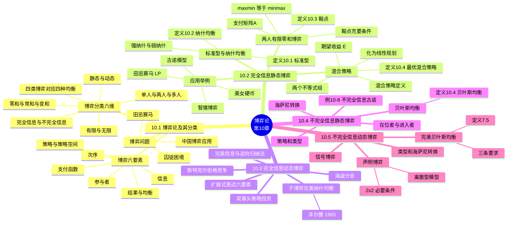

# 第十章 博弈论（Game Theory）

> **本章主线**：决策者之间**利益相互冲突、行为互相依赖** → 先用**标准型（支付矩阵）**描述静态博弈，求**纳什均衡**（纯策略看鞍点 $\max\min=\min\max$，无鞍点就上**混合策略**，化成线性规划解）→ 动态博弈用**扩展式**描述，纳什均衡会留下"不可信威胁"，升级为**泽尔滕的子博弈完美纳什均衡**（逆向归纳法）→ 不完全信息（有人知道别人不知道的收益）经**海萨尼转换**引入"自然"选类型，得到**贝叶斯纳什均衡** → 再叠加动态，得到**完美贝叶斯均衡**（信念 + 贝叶斯法则 + 最优策略）。
> 一句话版本：**四种"信息 × 顺序"的组合对应四种均衡——静态完全信息纳什、动态完全信息子博弈完美、静态不完全信息贝叶斯、动态不完全信息完美贝叶斯；解法套路是"矩阵找鞍点、无鞍点配概率、动态倒着推、不完全信息让自然先选类型"**。

---

## 10.1 博弈论及其分类

### 10.1.1 问题背景与博弈问题

在现实生活中我们经常会遇到一些具有**竞争性质**的决策问题：存在竞争对手，每个决策主体的行为后果都要受到对手的影响，并且这些决策者之间的利益是**相互冲突**的，这类特殊的决策问题就是**竞争型决策**。

**博弈论**是研究**理性的决策者之间的冲突与合作**的理论，具体讲就是研究当决策主体的行为在发生直接的相互作用时，人们如何进行决策以及这种决策的**均衡**问题。此外，博弈论研究的决策问题是包括**开始、过程和结果**的整个决策过程，也是广义上的竞争型决策分析。

#### （一）"囚徒困境"

警方拘捕两个同案犯罪嫌疑人（囚徒）后，为防其相互间串供，将两人分别拘押、隔离审问。摆在两疑犯面前的选择有两种：**坦白或不坦白**（坦白从宽，抗拒从严）：

- 若两人**均坦白**：从轻处理，分别判刑 5 年，收益 **$(-5, -5)$**；
- 若**一人坦白、一人抵赖**：坦白者免于处罚（0），抵赖者从重判 15 年，收益 **$(0, -15)$** 或 $(-15, 0)$；
- 若两人**均抵赖**：证据不足只按妨碍公务罪判 1 年，收益 **$(-1, -1)$**。

| A \ B | 坦白 | 抵赖 |
|---|---|---|
| **坦白** | $-5,\ -5$ | $0,\ -15$ |
| **抵赖** | $-15,\ 0$ | $-1,\ -1$ |

该博弈问题的最终结果必然是**两博弈方都选择坦白，收益均为 $-5$**。前提：两人均没有条件串供——否则无论对总体还是个人，最佳结果都是同时不坦白得到 $-1$。这正是**亚当斯密**"看不见的手"失效的经典例证：个体理性导向了集体更差的结果。

**一句话概括**：坦白是双方的**占优策略**，均衡 $(-5,-5)$ 却帕累托劣于 $(-1,-1)$——理性人各自算计，反而集体吃亏。

#### （二）"齐威王与田忌赛马"

齐威王约田忌赛马：每次各出三匹马，一对一赛三场，每场败者输一千金。齐威王上、中、下三匹马都分别比田忌的上、中、下三匹马**略胜一筹**，因此田忌每次连输三场，输掉三千金。实际上田忌的上马虽不如齐威王上马，却比齐威王的中马和下马都要好，田忌的中马则比齐威王的下马要好。

孙膑出主意：**不要用上马对抗齐威王的上马，而是用下马去对抗齐威王的上马，上马则去对抗齐威王的中马，中马去对抗齐威王的下马**。这样第一场必败，但后两场都能取胜，二胜一负，田忌反而**赢齐威王一千金**。

**一句话概括**：同样的马、改变**出马次序（策略组合）**就能翻盘——博弈论关心的正是"策略组合"层面的优化，而非单个决策的优化。

#### （三）中国博弈应用

《孙子兵法》是我国乃至世界最早的一部经典博弈论著作。近几年出现了《博弈论的诡计》《最神奇的博弈论定律》等收集整理博弈论知识的书籍。中国经纬智库是最早研究新型博弈理论的民间智库之一，由理事宋雪峰牵头研究公布的《多腿凳定律》《定量无穷大》《十字弓博弈基础》已经被引用到社会经济发展的方方面面。

"博弈论"与传统咨询工具相结合，可以帮助企业开启解决**战略定位、股权分配、股权融资、价值塑造、商业模式**等疑难杂症的新视角（该论述源自经邦）。

### 10.1.2 博弈的要素

#### （一）博弈的参与者

又称**博弈方或局中人**，是指博弈中**独立决策、独立承担结果**的决策主体。一般地，记博弈方为 $i$，$N=\{1,2,\dots,n\}$，即共有 $n$ 个博弈方。

#### （二）博弈方可选择的全部行为或策略的集合

即每个博弈方在进行决策时（同时或先后，一次或多次）可以选择的方法、做法等。策略有**纯策略和混合策略**之分。记博弈方 $i$ 的策略为 $s_i$，$S_i$ 为博弈方 $i$ 可选择的策略组成的策略集合，又称**策略空间**，则 $s_i \in S_i$。

$n$ 个局中人各选择一个策略形成的向量 $s=\{s_1,\dots,s_n\}$ 称为**策略组合**。

> **参与者、策略和支付是博弈必不可少的三个基本要素。**

#### （三）博弈方的支付

每个博弈方从各种策略组合中获得的**收益或效用**，它是策略组合 $s$ 的函数，所以也被称为**支付函数**。记博弈方 $i$ 的支付函数为 $u_i(s)$。

#### （四）博弈方的信息

信息是博弈方有关博弈的知识。博弈方应尽可能多地收集有关博弈的信息，从而在采取策略进行决策时掌握主动。

#### （五）博弈的次序

很多时候各博弈方的决策又必须有先后之分，并且在一些博弈中每个博弈方还要作不止一次的决策选择，这就免不了有一个**次序**问题。因此，规定一个博弈就必须规定其中的次序，**不同的次序必然是不同的博弈**，即使其他方面都相同。

#### （六）结果和均衡

**结果**指博弈中博弈方的行动所产生的每一可能情形。而**均衡**是指所有博弈方的**最优策略的组合**，记为 $s^*=(s_1^*,s_2^*,\dots,s_n^*)$，其中 $s_i^*$ 为第 $i$ 个博弈方在均衡情况下的最优策略。

### 10.1.3 博弈的分类

#### （一）单人博弈、两人博弈和多人博弈

按博弈中参与人数目的多少划分：**单人博弈**即只存在一个博弈方的博弈；**两人博弈**就是存在两个各自独立决策，但策略和利益具有相互依存与制约关系的博弈方的决策问题；**多人博弈**是指有三个或三个以上博弈方参加的博弈。

#### （二）有限博弈和无限博弈

根据各博弈方可选策略数量的多少划分：**有限博弈**是指各个博弈方的可选策略都是有限的博弈；**无限博弈**是指至少有某些博弈方的策略是无限多个的博弈。

#### （三）零和博弈、常和博弈和变和博弈

按参加博弈的各个博弈方从博弈中所获得的利益的总和划分：

- **零和博弈**：所有博弈方的得益总和始终为 $0$；
- **常和博弈**：所有博弈方的得益总和始终为某一非零常数；
- **变和博弈**：零和博弈和常和博弈以外的所有博弈。

#### （四）静态博弈和动态博弈

按参与人行动的先后顺序划分：**静态博弈**是指所有博弈方**同时或可看作同时**选择策略的博弈；**动态博弈**指的是参与人的行动有**先后顺序**，而且**后行动者能够观察到**先行动者所选择的行动的博弈。

#### （五）完全信息博弈和不完全信息博弈

根据参与人所掌握的信息划分：**完全信息博弈**是指每个参与人对其他参与人的**策略空间及支付函数有准确认识**的博弈；**不完全信息博弈**是指**至少部分博弈方不完全了解**其他博弈方支付情况的博弈。

#### （六）混合划分

把参与人**行动顺序**和**掌握的信息**结合起来划分，可以得到**四种类型的博弈**。与它们相对应的**四种均衡**是本章的骨架：

| | **静态**（同时行动） | **动态**（先后行动、可观察） |
|---|---|---|
| **完全信息** | 完全信息静态博弈 → **纳什均衡** | 完全信息动态博弈 → **子博弈完美纳什均衡** |
| **不完全信息** | 不完全信息静态博弈 → **贝叶斯纳什均衡** | 不完全信息动态博弈 → **完美贝叶斯均衡** |

**口诀：静纳、动子、贝叶斯、完贝——"静态纳什、动态子博弈、不完全贝叶斯、又动又不完全上完美贝叶斯"**，即每加一层复杂度，均衡概念就升一级。

---

## 10.2 完全信息静态博弈

### 10.2.1 博弈的标准型与纳什均衡

#### （一）博弈的标准型

**定义10.1** 在一个 $n$ 人博弈的**标准型**表述中，参与者的策略空间分别为 $S_1,\dots,S_n$，收益函数分别为 $u_1,\dots,u_n$，则

$$G=\{S_1,\dots,S_n;\ u_1,\dots,u_n\}$$

表示此博弈。标准型（normal form）就是"一张表写完所有信息"：策略空间 + 支付函数，两人有限情形下即**支付矩阵**。

#### （二）纳什均衡

**定义10.2** 在博弈 $G=\{S_1,\dots,S_n;\ u_1,\dots,u_n\}$ 中，如果策略组合 $(s_1^*,\dots,s_n^*)$ 中**任一博弈方 $i$ 的策略 $s_i^*$ 都是对其余博弈方的策略组合的最佳对策**，也即：

$$u_i(s_1^*,\dots,s_{i-1}^*,s_i^*,s_{i+1}^*,\dots,s_n^*) \ge u_i(s_1^*,\dots,s_{i-1}^*,s_{ij},s_{i+1}^*,\dots,s_n^*)$$

对**任意** $s_{ij}\in S_i$ 都成立，则称 $(s_1^*,\dots,s_n^*)$ 为 $G$ 的一个**"纳什均衡"**。

纳什均衡有**强弱之分**：

- 以上是**弱纳什均衡**，也是最常用的纳什均衡概念——"不偏离不亏"，允许打平；
- **强（严格）纳什均衡**是指每个博弈方对于对手的策略有**唯一**的最佳反应，即 $s^*$ 为严格纳什均衡，当且仅当对所有 $i$，所有其他 $s_{ij}\in S_i$，均有**严格不等式**：

$$u_i(s_1^*,\dots,s_{i-1}^*,s_i^*,s_{i+1}^*,\dots,s_n^*) > u_i(s_1^*,\dots,s_{i-1}^*,s_{ij},s_{i+1}^*,\dots,s_n^*)$$

**一句话概括**：纳什均衡 = **"谁单独 deviation 都不划算"的策略组合**；弱均衡 $\ge$（允许无差异），强均衡 $>$（严格最优、唯一反应）。

### 10.2.2 两人有限零和博弈与鞍点

#### （一）两人有限零和博弈模型

**两人有限零和博弈**是指只有两个局中人，每个局中人都有**有限个**可选择的策略，而且在任一局势中两个局中人**得失之和总是等于零**。

用 $\alpha$ 和 $\beta$ 表示两个局中人，策略集分别为：

$$S_\alpha=\{\alpha_1\ \alpha_2\ \cdots\ \alpha_m\},\qquad S_\beta=\{\beta_1\ \beta_2\ \cdots\ \beta_n\}$$

局中人 $\alpha$ 的**支付矩阵**可记作：

$$A=\begin{bmatrix} \alpha_{11} & \cdots & \alpha_{1n} \\ \vdots & & \vdots \\ \alpha_{m1} & \cdots & \alpha_{mn} \end{bmatrix}$$

根据支付矩阵 $A$，结合博弈的一般式表述 $G=\{S_1,\dots,S_n;\ u_1,\dots,u_n\}$，可将这种博弈记作 $G=\{S_\alpha, S_\beta;\ A\}$。零和假设下**只需一张矩阵**——$\beta$ 的收益恒为 $-\alpha$ 的收益。

#### （二）最优纯策略与鞍点

**定义10.3** 对于博弈 $G=\{S_\alpha, S_\beta;\ A\}$，如果

$$\max_i \min_j \{\alpha_{ij}\} = \min_j \max_i \{\alpha_{ij}\} = \alpha_{i^*j^*} = v$$

则称 $\alpha_{i^*}$、$\beta_{j^*}$ 分别为局中人 $\alpha$ 和 $\beta$ 的**最优纯策略**，称局势 $(\alpha_{i^*},\beta_{j^*})$ 为博弈 $G$ 的**鞍点**，$v$ 称博弈 $G$ 的**博弈值**。

- 不难验证鞍点 $(\alpha_{i^*},\beta_{j^*})$ 是博弈 $G$ 的**纳什均衡**，鞍点又称**纯策略纳什均衡**；
- **充要条件**：两人有限零和博弈存在鞍点，当且仅当支付矩阵中存在一个元素 $a_{i^*j^*}$，使对于一切 $i=1,2,\dots,m$，$j=1,2,\dots,n$，总有：

$$\boxed{a_{ij^*} \le a_{i^*j^*} \le a_{i^*j}}$$

**几何解读**：$a_{i^*j^*}$ 所在**行的最小值 = 全表最大值**（行主取小、列主取大在该点相遇）——它是行方向的"谷"、列方向的"峰"，故名**鞍点**（saddle point）。

**口诀：行内找最小、列内找最大，两者撞在同一个格子 = 鞍点 = 纯策略纳什均衡**。

### 10.2.3 混合策略与最优混合策略

#### （一）混合策略的定义

局中人只能以一定的**概率**在其策略集中随机选择每个策略，这种在**纯策略空间上的概率分布**为**混合策略**。

设博弈 $G=\{S_\alpha,S_\beta;\ A\}$，$S_\alpha=\{\alpha_1\cdots\alpha_m\}$，$S_\beta=\{\beta_1\cdots\beta_n\}$。令 $x_i$、$y_j$ 分别为局中人 $\alpha$ 和 $\beta$ 在各自的策略集中选择策略 $\alpha_i$ 和 $\beta_j$ 的概率，则称

$$x=(x_1\ \cdots\ x_m),\quad \sum_{i=1}^{m} x_i = 1 \ \text{且}\ x_i \ge 0; \qquad y=(y_1\ \cdots\ y_n),\quad \sum_{j=1}^{n} y_j = 1 \ \text{且}\ y_j \ge 0$$

分别为局中人 $\alpha$ 和 $\beta$ 的一个**混合策略**。称

$$E(xy)=\sum_{i=1}^{m}\sum_{j=1}^{n} \alpha_{ij}\, x_i y_j$$

为局中人 $\alpha$ 的**期望获得**，$-E(xy)$ 为 $\beta$ 的期望获得，而 $(x,y)$ 为博弈的**混合局势**。又记

$$S_m=\Big\{x\ \Big|\ x=(x_1\cdots x_m),\ x_i\ge 0,\ \textstyle\sum x_i=1\Big\},\qquad S_n=\Big\{y\ \Big|\ y=(y_1\cdots y_n),\ y_j\ge 0,\ \textstyle\sum y_j=1\Big\}$$

分别为局中人 $\alpha$ 和 $\beta$ 的**混合策略集合**（概率单纯形）。

#### （二）最优混合策略

**定义10.4** 如果

$$\max_{x\in S_m} \min_{y\in S_n} E(xy) = \min_{y\in S_n} \max_{x\in S_m} E(xy) = E(x^*,y^*) = v$$

则称 $x^*$、$y^*$ 为局中人 $\alpha$ 和 $\beta$ 的**最优混合策略**，称 $(x^*,y^*)$ 为 $G$ 的**最优混合局势**，$v$ 称为博弈方的**期望所得**。

最优混合局势 $(x^*,y^*)$ 构成了**混合意义上的纳什均衡**：任何一方单独背离这个局势，则它的期望所得将**不会优于**最优混合局势下的所得。

> **注意**：这里课件用了第二个"定义10.4"（与 10.2.3 前文编号重复，保持课件原貌）——第一个定义10.4 是混合策略求解的最优性刻画，第二个在 10.4 节是贝叶斯均衡定义。

#### （三）最优混合策略的求解方法：不等式组 → 线性规划

博弈 $G=\{S_\alpha,S_\beta;\ A\}$ 有混合意义下的解的**充要条件**是：存在 $x^*\in S_m$，$y^*\in S_n$ 满足下列两个不等式组：

$$\text{(1)}\quad \begin{cases} \displaystyle\sum_{i=1}^{m} \alpha_{ij} x_i \ge v, & j=1,2\cdots n \\[6pt] \displaystyle\sum_{i=1}^{m} x_i = 1 \\[4pt] x_i \ge 0, & i=1,2\cdots m \end{cases} \qquad \text{(2)}\quad \begin{cases} \displaystyle\sum_{j=1}^{n} \alpha_{ij} y_j \le v, & i=1,2\cdots m \\[6pt] \displaystyle\sum_{j=1}^{n} y_j = 1 \\[4pt] y_j \ge 0, & j=1,2\cdots n \end{cases}$$

为了求解上述不等式组，可将它们变为**线性规划**。不妨设 $v>0$（否则令 $\alpha'_{ij}=\alpha_{ij}+d$，平移后 $v$ 一定可大于零）。令 $x'_i = \dfrac{x_i}{v}$，则不等式组 (1) 等价于线性规划：

$$\text{(3)}\quad \min S' = \sum_{i=1}^{m} x'_i, \qquad \text{s.t.}\ \begin{cases} \displaystyle\sum_{i=1}^{m} \alpha_{ij} x'_i \ge 1, & j=1,2\cdots n \\[4pt] x'_i \ge 0, & i=1,2\cdots m \end{cases}$$

同理，令 $y'_j = \dfrac{y_j}{v}$，问题 (2) 就变为线性规划：

$$\text{(4)}\quad \max S' = \sum_{j=1}^{n} y'_j, \qquad \text{s.t.}\ \begin{cases} \displaystyle\sum_{j=1}^{n} \alpha_{ij} y'_j \le 1, & i=1,2\cdots m \\[4pt] y'_j \ge 0, & j=1,2\cdots n \end{cases}$$

求出最优值 $S'$ 后**还原**：$v = 1/S'$，再回代 $x_i = v\, x'_i$、$y_j = v\, y'_j$。

**套路总结（三步）**：① 设 $v>0$（必要时整体平移支付矩阵）→ ② 令 $x'=x/v$、$y'=y/v$ 把"带参数 $v$"的不等式组**齐次化**成标准 LP（对列约束 min、对行约束 max，互为对偶）→ ③ 解 LP、用 $v=1/S'$ 还原概率。

### 10.2.4 应用举例

#### （一）美女硬币：混合策略直觉

收益矩阵（男出正/反 × 美女出正/反，前为男收益）：

| 男 \ 美女 | 美女正面 | 美女反面 |
|---|---|---|
| **男正面** | $3$ | $-2$ |
| **男反面** | $-2$ | $1$ |

设男出正面的概率为 $x$，反面为 $1-x$（女出正面概率 $y$，反面 $1-y$）。为使利益最大化，应该在**对手出正面或反面的时候自己的收益相等**（否则，对方就可以针对）：

$$3x + (-2)\times(1-x) = (-2)\times x + 1\times(1-x)$$

解得 **$x=3/8$；收益：$-1/8$**。同理可列方程：

$$-3y + 2(1-y) = 2y + (-1)\times(1-y)$$

解得 **$y=3/8$；收益：$1/8$**。

**一句话概括**：混合策略的本质是**"让对手无从针对"——我按这个概率分布，你选哪个纯策略期望收益都一样**；因此最优混合策略必使对方" indifferent"，方程就是这么列出来的。

#### （二）例：田忌赛马（LP 求解）

支付矩阵（$6\times6$，行=田忌策略组合、列=齐威王策略组合，收益为田忌所得）：

$$A=\begin{bmatrix} 3 & 1 & 1 & 1 & -1 & 1 \\ 1 & 3 & 1 & 1 & 1 & -1 \\ 1 & -1 & 3 & 1 & 1 & 1 \\ -1 & 1 & 1 & 3 & 1 & 1 \\ 1 & 1 & 1 & -1 & 3 & 1 \\ 1 & 1 & -1 & 1 & 1 & 3 \end{bmatrix}$$

按 10.2.3 的套路化为线性规划（已设 $v=1$ 归一化）：

$$\min\ (x_1+x_2+x_3+x_4+x_5+x_6) \quad \text{s.t.}\ \begin{cases} 3x_1 + x_2 + x_3 - x_4 + x_5 + x_6 \ge 1 \\ x_1 + 3x_2 - x_3 + x_4 + x_5 + x_6 \ge 1 \\ x_1 + x_2 + 3x_3 + x_4 + x_5 - x_6 \ge 1 \\ x_1 + x_2 + x_3 + 3x_4 - x_5 + x_6 \ge 1 \\ -x_1 + x_2 + x_3 + x_4 + 3x_5 + x_6 \ge 1 \\ x_1 - x_2 + x_3 + x_4 + x_5 + 3x_6 \ge 1 \\ x_1,x_2,x_3,x_4,x_5,x_6 \ge 0 \end{cases}$$

**解得：$x_2=x_3=x_6=1/3,\ V=1$**；另一解 $x_1=x_2=x_3=x_4=x_5=x_6=1/6,\ V=1$。

**一句话概括**：田忌赛马的最优混合策略是**均匀随机化（各 $1/6$）或只押三个特定策略各 $1/3$**——齐威王摸不透田忌出哪套，田忌保底不输（$v=1$ 期望值），这就是"混合策略保值"的意义。

#### （三）二、应用举例——"智猪博弈"（Pigs' payoffs）

猪圈里有一头大猪、一头小猪。一头有猪食槽，另一头安装控制猪食供应的按钮，按一下按钮会有 10 个单位猪食进槽，但**谁按按钮谁先付 2 个单位成本**，去食槽路上还有 2 个单位猪食的体能消耗。若大猪先到槽边，大小猪吃到食物的收益比是 **9:1**；同时行动（同去按按钮），收益比是 **7:3**；小猪先到槽边，收益比是 **6:4**。在两头猪都有智慧的前提下，最终结果是**小猪选择等待**。

"智猪博弈"由**纳什于 1950 年提出**。小猪选择等待、让大猪去按按钮而自己"坐船"（**搭便车**）的原因：大猪行动时，小猪等待得 4、行动只得 1，**等待优于行动**；大猪等待时，小猪行动收入不抵成本得 $-1$、等待得 0，**还是等待优于行动**。

报酬矩阵（行=大猪，列=小猪）：

| 大猪 \ 小猪 | 行动 | 等待 |
|---|---|---|
| **行动** | $5,\ 1$ | $4,\ 4$ |
| **等待** | $9,\ -1$ | $0,\ 0$ |

从矩阵看：大猪行动时，小猪行动得 1、等待得 4 → 选等待；大猪等待时，小猪行动得 $-1$、等待得 0 → 选等待。**无论大猪怎么选，小猪的选择都将是等待，即等待是小猪的占优策略！**

**一句话概括**：智猪博弈 = **"搭便车"的博弈论版本**——小猪有占优策略（等待），大猪明知被搭便车也只好行动（否则大家都 0）；弱者靠占优策略逼强者干活。

#### （四）例10-5 产量决策的古诺模型（两人无限非零和对策）

当对策中至少一方的可选方案数为**无穷多个**时，就不能用矩阵描述收益函数了——策略是连续变量。**古诺模型**是博弈论中最经典的例子：古诺采用了分析企业各自的**最优反应函数**从而形成均衡的思路，与纳什均衡非常相似，因此**纳什均衡也称古诺—纳什均衡**，它描述的是厂商进行**数量竞争**的形势。

假设市场上有 A、B 两个厂商生产销售相同产品，单位生产成本分别为 $c_1$、$c_2$。价格取决于总产量 $Q$：

$$p(Q)=a-bQ \quad (a,b>0)$$

设产量分别为 $q_1$、$q_2$，则 $p=a-b(q_1+q_2)$，两厂商利润分别为：

$$R_1(q_1,q_2)=q_1\big[a-b(q_1+q_2)\big]-c_1 q_1, \qquad R_2(q_1,q_2)=q_2\big[a-b(q_1+q_2)\big]-c_2 q_2$$

对厂商 A：若其认为厂商 B 的产量为 $q_2$，利润最大化条件 $\dfrac{\partial R_1}{\partial q_1}=a-2bq_1-bq_2-c_1=0$，即

$$q_1 = \frac{a-c_1}{2b} - \frac{q_2}{2}$$

同理对厂商 B：$\dfrac{\partial R_2}{\partial q_2}=a-2bq_2-bq_1-c_2=0$，即

$$q_2 = \frac{a-c_2}{2b} - \frac{q_1}{2}$$

两式即 A 和 B 的**最优产量决策函数（最优反应函数）**。根据纳什均衡的定义，**两个最优决策函数的唯一公共点就是纳什均衡点**：

$$\begin{cases} q_1 = \dfrac{a-c_1}{2b} - \dfrac{q_2}{2} \\[8pt] q_2 = \dfrac{a-c_2}{2b} - \dfrac{q_1}{2} \end{cases} \Longrightarrow \begin{cases} q_1^* = \dfrac{a+c_2-2c_1}{3b} \\[8pt] q_2^* = \dfrac{a+c_1-2c_2}{3b} \end{cases}$$

**练习**：双头垄断企业产量 $Q_1$、$Q_2$，成本函数 $C_1=20Q_1$、$C_2=2Q_2^2$，市场需求 $P=400-2(Q_1+Q_2)$，求古诺模型下两企业均衡产量。

**解**：
1. $\pi_1 = Q_1\big[400-2(Q_1+Q_2)\big]-20Q_1 = Q_1(380-2Q_1-2Q_2)$，$\dfrac{\partial \pi_1}{\partial Q_1}=380-4Q_1-2Q_2=0 \Rightarrow Q_1 = 95 - \dfrac{Q_2}{2}$；
2. $\pi_2 = Q_2\big[400-2(Q_1+Q_2)\big]-2Q_2^2 = Q_2(400-2Q_1-4Q_2)$，$\dfrac{\partial \pi_2}{\partial Q_2}=400-2Q_1-8Q_2=0 \Rightarrow Q_2 = 50 - \dfrac{Q_1}{4}$；
3. 联立：$Q_1 = 95-\frac{1}{2}\big(50-\frac{Q_1}{4}\big)=70+\frac{Q_1}{8} \Rightarrow \frac{7}{8}Q_1=70 \Rightarrow \boxed{Q_1=80}$，代回 $Q_2 = 50-20 = \boxed{30}$。

**答案：$Q_1=80,\ Q_2=30$**（此时 $P=400-2\times110=180$）。

**一句话概括**：古诺模型的解题套路 = **各自求偏导得最优反应函数 → 联立求公共点 = 纳什均衡**；成本低的一方多产（$c_1$ 越小 $q_1^*$ 越大），这正是"古诺—纳什均衡"命名的由来。

---

## 10.3 完全信息动态博弈

### 10.3.1 博弈的扩展式表述

在**动态博弈**中，参与人的行动有先后顺序，且后行动者在自己行动之前能观测到先行动者的行动，且对各博弈方的策略空间及支付有充分的了解，我们称这种博弈为**完全信息动态博弈**。动态博弈有不同于静态博弈的特征，习惯于用**扩展式（extensive form）**来描述和分析动态博弈。

博弈的扩展式表述包括以下**六要素**：

1. **参与人**集合；
2. **行动次序**，即参与人参与行动的次序；
3. **收益**，即参与人所采取行动的函数；
4. **行动**，即轮到次序的参与人的选择；
5. **信息集**，它表示参与人在每次行动时所知道的信息；
6. 每一个**外生事件的概率分布**。

**对比记忆**：标准型 = "策略空间 + 支付"（一张表）；扩展式 = "参与人 + 次序 + 收益 + 行动 + 信息集 + 概率"（一棵树）——**静态用表、动态用树**。

### 10.3.2 多阶段可观察行动博弈与子博弈完美纳什均衡

**多阶段可观察行动博弈**有着多个"阶段"，通常记为 $k$，行动的历史通常记为 $h^k$，从而：

1. 在每一个阶段 $k$，每一个参与人都知道所有行为情况，包括自然的行为以及过去各阶段所有参与人的行为 $h^k$；
2. 在任一给定阶段中，每一个参与人最多只能行动一次；
3. 阶段 $k$ 的信息集不会提供有关这一阶段的任何信息。

由于这种博弈存在多个阶段，它与只有一个阶段的完全信息博弈有着本质的区别，因此如果我们仍用纳什均衡思想分析这种博弈问题就难免存在局限性（纳什均衡允许**不可信的威胁**）。**泽尔滕（Selten, 1965）提出了子博弈完美纳什均衡的思想**。

**泽尔滕子博弈完美纳什均衡**是指在一个多阶段可观察的博弈中，由各博弈方的策略构成的一个策略组合，这个策略组合满足**在整个动态博弈及它的所有子博弈中都构成纳什均衡**。

**一句话概括**：子博弈完美 = **"每个子博弈里都不能有吓唬人的空头威胁"**——把纳什均衡的"不可信承诺/威胁"剔除干净。

### 10.3.3 完美信息博弈与逆向归纳法

在多阶段可观察行动博弈中，如果我们对条件 (2) 稍加限制，即在任一给定阶段中，每一个参与人最多只能行动一次**而且只有一个参与人采取行动**，就得到**完美信息博弈**。

由于引入了子博弈完美纳什均衡的概念，多阶段可观察行动博弈通常采用**逆向归纳法**："逆向归纳法"这一思路是**先解决参与人在面临任何可能情况下的最终行为策略，然后逐步向前推导计算前一步最优选择**。

逆向归纳法可以在任何完美信息下的多阶段博弈中应用：这一方法从**最终阶段 $k$ 在每一历史情况下最优选择开始**，即在给定历史情况条件下，通过最大化参与人在面临历史情况条件的收益确定其最优行动，从而向前推算到阶段 $k-1$，并确定这一阶段中采取行动的参与人的最优行为——只要给定阶段 $k$ 中采取行动的参与人在历史情况下将采取我们之前推导出来的最优行动即可。用这一方法不断地向前推算下去，**直至初始阶段**，这样我们就可以建立一个策略组合。

**口诀：逆向归纳 = 从最后一棵决策树倒着往回砍——先定终局、再定前一步，砍到树根就是均衡**。

#### （一）例10-6 斯特克尔伯格竞争

斯特克尔伯格竞争是古诺模型的一种变形，它引入了**行动的先后次序**，也是连续的扩展博弈的经典例子。生产同质产品的两个企业**先后**选择各自的产量 $q_i\ (i=1,2)$，市场需求决定价格 $p=a-(q_1+q_2)$，单位成本均为常数 $c$。与古诺模型"同时选产量"的区别仅在**次序**——先动者（领导者）产量大、后动者（跟随者）按反应函数跟进。

#### （二）例10-7 双寡头策略投资模型

企业1和企业2当前的单位成本都是 2。**企业1可以装备一种新的技术，从而使得其单位成本为 0，装备这一技术需要花费 $f$**。企业2可以观察到企业1是否投资于这项新技术。一旦新技术的投资被观察到之后，这两个企业就会像古诺竞争一样同时选择它们的产出水平 $q_1$ 和 $q_2$。因此，这是一个**两阶段不完美信息博弈**。

为了定义收益函数，假设需求为 $p(q)=14-q$，并且每个企业的目标都是使扣除成本之后的净收入最大化：

- 企业1**不投资**：收益为 $\big[12-(q_1+q_2)\big]q_1$；
- 企业1**投资新技术**：收益为 $\big[14-(q_1+q_2)\big]q_1 - f$；
- 企业2的收益是 $\big[12-(q_1+q_2)\big]q_2$（课件印作 $q_1$，应为 $q_2$ 之笔误）。

**套路总结**：第一阶段"投不投资"用逆向归纳——**先算投资/不投资两种情形下的第二阶段古诺均衡，再比较净收益 $f$ 的临界值**。

#### （三）海盗分金（逆向归纳经典）

**5 个海盗抢得 100 枚金币**，按抽签顺序依次提方案：首先由 1 号提出分配方案，然后 5 人表决，投票要**超过半数同意**方案才被通过，否则他将被扔入大海喂鲨鱼，依此类推。假定"**每个海盗都是绝顶聪明且很理智**"，问第一个海盗提出怎样的分配方案才能使自己的收益最大化？

**推理过程（从后向前推）**：

1. 如果 1 至 3 号强盗都喂了鲨鱼，只剩 4 号和 5 号：**5 号一定投反对票让 4 号喂鲨鱼，以独吞全部金币——所以 4 号惟有支持 3 号才能保命**；
2. 3 号知道这一点，就会提出 **"100, 0, 0"** 的分配方案，对 4 号、5 号一毛不拔而将全部金币归为己有——他知道 4 号一无所获但还是会投赞成票（保命），再加上自己一票，方案即可通过；
3. 2 号推知 3 号的方案，就会提出 **"98, 0, 1, 1"**，即放弃 3 号，给 4 号和 5 号各一枚金币。该方案对 4 号和 5 号比在 3 号分配时更有利，他们将支持他——2 号拿走 98 枚；
4. 2 号的方案也被 1 号洞悉，1 号将提出 **$(97, 0, 1, 2, 0)$ 或 $(97, 0, 1, 0, 2)$**：放弃 2 号，给 3 号一枚金币，同时给 4 号（或 5 号）2 枚金币。这对 3 号和 4 号（或 5 号）比 2 号分配时更优，他们投赞成票，加上 1 号自己的票，方案通过。

**答案：1 号强盗分给 3 号 1 枚金币，分给 4 号或 5 号 2 枚，自己独得 97 枚。分配方案可写成 $(97, 0, 1, 2, 0)$ 或 $(97, 0, 1, 0, 2)$。**

**一句话概括**：海盗分金是逆向归纳的教科书演示——**从"只剩两人"的终局倒推，每一步用最少的金币收买"最不得意的人"（下一局最吃亏者），理性预期把 100 枚里的 97 枚装进了提议者口袋**。

---

## 10.4 不完全信息静态博弈

### 10.4.1 概念

如果在一个博弈中，**某些参与人不知道其他参与人的收益**，我们就说这个博弈是**不完全信息博弈**。

先看一个例子：假定一个行业，一个**在位者**和一个潜在的**进入者**。在位者决定是否建立一个新工厂，同时进入者决定是否该进入。假定**进入者不知道在位者的成本到底是 1 还是 3，但在位者自己知道**。结果显示，在位者明显有一个优势策略：**成本低，建厂；成本高，不建厂**。

——但进入者只能"猜"在位者是哪种类型，这就是不完全信息的困境。

### 10.4.2 海萨尼转换

**海萨尼（Harsanyi, 1967—1968）**首先给出了一种模拟和处理这一类不完全信息博弈的方法，即引入一个**虚拟参与人——"自然"（Nature）**："自然"首先选择参与人 1 的类型（这里是他的成本）。在这个转换博弈中，参与人 2 关于参与人 1 成本的不完全信息就变成了**关于"自然"的行动的不完全信息**，从而这个转换博弈可以用标准的技术来分析。

从不完全信息博弈到不完美信息博弈的转换最早由海萨尼给出：$N$ 代表"自然"，"自然"选择参与人 1 的类型。这里有一个**标准假设**，即**所有参与人对自然行动的概率分布具有一致的判断（共同先验）**。一旦采用这一假设，我们就得到一个标准博弈，从而可以使用纳什均衡的概念。**海萨尼的贝叶斯均衡（或贝叶斯纳什均衡）正是指不完美信息博弈的纳什均衡**。

**一句话概括**：海萨尼转换 = **把"我不知道你是谁"改写成"我先看自然把你抽成谁"——私有信息变成随机类型，不完全信息变成不完美信息**。

### 10.4.3 策略和类型

参与人的"**类型**"——他的**私人信息**——就是他的成本。在通常情况下，一个参与人的类型可能包括与其决策相关的任何私人信息。**参与人的收益函数就相当于它的类型**。

如果参与人的类型过于复杂，模型就可能很难处理，在实际运用中，通常假定参与人关于对手的判断完全由他自己的收益函数决定。

海萨尼考虑了更一般的情形：假定参与人的类型 $\{\theta_i\}_{i=1}^{I}$ 取自某一客观概率分布 $p(\theta_1,\dots,\theta_I)$，这里 $\theta_i$ 属于某一空间 $\Theta_i$（简单起见假定 $\Theta_i$ 存在有限个元素）。**$\theta_i$ 只能被参与人 $i$ 观察到**（私人信息）。令 $p(\theta_{-i}\,|\,\theta_i)$ 代表给定 $\theta_i$ 时参与人 $i$ 关于其他参与人类型 $\theta_{-i}=(\theta_1,\dots,\theta_{i-1},\theta_{i+1},\dots,\theta_I)$ 的条件概率。假定对于每一个 $\theta_i\in\Theta_i$，边际分布 $p_i(\theta_i)$ 是**严格正的**。

我们通常把博弈的外生因素如**策略空间、收益函数、可能类型、先验分布等视为共同知识**。为简单起见，假定策略空间 $S_i$ 是参与人 $i$ 的（非相机）行动集。

可以用 $\sigma_i(\theta_i)$ 代表类型为 $\theta_i$ 的参与人 $i$ 的策略选择（可能是混合策略）。如果参与人 $i$ 知道其他参与人的策略 $\{\sigma_j(\cdot)\}_{j\ne i}$ 是其相应类型的函数，参与人 $i$ 就可以用条件概率 $p(\theta_{-i}\,|\,\theta_i)$ 来计算对应于每一个选择的**期望效用**，从而找出**最优反应策略 $\sigma_i(\theta_i)$**。

### 10.4.4 贝叶斯均衡

**定义10.4（贝叶斯均衡，课件中第二个定义10.4）** 在一个不完全信息博弈中，如果每一参与人 $i$ 的类型 $\theta_i$ 有限；且参与人类型的先验分布为 $p$，相应纯策略空间为 $S_i$，则该博弈的一个**贝叶斯均衡**是其"**展开博弈**"的一个**纳什均衡**，在这个"展开博弈"中，每一个参与人 $i$ 的纯策略空间是由从 $\theta_i$ 到 $S_i$ 的**映射**构成的集合 $S_i^{\theta_i}$。

给定策略组合 $s(\cdot)$ 和 $s_i'(\cdot)\in S_i^{\theta_i}$，令

$$\big(s_i'(\theta_i),\, s_{-i}(\theta_{-i})\big)=\big(s_1(\theta_1),\dots,s_{i-1}(\theta_{i-1}),\, s_i'(\theta_i),\, s_{i+1}(\theta_{i+1}),\dots,s_I(\theta_I)\big)$$

代表策略组合在 $\theta=(\theta_i,\theta_{-i})$ 的值。那么策略组合 $s(\cdot)$ 是一个（纯策略）**贝叶斯均衡**，如果对于每一个参与人 $i$ 均有：

$$s(\cdot) \in \arg\max_{s_i(\cdot)\in S_i^{\theta_i}} \sum_{\theta_i}\sum_{\theta_{-i}} p(\theta_i,\theta_{-i})\, u_i\big(s_i'(\theta_i),\, s_{-i}(\theta_{-i});\, (\theta_i,\theta_{-i})\big)$$

**解读**：策略不再是"选哪个行动"，而是"**每种类型选哪个行动**"的完整映射；均衡条件仍是纳什均衡——**给定别人按类型出牌，我按自己的类型出牌最优（对先验分布取期望）**。

### 10.4.5 例10-8 不完全信息下的古诺模型

考虑双寡头垄断古诺模型（产量竞争）。假定企业的利润：

$$u_i = q_i(\theta_i - q_i - q_j)$$

这里 **$\theta_i$ 是线性需求函数的截距与企业 $i$ 的不变单位成本之差** $(i=1,2)$，$q_i$ 是企业 $i$ 选择的产量 $s_i=q_i$。

- **企业1的类型 $\theta_1=1$ 是共同知识**（企业2完全知道关于企业1的信息，企业1只有一种可能类型）；
- 但**企业2拥有关于其单位成本的私人信息**：企业1认为 **$\theta_2=3/4$ 的概率是 $1/2$，$\theta_2=5/4$ 的概率也是 $1/2$**，且企业1的判断是共同知识；
- 这样企业2有两种可能类型，分别称为"**低成本型**"（$\theta_2=5/4$）和"**高成本型**"（$\theta_2=3/4$）。两个企业**同时**选择产量。

**求解（纯策略贝叶斯均衡）**：

1. 企业2的均衡产量必须满足（给定 $q_1$ 按类型最优化）：

$$q_2(\theta_2)\in\arg\max_{q_2}\big\{q_2(\theta_2-q_1-q_2)\big\} \Longrightarrow q_2(\theta_2)=\frac{\theta_2-q_1}{2}$$

2. 企业1不知道企业2是哪种类型，收益只能对类型取期望：

$$q_1\in\arg\max_{q_1}\left\{\tfrac{1}{2}q_1(1-q_1-q_2^{H})+\tfrac{1}{2}q_1(1-q_1-q_2^{L})\right\} \Longrightarrow q_1=\frac{2-q_2^{H}-q_2^{L}}{4}$$

3. 将 $\theta_2=5/4$ 和 $\theta_2=3/4$ 代入 $q_2(\theta_2)$ 并联立，得到**贝叶斯均衡解**：

$$\boxed{\Big(q_1=\frac{1}{3},\ \ q_2^{L}=\frac{11}{24},\ \ q_2^{H}=\frac{5}{24}\Big)}$$

（事实上，这也是惟一的均衡。）

**验算**：$q_1=1/3$ 时，$\theta_2=5/4 \Rightarrow q_2=(5/4-1/3)/2=11/24$；$\theta_2=3/4 \Rightarrow q_2=(3/4-1/3)/2=5/24$；再验 $q_1=(2-\frac{11}{24}-\frac{5}{24})/4=(2-\frac{2}{3})/4=\frac{1}{3}$ ✓。**课件中 $q_2^{L}/q_2^{H}$ 标号与类型的对应关系印反了（L 实配 $11/24$ 即低成本 $\theta_2=5/4$ 的产量）**——按数值记：**低成本型产 $11/24$、高成本型产 $5/24$**，经济含义正确：成本低者多产。

**一句话概括**：不完全信息古诺 = **各类型按自己的 $\theta$ 求反应函数，先动企业对别人的类型求期望**——私有信息不改变"最优化"逻辑，只把"点"换成了"期望"。

---

## 10.5 不完全信息动态博弈

### 10.5.1 不完全信息动态博弈问题（信号博弈）

**信号博弈**的基本特征是博弈方分为**信号发出方 S** 和**信号接受方 R** 两类，先行为的信号发出方的行为对后行为的信号接受方来说具有**传递信息**的作用。信号博弈其实是一类具有信息传递机制的**动态贝叶斯博弈**的总称。许多博弈或信息经济学问题都可以归结为信号博弈。

一个信号博弈可表示为：

1. 博弈方 0 以概率 $p(t_i)$ 为信号发出方 $S$ 选择类型 $t_i$；
2. 发出方 $S$ 选择行为 $a_1\in A_1$；
3. 接收方 $R$ 看到 $a_1$ 后选择行为 $a_2\in A_2$；
4. 双方得益 $u_1$ 和 $u_2$ 都取决于 $t_i$、$a_1$ 和 $a_2$。

**完美贝叶斯均衡的条件**是：

1. 接收方 $R$ 在观察到发出方的信号 $a_1$ 后，必须有关于发出方的类型判断，即发出方选择行为 $a_1$ 时，发出方 $S$ 是类型 $t_i$ 的**后验概率**：

$$p(t_i\,|\,a_1),\qquad p(t_i\,|\,a_1)\ge 0,\qquad \sum_{t_i} p(t_i\,|\,a_1)=1$$

2. 对于发出方给出的信号 $a_1$ 和对发出方类型判断即后验概率 $p(t_i\,|\,a_1)$，接收方 $R$ 选择的行动 $a_2$ 必须是**接收方收益最大**，即：

$$\max_{a_2}\sum_{t_i} p(t_i\,|\,a_1)\, u_R(t_i, a_1, a_2)$$

3. 给定 $R$ 的策略 $a_2$ 时，$S$ 的选择 $a_1$ 必须使 $S$ 的得益最大，即 $a_1$ 是最大化问题 $\max_{a_1} u_S[t_i, a_1, a_2]$ 的解。

满足上述要求的双方策略和接收方判断构成信号博弈的**完美贝叶斯均衡**。

**口诀：完美贝叶斯三件套——信念（后验概率）、反应（给定信念最优回应）、更新（贝叶斯法则）**。

### 10.5.2 类型和海萨尼转换

静态贝叶斯博弈中处理不完全信息的方法是将博弈方得益的不同可能理解为博弈方有不同的类型，并引进一个为博弈方选择类型的虚拟博弈方，从而把不完全信息博弈转化成**完全但不完美信息动态博弈**，这样的处理方法称为**海萨尼转换**。这种处理方法同样适用于动态贝叶斯博弈，二者的差别是动态贝叶斯博弈转化的不是两阶段有同时选择的不完美信息动态博弈，而是**更一般的不完美信息动态博弈**。

既然通过海萨尼转换可以很容易地将动态贝叶斯博弈转化为完全但不完美信息动态博弈，那么动态贝叶斯博弈分析就可以主要利用**贝叶斯均衡、合并均衡和分开均衡**等概念和相应的分析方法。

### 10.5.3 完美贝叶斯均衡

**完美贝叶斯均衡要求**：

1. 在每个信息集上，局中人必须有一个定义在属于该信息集的所有节点上的概率分布，这就是局中人的**信念**——信息集包含了局中人类型的信息，这一信念也相当于在该信息集上对其他局中人类型的概率判断；
2. 给定该信息集上的信念和其他局中人的后续策略，局中人的后续策略必须是**最优**的；
3. 局中人根据**贝叶斯法则**和均衡策略**修正后验信念**。

**定义7.5（课件原文编号）** 完美贝叶斯均衡是一种策略组合 $s^*(\theta)=(s_1^*(\theta_1),\dots,s_n^*(\theta_n))$ 与一种后验概率组合 $\bar{p}=(p_1,\dots,p_n)$，满足：对于所有的局中人 $i$，在每个信息集 $h$，

$$s_i^*(s_{-i},\theta_i)\in\max_{s_i}\sum_{\theta_{-i}} p_i(\theta_{-i}\,|\,a_i^h)\, u_i(s_i, s_{-i}, \theta_i)$$

由先验概率 $p_i(\theta_{-i}\,|\,\theta_i)$、$\tilde{p}_i(\theta_{-i}\,|\,a_{-i}^h)$、所观测的 $a_{-i}^h$ 和最优策略 $s_{-i}^*(\cdot)$ 通过**贝叶斯法则**形成。

**一句话概括**：完美贝叶斯均衡 = **策略组合 + 信念组合**的配对——策略在给定信念下最优，信念由先验经贝叶斯法则更新而来；它是"动态 + 不完全信息"的终极均衡概念。

### 10.5.4 举例——声明博弈

#### （一）2×2 声明博弈

2×2 声明博弈中声明能有效传递信息的几个**必要条件**：

1. **不同类型的声明方必须偏好行为方的不同行为**；
2. **对应声明方的不同类型，行为方必须偏好不同的行为**；
3. **行为方的偏好必须与声明方的偏好具有一致性**。

#### （二）离散型声明博弈模型

1. **自然**抽取声明方的类型 $\theta_i$，抽取的方法是从类型集合 $\Theta=\{\theta_1,\dots,\theta_I\}$ 中以概率分布 $p(\theta_1),\dots,p(\theta_I)$ 随机抽取，其中 $\displaystyle\sum_{i=1}^{I} p(\theta_i)=1$；
2. 声明方了解到自己的 $\theta_i$ 以后，从 $\Theta$ 中选择 $\theta_j$ 作为自己声明的类型。当然 **$\theta_j$ 可以与 $\theta_i$ 相同（说真话），也可以与 $\theta_i$ 不同（说假话）**；
3. 行为方在听到声明方的声明 $\theta_j$ 后，在可选择的行为集合 $A=\{a_1,\dots,a_K\}$ 中选择行为；
4. 声明方的得益为 $u_S(\theta_i, a_k)$，行为方的得益为 $u_R(\theta_i, a_k)$。

**一句话概括**：声明博弈问的是**"什么时候说真话是均衡"**——三个必要条件凑齐，声明才能成为可信的信号；否则声明沦为廉价谈话（cheap talk）。

---

### 知识定位与框架衔接

**前置知识**：第 2 章的**线性规划**是 10.2.3 的直接工具——混合策略求解的不等式组 (1)(2) 化成的 LP (3)(4) 恰是一对**互相对偶**的 LP，博弈值 $v$ 与最优值 $S'$ 满足 $v=1/S'$，这与第 3 章对偶理论遥相呼应；概率论的**期望与条件概率**是 10.4/10.5（贝叶斯法则、先验/后验）的数学底座；微积分的**偏导求极值**给出古诺模型的最优反应函数。

**后置知识**：

1. **微观经济学与产业组织**：古诺/斯特克尔伯格模型是寡头竞争理论的核心，信号博弈直接通向**劳动力市场信号（Spence）、保险市场逆向选择（Akerlof）**等信息经济学经典；
2. **机制设计与拍卖理论**：完美贝叶斯均衡是不完全信息动态博弈的标准解概念，声明博弈、信号博弈是机制设计的积木；
3. **运筹学决策论**：本章补全了"**有对手的决策**"这一翼——第 1–3 章决策者面对的是自然（概率），本章面对的是**理性的对手**；
4. **强化学习与多智能体系统**：纳什均衡、演化稳定策略是现代 AI 多智能体训练的目标概念。

**比喻**：第 2–4 章的 LP 是"**一个人对着自然解方程**"，本章是"**两个人互相对着解方程**"——你最优的前提是他给定最优，解从"一个点"变成"互相咬合的齿轮"。四类博弈四均衡像**俄罗斯套娃**：纳什是芯，子博弈完美把动态的不可信威胁剥掉，贝叶斯把私有信息套进来，完美贝叶斯再把动态+私信一起锁死。

**核心灵魂问题（学完本章应能回答）**：

1. **为什么混合策略要"让对手无从针对"，方程总按"期望收益相等"列？**——因为最优混合策略下，我若让对手对我的任一纯策略反应有偏好，他就能针对我、把我的期望压低；所以均衡时我给他的**每个纯策略的期望收益必须相等**，"美女硬币"的方程 $3x-2(1-x)=-2x+(1-x)$ 就是这么来的。混合策略本质是**对自己保密、让对方 indifferent**。
2. **鞍点条件 $a_{ij^*}\le a_{i^*j^*}\le a_{i^*j}$ 为什么既是"行的最小"又是"列的最大"？**——左边固定列 $j^*$ 看：$a_{ij^*}\le a_{i^*j^*}$ 说明第 $i^*$ 行是**该列最大**（列主取大选中它）；右边固定行 $i^*$ 看：$a_{i^*j^*}\le a_{i^*j}$ 说明第 $j^*$ 列是**该行最小**（行主取小选中它）。$\max\min=\min\max$ 相等 ⇔ 两股"保守主义"撞在同格——这个格子谁单独偏离都吃亏，正是纯策略纳什均衡。
3. **为什么动态博弈只用纳什均衡不够，泽尔滕要提出子博弈完美？**——纳什均衡允许策略组合里含**不可信的威胁/承诺**（如"你敢进我就同归于尽"，但真发生时实施威胁对自己也不利）；子博弈完美要求**每个子博弈上都是纳什均衡**，逆向归纳法保证终局决策都是真最优，威胁自然被剔除——"海盗分金"里 4 号的"反对"是可信的（保命），1 号正是利用这种可信性才敢只分 1 枚金币给他。
4. **海萨尼转换到底"转换"了什么？为什么加了"自然"就能用标准技术？**——转换把"**收益函数是私人信息**"改写成"**类型是私人信息、由自然按共同先验抽取**"：信息结构变了（对收益的无知 → 对自然抽签的无知），但博弈变成标准的"完全但不完美信息博弈"，于是**纳什均衡的整套机器（期望、最优化）都能运转**——贝叶斯均衡就是展开博弈上的纳什均衡。
5. **例10-8 中为什么企业 1 要"对类型取期望"而企业 2 不用？**——企业 2 知道自己的 $\theta_2$（私人信息），按类型逐个最优化即可；企业 1 不知道 $\theta_2$，只能按先验 $1/2,1/2$ **加权期望**后再最优化——**谁有私信谁按类型出牌，谁没有私信谁按期望出牌**，这就是贝叶斯均衡里"策略 = 类型的映射"的直接体现。

> **一句话总结本章**：**博弈论 = 研究利益冲突下理性人如何决策与均衡：标准型求纳什（有鞍点用纯策略，无鞍点用混合策略化 LP 解），动态型用扩展式求子博弈完美（逆向归纳剔除不可信威胁），不完全信息经海萨尼转换引入自然选类型得贝叶斯均衡，动态+不完全信息最终落在完美贝叶斯均衡（信念 + 贝叶斯更新 + 最优反应）——四类博弈四均衡，静态用表、动态用树、有私信求期望、倒着推**。

---

## 课件 PDF

<iframe src="https://cognishelf.naimore3.workers.dev/课程笔记/大二上/运筹学/10博弈论/10博弈论.pdf" width="100%" height="800px" style="border: none;"></iframe>

[打开 PDF](https://cognishelf.naimore3.workers.dev/课程笔记/大二上/运筹学/10博弈论/10博弈论.pdf)
