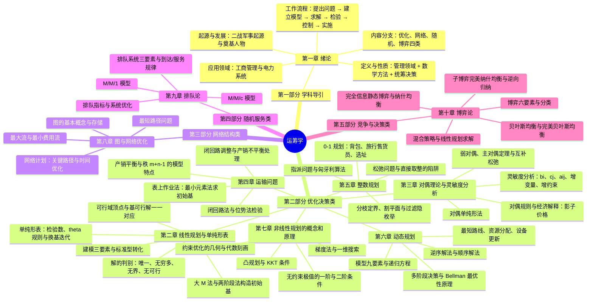

# 课程概览
## 基本信息
- 授课老师：卓新建
- 课程成绩：87
- 这门课程总体难度不高，没有期中，有期末开卷考试。老师授课水平比较差，但是改卷老师比较松，有同学拿了100分。平时可以不听课，最后把所有解法练习熟练，打印下来即可应付期末考试。
## 知识结构

本课程按"**学科导引 → 优化决策 → 网络结构 → 随机服务 → 竞争决策**"的四类分支展开：第一章 绪论给出运筹学的定义、分支与六步工作流程，是全课程的"学科地图"；第二~七章是**优化决策类**主线，从线性规划与单纯形法出发，依次加上对偶与灵敏度的镜子、运输的表格结构、整数的取整约束、多阶段的时序分解与非线性的弯曲线；第八章把优化对象本身换成图/网络，第九章引入随机性研究等待规律，第十章引入对手研究均衡。贯穿始终的是绪论 1.2 节的"**约束 — 模型 — 目标 — 全局最优**"四要素框架与 1.5 节的六步工作流程。整体框架如下：

1. **第一章 绪论**
    - 全课程的学科地图：运筹学从哪来（二战军事起源 → 战后民用化 → 埃尔朗、康托洛维奇、Dantzig 三大学派奠基 → 进入中国）→ 它是什么（**管理领域 + 数学方法 + 统筹规划 + 决策落地**的定义五关键词）→ 它研究什么（优化、网络、随机、博弈四类分支）→ 能干什么（工商管理八大领域与电力系统九大应用）→ 怎么干。
    - **六步工作流程**（提出问题 → 建立模型 → 求解模型 → 解的检验 → 解的控制 → 解的实施）是贯穿全书的方法论骨架：后续每一章都是"建模 + 求解"的某个具体范式，第 3 章灵敏度分析正是"解的控制"的系统化展开。
    - 丁渭修皇宫的完整例题演示"系统耦合思维"：反对分项局部最优，追求总体、全局最优——这是运筹学区别于普通管理的核心立场。
2. **第二章 线性规划与单纯形表**
    - 全课程的算法引擎：线性规划模型的三要素（决策变量、目标函数、约束条件），一般形式化标准型的四条转化规则（松弛变量、剩余变量、乘 -1、无约束变量拆分）。
    - 解的几何—代数对应是本章灵魂：可行域是凸多面体、最优解必在顶点达到 ⇔ 基、基变量、基可行解——单纯形法因此可以只在顶点（基可行解）之间移动。
    - 单纯形表的完整流程：初始基可行解 → 检验数 $\sigma_j$ 判优 → $\theta$ 最小比值规则选离基变量 → 换基迭代；没有天然初始基时用 **大 M 法**（人工变量 + 罚系数）或**两阶段法**；最后用五个判别定理区分唯一最优、无穷多最优、无界解与无可行解。
3. **第三章 对偶理论与灵敏度分析**
    - 给每个 LP 配一面镜子：从"资源出租定价"的经济视角引出对偶问题，标准型对偶规则（max 变 min、每行约束对一个 $y$、$c$ 与 $b$ 互换、$A$ 转置），非标准型直接写对偶的符号规则。
    - 对偶性质层层递进：弱对偶定理 → 最优性判别 → 主对偶定理（最优值相等、**影子价格**）→ **互补松弛定理**（由原最优解直接解出对偶最优解）；对偶单纯形法则是"检验数先合格、$b$ 列负值逐步转正"的不解原问题的解法。
    - **灵敏度分析**回答"数据变了答案还对吗"：$b_i$、$c_j$（非基/基变量）、$a_{ij}$（非基/基变量）、增加新变量、增加新约束五类扰动的变动范围与解的更新公式，配 LINGO 灵敏性报告的解读。
4. **第四章 运输问题**
    - 一类结构特殊的 LP：产销平衡、系数矩阵每列恰两个 1、秩 $= m+n-1$、基变量恰 $m+n-1$ 个——结构特殊性使它不必用通用单纯形法，而用**表上作业法**。
    - 表上作业法三部曲：**最小元素法**（或运费差额法）求初始基可行解 → **闭回路法 / 位势法**算检验数判优 → 负检验数对应闭回路**奇偶标号调整**换基，循环直至全部检验数非负。
    - 产销不平衡时设虚拟产地/销地（运价为 0）化为平衡问题；大数 $M$ 禁止调运、上下限拆列等技巧把煤炭调运、化肥分配、生产存储、月度排产等问题**化归为运输模型**。
5. **第五章 整数规划**
    - 整数规划 = 线性规划 + 整数约束：松弛掉整数要求得到 LP，若 LP 最优恰为整数点则同解，否则 LP 只是参考界——**直接取整必踩坑**（三个经典反例），一般 IP 是 NP-C/NP-Hard。
    - 通用武器：分枝定界法、割平面法、过滤隐枚举法（0-1 变量）、蒙特卡洛法；典型模型有一维背包、旅行售货员（MTZ 子回路约束）、最短路、选址。
    - **指派问题与匈牙利算法**是本章的组合秒杀技：行列归约出零 → 括 0 法找独立零元素组 → 不足 $n$ 个则最少直线覆盖 + 增零变换 → 回步骤 2；一般指派的四类变形（最大化、人数不等、一人多事、禁止指派）全部先化归标准型。
6. **第六章 动态规划**
    - 求解**多阶段决策问题**的最优化方法，基于 Bellman 1951 年的**最优性原理**：最优策略的子策略仍最优。它是"方法"而非"算法"，没有统一的数学表达式，必须按问题建模。
    - 模型九要素（阶段、状态、决策、策略、状态转移方程、指标函数、最优值函数、最优策略与最优轨线、递归方程与边际条件）与**建模六步**（阶段 → 状态 → 决策 → 转移 → 指标 → 方程）；基本方程分**逆序解法**（由后向前，加法边界取 0、乘法边界取 1）与顺序解法。
    - 三类经典应用完整演示"建模 → 逆序递推 → 结果回溯"：最短路线问题（四阶段 A 到 J）、资源分配问题（资金分配三个项目）、设备更新问题（每年更新 or 继续）。
7. **第七章 非线性规划的概念和原理**
    - 从线性迈入非线性：目标函数或约束中出现非线性项后，可行域不再一定是凸多面体，最优解可能在区域内部取得。
    - 无约束极值的一阶（梯度为零）与二阶（Hessian 正定）条件，以及驻点不等于极值点的陷阱；**凸规划**给出"局部最优即全局最优"的充分保障。
    - 约束优化的统一刻画：等式约束用**拉格朗日乘子法**，不等式约束推广为 **KKT 条件**——它是线性规划 KKT 与对偶理论在非线性情形的自然推广。
    - 求解思路沿"梯度法（最速下降，回收绪论柯西梯度法）+ 一维搜索"展开，强调概念、条件与几何直觉而非复杂算法。
8. **第八章 图与网络优化**
    - 优化对象本身是图/网络：图的基本概念与邻接矩阵、关联矩阵等表示，是第五章指派问题（二分图匹配）与数据结构中图论内容的运筹学版本。
    - 三大经典网络问题：**最短路径**（回收绪论欧拉七桥问题开创的图论）、**最大流与最小费用流**（割与流量平衡）、**网络计划**（AOE 网的关键路径、时间—费用优化）。
    - 网络计划是工程管理的落地工具：事项/工序、最早与最迟时间、关键路径与关键工序——把"找最长路"变成进度控制的抓手。
9. **第九章 排队论**
    - 回收绪论埃尔朗 1917 年的电话交换研究：排队系统的三要素（**到达过程、服务过程、服务规则**）与 $M/M/1$、$M/M/c$ 等记号体系，泊松到达、指数服务的随机假设。
    - 核心是等待规律的量化：队长、逗留时间、等待时间及其期望，利用状态转移平衡方程（生灭过程）求稳态分布，$\rho < 1$ 是系统稳定的前提。
    - 系统优化的两个方向：**已知系统控成本**（服务台数量）与**给定标准求设计**（到达率、服务率的配置）——运筹学从"算指标"走向"定参数"。
10. **第十章 博弈论**
    - 决策者之间利益冲突、行为互相依赖：博弈六要素（参与者、策略与策略空间、支付函数、信息、次序、结果与均衡）与六维分类，四类"信息 × 顺序"组合对应四种均衡。
    - **完全信息静态**：标准型支付矩阵，有鞍点（$\max\min = \min\max$）取纯策略，无鞍点上**混合策略**——两个不等式组化为线性规划求解（回收第 2 章单纯形法）。
    - **完全信息动态**：扩展式表述，纳什均衡存在"不可信威胁"，升级为泽尔滕的**子博弈完美纳什均衡**，用**逆向归纳法**求解（斯特克尔伯格竞争、海盗分金）；**不完全信息**经**海萨尼转换**让"自然"先选类型，得到**贝叶斯均衡**；再叠加动态得到**完美贝叶斯均衡**（信念 + 贝叶斯法则 + 最优策略）。

### 知识定位与框架衔接

**前置知识**：高等数学（多元函数极值、拉格朗日乘子、级数与极限——非线性规划与对偶理论的数学语言）、线性代数（矩阵、线性方程组——线性规划的模型语言与单纯形法的代数基础）、概率论与数理统计（随机变量、期望与分布——排队论处理不确定性的前提），另有离散数学（图论基础）与计算机基础（LINGO 等优化软件的使用）作为辅助。绪论的"约束—模型—目标—全局最优"四要素框架与六步工作流程贯穿全书，是后续一切章节的起点。

**后置知识**：最优化方法 / 凸优化（对 KKT 条件与梯度法的系统深化）、随机过程（排队论的生灭过程与马尔可夫链基础）、决策分析与多目标规划（对单一目标最优的拓展）、机器学习与人工智能（SVM 的凸二次规划、强化学习的动态规划与博弈均衡）、以及运筹学的主战场落地领域——供应链与物流、电力系统调度、金融组合与风险管理。

**故事比喻**：这门课像"给有限资源找归宿的系统训练"——先是同一笔资源的两本账（线性规划算自营、对偶算出租，最优处两账必然相等），再是给问题层层加"枷锁"：搬上表格（运输问题）、锁进整数（整数规划）、拆成接力赛（动态规划）、弯成曲线（非线性规划）；走出表格是路网与工程（图与网络），把运气写进模型是排队论，最后把对手请上桌是博弈论。每一章都重复回答三个问题：**怎么建模**（变量、约束、目标）、**怎么解**（算法如何一步步迭代）、**解意味着什么**（影子价格、灵敏度、均衡的经济解释）。

**四个灵魂问题**：

1. **单纯形法为什么只在顶点上走，几何与代数为什么是一回事？** —— 线性目标在凸多面体上的最优必在顶点达到（几何），而顶点与基可行解一一对应（代数），于是"沿棱爬山"变成"换基迭代"，检验数 $\sigma_j$ 就是棱边方向的斜率。这一对应是理解整个线性规划体系（对偶、灵敏度、表上作业法）的地基，也是大 M 法、两阶段法等一切变形技术的出发点。
2. **对偶与影子价格为什么是资源的"第二本账"，灵敏度分析在六步流程中处于什么位置？** —— 原问题最大化利润、对偶问题最小化资源出租收入，主对偶定理保证最优处两账相等，对偶解 $y_i$ 即资源 $i$ 的**影子价格**（多一份资源值多少钱）；灵敏度分析回答"数据晃动时结论还稳不稳"，正是绪论六步流程中"**解的控制**"一节的系统化落地——不会灵敏度分析，最优解只是纸面数字。
3. **为什么结构越特殊，算法越专用也越快？** —— 运输问题的"每列两个 1、秩 $m+n-1$"换来了表上作业法，指派问题的"行和列和均为 1"换来了匈牙利算法，多阶段结构换来了动态规划的递推——通用单纯形法万能但慢，识别问题的**结构特征**并匹配专用算法，是运筹学从"会算"到"算得巧"的分水岭，也是 NP-hard 的整数规划仍要区分问题类型的原因。
4. **确定性模型遇到随机与对手时，解为什么从"唯一最优"退化为"均衡或满意"？** —— 排队论里到达与服务是随机的，产出只能是期望指标与参数配置，追求的是稳态下的成本—服务平衡；博弈论里对手会反制，纳什均衡的要义是"没有人能单方面偏离占优"，而非全局最优——**有随机就谈分布与期望，有对抗就谈均衡**，这正是绪论四类分支中"随机服务类"与"竞争决策类"区别于"优化决策类"的根本气质。
